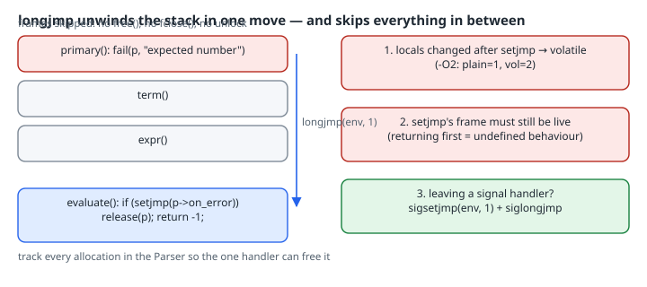

# setjmp/longjmp for Error Unwinding: The Rules That Bite

## Thesis

`setjmp`/`longjmp` lets a deeply nested parser report an error with one jump back to a single handler, without threading return codes through every level. That is how Lua raises errors (`luaD_throw` → `LUAI_THROW`, which is `longjmp` or `_longjmp` in [ldo.c](https://www.lua.org/source/5.4/ldo.c.html)) and how many hand-written parsers work. The jump is cheap, but it is also blind: it discards every stack frame in between without running any of their cleanup. To use it safely you need four rules, all of which this chapter reproduces in real runs:

1. A local in the `setjmp` caller that changes after `setjmp` must be `volatile`, or its value after the jump is unspecified.
2. Anything the skipped frames own has to be reachable from somewhere the handler can free it.
3. The function that called `setjmp` must still be running when `longjmp` happens.
4. When jumping out of a signal handler, use `sigsetjmp(env, 1)`/`siglongjmp`. Otherwise the signal can stay blocked.

## Mental model

{fig-alt="Left: a call stack with evaluate at the bottom calling setjmp, then expr, term and primary stacked above it. primary calls fail, which calls longjmp. An arrow jumps from primary straight back to the setjmp point in evaluate, which now returns nonzero. The frames for expr, term and primary are discarded without running any cleanup, so heap blocks they allocated leak unless they were registered in the parser's owned list, which the handler frees. Right: three rules. Locals of the setjmp caller that change after setjmp must be volatile (at -O2 a plain int read back the stale value 1, not 2). The frame that called setjmp must still be live. Use sigsetjmp with savemask 1 when jumping out of a signal handler, or the signal stays blocked."}

`setjmp(env)` saves "where we are": the stack pointer, the program counter, and some registers. It returns 0 the first time. A later `longjmp(env, v)` restores that state, so `setjmp` appears to return a second time, now with `v`. If you pass 0, it returns 1 instead. Anything between the two points is simply abandoned. Nothing like C++ destructors or Go `defer` runs.

The standard also limits where `setjmp` may appear. It may appear only as the entire controlling expression of an `if`/`switch`/loop, as one operand of a comparison against an integer constant expression (or the operand of `!`) when that is the entire controlling expression, or as a whole expression statement. In any other context, including `int r = setjmp(env);`, the behaviour is undefined ([cppreference](https://en.cppreference.com/w/c/program/setjmp)). The return value is for control flow only.

## Worked example 1: the volatile rule, made visible

```c
#include <setjmp.h>
#include <stdio.h>

static jmp_buf env;
__attribute__((noinline)) static void fail(void) { longjmp(env, 1); }

int main(void) {
    int plain = 1;
    volatile int vol = 1;
    if (setjmp(env) == 0) {
        plain = 2;          /* modified after setjmp, not volatile */
        vol = 2;
        fail();
    }
    printf("plain=%d vol=%d\n", plain, vol);
    return 0;
}
```

```bash
gcc -std=c17 -O0 -Wall -Wextra -o clobber_O0 clobber.c && ./clobber_O0
gcc -std=c17 -O2 -Wall -Wextra -o clobber_O2 clobber.c && ./clobber_O2
```

```text
-O0: plain=2 vol=2
-O2: plain=1 vol=2
```

At `-O0`, `plain` lives in memory, so the store of 2 survives. At `-O2` the optimizer is free to keep `plain` in a register or treat it as a known constant, because the standard makes its value unspecified after the jump. Here it read back the old value, 1. The Linux man page states the condition precisely. A local is unspecified after `longjmp` when it is local to the `setjmp` caller, it was changed between `setjmp` and `longjmp`, and it isn't `volatile`.

Don't rely on warnings to catch this. GCC documents `-Wclobbered` as warning "for variables that might be changed by longjmp or vfork", and `-Wextra` enables it. Yet this exact program built silently with `-O2 -Wall -Wextra -Wclobbered` on GCC 14.2. The warning is heuristic, so the rule needs to be followed in code.

## Worked example 2: a parser that unwinds and doesn't leak

The parser below handles `+ - * /` and parentheses with plain recursive descent. Every error goes through `fail()`, which records a message and calls `longjmp` back to `evaluate()`. To show the cleanup problem, every number allocates a small heap block, standing in for AST nodes or token buffers.

```c
/* Recursive-descent calculator: errors unwind with longjmp to one handler. */
#include <ctype.h>
#include <setjmp.h>
#include <stdio.h>
#include <stdlib.h>

typedef struct {
    const char *s;
    jmp_buf on_error;
    const char *msg;
    long pos;
    void *owned[64];      /* allocations to free if we unwind */
    int nowned;
} Parser;

static _Noreturn void fail(Parser *p, const char *msg) {
    p->msg = msg;
    longjmp(p->on_error, 1);
}

static void *track(Parser *p, size_t n) {
    void *q = malloc(n);
    if (!q || p->nowned == 64) fail(p, "out of memory");
    p->owned[p->nowned++] = q;
    return q;
}

static void skip(Parser *p) { while (isspace((unsigned char)*p->s)) p->s++; }
static long expr(Parser *p, const char *start);

static long primary(Parser *p, const char *start) {
    skip(p);
    if (*p->s == '(') {
        p->s++;
        long v = expr(p, start);
        skip(p);
        if (*p->s != ')') { p->pos = p->s - start; fail(p, "expected ')'"); }
        p->s++;
        return v;
    }
    if (!isdigit((unsigned char)*p->s)) { p->pos = p->s - start; fail(p, "expected number"); }
    long *scratch = track(p, sizeof *scratch);   /* pretend we need heap per node */
    *scratch = strtol(p->s, (char **)&p->s, 10);
    return *scratch;
}

static long term(Parser *p, const char *start) {
    long v = primary(p, start);
    for (;;) {
        skip(p);
        char op = *p->s;
        if (op != '*' && op != '/') return v;
        long op_pos = p->s - start;
        p->s++;
        long r = primary(p, start);
        if (op == '/' && r == 0) { p->pos = op_pos; fail(p, "division by zero"); }
        v = op == '*' ? v * r : v / r;
    }
}

static long expr(Parser *p, const char *start) {
    long v = term(p, start);
    for (;;) {
        skip(p);
        char op = *p->s;
        if (op != '+' && op != '-') return v;
        p->s++;
        long r = term(p, start);
        v = op == '+' ? v + r : v - r;
    }
}

static void release(Parser *p) {
    for (int i = 0; i < p->nowned; i++) free(p->owned[i]);
    p->nowned = 0;
}

/* Returns 0 on success, -1 on error (message in p->msg). */
static int evaluate(const char *src, long *out, Parser *p) {
    p->s = src; p->nowned = 0; p->msg = NULL; p->pos = 0;
    if (setjmp(p->on_error) != 0) {
#ifndef LEAK
        release(p);            /* unwinding skipped every free on the way up */
#endif
        return -1;
    }
    long v = expr(p, src);
    skip(p);
    if (*p->s) { p->pos = p->s - src; fail(p, "trailing input"); }
    release(p);
    *out = v;
    return 0;
}

int main(void) {
    const char *inputs[] = { "2 + 3 * (4 - 1)", "2 * (3 + ", "10 / (5 - 5)", "7 7", "((1+2)*(3+4))" };
    Parser p;
    for (size_t i = 0; i < sizeof inputs / sizeof *inputs; i++) {
        long v;
        if (evaluate(inputs[i], &v, &p) == 0)
            printf("%-18s = %ld\n", inputs[i], v);
        else
            printf("%-18s ! %s at offset %ld\n", inputs[i], p.msg, p.pos);
    }
    return 0;
}
```

```bash
gcc -std=c17 -O2 -g -Wall -Wextra -fsanitize=address,undefined -o parse parse.c && ./parse
```

```text
2 + 3 * (4 - 1)    = 11
2 * (3 +           ! expected number at offset 9
10 / (5 - 5)       ! division by zero at offset 3
7 7                ! trailing input at offset 2
((1+2)*(3+4))      = 21
```

Three design choices make this safe:

- The `jmp_buf` lives in the `Parser`, not in a global. Each parse has its own target, which is what the man page recommends ("each setjmp() call should employ a unique jmp_buf variable"), and nested or concurrent parsers can't overwrite each other's target.
- The state the handler reads (`msg`, `pos`, `owned`, `nowned`) lives in memory reached through a pointer, not in locals of `evaluate()` that change after `setjmp`. That keeps it out of reach of rule 1.
- Allocations are recorded in `owned[]`, so the single handler can free what the abandoned frames can't.

Remove that one `release(p)` call from the error path (`-DLEAK`) and AddressSanitizer counts exactly what the skipped frames dropped:

```text
Direct leak of 48 byte(s) in 6 object(s) allocated from:
SUMMARY: AddressSanitizer: 48 byte(s) leaked in 6 allocation(s).
```

That is 2 blocks from `2 * (3 + `, 3 from `10 / (5 - 5)` and 1 from `7 7`, six in total, each allocated by a frame that `longjmp` jumped over. The same applies to `FILE *` handles, held mutexes and partially built structures. If a skipped frame owns it, the handler has to be able to find it. An arena that the handler resets in one call is the cleanest version of this.

## Worked example 3: leaving a signal handler

When a signal handler runs, the kernel blocks that signal until the handler returns. A jump out of the handler never returns, so whether the signal mask gets restored depends on which function you used:

```c
#define _POSIX_C_SOURCE 200809L
#include <setjmp.h>
#include <signal.h>
#include <stdio.h>
#include <string.h>

static sigjmp_buf senv;
static jmp_buf jenv;
static int use_sig;

static void on_usr1(int sig) {
    (void)sig;
    if (use_sig) siglongjmp(senv, 1); else longjmp(jenv, 1);
}

static int usr1_blocked(void) {
    sigset_t cur;
    sigprocmask(SIG_BLOCK, NULL, &cur);
    return sigismember(&cur, SIGUSR1);
}

int main(void) {
    struct sigaction sa;
    memset(&sa, 0, sizeof sa);
    sa.sa_handler = on_usr1;          /* SIGUSR1 is blocked while the handler runs */
    sigaction(SIGUSR1, &sa, NULL);

    use_sig = 0;
    if (setjmp(jenv) == 0) raise(SIGUSR1);
    printf("after longjmp:            SIGUSR1 blocked=%d\n", usr1_blocked());

    sigset_t none; sigemptyset(&none); sigprocmask(SIG_SETMASK, &none, NULL);

    use_sig = 1;
    if (sigsetjmp(senv, 1) == 0) raise(SIGUSR1);
    printf("after siglongjmp(savemask=1): SIGUSR1 blocked=%d\n", usr1_blocked());
    return 0;
}
```

```text
after longjmp:            SIGUSR1 blocked=1
after siglongjmp(savemask=1): SIGUSR1 blocked=0
```

On glibc 2.41 a plain `longjmp` leaves `SIGUSR1` blocked, so a second `SIGUSR1` would never be delivered. `sigsetjmp(env, 1)` saves the mask and `siglongjmp` restores it. The man page records the history: before glibc 2.19 `setjmp` could follow BSD semantics (saving the mask) depending on feature-test macros. Since 2.19 `<setjmp.h>` exposes only the System V version, and programs that need the mask restored are told to use `sigsetjmp` with a nonzero `savesigs`. POSIX itself leaves it unspecified whether `setjmp` saves the mask, so portable code should use `sigsetjmp` whenever a signal handler is involved.

Even then, jumping out of a handler is only well-defined in limited cases. The man page warns that if the handler interrupted a non-async-signal-safe function such as `malloc` or `printf`, calling any non-async-signal-safe function after the jump is undefined behaviour. Here the handler interrupted `raise()`, which is async-signal-safe.

## Things that bite

| Trap | What happens | Fix |
|---|---|---|
| Non-volatile local changed after `setjmp` | Stale value after the jump (`plain=1` at `-O2`) | `volatile`, or keep the state in a struct reached through a pointer |
| Frames own resources | Leaks, unclosed files, mutexes left locked | Register ownership in the context, or use an arena the handler resets |
| `setjmp` caller already returned | Undefined behaviour: the saved stack frame no longer exists | Call `setjmp` in a function that stays live for the whole protected region |
| Jump target from another thread | Undefined behaviour (man page) | One `jmp_buf` per thread or context |
| Jumping out of a signal handler with `longjmp` | Signal stays blocked on glibc | `sigsetjmp(env, 1)` + `siglongjmp` |
| `int r = setjmp(env);` | Undefined behaviour: not a permitted context | `if (setjmp(env) != 0) { ... }` or `switch (setjmp(env))` |
| VLA in scope at `setjmp`, scope since left | Undefined behaviour even within the same function, and skipped VLAs may leak ([cppreference](https://en.cppreference.com/w/c/program/longjmp)) | Don't mix VLAs with non-local jumps |

## When to choose it

Use `setjmp`/`longjmp` when there is one well-defined entry point (`evaluate`, `lua_pcall`-style), errors are rare, and the code between entry and failure is your own and can register what it owns. Prefer return codes or a `goto cleanup` per function when frames own resources you can't easily centralise. The same applies when callbacks pass through code you don't control, since a jump through a library's frames skips its cleanup too.

## Try this

1. Change `plain` in `clobber.c` to `volatile int` and confirm both builds print `plain=2`. Then try `-O1` and `-Os`.
2. Add a nesting-depth counter to `Parser` and `fail(p, "too deep")` past 100 levels. Feed it 10,000 `(` characters and check that ASan stays quiet.
3. In `mask.c`, replace the `sigsetjmp(senv, 1)` call with `sigsetjmp(senv, 0)` and predict the output before running it.

## Sources

- C reference: [`setjmp`](https://en.cppreference.com/w/c/program/setjmp), [`longjmp`](https://en.cppreference.com/w/c/program/longjmp)
- Linux man-pages: [setjmp(3)](https://man7.org/linux/man-pages/man3/setjmp.3.html) (caveats, glibc 2.19 history, undefined behaviour list)
- POSIX.1-2024: [sigsetjmp](https://pubs.opengroup.org/onlinepubs/9799919799/functions/sigsetjmp.html), [longjmp](https://pubs.opengroup.org/onlinepubs/9799919799/functions/longjmp.html)
- Lua 5.4: [ldo.c](https://www.lua.org/source/5.4/ldo.c.html) (`LUAI_THROW`)
- GCC: [Warning options, `-Wclobbered`](https://gcc.gnu.org/onlinedocs/gcc/Warning-Options.html)
