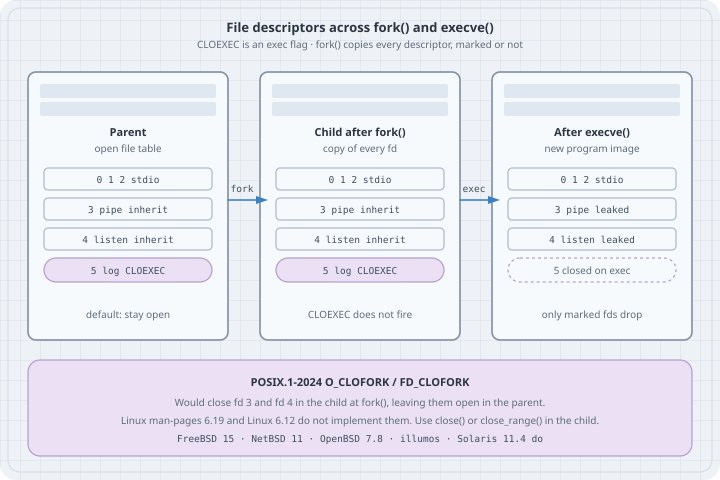

# File-Descriptor Hygiene: CLOEXEC, close_range, and O_CLOFORK

## Thesis

`fork()` copies the calling process's file-descriptor table. `execve()` then keeps every descriptor whose close-on-exec flag is clear. The default for `open()`, `pipe()`, `socket()`, `accept()`, and `dup()` is **clear**. A worker, a helper, a pager, a `system()` grandchild — any of them can inherit a pipe write end, a listening socket, a secret, or a log file you meant to keep to yourself.

`O_CLOEXEC` / `FD_CLOEXEC` is the opt-out for **exec**. It does nothing at **fork**. A prefork server that never `exec`s still hands every unmarked descriptor to every child. POSIX.1-2024 added `O_CLOFORK` / `FD_CLOFORK` for that case. Linux does not implement them: not in this kernel (6.12), not in glibc 2.41, and not in the Linux man-pages 6.19 `fcntl(2)` VERSIONS note ("POSIX.1-2024 specifies `FD_CLOFORK` and `F_DUPFD_CLOFORK`, but Linux doesn't support them").

On Linux the working kit is: create every descriptor with an atomic `*CLOEXEC` constructor, and before `exec` sweep the rest with `close_range()`. Setting `FD_CLOEXEC` with `fcntl()` *after* `open()` is a race against any other thread that `fork`s.

## Mental model

```text
  open / pipe / socket / accept / dup     →  FD_CLOEXEC clear  (inherited)
  open(..., O_CLOEXEC)  and friends       →  FD_CLOEXEC set    (closed on exec only)
  POSIX.1-2024 O_CLOFORK                  →  FD_CLOFORK set    (closed in the child at fork)
                                             Linux: not implemented
```

{fig-alt="Three process cards: parent, child after fork with every descriptor including a CLOEXEC log, and the image after execve with the log gone but a pipe and listening socket still leaked. A footer notes POSIX.1-2024 O_CLOFORK would have dropped those at fork and that Linux does not implement it."}

| Flag / call | When it fires | On this Linux (6.12, glibc 2.41) |
|-------------|---------------|----------------------------------|
| `O_CLOEXEC`, `FD_CLOEXEC` | `execve` / `posix_spawn` | Yes. Linux 2.6.23; POSIX.1-2008 |
| `SOCK_CLOEXEC`, `pipe2`, `dup3`, `accept4`, `F_DUPFD_CLOEXEC` | At creation, sets `FD_CLOEXEC` | Yes. `SOCK_CLOEXEC` / `dup3` / `pipe2` are in POSIX.1-2024 |
| `close_range(first, last, 0)` | Now: close every fd in the range | Yes. Linux 5.9, glibc 2.34 |
| `CLOSE_RANGE_CLOEXEC` | Now: *mark* the range close-on-exec | Yes. Linux 5.11 |
| `O_CLOFORK`, `FD_CLOFORK`, `F_DUPFD_CLOFORK`, `SOCK_CLOFORK` | `fork` in the child | **No.** Headers do not define them; `open(..., O_CLOFORK)` does not compile |

A pipe is a single open file description with two descriptors. `read()` returns 0 only when **every** write end is closed. If the child still holds a write end, the reader waits forever. That is the leak that looks like a hang.

## Worked examples

Tested on Debian 13 (x86_64), Linux **6.12.94+**, GCC **14.2.0**, glibc **2.41**. Compile with `-std=c17 -Wall -Wextra -O2`. Several programs start with `close_range(3, ~0U, 0)` so the listing is about the descriptors *we* open, not whatever the parent process already leaked. In this captured session fds 0–2 are `/dev/null` and two pipes; in a terminal they are usually the tty. The `man` pages are not installed on this box; quotes below are from [man-pages 6.19](https://www.kernel.org/doc/man-pages/) (checked on man7.org, 2026-10-17) and from POSIX.1-2024.

Build the fd-dump helper once. Later cases `exec` it:

```c
/* listfd.c — dump /proc/self/fd plus FD_CLOEXEC for each open descriptor */
#define _GNU_SOURCE
#include <dirent.h>
#include <fcntl.h>
#include <stdio.h>
#include <stdlib.h>
#include <string.h>
#include <unistd.h>

struct rec {
    int fd;
    int cloexec;
    char target[128];
};

static int cmp_fd(const void *a, const void *b)
{
    return ((const struct rec *)a)->fd - ((const struct rec *)b)->fd;
}

int main(void)
{
    DIR *d = opendir("/proc/self/fd");
    if (!d) {
        perror("opendir");
        return 1;
    }
    int dfd = dirfd(d);
    struct rec recs[64];
    int nrec = 0;
    struct dirent *ent;
    while ((ent = readdir(d)) != NULL && nrec < 64) {
        if (ent->d_name[0] == '.')
            continue;
        int fd = atoi(ent->d_name);
        char path[64];
        snprintf(path, sizeof path, "/proc/self/fd/%d", fd);
        ssize_t n = readlink(path, recs[nrec].target,
                             sizeof recs[nrec].target - 1);
        if (n < 0)
            continue;
        recs[nrec].target[n] = '\0';
        int flags = fcntl(fd, F_GETFD);
        recs[nrec].fd = fd;
        recs[nrec].cloexec = (flags >= 0 && (flags & FD_CLOEXEC));
        nrec++;
    }
    qsort(recs, (size_t)nrec, sizeof recs[0], cmp_fd);
    for (int i = 0; i < nrec; i++) {
        printf("fd %2d  %-8s  %s%s\n",
               recs[i].fd,
               recs[i].cloexec ? "CLOEXEC" : "inherit",
               recs[i].target,
               recs[i].fd == dfd ? "  (opendir)" : "");
    }
    closedir(d);
    return 0;
}
```

```bash
gcc -std=c17 -Wall -Wextra -O2 -o listfd listfd.c
```

glibc's `opendir("/proc/self/fd")` itself opens a descriptor with `O_CLOEXEC`. That extra line is the directory handle `listfd` used to walk the table, not a leak from the parent.

### Case 0: What this libc actually defines

```c
/* probe.c — what this libc and kernel actually define */
#define _GNU_SOURCE
#include <fcntl.h>
#include <linux/close_range.h>
#include <stdio.h>
#include <sys/socket.h>
#include <unistd.h>
#ifdef __GLIBC__
#include <gnu/libc-version.h>
#endif

int main(void)
{
#ifdef __GLIBC__
    printf("glibc %s\n", gnu_get_libc_version());
#endif
    printf("O_CLOEXEC           = 0%o (0x%x)\n", O_CLOEXEC, O_CLOEXEC);
    printf("FD_CLOEXEC          = %d\n", FD_CLOEXEC);
    printf("F_DUPFD_CLOEXEC     = %d\n", F_DUPFD_CLOEXEC);
    printf("SOCK_CLOEXEC        = 0%o (0x%x)\n", SOCK_CLOEXEC, SOCK_CLOEXEC);
    printf("CLOSE_RANGE_UNSHARE = %u\n", CLOSE_RANGE_UNSHARE);
    printf("CLOSE_RANGE_CLOEXEC = %u\n", CLOSE_RANGE_CLOEXEC);

#ifdef O_CLOFORK
    printf("O_CLOFORK           = 0x%x\n", O_CLOFORK);
#else
    printf("O_CLOFORK           not defined\n");
#endif
#ifdef FD_CLOFORK
    printf("FD_CLOFORK          = %d\n", FD_CLOFORK);
#else
    printf("FD_CLOFORK          not defined\n");
#endif
#ifdef F_DUPFD_CLOFORK
    printf("F_DUPFD_CLOFORK     = %d\n", F_DUPFD_CLOFORK);
#else
    printf("F_DUPFD_CLOFORK     not defined\n");
#endif
#ifdef SOCK_CLOFORK
    printf("SOCK_CLOFORK        = 0x%x\n", SOCK_CLOFORK);
#else
    printf("SOCK_CLOFORK        not defined\n");
#endif
    return 0;
}
```

```bash
gcc -std=c17 -Wall -Wextra -O2 -o probe probe.c
./probe
```

```text
glibc 2.41
O_CLOEXEC           = 02000000 (0x80000)
FD_CLOEXEC          = 1
F_DUPFD_CLOEXEC     = 1030
SOCK_CLOEXEC        = 02000000 (0x80000)
CLOSE_RANGE_UNSHARE = 2
CLOSE_RANGE_CLOEXEC = 4
O_CLOFORK           not defined
FD_CLOFORK          not defined
F_DUPFD_CLOFORK     not defined
SOCK_CLOFORK        not defined
```

`O_CLOEXEC` and `SOCK_CLOEXEC` are the same bit (`02000000`). Passing `O_CLOFORK` without an `#ifdef` fails at compile time:

```text
oclofork_use.c:2:54: error: ‘O_CLOFORK’ undeclared (first use in this function)
```

### Case 1: A leaked pipe write end hides EOF

`read()` on a pipe returns 0 only when no process still holds a write end. `fork()` duplicates both ends. If the child is the reader and keeps the inherited write end, the parent's `close()` is not enough.

```c
/* leak_pipe.c — a leaked write end keeps the reader from seeing EOF */
#define _GNU_SOURCE
#include <errno.h>
#include <poll.h>
#include <stdio.h>
#include <string.h>
#include <sys/wait.h>
#include <unistd.h>

int main(int argc, char **argv)
{
    int leak = argc > 1 && strcmp(argv[1], "leak") == 0;
    int p[2];
    if (pipe(p) == -1) {
        perror("pipe");
        return 1;
    }

    fflush(stdout);
    pid_t pid = fork();
    if (pid == -1) {
        perror("fork");
        return 1;
    }
    if (pid == 0) {
        /* Child is the reader. Closing the inherited write end is what
           lets read() return 0 once the parent drops its write end. */
        if (!leak)
            close(p[1]);
        char buf[64];
        for (;;) {
            struct pollfd po = { .fd = p[0], .events = POLLIN };
            int pr = poll(&po, 1, 400);
            if (pr == 0) {
                printf("child: poll timeout — write end still open, no EOF\n");
                fflush(stdout);
                _exit(2);
            }
            if (pr < 0) {
                perror("poll");
                _exit(1);
            }
            ssize_t n = read(p[0], buf, sizeof buf);
            if (n == 0) {
                printf("child: read returned 0 (EOF)\n");
                fflush(stdout);
                _exit(0);
            }
            if (n < 0) {
                perror("read");
                _exit(1);
            }
            printf("child: read %zd byte(s)\n", n);
            fflush(stdout);
        }
    }

    close(p[0]);
    const char msg[] = "hello\n";
    if (write(p[1], msg, sizeof msg - 1) != (ssize_t)(sizeof msg - 1)) {
        perror("write");
        return 1;
    }
    close(p[1]); /* parent drops its write end */
    int st;
    if (waitpid(pid, &st, 0) == -1) {
        perror("waitpid");
        return 1;
    }
    printf("parent: child exit %d\n", WIFEXITED(st) ? WEXITSTATUS(st) : -1);
    return 0;
}
```

```bash
gcc -std=c17 -Wall -Wextra -O2 -o leak_pipe leak_pipe.c
./leak_pipe
./leak_pipe leak
```

```text
child: read 6 byte(s)
child: read returned 0 (EOF)
parent: child exit 0
```

```text
child: read 6 byte(s)
child: poll timeout — write end still open, no EOF
parent: child exit 2
```

Six bytes is `"hello\n"`. The data arrives either way. EOF does not, unless the child closes its copy of the write end. `pipe2(p, O_CLOEXEC)` would have marked both ends close-on-exec, which helps a later `exec` and does **not** close the child's write end across a plain `fork`. For a fork-only worker, the child still has to `close(p[1])`.

### Case 2: The child inherits the listening socket

A prefork server that `listen()`s and then `fork()`s workers wants the children to inherit that socket. Almost every other `fork` does not. `SOCK_CLOEXEC` does not change the fork case.

```c
/* leak_listen.c — a child inherits the listening socket across fork() */
#define _GNU_SOURCE
#include <arpa/inet.h>
#include <fcntl.h>
#include <linux/close_range.h>
#include <netinet/in.h>
#include <stdio.h>
#include <string.h>
#include <sys/socket.h>
#include <sys/wait.h>
#include <unistd.h>

static void dump_one(const char *who, int fd)
{
    char path[64], target[128];
    snprintf(path, sizeof path, "/proc/self/fd/%d", fd);
    ssize_t n = readlink(path, target, sizeof target - 1);
    if (n < 0) {
        printf("%s: fd %d gone\n", who, fd);
        return;
    }
    target[n] = '\0';
    int flags = fcntl(fd, F_GETFD);
    printf("%s pid %d  fd %d -> %s  FD_CLOEXEC=%s\n",
           who, getpid(), fd, target,
           (flags >= 0 && (flags & FD_CLOEXEC)) ? "yes" : "no");
}

int main(int argc, char **argv)
{
    int cloexec = 0, do_exec = 0;
    const char *helper = "./listfd";
    for (int i = 1; i < argc; i++) {
        if (strcmp(argv[i], "cloexec") == 0)
            cloexec = 1;
        else if (strcmp(argv[i], "exec") == 0)
            do_exec = 1;
        else if (strncmp(argv[i], "helper=", 7) == 0)
            helper = argv[i] + 7;
    }

    /* Drop inherited junk so the listing is about this socket. */
    if (close_range(3, ~0U, 0) == -1) {
        perror("close_range");
        return 1;
    }

    int type = SOCK_STREAM | (cloexec ? SOCK_CLOEXEC : 0);
    int s = socket(AF_INET, type, 0);
    if (s == -1) {
        perror("socket");
        return 1;
    }
    struct sockaddr_in addr = {
        .sin_family = AF_INET,
        .sin_addr.s_addr = htonl(INADDR_LOOPBACK),
        .sin_port = 0,
    };
    if (bind(s, (struct sockaddr *)&addr, sizeof addr) == -1) {
        perror("bind");
        return 1;
    }
    if (listen(s, 1) == -1) {
        perror("listen");
        return 1;
    }
    socklen_t alen = sizeof addr;
    if (getsockname(s, (struct sockaddr *)&addr, &alen) == -1) {
        perror("getsockname");
        return 1;
    }
    printf("parent listening on 127.0.0.1:%u  fd=%d  SOCK_CLOEXEC=%s\n",
           ntohs(addr.sin_port), s, cloexec ? "yes" : "no");
    dump_one("parent", s);
    fflush(stdout);

    pid_t pid = fork();
    if (pid == -1) {
        perror("fork");
        return 1;
    }
    if (pid == 0) {
        if (do_exec) {
            execl(helper, "listfd", (char *)NULL);
            perror("execl");
            _exit(1);
        }
        dump_one("child ", s);
        fflush(stdout);
        _exit(0);
    }
    int st;
    waitpid(pid, &st, 0);
    close(s);
    return 0;
}
```

```bash
gcc -std=c17 -Wall -Wextra -O2 -o leak_listen leak_listen.c
./leak_listen
./leak_listen cloexec
./leak_listen exec helper=./listfd
./leak_listen cloexec exec helper=./listfd
```

Plain `fork`, no `exec`. The child has the listening socket, `FD_CLOEXEC` clear:

```text
parent listening on 127.0.0.1:53065  fd=3  SOCK_CLOEXEC=no
parent pid 921716  fd 3 -> socket:[10082516]  FD_CLOEXEC=no
child  pid 921717  fd 3 -> socket:[10082516]  FD_CLOEXEC=no
```

`SOCK_CLOEXEC` sets the flag and **still** copies the descriptor across `fork`. Both processes share the same kernel socket (same inode number):

```text
parent listening on 127.0.0.1:42277  fd=3  SOCK_CLOEXEC=yes
parent pid 921718  fd 3 -> socket:[10076076]  FD_CLOEXEC=yes
child  pid 921719  fd 3 -> socket:[10076076]  FD_CLOEXEC=yes
```

`fork` + `exec` without `SOCK_CLOEXEC` leaks the listener into the new image. `listfd` still sees `fd 3` as that socket:

```text
parent listening on 127.0.0.1:58355  fd=3  SOCK_CLOEXEC=no
parent pid 921720  fd 3 -> socket:[10076080]  FD_CLOEXEC=no
fd  0  inherit   /dev/null
fd  1  inherit   pipe:[10081799]
fd  2  inherit   pipe:[10081799]
fd  3  inherit   socket:[10076080]
fd  4  CLOEXEC   /proc/921721/fd  (opendir)
```

`fork` + `exec` *with* `SOCK_CLOEXEC` drops it. `fd 3` in the new image is `listfd`'s own `opendir`, not the listener:

```text
parent listening on 127.0.0.1:45693  fd=3  SOCK_CLOEXEC=yes
parent pid 921722  fd 3 -> socket:[10076084]  FD_CLOEXEC=yes
fd  0  inherit   /dev/null
fd  1  inherit   pipe:[10081799]
fd  2  inherit   pipe:[10081799]
fd  3  CLOEXEC   /proc/921723/fd  (opendir)
```

A helper that inherited a listener can `accept()` connections the parent thought it owned. That is a correctness bug and, on a privileged socket, a privilege bug.

### Case 3: Audit with `/proc/self/fd`

`/proc/self/fd/N` is a symlink to the open file. `fcntl(fd, F_GETFD)` reports the close-on-exec bit (`FD_CLOEXEC` is the value 1). Open one file without the flag and one with it, then `exec` `listfd`.

```c
/* audit_exec.c — open two files, one with O_CLOEXEC, then exec listfd */
#define _GNU_SOURCE
#include <fcntl.h>
#include <linux/close_range.h>
#include <stdio.h>
#include <unistd.h>

int main(int argc, char **argv)
{
    const char *helper = (argc > 1) ? argv[1] : "./listfd";

    /* Isolate the demo from whatever the parent leaked to us. */
    if (close_range(3, ~0U, 0) == -1) {
        perror("close_range");
        return 1;
    }

    int plain = open("/dev/null", O_RDONLY);
    int marked = open("/dev/null", O_RDONLY | O_CLOEXEC);
    if (plain < 0 || marked < 0) {
        perror("open");
        return 1;
    }
    printf("parent: plain fd=%d  cloexec fd=%d  then exec %s\n",
           plain, marked, helper);
    fflush(stdout);
    execl(helper, "listfd", (char *)NULL);
    perror("execl");
    return 1;
}
```

```bash
gcc -std=c17 -Wall -Wextra -O2 -o audit_exec audit_exec.c
./audit_exec ./listfd
```

```text
parent: plain fd=3  cloexec fd=4  then exec ./listfd
fd  0  inherit   /dev/null
fd  1  inherit   pipe:[10081799]
fd  2  inherit   pipe:[10081799]
fd  3  inherit   /dev/null
fd  4  CLOEXEC   /proc/921724/fd  (opendir)
```

The unmarked `/dev/null` survived as fd 3. The `O_CLOEXEC` `/dev/null` is gone. fd 4 is a **new** descriptor `listfd` opened on `/proc/self/fd`; it is not the file the parent marked. Read `/proc/self/fd` by target and by the `CLOEXEC` column, not by number reuse.

### Case 4: Atomic constructors

`open(2)` is explicit that `fcntl(F_SETFD)` after `open` is not enough in a multithreaded program. Every fd-creating call has (or grew) a flag that sets `FD_CLOEXEC` in the same syscall that allocates the descriptor.

```c
/* atomic_ctors.c — pipe2, dup3, SOCK_CLOEXEC, F_DUPFD_CLOEXEC, accept4 */
#define _GNU_SOURCE
#include <arpa/inet.h>
#include <fcntl.h>
#include <linux/close_range.h>
#include <netinet/in.h>
#include <stdio.h>
#include <sys/socket.h>
#include <sys/wait.h>
#include <unistd.h>

static void show(const char *tag, int fd)
{
    int flags = fcntl(fd, F_GETFD);
    printf("%-22s fd=%-3d FD_CLOEXEC=%s\n",
           tag, fd,
           (flags >= 0 && (flags & FD_CLOEXEC)) ? "yes" : "no");
}

int main(void)
{
    if (close_range(3, ~0U, 0) == -1) {
        perror("close_range");
        return 1;
    }

    int p[2];
    if (pipe2(p, O_CLOEXEC) == -1) {
        perror("pipe2");
        return 1;
    }
    show("pipe2(O_CLOEXEC) r", p[0]);
    show("pipe2(O_CLOEXEC) w", p[1]);

    int d = dup3(p[0], 20, O_CLOEXEC);
    if (d == -1) {
        perror("dup3");
        return 1;
    }
    show("dup3(..., O_CLOEXEC)", d);

    int extra = fcntl(p[0], F_DUPFD_CLOEXEC, 30);
    if (extra == -1) {
        perror("F_DUPFD_CLOEXEC");
        return 1;
    }
    show("F_DUPFD_CLOEXEC", extra);

    int sock = socket(AF_INET, SOCK_STREAM | SOCK_CLOEXEC, 0);
    if (sock == -1) {
        perror("socket");
        return 1;
    }
    show("SOCK_CLOEXEC", sock);

    int lst = socket(AF_INET, SOCK_STREAM | SOCK_CLOEXEC, 0);
    if (lst == -1) {
        perror("socket listen");
        return 1;
    }
    struct sockaddr_in addr = {
        .sin_family = AF_INET,
        .sin_addr.s_addr = htonl(INADDR_LOOPBACK),
        .sin_port = 0,
    };
    if (bind(lst, (struct sockaddr *)&addr, sizeof addr) == -1 ||
        listen(lst, 1) == -1) {
        perror("bind/listen");
        return 1;
    }
    socklen_t alen = sizeof addr;
    if (getsockname(lst, (struct sockaddr *)&addr, &alen) == -1) {
        perror("getsockname");
        return 1;
    }

    fflush(stdout);
    pid_t pid = fork();
    if (pid == 0) {
        int c = socket(AF_INET, SOCK_STREAM | SOCK_CLOEXEC, 0);
        if (c == -1 || connect(c, (struct sockaddr *)&addr, sizeof addr) == -1)
            _exit(1);
        _exit(0);
    }
    int acc = accept4(lst, NULL, NULL, SOCK_CLOEXEC);
    if (acc == -1) {
        perror("accept4");
        return 1;
    }
    show("accept4(SOCK_CLOEXEC)", acc);
    int st;
    waitpid(pid, &st, 0);
    return 0;
}
```

```bash
gcc -std=c17 -Wall -Wextra -O2 -o atomic_ctors atomic_ctors.c
./atomic_ctors
```

```text
pipe2(O_CLOEXEC) r     fd=3   FD_CLOEXEC=yes
pipe2(O_CLOEXEC) w     fd=4   FD_CLOEXEC=yes
dup3(..., O_CLOEXEC)   fd=20  FD_CLOEXEC=yes
F_DUPFD_CLOEXEC        fd=30  FD_CLOEXEC=yes
SOCK_CLOEXEC           fd=5   FD_CLOEXEC=yes
accept4(SOCK_CLOEXEC)  fd=7   FD_CLOEXEC=yes
```

| Instead of | Use |
|------------|-----|
| `pipe` + two `fcntl`s | `pipe2(p, O_CLOEXEC)` |
| `dup` / `dup2` | `dup3(old, new, O_CLOEXEC)` (`dup3` fails if `old == new`) |
| `fcntl(fd, F_DUPFD, n)` | `fcntl(fd, F_DUPFD_CLOEXEC, n)` |
| `socket(af, type, proto)` | `socket(af, type \| SOCK_CLOEXEC, proto)` |
| `accept` | `accept4(s, addr, len, SOCK_CLOEXEC)` |
| `fopen(path, "r")` | `fopen(path, "re")` (`e` is POSIX.1-2008: `O_CLOEXEC`) |

`dup()` and `dup2()` **clear** `FD_CLOEXEC` on the new descriptor, even when the old one had it set. `F_DUPFD` does the same. That is why `dup3` and `F_DUPFD_CLOEXEC` exist.

### Case 5: `close_range`, including `CLOSE_RANGE_CLOEXEC`

`close_range(first, last, flags)` is one syscall for "everything from here up". `last = ~0U` means "to the end of the table". `flags = 0` closes. `CLOSE_RANGE_CLOEXEC` (Linux 5.11) **marks** instead of closing, which is the right move when you still need the descriptors until `execve` — for example a seccomp profile you install after marking, which then forbids `close_range` itself.

glibc 2.34 declares the wrapper in `<unistd.h>` under `_GNU_SOURCE`. The flag constants live in `<linux/close_range.h>`:

```c
#define CLOSE_RANGE_UNSHARE	(1U << 1)
#define CLOSE_RANGE_CLOEXEC	(1U << 2)
```

```c
/* close_range_demo.c — CLOSE_RANGE_CLOEXEC then a real close */
#define _GNU_SOURCE
#include <fcntl.h>
#include <linux/close_range.h>
#include <stdio.h>
#include <unistd.h>

static void show(const char *phase, int fd)
{
    int flags = fcntl(fd, F_GETFD);
    if (flags == -1) {
        printf("%s: fd %d  gone\n", phase, fd);
        return;
    }
    printf("%s: fd %d  FD_CLOEXEC=%s\n",
           phase, fd, (flags & FD_CLOEXEC) ? "yes" : "no");
}

int main(void)
{
    if (close_range(3, ~0U, 0) == -1) {
        perror("close_range");
        return 1;
    }

    int a = open("/dev/null", O_RDONLY);
    int b = open("/dev/null", O_RDONLY);
    int c = open("/dev/zero", O_RDONLY);
    if (a < 0 || b < 0 || c < 0) {
        perror("open");
        return 1;
    }
    printf("opened fds %d %d %d\n", a, b, c);
    show("after open", a);
    show("after open", b);
    show("after open", c);

    if (close_range((unsigned)a, ~0U, CLOSE_RANGE_CLOEXEC) == -1) {
        perror("close_range CLOEXEC");
        return 1;
    }
    show("after CLOEXEC flag", a);
    show("after CLOEXEC flag", b);
    show("after CLOEXEC flag", c);

    if (close_range((unsigned)a, ~0U, 0) == -1) {
        perror("close_range close");
        return 1;
    }
    show("after close", a);
    show("after close", b);
    show("after close", c);
    return 0;
}
```

```bash
gcc -std=c17 -Wall -Wextra -O2 -o close_range_demo close_range_demo.c
./close_range_demo
```

```text
opened fds 3 4 5
after open: fd 3  FD_CLOEXEC=no
after open: fd 4  FD_CLOEXEC=no
after open: fd 5  FD_CLOEXEC=no
after CLOEXEC flag: fd 3  FD_CLOEXEC=yes
after CLOEXEC flag: fd 4  FD_CLOEXEC=yes
after CLOEXEC flag: fd 5  FD_CLOEXEC=yes
after close: fd 3  gone
after close: fd 4  gone
after close: fd 5  gone
```

The usual pre-exec idiom from `close_range(2)`:

```c
close_range(3, ~0U, CLOSE_RANGE_UNSHARE | CLOSE_RANGE_CLOEXEC);
execve(...);
```

`CLOSE_RANGE_UNSHARE` snapshots the fd table off any thread that still shares it (`CLONE_FILES`), then the mark applies to the private copy. Errors closing individual descriptors are ignored; a bad `flags` or `first > last` returns `-1` / `EINVAL`.

### Case 6: The threads + `fork` race, shown as a window

`open(2)`:

> the use of this flag is essential in some multithreaded programs, because using a separate `fcntl(2)` `F_SETFD` operation to set the `FD_CLOEXEC` flag does not suffice to avoid race conditions where one thread opens a file descriptor and attempts to set its close-on-exec flag using `fcntl(2)` at the same time as another thread does a `fork(2)` plus `execve(2)`.

The window is two syscalls wide:

```text
  thread A:  fd = open(path, O_RDONLY);     /* FD_CLOEXEC clear */
             /*  ← thread B: fork(); execve(helper)  */
             fcntl(fd, F_SETFD, FD_CLOEXEC); /* too late for that child */
```

A single-threaded program can put `fork` in that same gap. That is this listing: `open` without `O_CLOEXEC`, `fork` + `exec`, *then* `fcntl` in the parent.

```c
/* fcntl_window.c — the open / fcntl / fork window, shown without threads */
#define _GNU_SOURCE
#include <fcntl.h>
#include <linux/close_range.h>
#include <stdio.h>
#include <sys/wait.h>
#include <unistd.h>

int main(int argc, char **argv)
{
    const char *helper = (argc > 1) ? argv[1] : "./listfd";

    if (close_range(3, ~0U, 0) == -1) {
        perror("close_range");
        return 1;
    }

    int fd = open("/dev/null", O_RDONLY); /* no O_CLOEXEC */
    if (fd < 0) {
        perror("open");
        return 1;
    }
    printf("parent: opened /dev/null as fd %d, about to fork, then fcntl\n", fd);
    fflush(stdout);

    pid_t pid = fork();
    if (pid == -1) {
        perror("fork");
        return 1;
    }
    if (pid == 0) {
        /* Child execs before the parent can set FD_CLOEXEC. */
        execl(helper, "listfd", (char *)NULL);
        perror("execl");
        _exit(1);
    }

    if (fcntl(fd, F_SETFD, FD_CLOEXEC) == -1) {
        perror("fcntl");
        return 1;
    }
    int flags = fcntl(fd, F_GETFD);
    printf("parent: fcntl(F_SETFD, FD_CLOEXEC) done; now FD_CLOEXEC=%s\n",
           (flags & FD_CLOEXEC) ? "yes" : "no");
    int st;
    waitpid(pid, &st, 0);
    return 0;
}
```

```bash
gcc -std=c17 -Wall -Wextra -O2 -o fcntl_window fcntl_window.c
./fcntl_window ./listfd
```

```text
parent: opened /dev/null as fd 3, about to fork, then fcntl
fd  0  inherit   /dev/null
fd  1  inherit   pipe:[10081799]
fd  2  inherit   pipe:[10081799]
fd  3  inherit   /dev/null
fd  4  CLOEXEC   /proc/921729/fd  (opendir)
parent: fcntl(F_SETFD, FD_CLOEXEC) done; now FD_CLOEXEC=yes
```

The child's image still has `/dev/null` as fd 3, `inherit`. The parent's later `fcntl` cannot reach it. With threads you do not get to place the `fork`; another thread can. `O_CLOEXEC` on the `open` (or `pipe2` / `accept4` / …) closes the window because the descriptor is born marked.

### Case 7: POSIX.1-2024 `O_CLOFORK`, and who actually has it

POSIX.1-2024 `open()`:

> The `FD_CLOEXEC` file descriptor flag associated with the new file descriptor shall be cleared unless the `O_CLOEXEC` flag is set in `oflag`. The `FD_CLOFORK` file descriptor flag associated with the new file descriptor shall be cleared unless the `O_CLOFORK` flag is set in `oflag`.

POSIX.1-2024 `fork()`:

> The child process shall have its own copy of the parent's file descriptors, except for those whose `FD_CLOFORK` flag is set.

`fcntl(F_SETFD)` with `FD_CLOFORK` set means the descriptor "shall not be inherited by any child process". `F_DUPFD_CLOFORK` is the dup analogue of `F_DUPFD_CLOEXEC`. `SOCK_CLOFORK` is specified on `socket()` / `accept4()` the same way.

That is exactly the prefork-server hole `O_CLOEXEC` does not fill. Linux does not ship it.

| System | `O_CLOFORK` / `FD_CLOFORK` |
|--------|----------------------------|
| **Linux** (this box 6.12; man-pages 6.19; mainline `fcntl.h` `VALID_OPEN_FLAGS` has `O_CLOEXEC` and not `O_CLOFORK`) | No. A 2011 patch was never merged; a later attempt was NAKed. |
| glibc 2.41, musl (as of the gnulib 2025 survey) | Macros not defined |
| **FreeBSD 15.0** (landed 2025-07-06, `O_CLOFORK 0x08000000`) | Yes |
| **NetBSD 11** (kernel, 2025-07-16) | Yes |
| **OpenBSD 7.8** | Yes |
| DragonFly BSD (master, 2025) | Yes |
| **illumos**, **Solaris 11.4** | Yes (Solaris had it first) |
| macOS 15, AIX 7.3 | No, as of the 2025 gnulib survey |

Austin Group [defect 1851](https://www.austingroupbugs.net/view.php?id=1851) asked whether `FD_CLOFORK` should survive `exec`. POSIX.1-2024 as published says it remains set on descriptors that stay open. OpenBSD, FreeBSD, NetBSD, Solaris 11.4.78, and illumos **clear** it on `exec`. The interpretation (2025-08) restates the published text and refers the concern to the sponsor, with a proposed fix that the flag "shall be cleared". On a system that has `O_CLOFORK`, do not assume the bit is still set after `execve`.

Until Linux grows the flag, a child that must not see a descriptor has to `close` it (or `close_range` it) itself. `O_CLOEXEC` only helps if that child `exec`s.

## The trap

Treating `O_CLOEXEC` as "do not leak to children". It is close-on-**exec**. A long-lived `fork()` worker — a prefork HTTP server, a process pool, a privilege-separated helper that keeps running the same binary — inherits the listening socket, the log, the metrics pipe, and anything else you did not close. The other trap is `open` then `fcntl(F_SETFD, FD_CLOEXEC)` in a program that has threads. The man page calls that race out by name. `dup()` / `dup2()` / `F_DUPFD` are a third: they clear the flag on the copy.

## The boring rule

Create every descriptor with the atomic `*CLOEXEC` constructor (`O_CLOEXEC`, `SOCK_CLOEXEC`, `pipe2`, `dup3`, `accept4`, `F_DUPFD_CLOEXEC`, `fopen(..., "re")`). In a child that will `exec`, sweep the rest with `close_range(3, ~0U, CLOSE_RANGE_CLOEXEC)` (or close them) *before* `execve`. In a child that will not `exec`, close what it must not hold; Linux has no `O_CLOFORK`. Never rely on `fcntl` after `open` if another thread can `fork`.

## Try this

1. Run `listfd` from a shell and from a `system("./listfd")` (or `popen`) inside a program that has a listening socket. Compare the tables.
2. Change Case 1 to `pipe2(p, O_CLOEXEC)` and `exec` a reader in the child. Confirm EOF appears. Then `fork` without `exec` and confirm you still have to `close` the child's write end.
3. In Case 2, connect to the leaked listener from a third process while the helper is alive; `accept` in the helper. Then mark `SOCK_CLOEXEC` and show the helper can no longer `accept`.
4. Replace the `fcntl` in Case 6 with `open(..., O_RDONLY | O_CLOEXEC)` and confirm fd 3 is gone from the child's `listfd` output.
5. On a FreeBSD 15 or OpenBSD 7.8 box, rebuild Case 2 with `SOCK_CLOFORK` (or `O_CLOFORK` on a file) and confirm the child does not have the descriptor after `fork` with no `exec`.

## Sources

- POSIX.1-2024 `open()`: <https://pubs.opengroup.org/onlinepubs/9799919799/functions/open.html>
- POSIX.1-2024 `fork()` (child fd table and `FD_CLOFORK`): <https://pubs.opengroup.org/onlinepubs/9799919799/functions/fork.html>
- POSIX.1-2024 `fcntl()` (`F_DUPFD_CLOEXEC`, `F_DUPFD_CLOFORK`, `FD_CLOEXEC`, `FD_CLOFORK`): <https://pubs.opengroup.org/onlinepubs/9799919799/functions/fcntl.html>
- Linux `open(2)` (`O_CLOEXEC` and the threads/`fork` race): <https://man7.org/linux/man-pages/man2/open.2.html>
- Linux `fcntl(2)` (VERSIONS: `FD_CLOFORK` / `F_DUPFD_CLOFORK` not on Linux; man-pages 6.19): <https://man7.org/linux/man-pages/man2/fcntl.2.html>
- Linux `close_range(2)` (`CLOSE_RANGE_CLOEXEC` since 5.11, glibc 2.34): <https://man7.org/linux/man-pages/man2/close_range.2.html>
- Linux `pipe(2)` / `pipe2`, `dup(2)` / `dup3`, `accept(2)` / `accept4`, `socket(2)` (`SOCK_CLOEXEC`; `SOCK_CLOFORK` specified by POSIX.1-2024 and not implemented on Linux)
- UAPI `close_range` flags: `<linux/close_range.h>` on this box; kernel `include/uapi/linux/close_range.h`
- glibc `close_range` wrapper: `<unistd.h>` under `_GNU_SOURCE` (glibc 2.34); descriptor flags: <https://www.gnu.org/software/libc/manual/html_node/Descriptor-Flags.html>
- Austin Group defect 1851 (`FD_CLOFORK` across `exec`): <https://www.austingroupbugs.net/view.php?id=1851>
- Linux man-pages thread, 2025-04-21: POSIX.1-2024 added `*_CLOFORK`; Linux unsupported, earlier idea NAKed — <https://www.spinics.net/lists/linux-man/msg29355.html>
- FreeBSD 15 `O_CLOFORK` (2025-07-06): <https://cgit.freebsd.org/src/commit/?id=02ffca404e65b2058720e1e9d5a5bc8bb2867113>
- NetBSD kernel `O_CLOFORK` (2025-07-16): <http://mail-index.netbsd.org/source-changes/2025/07/16/msg157460.html>
- OpenBSD 7.8 `open(2)` (`O_CLOFORK`): <https://man.openbsd.org/OpenBSD-7.8/open.2>
