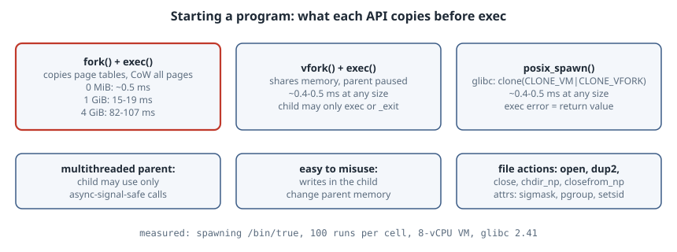

# `fork()`, `vfork()` or `posix_spawn()`: Starting Programs in Modern C

## Thesis

The textbook way to run another program is `fork()` followed by `exec()`. It is short and flexible, and it gets expensive as the parent's memory grows. `fork()` has to duplicate the parent's address space (page tables, with every page marked copy-on-write) only for `exec()` to throw that copy away immediately. The 2019 HotOS paper [*A fork() in the road*](https://www.microsoft.com/en-us/research/publication/a-fork-in-the-road/) argues that `fork` is a poor default for this job. This chapter measures the cost and shows the replacement: **`posix_spawn()`**. It is as fast as `vfork()`, it reports exec failures directly, and it configures the child declaratively instead of with arbitrary code between `fork` and `exec`.

{fig-alt="fork plus exec copies the parent's page tables and marks every page copy-on-write, so its cost grows with resident memory: about 0.5 ms with no heap but 15 to 19 ms with 1 GiB and 82 to 107 ms with 4 GiB on this VM. vfork plus exec shares the parent's memory and suspends the parent until exec or _exit, costing about 0.4 to 0.5 ms regardless of heap size, but the child may only call exec or _exit. posix_spawn in glibc 2.24 and later uses clone with CLONE_VM and CLONE_VFORK on a separate stack, so it is as cheap as vfork, reports exec errors as a return value, and configures the child through file actions and attributes."}

Everything was run with GCC 14.2.0 and glibc 2.41 on Linux 6.12, on an 8-vCPU x86-64 VM with 16 GB of RAM.

## The three APIs

| | `fork()` + `exec()` | `vfork()` + `exec()` | `posix_spawn()` |
|---|---|---|---|
| Child's memory | copy-on-write duplicate | **shared** with the parent | shared (glibc ≥ 2.24) |
| Parent during the gap | keeps running | suspended until `exec`/`_exit` | suspended until `exec` |
| What the child may do before `exec` | anything (single-threaded parent); only async-signal-safe calls (multithreaded parent) | only `exec` or `_exit` | nothing: you describe it with file actions and attributes |
| Exec failure reported as | child exit status you invent | child exit status you invent | return value |
| Standard | POSIX | removed from POSIX.1-2008 | POSIX |

According to the [`posix_spawn(3)` man page](https://man7.org/linux/man-pages/man3/posix_spawn.3.html), "since glibc 2.24, the posix_spawn() function commences by calling clone(2) with CLONE_VM and CLONE_VFORK flags." In other words, glibc does the `vfork` trick for you, on a separate stack and with the dangerous parts handled.

## Measurement: cost versus parent memory

The parent maps and touches a heap of 0, 1 or 4 GiB, then starts `/bin/true` 100 times with each method and waits for every child. The heap is `mmap`ed and the program calls `madvise` on it. The `4k` argument asks for no transparent huge pages, and the default asks for them. `AnonHuge` reports how much of the heap actually received huge pages.

```c
// spawn.c: cost of starting /bin/true from a parent with a large resident heap
#define _GNU_SOURCE
#include <spawn.h>
#include <stdio.h>
#include <stdlib.h>
#include <string.h>
#include <sys/mman.h>
#include <sys/wait.h>
#include <time.h>
#include <unistd.h>

extern char **environ;
static char *argv_true[] = {"/bin/true", NULL};

static pid_t via_fork(void) {
    pid_t pid = fork();
    if (pid == 0) { execv(argv_true[0], argv_true); _exit(127); }
    return pid;
}
static pid_t via_vfork(void) {
    pid_t pid = vfork();
    if (pid == 0) { execv(argv_true[0], argv_true); _exit(127); }
    return pid;
}
static pid_t via_spawn(void) {
    pid_t pid;
    int e = posix_spawn(&pid, argv_true[0], NULL, NULL, argv_true, environ);
    return e ? -1 : pid;
}

static long anon_huge_kib(void) {
    FILE *f = fopen("/proc/self/smaps_rollup", "r");
    char line[256]; long kib = -1;
    while (f && fgets(line, sizeof line, f))
        if (sscanf(line, "AnonHugePages: %ld kB", &kib) == 1) break;
    if (f) fclose(f);
    return kib;
}

static double bench(pid_t (*start)(void), int n) {
    struct timespec a, b;
    clock_gettime(CLOCK_MONOTONIC, &a);
    for (int i = 0; i < n; i++) {
        int st; pid_t p = start();
        if (p < 0 || waitpid(p, &st, 0) < 0 || !WIFEXITED(st) || WEXITSTATUS(st)) {
            fprintf(stderr, "spawn failed\n"); exit(1);
        }
    }
    clock_gettime(CLOCK_MONOTONIC, &b);
    return ((b.tv_sec - a.tv_sec) * 1e9 + (b.tv_nsec - a.tv_nsec)) / n / 1e3;
}

int main(int argc, char **argv) {
    size_t mib = argc > 1 ? strtoul(argv[1], NULL, 10) : 0;
    int small_pages = argc > 2 && strcmp(argv[2], "4k") == 0;
    char *heap = NULL;
    if (mib) {
        heap = mmap(NULL, mib << 20, PROT_READ | PROT_WRITE, MAP_PRIVATE | MAP_ANONYMOUS, -1, 0);
        if (heap == MAP_FAILED) { perror("mmap"); return 1; }
        madvise(heap, mib << 20, small_pages ? MADV_NOHUGEPAGE : MADV_HUGEPAGE);
        memset(heap, 1, mib << 20);           /* make it resident */
    }
    int n = 100;
    printf("heap %5zu MiB %s (AnonHuge %7ld MiB):  fork+exec %8.1f us   vfork+exec %6.1f us   posix_spawn %6.1f us\n",
           mib, small_pages ? "4K " : "THP", anon_huge_kib() >> 10, bench(via_fork, n), bench(via_vfork, n), bench(via_spawn, n));
    if (heap) munmap(heap, mib << 20);
    return 0;
}
```

```text
$ gcc -std=c23 -O2 -Wall -Wextra spawn.c -o spawn
$ for m in 0 1024 4096; do ./spawn $m; ./spawn $m 4k; done
heap     0 MiB THP (AnonHuge       0 MiB):  fork+exec    545.7 us   vfork+exec  397.4 us   posix_spawn  382.8 us
heap     0 MiB 4K  (AnonHuge       0 MiB):  fork+exec    546.3 us   vfork+exec  414.8 us   posix_spawn  434.7 us
heap  1024 MiB THP (AnonHuge     178 MiB):  fork+exec  15299.9 us   vfork+exec  441.4 us   posix_spawn  474.0 us
heap  1024 MiB 4K  (AnonHuge       0 MiB):  fork+exec  19366.4 us   vfork+exec  475.4 us   posix_spawn  493.9 us
heap  4096 MiB THP (AnonHuge     178 MiB):  fork+exec 106975.3 us   vfork+exec  499.0 us   posix_spawn  521.3 us
heap  4096 MiB 4K  (AnonHuge       0 MiB):  fork+exec  82345.9 us   vfork+exec  437.6 us   posix_spawn  492.1 us
```

- **`fork`+`exec` grows with resident memory:** about 0.55 ms with no heap, 15–19 ms with 1 GiB and 82–107 ms with 4 GiB. That is two orders of magnitude slower for the same `/bin/true`.
- **`vfork` and `posix_spawn` stay flat** at 0.38–0.52 ms at every heap size, because they never copy the address space.
- The THP rows show only 178 MiB of huge pages actually allocated, so this run tells you nothing about huge pages either way. The 4 KiB rows are the clean comparison.

The cost isn't only time. A `fork` from a 4 GiB process also briefly *commits* another 4 GiB of copy-on-write memory, which can fail outright under `vm.overcommit_memory=2` even though the child is about to `exec` ([`fork(2)`](https://man7.org/linux/man-pages/man2/fork.2.html) lists `ENOMEM`).

## Errors and child setup

```c
// errs.c: how each API reports "the program does not exist", plus file actions
#define _GNU_SOURCE
#include <errno.h>
#include <fcntl.h>
#include <spawn.h>
#include <stdio.h>
#include <string.h>
#include <sys/wait.h>
#include <unistd.h>

extern char **environ;

int main(void) {
    char *bad[] = {"/no/such/program", NULL};

    /* fork + exec: the error happens in the child; the parent sees only a status */
    pid_t pid = fork();
    if (pid == 0) { execv(bad[0], bad); _exit(127); }
    int st; waitpid(pid, &st, 0);
    printf("fork+exec:   fork() succeeded, child exit status %d\n", WEXITSTATUS(st));

    /* posix_spawn: glibc reports the exec failure as the return value */
    int e = posix_spawn(&pid, bad[0], NULL, NULL, bad, environ);
    printf("posix_spawn: returned %d (%s)\n", e, strerror(e));

    /* file actions: run `pwd` in /tmp with stdout redirected to a file */
    posix_spawn_file_actions_t fa;
    posix_spawn_file_actions_init(&fa);
    posix_spawn_file_actions_addopen(&fa, STDOUT_FILENO, "/tmp/spawn-out.txt",
                                     O_WRONLY | O_CREAT | O_TRUNC, 0644);
    posix_spawn_file_actions_addchdir_np(&fa, "/tmp");
    char *pwd[] = {"pwd", NULL};
    e = posix_spawnp(&pid, "pwd", &fa, NULL, pwd, environ);
    posix_spawn_file_actions_destroy(&fa);
    waitpid(pid, &st, 0);
    printf("posix_spawnp(pwd): returned %d, child status %d\n", e, WEXITSTATUS(st));
    return 0;
}
```

```text
$ gcc -std=c23 -O2 -Wall -Wextra errs.c -o errs && ./errs && cat /tmp/spawn-out.txt
fork+exec:   fork() succeeded, child exit status 127
posix_spawn: returned 2 (No such file or directory)
posix_spawnp(pwd): returned 0, child status 0
/tmp
```

With `fork`+`exec`, the parent learns only that the child exited with 127, the conventional "command not found" code that this program chose itself. To get the real `errno` you need a close-on-exec pipe so the child can send it back. `posix_spawn` returns `ENOENT` (2) directly.

The child is configured with **file actions**, which are applied in order in the child before `exec`. Here they open a file as stdout and `chdir` to `/tmp`. The available actions are `addopen`, `adddup2`, `addclose`, and the glibc extensions `addchdir_np` (glibc 2.29) and `addclosefrom_np` (glibc 2.34). **Attributes** (`posix_spawnattr_*`) set the signal mask, default signal dispositions, process group and session. These cover most of what people write between `fork` and `exec`.

## When to use which

- **Starting a program: `posix_spawn`/`posix_spawnp`.** It is fast at any heap size, reports errors properly and is safe in multithreaded programs.
- **`fork` without `exec`:** prefork servers, snapshotting (Redis `BGSAVE`), sandboxes that fork a template. In these cases the copy is the point. Remember that in a **multithreaded** parent the child may only use async-signal-safe functions until it calls `exec`, because other threads' locks (including malloc's) may be held forever ([POSIX `fork`](https://pubs.opengroup.org/onlinepubs/9799919799/functions/fork.html)).
- **`vfork`: almost never directly.** The child shares the parent's memory and stack. Any write other than calling `exec` or `_exit`, including returning from the function that called `vfork`, corrupts the parent ([`vfork(2)`](https://man7.org/linux/man-pages/man2/vfork.2.html)). `posix_spawn` gives you the same speed safely.
- **Needs `posix_spawn` can't express** (seccomp filters, namespaces, `setrlimit` in the child): use `clone3`/`pidfd`-based helpers or a small exec-wrapper program. A `fork` from a large process is the expensive option here too.

## Pitfalls

- **`system()` and `popen()` use a shell.** glibc runs them through `/bin/sh -c`. They cost an extra exec and bring shell quoting bugs. Use `posix_spawnp` with an argv array.
- **Descriptor leaks.** The spawned child inherits every descriptor that isn't close-on-exec. Create descriptors with `O_CLOEXEC`, or add `addclosefrom_np`, before spawning.
- **`posix_spawnp` searches `PATH`; `posix_spawn` doesn't.** Pass an absolute path to `posix_spawn`.
- **Exit status 127 is just a convention.** In a `fork`+`exec` error path it is ambiguous with a real program that exits 127. Prefer an errno pipe or `posix_spawn`.

## Takeaways

- `fork`+`exec` cost grows with the parent's resident memory: 0.55 ms → about 19 ms (1 GiB) → about 82 ms (4 GiB) here. `posix_spawn` stayed at about 0.5 ms.
- glibc's `posix_spawn` is a safe `vfork`: `clone(CLONE_VM | CLONE_VFORK)` on its own stack.
- It returns exec errors directly and configures the child with file actions and attributes.
- Use `fork` when you want the copy, and `posix_spawn` when you want a new program.

## Sources

- Linux man-pages, [`posix_spawn(3)`](https://man7.org/linux/man-pages/man3/posix_spawn.3.html), [`fork(2)`](https://man7.org/linux/man-pages/man2/fork.2.html), [`vfork(2)`](https://man7.org/linux/man-pages/man2/vfork.2.html)
- POSIX.1-2024, [`fork`](https://pubs.opengroup.org/onlinepubs/9799919799/functions/fork.html) (async-signal-safe rule in multithreaded processes)
- Baumann, Appavoo, Krieger, Roscoe, [*A fork() in the road*](https://www.microsoft.com/en-us/research/publication/a-fork-in-the-road/), HotOS 2019 ([PDF](https://www.microsoft.com/en-us/research/uploads/prod/2019/04/fork-hotos19.pdf))
