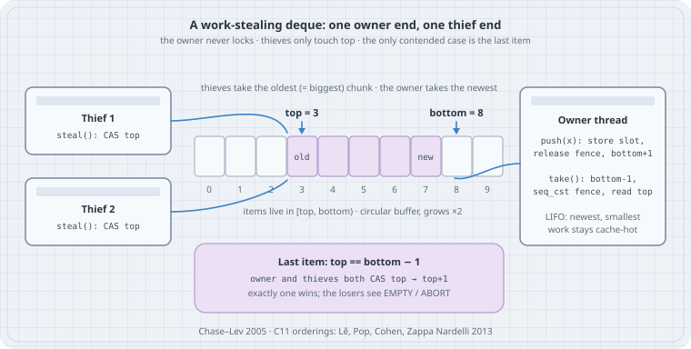

# Work Stealing in C: a Chase–Lev Deque with C11 Atomics

## Thesis

A work-stealing scheduler gives every worker thread its own double-ended queue of tasks. The owner pushes and pops at the **bottom**, like a stack: newest first and cache-hot. It takes no lock. An idle worker becomes a **thief** and steals from the **top** of someone else's deque: oldest first, which in divide-and-conquer code is the *biggest* chunk of work. Cilk made this scheduler famous in the 1990s. Blumofe and Leiserson proved it efficient: randomized stealing has provably good time and space bounds. Chase and Lev (SPAA 2005) gave the lock-free, growable deque most runtimes still use.

The data structure is about 100 lines of C11. Every line of it can be wrong in a way that passes most test runs. The owner's `take()` needs a **sequentially consistent fence** between "I lowered `bottom`" and "let me read `top`". Without it, an owner and a thief can both walk away with the same task, even on x86. This chapter builds the deque with the C11 orderings from Lê, Pop, Cohen and Zappa Nardelli (PPoPP 2013), proves it with a counting stress test, removes the fence to watch it break, and then uses it to run a tiny parallel scheduler.

## Mental model

```text
                 top (thieves CAS here)                bottom (owner only)
                  │                                      │
  index:   0  1  2│ 3      4      5      6      7      │8  9
  slots: [ ][ ][ ][A0  ][A1   ][A2   ][ ...  ][A7   ][ ][ ]      items live in [top, bottom)
                    oldest = biggest chunk      newest = smallest chunk

  push(x)   owner:  buf[bottom] = x;  release fence;  bottom++
  take()    owner:  bottom--;  SEQ_CST FENCE;  t = top
                    t <  bottom → item is mine, no CAS
                    t == bottom → last item: CAS top, t → t+1 (race the thieves)
                    t >  bottom → empty, restore bottom
  steal()   thief:  t = top;  SEQ_CST FENCE;  b = bottom
                    t < b → read buf[t], CAS top, t → t+1 (fail = ABORT, someone else won)
```

{fig-alt="Two thief cards on the left with arrows into slot 3, labelled top = 3. An owner card on the right with push and take, pointing at bottom = 8. Slots 3 to 7 are filled, oldest at 3 and newest at 7. A note says thieves take the oldest, biggest chunk and the owner takes the newest. A box below says that for the last item, owner and thieves both CAS top and exactly one wins."}

| Operation | Who | Atomics it needs | Why |
|-----------|-----|------------------|-----|
| `push` | owner | release fence before `bottom++` | A thief that sees the new `bottom` must see the item |
| `take` | owner | **seq_cst fence** between the `bottom` store and the `top` load; seq_cst CAS on the last item | Either the owner sees a thief's `top`, or the thief sees the owner's `bottom`. Never neither |
| `steal` | any | acquire `top`, **seq_cst fence**, acquire `bottom`; seq_cst CAS on `top` | Pairs with `take`'s fence. The CAS makes "one winner per slot" true |
| grow | owner | release store of the new array pointer | A thief that loads the new pointer sees the copied items |

`top` only ever increases, so a 64-bit CAS on it has no ABA problem. `bottom` is written only by the owner. The only contended moment is the **last item**, where the owner, too, has to win a CAS.

## Worked examples

Tested on Debian 13 x86_64 (8 vCPUs, a shared VM), Linux 6.12, **GCC 14.2.0** (`gcc (Debian 14.2.0-19)`), glibc 2.41, `-std=c17`. Nothing here depends on a newer compiler. Current upstream GCC (16.1) reads the same `<stdatomic.h>` API, and C23 keeps it apart from removing `ATOMIC_VAR_INIT`. The deque lives in two files that every case links against.

```c
/* chase_lev.h — Chase–Lev work-stealing deque with C11 atomics (interface)
 * Algorithm: Chase & Lev, SPAA 2005; C11 orderings after Lê, Pop, Cohen,
 * Zappa Nardelli, PPoPP 2013. One owner pushes/takes at the bottom;
 * any number of thieves steal from the top. */
#ifndef CHASE_LEV_H
#define CHASE_LEV_H
#include <stdatomic.h>
#include <stddef.h>
#include <stdint.h>

#define CL_EMPTY INTPTR_MIN        /* take/steal: nothing there        */
#define CL_ABORT (INTPTR_MIN + 1)  /* steal: lost a race, may retry    */

#ifdef CL_UNSIGNED                 /* deliberately wrong: see Case 4   */
typedef size_t cl_index;
#else
typedef int64_t cl_index;
#endif

typedef struct cl_array {
    cl_index size;                 /* power of two                    */
    struct cl_array *prev;         /* retired arrays, freed at destroy */
    _Atomic intptr_t buf[];
} cl_array;

typedef struct {
    _Alignas(64) _Atomic cl_index top;     /* thieves CAS this end    */
    _Alignas(64) _Atomic cl_index bottom;  /* only the owner writes   */
    _Alignas(64) _Atomic(cl_array *) array;
} cl_deque;

void     cl_init(cl_deque *q, cl_index size);    /* size: power of two */
void     cl_destroy(cl_deque *q);
void     cl_push(cl_deque *q, intptr_t x);       /* owner only */
intptr_t cl_take(cl_deque *q);                   /* owner only */
intptr_t cl_steal(cl_deque *q);                  /* any thread */
#endif
```

```c
/* chase_lev.c — Chase–Lev deque implementation (one owner, many thieves) */
#include <stdlib.h>
#include "chase_lev.h"

static cl_array *cl_array_new(cl_index size)
{
    cl_array *a = malloc(sizeof *a + (size_t)size * sizeof a->buf[0]);
    if (!a)
        abort();
    a->size = size;
    a->prev = NULL;
    for (cl_index i = 0; i < size; i++)
        atomic_init(&a->buf[i], 0);
    return a;
}

void cl_init(cl_deque *q, cl_index size)
{
    atomic_init(&q->top, 0);
    atomic_init(&q->bottom, 0);
    atomic_init(&q->array, cl_array_new(size));
}

void cl_destroy(cl_deque *q)
{
    cl_array *a = atomic_load_explicit(&q->array, memory_order_relaxed);
    while (a) {
        cl_array *p = a->prev;
        free(a);
        a = p;
    }
}

/* Owner only. Thieves may still be reading the old array, so it is
 * retired, not freed. */
static cl_array *cl_grow(cl_deque *q, cl_array *a, cl_index t, cl_index b)
{
    cl_array *n = cl_array_new(a->size * 2);
    for (cl_index i = t; i < b; i++)
        atomic_store_explicit(&n->buf[i & (n->size - 1)],
            atomic_load_explicit(&a->buf[i & (a->size - 1)], memory_order_relaxed),
            memory_order_relaxed);
    n->prev = a;
    atomic_store_explicit(&q->array, n, memory_order_release);
    return n;
}

void cl_push(cl_deque *q, intptr_t x)               /* owner */
{
    cl_index b = atomic_load_explicit(&q->bottom, memory_order_relaxed);
    cl_index t = atomic_load_explicit(&q->top, memory_order_acquire);
    cl_array *a = atomic_load_explicit(&q->array, memory_order_relaxed);
    if (b - t > a->size - 1)
        a = cl_grow(q, a, t, b);
    atomic_store_explicit(&a->buf[b & (a->size - 1)], x, memory_order_relaxed);
    atomic_thread_fence(memory_order_release);  /* item before bottom */
    atomic_store_explicit(&q->bottom, b + 1, memory_order_relaxed);
}

intptr_t cl_take(cl_deque *q)                        /* owner */
{
    cl_index b = atomic_load_explicit(&q->bottom, memory_order_relaxed) - 1;
    cl_array *a = atomic_load_explicit(&q->array, memory_order_relaxed);
    atomic_store_explicit(&q->bottom, b, memory_order_relaxed);
#ifndef CL_NO_TAKE_FENCE                       /* deliberately wrong: Case 3 */
    atomic_thread_fence(memory_order_seq_cst);  /* bottom store before top load */
#endif
    cl_index t = atomic_load_explicit(&q->top, memory_order_relaxed);
    intptr_t x;
    if (t <= b) {                               /* non-empty */
        x = atomic_load_explicit(&a->buf[b & (a->size - 1)], memory_order_relaxed);
        if (t == b) {                           /* last item: race the thieves */
            if (!atomic_compare_exchange_strong_explicit(&q->top, &t, t + 1,
                    memory_order_seq_cst, memory_order_relaxed))
                x = CL_EMPTY;                   /* a thief won */
            atomic_store_explicit(&q->bottom, b + 1, memory_order_relaxed);
        }
    } else {                                    /* was empty: undo */
        x = CL_EMPTY;
        atomic_store_explicit(&q->bottom, b + 1, memory_order_relaxed);
    }
    return x;
}

intptr_t cl_steal(cl_deque *q)                       /* any thread */
{
    cl_index t = atomic_load_explicit(&q->top, memory_order_acquire);
    atomic_thread_fence(memory_order_seq_cst);  /* top load before bottom load */
    cl_index b = atomic_load_explicit(&q->bottom, memory_order_acquire);
    if (!(t < b))
        return CL_EMPTY;
    cl_array *a = atomic_load_explicit(&q->array, memory_order_acquire);
    intptr_t x = atomic_load_explicit(&a->buf[t & (a->size - 1)], memory_order_relaxed);
    if (!atomic_compare_exchange_strong_explicit(&q->top, &t, t + 1,
            memory_order_seq_cst, memory_order_relaxed))
        return CL_ABORT;                        /* another thief or the owner won */
    return x;
}
```

Two `-D` switches exist only so later cases can break the code on purpose. `CL_NO_TAKE_FENCE` deletes the one fence in `take()`, and `CL_UNSIGNED` makes the indices `size_t`. Never ship either.

### Case 1: One thread, both ends

```c
/* basic.c — single-threaded behaviour: LIFO for the owner, FIFO for thieves */
#include <stdio.h>
#include "chase_lev.h"

int main(void)
{
    cl_deque q;
    cl_init(&q, 2);                   /* tiny on purpose: forces two grows */
    for (intptr_t i = 1; i <= 5; i++)
        cl_push(&q, i);
    printf("array size after 5 pushes: %lld\n",
           (long long)atomic_load(&q.array)->size);
    printf("steal -> %ld (oldest)\n", (long)cl_steal(&q));
    printf("take  -> %ld (newest)\n", (long)cl_take(&q));
    printf("take  -> %ld\n", (long)cl_take(&q));
    printf("steal -> %ld\n", (long)cl_steal(&q));
    printf("take  -> %ld\n", (long)cl_take(&q));
    intptr_t e = cl_take(&q);
    printf("take  -> %s\n", e == CL_EMPTY ? "EMPTY" : "?");
    cl_destroy(&q);
    return 0;
}
```

```text
$ gcc -std=c17 -Wall -Wextra -O2 -o basic basic.c chase_lev.c && ./basic
array size after 5 pushes: 8
steal -> 1 (oldest)
take  -> 5 (newest)
take  -> 4
steal -> 2
take  -> 3
take  -> EMPTY
```

The capacity started at 2 and grew twice (2 → 4 → 8) during five pushes. Thieves see FIFO order (1, then 2). The owner sees LIFO order (5, 4, 3). The empty sentinel is `INTPTR_MIN`, so items are any `intptr_t` except the two sentinels. In a real scheduler an item is a task pointer.

### Case 2: One owner, seven thieves, two million items

The test has to *count*. Every item is a number from 1 to N, and `seen[v]` counts how many times `v` came out. A correct deque gives `lost 0 duplicated 0` every time.

```c
/* stress.c — one owner, several thieves: every item must come out exactly once */
#include <pthread.h>
#include <stdio.h>
#include <stdlib.h>
#include "chase_lev.h"

enum { N = 2000000, THIEVES = 7 };

static cl_deque q;
static _Atomic unsigned char seen[N + 1];
static _Atomic long consumed;
static long stolen[THIEVES], aborts[THIEVES];

static void eat(intptr_t v)
{
    atomic_fetch_add_explicit(&seen[v], 1, memory_order_relaxed);
    atomic_fetch_add_explicit(&consumed, 1, memory_order_relaxed);
}

static void *thief(void *arg)
{
    long id = (long)arg;
    while (atomic_load_explicit(&consumed, memory_order_relaxed) < N) {
        intptr_t v = cl_steal(&q);
        if (v == CL_ABORT)
            aborts[id]++;
        else if (v != CL_EMPTY) {
            eat(v);
            stolen[id]++;
        }
    }
    return NULL;
}

int main(void)
{
    cl_init(&q, 64);
    pthread_t th[THIEVES];
    for (long i = 0; i < THIEVES; i++)
        pthread_create(&th[i], NULL, thief, (void *)i);

    long taken = 0;
    for (intptr_t v = 1; v <= N; v++) {
        cl_push(&q, v);
        if (v % 3 == 0) {                 /* owner works on its newest items */
            intptr_t x = cl_take(&q);
            if (x != CL_EMPTY) { eat(x); taken++; }
        }
    }
    for (intptr_t x; (x = cl_take(&q)) != CL_EMPTY; taken++)
        eat(x);                           /* drain what thieves left */
    for (int i = 0; i < THIEVES; i++)
        pthread_join(th[i], NULL);

    long lost = 0, dup = 0, st = 0, ab = 0;
    for (long v = 1; v <= N; v++) {
        unsigned c = atomic_load(&seen[v]);
        lost += (c == 0);
        dup += (c > 1);
    }
    for (int i = 0; i < THIEVES; i++) { st += stolen[i]; ab += aborts[i]; }
    printf("items %d  owner took %ld  thieves stole %ld  steal aborts %ld\n",
           N, taken, st, ab);
    printf("final array size %lld\n", (long long)atomic_load(&q.array)->size);
    printf("lost %ld  duplicated %ld  -> %s\n", lost, dup,
           lost == 0 && dup == 0 ? "OK" : "BROKEN");
    cl_destroy(&q);
    return lost || dup;
}
```

```text
$ gcc -std=c17 -Wall -Wextra -O2 -pthread -o stress stress.c chase_lev.c
$ for i in 1 2 3; do ./stress; done
items 2000000  owner took 666667  thieves stole 1333333  steal aborts 678870
final array size 262144
lost 0  duplicated 0  -> OK
items 2000000  owner took 669554  thieves stole 1330446  steal aborts 788784
final array size 262144
lost 0  duplicated 0  -> OK
items 2000000  owner took 675706  thieves stole 1324294  steal aborts 786425
final array size 131072
lost 0  duplicated 0  -> OK
```

"Steal aborts" are CAS losses: another thief, or the owner taking the last item, got there first. They are normal and cheap. A thief just tries again. The final array size varies from run to run because it depends on how far ahead of the thieves the owner got.

### Case 3: Delete one fence and the deque duplicates and loses work

```text
$ gcc -std=c17 -Wall -Wextra -O2 -pthread -DCL_NO_TAKE_FENCE -o stress_nofence stress.c chase_lev.c
$ for i in 1 2 3; do ./stress_nofence; echo "exit $?"; done
items 2000000  owner took 669678  thieves stole 1330322  steal aborts 628972
final array size 524288
lost 0  duplicated 0  -> OK
exit 0
items 2000000  owner took 668223  thieves stole 1331777  steal aborts 700731
final array size 32768
lost 0  duplicated 0  -> OK
exit 0
items 2000000  owner took 667793  thieves stole 1332207  steal aborts 431824
final array size 524288
lost 0  duplicated 0  -> OK
exit 0
```

Three green runs. This is exactly what makes concurrency bugs dangerous. Now run each build ten times and count the failures:

```bash
#!/usr/bin/env bash
# hunt.sh — run the stress test 10 times per build; count runs that lost or duplicated items
set -u
for flags in "-O2" "-O2 -DCL_NO_TAKE_FENCE" "-O2 -flto -DCL_NO_TAKE_FENCE" "-O0 -DCL_NO_TAKE_FENCE"; do
  gcc -std=c17 -Wall -Wextra -pthread $flags -o hunt_bin stress.c chase_lev.c || exit 1
  broken=0
  for i in $(seq 10); do ./hunt_bin > /dev/null || broken=$((broken + 1)); done
  printf '%-30s broken in %2d of 10 runs\n' "$flags" "$broken"
done
```

```text
$ ./hunt.sh
-O2                            broken in  0 of 10 runs
-O2 -DCL_NO_TAKE_FENCE         broken in  3 of 10 runs
-O2 -flto -DCL_NO_TAKE_FENCE   broken in  2 of 10 runs
-O0 -DCL_NO_TAKE_FENCE         broken in  2 of 10 runs
```

The correct `-O2` build passed 10 of 10 runs. The build without the fence lost and duplicated items in some runs at every optimisation level, including `-flto`, where `take()` is inlined into the owner loop. The failure rate changes from batch to batch. While writing this chapter, the same no-fence source also went 20 of 20 clean in a header-only, `static inline` build. The bug is in the source. Whether you *see* it depends on inlining and timing.

Here is what happens without the fence, with two items at `top = t` and `t+1`:

1. The owner lowers `bottom` to `t+1`. On x86 that store sits in the core's **store buffer**. x86-TSO lets a later load pass an earlier store, so the owner's load of `top` can complete first and read `t`.
2. A thief steals slot `t` (`top` becomes `t+1`). Then a thief (the same one or another) reads `top = t+1` and still sees the *old* `bottom = t+2`, because the owner's store has not left its store buffer. It takes slot `t+1` with a successful CAS.
3. The owner compares its stale `t` with `b = t+1`, decides "more than one item, no CAS needed", and also takes slot `t+1`. That item is **duplicated**. `top` (`t+2`) is now past `bottom` (`t+1`), so the owner's next push lands in a slot no thief will ever read. That item is **lost**. This is why the counts above are always "lost N duplicated N".

The seq_cst fence in `take()` pairs with the one in `steal()`. Of the two threads, at least one must see the other's write. You can see what it costs on x86:

```text
$ gcc -std=c17 -O2 -S -o - chase_lev.c | grep -E '^cl_[a-z]+:|lock|mfence'
cl_init:
cl_destroy:
cl_push:
cl_take:
	lock orq	$0, (%rsp)
	lock cmpxchgq	%r8, (%rdi)
cl_steal:
	lock orq	$0, (%rsp)
	lock cmpxchgq	%rcx, (%rdi)
$ gcc -std=c17 -O2 -DCL_NO_TAKE_FENCE -S -o - chase_lev.c | grep -E '^cl_[a-z]+:|lock|mfence'
cl_init:
cl_destroy:
cl_push:
cl_take:
	lock cmpxchgq	%r8, (%rdi)
cl_steal:
	lock orq	$0, (%rsp)
	lock cmpxchgq	%rcx, (%rdi)
```

GCC 14 implements a seq_cst fence as `lock or $0,(%rsp)`, a locked no-op on the stack that drains the store buffer. `cl_push` has no locked instruction at all: a release fence on x86 only stops the *compiler* from reordering. Removing the fence from `take()` saves one locked instruction per pop and costs you correctness.

### Case 4: Unsigned indices turn "empty" into "an item"

`take()` begins with `b = bottom - 1`. With `bottom == 0` and a signed index, `b` is −1 and `t <= b` is false: empty. With `size_t`, `b` wraps to 2^64 − 1 and `t <= b` is true:

```c
/* unsigned_trap.c — take() on an empty deque, signed vs unsigned indices */
#include <stdio.h>
#include "chase_lev.h"

int main(void)
{
    cl_deque q;
    cl_init(&q, 4);
    intptr_t x = cl_take(&q);                 /* nothing was ever pushed */
    cl_index t = atomic_load(&q.top), b = atomic_load(&q.bottom);
    printf("index type: %s\n", (cl_index)-1 > 0 ? "unsigned (size_t)" : "signed (int64_t)");
    printf("take on empty -> %s\n", x == CL_EMPTY ? "EMPTY" : "an item (!)");
    printf("afterwards: top=%llu bottom=%llu, next push sees b - t = %llu\n",
           (unsigned long long)t, (unsigned long long)b,
           (unsigned long long)(b - t));
    cl_destroy(&q);
    return 0;
}
```

```text
$ gcc -std=c17 -Wall -Wextra -O2 -o trap_signed unsigned_trap.c chase_lev.c && ./trap_signed
index type: signed (int64_t)
take on empty -> EMPTY
afterwards: top=0 bottom=0, next push sees b - t = 0
$ gcc -std=c17 -Wall -Wextra -O2 -DCL_UNSIGNED -o trap_unsigned unsigned_trap.c chase_lev.c && ./trap_unsigned
index type: unsigned (size_t)
take on empty -> an item (!)
afterwards: top=0 bottom=18446744073709551615, next push sees b - t = 18446744073709551615
```

The unsigned build returned a garbage "item" from a deque that never held one. It also left `bottom` at 2^64 − 1, so the next `push` would compute `b - t` as 2^64 − 1 and try to grow the array forever. Use a signed 64-bit index (`int64_t` or `ptrdiff_t`). It cannot overflow in practice: at a billion pushes a second it lasts about 292 years.

### Case 5: ThreadSanitizer does not see fences

```text
$ gcc -std=c17 -Wall -Wextra -O1 -g -pthread -fsanitize=thread -o stress_tsan stress.c chase_lev.c
$ ./stress_tsan
items 2000000  owner took 676005  thieves stole 1323995  steal aborts 1086457
final array size 65536
lost 0  duplicated 0  -> OK
$ gcc -std=c17 -O1 -g -pthread -fsanitize=thread -Wno-tsan -DCL_NO_TAKE_FENCE -o stress_tsan_nofence stress.c chase_lev.c
$ for i in 1 2 3; do ./stress_tsan_nofence; echo "exit $?"; done
items 2000000  owner took 674680  thieves stole 1325320  steal aborts 960598
final array size 131072
lost 0  duplicated 0  -> OK
exit 0
items 2000000  owner took 666747  thieves stole 1333253  steal aborts 1122614
final array size 131072
lost 0  duplicated 0  -> OK
exit 0
items 2000000  owner took 695678  thieves stole 1304322  steal aborts 1028966
final array size 131072
lost 0  duplicated 0  -> OK
exit 0
```

TSan reported **nothing** on either build, and the no-fence build even passed under it. The instrumentation slows the threads down enough to hide the window. The GCC manual says why TSan is the wrong tool here: "ThreadSanitizer does not support `std::atomic_thread_fence` and can report false positives." GCC can warn you (`-Wtsan`, on by default), but in GCC 14 it only does so where a fence has been **inlined**:

```c
/* tsan_fence_probe.c — when does GCC tell you TSan ignores a fence? */
#include <stdatomic.h>

void exported(void) { atomic_thread_fence(memory_order_seq_cst); }
static void local(void) { atomic_thread_fence(memory_order_seq_cst); }

int main(void)
{
    local();
    exported();
    return 0;
}
```

```text
$ gcc -std=c17 -O1 -fsanitize=thread -c tsan_fence_probe.c
In file included from tsan_fence_probe.c:2:
In function ‘local’,
    inlined from ‘main’ at tsan_fence_probe.c:9:5:
tsan_fence_probe.c:5:27: warning: ‘atomic_thread_fence’ is not supported with ‘-fsanitize=thread’ [-Wtsan]
    5 | static void local(void) { atomic_thread_fence(memory_order_seq_cst); }
      |                           ^~~~~~~~~~~~~~~~~~~
$ gcc -std=c17 -O1 -fsanitize=thread -c chase_lev.c && echo "no warning"
no warning
```

`local()` was inlined into `main` and got the warning. `exported()` and every fence in `chase_lev.c` did not. The split build in this case compiled with no warning at all. Every access in this deque is atomic, so TSan has no data race to report. The bug here is a *memory-ordering* bug between atomics, and TSan does not model it. Counting tests, run many times and in several build configurations, are what catch it.

### Case 6: A scheduler in 100 lines

With the deque in hand, a scheduler is a loop: take your own work, and if there is none, steal from a random victim. Tasks here are `[lo, hi)` ranges packed into an `intptr_t`. A worker splits its range by **pushing the right half and keeping the left**, the Cilk "work-first" shape. It sums the leaves (4096 elements each) with a hash, so there is real work to do.

```c
/* wsum.c — a tiny work-stealing scheduler: split a range, keep half, let thieves take the rest */
#include <pthread.h>
#include <stdint.h>
#include <stdio.h>
#include <stdlib.h>
#include <time.h>
#include "chase_lev.h"

enum { MAXW = 64, CUTOFF = 4096 };
static const int64_t M = INT64_C(1) << 28;      /* 268,435,456 elements */

static inline uint64_t mix(uint64_t z)          /* splitmix64 finalizer: some real work */
{
    z += 0x9e3779b97f4a7c15u;
    z = (z ^ (z >> 30)) * 0xbf58476d1ce4e5b9u;
    z = (z ^ (z >> 27)) * 0x94d049bb133111ebu;
    return z ^ (z >> 31);
}

static inline intptr_t pack(int64_t lo, int64_t hi) { return (intptr_t)(lo << 32 | hi); }
static inline int64_t lo_of(intptr_t t) { return (int64_t)((uint64_t)t >> 32); }
static inline int64_t hi_of(intptr_t t) { return (int64_t)((uint64_t)t & 0xffffffffu); }

typedef struct {
    _Alignas(64) cl_deque q;
    uint64_t sum;
    long leaves, steals, stolen_elems;
    unsigned seed;
    int id;
} worker;

static worker W[MAXW];
static int nworkers;
static _Atomic int64_t remaining;

static void run(worker *w, intptr_t task)
{
    int64_t lo = lo_of(task), hi = hi_of(task);
    while (hi - lo > CUTOFF) {                   /* split: push right half, keep left */
        int64_t mid = lo + (hi - lo) / 2;
        cl_push(&w->q, pack(mid, hi));
        hi = mid;
    }
    uint64_t s = 0;
    for (int64_t i = lo; i < hi; i++)
        s += mix((uint64_t)i);
    w->sum += s;
    w->leaves++;
    atomic_fetch_sub_explicit(&remaining, hi - lo, memory_order_relaxed);
}

static void *loop(void *arg)
{
    worker *w = arg;
    while (atomic_load_explicit(&remaining, memory_order_relaxed) > 0) {
        intptr_t t = cl_take(&w->q);
        if (t == CL_EMPTY) {                     /* idle: steal from a random victim */
            worker *v = &W[rand_r(&w->seed) % nworkers];
            if (v == w)
                continue;
            t = cl_steal(&v->q);
            if (t == CL_EMPTY || t == CL_ABORT)
                continue;
            w->steals++;
            w->stolen_elems += hi_of(t) - lo_of(t);
        }
        run(w, t);
    }
    return NULL;
}

int main(int argc, char **argv)
{
    nworkers = argc > 1 ? atoi(argv[1]) : 4;
    if (nworkers < 1 || nworkers > MAXW)
        return 2;
    for (int i = 0; i < nworkers; i++) {
        cl_init(&W[i].q, 64);
        W[i].seed = 12345u + (unsigned)i;
        W[i].id = i;
    }
    atomic_store(&remaining, M);
    cl_push(&W[0].q, pack(0, M));                /* all work starts on worker 0 */

    struct timespec a, b;
    clock_gettime(CLOCK_MONOTONIC, &a);
    pthread_t th[MAXW];
    for (int i = 1; i < nworkers; i++)
        pthread_create(&th[i], NULL, loop, &W[i]);
    loop(&W[0]);
    for (int i = 1; i < nworkers; i++)
        pthread_join(th[i], NULL);
    clock_gettime(CLOCK_MONOTONIC, &b);

    uint64_t total = 0;
    for (int i = 0; i < nworkers; i++)
        total += W[i].sum;
    uint64_t check = 0;
    for (int64_t i = 0; i < M; i++)
        check += mix((uint64_t)i);
    double ms = (b.tv_sec - a.tv_sec) * 1e3 + (b.tv_nsec - a.tv_nsec) / 1e6;
    printf("workers %d  time %.1f ms  sum %s\n", nworkers, ms,
           total == check ? "matches serial" : "WRONG");
    for (int i = 0; i < nworkers; i++)
        printf("  w%-2d leaves %6ld  steals %4ld  avg stolen range %9.0f\n", i,
               W[i].leaves, W[i].steals,
               W[i].steals ? (double)W[i].stolen_elems / W[i].steals : 0.0);
    for (int i = 0; i < nworkers; i++)
        cl_destroy(&W[i].q);
    return total != check;
}
```

```text
$ gcc -std=c17 -Wall -Wextra -O2 -pthread -o wsum wsum.c chase_lev.c
$ for n in 1 2 4 8; do ./wsum $n; done
workers 1  time 480.9 ms  sum matches serial
  w0  leaves  65536  steals    0  avg stolen range         0
workers 2  time 249.5 ms  sum matches serial
  w0  leaves  32711  steals    6  avg stolen range  22505472
  w1  leaves  32825  steals    2  avg stolen range 134742016
workers 4  time 178.1 ms  sum matches serial
  w0  leaves  15832  steals   11  avg stolen range  15488838
  w1  leaves  15805  steals   10  avg stolen range  30411571
  w2  leaves  18513  steals    5  avg stolen range  29360128
  w3  leaves  15386  steals    3  avg stolen range  22544384
workers 8  time 83.8 ms  sum matches serial
  w0  leaves   9571  steals   26  avg stolen range   4194146
  w1  leaves   8634  steals    4  avg stolen range  22282240
  w2  leaves  10160  steals    7  avg stolen range  14080878
  w3  leaves   6657  steals    5  avg stolen range  57671680
  w4  leaves   6567  steals   14  avg stolen range   2677906
  w5  leaves  10352  steals   11  avg stolen range  15615441
  w6  leaves   6681  steals    8  avg stolen range   4784128
  w7  leaves   6914  steals   15  avg stolen range   4780851
```

The sum matches the serial loop at every worker count. Each worker steals only a few times (here 2 to 26), and each steal moves millions of elements on average. That is the point of stealing from the top: the oldest task is the biggest, so one CAS hands a thief a large subtree. All of the fine-grained work (65,536 leaves) stays on the owners' own bottoms, without locks or fences on the push side. The timings came from a shared VM with other jobs running (load average ~10), so the absolute numbers are noisy between batches. The shape is stable: more workers, less time, few steals.

Two things this toy skips that real runtimes need:

- **Memory reclamation.** `cl_grow` *retires* the old array and frees it only in `cl_destroy`, because a thief may have loaded the old pointer and not yet read from it. Long-running runtimes use epoch or hazard-pointer schemes, or never shrink.
- **Idle policy.** The thieves spin. A real scheduler backs off, parks idle workers on a futex or condition variable, and has a termination protocol that does not need a global counter on every leaf.

## The trap

The trap is believing a lock-free structure is correct because the stress test passed. In Case 3 the no-fence build passed three consecutive runs and, in another build layout, twenty. ThreadSanitizer passed it too, without a single report. The race needs a store-buffer delay to line up with two thieves and a near-empty deque, so it shows up in production under load, not on your laptop. The usual "fixes" make it worse. Dropping the seq_cst fence because "x86 is strongly ordered" removes the one guarantee the algorithm needs. x86 does reorder a store with a later load. Switching to `size_t` indices because sizes are unsigned turns an empty deque into a garbage task.

## The boring rule

> Copy the published orderings exactly (Lê et al. 2013): release fence in `push`, seq_cst fences in `take` and `steal`, seq_cst CAS on `top`. Use signed 64-bit indices. Never free a buffer a thief might still read. Prove correctness with a test that **counts** every item (`lost 0 duplicated 0`), run it many times at `-O0`, `-O2` and with LTO, and treat a single failure as a real bug. Do not rely on TSan for fence-based code.

## Try this

1. Change `stress.c` to `THIEVES = 1` and run `hunt.sh` again. Does the no-fence build still fail, and how often? Use the three-step trace above to argue whether one thief stealing twice can produce the same interleaving.
2. Replace the release fence in `cl_push` with nothing and check `gcc -O2 -S`. On x86 the assembly does not change. Explain why the fence is still required by the C memory model, and what could break on AArch64.
3. Make `wsum.c` push the *left* half and keep the right. Do steal counts or times change? Then try `CUTOFF = 64` and `CUTOFF = 1 << 20` and explain the trade-off.
4. Add a `steal_half()` that steals several items with one CAS. Write down what new races it creates before you write any code.
5. Run `stress.c` under `perf stat -e cycles,instructions` with and without `-DCL_NO_TAKE_FENCE` and measure what the fence costs per `take()`.

## Sources

- D. Chase, Y. Lev, "Dynamic Circular Work-Stealing Deque", SPAA 2005. doi:[10.1145/1073970.1073974](https://doi.org/10.1145/1073970.1073974)
- N. M. Lê, A. Pop, A. Cohen, F. Zappa Nardelli, "Correct and Efficient Work-Stealing for Weak Memory Models", PPoPP 2013 (C11 and ARMv7/POWER orderings). doi:[10.1145/2442516.2442524](https://doi.org/10.1145/2442516.2442524)
- R. D. Blumofe, C. E. Leiserson, "Scheduling Multithreaded Computations by Work Stealing", *J. ACM* 46(5), 1999. doi:[10.1145/324133.324234](https://doi.org/10.1145/324133.324234)
- M. Frigo, C. E. Leiserson, K. H. Randall, "The Implementation of the Cilk-5 Multithreaded Language", PLDI 1998 (work-first principle, THE protocol). doi:[10.1145/277650.277725](https://doi.org/10.1145/277650.277725)
- ISO/IEC 9899:2018 (C17) §7.17 *Atomics `<stdatomic.h>`*; cppreference: [`atomic_thread_fence`](https://en.cppreference.com/w/c/atomic/atomic_thread_fence), [`memory_order`](https://en.cppreference.com/w/c/atomic/memory_order)
- GCC manual, Warning Options, `-Wno-tsan`: <https://gcc.gnu.org/onlinedocs/gcc/Warning-Options.html>
- P. Sewell et al., "x86-TSO: A Rigorous and Usable Programmer's Model for x86 Multiprocessors", *CACM* 53(7), 2010 (store-buffer reordering)
