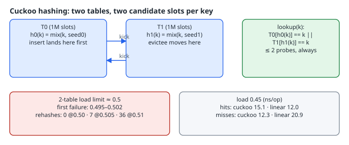

# Cuckoo Hashing: Two Tables, Two Probes, and the 50% Wall

## Thesis

Linear probing gives you a good *average* lookup but no bound on the worst case. A miss keeps walking until it reaches an empty slot, and clusters grow as the table fills. Cuckoo hashing (Pagh & Rodler, [BRICS RS-01-32](https://www.brics.dk/RS/01/32/BRICS-RS-01-32.pdf)) turns that around. Every key has exactly **two** possible homes, one in each of two tables, so a lookup reads at most two slots, hit or miss. Inserts pay instead. A new key evicts the current occupant, the evictee moves to its *other* home, and so on. Occasionally the chain never ends and the whole table has to be rebuilt with new hash functions.

This chapter builds a 2-table cuckoo set for `uint64_t` keys in about 130 lines of C23 and measures three things on 2 × 1M slots:

- how full it gets before the first failed insert,
- what rehash-on-failure costs as you approach that limit,
- hit and miss latency against linear probing at the same load.

Everything was built with gcc 14.2.0 `-O2` on an 8-vCPU Intel Xeon VM.

{fig-alt="Each key k has one slot in T0 at h0(k) and one in T1 at h1(k). Lookup checks exactly those two. Insert lands in T0 and evicts the resident to its slot in T1, and so on for up to 500 kicks, otherwise rebuild with new seeds. Measured on 2 x 1M slots: first failure at load 0.495 to 0.502 across three seeds; with rehash-on-failure, 0 rehashes up to 0.500, 7 at 0.505, 36 at 0.510. At load 0.45, hits took 15.1 ns for cuckoo vs 12.0 ns for linear probing (1.41 probes), and misses 12.3 ns vs 20.9 ns (2.15 probes)."}

## The structure

Two power-of-two tables share one hash family (the splitmix64 finaliser) with different seeds. Key `0` is reserved to mean "empty".

```c
#define EMPTY 0               /* key 0 reserved as "empty" */
#define MAX_KICKS 500
/* hits are odd keys, misses are even keys: the two sets can never overlap */
#define KEY(miss, i) ((miss) ? (mix((i), 31337) << 1) : (mix((i), 99) | 1))

static uint64_t mix(uint64_t x, uint64_t seed) {        /* splitmix64 finaliser */
    x += seed + 0x9e3779b97f4a7c15ull;
    x = (x ^ (x >> 30)) * 0xbf58476d1ce4e5b9ull;
    x = (x ^ (x >> 27)) * 0x94d049bb133111ebull;
    return x ^ (x >> 31);
}

typedef struct { uint64_t *t[2]; size_t mask; uint64_t seed[2]; size_t n, rehashes; } Cuckoo;

static size_t slot(const Cuckoo *c, int w, uint64_t k) { return mix(k, c->seed[w]) & c->mask; }

static bool ck_contains(const Cuckoo *c, uint64_t k) {  /* at most two probes, always */
    return c->t[0][slot(c, 0, k)] == k || c->t[1][slot(c, 1, k)] == k;
}
```

`ck_contains` has no loop. It does at most two loads and two compares, whether the key is present or not, and stops after one if `T0` matches. That is the whole appeal.

## Insert: kick until something is empty

```c
/* Insert; on failure rehash everything with fresh seeds (same size). */
static bool ck_insert(Cuckoo *c, uint64_t k, uint64_t *homeless_out) {
    if (ck_contains(c, k)) return true;
    int w = 0; uint64_t cur = k;
    for (int kick = 0; kick < MAX_KICKS; kick++) {
        uint64_t *s = &c->t[w][slot(c, w, cur)];
        uint64_t ev = *s; *s = cur;
        if (ev == EMPTY) { c->n++; return true; }
        cur = ev; w ^= 1;
    }
    *homeless_out = cur;                     /* someone is left without a slot */
    return false;
}
```

Each eviction sends the displaced key to its slot in the *other* table (`w ^= 1`). If the walk hasn't reached an empty slot after `MAX_KICKS` steps, it has almost certainly entered a cycle: a group of keys whose candidate slots form a closed loop with more keys than slots. The function then returns the key that was left holding no slot. That may not be the key you tried to insert. It's whoever was evicted last, and a naive implementation that just returns `false` here has silently lost a resident key.

## Rehash on failure

The standard remedy is to choose new hash functions and rebuild:

```c
/* Failure is not fatal: rebuild both tables with fresh seeds, then retry. */
static void ck_insert_rehash(Cuckoo *c, uint64_t k) {
    uint64_t homeless;
    while (!ck_insert(c, k, &homeless)) {
        size_t per = c->mask + 1, m = 0;
        uint64_t *all = malloc((c->n + 1) * sizeof *all);
        for (int w = 0; w < 2; w++)
            for (size_t i = 0; i < per; i++) if (c->t[w][i] != EMPTY) all[m++] = c->t[w][i];
        all[m++] = homeless;                  /* the key that lost its slot */
        bool ok;
        do {
            c->seed[0] = mix(c->seed[0], 1); c->seed[1] = mix(c->seed[1], 2); c->rehashes++;
            for (int w = 0; w < 2; w++) for (size_t i = 0; i < per; i++) c->t[w][i] = EMPTY;
            c->n = 0; ok = true;
            for (size_t i = 0; i < m && ok; i++) ok = ck_insert(c, all[i], &homeless);
        } while (!ok);
        free(all);
    }
}
```

The homeless key is added to the rebuild list, so nothing is lost. Production tables also *grow* when rehashes start repeating. This chapter keeps the size fixed on purpose, to show where the wall is.

## Measurement 1: where is the wall?

Three seeds, inserting random keys until the first insert fails (`./cuckoo`):

```text
trial 0: first failure after 1053142 keys = load 0.502 of 2097152 slots
trial 1: first failure after 1037278 keys = load 0.495 of 2097152 slots
trial 2: first failure after 1047809 keys = load 0.500 of 2097152 slots
```

All three runs fail within about half a percent of **load 0.5**. That matches the analysis in the paper: two tables of size *r* hold *n* keys with constant expected insert time when *r* ≥ (1 + ε)*n*, so total occupancy stays below ½. The paper's own experiments therefore stop at load factors below ½. The bound is sharp, and the rehash counts show it.

## Measurement 2: what rehashing costs near the wall

The same tables, filled to a target load with `ck_insert_rehash`, then every key checked:

```text
rehash mode, load 0.400: 838860/838860 keys present, 0 full rehashes
rehash mode, load 0.490: 1027604/1027604 keys present, 0 full rehashes
rehash mode, load 0.500: 1048576/1048576 keys present, 0 full rehashes
rehash mode, load 0.505: 1059061/1059061 keys present, 7 full rehashes
rehash mode, load 0.510: 1069547/1069547 keys present, 36 full rehashes
```

Up to 0.500 with these seeds, no rebuilds were needed. One percent past it, there were 36 full rebuilds of a million-key table. That is why real 2-table cuckoo implementations resize at around 40–45% full. Variants that use more hash functions or **buckets of several slots** push the usable load much higher. Li et al., [Algorithmic Improvements for Fast Concurrent Cuckoo Hashing](https://www.cs.cmu.edu/~dga/papers/cuckoo-eurosys14.pdf) (EuroSys 2014), note that 4-way buckets raise space utilisation above 90%, and that the 4-way table in MemC3 reaches a 95% maximum load factor.

## Measurement 3: lookups against linear probing at 0.45

The linear-probing table has the same 2M slots and uses the same hash. Hit keys are odd and miss keys even, so the two sets can never overlap.

```text
load 0.45: cuckoo insert failures 0, linear-probing worst insert probe 35
hits   x 943718: cuckoo 14.9 ns/op (<=2 probes), linear 11.7 ns/op (avg 1.41 probes)
misses x 943718: cuckoo 11.9 ns/op (<=2 probes), linear 20.3 ns/op (avg 2.15 probes)
```

Two earlier runs gave hits of 15.4 / 12.3 and 15.1 / 12.0 ns, and misses of 12.7 / 21.1 and 12.3 / 20.9 ns (cuckoo / linear). The diagram uses the second of those runs. The pattern held each time:

- **Hits: linear probing wins.** It averages 1.41 probes, and they're adjacent, so usually one cache line. A cuckoo hit misses in `T0` about half the time and then touches a second, unrelated cache line in `T1`.
- **Misses: cuckoo wins by about 40%.** Linear probing averages 2.15 probes, the classic ½(1 + 1/(1 − α)²) at α = 0.45, and has a long tail. The worst insert in this table walked 35 slots. Cuckoo's miss is still exactly two probes.

One measurement bug is worth recording. The first version drew "miss" keys from the same generator with a different seed. Because `mix` adds the seed to the input, `mix(i, 12345)` equals `mix(i + 12246, 99)`, so most "misses" were really hits. The tell was a linear-probing miss average of 1.43 probes instead of the theoretical 2.15. Splitting the key spaces by parity fixed it.

## When to choose cuckoo

| Workload | Better fit |
|---|---|
| Mostly hits, cache-sensitive, frequent inserts | linear probing (or Robin Hood) |
| Many negative lookups (filters, caches, dedup) | cuckoo |
| Hard latency bound on lookup (packet processing, real-time) | cuckoo: ≤ 2 probes, no tail |
| High occupancy needed | bucketed cuckoo (4 slots/bucket), not 2-table |
| Insert-latency sensitive | not cuckoo: a rehash is a full rebuild |

## Takeaways

- A cuckoo lookup costs at most two probes. Inserts can cascade, and they occasionally fail.
- A failed insert leaves *some* key homeless. Rebuild with new seeds and include that key.
- With two single-slot tables the wall is load 0.5. Measured: 0 rebuilds at 0.500, 36 at 0.510. Resize well before it.
- Use cuckoo for misses and for bounded latency. Linear probing still wins on hits.

## Appendix: linear-probing baseline and benchmark driver

The rest of `cuckoo.c` (build with `gcc -std=c23 -O2 cuckoo.c -o cuckoo`):

```c
#define _POSIX_C_SOURCE 200809L
#include <stdint.h>
#include <stdio.h>
#include <stdlib.h>
#include <stdbool.h>
#include <time.h>
/* ... definitions shown above ... */

typedef struct { uint64_t *t; size_t mask; } Linear;
static void lp_insert(Linear *l, uint64_t k, size_t *maxprobe) {
    size_t i = mix(k, 1) & l->mask, p = 1;
    while (l->t[i] != EMPTY && l->t[i] != k) { i = (i + 1) & l->mask; p++; }
    l->t[i] = k; if (p > *maxprobe) *maxprobe = p;
}
static bool lp_contains(const Linear *l, uint64_t k, size_t *probes) {
    size_t i = mix(k, 1) & l->mask;
    for (;;) { (*probes)++; if (l->t[i] == k) return true; if (l->t[i] == EMPTY) return false; i = (i + 1) & l->mask; }
}

static double now(void) { struct timespec t; clock_gettime(CLOCK_MONOTONIC, &t); return t.tv_sec + t.tv_nsec * 1e-9; }

int main(void) {
    enum { PER = 1 << 20 };                  /* 2 x 1M slots = 2M total for cuckoo */
    /* 1. How full can a 2-table cuckoo get before the first failed insert? */
    for (int trial = 0; trial < 3; trial++) {
        Cuckoo c; ck_init(&c, PER, 11 + trial, 977 + trial);
        uint64_t homeless, k = 1;
        while (ck_insert(&c, mix(k, 42 + trial) | 1, &homeless)) k++;
        printf("trial %d: first failure after %zu keys = load %.3f of %d slots\n",
               trial, c.n, (double)c.n / (2.0 * PER), 2 * PER);
        free(c.t[0]); free(c.t[1]);
    }
    /* 2. Lookups at 45%% load: cuckoo vs linear probing, same 2M slots. */
    size_t N = (size_t)(0.45 * 2 * PER);
    Cuckoo c; ck_init(&c, PER, 7, 1009);
    Linear l = { calloc(2 * PER, sizeof(uint64_t)), 2 * PER - 1 };
    size_t lp_max = 0, fails = 0; uint64_t homeless;
    for (size_t i = 1; i <= N; i++) { uint64_t k = KEY(0, i);
        if (!ck_insert(&c, k, &homeless)) fails++;
        lp_insert(&l, k, &lp_max); }
    printf("load 0.45: cuckoo insert failures %zu, linear-probing worst insert probe %zu\n", fails, lp_max);
    for (int pass = 0; pass < 2; pass++) {
        const char *what = pass ? "misses" : "hits";
        volatile size_t found = 0; size_t probes = 0;
        double best_c = 1e9, best_l = 1e9;
        for (int r = 0; r < 5; r++) {
            double t0 = now();
            for (size_t i = 1; i <= N; i++) found += ck_contains(&c, KEY(pass, i));
            double t1 = now(); probes = 0;
            for (size_t i = 1; i <= N; i++) found += lp_contains(&l, KEY(pass, i), &probes);
            double t2 = now();
            if (t1 - t0 < best_c) best_c = t1 - t0;
            if (t2 - t1 < best_l) best_l = t2 - t1;
        }
        printf("%-6s x %zu: cuckoo %.1f ns/op (<=2 probes), linear %.1f ns/op (avg %.2f probes)\n",
               what, N, best_c * 1e9 / N, best_l * 1e9 / N, (double)probes / N);
    }
    /* 3. With rehash-on-failure, how far can we push it? */
    const double lfs[] = {0.40, 0.49, 0.50, 0.505, 0.51};
    for (int li = 0; li < 5; li++) { double lf = lfs[li]; {
        Cuckoo r; ck_init(&r, PER, 5, 6);
        size_t want = (size_t)(lf * 2 * PER);
        for (size_t i = 1; i <= want; i++) ck_insert_rehash(&r, KEY(0, i));
        size_t ok = 0; for (size_t i = 1; i <= want; i++) ok += ck_contains(&r, KEY(0, i));
        printf("rehash mode, load %.3f: %zu/%zu keys present, %zu full rehashes\n", lf, ok, want, r.rehashes);
        free(r.t[0]); free(r.t[1]);
        fflush(stdout);
    }}
    return 0;
}
```
