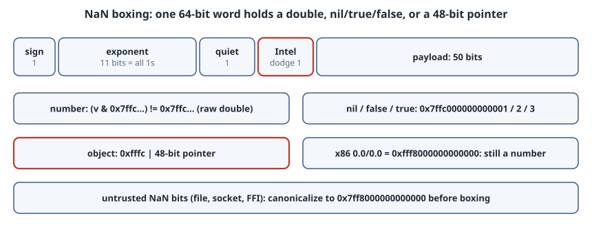

# NaN Boxing: A Dynamic Value in One 64-bit Word

## Thesis

A dynamically typed interpreter needs a `Value` that can be a number, `nil`, a boolean or a pointer to a heap object. The textbook C version is a tagged union: an `int` tag next to a `union`. On x86-64 that takes **16 bytes**, half of which is tag and padding.

**NaN boxing** uses **8 bytes**. An IEEE 754 double has 2⁵² distinct quiet-NaN bit patterns (the sign bit plus 51 free fraction bits), but arithmetic only needs one of them. The spare patterns can hold a tag and a 48-bit pointer, and every non-NaN bit pattern is simply a `double`. JavaScriptCore, SpiderMonkey and LuaJIT all use variants of this layout, and *Crafting Interpreters* builds one for clox.

The trick is easy to get subtly wrong. The two classic bugs are (1) picking a mask that the CPU's own default NaN matches, and (2) boxing NaN bits that came from outside without checking them. This chapter builds the encoding with `memcpy` (no strict-aliasing UB), then reproduces both bugs and measures the payoff. All output is from GCC 14.2.0 on an x86-64 Linux VM.

{fig-alt="A 64-bit IEEE 754 double has 1 sign bit, 11 exponent bits and 52 fraction bits. When all exponent bits are 1 and the top fraction bit (quiet) is 1, the value is a quiet NaN and the remaining bits are free. The scheme uses mask 0x7ffc000000000000, which sets the exponent, the quiet bit and one more bit to avoid Intel's default NaN 0xfff8000000000000. Numbers are any word that does not have all mask bits set. nil, false and true are 0x7ffc000000000001, ...2 and ...3. Objects set the sign bit too, 0xfffc in the top 16 bits, with a 48-bit pointer in the low bits. NaNs from outside must be canonicalized to 0x7ff8000000000000 before boxing."}

## The bit budget

A binary64 is laid out as `sign(1) | exponent(11) | fraction(52)`. If all 11 exponent bits are 1 and the fraction is non-zero, the value is a NaN. If the top fraction bit (bit 51) is also set, it is a *quiet* NaN, which propagates through arithmetic without trapping.

That leaves the sign bit and 51 fraction bits free. The encoding below (the clox layout) uses them like this:

- **mask `0x7ffc000000000000`**: exponent all ones, the quiet bit, *and bit 50*. Bit 50 is the "Intel dodge" explained below.
- **singletons**: `nil`, `false` and `true` are the mask plus 1, 2 and 3 in the low bits.
- **objects**: the mask plus the sign bit (`0xfffc` in the top 16 bits), with the pointer in the low 48 bits.
- **numbers**: everything else, stored as the raw `double` bits.

## The encoding, without undefined behaviour

Reading a `double` through a `uint64_t *` breaks C's effective-type (strict aliasing) rules. `memcpy` between objects of the same size is the portable way to reinterpret the bits, and GCC and Clang compile it to a plain register move at `-O2`.

```c
#ifndef VALUE_H
#define VALUE_H
#include <stdbool.h>
#include <stdint.h>
#include <string.h>

typedef uint64_t Value;

#define SIGN_BIT ((uint64_t)0x8000000000000000)
#define QNAN     ((uint64_t)0x7ffc000000000000)

#define TAG_NIL   1
#define TAG_FALSE 2
#define TAG_TRUE  3

#define NIL_VAL   ((Value)(QNAN | TAG_NIL))
#define FALSE_VAL ((Value)(QNAN | TAG_FALSE))
#define TRUE_VAL  ((Value)(QNAN | TAG_TRUE))

static inline Value num_val(double d) { Value v; memcpy(&v, &d, sizeof v); return v; }
static inline double as_num(Value v)  { double d; memcpy(&d, &v, sizeof d); return d; }
static inline bool is_num(Value v)    { return (v & QNAN) != QNAN; }
static inline bool is_nil(Value v)    { return v == NIL_VAL; }
static inline bool is_bool(Value v)   { return (v | 1) == TRUE_VAL; }
static inline bool as_bool(Value v)   { return v == TRUE_VAL; }
static inline Value bool_val(bool b)  { return b ? TRUE_VAL : FALSE_VAL; }

static inline bool is_obj(Value v)    { return (v & (QNAN | SIGN_BIT)) == (QNAN | SIGN_BIT); }
static inline Value obj_val(void *p)  { return SIGN_BIT | QNAN | (uint64_t)(uintptr_t)p; }
static inline void *as_obj(Value v)   { return (void *)(uintptr_t)(v & ~(SIGN_BIT | QNAN)); }
#endif
```

`is_bool` uses a small trick: `false` (…2) and `true` (…3) differ only in bit 0, so OR-ing in 1 maps both to `TRUE_VAL`.

## What the words look like

`demo.c` boxes a selection of values and classifies them:

```text
$ gcc -std=c17 -O2 -Wall -Wextra -o demo demo.c -lm && ./demo
sizeof(Tagged) = 16, sizeof(Value) = 8

1.5            0x3ff8000000000000  number
-0.0           0x8000000000000000  number
INFINITY       0x7ff0000000000000  number
0.0/0.0        0xfff8000000000000  number
sqrt(-1)       0xfff8000000000000  number
NAN macro      0x7ff8000000000000  number
nil            0x7ffc000000000001  nil
true           0x7ffc000000000003  true
false          0x7ffc000000000002  false
malloc ptr     0xfffc555a926f62b0  object

malloc returned 0x555a926f62b0, as_obj gives back 0x555a926f62b0
```

The `Tagged` struct being compared is `struct { int kind; union { double num; bool b; void *obj; } as; }`. That is 4 bytes of tag, 4 bytes of padding and 8 bytes of union.

Notes on the output:

- **`-0.0` and `INFINITY` are ordinary numbers.** Only patterns where all the mask bits are set are claimed for tags.
- **The pointer round-trips.** User-space addresses on x86-64 with 4-level paging fit in 47 bits, so the top 16 bits of the box are free for `0xfffc`.
- **The two NaNs differ.** The C `NAN` macro gives `0x7ff8…`, but the NaN the *hardware* produces for `0.0/0.0` or `sqrt(-1)` is `0xfff8…`, with the sign bit set. That second pattern is why the mask has an extra bit.

## Bug 1: a mask the hardware's own NaN matches

When an x86 SSE operation produces a NaN from non-NaN inputs, it returns the "QNaN floating-point indefinite" value `0xfff8000000000000`. With the obvious quiet-NaN mask `0x7ff8…`, that word has the sign bit and every mask bit set, which is exactly the object pattern:

```text
$ ./naive      # same scheme, QNAN = 0x7ff8000000000000
0.0/0.0 = 0xfff8000000000000  is_num=0 is_obj=1  as_obj=(nil)
```

A script that evaluates `0/0` would get back an "object" whose pointer is `NULL`, and the next field access crashes. Adding bit 50 to the mask (`0x7ffc…`) makes the indefinite value fail `is_obj` and `is_num` correctly reports it as a number, as the first table shows. Arithmetic on boxed numbers can now only produce this indefinite value or pass along an existing input NaN's payload. If every NaN that got in was canonical, arithmetic can never produce a pattern with bit 50 set.

## Bug 2: NaN bits from outside

That last guarantee only holds if every NaN entering the VM came from arithmetic. A `double` decoded from a file, a network packet or an FFI call can carry *any* payload, including one that looks like `nil` or like a pointer:

```c
/* A double that arrived as 8 raw bytes (file, socket, FFI). */
static double decode(uint64_t wire) { double d; memcpy(&d, &wire, sizeof d); return d; }

static Value num_val_checked(double d) {
    if (isnan(d)) d = NAN;            /* canonical quiet NaN: 0x7ff8000000000000 */
    return num_val(d);
}
```

```text
$ ./untrusted
wire 0x7ffc000000000001  isnan=1  raw: nil     checked: number 0x7ff8000000000000
wire 0xfffc0000deadbeef  isnan=1  raw: object  checked: number 0x7ff8000000000000
```

Unchecked, the second word becomes an object pointing at `0xdeadbeef`. That is a forged pointer created from data, which is a memory-safety hole in any VM that runs untrusted input. The rule is to **canonicalize at every boundary**: every path that turns external bits into a `Value` (deserializers, typed-array reads, FFI returns) goes through `num_val_checked`. Arithmetic results don't need the check.

## What it buys: half the memory, fewer cache misses

`bench.c` fills 8,388,608 values (7 numbers to every `nil`) and sums the numbers, once with the tagged union and once with boxed words. It reports the best of 20 passes:

```text
$ gcc -std=c17 -O2 -Wall -Wextra -o bench bench.c && for i in 1 2 3; do ./bench; done
array bytes: tagged 128 MiB, nan-boxed 64 MiB
sum equal: yes (3750756352)
best of 20: tagged 16.33 ms, nan-boxed 10.33 ms
array bytes: tagged 128 MiB, nan-boxed 64 MiB
sum equal: yes (3750756352)
best of 20: tagged 16.31 ms, nan-boxed 10.37 ms
array bytes: tagged 128 MiB, nan-boxed 64 MiB
sum equal: yes (3750756352)
best of 20: tagged 16.51 ms, nan-boxed 10.49 ms
```

The array is half the size, and the scan is about 1.6× faster (10.2–10.4 ms vs 16.1–16.5 ms across three runs) because it streams half as many cache lines. Real interpreters see the same effect on stacks, constant tables and object fields, where `Value`s are stored by the million. This is one machine and one access pattern, so measure your own workload before relying on the number.

## Portability limits

- **Address width.** The scheme assumes pointers fit in 48 bits. With 5-level paging, Linux on x86 can hand out user addresses above 47 bits, but only when `mmap` is given a hint address above that line. Without a hint, allocations stay below 47 bits. An allocator that passes such hints, or a future default change, breaks the encoding. Add a debug assertion that `(uintptr_t)p >> 48 == 0` in `obj_val`.
- **Top-byte tags on arm64.** AArch64 can ignore the top byte of addresses (TBI), and features such as MTE store tags there. A pointer whose top byte isn't zero can't be boxed as-is.
- **32-bit targets.** Pointers fit easily, but the 8-byte `Value` is now larger than a pointer. 32-bit engines usually use a different layout, such as SpiderMonkey's "nunboxing" (a separate tag word next to a payload word) or pointer tagging.
- **Integers.** This scheme has no separate integer type. An integer above 2⁵³ loses precision as a `double`. Engines that need int32 fast paths reserve another tag pattern for them, as JavaScriptCore does.
- **Signalling NaNs and x87.** Moving a value through the x87 FPU (32-bit x86 without SSE2) can turn a signalling NaN into a quiet one. Keep boxed words in integer registers or memory, never in `long double`.

## Takeaways

- NaN boxing fits a number, `nil`, booleans and a 48-bit pointer into one `uint64_t`. Any word that doesn't match the mask is just a `double`.
- Use `memcpy` to convert between `double` and `uint64_t` bits. It's free at `-O2` and avoids strict-aliasing UB.
- Choose the mask so the CPU's default NaN (`0xfff8…` on x86) is never classified as a tag. clox uses `0x7ffc…` for exactly this reason.
- Canonicalize every NaN that comes from outside, or the decoder becomes a way to forge pointers.
- The result is half the memory of a tagged union and a measurably faster scan, provided your pointers really fit in 48 bits.

## Sources

- Robert Nystrom, [*Crafting Interpreters*, ch. 30 "Optimization" — NaN boxing](https://craftinginterpreters.com/optimization.html): the clox layout and the Intel "QNaN Floating-Point Indefinite" dodge.
- [WebKit `JSCJSValue.h`](https://github.com/WebKit/WebKit/blob/main/Source/JavaScriptCore/runtime/JSCJSValue.h): JavaScriptCore's 64-bit value encoding, with int32 and double tagging.
- [ISO/IEC 9899 working draft N3220](https://www.open-std.org/jtc1/sc22/wg14/www/docs/n3220.pdf): §6.5 effective type (aliasing), and Annex F (IEC 60559 floating point).
- cppreference: [object representation and effective type](https://en.cppreference.com/w/c/language/object), [`isnan`](https://en.cppreference.com/w/c/numeric/math/isnan) and [`NAN`](https://en.cppreference.com/w/c/numeric/math/NAN).
- Linux kernel docs: [5-level paging on x86-64](https://docs.kernel.org/arch/x86/x86_64/5level-paging.html) (the 47-bit default and mmap hints) and [arm64 tagged addresses](https://docs.kernel.org/arch/arm64/tagged-pointers.html).
- Intel® 64 and IA-32 Architectures Software Developer's Manual, Vol. 1, §4.8.3.7 "QNaN Floating-Point Indefinite" (intel.com, not fetchable by script).
