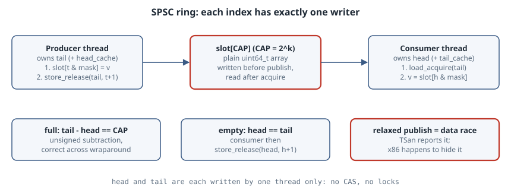

# A Lock-Free SPSC Ring Buffer in C11

## Thesis

A queue with exactly **one producer thread and one consumer thread** is the one lock-free structure that is easy to get right. You don't need compare-and-swap. You need two indices, each written by only one thread, one release store to publish a value, and one acquire load to see it. This chapter builds a 60-line ring buffer and tests the three properties that matter:

- **Ordering:** 50 million values arrive in order.
- **Wraparound:** free-running `size_t` indices that overflow are still correct.
- **Memory order:** ThreadSanitizer catches a relaxed publish that x86 lets through.

It then measures the two standard speed-ups, cache-line padding and cached indices. On this machine one of them did *not* do what the textbooks say.

{fig-alt="The producer thread owns tail and writes slot[tail & mask] with a plain store, then publishes with a release store of tail+1. The consumer owns head; it acquire-loads tail, reads slot[head & mask], then release-stores head+1 to free the slot. Full when tail - head == CAP; empty when head == tail. Indices are free-running size_t values that wrap safely because CAP is a power of two. Optional cached copies (head_cache, tail_cache) skip the cross-core load until the queue looks full or empty."}

Everything here was run with GCC 14.2.0 (`-std=c23`) on Linux 6.12, on an 8-vCPU x86-64 Xeon VM with 64-byte cache lines.

## The design in four rules

1. **One writer per index.** Only the producer stores `tail` and only the consumer stores `head`. Neither thread ever needs read-modify-write on them, so there is no CAS loop and no ABA problem.
2. **Free-running indices, power-of-two capacity.** `tail` and `head` count up forever. The slot is `index & (CAP - 1)`, the fill level is `tail - head`, and the queue is full when that equals `CAP`. Unsigned subtraction is defined modulo 2⁶⁴, and a power-of-two `CAP` divides 2⁶⁴, so overflow is harmless. This also avoids the classic "leave one slot empty" trick, which you need if you store the indices already masked, because then full and empty both look like `head == tail`.
3. **Write the slot, *then* release-store the index.** The slot itself is a plain `uint64_t`. What makes it safe to read is the release/acquire pair on `tail`: everything the producer wrote before the release store is visible to a consumer whose acquire load reads that value ([memory_order](https://en.cppreference.com/w/c/atomic/memory_order)). The consumer frees the slot the same way, with a release store of `head` after the read.
4. **Your own index needs only a relaxed load.** Each thread is the only writer of its own index, so reading it never races.

## The code

```c
// spsc.h: bounded single-producer/single-consumer ring buffer (C11 atomics)
#ifndef SPSC_H
#define SPSC_H
#include <stdatomic.h>
#include <stdbool.h>
#include <stddef.h>
#include <stdint.h>

#ifndef SPSC_PAD
#define SPSC_PAD 1          /* put head and tail on separate cache lines */
#endif
#ifndef SPSC_CACHE
#define SPSC_CACHE 1        /* keep a private copy of the other side's index */
#endif
#ifndef SPSC_PUBLISH
#define SPSC_PUBLISH memory_order_release
#endif

#define SPSC_CAP 1024u      /* must be a power of two */
#if SPSC_PAD
#define LINE _Alignas(64)
#else
#define LINE
#endif

typedef struct {
    LINE _Atomic size_t head;   /* next slot to read; written only by consumer */
    size_t tail_cache;          /* consumer's last view of tail */
    LINE _Atomic size_t tail;   /* next slot to write; written only by producer */
    size_t head_cache;          /* producer's last view of head */
    LINE uint64_t slot[SPSC_CAP];
} spsc;

static inline bool spsc_push(spsc *q, uint64_t v) {
    size_t t = atomic_load_explicit(&q->tail, memory_order_relaxed);   /* own index */
#if SPSC_CACHE
    if (t - q->head_cache == SPSC_CAP) {
        q->head_cache = atomic_load_explicit(&q->head, memory_order_acquire);
        if (t - q->head_cache == SPSC_CAP) return false;               /* full */
    }
#else
    if (t - atomic_load_explicit(&q->head, memory_order_acquire) == SPSC_CAP) return false;
#endif
    q->slot[t & (SPSC_CAP - 1)] = v;                                   /* plain write */
    atomic_store_explicit(&q->tail, t + 1, SPSC_PUBLISH);              /* publish */
    return true;
}

static inline bool spsc_pop(spsc *q, uint64_t *out) {
    size_t h = atomic_load_explicit(&q->head, memory_order_relaxed);   /* own index */
#if SPSC_CACHE
    if (h == q->tail_cache) {
        q->tail_cache = atomic_load_explicit(&q->tail, memory_order_acquire);
        if (h == q->tail_cache) return false;                          /* empty */
    }
#else
    if (h == atomic_load_explicit(&q->tail, memory_order_acquire)) return false;
#endif
    *out = q->slot[h & (SPSC_CAP - 1)];                                /* plain read */
    atomic_store_explicit(&q->head, h + 1, memory_order_release);      /* free the slot */
    return true;
}
#endif
```

`SPSC_PAD`, `SPSC_CACHE` and `SPSC_PUBLISH` are compile-time switches for the experiments below. Production code would pick one setting and remove the `#if`s.

`tail_cache` and `head_cache` are **plain** fields. Each one is touched by only one thread: `tail_cache` by the consumer and `head_cache` by the producer. They keep that thread's last view of the *other* thread's index, so the expensive cross-core load only happens when the queue looks full (for the producer) or empty (for the consumer).

## Test 1: order and integrity under load

The benchmark pins the producer to one CPU and the consumer to another ([`pthread_setaffinity_np`](https://man7.org/linux/man-pages/man3/pthread_setaffinity_np.3.html)), pushes 1..N, and checks that every value comes out in order and that the sum is N(N+1)/2. It also counts how often `pop` found the queue empty and how often `push` found it full:

```c
// bench.c: move N values through the ring, check order and sum, report Mops/s
#define _GNU_SOURCE
#include "spsc.h"
#include <pthread.h>
#include <sched.h>
#include <stdio.h>
#include <stdlib.h>
#include <time.h>

#ifndef N
#define N 50000000ull
#endif
static spsc q;
static uint64_t full_spins;   /* producer only */

static void pin(int cpu) {
    cpu_set_t s; CPU_ZERO(&s); CPU_SET(cpu, &s);
    pthread_setaffinity_np(pthread_self(), sizeof s, &s);
}

static void *producer(void *arg) {
    (void)arg; pin(PCPU);
    for (uint64_t i = 1; i <= N; i++)
        while (!spsc_push(&q, i)) full_spins++;
    return NULL;
}

int main(void) {
    pthread_t p;
    struct timespec a, b;
    clock_gettime(CLOCK_MONOTONIC, &a);
    pthread_create(&p, NULL, producer, NULL);
    pin(CCPU);
    uint64_t v, expect = 1, sum = 0, empty_spins = 0;
    while (expect <= N) {
        if (!spsc_pop(&q, &v)) { empty_spins++; continue; }
        if (v != expect) { printf("ORDER BUG: got %llu want %llu\n",
                                  (unsigned long long)v, (unsigned long long)expect); return 1; }
        sum += v; expect++;
    }
    pthread_join(p, NULL);
    clock_gettime(CLOCK_MONOTONIC, &b);
    double s = (b.tv_sec - a.tv_sec) + (b.tv_nsec - a.tv_nsec) / 1e9;
    printf("pad=%d cache=%d  sum ok=%d  %.3f s  %6.1f Mops/s  empty/item %.2f  full/item %.2f\n",
           SPSC_PAD, SPSC_CACHE, sum == N * (N + 1) / 2, s, N / s / 1e6,
           (double)empty_spins / N, (double)full_spins / N);
    return 0;
}
```

## Test 2: wraparound

Start both indices three steps before `SIZE_MAX`, push six values, drain them, then fill the queue to capacity:

```c
// wrap.c: free-running indices survive size_t overflow because only t - h is used
#include "spsc.h"
#include <stdio.h>

static spsc q;

int main(void) {
    size_t start = SIZE_MAX - 2;               /* three increments from wrapping */
    atomic_store(&q.head, start); atomic_store(&q.tail, start);
    q.head_cache = q.tail_cache = start;
    for (uint64_t i = 0; i < 6; i++) spsc_push(&q, 100 + i);
    printf("tail=%zu head=%zu  tail-head=%zu\n",
           atomic_load(&q.tail), atomic_load(&q.head), atomic_load(&q.tail) - atomic_load(&q.head));
    uint64_t v;
    while (spsc_pop(&q, &v)) printf("%llu ", (unsigned long long)v);
    printf("\nfill to capacity: ");
    unsigned n = 0;
    while (spsc_push(&q, n)) n++;
    printf("%u pushes accepted (SPSC_CAP=%u)\n", n, SPSC_CAP);
    return 0;
}
```

```text
$ gcc -std=c23 -O2 -Wall -Wextra wrap.c -o wrap && ./wrap
tail=3 head=18446744073709551613  tail-head=6
100 101 102 103 104 105 
fill to capacity: 1024 pushes accepted (SPSC_CAP=1024)
```

`tail` wrapped to 3 while `head` is still near 2⁶⁴, `tail - head` is correctly 6, the values come out in order, and exactly 1024 pushes fit. No slot is wasted.

## Test 3: what a relaxed publish breaks

The correct build is clean under ThreadSanitizer ([manual](https://github.com/google/sanitizers/wiki/ThreadSanitizerCppManual)):

```text
$ gcc -std=c23 -O1 -g -pthread -fsanitize=thread -DPCPU=2 -DCCPU=6 -DN=200000ull bench.c -o tsan_ok && ./tsan_ok
pad=1 cache=1  sum ok=1  0.113 s     1.8 Mops/s  empty/item 0.12  full/item 0.00
```

Now change the publishing store of `tail` to `memory_order_relaxed`:

```text
$ gcc -std=c23 -O1 -g -pthread -fsanitize=thread -DPCPU=2 -DCCPU=6 -DN=200000ull \
      -DSPSC_PUBLISH=memory_order_relaxed bench.c -o tsan_bad && ./tsan_bad
==================
WARNING: ThreadSanitizer: data race (pid=1646727)
  Read of size 8 at 0x5564fca84180 by main thread:
    #0 spsc_pop /tmp/spsc/spsc.h:59 (tsan_bad+0x1458) (BuildId: 433919b12514ebb5e569e3c46ed5d59507d477d4)
    #1 main /tmp/spsc/bench.c:36 (tsan_bad+0x1458)

  Previous write of size 8 at 0x5564fca84180 by thread T1:
    #0 spsc_push /tmp/spsc/spsc.h:44 (tsan_bad+0x1302) (BuildId: 433919b12514ebb5e569e3c46ed5d59507d477d4)
    #1 producer /tmp/spsc/bench.c:24 (tsan_bad+0x1302)

  Location is global 'q' of size 8320 at 0x5564fca84100 (tsan_bad+0x4180)

  Thread T1 (tid=1646729, running) created by main thread at:
    #0 pthread_create ../../../../src/libsanitizer/tsan/tsan_interceptors_posix.cpp:1022 (libtsan.so.2+0x568a6) (BuildId: 99ef88596cb10a8ccf307fe1a9070f66a44b1624)
    #1 main /tmp/spsc/bench.c:32 (tsan_bad+0x1397) (BuildId: 433919b12514ebb5e569e3c46ed5d59507d477d4)

SUMMARY: ThreadSanitizer: data race /tmp/spsc/spsc.h:59 in spsc_pop
==================
ThreadSanitizer: reported 1 warnings
pad=1 cache=1  sum ok=1  0.152 s     1.3 Mops/s  empty/item 0.00  full/item 4.04
```

TSan reports the plain read of the slot (`spsc.h:59`) racing with the plain write (`spsc.h:44`). With a relaxed store there is no happens-before edge between them, so the consumer can see the new `tail` before it sees the value. Note the last line, though: **`sum ok=1`**. On x86-64 a release store and a relaxed store both compile to an ordinary `mov`, and the hardware doesn't reorder stores with other stores, so the broken version *worked* here. It is still undefined behaviour. The compiler is allowed to move the slot write below the relaxed store, and weakly ordered CPUs such as Arm and POWER can reorder them in hardware. Passing tests on x86 proves nothing about memory order. Run TSan.

## Test 4: padding and cached indices, measured

The usual advice is (a) put `head` and `tail` on separate cache lines so the two cores don't fight over one line, and (b) cache the other thread's index so you only read it when you have to. Here are the four combinations, three rounds each, 50 M items per run:

```text
$ for p in 0 1; do for c in 0 1; do
    gcc -std=c23 -O2 -pthread -DPCPU=2 -DCCPU=6 -DSPSC_PAD=$p -DSPSC_CACHE=$c bench.c -o b && ./b
  done; done   # repeated 3 times
pad=0 cache=0  sum ok=1  0.501 s    99.7 Mops/s  empty/item 0.49  full/item 0.03
pad=0 cache=1  sum ok=1  0.256 s   195.4 Mops/s  empty/item 0.03  full/item 0.00
pad=1 cache=0  sum ok=1  1.158 s    43.2 Mops/s  empty/item 4.90  full/item 0.02
pad=1 cache=1  sum ok=1  1.041 s    48.0 Mops/s  empty/item 2.49  full/item 0.01
pad=0 cache=0  sum ok=1  0.283 s   176.7 Mops/s  empty/item 0.07  full/item 0.05
pad=0 cache=1  sum ok=1  0.294 s   170.1 Mops/s  empty/item 0.03  full/item 0.02
pad=1 cache=0  sum ok=1  1.566 s    31.9 Mops/s  empty/item 8.41  full/item 0.02
pad=1 cache=1  sum ok=1  0.502 s    99.5 Mops/s  empty/item 0.86  full/item 0.07
pad=0 cache=0  sum ok=1  0.551 s    90.7 Mops/s  empty/item 0.77  full/item 0.12
pad=0 cache=1  sum ok=1  0.318 s   157.4 Mops/s  empty/item 0.05  full/item 0.00
pad=1 cache=0  sum ok=1  1.466 s    34.1 Mops/s  empty/item 6.25  full/item 0.02
pad=1 cache=1  sum ok=1  1.102 s    45.4 Mops/s  empty/item 2.78  full/item 0.02
```

What the numbers show on this VM:

- **Cached indices were the more dependable win.** With padding they raised throughput from 32–43 Mops/s to 45–100 Mops/s. Without padding they gave 157–195 Mops/s, against 91–177 Mops/s uncached. In round 2 the two were within noise of each other.
- **Padding on its own made things slower here, not faster.** `pad=1 cache=0` was the slowest configuration in every round, at 32 to 43 Mops/s against 91 to 177 Mops/s for `pad=0 cache=0`. That goes against the usual advice, so the counters matter. In the slow runs, `empty/item` is between 4.9 and 8.4. The consumer kept catching up with the producer and spinning on an empty queue, which means it re-reads `tail` immediately after nearly every push. In that "always nearly empty" regime each item costs cache-line transfers whatever the layout, and splitting the indices across lines didn't help on this hardware.
- **The spread is large.** The same configuration varied by more than 2× between rounds (`pad=1 cache=1`: 45 to 100 Mops/s). One run proves nothing, so repeat runs and report the range.

The usual advice is aimed at a different situation: a producer and consumer running at similar speeds with the queue partly full. There, false sharing between `head` and `tail` is a real cost. **Measure your own workload on your own hardware** before you add `_Alignas(64)`. If the consumer is much faster than the producer, consider batching: pop everything available up to the cached `tail` before going back to the shared index.

## Pitfalls

- **More than one producer or consumer.** All of this depends on one writer per index. A second producer makes `tail` a contended read-modify-write and the design breaks. Use an MPSC or MPMC queue for that case.
- **Non-power-of-two capacity with `&`.** The mask only works for 2ᵏ. With modulo instead of a mask, free-running indices are wrong at the 2⁶⁴ wrap unless `CAP` divides 2⁶⁴.
- **Storing pointers to stack data.** The consumer may read a slot long after the producer's frame is gone. Store values or owned heap pointers.
- **Spinning forever.** The benchmark busy-waits. A real queue needs a back-off or blocking path (`futex`, `eventfd`, condition variable) for when the other side is idle.
- **Trusting x86.** See Test 3.

## Takeaways

- An SPSC ring needs two single-writer indices and one release/acquire pair per direction. No CAS is involved.
- Free-running unsigned indices with a power-of-two capacity handle full/empty and wraparound with a single subtraction.
- `memory_order_relaxed` on the publish is a real data race that x86 hides. ThreadSanitizer finds it.
- Cached indices helped in all but one round. Cache-line padding did not help here when the consumer kept outrunning the producer. Measure before and after.

## Sources

- cppreference, [`memory_order`](https://en.cppreference.com/w/c/atomic/memory_order) (release/acquire synchronization)
- Linux kernel documentation, [Circular Buffers](https://www.kernel.org/doc/html/latest/core-api/circular-buffers.html) (power-of-two indexing and the producer/consumer barrier pairing)
- Google Sanitizers, [ThreadSanitizer C/C++ manual](https://github.com/google/sanitizers/wiki/ThreadSanitizerCppManual)
- Linux man-pages, [`pthread_setaffinity_np(3)`](https://man7.org/linux/man-pages/man3/pthread_setaffinity_np.3.html)
- Erik Rigtorp, [Optimizing a ring buffer for throughput](https://rigtorp.se/ringbuffer/) (the cached-index technique)
