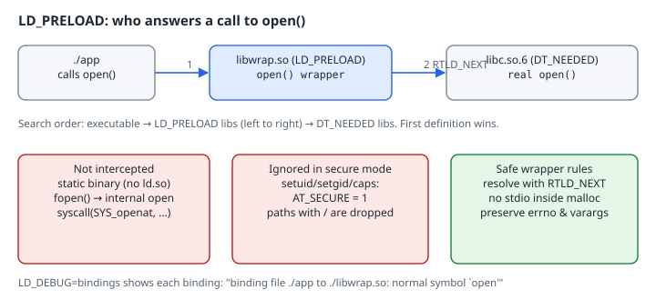

# Function Interposition with LD_PRELOAD

## Thesis

On a dynamically linked Linux program, every call to an exported library function such as `open` or `malloc` is resolved by the dynamic loader `ld.so` at run time. `LD_PRELOAD` puts your own shared object at the front of that search, so your definition wins. Inside the wrapper, `dlsym(RTLD_NEXT, "open")` hands you the definition that *would* have been used, so you can log, count, or fake a call and then pass it through. You don't need to recompile, relink, or have the source.

The technique is useful for tracing, fault injection and test doubles. It is also easy to get subtly wrong. This chapter builds a working shim, then shows the four places where it silently does nothing.

## Mental model

{fig-alt="Three boxes in a row: ./app calls open(); libwrap.so, loaded by LD_PRELOAD, provides an open() wrapper; libc.so.6, a DT_NEEDED library, provides the real open(). Arrow 1 goes from app to the wrapper, and arrow 2, labelled RTLD_NEXT, goes from the wrapper to libc. The search order is executable, then LD_PRELOAD libraries left to right, then DT_NEEDED libraries, and the first definition wins. Below are three panels. Not intercepted: static binaries, fopen's internal open, and syscall(SYS_openat). Ignored in secure mode: setuid, setgid or capabilities set AT_SECURE to 1, and preload paths containing a slash are dropped. Safe wrapper rules: resolve with RTLD_NEXT, no stdio inside malloc, and preserve errno and varargs."}

`ld.so(8)` defines the order. The loader builds one global lookup scope: the executable first, then each `LD_PRELOAD` object in order, then the `DT_NEEDED` dependencies breadth-first. A reference to `open` binds to the **first** object in that scope that defines it. `RTLD_NEXT` is a pseudo-handle for `dlsym(3)` that means "search the objects *after* the one making this call", which is exactly the real implementation.

## Worked example

Verified on Debian 13 with **GCC 14.2** and **glibc 2.41** (x86-64).

The target is an ordinary program that you won't modify:

```c
/* app.c - an ordinary program that allocates and opens a file */
#include <fcntl.h>
#include <stdio.h>
#include <stdlib.h>
#include <string.h>
#include <unistd.h>

int main(void) {
  char *buf = malloc(64);
  if (!buf) return 1;
  strcpy(buf, "hello");
  int fd = open("/etc/hostname", O_RDONLY);
  printf("app: buf=%s fd=%d\n", buf, fd);
  if (fd >= 0) close(fd);
  free(buf);
  return 0;
}
```

The shim wraps `open` (logging the path and result) and counts `malloc` calls, printing the total from a destructor when the process exits:

```c
/* wrap.c - LD_PRELOAD shim that wraps open() and counts malloc() */
#define _GNU_SOURCE
#include <dlfcn.h>
#include <errno.h>
#include <fcntl.h>
#include <stdarg.h>
#include <stdatomic.h>
#include <stdio.h>
#include <stdlib.h>
#include <string.h>
#include <unistd.h>

static atomic_long n_malloc;

static void say(const char *msg) {          /* no stdio: safe inside malloc */
  ssize_t r = write(2, msg, strlen(msg));
  (void)r;
}

int open(const char *path, int flags, ...) {
  static int (*real_open)(const char *, int, ...);
  if (!real_open)
    real_open = (int (*)(const char *, int, ...))dlsym(RTLD_NEXT, "open");
  mode_t mode = 0;
  if (flags & (O_CREAT | O_TMPFILE)) {
    va_list ap;
    va_start(ap, flags);
    mode = (mode_t)va_arg(ap, int);
    va_end(ap);
  }
  int fd = real_open(path, flags, mode);
  int saved = errno;                         /* logging must not clobber errno */
  char line[256];
  int len = snprintf(line, sizeof line, "[wrap] open(\"%s\") = %d\n", path, fd);
  if (len > 0) say(line);
  errno = saved;
  return fd;
}

extern void *__libc_malloc(size_t);          /* glibc: avoids dlsym recursion */

void *malloc(size_t n) {
  atomic_fetch_add(&n_malloc, 1);
  return __libc_malloc(n);
}

__attribute__((destructor)) static void report(void) {
  char line[64];
  int len = snprintf(line, sizeof line, "[wrap] malloc calls: %ld\n",
                     atomic_load(&n_malloc));
  if (len > 0) say(line);
}
```

```bash
gcc -O2 -Wall -o app app.c
gcc -O2 -Wall -fPIC -shared -o libwrap.so wrap.c
./app
LD_PRELOAD=./libwrap.so ./app
```

```text
app: buf=hello fd=5
[wrap] open("/etc/hostname") = 5
[wrap] malloc calls: 2
app: buf=hello fd=5
```

The first line comes from the plain run, and the next three from the preloaded run. (`fd=5` instead of `3` only means the lab shell already had descriptors 3 and 4 open.) Two details are worth noticing:

- The program's `printf` line appears **after** the destructor's line. Stdout went to a pipe, so it was fully buffered and only flushed during `exit`, after the shim's destructor ran. The shim writes straight to fd 2 with `write(2)` and isn't buffered.
- The count is 2, not 1. The program called `malloc` once, and stdio allocated its own buffer on the first `printf`. Interposition catches **every** caller of the exported symbol, including libc's.

Since glibc 2.34, `dlsym` lives in libc itself, so you no longer need `-ldl`. Older toolchains still need it.

### Proving the binding with LD_DEBUG

`LD_DEBUG=bindings` makes the loader print each symbol binding it performs:

```bash
LD_DEBUG=bindings LD_PRELOAD=./libwrap.so ./app 2>&1 | grep -E "symbol .(open|malloc)'"
```

```text
   1242272:	binding file /lib/x86_64-linux-gnu/libc.so.6 [0] to ./libwrap.so [0]: normal symbol `malloc' [GLIBC_2.2.5]
   1242272:	binding file ./app [0] to ./libwrap.so [0]: normal symbol `malloc' [GLIBC_2.2.5]
   1242272:	binding file ./app [0] to ./libwrap.so [0]: normal symbol `malloc' [GLIBC_2.2.5]
   1242272:	binding file ./app [0] to ./libwrap.so [0]: normal symbol `open' [GLIBC_2.2.5]
   1242272:	binding file ./libwrap.so [0] to /lib/x86_64-linux-gnu/libc.so.6 [0]: normal symbol `open'
```

The number at the start of each line is the process ID. The first line shows libc binding its *own* `malloc` reference to the shim, which is why the count includes stdio's buffer. The last line is the `dlsym(RTLD_NEXT, "open")` lookup: the shim's reference resolves to libc's `open`, the next definition in the search order.

### errno has to survive the wrapper

Callers read `errno` right after a failed call. Anything the wrapper does after the real call, such as `snprintf` or `write`, may change it, so the shim saves and restores `errno`:

```c
/* missing.c - errno must survive the wrapper */
#include <errno.h>
#include <fcntl.h>
#include <stdio.h>
#include <string.h>
int main(void) {
  int fd = open("/no/such/file", O_RDONLY);
  printf("fd=%d errno=%s\n", fd, strerror(errno));
  return 0;
}
```

```text
[wrap] open("/no/such/file") = -1
[wrap] malloc calls: 3
fd=-1 errno=No such file or directory
```

## Where interposition silently does nothing

### 1. Static binaries

```bash
gcc -O2 -static -o app-static app.c
LD_PRELOAD=./libwrap.so ./app-static
```

```text
app: buf=hello fd=5
```

A static executable has no `PT_INTERP`, so `ld.so` never runs and nobody reads `LD_PRELOAD`. Nothing is printed and there is no error.

### 2. Calls made inside libc

```c
/* fopen.c - fopen() reaches the kernel without calling the exported open() */
#include <stdio.h>
int main(void) {
  FILE *f = fopen("/etc/hostname", "r");
  printf("fopen: %s\n", f ? "ok" : "failed");
  if (f) fclose(f);
  return 0;
}
```

```text
[wrap] malloc calls: 2
fopen: ok
```

`fopen` opened the file, but the `open` wrapper never fired. glibc calls its internal, non-exported `__open` alias (it ends up in the `openat` syscall), and internal calls don't go through the dynamic symbol table. `malloc` *is* still caught here, because glibc deliberately routes its allocations through the interposable `malloc` symbol. Before you rely on intercepting a function, check how libc reaches it, or wrap the internal entry points (`fopen`, `openat`, `open64`) as well.

### 3. Raw system calls

`syscall(SYS_openat, ...)` and inline `syscall` instructions (common in Go binaries and in some runtimes) never call a library function. To observe those you need `strace`, seccomp or eBPF, not `LD_PRELOAD`.

### 4. Secure-execution mode

When the kernel starts a set-user-ID or set-group-ID program, or one with file capabilities, it passes `AT_SECURE=1` in the auxiliary vector (see `getauxval(3)`). In that mode, `ld.so(8)` documents that `LD_PRELOAD` entries containing a slash are ignored. Only libraries found in the standard search directories are loaded, and only if they are themselves set-user-ID. Without this rule, any user could inject code into `passwd`. This chapter doesn't reproduce the case, because building a setuid binary needs root; the behaviour above is taken from the man page.

## Writing a wrapper that doesn't bite

- **Match the prototype exactly**, including varargs. `open` takes a third `mode_t` argument only for `O_CREAT`/`O_TMPFILE`, so read it with `va_arg` only then.
- **Don't recurse through `malloc`.** `dlsym` and stdio may allocate. In the `malloc` wrapper, call glibc's `__libc_malloc` (glibc-specific) or use a small static bootstrap buffer, and log with `write(2)`, not `printf`.
- **Preserve `errno`**, and return exactly what the real function returned.
- **Wrap the whole family.** `open`, `open64`, `openat` and `__open_2` (used by `_FORTIFY_SOURCE`) are different symbols.
- **Make it thread-safe.** Use atomics for counters. The lazy `real_open` initialization above is a benign race on x86-64 (every thread stores the same pointer), but use `pthread_once` if the setup does more.
- **Remember the destructor order.** Output from destructors can appear before the program's buffered stdout, as the first run shows.

## Try this

1. Add `fopen` to the shim and confirm that `./fopen` now logs.
2. Make `malloc` fail on its 3rd call (set `errno = ENOMEM`, then `return NULL`) and watch how `app` handles out-of-memory. This is cheap fault injection.
3. Run `LD_DEBUG=libs LD_PRELOAD=./libwrap.so ./app` and find where the loader reports loading `libwrap.so` before `libc.so.6`.

## Sources

- `ld.so(8)`: `LD_PRELOAD`, search order, secure-execution mode: <https://man7.org/linux/man-pages/man8/ld.so.8.html>
- `dlsym(3)`: `RTLD_NEXT`: <https://man7.org/linux/man-pages/man3/dlsym.3.html>
- `getauxval(3)`: `AT_SECURE`: <https://man7.org/linux/man-pages/man3/getauxval.3.html>
- glibc manual, "Replacing malloc": <https://sourceware.org/glibc/manual/latest/html_node/Replacing-malloc.html>
- glibc 2.34 release notes (libdl merged into libc): <https://sourceware.org/pipermail/libc-alpha/2021-August/129718.html>
