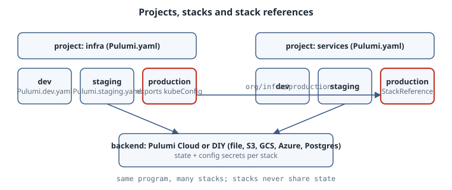

# Projects, Stacks and State

Every Pulumi command you run answers three questions before it touches a cloud API: *which program* (the project), *which copy of it* (the stack), and *where is the record of what already exists* (the backend and its state). Get those three straight and the rest of Pulumi is "write a program that declares resources". Get them wrong and you deploy staging's code into production's state.

::: {.callout-note}
## What was and was not run

The authoring box had no `pulumi` CLI and the run rules forbid installs, so none of the commands below were executed. Command lines, file names and behaviour follow the current Pulumi documentation. The CLI listings are reproduced from that documentation, not captured locally, and are marked as such. Examples use Python. Every other Pulumi language has an equivalent call, listed in the docs.
:::

## Learning goals

- Read a `Pulumi.yaml` and say which runtime and entrypoint it selects
- Create, select, rename and remove stacks, and explain fully qualified stack names
- Export stack outputs and consume them from another project with a `StackReference`
- Choose between Pulumi Cloud and a DIY backend, and know what `pulumi refresh` does and does not do

{fig-alt="Two Pulumi projects, infra and services, each with dev, staging and production stacks; each services stack reads the matching infra stack's outputs through a StackReference named org/infra/<stack>"}

## Projects: the program and its `Pulumi.yaml`

A **project** is any directory containing a `Pulumi.yaml`. At run time Pulumi walks up from the current directory to the nearest one, and that file decides the project. `pulumi new` creates it.

```yaml
name: webserver
runtime: python
description: A minimal Pulumi program.
```

- `name` is the project name. It also namespaces configuration keys (next chapter).
- `runtime` is one of `nodejs`, `python`, `go`, `dotnet`, `java`, `yaml` or `hcl`.
- Each runtime finds its entrypoint by its own convention: `__main__.py` (or `setup.py`) for Python, `package.json` for Node, the build tool for Go, .NET and Java, `.tf` files for HCL.

The file name must start with a capital `P`. Either `.yaml` or `.yml` works.

For compiled languages you can skip the build at deploy time by pointing at a prebuilt binary:

```yaml
name: my-project
runtime:
  name: go
  options:
    binary: mybinary
```

**Paths.** File paths inside a program are relative to the *working directory*. If the program must find files next to `Pulumi.yaml` regardless of where it was launched, use `pulumi.get_root_directory()` and convert the result to a path relative to the working directory, so plans don't differ between machines.

## Stacks: many instances of one program

A **stack** is an isolated, independently configured instance of the project's program, typically `dev`, `staging`, `production`, or one per feature branch. Each stack has its own configuration and its own state. The program is shared.

```bash
pulumi stack init staging     # create and select
pulumi stack ls               # list stacks of the nearest project
pulumi stack select dev       # change the active stack
pulumi stack                  # show the active stack's resources and outputs
```

The commands `config`, `preview`, `up` and `destroy` act on the **active** stack. Pass `--stack` (or `-s`) in scripts and pipelines rather than relying on whatever was selected last.

### Names

Stack names may contain letters, digits, hyphens, underscores and periods, and must be unique within a project. A stack can be written three ways:

| Form | Meaning |
|------|---------|
| `dev` | Current user or default organization, nearest project |
| `acme/dev` | Organization `acme`, nearest project |
| `acme/webserver/dev` | Fully qualified: organization, project, stack |

On a DIY backend the organization part is always the literal `organization`. Backends initialised by a CLI older than v3.61.0 only understand the short form until upgraded with `pulumi state upgrade`.

### Renaming has consequences

`pulumi stack rename production` changes the value of `pulumi.get_stack()`. If your program uses the stack name in resource names, the next `pulumi up` proposes **replacements**. Read the preview. Sometimes creating a new stack is the safer operation.

A rename across projects (`acme/old-project/prod` to `acme/new-project/prod`) needs two manual follow-ups: change `name` in `Pulumi.yaml`, and rename project-namespaced keys in `Pulumi.<stack>.yaml` (for example `old-project:database` to `new-project:database`). Skip the second step and the program silently sees those values as unset.

### Removing

`pulumi destroy` deletes the stack's resources. `pulumi stack rm` then deletes the empty stack, its history and its `Pulumi.<stack>.yaml`. `pulumi stack rm --force` removes a stack that still has resources, orphaning them. Do not.

## Outputs: what a stack publishes

A stack exports values from the top level of the program:

```python
import pulumi

pulumi.export("x", "hello")
pulumi.export("o", {"num": 42})
```

From the documentation (not run here), reading them back looks like:

```bash
$ pulumi stack output x
hello
$ pulumi stack output --json
{
  "x": "hello",
  "o": {
      "num": 42
  }
}
```

Outputs are effectively JSON-serialised and resolved after the update finishes. Export IDs and names, not whole resource objects, which serialise to large blobs. Secret outputs display as `[secret]` unless you pass `--show-secrets`.

## Stack references: wiring projects together

Large systems split into projects by lifecycle and ownership, for example `infra` (network, cluster) and `services` (apps deployed onto it). The pairing is by environment: `acme/infra/production` feeds `acme/services/production`. A `StackReference` reads another stack's outputs:

```python
import pulumi
from pulumi import StackReference

env = pulumi.get_stack()
infra = StackReference(f"acme/infra/{env}")

kubeconfig = infra.require_output("kubeConfig")
```

Use the fully qualified name. Pulumi records the dependency between stacks. Choose the reader carefully:

| Method | Behaviour | Use |
|--------|-----------|-----|
| `require_output` | Fails the deployment if the output is missing | Default choice; turns a typo into an error |
| `get_output` | Returns an output wrapping `None` if missing | Only when absence is expected and handled |
| `get_output_details` | Awaitable; returns `.value` or `.secret_value` directly | When program logic needs the raw value. Python needs an async entrypoint and SDK 3.254.0 or later |

The referenced stack's outputs are its public interface. Renaming an output is a breaking change for every consumer, just like renaming a function.

## State and backends

Each stack's **state** is Pulumi's record of the resources it manages. `preview` and `up` diff the program against that record, not against the live cloud. The state lives in a **backend**:

- **Pulumi Cloud** (the default, also self-hostable): `pulumi login` with no argument. Updates go through a transactional API with full history.
- **DIY**: object storage you run (S3 or compatible such as MinIO or Ceph, Azure Blob, GCS), a PostgreSQL database, or the local filesystem. `pulumi login <backend-url>`, for example `pulumi login file://~` for local files.

Avoid typing the URL every time by setting `PULUMI_BACKEND_URL` or a `backend.url` in `Pulumi.yaml`. `pulumi whoami -v` shows the user and the backend in use. Credentials for backends are stored in `~/.pulumi/credentials.json`. Your *cloud* credentials are never stored in state. They stay where the CLI runs.

With a DIY backend you take on access control, encryption at rest, backups and auditing yourself. Checkpoint history lives under `.pulumi/history/`, but blob storage is not transactional, so some partial failures cannot be recovered automatically the way Pulumi Cloud recovers them.

**Moving a stack** between backends is `pulumi stack migrate` (CLI v3.254.0 or later). Log in to the target and name the source:

```bash
pulumi login                          # target: Pulumi Cloud
pulumi stack migrate file://~ my-app-production
```

It copies the latest checkpoint and configuration, re-encrypts secrets with the target's secrets provider, and leaves the source untouched.

### Drift and refresh

Pulumi does not query every resource on every run. That is a deliberate choice for speed, predictability and explicit control. A console edit is invisible until you run:

```bash
pulumi refresh              # update state from the cloud; changes no infrastructure
pulumi preview --refresh    # refresh, then show what up would do
pulumi up --refresh         # refresh, then converge to the program
```

After a refresh, the next `up` reverts out-of-band changes unless you also change the program to keep them.

### Raw state

`pulumi stack export --file stack.json` and `pulumi stack import --file stack.json` give you the JSON checkpoint for inspection or emergency repair. An incorrect import can orphan resources. Export first, keep the copy, and prefer the `pulumi state` subcommands for targeted edits.

## Diagnosis

| Symptom | Likely cause | Check |
|---------|--------------|-------|
| `up` acts on the wrong environment | Active stack was not the one you assumed | `pulumi stack ls` (the `*` marks the active one); pass `--stack` |
| CLI says no project (`Pulumi.yaml`) was found | Running outside the project tree | `ls Pulumi.yaml` in the directory or a parent |
| Preview proposes replacing everything after a rename | Stack name used in resource names | Revert the rename, or accept replacement deliberately |
| Config values silently missing after rename | Project-namespaced keys still carry the old name | Inspect `Pulumi.<stack>.yaml` |
| StackReference fails | Wrong qualified name, missing permission, or output not exported | `pulumi stack output -s org/project/stack` |
| Stacks "disappeared" | Logged in to a different backend | `pulumi whoami -v` |
| Plan ignores a console change | No refresh | `pulumi preview --refresh` |

## Operational care

- One project per lifecycle and owner. One stack per environment. Do not encode environments as `if` statements on the stack name for anything bigger than sizes and counts.
- Commit `Pulumi.yaml` and the `Pulumi.<stack>.yaml` files of long-lived stacks (secrets in them are encrypted). Ephemeral stacks usually do not commit theirs.
- In CI, always pass `--stack` with the fully qualified name, and run `preview` in pull requests and `up` on merge.
- Tag stacks (`pulumi stack tag set environment production`) so Pulumi Cloud can group them. Avoid the reserved prefixes `pulumi:`, `gitHub:` and `vcs:`.
- On DIY backends: version the bucket, restrict who can write, and back it up. That bucket *is* your inventory.

## Practice

1. Sketch the project and stack layout for a system with a shared network, a database, and three services, across dev and production. How many stacks, and which references?
2. Write the `StackReference` line a `services` program needs to read `vpcId` from the matching `infra` stack, and justify `require_output` over `get_output`.
3. List what you must do yourself if you choose an S3 DIY backend instead of Pulumi Cloud.

## Recall card

- Project = directory with `Pulumi.yaml` (name, runtime). Stack = one configured instance with its own state.
- `org/project/stack` is the full name. DIY backends use the literal `organization`.
- `pulumi.export` publishes; `StackReference.require_output` consumes.
- Backend = Pulumi Cloud or DIY. `refresh` syncs state from reality, explicitly. `stack migrate` moves between backends.

## Sources

- Pulumi, [Projects](https://www.pulumi.com/docs/iac/concepts/projects/)
- Pulumi, [Stacks](https://www.pulumi.com/docs/iac/concepts/stacks/)
- Pulumi, [State and backends](https://www.pulumi.com/docs/iac/concepts/state-and-backends/)
