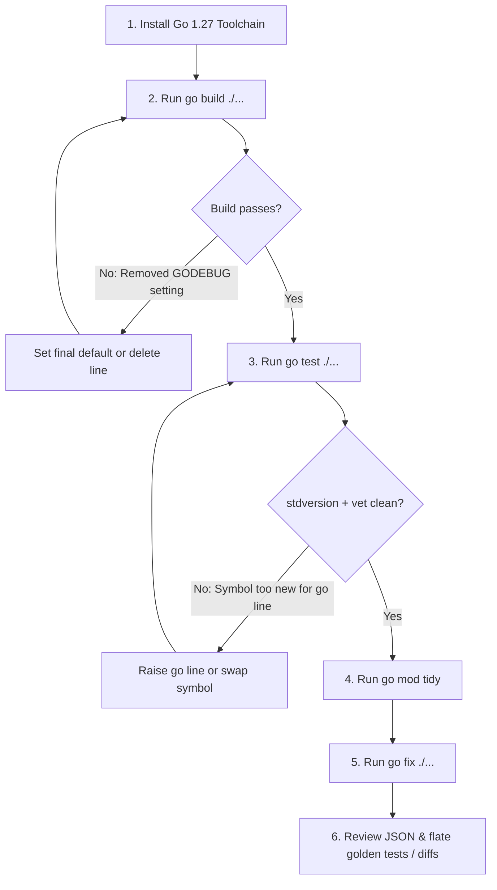

# Upgrading to Go 1.27: What Breaks, What to Adopt First

Go **1.27** shipped in August 2026. For most modules, the upgrade path is minimal—a single `go.mod` line update followed by a `go fix` pass. But a handful of changes bite silently.

The headline changes are structural:

- `encoding/json` is now backed by the new `json/v2` engine under the hood.
- The `uuid` package has officially joined the standard library (RFC 9562).
- Methods can finally declare their own type parameters (generic methods).
- Promoted fields can be used directly as composite literal keys.

None of these force a rewrite. The Go team maintained the backward compatibility promise: almost all existing code compiles and runs unchanged.

However, several silent traps and strict enforcement mechanisms can disrupt a release:

1. **Removed `GODEBUG` settings** now cause build failures if pinned to their legacy values.
2. **`compress/flate` produces different bytes**, silently breaking byte-for-byte golden file tests across gzip, zip, and PNG fixtures.
3. **`go test` enforces the `stdversion` vet check by default**, causing `go build` and `go test` to disagree when symbols are newer than the declared `go` directive.
4. **Compiler-generated symbol names** for function literals changed, breaking traceback parsers and function pointer equality.

This chapter walks through the upgrade path, breaking changes, hands-on reproductions, and high-leverage APIs to adopt first.

---

## The Upgrade Path in One Diagram

The Go team strongly recommends a **build-first, fix-second** order. While `go fix` rewrites code to new APIs and idioms, only an initial clean build tells you whether runtime-level or `GODEBUG` changes impact your service.



---

## Step 0: Toolchain Installation and Selection

Start with the toolchain itself. If you manage toolchains through the `go` command, either install the binary explicitly:

```bash
go install golang.org/dl/go1.27@latest
go1.27 download
go1.27 version
```

```text
go version go1.27.2 linux/amd64
```

Alternatively, set `GOTOOLCHAIN=go1.27.0` in your environment, or pin the toolchain directive inside `go.mod`:

```text
module example.com/svc

go 1.27

toolchain go1.27.2
```

When `GOTOOLCHAIN=auto` (the default) is in effect, invoking the `go` command automatically downloads and switches to the specified compiler version.

---

## Step 1: Bump the `go` Line and Clear Removed `GODEBUG` Settings

Raise the module's language version and tidy dependencies:

```bash
go mod edit -go=1.27
go mod tidy
go build ./...
```

Raising the `go` directive activates Go 1.27 language features (generic methods, promoted-field composite keys, wider function type inference) and instructs the toolchain to enforce strict rules on `GODEBUG` settings whose support has permanently ended.

### Permanently Removed Settings in Go 1.27

| Setting | Former Behavior | Go 1.27 Permanent Behavior |
|---------|-----------------|----------------------------|
| `asynctimerchan` | Allowed reverting to pre-1.23 buffered timer channels (`asynctimerchan=1`) | Timer and ticker channels are **always unbuffered** |
| `gotypesalias` | Allowed opting out of `go/types.Alias` (`gotypesalias=0`) | `types.Alias` is always enabled |
| `tlsunsafeekm` | Allowed unsafe EKM derivation without TLS 1.3 Extended Master Secret | Deprecated unsafe key material derivation refused |
| `tlsrsakex` | Allowed RSA key exchange without (EC)DHE | RSA key exchange permanently removed from default suites |
| `tls3des` | Allowed 3DES cipher suites (`TLS_RSA_WITH_3DES_EDE_CBC_SHA`) | 3DES ciphers permanently disabled |
| `tls10server` | Allowed TLS 1.0 and 1.1 handshakes on server connections | TLS 1.2 is minimum allowed server protocol |
| `x509keypairleaf` | Allowed `tls.X509KeyPair` without parsing leaf certificate | Leaf certificate is always parsed |

### The New `GODEBUG` Acceptance Rule

The `go` command still accepts removed settings in `go.mod` (`godebug` lines) or source (`//go:debug` comments) **only if set to the final default value that existed before removal**. 

Any legacy value that attempted to disable a behavior change fails the build immediately:

```text
// go.mod
module example.com/gd

go 1.27

godebug asynctimerchan=1
```

```bash
go run .
```

```text
go: error loading go.mod:
go.mod:5: removed GODEBUG "asynctimerchan" set to old value "1" (https://go.dev/doc/godebug#go-127)
```

With `godebug asynctimerchan=0` (or removing the line entirely), the build succeeds. 

> [!WARNING]
> If your code fails when `asynctimerchan=1` is removed, your application depended on pre-Go 1.23 buffered timer channels. Review all `time.Timer.Stop()` and `time.Timer.Reset()` calls. In Go 1.23+, unbuffered timer channels guarantee that stopped or reset timers do not leak stale ticks into channel drains.
>
> Search your codebase for removed settings before bumping `go.mod`:
>
> ```bash
> grep -rnE 'asynctimerchan|tlsunsafeekm|tlsrsakex|tls3des|tls10server|x509keypairleaf|gotypesalias' \
>   --include=go.mod --include='*.go' .
> ```

---

## Step 2: Run `go test` — The `stdversion` Trap

In Go 1.27, `go build` and `go test` no longer treat version mismatches identically. `go test` runs the `stdversion` vet check by default.

Consider this path-utility package where `go.mod` still declares `go 1.26`:

```text
// go.mod
module example.com/pathx

go 1.26
```

```go
// pathx.go
package pathx

import "strings"

// Base returns the final element of a slash-separated path.
func Base(p string) string {
	_, file, ok := strings.CutLast(p, "/") // added in Go 1.27
	if !ok {
		return p
	}
	return file
}
```

```go
// pathx_test.go
package pathx

import "testing"

func TestBase(t *testing.T) {
	if got := Base("desk/shift/ticket.txt"); got != "ticket.txt" {
		t.Fatalf("Base = %q", got)
	}
}
```

When executed with a Go 1.27 compiler:

```bash
go build ./...; echo "exit=$?"
go test ./...;  echo "exit=$?"
```

```text
exit=0
# example.com/pathx
# [example.com/pathx]
./pathx.go:8:25: strings.CutLast requires go1.27 or later (module is go1.26)
FAIL	example.com/pathx [build failed]
FAIL
exit=1
```

- `go build` passes because the Go 1.27 toolchain's standard library physically contains `strings.CutLast`.
- `go test` fails because `stdversion` catches the call to a standard-library API that is newer than the `go 1.26` directive in `go.mod`.
- On an actual Go 1.26 machine, `go build` would fail with `undefined: strings.CutLast`.

> [!IMPORTANT]
> **Never validate an upgrade with `go build` alone.** Always run `go test ./...` across the entire module.

### Dual Build Tags Workaround

If your module must support older Go toolchains while taking advantage of 1.27 APIs when available, separate implementations using build constraints:

```go
// cut_legacy.go
//go:build !go1.27

package pathx

import "strings"

func cutLast(p, sep string) (string, string, bool) {
	i := strings.LastIndex(p, sep)
	if i < 0 {
		return "", p, false
	}
	return p[:i], p[i+len(sep):], true
}
```

```go
// cut_go127.go
//go:build go1.27

package pathx

import "strings"

func cutLast(p, sep string) (string, string, bool) {
	return strings.CutLast(p, sep)
}
```

`stdversion` inspects file-level `//go:build go1.27` constraints and recognizes that `cut_go127.go` is guarded by the appropriate version floor.

### New `printf` Vet Finding: `%w` with Pointer to Error

The `printf` analyzer in `go test` and `go vet` now flags `%w` wrapping on pointers to types that implement `error`:

```go
package main

import (
	"errors"
	"fmt"
)

type NotFound struct{ Key string }

func (e NotFound) Error() string { return "not found: " + e.Key }

func lookup(k string) error {
	p := &NotFound{Key: k}
	return fmt.Errorf("lookup: %w", p) // Vet warning in Go 1.27!
}

func main() {
	err := lookup("port")
	var nf NotFound
	fmt.Println(err, errors.As(err, &nf))
}
```

```bash
go vet .
```

```text
main.go:14:29: %w wants operand of error type NotFound, not pointer type *NotFound (defeats errors.Is)
```

Because `NotFound` has a value receiver on `Error()`, passing `*NotFound` creates a pointer-to-struct error wrapper. Type assertions and `errors.As(err, &nf)` fail silently. Fix it by wrapping the value directly:

```go
return fmt.Errorf("lookup: %w", NotFound{Key: k})
```

---

## Step 3: `go mod tidy` Merges `require` Blocks

Long-lived modules often accumulate scattered `require` blocks resulting from merge conflicts and hand-edits:

```text
// go.mod (before)
module example.com/svc

go 1.27

require github.com/google/uuid v1.6.0

// Pinned for config loader
require gopkg.in/yaml.v3 v3.0.1

require (
	golang.org/x/sync v0.10.0
	golang.org/x/text v0.21.0 // indirect
)
```

Running `go mod tidy` on Go 1.27 consolidates duplicate blocks into at most two blocks (direct dependencies followed by indirect dependencies), preserving inline comments:

```text
// go.mod (after)
module example.com/svc

go 1.27

require (
	github.com/google/uuid v1.6.0
	golang.org/x/sync v0.10.0
	// Pinned for config loader
	gopkg.in/yaml.v3 v3.0.1
)
```

Review this cleanup in a dedicated commit before making functional code changes.

---

## Step 4: `encoding/json` — The v2 Engine Underneath

The headline runtime evolution in Go 1.27 is the transition of `encoding/json`. The classic `encoding/json` package is now backed internally by the `json/v2` engine.

For callers of `encoding/json`, API semantics remain backward-compatible—nil slices still serialize to `null`, and map keys remain sorted. However, three subtle shifts occur:

1. **Error Message Formatting:** The wording of error messages returned during decoding has been unified with the v2 engine. Tests that assert exact error strings via `strings.Contains(err.Error(), ...)` may fail.
2. **Allocation Profiles:** Unmarshalling throughput has increased, but memory allocation points have shifted. CI benchmark thresholds might require re-baselining.
3. **Emergency Rollback Hatch:** If an unexpected regression occurs in production, build with:
   ```bash
   GOEXPERIMENT=nojsonv2 go build ./...
   ```
   This temporarily restores the legacy Go 1.26 JSON engine. Treat this as a short-term debugging fallback—it is scheduled for removal in Go 1.28.

### The `compress/flate` Golden Test Trap

A subtle second-order change: `compress/flate`'s compression encoder was overhauled in Go 1.27 for increased throughput.

Consequently, outputs from `archive/zip`, `compress/gzip`, `compress/zlib`, and `image/png` may differ **byte-for-byte** from Go 1.26, even though they decompress to identical data. 

> [!TIP]
> If snapshot or golden-file tests verify exact byte representations of compressed payloads, regenerate the test fixtures using `UPDATE_GOLDEN=1` rather than attempting to force legacy compression bytes.

### Migrating to `encoding/json/v2` Deliberately

When writing new services or updating data models, you can import `encoding/json/v2` directly alongside `encoding/json/jsontext`:

```go
import (
	jsonv2 "encoding/json/v2"
	"encoding/json/jsontext"
)

// Step 1: Exact v1 compatibility via explicit options
out, err := jsonv2.Marshal(v, jsonv2.DefaultOptionsV1())

// Step 2: Selectively opt in to modern v2 defaults
out, err := jsonv2.Marshal(v,
	jsonv2.DefaultOptionsV1(),
	jsonv2.FormatNilSliceAsNull(false), // encodes nil slice as [] instead of null
)
```

Dropping `DefaultOptionsV1()` enables pure v2 defaults:

| Behavior | v1 (`encoding/json`) | v2 Default (`encoding/json/v2`) |
| :--- | :--- | :--- |
| **Invalid UTF-8 in strings** | Replaced with `U+FFFD` (``) | Returns syntax error |
| **Duplicate object keys** | Allowed (last key overwrites) | Returns semantic error |
| **Nil slice / nil map** | Serializes to `null` | Serializes to `[]` and `{}` |
| **Struct field matching** | Case-insensitive fallback | Strict case-sensitive matching |
| **Unknown object members** | Ignored | Ignored (`RejectUnknownMembers(true)` to error) |
| **Map key ordering** | Always sorted alphabetically | Unsorted by default (fast) |
| **`time.Duration`** | Built-in nanosecond string | No default encoding (requires custom format) |

```go
// For stable map output in snapshot/golden tests, enable deterministic ordering:
out, err := jsonv2.Marshal(v, jsonv2.Deterministic(true))
```

### Struct Tag Evolution: `embed` vs `inline`

Grep your struct tags before migrating to `encoding/json/v2`:

- `format:...` tag options used in early experiments were removed.
- `inline` has been standardized to `embed`:

```go
type Document struct {
	// Go 1.27 json/v2: use 'embed' rather than 'inline'
	Metadata `json:",embed"`
	Title    string `json:"title"`
}
```

---

## Step 5: Adopt Stdlib `uuid` (RFC 9562)

Go 1.27 introduces `uuid` to the standard library, implementing RFC 9562:

```go
package main

import (
	"fmt"
	"uuid"
)

func main() {
	id := uuid.New()   // Random UUIDv4 equivalent: [16]byte
	v7 := uuid.NewV7() // Time-sortable UUIDv7

	u, err := uuid.Parse("550e8400-e29b-41d4-a716-446655440000")
	if err != nil {
		panic(err)
	}

	fmt.Println("v4:", id)
	fmt.Println("v7:", v7)
	fmt.Println("Equal:", u == id)
}
```

### Why UUIDv7 Matters for Storage

UUIDv4 generates pure random bits, scattering writes across database B-tree indexes and causing page splits. 

UUIDv7 embeds a **48-bit millisecond UNIX timestamp** in the most significant bits followed by cryptographically random bits. This delivers:

1. **Chronological Sorting:** IDs sort naturally by creation timestamp.
2. **Index Locality:** High-concurrency inserts append sequentially to B-tree leaves, significantly reducing disk I/O.
3. **Primary Key Ordering:** Replaces compound auto-increment ID + timestamp columns in distributed systems.

Standard library `uuid.UUID` implements `sql.Scanner`, `driver.Valuer`, `encoding.TextMarshaler`, and `encoding.TextUnmarshaler`. Migrating from `github.com/google/uuid` is clean and mechanical.

---

## Step 6: Language Changes & Modernizers

### Generic Methods

Go 1.27 introduces generic methods: methods may now declare their own type parameters, independent of whether the receiver type itself is generic:

```go
package main

import (
	"fmt"
	"math/rand/v2"
)

func main() {
	r := rand.New(rand.NewPCG(42, 1024))

	// (*Rand).N[Int intType](n Int) Int
	valInt := r.N(10)
	valInt64 := r.N(int64(1_000_000))

	fmt.Printf("int: %d, int64: %d\n", valInt, valInt64)
}
```

**Type System Rules:**
- Interface methods **cannot** declare type parameters.
- Generic methods **cannot** implement interface methods.

### Promoted Field Keys in Struct Literals

Embedded anonymous struct fields can now be initialized directly in composite literals:

```go
type Address struct {
	City  string
	State string
}

type User struct {
	Address
	Name string
}

// Go 1.27: Flattened composite literal syntax
u := User{
	Name:  "Alex",
	City:  "Seattle",
	State: "WA",
}
```

### Automated Code Modernization with `go fix`

Go 1.27 expands `go fix` with modernizers:

- `embedlit`: Flattens legacy nested composite literals into promoted-field keys.
- `atomictypes`: Migrates legacy `atomic.AddInt64(&val, 1)` to `atomic.Int64`.
- `slicesbackward`: Replaces manual reverse loops (`for i := len(s)-1; i >= 0; i--`) with `for i, x := range slices.Backward(s)`.
- `waitgroupgo`: Modernizes `wg.Add(1); go func() { defer wg.Done(); ... }()` to `wg.Go(...)` (introduced in Go 1.25).
- `unsafefuncs`: Replaces `unsafe.Pointer` cast patterns with standard helpers.

```bash
# Preview diff without applying
go fix -diff ./...

# Apply changes across module
go fix ./...
```

> [!CAUTION]
> When maintaining shared libraries, run `go fix -fix=atomictypes` cautiously. Changing an exported package-level variable from `int64` to `atomic.Int64` breaks downstream consumers.

---

## Step 7: Things That Quietly Break

These changes compile without error but can cause unexpected runtime or CI issues:

### 1. Function-Literal Symbol Names and Closure Merging

The Go 1.27 compiler generates simpler, inlining-independent names for closures in debug symbols. Furthermore, identical closure literals may be merged.

- Tests that assert on raw function names in stack traces or `runtime.FuncForPC` outputs will break.
- Code comparing function pointers for identity (`fn1 == fn2`) will produce incorrect results.

### 2. `gofmt` Column Alignment

A fix to column-alignment logic (which previously varied across CPU architectures) reflows a small number of struct and variable declarations. Run:

```bash
gofmt -w .
```
Commit formatting adjustments in an isolated commit to avoid noisy pull request diffs.

### 3. Goroutine Labels in Crash Tracebacks

Crash tracebacks now include `runtime/pprof` goroutine labels in their headers:

```text
panic: runtime error: invalid memory address

goroutine 7 [running] {request_id: "req-1092", user_id: "usr-44"}:
main.process()
    /app/service.go:42 +0x3a
```

If labels contain sensitive information (e.g., email addresses or session tokens), disable the header with:

```bash
GODEBUG=tracebacklabels=0
```

*Note:* Panics occurring directly inside `pprof.Do(ctx, labels, f)` do not display labels, as deferred unwinding restores prior labels before the panic header is formatted.

### 4. `go tool trace` Localhost Binding

`go tool trace -http=:6060` now binds strictly to `localhost` for security. When debugging inside Docker containers or remote servers, specify the interface explicitly:

```bash
go tool trace -http=0.0.0.0:6060 trace.out
```

---

## Step 8: New Daily APIs to Adopt Immediately

### `strings.CutLast` and `bytes.CutLast`

Replaces cumbersome `strings.LastIndex` slicing patterns:

```go
package main

import (
	"fmt"
	"strings"
)

func main() {
	path := "archive/backup/data.tar.gz"
	dir, file, found := strings.CutLast(path, "/")
	stem, ext, _ := strings.CutLast(file, ".")

	fmt.Println("Dir:", dir)   // archive/backup
	fmt.Println("File:", file) // data.tar.gz
	fmt.Println("Ext:", ext)   // gz
	_ = found
}
```

### `httptest.NewTestServer` Paired with `testing/synctest`

`httptest.NewTestServer(t, mux)` creates an in-process HTTP server backed by an in-memory network channel instead of binding an operating system TCP loopback port:

```go
package api_test

import (
	"io"
	"net/http"
	"net/http/httptest"
	"testing"
)

func TestAPI(t *testing.T) {
	mux := http.NewServeMux()
	mux.HandleFunc("/health", func(w http.ResponseWriter, r *http.Request) {
		w.Write([]byte("OK"))
	})

	// In-memory fake network with auto-cleanup (t.Cleanup registered)
	srv := httptest.NewTestServer(t, mux)

	res, err := srv.Client().Get(srv.URL + "/health")
	if err != nil {
		t.Fatal(err)
	}
	body, _ := io.ReadAll(res.Body)
	if string(body) != "OK" {
		t.Errorf("got %q, want OK", body)
	}
}
```

Because `NewTestServer` operates without real network I/O, it integrates with `testing/synctest` for deterministic timeout, retry, and cancellation testing without real wall-clock delays.

---

## Step 9: Experiments Worth Watching

Enable experimental features using `GOEXPERIMENT`:

### 1. Portable Hardware SIMD (`GOEXPERIMENT=simd`)

The experimental `simd` and `simd/archsimd` packages provide portable vector types (`Int8s`, `Float32s`, etc.) that compile directly into AVX-512, arm64 NEON, or WebAssembly SIMD instructions.

The standard library uses this machinery internally: Go's Swiss Table map implementation leverages vector instructions for high-throughput bucket lookups.

### 2. Post-Quantum Cryptography (`crypto/mldsa`)

Go 1.27 introduces `crypto/mldsa`, implementing the post-quantum ML-DSA digital signature standard (FIPS 204) across parameter sets `MLDSA44`, `MLDSA65`, and `MLDSA87`. 

Integrated into `crypto/x509` and TLS 1.3, hybrid post-quantum key exchange can be enabled via `tls.Config.CurvePreferences`.

---

## The Upgrade Checklist Matrix

| Step | Small Module | Service / Monorepo |
| :--- | :--- | :--- |
| **1. Toolchain** | `go install golang.org/dl/go1.27@latest` | Pin `toolchain go1.27.0` in `go.mod`; align CI runner images |
| **2. go.mod** | `go mod edit -go=1.27 && go mod tidy` | Same, and resolve multi-module workspace require diffs |
| **3. Removed GODEBUG** | Grep `//go:debug` and `godebug` in `go.mod` | Audit container flags, Helm values, and systemd environment vars |
| **4. `go build ./...`** | Fix any compilation errors | Build per-service; bisect any CGo or assembly regressions |
| **5. `go test ./...`** | Fix `stdversion` and `%w` printf findings | Run before bumping `go.mod` to isolate version mismatches |
| **6. `go fix ./...`** | Review diff and commit | Apply one modernizer at a time (`-embedlit`, `-slicesbackward`) |
| **7. Golden / JSON Tests** | Regenerate snapshot fixtures | Check `compress/flate` (zip/gzip/png) and JSON error string diffs |
| **8. Emergency Fallbacks** | Skip | Document `GOEXPERIMENT=nojsonv2` for rapid rollback if needed |

---

## The Traps

- **Validating with `go build` alone:** Only `go test` and `go vet` run `stdversion`.
- **Leaving removed `GODEBUG` flags set to legacy values:** Immediately halts the build under `go 1.27`.
- **Pinning compressed bytes in golden files:** `compress/flate` produces different byte outputs for identical decompressed payloads.
- **Bulk `go fix -atomictypes` across exported APIs:** Can silently alter exported package-level types.
- **Comparing function pointers:** Function literal merging causes distinct closures to compare equal.

## The Boring Rule

> **Build first, test second, fix third.**
> 
> Keep the toolchain upgrade, the `go.mod` bump, and the `go fix` modernization in separate, reviewable commits.

---

## Sources

- Go 1.27 Release Notes: <https://go.dev/doc/go1.27>
- GODEBUG Documentation & History: <https://go.dev/doc/godebug>
- Go Toolchain Management: <https://go.dev/doc/toolchain>
- RFC 9562: Universally Unique IDentifiers (UUID): <https://www.rfc-editor.org/rfc/rfc9562.html>
