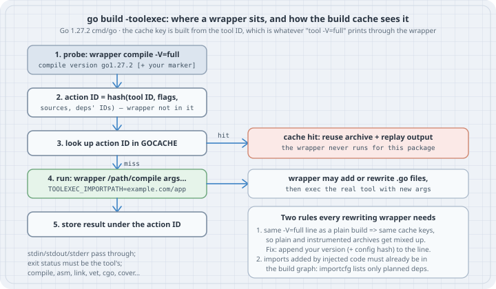

# Joining the Go Build with `-toolexec`: Wrappers, Build-Cache Keys, and Compile-Time Instrumentation

## Thesis

`go build -toolexec=prog` makes the go command run `prog /path/to/compile args...` instead of `compile args...`, and the same for `asm`, `link`, `vet`, `cgo` and the other tools. That one flag is how compile-time instrumentation tools such as OpenTelemetry's `otelc` add tracing to code you never edited, how `toolstash` swaps in a saved compiler, and how you can log exactly what a build does. No compiler patches, no fork of the toolchain.

The wrapper is easy to write. The hard part is the **build cache**. The go command decides whether to run a tool at all by hashing a *tool ID*, and it gets that ID by asking the tool, through your wrapper, to print its version (`compile -V=full`). If a rewriting wrapper passes that line through unchanged, plain and instrumented builds share cache entries. Then an instrumented build can silently produce an uninstrumented binary, and a plain build can silently produce an instrumented one. This chapter shows both on Go 1.27.2, then the fix, then the second rule: code you inject can only import packages the go command already planned to build.

Verified on **Go 1.27.2** (linux/amd64), Linux 6.12, on 2026-10-19. Go source links are pinned to the [`go1.27.2` tag](https://github.com/golang/go/tree/go1.27.2/src).

## Learning goals

- Write a `-toolexec` wrapper that passes arguments, standard streams and exit status through correctly
- Read `TOOLEXEC_IMPORTPATH` and the compile command line to decide which packages to touch
- Explain how the go command computes a tool ID from `tool -V=full`, and why the wrapper's own path is not in the cache key
- Reproduce cache sharing between plain and rewritten builds, and fix it by marking the tool ID
- Explain why injected code cannot import a package the build did not already plan, and how real tools set that up
- Decide when `-toolexec` is the right tool, and what to check before you trust one

## Mental model

{fig-alt="Flow of a go build with -toolexec in Go 1.27.2. Step 1: the go command runs the wrapper with the tool path and -V=full and uses the printed line as the tool ID. Step 2: the action ID hashes the tool ID, flags, sources and dependency IDs; the wrapper itself is not part of it. Step 3: look up the action ID in GOCACHE; on a hit the cached archive is reused and its output replayed, and the wrapper never runs. Step 4: on a miss the go command runs the wrapper with the real tool path, arguments and TOOLEXEC_IMPORTPATH; the wrapper may add or rewrite Go files and then runs the real tool. Step 5: the result is stored under the action ID. Two rules: append a version marker to the -V=full line, and imports added by injected code must already be in the build graph."}

The flag's whole contract, from `go help build`:

> `-toolexec 'cmd args'` a program to use to invoke toolchain programs like vet and asm. For example, instead of running asm, the go command will run 'cmd args /path/to/asm <arguments for asm>'. The TOOLEXEC_IMPORTPATH environment variable will be set, matching 'go list -f {{.ImportPath}}' for the package being built.

| Fact | Consequence |
|------|-------------|
| The wrapper gets the real tool's absolute path as its first argument | It can log, rewrite arguments, add files, or run a different binary |
| The go command first runs `wrapper tool -V=full` and uses the printed line as the **tool ID** ([`toolID` in `buildid.go`](https://github.com/golang/go/blob/go1.27.2/src/cmd/go/internal/work/buildid.go#L115-L182)) | Whatever the wrapper prints there goes into every cache key for that tool |
| For a release toolchain the tool ID is the whole version line, e.g. `compile version go1.27.2` | A wrapper that echoes it is indistinguishable from no wrapper |
| The `-toolexec` command line itself is not hashed into the action ID | Changing or adding a wrapper does not invalidate the cache by itself |
| On a cache hit the go command reuses the archive and replays the tool's saved output | The wrapper is not run for that package at all, not even to log |
| Source files are the last arguments on a `compile` command line, as absolute paths ([`gc.go`](https://github.com/golang/go/blob/go1.27.2/src/cmd/go/internal/work/gc.go#L161-L176)) | Appending a file path adds a file to the package |
| `compile` resolves imports only through the `-importcfg` file the go command wrote | Injected code can import only packages already in this package's build plan |

## Worked examples

One module holds the program being built and two wrappers. Every command was run from its root, `/tmp/toolexec` on the test machine. `GOCACHE` points at a fresh, empty directory at the start of each case so the results do not depend on earlier builds.

```go
// go.mod
module example.com/toolexec

go 1.27
```

```go
// app/main.go
package main

import (
	"fmt"
	"strings"
)

func greet(name string) string { return "hello, " + strings.ToUpper(name) }

func main() {
	fmt.Println(greet("gopher"))
}
```

### Case 1: A wrapper that only watches

```go
// logexec/main.go: a -toolexec wrapper that logs every tool the go
// command runs, then runs it unchanged.
package main

import (
	"fmt"
	"os"
	"os/exec"
	"path/filepath"
	"strings"
)

func main() {
	tool, args := os.Args[1], os.Args[2:]
	pkg := os.Getenv("TOOLEXEC_IMPORTPATH") // set by the go command
	if log := os.Getenv("LOGEXEC_FILE"); log != "" {
		f, err := os.OpenFile(log, os.O_APPEND|os.O_CREATE|os.O_WRONLY, 0o644)
		if err == nil {
			first := ""
			if len(args) > 0 {
				first = args[0]
			}
			fmt.Fprintf(f, "%-8s %-28s %s (%d args)\n", filepath.Base(tool), pkg, first, len(args))
			f.Close()
		}
	}
	cmd := exec.Command(tool, args...)
	cmd.Stdin, cmd.Stdout, cmd.Stderr = os.Stdin, os.Stdout, os.Stderr
	if err := cmd.Run(); err != nil {
		if ee, ok := err.(*exec.ExitError); ok {
			os.Exit(ee.ExitCode())
		}
		fmt.Fprintln(os.Stderr, "logexec:", strings.TrimSpace(err.Error()))
		os.Exit(1)
	}
}
```

The wrapper logs to a file, not to stdout. Stdout belongs to the tool: the go command parses what `compile -V=full` prints, and anything extra there breaks the build. The exit status is passed through so a compile error stays a compile error.

```text
$ go build -o bin/logexec ./logexec
$ export GOCACHE=/tmp/toolexec/cache          # new, empty directory
$ LOGEXEC_FILE=$PWD/log.txt go build -toolexec=$PWD/bin/logexec -o bin/app ./app
$ bin/app
hello, GOPHER
$ wc -l log.txt
117 log.txt
$ awk '{print $1}' log.txt | sort | uniq -c
     54 asm
     61 compile
      2 link
$ grep -c -- '-V=full' log.txt
3
$ head -5 log.txt
compile                               -V=full (1 args)
asm                                   -V=full (1 args)
compile  internal/byteorder           -o (19 args)
compile  internal/goarch              -o (21 args)
compile  internal/godebugs            -o (19 args)
$ grep -E '^(compile|link) +(example|  )' log.txt
compile                               -V=full (1 args)
compile  example.com/toolexec/app     -o (18 args)
link                                  -V=full (1 args)
link     example.com/toolexec/app     -o (8 args)
```

With an empty cache, building a two-function program runs the compiler 61 times and the assembler 54 times: the go command compiles every standard-library package `fmt` and `strings` need, and the wrapper sees all of them. The first three lines of work are `-V=full` probes, one per tool, with no import path. Each package compile comes with `TOOLEXEC_IMPORTPATH` set.

Now build again, and then build without the wrapper:

```text
$ rm log.txt
$ LOGEXEC_FILE=$PWD/log.txt go build -toolexec=$PWD/bin/logexec -o bin/app ./app
$ cat log.txt
compile                               -V=full (1 args)
asm                                   -V=full (1 args)
link                                  -V=full (1 args)
$ go build -x -o bin/app ./app 2>&1 | grep -cE '/compile |/link '
0
```

The second wrapped build ran *only* the three probes: every package was a cache hit, so the wrapper never saw a compile. The plain build afterwards ran no compiler and no linker either. It reused what the wrapped build stored. For a wrapper that changes nothing this is ideal. For a wrapper that changes code it is a bug, as the next case shows.

### Case 2: A wrapper that changes the code

This wrapper adds one generated file to every compile of package `main`. The file has an `init` that prints a marker, a minimal stand-in for the hooks an instrumentation tool injects. Two switches, used in Cases 4 and 5, are off by default.

```go
// stampexec/main.go: a -toolexec wrapper that adds one generated file to
// every compile of package main. STAMPEXEC_MARK=1 makes the wrapper report
// its own identity in the tool ID (Case 4); STAMPEXEC_IMPORT=1 injects a
// hook that imports a package (Case 5).
package main

import (
	"bytes"
	"fmt"
	"os"
	"os/exec"
	"path/filepath"
	"slices"
	"strings"
)

const version = "stampexec/v1"

// generated is the extra source file injected into package main.
const generated = `package main

func init() { println("[instrumented by ` + version + `]") }
`

// withImport is the same hook, but it needs a package (time) that the
// program being built might not import (Case 5).
const withImport = `package main

import "time"

func init() { println("[instrumented by ` + version + ` at", time.Now().Year(), "]") }
`

func main() {
	tool, args := os.Args[1], os.Args[2:]
	name := filepath.Base(tool)

	// The go command asks every tool for its version to build cache keys.
	if len(args) == 1 && args[0] == "-V=full" {
		out, err := exec.Command(tool, args...).Output()
		if err != nil {
			os.Exit(1)
		}
		line := string(bytes.TrimSpace(out))
		if os.Getenv("STAMPEXEC_MARK") == "1" {
			line += " " + version // a different tool ID => different cache keys
		}
		fmt.Println(line)
		return
	}

	if name == "compile" && isMainPackage(args) {
		f := filepath.Join(os.TempDir(), fmt.Sprintf("stampexec-%d.go", os.Getpid()))
		src := generated
		if os.Getenv("STAMPEXEC_IMPORT") == "1" {
			src = withImport
		}
		if err := os.WriteFile(f, []byte(src), 0o644); err != nil {
			fail(err)
		}
		defer os.Remove(f)
		args = append(args, f) // source files come last on the compile line
		fmt.Fprintln(os.Stderr, "stampexec: instrumenting", os.Getenv("TOOLEXEC_IMPORTPATH"))
	}

	cmd := exec.Command(tool, args...)
	cmd.Stdin, cmd.Stdout, cmd.Stderr = os.Stdin, os.Stdout, os.Stderr
	if err := cmd.Run(); err != nil {
		if ee, ok := err.(*exec.ExitError); ok {
			os.Exit(ee.ExitCode())
		}
		fail(err)
	}
}

// isMainPackage reports whether a compile command line builds package main
// ("-p main" is how the go command names it).
func isMainPackage(args []string) bool {
	i := slices.Index(args, "-p")
	return i >= 0 && i+1 < len(args) && args[i+1] == "main"
}

func fail(err error) {
	fmt.Fprintln(os.Stderr, "stampexec:", strings.TrimSpace(err.Error()))
	os.Exit(1)
}
```

The important lines:

- `-V=full` probes are answered by running the real tool and printing its line. With `STAMPEXEC_MARK` unset, the line is passed through unchanged, exactly like `logexec`.
- `isMainPackage` reads `-p main` from the compile line. The import path from `TOOLEXEC_IMPORTPATH` would work as well. Both are in the environment or arguments of every compile.
- The generated file is appended after the package's own source files. The compiler does not care where a file lives, only that it declares the same package.

### Case 3: Two silent failures from one shared cache

Plain build first, then the rewriting wrapper with the same cache:

```text
$ go build -o bin/stampexec ./stampexec
$ export GOCACHE=/tmp/toolexec/cache2          # new, empty directory
$ go build -o bin/app ./app && bin/app
hello, GOPHER
$ go build -toolexec=$PWD/bin/stampexec -o bin/app ./app && bin/app
hello, GOPHER
```

**Failure 1: the instrumented build is not instrumented.** No error, no warning, no "instrumenting" line. The wrapper answered the probe with `compile version go1.27.2`, so the action ID for `example.com/toolexec/app` was the one the plain build had just stored, and the go command never ran the wrapper for it.

Force a rebuild with `-a` and the wrapper does its job (`sort | uniq -c` only collapses repeated lines):

```text
$ go build -a -toolexec=$PWD/bin/stampexec -o bin/app ./app 2>&1 | sort | uniq -c
      1 # example.com/toolexec/app
      1 stampexec: instrumenting example.com/toolexec/app
[instrumented by stampexec/v1]
hello, GOPHER
```

Now a plain build, with no wrapper anywhere on the command line, to a new output file:

```text
$ go build -o bin/app-plain ./app && bin/app-plain
# example.com/toolexec/app
stampexec: instrumenting example.com/toolexec/app
[instrumented by stampexec/v1]
hello, GOPHER
```

**Failure 2: the plain build is instrumented.** It reused the archive the `-a` build stored under the same key, and it even replayed the wrapper's stderr line from the cache, which is the only hint that something is wrong. A developer who tried an instrumentation tool once and then ran `go build` in the same workspace would ship this binary.

### Case 4: Mark the tool ID

The fix is in the probe answer. With `STAMPEXEC_MARK=1` the wrapper appends its own version to the version line:

```text
$ $(go env GOTOOLDIR)/compile -V=full
compile version go1.27.2
$ STAMPEXEC_MARK=1 bin/stampexec $(go env GOTOOLDIR)/compile -V=full
compile version go1.27.2 stampexec/v1
```

`toolID` accepts that: it checks that the first fields are `compile`, `version` and a version string, and for a release toolchain uses the whole trimmed line. A different line means different action IDs for every package compiled through the wrapper, so plain and instrumented artifacts can no longer meet:

```text
$ rm -f bin/app*
$ export GOCACHE=/tmp/toolexec/cache3          # new, empty directory
$ go build -o bin/app ./app && bin/app
hello, GOPHER
$ time (STAMPEXEC_MARK=1 go build -toolexec=$PWD/bin/stampexec -o bin/app-inst ./app)
# example.com/toolexec/app
stampexec: instrumenting example.com/toolexec/app

real	0m4.491s
user	0m7.780s
sys	0m1.086s
$ bin/app-inst
[instrumented by stampexec/v1]
hello, GOPHER
$ time (STAMPEXEC_MARK=1 go build -toolexec=$PWD/bin/stampexec -o bin/app-inst ./app)
# example.com/toolexec/app
stampexec: instrumenting example.com/toolexec/app

real	0m0.036s
user	0m0.056s
sys	0m0.018s
$ bin/app-inst
[instrumented by stampexec/v1]
hello, GOPHER
$ go build -o bin/app ./app && bin/app
hello, GOPHER
```

The first marked build is slow (4.5 s) because *every* package, the whole standard-library closure, is a cache miss under the new tool ID, even though the plain build had just compiled the same packages. After that the instrumented build has its own cached artifacts (the second run takes 36 ms and replays the saved output), and the plain build still gets the plain ones.

Note the `rm -f bin/app*` at the top. The first attempt at this case skipped it, and the "plain" build with a brand-new, empty cache printed `[instrumented by stampexec/v1]`. `bin/app` was still the instrumented binary from Case 3, and its build ID matched the plain action ID, so `go build -o bin/app` decided the existing file was up to date and did not relink it. A poisoned binary can outlive the cache that poisoned it.

`otelc` does the same thing, and also mixes in a hash of its rule set so editing the configuration invalidates cached artifacts. The comment on its `toolVersionLine` function says the marker is there "so the tool ID (and every build cache key derived from it) differs from a plain build", and the probe handler explains that otherwise "instrumentation changes compile output without changing any input go hashes" (see Sources).

### Case 5: Injected code can only import what the build planned

With `STAMPEXEC_IMPORT=1` the injected hook imports `time`, which `app` does not import:

```text
$ export GOCACHE=/tmp/toolexec/cache4          # new, empty directory
$ STAMPEXEC_MARK=1 STAMPEXEC_IMPORT=1 go build -toolexec=$PWD/bin/stampexec -o bin/app-inst ./app
# example.com/toolexec/app
stampexec: instrumenting example.com/toolexec/app
../stampexec-239428.go:3:8: could not import time (open : no such file or directory)
```

(The generated file lives in `/tmp`, so its path is printed relative to the current directory.) The go command planned the build before running any tool. It wrote an `importcfg` for `app` that maps each import in `app`'s own files to a compiled archive, and `time` is not one of them. The compiler has no other way to find packages; the empty file name in `open :` is what it is left with when `importcfg` has no entry for the import. A wrapper cannot repair this from inside one compile, because the archive for `time` may not have been built at all.

The fix is to put the dependency into the build plan *before* the build: add a file to the package that imports what the hooks will need, so the go command builds those packages and lists them in `importcfg`:

```go
// app/stamp_imports.go: declare, in source, the packages the injected
// hook will need, so the go command builds them and lists them in importcfg.
package main

import _ "time"
```

> **Not run for this chapter.** The build with this file in place was not executed on the test machine. Expected result, from how the go command writes `importcfg`: the build succeeds and `bin/app-inst` prints `[instrumented by stampexec/v1 at <year> ]` before `hello, GOPHER`, because `time` is now an import of `app` and therefore in its `importcfg`.

This is exactly `otelc`'s "Phase 1: Setup Dependencies". Its implementation notes describe running `go build -n` to collect the dependency list, generating a file such as `otel_importer.go` with blank imports of the SDK and hook packages, and running `go mod tidy` so the new modules are in `go.mod` and the module cache. Only then does "Phase 2: Building with Instrumentation" run the build with `-toolexec`. For third-party packages a blank import alone is not enough: the module must also be required in `go.mod`, which is why the setup phase edits it.

### Case 6: When to reach for `-toolexec`

| You want to | Use |
|-------------|-----|
| See what a build runs | `go build -x`, or `-n` for a dry run. A logging wrapper only adds `TOOLEXEC_IMPORTPATH` and timing. |
| Change compiler flags for some packages | `-gcflags=pattern=flags` (for example `-gcflags=example.com/app/...=-m`) |
| Replace one file's contents for a build | `-overlay=file.json` |
| Add code to packages you do not own, at build time, for every build of a service | `-toolexec`, via a maintained tool (`otelc`, Datadog's Orchestrion), not a hand-rolled wrapper |
| Compare a patched compiler with the installed one | `toolstash` with `-toolexec` (the use case `toolID`'s comment is written around) |

## The trap

- **Echoing `-V=full` unchanged from a wrapper that rewrites code.** Plain and rewritten builds then share cache keys. You get uninstrumented "instrumented" builds and instrumented "plain" builds, with no error (Case 3). Append a marker that changes whenever the wrapper's output would change: its version, plus a hash of its configuration.
- **Testing a wrapper against a warm cache.** A hit means the wrapper never ran. Use a fresh `GOCACHE`, or `-a`, when you test one, and delete old output binaries too (Case 4).
- **Printing to stdout from a wrapper.** The go command parses the `-V=full` answer from stdout, and some tools write their real output there. Log to stderr or a file.
- **Swallowing the tool's exit status.** A wrapper that exits 0 after a failed compile produces confusing failures several steps later. Pass the status through.
- **Injecting imports at compile time.** Only packages in the `importcfg` the go command wrote can be imported (Case 5). Declare them in source, and in `go.mod`, before the build.
- **Accepting `-toolexec` from outside.** It runs an arbitrary program for every tool invocation. A `GOFLAGS=-toolexec=...` in a CI environment, a Makefile or an editor setting you did not write is code execution. Review it like a dependency.

## The boring rule

Use `-x` and `-n` to watch a build and `-gcflags` or `-overlay` to change it. Use `-toolexec` only through a maintained tool, and before you adopt one check two things: that its `-V=full` answer carries its own version and configuration hash, and that it adds its dependencies to the build plan before building. Run its builds with a separate `GOCACHE` in CI anyway. It costs one cold build and makes it impossible for an instrumented artifact to reach a plain build.

## Try this

1. Add timing to `logexec` (start time and duration per tool run) and find the slowest package compile in a cold build of one of your own services.
2. Run `go vet -toolexec=$PWD/bin/logexec ./app` with `LOGEXEC_FILE` set. Which tool names appear, and does `vet` get its own `-V=full` probe?
3. Change `version` in `stampexec` to `stampexec/v2` without setting `STAMPEXEC_MARK`, rebuild the wrapper, and run a wrapped build against the cache from Case 3. Which binary do you get, and why does the wrapper's own rebuild not matter?
4. Replace the appended file with a real rewrite: parse `app`'s `main.go` with `go/parser`, add `defer println("leave greet")` at the top of `greet`, print it with `go/printer` into a temporary file, and pass that file instead of the original. What must you do so error messages still point at the user's line numbers? (Hint: `//line` directives.)
5. Read `otelc`'s troubleshooting guide and list which of the traps above it detects for you.

## Sources

Go documentation and source at the `go1.27.2` tag:

- `go help build` (`-toolexec`, `-a`, `-x`, `-n`, `-gcflags`, `-overlay`): <https://pkg.go.dev/cmd/go#hdr-Compile_packages_and_dependencies>
- Build cache (`GOCACHE`): <https://pkg.go.dev/cmd/go#hdr-Build_and_test_caching>
- `toolID` and the `-V=full` probe: <https://github.com/golang/go/blob/go1.27.2/src/cmd/go/internal/work/buildid.go#L115-L182>
- Compile command line, including `-importcfg` and the trailing source files: <https://github.com/golang/go/blob/go1.27.2/src/cmd/go/internal/work/gc.go#L136-L178>
- `TOOLEXEC_IMPORTPATH` in the environment of every tool run: <https://github.com/golang/go/blob/go1.27.2/src/cmd/go/internal/work/shell.go#L639-L646>
- `toolstash`: <https://pkg.go.dev/golang.org/x/tools/cmd/toolstash>

OpenTelemetry Go compile-time instrumentation (`otelc`), at commit `4ffef19` (2026-10-17):

- Project and quick start: <https://github.com/open-telemetry/opentelemetry-go-compile-instrumentation>
- Implementation notes (Phase 1 setup, Phase 2 `-toolexec` build): <https://github.com/open-telemetry/opentelemetry-go-compile-instrumentation/blob/main/docs/implementation.md>
- `toolVersionLine` / `interceptToolVersion` (tool-ID marker): <https://github.com/open-telemetry/opentelemetry-go-compile-instrumentation/blob/main/tool/internal/instrument/toolexec.go>
- Troubleshooting: <https://github.com/open-telemetry/opentelemetry-go-compile-instrumentation/blob/main/docs/troubleshooting.md>
- User documentation: <https://opentelemetry.io/docs/zero-code/go/compile-time/>
- Datadog Orchestrion (another `-toolexec`-based instrumentation tool): <https://github.com/DataDog/orchestrion>

Tools: Go 1.27.2 (`go build`, `go env GOTOOLDIR`), no third-party modules.
