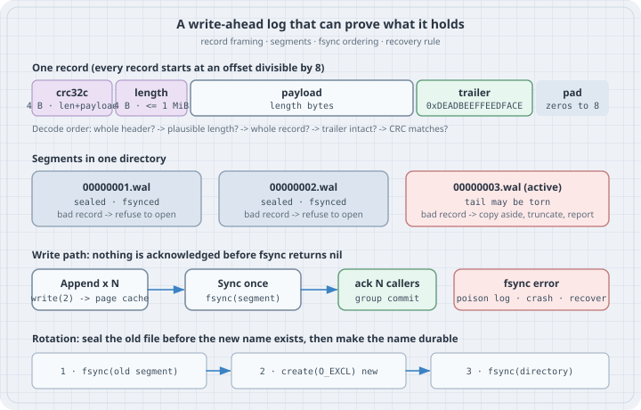

# A Corruption-Proof Write-Ahead Log

## Thesis

A write-ahead log (WAL) is a file you only append to, so that after a crash you can replay it and rebuild state. Writing one takes an afternoon. Trusting one takes more work, because the difficult part is the crash itself. A crash can leave half a record on disk. A disk can flip a bit in a record you acknowledged last week. A segment file can be fsynced and still be missing after a power cut, because its directory entry never reached the disk. The format and the recovery code have to tell these cases apart, and they have to do it from the bytes alone.

This chapter builds a small segmented WAL in under 300 lines of standard-library Go. Each record carries a CRC-32C, a bounded length, a commit trailer, and padding to 8 bytes. The write path fsyncs before acknowledging anything and fsyncs the directory when it rotates segments. Recovery refuses to open when a sealed segment is damaged and truncates a torn tail, keeping a copy of what it cut. Every failure below is caused on purpose with `truncate`, `dd`, and a test that cuts the log at every byte offset.

Everything was compiled and run with **Go 1.27.2** on linux/amd64 (kernel 6.12, ext4 on a virtio disk, 8 vCPUs). The fsync timings are for that one virtual disk. Your NVMe, cloud volume, or laptop SSD will give different numbers, so measure your own before choosing a batch size.

## Mental model

{fig-alt="One record is crc32c over length and payload (4 bytes), length up to 1 MiB (4 bytes), the payload, an 8-byte trailer 0xDEADBEEFFEEDFACE, and zero padding to a multiple of 8. Decode checks header, length, whole record, trailer, then CRC. Segments 00000001.wal and 00000002.wal are sealed and fsynced: a bad record there means refuse to open. The active segment 00000003.wal may have a torn tail: copy the bad bytes aside, truncate, report. Write path: Append N records into the page cache, Sync once, then acknowledge N callers; an fsync error poisons the log. Rotation: fsync the old segment, create the new one with O_EXCL, fsync the directory."}

- **`write` is not durable.** `(*os.File).Write` copies bytes into the kernel page cache and returns. Only [`(*os.File).Sync`](https://pkg.go.dev/os#File.Sync) asks the kernel to put them on stable storage. On Linux that is [`fsync(2)`](https://man7.org/linux/man-pages/man2/fsync.2.html). On macOS, Go's `Sync` calls `fcntl(F_FULLFSYNC)`, because plain `fsync` there does not flush the drive's cache (`internal/poll/fd_fsync_darwin.go`). The contract is short: **acknowledge a record only after a `Sync` that covers it has returned `nil`.**
- **A crash only tears the unsynced tail.** Records that were fsynced before an acknowledgement went out are on the disk. Anything written after the last successful fsync can be missing, partly present, or present out of order, because the kernel writes dirty pages back in any order it likes. So the end of the *active* segment is the only place a crash can legitimately leave garbage.
- **Each layer catches a different failure.** The framing follows the layers described in [UnisonDB's WAL write-up](https://unisondb.io/blog/building-corruption-proof-write-ahead-log-in-go/), with the trade-offs spelled out:

| Layer | Catches | Does not catch |
| --- | --- | --- |
| Length bound (`1..MaxRecord`) | A garbage length that would make recovery read or allocate gigabytes; zero-filled space | A plausible but wrong length (the next checks catch that) |
| Whole-record check | A file that ends mid-record | Bytes that are present but wrong |
| Trailer (`0xDEADBEEFFEEDFACE`, written last) | A record whose tail never landed: zeros or stale bytes where the end should be | A bit flip in the payload |
| CRC-32C over length + payload | Bit flips and torn sectors inside a finished record | Zero-filled space, if it covered only the payload and allowed empty records (Case 3) |
| 8-byte alignment | An 8-byte header crossing a 512 B or 4 KiB sector boundary, so a torn sector cannot split it | Torn payloads, which the trailer and CRC handle |

- **Sealed and active segments get different rules.** When a segment fills up, rotation fsyncs it *before* creating the next one. A bad record in a sealed segment therefore cannot be a crash artefact, as long as the device honours flushes. It is media corruption, a bug, a drive that lied about its cache, or tampering, and the log refuses to open. A bad record in the active segment is treated as a torn tail.
- **A new file needs two fsyncs.** The Linux man page says it directly: calling `fsync()` on a file "does not necessarily ensure that the entry in the directory containing the file has also reached disk. For that an explicit fsync() on a file descriptor for the directory is also needed." In Go: `os.Open(dir)` and then `.Sync()`.

## The code

The module has one package and three small programs. Lay it out like this:

```text
walbook/
├── go.mod
├── wal/record.go         framing: Encode / Decode
├── wal/log.go            segments, Append / Sync, rotation, recovery
├── wal/log_test.go       crash at every byte offset
├── cmd/walctl/main.go    append / recover / bench from the shell
├── cmd/zerofill/main.go  Case 3
└── cmd/groupcommit/main.go  Case 6
```

```text
// go.mod
module example.com/walbook

go 1.27
```

The framing. `Decode` runs its checks cheapest and most structural first, so a corrupt length can never cause a large read before the CRC rejects it.

```go
// wal/record.go
package wal

import (
	"encoding/binary"
	"errors"
	"hash/crc32"
)

// On disk, every record is:
//
//	| crc32c (4) | length (4) | payload (length) | trailer (8) | zero pad to 8 |
//
// The CRC covers length+payload. The trailer is written last and means
// "this record is finished". Every record starts at an offset divisible by 8.
const (
	headerSize  = 8
	trailerSize = 8
	align       = 8
	// MaxRecord bounds the length field so a corrupt header can never make
	// recovery allocate or read gigabytes before the CRC check fails.
	MaxRecord = 1 << 20
	trailer   = uint64(0xDEADBEEFFEEDFACE)
)

var (
	castagnoli = crc32.MakeTable(crc32.Castagnoli)

	ErrTorn   = errors.New("torn or incomplete record")
	ErrCRC    = errors.New("checksum mismatch")
	ErrLength = errors.New("implausible length")
)

func alignUp(n int64) int64 { return (n + align - 1) &^ (align - 1) }

// Encode returns the bytes of one record, padded to a multiple of 8.
func Encode(payload []byte) []byte {
	if len(payload) == 0 || len(payload) > MaxRecord {
		panic("wal: payload must be 1..MaxRecord bytes")
	}
	n := len(payload)
	buf := make([]byte, alignUp(int64(headerSize+n+trailerSize)))
	binary.LittleEndian.PutUint32(buf[4:8], uint32(n))
	copy(buf[headerSize:], payload)
	binary.LittleEndian.PutUint64(buf[headerSize+n:], trailer)
	binary.LittleEndian.PutUint32(buf[0:4], crc32.Checksum(buf[4:headerSize+n], castagnoli))
	return buf
}

// Decode parses the record at the start of b and returns its payload and
// its size on disk. It checks, in order: a whole header is present, the
// length is plausible, the whole record is present, the trailer is intact,
// and only then the CRC.
func Decode(b []byte) (payload []byte, size int64, err error) {
	if len(b) < headerSize {
		return nil, 0, ErrTorn
	}
	n := int64(binary.LittleEndian.Uint32(b[4:8]))
	if n == 0 || n > MaxRecord {
		return nil, 0, ErrLength
	}
	size = alignUp(headerSize + n + trailerSize)
	if int64(len(b)) < size {
		return nil, 0, ErrTorn
	}
	if binary.LittleEndian.Uint64(b[headerSize+n:]) != trailer {
		return nil, 0, ErrTorn
	}
	if crc32.Checksum(b[4:headerSize+n], castagnoli) != binary.LittleEndian.Uint32(b[0:4]) {
		return nil, 0, ErrCRC
	}
	return b[headerSize : headerSize+n], size, nil
}
```

The log. `Open` is the recovery procedure, `Append` + `Sync` are the write path, and `rotate` + `create` hold the fsync ordering.

```go
// wal/log.go
package wal

import (
	"errors"
	"fmt"
	"os"
	"path/filepath"
	"slices"
	"strings"
)

// Log is an append-only, segmented write-ahead log. It is not safe for
// concurrent use; put one goroutine (or one mutex) in front of it.
type Log struct {
	dir    string
	dirf   *os.File // the directory, kept open so we can fsync it
	f      *os.File // active segment
	seq    int
	size   int64
	maxSeg int64
	err    error // sticky: once a write or fsync fails, the log is dead
}

// Report says what recovery found.
type Report struct {
	Segments  int
	Records   int
	Truncated int64 // bytes cut from the tail of the active segment
	Reason    error // why the tail was cut (nil if nothing was cut)
}

func segName(seq int) string { return fmt.Sprintf("%08d.wal", seq) }

// Open recovers dir and returns a log ready to append. replay is called for
// every valid record in order. A bad record inside a sealed (non-last)
// segment is fatal. A bad record in the last segment is treated as a torn
// tail: the segment is truncated at the last good record and fsynced.
func Open(dir string, maxSeg int64, replay func(seq int, off int64, p []byte)) (*Log, Report, error) {
	var rep Report
	if err := os.MkdirAll(dir, 0o755); err != nil {
		return nil, rep, err
	}
	dirf, err := os.Open(dir)
	if err != nil {
		return nil, rep, err
	}
	seqs, err := listSegments(dir)
	if err != nil {
		dirf.Close()
		return nil, rep, err
	}
	l := &Log{dir: dir, dirf: dirf, maxSeg: maxSeg}
	if len(seqs) == 0 {
		if err := l.create(1); err != nil {
			dirf.Close()
			return nil, rep, err
		}
		rep.Segments = 1
		return l, rep, nil
	}
	rep.Segments = len(seqs)
	for i, seq := range seqs {
		path := filepath.Join(dir, segName(seq))
		data, err := os.ReadFile(path)
		if err != nil {
			dirf.Close()
			return nil, rep, err
		}
		good, n, bad := scan(data, func(off int64, p []byte) {
			if replay != nil {
				replay(seq, off, p)
			}
		})
		rep.Records += n
		last := i == len(seqs)-1
		if bad != nil && !last {
			dirf.Close()
			return nil, rep, fmt.Errorf("sealed segment %s: %w at offset %d; refusing to open", segName(seq), bad, good)
		}
		if last {
			f, err := os.OpenFile(path, os.O_WRONLY, 0)
			if err != nil {
				dirf.Close()
				return nil, rep, err
			}
			if bad != nil {
				rep.Truncated, rep.Reason = int64(len(data))-good, bad
				// Keep the evidence: copy the cut bytes aside before truncating.
				if err := os.WriteFile(fmt.Sprintf("%s.tail-%d", path, good), data[good:], 0o644); err != nil {
					return nil, rep, err
				}
				if err := f.Truncate(good); err != nil {
					return nil, rep, err
				}
				if err := f.Sync(); err != nil {
					return nil, rep, err
				}
			}
			if _, err := f.Seek(good, 0); err != nil {
				return nil, rep, err
			}
			l.f, l.seq, l.size = f, seq, good
		}
	}
	return l, rep, nil
}

// scan walks records from the start of a segment. It returns the offset just
// past the last good record, how many good records it saw, and the error that
// stopped it (nil if the segment ended cleanly).
func scan(data []byte, fn func(off int64, p []byte)) (good int64, n int, bad error) {
	for good < int64(len(data)) {
		p, size, err := Decode(data[good:])
		if err != nil {
			return good, n, err
		}
		fn(good, p)
		good += size
		n++
	}
	return good, n, nil
}

// Append writes one record to the OS. It is NOT durable until Sync returns nil.
func (l *Log) Append(p []byte) error {
	if l.err != nil {
		return l.err
	}
	rec := Encode(p)
	if l.size > 0 && l.size+int64(len(rec)) > l.maxSeg {
		if err := l.rotate(); err != nil {
			l.err = err
			return err
		}
	}
	if _, err := l.f.Write(rec); err != nil {
		l.err = fmt.Errorf("wal write: %w", err)
		return l.err
	}
	l.size += int64(len(rec))
	return nil
}

// Sync makes every appended record durable. If it fails, the log is poisoned:
// the kernel may already have dropped the dirty pages, so retrying and seeing
// success proves nothing. Crash, restart, and let Open recover.
func (l *Log) Sync() error {
	if l.err != nil {
		return l.err
	}
	if err := l.f.Sync(); err != nil {
		l.err = fmt.Errorf("wal fsync (log is now unusable): %w", err)
		return l.err
	}
	return nil
}

func (l *Log) rotate() error {
	// Seal: the old segment must be complete on disk before the new one exists.
	if err := l.f.Sync(); err != nil {
		return err
	}
	if err := l.f.Close(); err != nil {
		return err
	}
	return l.create(l.seq + 1)
}

func (l *Log) create(seq int) error {
	f, err := os.OpenFile(filepath.Join(l.dir, segName(seq)), os.O_CREATE|os.O_EXCL|os.O_WRONLY, 0o644)
	if err != nil {
		return err
	}
	// fsync on the file does not persist its directory entry; fsync the directory.
	if err := l.dirf.Sync(); err != nil {
		f.Close()
		return err
	}
	l.f, l.seq, l.size = f, seq, 0
	return nil
}

// Close syncs and closes the log.
func (l *Log) Close() error {
	err := l.Sync()
	return errors.Join(err, l.f.Close(), l.dirf.Close())
}

func listSegments(dir string) ([]int, error) {
	ents, err := os.ReadDir(dir)
	if err != nil {
		return nil, err
	}
	var seqs []int
	for _, e := range ents {
		var seq int
		if strings.HasSuffix(e.Name(), ".wal") {
			if _, err := fmt.Sscanf(e.Name(), "%08d.wal", &seq); err == nil {
				seqs = append(seqs, seq)
			}
		}
	}
	slices.Sort(seqs)
	return seqs, nil
}
```

A command-line driver, so the cases below can damage files with ordinary shell tools:

```go
// cmd/walctl/main.go
package main

import (
	"fmt"
	"os"
	"strconv"
	"time"

	"example.com/walbook/wal"
)

func main() {
	if len(os.Args) < 3 {
		fmt.Fprintln(os.Stderr, "usage: walctl append|recover|bench DIR ...")
		os.Exit(2)
	}
	cmd, dir := os.Args[1], os.Args[2]
	maxSeg := int64(64 << 20)
	if s := os.Getenv("WAL_MAX_SEG"); s != "" {
		maxSeg, _ = strconv.ParseInt(s, 10, 64)
	}
	switch cmd {
	case "append": // walctl append DIR msg...
		l, _, err := wal.Open(dir, maxSeg, nil)
		check(err)
		for _, m := range os.Args[3:] {
			check(l.Append([]byte(m)))
		}
		check(l.Sync()) // one fsync for the whole batch, then acknowledge
		fmt.Printf("acked %d records\n", len(os.Args[3:]))
		check(l.Close())

	case "recover": // walctl recover DIR
		l, rep, err := wal.Open(dir, maxSeg, func(seq int, off int64, p []byte) {
			fmt.Printf("  seg %d off %4d  %q\n", seq, off, p)
		})
		if err != nil {
			fmt.Println("recover:", err)
			os.Exit(1)
		}
		fmt.Printf("segments=%d records=%d truncated=%dB", rep.Segments, rep.Records, rep.Truncated)
		if rep.Reason != nil {
			fmt.Printf(" reason=%q", rep.Reason.Error())
		}
		fmt.Println()
		check(l.Close())

	case "bench": // walctl bench DIR N BATCH
		n, _ := strconv.Atoi(os.Args[3])
		batch, _ := strconv.Atoi(os.Args[4])
		l, _, err := wal.Open(dir, maxSeg, nil)
		check(err)
		payload := make([]byte, 100)
		start := time.Now()
		syncs := 0
		for i := 1; i <= n; i++ {
			check(l.Append(payload))
			if i%batch == 0 || i == n {
				check(l.Sync())
				syncs++
			}
		}
		el := time.Since(start)
		fmt.Printf("records=%d batch=%d fsyncs=%d elapsed=%v  %.0f records/s  %.1fµs/record\n",
			n, batch, syncs, el.Round(time.Millisecond), float64(n)/el.Seconds(),
			float64(el.Microseconds())/float64(n))
		check(l.Close())
	}
}

func check(err error) {
	if err != nil {
		fmt.Fprintln(os.Stderr, "walctl:", err)
		os.Exit(1)
	}
}
```

Build it once and put it on `PATH`:

```bash
go vet ./...
go build -o /tmp/wbin/walctl ./cmd/walctl
export PATH=/tmp/wbin:$PATH
```

## Worked examples

### Case 1: Three records, byte by byte

Append three records in one batch (one fsync), then look at the raw segment and replay it.

```bash
mkdir /tmp/w1 && cd /tmp/w1
walctl append ./log "order 1001 paid" "order 1002 paid" "refund 1001"
wc -c log/00000001.wal
od -A d -t x1 log/00000001.wal
walctl recover ./log
```

Output:

```text
acked 3 records
96 log/00000001.wal
0000000 ec 25 6f 84 0f 00 00 00 6f 72 64 65 72 20 31 30
0000016 30 31 20 70 61 69 64 ce fa ed fe ef be ad de 00
0000032 36 ee d3 b0 0f 00 00 00 6f 72 64 65 72 20 31 30
0000048 30 32 20 70 61 69 64 ce fa ed fe ef be ad de 00
0000064 ea 39 0f e1 0b 00 00 00 72 65 66 75 6e 64 20 31
0000080 30 30 31 ce fa ed fe ef be ad de 00 00 00 00 00
0000096
  seg 1 off    0  "order 1001 paid"
  seg 1 off   32  "order 1002 paid"
  seg 1 off   64  "refund 1001"
segments=1 records=3 truncated=0B
```

Read the first row. `ec 25 6f 84` is the CRC-32C, stored little-endian. `0f 00 00 00` is the length, 15. Then come the 15 payload bytes `order 1001 paid` and the trailer `ce fa ed fe ef be ad de`, which is `0xDEADBEEFFEEDFACE` in little-endian. 8 + 15 + 8 = 31 bytes, padded to 32, so the next record starts at offset 32. The third record is 8 + 11 + 8 = 27 bytes, padded with five zeros to 32. Every header starts at a multiple of 8.

### Case 2: A crash tears the last record

Simulate a power cut that left only 16 of record 3's 32 bytes on disk. Recovery replays the two complete records, copies the torn bytes aside, and truncates the segment back to the last good offset. The client never got an acknowledgement for record 3, so it retries, and the log accepts the append.

```bash
# /tmp/w1, continuing from Case 1
truncate -s 80 log/00000001.wal      # the crash tore record 3 mid-payload
walctl recover ./log
wc -c log/00000001.wal
walctl append ./log "refund 1001"      # the client never got an ack, so it retries
walctl recover ./log
```

Output:

```text
  seg 1 off    0  "order 1001 paid"
  seg 1 off   32  "order 1002 paid"
segments=1 records=2 truncated=16B reason="torn or incomplete record"
64 log/00000001.wal
acked 1 records
  seg 1 off    0  "order 1001 paid"
  seg 1 off   32  "order 1002 paid"
  seg 1 off   64  "refund 1001"
segments=1 records=3 truncated=0B
```

Now a different crash. The file *length* survived, but the sector holding record 3's trailer did not, and it reads back as zeros. This is the case the trailer is for. The length is plausible and the bytes are all there, but the record never finished.

```bash
# /tmp/w1, continuing
dd if=/dev/zero of=log/00000001.wal bs=1 seek=83 count=8 conv=notrunc status=none
od -A d -t x1 -j 64 log/00000001.wal
walctl recover ./log
ls log
```

Output:

```text
0000064 ea 39 0f e1 0b 00 00 00 72 65 66 75 6e 64 20 31
0000080 30 30 31 00 00 00 00 00 00 00 00 00 00 00 00 00
0000096
  seg 1 off    0  "order 1001 paid"
  seg 1 off   32  "order 1002 paid"
segments=1 records=2 truncated=32B reason="torn or incomplete record"
00000001.wal
00000001.wal.tail-64
```

The `.tail-64` file holds the 32 bytes that were cut, named after the offset where they started. `listSegments` ignores it, because it only picks up names ending in `.wal`. Nothing is thrown away without a trace.

### Case 3: Why "CRC alone" is not enough: zero-filled space

Many logs preallocate segments, or run on filesystems that can expose zeros after a crash. A tempting first format is `| crc32c(payload) | length | payload |`, with empty payloads allowed. The CRC-32C of zero bytes of input is `0`, so a run of zeros parses as an endless stream of valid, empty records.

```go
// cmd/zerofill/main.go
package main

import (
	"encoding/binary"
	"fmt"
	"hash/crc32"

	"example.com/walbook/wal"
)

var castagnoli = crc32.MakeTable(crc32.Castagnoli)

// naiveDecode is the format many first WALs use: | crc(payload) | length | payload |
// with the CRC over the payload only and empty payloads allowed.
func naiveDecode(b []byte) (payload []byte, size int, ok bool) {
	if len(b) < 8 {
		return nil, 0, false
	}
	n := int(binary.LittleEndian.Uint32(b[4:8]))
	if len(b) < 8+n {
		return nil, 0, false
	}
	p := b[8 : 8+n]
	return p, 8 + n, crc32.Checksum(p, castagnoli) == binary.LittleEndian.Uint32(b[0:4])
}

func main() {
	fmt.Printf("crc32c(empty)        = %#08x\n", crc32.Checksum(nil, castagnoli))
	fmt.Printf("crc32c(00 00 00 00)  = %#08x\n", crc32.Checksum(make([]byte, 4), castagnoli))

	// A preallocated segment: the writer reserved 4 KiB of zeros up front,
	// and the crash happened before any record reached this region.
	tail := make([]byte, 4096)

	n := 0
	for off := 0; off < len(tail); {
		_, size, ok := naiveDecode(tail[off:])
		if !ok {
			break
		}
		n++
		off += size
	}
	fmt.Printf("naive format: %d \"valid\" empty records in 4096 zero bytes\n", n)

	_, _, err := wal.Decode(tail)
	fmt.Printf("this chapter's format: %v\n", err)
}
```

```bash
go run ./cmd/zerofill
```

Output:

```text
crc32c(empty)        = 0x00000000
crc32c(00 00 00 00)  = 0x48674bc7
naive format: 512 "valid" empty records in 4096 zero bytes
this chapter's format: implausible length
```

This chapter's format refuses zeros twice. A length of 0 is rejected outright. And because the CRC covers the length field, even a format that allowed empty records would need `0x48674bc7` in the CRC slot, not `0`.

### Case 4: One flipped bit in a sealed segment

Use tiny segments (64 bytes) so five 24-byte records spread over three files. Then flip one bit in record 2, inside the first segment, which was sealed and fsynced when the log rotated.

```bash
mkdir /tmp/w4 && cd /tmp/w4
export WAL_MAX_SEG=64                     # tiny segments: two 24-byte records each
walctl append ./log "set a=1" "set b=2" "set c=3" "set d=4" "set e=5"
ls log
walctl recover ./log
# flip one bit in record 2's payload ('t' 0x74 -> 'u' 0x75), inside the SEALED first segment
printf 'u' | dd of=log/00000001.wal bs=1 seek=34 count=1 conv=notrunc status=none
walctl recover ./log; echo "exit=$?"
```

Output:

```text
acked 5 records
00000001.wal
00000002.wal
00000003.wal
  seg 1 off    0  "set a=1"
  seg 1 off   24  "set b=2"
  seg 2 off    0  "set c=3"
  seg 2 off   24  "set d=4"
  seg 3 off    0  "set e=5"
segments=3 records=5 truncated=0B
  seg 1 off    0  "set a=1"
recover: sealed segment 00000001.wal: checksum mismatch at offset 24; refusing to open
exit=1
```

The trailer of record 2 is intact, so this is not a torn write. The CRC is wrong, so the bytes changed after the record was finished. A crash cannot produce this in a sealed segment, so the log does not guess. It refuses to open, names the file and the offset, and leaves the decision to an operator: restore the segment from a replica or a backup. Skipping the bad record and carrying on would silently drop `set b=2` while `set c=3` onward still applied, which is the gap a log exists to prevent.

### Case 5: What an fsync costs, and what batching buys

Same 4,096 records of 100 bytes, with an fsync every 1, 8, 64, or 512 records. Every record is still acknowledged only after the fsync that covers it.

```bash
mkdir /tmp/wb && cd /tmp/wb
for b in 1 8 64 512; do
  rm -rf ./log
  walctl bench ./log 4096 $b
done
```

Output (two runs back to back on the box):

```text
records=4096 batch=1 fsyncs=4096 elapsed=468ms  8760 records/s  114.2µs/record
records=4096 batch=8 fsyncs=512 elapsed=64ms  64219 records/s  15.6µs/record
records=4096 batch=64 fsyncs=64 elapsed=13ms  316255 records/s  3.2µs/record
records=4096 batch=512 fsyncs=8 elapsed=4ms  972050 records/s  1.0µs/record
records=4096 batch=1 fsyncs=4096 elapsed=465ms  8800 records/s  113.6µs/record
records=4096 batch=8 fsyncs=512 elapsed=58ms  70120 records/s  14.3µs/record
records=4096 batch=64 fsyncs=64 elapsed=12ms  328355 records/s  3.0µs/record
records=4096 batch=512 fsyncs=8 elapsed=6ms  690893 records/s  1.4µs/record
```

In these runs one fsync costs about 114 µs (earlier runs on the same box measured 93–96 µs), and it dominates everything else. One fsync per record caps the log at under 9,000 acknowledged records per second. One fsync per 64 records gives about 36× that. The durability guarantee is the same in every row. Batching only changes how many callers wait on each fsync.

### Case 6: Group commit with goroutines

In a server the batch is whatever arrived while the previous fsync was running. One goroutine owns the log. It takes every request already waiting on its channel, appends them all, fsyncs once, and then acknowledges each caller.

```go
// cmd/groupcommit/main.go
package main

import (
	"fmt"
	"os"
	"sync"
	"time"

	"example.com/walbook/wal"
)

type req struct {
	payload []byte
	done    chan error
}

// committer owns the log. It drains every request that is already waiting,
// appends them all, fsyncs once, and only then acknowledges each caller.
func committer(l *wal.Log, in <-chan req, stats *[2]int, exited chan<- struct{}) {
	defer close(exited)
	for r := range in {
		batch := []req{r}
	drain:
		for len(batch) < 256 {
			select {
			case r2, ok := <-in:
				if !ok {
					break drain
				}
				batch = append(batch, r2)
			default:
				break drain
			}
		}
		var err error
		for _, b := range batch {
			if err = l.Append(b.payload); err != nil {
				break
			}
		}
		if err == nil {
			err = l.Sync()
		}
		for _, b := range batch {
			b.done <- err // ack (or fail) only after the fsync
		}
		stats[0]++
		stats[1] += len(batch)
	}
}

func main() {
	dir, _ := os.MkdirTemp("", "gc")
	defer os.RemoveAll(dir)
	l, _, err := wal.Open(dir, 64<<20, nil)
	if err != nil {
		panic(err)
	}
	for _, clients := range []int{1, 8, 64} {
		in := make(chan req)
		var stats [2]int
		exited := make(chan struct{})
		go committer(l, in, &stats, exited)

		const perClient = 4096
		total := clients * (perClient / clients)
		var wg sync.WaitGroup
		start := time.Now()
		for c := 0; c < clients; c++ {
			wg.Go(func() {
				done := make(chan error, 1)
				for i := 0; i < perClient/clients; i++ {
					in <- req{payload: make([]byte, 100), done: done}
					if err := <-done; err != nil {
						panic(err)
					}
				}
			})
		}
		wg.Wait()
		el := time.Since(start)
		close(in)
		<-exited // stats are final only after the committer returns
		fmt.Printf("clients=%-3d records=%d fsyncs=%-5d avg batch=%5.1f  %7.0f acked records/s\n",
			clients, total, stats[0], float64(stats[1])/float64(stats[0]), float64(total)/el.Seconds())
	}
	if err := l.Close(); err != nil {
		panic(err)
	}
}
```

```bash
go run -race ./cmd/groupcommit    # once, to prove the stats hand-off is race-free
go run ./cmd/groupcommit
```

Output (`-race` run first, then the normal run):

```text
clients=1   records=4096 fsyncs=4096  avg batch=  1.0     9762 acked records/s
clients=8   records=4096 fsyncs=938   avg batch=  4.4    24761 acked records/s
clients=64  records=4096 fsyncs=68    avg batch= 60.2   105880 acked records/s
clients=1   records=4096 fsyncs=4096  avg batch=  1.0     6034 acked records/s
clients=8   records=4096 fsyncs=1024  avg batch=  4.0    37600 acked records/s
clients=64  records=4096 fsyncs=99    avg batch= 41.4   202211 acked records/s
```

With one client, every request pays a full fsync. With 64 concurrent clients, each fsync carries about 40–60 records, and acknowledged throughput rises by roughly 10–30× with no change to the durability rule. The spread between the two runs is the noise of a shared virtual disk. The batch sizes are the stable signal. Note the `<-exited` before reading `stats`. Without it, `-race` correctly reports that the committer can still be updating the counters after the last acknowledgement.

### Case 7: Crash at every byte

Hand-picked damage proves the cases you thought of. This test cuts a three-record segment at **every** offset from 0 to 96, recovers, appends, and recovers again.

```go
// wal/log_test.go
package wal

import (
	"os"
	"path/filepath"
	"testing"
)

// Crash at every possible byte: recovery must return exactly the records
// that were completely on disk, and the log must accept appends afterwards.
func TestTearEveryOffset(t *testing.T) {
	recs := [][]byte{[]byte("order 1001 paid"), []byte("order 1002 paid"), []byte("refund 1001")}
	var full []byte
	var ends []int // offset just past each record
	for _, r := range recs {
		full = append(full, Encode(r)...)
		ends = append(ends, len(full))
	}
	for cut := 0; cut <= len(full); cut++ {
		dir := t.TempDir()
		if err := os.WriteFile(filepath.Join(dir, segName(1)), full[:cut], 0o644); err != nil {
			t.Fatal(err)
		}
		want := 0
		for _, e := range ends {
			if e <= cut {
				want++
			}
		}
		l, rep, err := Open(dir, 1<<20, nil)
		if err != nil {
			t.Fatalf("cut=%d: %v", cut, err)
		}
		if rep.Records != want {
			t.Fatalf("cut=%d: recovered %d records, want %d", cut, rep.Records, want)
		}
		if err := l.Append([]byte("after crash")); err != nil {
			t.Fatal(err)
		}
		if err := l.Close(); err != nil {
			t.Fatal(err)
		}
		l, rep, err = Open(dir, 1<<20, nil)
		if err != nil || rep.Records != want+1 || rep.Truncated != 0 {
			t.Fatalf("cut=%d: reopen got %+v, %v", cut, rep, err)
		}
		l.Close()
	}
	t.Logf("tore the log at all %d offsets; every recovery returned the complete prefix", len(full)+1)
}
```

```bash
go test -v ./wal/
```

Output:

```text
=== RUN   TestTearEveryOffset
    log_test.go:50: tore the log at all 97 offsets; every recovery returned the complete prefix
--- PASS: TestTearEveryOffset (0.06s)
PASS
ok  	example.com/walbook/wal	0.062s
```

## The trap

Truncating a torn tail is correct only when the damaged bytes were never acknowledged. Recovery cannot know that. Undo Case 4's flip, then flip the same bit in the **active** segment's only record, `set e=5`. That record was acknowledged in Case 4, because `walctl append` printed `acked 5 records` after the fsync.

```bash
# /tmp/w4, continuing from Case 4
printf 't' | dd of=log/00000001.wal bs=1 seek=34 count=1 conv=notrunc status=none   # undo Case 4
# the same one-bit flip, this time in the ACTIVE segment's only record
printf 'u' | dd of=log/00000003.wal bs=1 seek=10 count=1 conv=notrunc status=none
walctl recover ./log
ls log
od -A d -t x1 log/00000003.wal.tail-0
```

Output:

```text
  seg 1 off    0  "set a=1"
  seg 1 off   24  "set b=2"
  seg 2 off    0  "set c=3"
  seg 2 off   24  "set d=4"
segments=3 records=4 truncated=24B reason="checksum mismatch"
00000001.wal
00000002.wal
00000003.wal
00000003.wal.tail-0
0000000 18 dc 52 f9 07 00 00 00 73 65 75 20 65 3d 35 ce
0000016 fa ed fe ef be ad de 00
0000024
```

The log opened, and an acknowledged write is gone from the replay. The bytes are still in the `.tail-0` file: `73 65 75 20 65 3d 35` is `seu e=5`. Look at the reason. A torn tail fails with `torn or incomplete record` or `implausible length`. Here the trailer is intact and the CRC is wrong, which is the signature of a finished record that changed afterwards.

The tempting fix is to make `Open` refuse whenever the tail fails the CRC. Do not do that blindly. A record larger than one sector can be torn so that its trailer sector lands and a middle sector does not, and that also shows up as a CRC mismatch with an intact trailer. A log that refuses to start after an ordinary power cut is its own outage. The defensible design is the one above: truncate, keep the evidence, and make the report loud enough that a human or a replica comparison decides.

Three neighbouring traps:

- **Retrying a failed fsync.** After a write-back error, the kernel may already have dropped the dirty pages or marked them clean, so a second `fsync` can return success for data that is gone. The PostgreSQL manual puts it plainly: "the second attempt may be reported as successful, when in fact the data has been lost." PostgreSQL changed its default to crash on the first failure for this reason (see [`data_sync_retry`](https://www.postgresql.org/docs/current/runtime-config-error-handling.html#GUC-DATA-SYNC-RETRY)). `Log.Sync` here is sticky: after one failure, every later call returns the same error.
- **mmap writes.** Stores into a mapped file report no errors. An I/O failure arrives later as `SIGBUS` or as an `msync` error. If you map segments for speed, keep `Sync` on the file descriptor as your durability point and test that path separately.
- **Forgetting the directory.** `create` fsyncs the directory after every new segment. Drop that line and a power cut right after rotation can leave a log whose newest segment simply does not exist, even though its records were fsynced.

## The boring rule

1. Acknowledge only after a `Sync` that covers the record has returned `nil`. Batch fsyncs (group commit); never skip them.
2. Frame every record as CRC-32C over length and payload, a bounded non-zero length, a trailer written last, and padding to 8 bytes.
3. Seal a segment with an fsync before creating the next one, and fsync the directory after creating, renaming, or deleting a segment.
4. In recovery, refuse to open on any bad record in a sealed segment. In the active segment, copy the bad tail aside, truncate, fsync, and report what was cut and why.
5. Alert on every non-zero `Truncated`, and page when the reason is a checksum mismatch rather than a torn record.
6. Treat an fsync error as fatal: poison the log, crash, and let recovery decide. Never retry and believe the second answer.
7. Keep a test that cuts the log at every offset, and run it with `-race` next to the group-commit code.

## Try this

1. Change `MaxRecord` to 64 bytes and append a 100-byte record. Where does it fail, and why is a panic in `Encode` the right place to stop a writer bug?
2. In the trap, compare the `.tail-0` bytes with the record from Case 4. Write a `walctl verify-tail` command that says whether a `.tail-*` file holds one complete record with a bad CRC (likely corruption) or a partial record (likely a torn write).
3. Run `walctl bench` on a tmpfs (`/dev/shm`) and on your real disk. Explain the difference in the first row.
4. Delete the `l.dirf.Sync()` call in `create`. Which test still passes? Why can no test on a running machine catch this, and what would?
5. Replace the trailer constant with the record's sequence number XORed with a per-log random value. What does that catch that a constant trailer cannot (hint: a stale record from a recycled segment)?

## Sources

- Go standard library: [`os.File.Sync`](https://pkg.go.dev/os#File.Sync), [`hash/crc32`](https://pkg.go.dev/hash/crc32) (Castagnoli table, hardware-accelerated on amd64 and arm64), [`encoding/binary`](https://pkg.go.dev/encoding/binary), [`sync.WaitGroup.Go`](https://pkg.go.dev/sync#WaitGroup.Go); `internal/poll/fd_fsync_darwin.go` in the Go 1.27 source for `F_FULLFSYNC`.
- Linux man pages: [`fsync(2)`](https://man7.org/linux/man-pages/man2/fsync.2.html) (directory entries need their own fsync), [`open(2)`](https://man7.org/linux/man-pages/man2/open.2.html) (`O_EXCL`), [`truncate(1)`](https://man7.org/linux/man-pages/man1/truncate.1.html), [`dd(1)`](https://man7.org/linux/man-pages/man1/dd.1.html).
- PostgreSQL documentation: [`data_sync_retry`](https://www.postgresql.org/docs/current/runtime-config-error-handling.html#GUC-DATA-SYNC-RETRY) (why a failed fsync must not be retried).
- LevelDB: [log format](https://github.com/google/leveldb/blob/main/doc/log_format.md) (checksummed, length-framed log records in fixed-size blocks; a well-known reference design).
- UnisonDB: [Building a Corruption-Proof Write-Ahead Log in Go](https://unisondb.io/blog/building-corruption-proof-write-ahead-log-in-go/) (CRC, trailer canary, 8-byte alignment, directory sync, stop at the first corruption).
