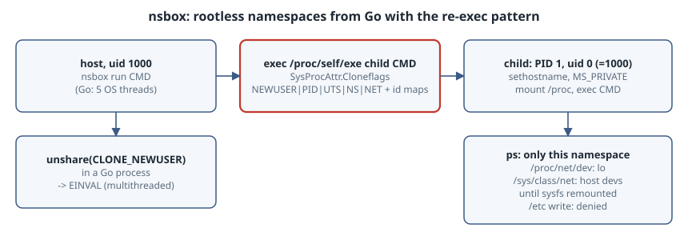

# Rootless Namespaces from Go: A 60-Line Sandbox with SysProcAttr and the Re-exec Pattern

## Thesis

Containers are built from ordinary Linux processes placed in fresh **namespaces**. With a **user namespace**, an unprivileged user can create one: you become "root" inside it, mapped to your own uid outside. Go makes this short to write, with one Go-specific constraint. **A Go program is always multithreaded**, and the kernel won't let a multithreaded process `unshare(CLONE_NEWUSER)`. Go programs therefore request the namespaces at *clone time* through `syscall.SysProcAttr`, and re-execute themselves (`/proc/self/exe`) to run setup code inside them.

This chapter builds `nsbox`, which uses new user, PID, UTS, mount and network namespaces with no root and no dependencies. It then checks from inside what the sandbox actually isolates, including one leak that surprises most people the first time.

{fig-alt="Left: the host. An unprivileged user, uid 1000, runs nsbox run CMD. Go starts several OS threads, so calling unshare with CLONE_NEWUSER directly fails with EINVAL. Instead exec.Command of /proc/self/exe child CMD with SysProcAttr Cloneflags CLONE_NEWUSER, NEWPID, NEWUTS, NEWNS and NEWNET, plus UID and GID mappings of 0 to 1000, creates the child in fresh namespaces at clone time. Right: inside the namespaces. The child is PID 1 and uid 0 mapped to host uid 1000; it sets hostname nsbox, makes mounts private, mounts a fresh /proc, then execs CMD. Inside, ps shows only the namespace's processes, /proc/net/dev shows only lo, but /sys/class/net still lists host devices until a fresh sysfs is mounted. Writing /etc is still denied because root inside maps to an unprivileged user outside."}

Environment: Go 1.27.2 on Linux 6.12 (x86-64), run as an ordinary user (uid 1000) with unprivileged user namespaces enabled (`/proc/sys/user/max_user_namespaces` > 0). Some distributions restrict them, for example through AppArmor policy on Ubuntu 24.04+. If they are restricted, the `run` step fails with `operation not permitted`.

## Why not just call `unshare`?

```go
// Why nsbox re-executes itself: a Go program is always multithreaded,
// and the kernel refuses unshare(CLONE_NEWUSER) in a multithreaded process.
package main

import (
	"fmt"
	"os"
	"strings"
	"syscall"
)

func main() {
	status, _ := os.ReadFile("/proc/self/status")
	for _, line := range strings.Split(string(status), "\n") {
		if strings.HasPrefix(line, "Threads:") {
			fmt.Println(line)
		}
	}
	err := syscall.Unshare(syscall.CLONE_NEWUSER)
	fmt.Println("unshare(CLONE_NEWUSER):", err)
}
```

```text
$ go run ./unsharetrap
Threads:	5
unshare(CLONE_NEWUSER): invalid argument
```

The Go runtime had already started 5 OS threads before `main` ran. [`unshare(2)`](https://man7.org/linux/man-pages/man2/unshare.2.html) says "CLONE_NEWUSER requires that the calling process is not threaded", so the call fails with `EINVAL`. Most other namespace types *can* be unshared by a single thread. That brings a second trap: only the calling OS thread moves into the new namespace, and the Go scheduler may later run your goroutine on a different thread. Code that does `unshare`/`setns` in-process has to pin itself with [`runtime.LockOSThread`](https://pkg.go.dev/runtime#LockOSThread) and must never unlock that thread. The re-exec pattern sidesteps both problems: the kernel creates the child *in* the namespaces, before any Go code runs there.

## nsbox

```go
// nsbox: run a command in new user, PID, UTS, mount and network namespaces,
// without root, using the re-exec pattern.
package main

import (
	"fmt"
	"os"
	"os/exec"
	"syscall"
)

func main() {
	if len(os.Args) < 3 {
		fmt.Fprintln(os.Stderr, "usage: nsbox run|child CMD [ARGS...]")
		os.Exit(2)
	}
	switch os.Args[1] {
	case "run":
		run(os.Args[2:])
	case "child":
		child(os.Args[2:])
	default:
		os.Exit(2)
	}
}

// run is the parent: it re-executes this binary as "child" inside new namespaces.
func run(argv []string) {
	cmd := exec.Command("/proc/self/exe", append([]string{"child"}, argv...)...)
	cmd.Stdin, cmd.Stdout, cmd.Stderr = os.Stdin, os.Stdout, os.Stderr
	cmd.SysProcAttr = &syscall.SysProcAttr{
		Cloneflags: syscall.CLONE_NEWUSER | syscall.CLONE_NEWPID |
			syscall.CLONE_NEWUTS | syscall.CLONE_NEWNS | syscall.CLONE_NEWNET,
		// Map our unprivileged uid/gid to root inside the user namespace.
		UidMappings: []syscall.SysProcIDMap{{ContainerID: 0, HostID: os.Getuid(), Size: 1}},
		GidMappings: []syscall.SysProcIDMap{{ContainerID: 0, HostID: os.Getgid(), Size: 1}},
	}
	fmt.Printf("[parent] host pid %d starting child\n", os.Getpid())
	if err := cmd.Run(); err != nil {
		fmt.Fprintln(os.Stderr, "[parent] child:", err)
		os.Exit(1)
	}
	fmt.Printf("[parent] child pid on the host was %d\n", cmd.Process.Pid)
}

// child runs as PID 1 of the new PID namespace, before exec'ing the user's command.
func child(argv []string) {
	must(syscall.Sethostname([]byte("nsbox")))
	// Stop mount events propagating back to the host, then mount a fresh /proc
	// so tools like ps see only this PID namespace.
	must(syscall.Mount("", "/", "", syscall.MS_REC|syscall.MS_PRIVATE, ""))
	must(syscall.Mount("proc", "/proc", "proc", syscall.MS_NOSUID|syscall.MS_NODEV|syscall.MS_NOEXEC, ""))
	path, err := exec.LookPath(argv[0])
	must(err)
	must(syscall.Exec(path, argv, os.Environ()))
}

func must(err error) {
	if err != nil {
		fmt.Fprintln(os.Stderr, "[child]", err)
		os.Exit(1)
	}
}
```

The parent and child are the same binary:

- **`run`** (parent) starts `/proc/self/exe child CMD...` with [`SysProcAttr`](https://pkg.go.dev/syscall#SysProcAttr):
  - `Cloneflags` lists the new namespaces.
  - `UidMappings`/`GidMappings` write `/proc/<pid>/uid_map` and `gid_map`, mapping in-namespace 0 to our real uid and gid. The [`user_namespaces(7)`](https://man7.org/linux/man-pages/man7/user_namespaces.7.html) rules allow an unprivileged process to map exactly one id, its own. The Go runtime also writes `deny` to `setgroups` before writing the gid map, as the kernel requires.
- **`child`** runs inside the namespaces as **PID 1**. It sets the hostname (UTS namespace) and makes every mount `MS_PRIVATE` so nothing propagates back to the host ([`mount_namespaces(7)`](https://man7.org/linux/man-pages/man7/mount_namespaces.7.html)). It then mounts a new `/proc` so that `/proc` describes *this* PID namespace, and finally `exec`s the user's command. That command takes over PID 1.

## What it looks like from inside

```sh
#!/bin/sh
# what the world looks like from inside nsbox
echo "id:       $(id -u):$(id -g) ($(id -un))"
echo "hostname: $(hostname)"
echo "my pid:   $$"
echo "processes:"; ps -eo pid,user,cmd
echo "net devices per /proc/net/dev:"; tail -n +3 /proc/net/dev | cut -d: -f1 | tr -d ' '
echo "net devices per /sys/class/net (host's sysfs):"; ls /sys/class/net | tr '\n' ' '; echo
mount -t sysfs sysfs /sys && echo "after mounting a fresh sysfs:" && ls /sys/class/net
echo "try to write a host-root file:"; touch /etc/nsbox-test 2>&1 || true
```

```sh
echo "\$ id -u; hostname; ls /sys/class/net | wc -l"
id -u; hostname; ls /sys/class/net | wc -l
echo "\$ ./nsbox run ./inside.sh"
./nsbox run ./inside.sh
echo "\$ hostname   # unchanged on the host"
hostname
```

```text
$ id -u; hostname; ls /sys/class/net | wc -l
1000
grok-bot-vm-399265740
3
$ ./nsbox run ./inside.sh
[parent] host pid 1671445 starting child
id:       0:0 (root)
hostname: nsbox
my pid:   1
processes:
    PID USER     CMD
      1 root     /bin/sh ./inside.sh
     10 root     ps -eo pid,user,cmd
net devices per /proc/net/dev:
lo
net devices per /sys/class/net (host's sysfs):
docker0 enp0s4 lo 
after mounting a fresh sysfs:
lo
try to write a host-root file:
touch: cannot touch '/etc/nsbox-test': Permission denied
[parent] child pid on the host was 1671451
$ hostname   # unchanged on the host
grok-bot-vm-399265740
```

Reading it line by line:

- **User namespace.** `id` reports `0:0 (root)`, but `touch /etc/nsbox-test` is still denied. Root inside maps to uid 1000 outside, and files owned by host root are outside our mapping. A user namespace gives you capabilities *over resources owned by that namespace*, not over the host.
- **PID namespace** ([`pid_namespaces(7)`](https://man7.org/linux/man-pages/man7/pid_namespaces.7.html)). The shell is PID 1, and `ps` sees only the shell and itself. The same process is PID 1671451 on the host (the parent prints it).
- **UTS namespace.** The hostname is `nsbox` inside, and the host's hostname is unchanged afterwards.
- **Network namespace** ([`network_namespaces(7)`](https://man7.org/linux/man-pages/man7/network_namespaces.7.html)). `/proc/net/dev` shows only `lo`, so the sandbox has no route out. **However, `/sys/class/net` still lists the host's `docker0` and `enp0s4`.** sysfs reports the network namespace of whoever *mounted* it, and `/sys` was inherited from the host. Mounting a fresh sysfs (allowed because our user namespace owns the new network namespace) shows only `lo`. Real runtimes mount new `/proc` *and* `/sys` for this reason. Tools that read `/sys/class/net` would otherwise get the host's view.

## What nsbox is not (yet)

`nsbox` shares the host's root filesystem, read-only in effect for host-owned files. A real runtime would add:

- **A root filesystem.** Unpack an image into a directory, bind-mount it onto itself, then call [`pivot_root(2)`](https://man7.org/linux/man-pages/man2/pivot_root.2.html) into it and unmount the old root. `chroot` alone is escapable.
- **Resource limits.** Create a cgroup v2 directory, write `memory.max`/`pids.max`/`cpu.max`, and add the child's PID. Rootless this works only inside a cgroup subtree delegated to your user, usually by systemd.
- **Networking.** Connect a veth pair, or a user-mode stack such as slirp4netns or pasta, to the empty network namespace.
- **Syscall filtering and capability dropping.** Use seccomp, `no_new_privs`, and a reduced capability set.

## Takeaways

- Go programs can't `unshare(CLONE_NEWUSER)` because they are always multithreaded. Request namespaces at clone time with `SysProcAttr.Cloneflags` and re-exec `/proc/self/exe` for the setup code.
- With `UidMappings`/`GidMappings`, an unprivileged user becomes root *inside* a namespace without gaining any power over host-owned resources.
- Remount `/proc` *and* `/sys` inside the sandbox. Otherwise `/sys/class/net` still shows host interfaces even in an empty network namespace.
- In-process `setns`/`unshare` from Go requires `runtime.LockOSThread` and a thread that is never unlocked.

## Sources

- Linux man-pages: [namespaces(7)](https://man7.org/linux/man-pages/man7/namespaces.7.html), [user_namespaces(7)](https://man7.org/linux/man-pages/man7/user_namespaces.7.html), [pid_namespaces(7)](https://man7.org/linux/man-pages/man7/pid_namespaces.7.html), [mount_namespaces(7)](https://man7.org/linux/man-pages/man7/mount_namespaces.7.html), [network_namespaces(7)](https://man7.org/linux/man-pages/man7/network_namespaces.7.html), [unshare(2)](https://man7.org/linux/man-pages/man2/unshare.2.html), [pivot_root(2)](https://man7.org/linux/man-pages/man2/pivot_root.2.html)
- Go: [`syscall.SysProcAttr`](https://pkg.go.dev/syscall#SysProcAttr) and [`runtime.LockOSThread`](https://pkg.go.dev/runtime#LockOSThread)
