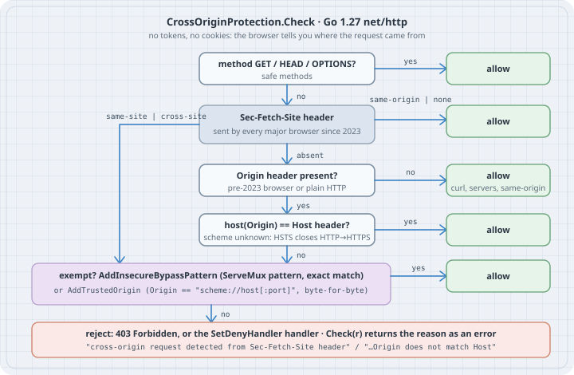

# CSRF Without Tokens: net/http CrossOriginProtection

## Thesis

Cross-Site Request Forgery is a confused-deputy attack: a page on `evil.example` makes the victim's browser send a state-changing request to your site, and the browser attaches the victim's cookies. For twenty years the answer was a CSRF token in every form, which meant every form, every `fetch`, and every template had to carry a secret correctly. Hand-rolled versions of that scheme still turn up in code review, model-written ones included. They often get the hard parts right (random tokens, constant-time compare) and the boring parts wrong (an `Origin` check done with `strings.HasPrefix`, logic spread across handlers).

Since **Go 1.25** the standard library ships the modern answer: **`http.CrossOriginProtection`**. It is middleware that rejects *non-safe, cross-origin browser requests* using the **`Sec-Fetch-Site`** Fetch-metadata header that every major browser has sent since 2023, and falls back to comparing `Origin` with `Host`. It needs no tokens, no cookies, and no template changes. On Go 1.27 a cookie-authenticated Go service should start from this middleware and justify any hand-rolled scheme on top of it.

## Mental model

The browser already knows where a request came from and, for HTTPS and `localhost` targets, it tells the server in `Sec-Fetch-Site`:

| `Sec-Fetch-Site` | Meaning | `CrossOriginProtection` |
|------------------|---------|-------------------------|
| `same-origin` | Your own page, same scheme + host + port | allow |
| `none` | User-initiated: typed URL, bookmark | allow |
| `same-site` | Sibling origin, e.g. `blog.example.com` → `app.example.com` | **reject** |
| `cross-site` | Anyone else | **reject** |

`Check` uses that header first. It ignores safe methods and falls back to `Origin` for older browsers. The flow below is the actual `Check` from `net/http/csrf.go` in Go 1.27.2:

{fig-alt="Decision flow. GET, HEAD and OPTIONS are allowed. Sec-Fetch-Site same-origin or none is allowed; same-site or cross-site goes to the exemption check. If Sec-Fetch-Site is absent and Origin is absent, allow. If Origin's host equals Host, allow. Otherwise check exemptions: an insecure bypass pattern or a trusted origin allows the request; otherwise reject with 403 or the deny handler."}

Four properties to keep in your head:

1. **It protects unsafe methods only.** `GET`, `HEAD`, and `OPTIONS` always pass, so a handler that changes state on `GET` is outside the protection by design.
2. **Same-site is not same-origin.** `SameSite=Lax` cookies stop *cross-site* requests but not a compromised marketing subdomain posting to your app. `Sec-Fetch-Site: same-site` is rejected.
3. **No headers means "not a browser".** Requests carrying neither `Sec-Fetch-Site` nor `Origin` come from curl, servers, or very old browsers, and they pass. CSRF needs a browser's ambient cookies, so this is correct. It also means CSRF protection is **not authentication**.
4. **Exemptions are explicit and narrow.** `AddTrustedOrigin` takes an exact `scheme://host[:port]` value. `AddInsecureBypassPattern` takes a `ServeMux` pattern and matches only requests that hit it directly. The deny path is a 403, or your handler via `SetDenyHandler`.

The API is small:

```go
cop := http.NewCrossOriginProtection()          // zero value is also valid
err := cop.AddTrustedOrigin("https://admin.example.com")
cop.AddInsecureBypassPattern("POST /sso/acs")   // panics on invalid/conflicting pattern
cop.SetDenyHandler(h)                           // default: 403 + reason text
err = cop.Check(r)                              // nil = allowed; side-effect free
handler := cop.Handler(mux)                     // wrap the whole router
```

All of the configuration methods are safe to call concurrently with request handling and apply to future requests.

## Worked examples

Every listing was run with **Go 1.27.2 on Linux (amd64)**. The output blocks are pasted from those runs. Each case is its own module so `go run .` sees one `main` package:

```bash
mkdir -p csrf/case1 && cd csrf/case1
go mod init example.com/csrf/case1
```

### Case 1: A hand-rolled origin check versus the standard library

This is the kind of middleware that shows up in review. It accepts a `POST` when `Origin` "starts with" the site's origin. We feed it, and the stdlib middleware, the header combinations real browsers produce.

```go
// main.go — the same POST handler behind a hand-rolled origin check and
// behind net/http.CrossOriginProtection, fed the requests browsers send.
package main

import (
	"fmt"
	"net/http"
	"net/http/httptest"
	"strings"
)

// transfer is a state-changing handler: it must only run for requests
// the user's own pages (or non-browser clients) made.
func transfer(w http.ResponseWriter, r *http.Request) {
	fmt.Fprintln(w, "transferred")
}

// handRolled is the kind of check that shows up in reviews: it compares
// Origin to the expected origin "as strings".
func handRolled(next http.Handler) http.Handler {
	return http.HandlerFunc(func(w http.ResponseWriter, r *http.Request) {
		if r.Method == http.MethodPost {
			o := r.Header.Get("Origin")
			if o != "" && !strings.HasPrefix(o, "https://bank.example") {
				http.Error(w, "bad origin", http.StatusForbidden)
				return
			}
		}
		next.ServeHTTP(w, r)
	})
}

type probe struct {
	name, method, site, origin string
}

func main() {
	stdlib := http.NewCrossOriginProtection().Handler(http.HandlerFunc(transfer))
	hand := handRolled(http.HandlerFunc(transfer))

	probes := []probe{
		{"own form (modern browser)", "POST", "same-origin", "https://bank.example"},
		{"evil.example form", "POST", "cross-site", "https://evil.example"},
		{"look-alike domain", "POST", "cross-site", "https://bank.example.evil.net"},
		{"sibling subdomain", "POST", "same-site", "https://blog.bank.example"},
		{"bookmark / typed URL", "POST", "none", ""},
		{"opaque origin (sandboxed iframe)", "POST", "cross-site", "null"},
		{"old browser, own page", "POST", "", "https://bank.example"},
		{"old browser, evil page", "POST", "", "https://evil.example"},
		{"curl / server-to-server", "POST", "", ""},
		{"cross-site GET", "GET", "cross-site", "https://evil.example"},
	}

	fmt.Printf("%-34s %-11s %-10s %s\n", "request", "Sec-Fetch", "hand", "stdlib")
	for _, p := range probes {
		fmt.Printf("%-34s %-11s %-10d %d\n", p.name, or(p.site, "-"),
			code(hand, p), code(stdlib, p))
	}
}

func code(h http.Handler, p probe) int {
	req := httptest.NewRequest(p.method, "https://bank.example/transfer", nil)
	if p.site != "" {
		req.Header.Set("Sec-Fetch-Site", p.site)
	}
	if p.origin != "" {
		req.Header.Set("Origin", p.origin)
	}
	rec := httptest.NewRecorder()
	h.ServeHTTP(rec, req)
	return rec.Code
}

func or(s, d string) string {
	if s == "" {
		return d
	}
	return s
}
```

```bash
go run .
```

Output:

```
request                            Sec-Fetch   hand       stdlib
own form (modern browser)          same-origin 200        200
evil.example form                  cross-site  403        403
look-alike domain                  cross-site  200        403
sibling subdomain                  same-site   403        403
bookmark / typed URL               none        200        200
opaque origin (sandboxed iframe)   cross-site  403        403
old browser, own page              -           200        200
old browser, evil page             -           403        403
curl / server-to-server            -           200        200
cross-site GET                     cross-site  200        200
```

Read the table row by row:

- **Look-alike domain.** `https://bank.example.evil.net` starts with `https://bank.example`, so the hand-rolled check waves it through. Stringly-typed origin comparison is the classic bug. `CrossOriginProtection` never compares prefixes: `Sec-Fetch-Site: cross-site` is rejected outright.
- **Sibling subdomain.** Both reject it here, but only by accident in the hand-rolled version. `SameSite` cookies would *not* have stopped it.
- **`none`.** A bookmark or typed URL is user-initiated, so it is allowed.
- **Opaque origin.** Sandboxed iframes and some redirects send `Origin: null`. Modern browsers also mark it `cross-site`, and even the `Origin`-only fallback rejects `null` because its host never equals `Host`.
- **Old browser rows.** With no `Sec-Fetch-Site`, the middleware compares the host of `Origin` with the `Host` header.
- **curl row.** No browser headers, no ambient cookies, no CSRF. The request is allowed, and your authentication layer still has to do its job.
- **Cross-site GET.** Allowed. This is the trap later in the chapter.

### Case 2: Trusted origins are exact strings

A separate admin SPA on `https://admin.bank.example` posts to `https://api.bank.example`. That is a `same-site` request, so it is rejected unless you trust the origin explicitly.

```bash
mkdir -p ../case2 && cd ../case2 && go mod init example.com/csrf/case2
```

```go
// main.go — trusted origins: what AddTrustedOrigin accepts, and how
// exactly it has to match the Origin header the browser sends.
package main

import (
	"fmt"
	"net/http"
	"net/http/httptest"
)

func main() {
	cop := http.NewCrossOriginProtection()

	// The admin SPA lives on its own origin and posts to the API.
	for _, o := range []string{
		"https://admin.bank.example",
		"https://admin.bank.example/", // trailing slash = a path
		"admin.bank.example",          // no scheme
		"https://partner.example:8443",
	} {
		if err := cop.AddTrustedOrigin(o); err != nil {
			fmt.Println("AddTrustedOrigin:", err)
		} else {
			fmt.Printf("AddTrustedOrigin: %q ok\n", o)
		}
	}
	fmt.Println()

	h := cop.Handler(http.HandlerFunc(func(w http.ResponseWriter, r *http.Request) {
		fmt.Fprintln(w, "ok")
	}))

	for _, origin := range []string{
		"https://admin.bank.example",
		"https://ADMIN.bank.example",
		"http://admin.bank.example",
		"https://admin.bank.example:443",
		"https://partner.example:8443",
		"https://partner.example",
	} {
		req := httptest.NewRequest("POST", "https://api.bank.example/v1/payees", nil)
		req.Header.Set("Sec-Fetch-Site", "same-site")
		req.Header.Set("Origin", origin)
		rec := httptest.NewRecorder()
		h.ServeHTTP(rec, req)
		fmt.Printf("%-32s -> %d\n", origin, rec.Code)
	}
}
```

```bash
go run .
```

Output:

```
AddTrustedOrigin: "https://admin.bank.example" ok
AddTrustedOrigin: invalid origin "https://admin.bank.example/": path, query, and fragment are not allowed
AddTrustedOrigin: invalid origin "admin.bank.example": scheme is required
AddTrustedOrigin: "https://partner.example:8443" ok

https://admin.bank.example       -> 200
https://ADMIN.bank.example       -> 403
http://admin.bank.example        -> 403
https://admin.bank.example:443   -> 403
https://partner.example:8443     -> 200
https://partner.example          -> 403
```

`AddTrustedOrigin` validates its input. It requires a scheme and a host, and rejects any path, query, or fragment, including a trailing `/`. Matching is a map lookup on the raw `Origin` header, so the value must be the browser's serialization: lowercase host, scheme included, default port omitted. Browsers never send `https://admin.bank.example:443` or an uppercase host, so those rows are only here to show that nothing is normalized for you. Configure origins exactly as a browser prints `window.location.origin`.

### Case 3: Bypass patterns for the flows that are cross-site by design

Some legitimate flows are cross-site browser `POST`s by construction. In a SAML HTTP-POST binding, or an OIDC `response_mode=form_post` callback, the identity provider's page auto-submits a form to you. Those routes need an exemption. Webhooks usually do **not**, because they come from servers and carry no browser headers.

```bash
mkdir -p ../case3 && cd ../case3 && go mod init example.com/csrf/case3
```

```go
// main.go — insecure bypass patterns: which requests they exempt, and
// which near-misses they deliberately do not.
package main

import (
	"fmt"
	"net/http"
	"net/http/httptest"
)

func main() {
	mux := http.NewServeMux()
	ok := func(w http.ResponseWriter, r *http.Request) { fmt.Fprintln(w, "ok") }
	mux.HandleFunc("POST /sso/acs", ok)                   // SAML HTTP-POST binding
	mux.HandleFunc("POST /oauth/{provider}/callback", ok) // OIDC response_mode=form_post
	mux.HandleFunc("POST /account/delete", ok)
	mux.HandleFunc("POST /webhooks/github", ok)

	cop := http.NewCrossOriginProtection()
	// Cross-site browser POSTs that are legitimate by design: the IdP's
	// page auto-submits a form to us. Nothing else gets an exemption.
	cop.AddInsecureBypassPattern("POST /sso/acs")
	cop.AddInsecureBypassPattern("POST /oauth/{provider}/callback")

	h := cop.Handler(mux)
	send := func(path string, browser bool) {
		req := httptest.NewRequest("POST", "https://bank.example"+path, nil)
		if browser {
			req.Header.Set("Sec-Fetch-Site", "cross-site")
			req.Header.Set("Origin", "https://idp.example")
		}
		rec := httptest.NewRecorder()
		h.ServeHTTP(rec, req)
		kind := "server"
		if browser {
			kind = "cross-site browser"
		}
		fmt.Printf("%-18s POST %-24s -> %d\n", kind, path, rec.Code)
	}
	send("/sso/acs", true)
	send("/sso/acs/", true)              // not matched by the pattern
	send("//sso/acs", true)              // ServeMux would clean + redirect
	send("/sso/../account/delete", true) // cleaned path is not a bypass
	send("/oauth/google/callback", true)
	send("/account/delete", true)
	send("/webhooks/github", false) // no bypass needed: not a browser

	// Patterns follow ServeMux rules, including conflict detection.
	defer func() { fmt.Println("\npanic:", recover()) }()
	cop.AddInsecureBypassPattern("POST /oauth/{name}/callback")
}
```

```bash
go run .
```

Output:

```
cross-site browser POST /sso/acs                 -> 200
cross-site browser POST /sso/acs/                -> 403
cross-site browser POST //sso/acs                -> 403
cross-site browser POST /sso/../account/delete   -> 403
cross-site browser POST /oauth/google/callback   -> 200
cross-site browser POST /account/delete          -> 403
server             POST /webhooks/github         -> 200

panic: pattern "POST /oauth/{name}/callback" (registered at /usr/local/go/src/net/http/csrf.go:114) conflicts with pattern "POST /oauth/{provider}/callback" (registered at /usr/local/go/src/net/http/csrf.go:114):
POST /oauth/{name}/callback matches the same requests as POST /oauth/{provider}/callback
```

A bypass pattern exempts only requests that match it **directly**. `/sso/acs/`, `//sso/acs`, and `/sso/../account/delete` would be cleaned or redirected by `ServeMux`, so they are rejected instead of slipping through. The exemption is checked by a private `ServeMux` inside the middleware, so pattern syntax, wildcards, and conflict detection behave exactly like your router. Registering an overlapping pattern panics at startup, which is where you want to find out. The server-side webhook passes without any exemption. Verify its signature in the handler, because CSRF protection says nothing about who sent it.

### Case 4: Production wiring behind a proxy, with a deny handler

In production the app sits behind a TLS-terminating proxy and sees `Host: app:8080`. Modern browsers are unaffected because `Sec-Fetch-Site` decides. But the `Origin == Host` fallback for old browsers would now reject your own pages. Fix it by naming the public origin as trusted. The deny handler returns JSON and logs the reason, which you get from calling `Check` again (it has no side effects).

```bash
mkdir -p ../case4 && cd ../case4 && go mod init example.com/csrf/case4
```

```go
// main.go — production wiring: one CrossOriginProtection in front of the
// whole mux, a deny handler that logs why, and real requests over TCP.
package main

import (
	"fmt"
	"io"
	"log/slog"
	"net/http"
	"net/http/httptest"
	"os"
	"strings"
)

func newServer(log *slog.Logger) http.Handler {
	mux := http.NewServeMux()
	mux.HandleFunc("GET /settings", func(w http.ResponseWriter, r *http.Request) {
		fmt.Fprintln(w, `<form method="post" action="/settings/email">...</form>`)
	})
	mux.HandleFunc("POST /settings/email", func(w http.ResponseWriter, r *http.Request) {
		fmt.Fprintln(w, "email updated")
	})

	cop := http.NewCrossOriginProtection()
	// Behind the TLS-terminating proxy the app sees Host: app:8080, so
	// old browsers' Origin never equals Host. Name the public origin.
	if err := cop.AddTrustedOrigin("https://app.example"); err != nil {
		panic(err)
	}
	cop.SetDenyHandler(http.HandlerFunc(func(w http.ResponseWriter, r *http.Request) {
		// Check is side-effect free; call it again to get the reason.
		log.Warn("csrf rejected",
			"method", r.Method, "path", r.URL.Path,
			"origin", r.Header.Get("Origin"),
			"sec_fetch_site", r.Header.Get("Sec-Fetch-Site"),
			"reason", cop.Check(r))
		w.Header().Set("Content-Type", "application/json")
		w.WriteHeader(http.StatusForbidden)
		io.WriteString(w, `{"error":"cross_origin_request"}`+"\n")
	}))
	return cop.Handler(mux)
}

func main() {
	log := slog.New(slog.NewTextHandler(os.Stdout, &slog.HandlerOptions{
		ReplaceAttr: func(_ []string, a slog.Attr) slog.Attr {
			if a.Key == slog.TimeKey {
				return slog.Attr{} // stable output
			}
			return a
		},
	}))
	srv := httptest.NewServer(newServer(log)) // a real listener on 127.0.0.1
	defer srv.Close()

	do := func(label, origin, site string) {
		req, _ := http.NewRequest("POST", srv.URL+"/settings/email",
			strings.NewReader("email=x@example.com"))
		req.Header.Set("Content-Type", "application/x-www-form-urlencoded")
		if origin != "" {
			req.Header.Set("Origin", origin)
		}
		if site != "" {
			req.Header.Set("Sec-Fetch-Site", site)
		}
		resp, err := http.DefaultClient.Do(req)
		if err != nil {
			panic(err)
		}
		body, _ := io.ReadAll(resp.Body)
		resp.Body.Close()
		fmt.Printf("%-26s %d %s", label, resp.StatusCode, body)
	}
	do("Go http.Client (no hdrs)", "", "")
	do("browser, same-origin", "https://app.example", "same-origin")
	do("old browser via proxy", "https://app.example", "")
	do("old browser, evil page", "https://evil.example", "")
	do("browser, cross-site", "https://evil.example", "cross-site")
}
```

```bash
go run .
```

Output:

```
Go http.Client (no hdrs)   200 email updated
browser, same-origin       200 email updated
old browser via proxy      200 email updated
level=WARN msg="csrf rejected" method=POST path=/settings/email origin=https://evil.example sec_fetch_site="" reason="cross-origin request detected, and/or browser is out of date: Sec-Fetch-Site is missing, and Origin does not match Host"
old browser, evil page     403 {"error":"cross_origin_request"}
level=WARN msg="csrf rejected" method=POST path=/settings/email origin=https://evil.example sec_fetch_site=cross-site reason="cross-origin request detected from Sec-Fetch-Site header"
browser, cross-site        403 {"error":"cross_origin_request"}
```

`httptest.NewServer` is a real listener on `127.0.0.1`, so these are real HTTP/1.1 requests through `http.DefaultClient`. Note the first row: a Go client sends neither header and is allowed. The two error strings are the two rejection reasons `Check` can return. They are worth logging, because the "browser is out of date" one tells you the request came through the fallback path.

### Case 5: Pin the contract in a test

Middleware is easy to drop in a refactor: a new router, a second `http.Server`, a handler mounted outside the wrapped mux. A table test on the exported router keeps the contract visible.

```bash
mkdir -p ../case5 && cd ../case5 && go mod init example.com/csrf/case5
```

```go
// app.go — the application's router, CSRF protection included.
package app

import "net/http"

func Routes() http.Handler {
	mux := http.NewServeMux()
	mux.HandleFunc("GET /profile", func(w http.ResponseWriter, r *http.Request) {})
	mux.HandleFunc("POST /profile", func(w http.ResponseWriter, r *http.Request) {})
	mux.HandleFunc("DELETE /profile", func(w http.ResponseWriter, r *http.Request) {})
	mux.HandleFunc("POST /sso/acs", func(w http.ResponseWriter, r *http.Request) {})

	cop := http.NewCrossOriginProtection()
	cop.AddInsecureBypassPattern("POST /sso/acs")
	return cop.Handler(mux)
}
```

```go
// app_test.go — pin the CSRF contract so a refactor cannot drop it.
package app

import (
	"net/http"
	"net/http/httptest"
	"testing"
)

func TestCrossOriginContract(t *testing.T) {
	h := Routes()
	tests := []struct {
		method, path, site string
		want               int
	}{
		{"POST", "/profile", "same-origin", http.StatusOK},
		{"POST", "/profile", "cross-site", http.StatusForbidden},
		{"POST", "/profile", "same-site", http.StatusForbidden},
		{"DELETE", "/profile", "cross-site", http.StatusForbidden},
		{"GET", "/profile", "cross-site", http.StatusOK},
		{"POST", "/sso/acs", "cross-site", http.StatusOK}, // the one exemption
	}
	for _, tt := range tests {
		t.Run(tt.method+" "+tt.path+" "+tt.site, func(t *testing.T) {
			req := httptest.NewRequest(tt.method, "https://app.example"+tt.path, nil)
			req.Header.Set("Sec-Fetch-Site", tt.site)
			rec := httptest.NewRecorder()
			h.ServeHTTP(rec, req)
			if rec.Code != tt.want {
				t.Fatalf("got %d, want %d", rec.Code, tt.want)
			}
		})
	}
}
```

```bash
go test -count=1 -v .
```

Output:

```
=== RUN   TestCrossOriginContract
=== RUN   TestCrossOriginContract/POST_/profile_same-origin
=== RUN   TestCrossOriginContract/POST_/profile_cross-site
=== RUN   TestCrossOriginContract/POST_/profile_same-site
=== RUN   TestCrossOriginContract/DELETE_/profile_cross-site
=== RUN   TestCrossOriginContract/GET_/profile_cross-site
=== RUN   TestCrossOriginContract/POST_/sso/acs_cross-site
--- PASS: TestCrossOriginContract (0.00s)
    --- PASS: TestCrossOriginContract/POST_/profile_same-origin (0.00s)
    --- PASS: TestCrossOriginContract/POST_/profile_cross-site (0.00s)
    --- PASS: TestCrossOriginContract/POST_/profile_same-site (0.00s)
    --- PASS: TestCrossOriginContract/DELETE_/profile_cross-site (0.00s)
    --- PASS: TestCrossOriginContract/GET_/profile_cross-site (0.00s)
    --- PASS: TestCrossOriginContract/POST_/sso/acs_cross-site (0.00s)
PASS
ok  	example.com/csrf/case5	0.003s
```

## The trap

`CrossOriginProtection` trusts the HTTP method. It assumes that safe methods do not change state, which HTTP has always required and many handlers still violate. A pattern without a method accepts `GET`, and a cross-site `` or link is enough to fire it.

```bash
mkdir -p ../trap && cd ../trap && go mod init example.com/csrf/trap
```

```go
// main.go — CrossOriginProtection trusts the HTTP method. A handler that
// changes state on GET is outside its protection by design.
package main

import (
	"fmt"
	"net/http"
	"net/http/httptest"
)

func main() {
	subscribed := true
	mux := http.NewServeMux()
	// No method in the pattern: GET, POST, anything reaches the handler.
	mux.HandleFunc("/newsletter/unsubscribe", func(w http.ResponseWriter, r *http.Request) {
		subscribed = false
		fmt.Fprintln(w, "unsubscribed")
	})
	h := http.NewCrossOriginProtection().Handler(mux)

	// evil.example embeds 
	req := httptest.NewRequest("GET", "https://bank.example/newsletter/unsubscribe", nil)
	req.Header.Set("Sec-Fetch-Site", "cross-site")
	rec := httptest.NewRecorder()
	h.ServeHTTP(rec, req)
	fmt.Println("cross-site GET:", rec.Code, "subscribed =", subscribed)

	// Fix: state changes only on unsafe methods, and say so in the pattern.
	subscribed = true
	mux2 := http.NewServeMux()
	mux2.HandleFunc("POST /newsletter/unsubscribe", func(w http.ResponseWriter, r *http.Request) {
		subscribed = false
	})
	h2 := http.NewCrossOriginProtection().Handler(mux2)
	for _, m := range []string{"GET", "POST"} {
		req := httptest.NewRequest(m, "https://bank.example/newsletter/unsubscribe", nil)
		req.Header.Set("Sec-Fetch-Site", "cross-site")
		rec := httptest.NewRecorder()
		h2.ServeHTTP(rec, req)
		fmt.Printf("fixed, cross-site %-4s: %d subscribed = %v\n", m, rec.Code, subscribed)
	}
}
```

```bash
go run .
```

Output:

```
cross-site GET: 200 subscribed = false
fixed, cross-site GET : 405 subscribed = true
fixed, cross-site POST: 403 subscribed = true
```

With the method in the pattern, a cross-site `GET` gets `405` from `ServeMux` and the cross-site `POST` gets `403` from the middleware. The same review applies to "unsubscribe" links in emails, `GET /logout`, and `?action=delete` query parameters. Give them a confirmation page that submits a `POST`.

Other edges to know about:

- **Plain HTTP and pre-2023 browsers.** `Sec-Fetch-Site` is only sent to trustworthy origins (HTTPS and `localhost`). The `Origin == Host` fallback cannot see the scheme, so an out-of-date browser is exposed to an HTTP→HTTPS request from a network attacker. HSTS closes that gap.
- **Header-stripping extensions.** An extension that removes `Origin` and `Sec-Fetch-Site` makes a browser request look like curl. That is a vulnerability in the extension, and no server-side scheme can detect it.
- **Mounting.** Wrap the **whole** mux (or the outermost handler) once. Protection added per route is protection someone forgets on the next route.
- **CORS is a different problem.** CORS controls who may *read* responses. CSRF controls who may cause *state changes*. `CrossOriginProtection` sets no CORS headers, and CORS configuration does not stop form posts.

## The boring rule

Wrap the outermost handler of every cookie-authenticated Go service in `http.NewCrossOriginProtection().Handler(...)`, put an explicit method on every state-changing route, exempt only the SSO callbacks that are cross-site by design with exact bypass patterns, trust only exact browser-serialized origins, keep HSTS on, and delete the hand-rolled token code unless a written threat model still needs it.

## Try this

1. Add a probe to Case 1 with `Sec-Fetch-Site: same-origin` and `Origin: https://evil.example`. Predict the result from the flow diagram before you run it, then explain why `Sec-Fetch-Site` wins.
2. In Case 4, remove `AddTrustedOrigin` and rerun. Which row changes, and why do modern browsers not care?
3. Register `cop.AddInsecureBypassPattern("/sso/")` instead of `"POST /sso/acs"`. Which requests are now exempt? Write a Case 5 test row that would have caught the widening.
4. Replace the deny handler in Case 4 with one that increments an `expvar` counter labelled by the `Check` error, and graph rejections during a deploy.
5. Grep a codebase you maintain for `HandleFunc("/` patterns without a method that write to a database. Each one is a cross-site `GET` waiting to happen.

## Sources

- `net/http` package documentation, `CrossOriginProtection`: <https://pkg.go.dev/net/http#CrossOriginProtection>
- Go 1.25 release notes, `net/http` section (introduces `CrossOriginProtection`): <https://go.dev/doc/go1.25#nethttppkgnethttp>
- Go source, `src/net/http/csrf.go` (behaviour verified against Go 1.27.2): <https://cs.opensource.google/go/go/+/refs/tags/go1.27.2:src/net/http/csrf.go>
- Go release history (Go 1.27.2, released 2026-10-08): <https://go.dev/doc/devel/release>
- Filippo Valsorda, "Cross-Site Request Forgery" (the analysis and algorithm behind the proposal): <https://words.filippo.io/csrf/>
- W3C, Fetch Metadata Request Headers (`Sec-Fetch-Site`): <https://www.w3.org/TR/fetch-metadata/>
- MDN, `Sec-Fetch-Site`: <https://developer.mozilla.org/en-US/docs/Web/HTTP/Reference/Headers/Sec-Fetch-Site>
- OWASP Cross-Site Request Forgery Prevention Cheat Sheet (Fetch Metadata section): <https://cheatsheetseries.owasp.org/cheatsheets/Cross-Site_Request_Forgery_Prevention_Cheat_Sheet.html>
