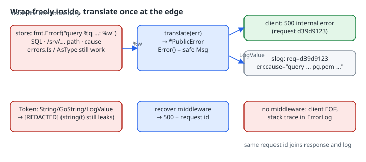

# Error Boundaries: Wrap Inside, Translate at the Edge, Leak Nothing

## Thesis

Good Go error wrapping and safe Go error output pull in opposite directions. `fmt.Errorf("query %q: %w", q, err)` is exactly what you want in a log, and exactly what you must never send to a client: it carries SQL text, file paths, tenant names and sometimes credentials. You don't fix this with less context. You fix it by making one **boundary** the only place where errors leave the trust zone. That boundary translates every error into a type whose `Error()` method is safe by construction, and sends the full detail only to the log, joined to the response by a request ID.

## Mental model

{fig-alt="Left: inside the service, the store returns an error wrapped with fmt.Errorf and %w that carries the SQL text, a file path and the cause. errors.Is and errors.AsType still walk this chain. Middle: at the HTTP boundary, translate turns it into a PublicError with a status, a safe message and the internal cause. PublicError's Error method returns only the safe message, and its LogValue method exposes the cause to slog. Right: the client gets only the status, the safe message and a request ID. The application log gets the request ID and the full cause. A Token type redacts itself in String, GoString and LogValue, though converting it with string(t) still returns the raw value. A panic is caught by recover middleware and turned into a 500. Without it, net/http logs a stack trace and the client sees EOF."}

Each piece has a single job:

- **Inside:** wrap with `%w` and add context freely. `errors.Is`/`errors.AsType` keep working through the chain.
- **`PublicError`:** `Error()` returns only the client-safe message, so an accidental `http.Error(w, err.Error(), …)` is harmless. `Unwrap()` keeps the cause reachable for code inside the service, and `LogValue()` ([`slog.LogValuer`](https://pkg.go.dev/log/slog#LogValuer)) sends the cause to the log.
- **Secrets as types:** a `Token` type that formats itself as `[REDACTED]` through every `fmt` verb and through slog.
- **Panics:** a recover middleware, because the `net/http` default isn't a response at all.

## Worked example

One program runs all five cases against an `httptest` server and prints what the client sees, what the application log records, and what `net/http` writes to its own error log.

```go
package main

import (
	"bytes"
	"context"
	"crypto/rand"
	"encoding/hex"
	"errors"
	"fmt"
	"io"
	"log"
	"log/slog"
	"net/http"
	"net/http/httptest"
	"os"
	"strings"
)

// ---- internal layer: rich, unsafe-to-show errors ----

var ErrNotFound = errors.New("not found")

type Token string

func (Token) String() string       { return "[REDACTED]" }
func (Token) GoString() string     { return `Token("[REDACTED]")` }
func (Token) LogValue() slog.Value { return slog.StringValue("[REDACTED]") }

func loadInvoice(id string, tok Token) error {
	const q = "SELECT * FROM invoices WHERE id = $1 AND tenant = 'acme'"
	if id == "404" {
		return fmt.Errorf("query %q (id=%s): %w", q, id, ErrNotFound)
	}
	cause := fmt.Errorf("open /srv/acme/secrets/pg.pem: permission denied")
	return fmt.Errorf("query %q with token %v: %w", q, tok, cause)
}

// ---- boundary type: Error() is safe; detail only via LogValue ----

type PublicError struct {
	Status int
	Msg    string // safe for clients
	err    error  // internal cause
}

func (e *PublicError) Error() string { return e.Msg }
func (e *PublicError) Unwrap() error { return e.err }
func (e *PublicError) LogValue() slog.Value {
	return slog.GroupValue(slog.Int("status", e.Status), slog.String("cause", e.err.Error()))
}

func translate(err error) *PublicError {
	if errors.Is(err, ErrNotFound) {
		return &PublicError{http.StatusNotFound, "invoice not found", err}
	}
	return &PublicError{http.StatusInternalServerError, "internal error", err}
}

func reqID() string { b := make([]byte, 4); rand.Read(b); return hex.EncodeToString(b) }

var logger *slog.Logger

// naive handler: what not to do
func naive(w http.ResponseWriter, r *http.Request) {
	if err := loadInvoice(r.URL.Query().Get("id"), "sk_live_9f8e7d"); err != nil {
		http.Error(w, err.Error(), http.StatusInternalServerError)
	}
}

// boundary handler
func safe(w http.ResponseWriter, r *http.Request) {
	if err := loadInvoice(r.URL.Query().Get("id"), "sk_live_9f8e7d"); err != nil {
		pe := translate(err)
		id := reqID()
		logger.ErrorContext(r.Context(), "load invoice", "req", id, "err", pe)
		http.Error(w, fmt.Sprintf("%s (request %s)", pe.Msg, id), pe.Status)
	}
}

func boom(w http.ResponseWriter, r *http.Request) {
	var m map[string]int
	m["x"] = 1 // panics
}

func recoverer(next http.Handler) http.Handler {
	return http.HandlerFunc(func(w http.ResponseWriter, r *http.Request) {
		defer func() {
			if v := recover(); v != nil {
				if v == http.ErrAbortHandler {
					panic(v)
				}
				id := reqID()
				logger.Error("panic", "req", id, "value", fmt.Sprint(v))
				http.Error(w, "internal error (request "+id+")", http.StatusInternalServerError)
			}
		}()
		next.ServeHTTP(w, r)
	})
}

func get(url string) {
	resp, err := http.Get(url)
	if err != nil {
		fmt.Printf("  client error: %v\n", err)
		return
	}
	defer resp.Body.Close()
	b, _ := io.ReadAll(resp.Body)
	fmt.Printf("  %d %s", resp.StatusCode, b)
}

func main() {
	var logs bytes.Buffer
	logger = slog.New(slog.NewTextHandler(&logs, &slog.HandlerOptions{
		ReplaceAttr: func(_ []string, a slog.Attr) slog.Attr {
			if a.Key == slog.TimeKey {
				return slog.Attr{}
			}
			return a
		}}))
	var serverLog bytes.Buffer
	mux := http.NewServeMux()
	mux.HandleFunc("/naive", naive)
	mux.HandleFunc("/safe", safe)
	mux.HandleFunc("/boom", boom)
	mux.Handle("/boom-recovered", recoverer(http.HandlerFunc(boom)))
	ts := httptest.NewUnstartedServer(mux)
	ts.Config.ErrorLog = log.New(&serverLog, "", 0)
	ts.Start()
	defer ts.Close()

	for _, p := range []string{"/naive?id=7", "/safe?id=7", "/safe?id=404", "/boom", "/boom-recovered"} {
		fmt.Println("GET", p)
		get(ts.URL + p)
	}
	ts.Close()
	fmt.Println("\n--- application log (slog) ---")
	os.Stdout.Write(logs.Bytes())
	fmt.Println("\n--- net/http ErrorLog (first 3 lines) ---")
	lines := strings.SplitN(serverLog.String(), "\n", 4)
	for _, l := range lines[:3] {
		fmt.Println(l)
	}

	fmt.Println("\n--- formatting a Token ---")
	t := Token("sk_live_9f8e7d")
	fmt.Printf("%%v=%v %%s=%s %%#v=%#v %%q=%q string(t)=%s\n", t, t, t, t, string(t))

	fmt.Println("\n--- the chain still works inside the service ---")
	wrapped := fmt.Errorf("handler: %w", translate(loadInvoice("404", t)))
	pe, ok := errors.AsType[*PublicError](wrapped)
	fmt.Printf("AsType ok=%v status=%d msg=%q  errors.Is(wrapped, ErrNotFound)=%v\n", ok, pe.Status, pe.Msg, errors.Is(wrapped, ErrNotFound))
	_ = context.Background
}
```

```bash
go vet ./... && go build -o safeerr . && ./safeerr
```

```text
GET /naive?id=7
  500 query "SELECT * FROM invoices WHERE id = $1 AND tenant = 'acme'" with token [REDACTED]: open /srv/acme/secrets/pg.pem: permission denied
GET /safe?id=7
  500 internal error (request d9b5f5d4)
GET /safe?id=404
  404 invoice not found (request f758d9f7)
GET /boom
  client error: Get "http://127.0.0.1:42753/boom": EOF
GET /boom-recovered
  500 internal error (request df661fd0)

--- application log (slog) ---
level=ERROR msg="load invoice" req=d9b5f5d4 err.status=500 err.cause="query \"SELECT * FROM invoices WHERE id = $1 AND tenant = 'acme'\" with token [REDACTED]: open /srv/acme/secrets/pg.pem: permission denied"
level=ERROR msg="load invoice" req=f758d9f7 err.status=404 err.cause="query \"SELECT * FROM invoices WHERE id = $1 AND tenant = 'acme'\" (id=404): not found"
level=ERROR msg=panic req=df661fd0 value="assignment to entry in nil map"

--- net/http ErrorLog (first 3 lines) ---
http: panic serving 127.0.0.1:37898: assignment to entry in nil map
goroutine 36 [running]:
net/http.(*conn).serve.func1()

--- formatting a Token ---
%v=[REDACTED] %s=[REDACTED] %#v=Token("[REDACTED]") %q="[REDACTED]" string(t)=sk_live_9f8e7d

--- the chain still works inside the service ---
AsType ok=true status=404 msg="invoice not found"  errors.Is(wrapped, ErrNotFound)=true
```

Reading it case by case:

- **`/naive`** shows the leak: the SQL text, the tenant `'acme'` and the path `/srv/acme/secrets/pg.pem` all reach the client in one line. The token printed as `[REDACTED]` only because its type redacts itself. A plain `string` would have gone out as is.
- **`/safe`** sends the client `internal error (request …)` or `invoice not found (request …)`. The log line with the same request ID carries `err.cause=` with the full chain. `errors.Is(err, ErrNotFound)` chose the 404 *before* any detail was dropped.
- **`/boom`** shows the `net/http` default. The [`Handler` docs](https://pkg.go.dev/net/http#Handler) say the server "recovers the panic, logs a stack trace to the server error log, and either closes the network connection or sends an HTTP/2 RST_STREAM". The client got `EOF`, not a 500. The stack trace stays server-side, but the client gets no usable status, and goroutine dumps end up wherever `ErrorLog` points.
- **`/boom-recovered`**: the middleware converts the panic into a normal 500 with a request ID. It re-panics on `http.ErrAbortHandler`, which the same docs reserve for deliberately aborting a response "so the client sees an interrupted response but the server doesn't log an error".
- **Token formatting**: `%v`, `%s` and `%q` go through `String()`, while `%#v` goes through `GoString()`, as specified by the [`fmt` rules](https://pkg.go.dev/fmt). You need both methods, or `%#v` prints the raw field. `string(t)` is a conversion, not formatting, and no method can intercept it.
- **The chain**: `errors.AsType[*PublicError]` (Go 1.26+, [docs](https://pkg.go.dev/errors#AsType)) finds the boundary error through an extra `%w` layer, and `errors.Is(wrapped, ErrNotFound)` is still true. Translating at the edge cost the service no introspection.

## Choosing what `Unwrap` exposes

`PublicError.Unwrap` returning the cause is a choice. It is right when everything that sees a `PublicError` is your own code. If a `PublicError` crosses into code you don't trust, such as a plugin, a client library returning errors to callers, or an RPC layer that serialises the chain, drop `Unwrap`. The chain then ends at the boundary, and nobody outside can probe for specific driver error types. The JetBrains article linked below calls this a firewall.

## Things that bite

| Trap | What happens | Fix |
|---|---|---|
| `http.Error(w, err.Error(), 500)` on a wrapped error | SQL, paths and tenant names reach the client (`/naive`) | Translate first, and make the boundary type's `Error()` safe |
| Secrets as plain `string` | Printed by any `%v` and serialised by any logger | A named type with `String`, `GoString` and `LogValue` |
| Only `String()` implemented | `%#v` prints the raw value | Implement `GoString()` too |
| `string(tok)` or `[]byte(tok)` | Redaction bypassed; no method can stop a conversion | Keep conversions in one audited function that hands the value to the HTTP client or driver |
| Relying on net/http's panic recovery | Client sees `EOF`, the stack goes to `ErrorLog` | Recover middleware; re-panic `http.ErrAbortHandler` |
| Logging the `PublicError` with `%v` | You log only the safe message and lose the cause | Log it as an slog attribute so `LogValue` runs, or log `errors.Unwrap(pe)` |
| Different messages for "no such user" and "wrong password" | Account enumeration | Map both to one public message at the boundary |

## Try this

1. Delete `GoString()` from `Token` and rerun. Which verb now leaks the secret?
2. Remove `Unwrap()` from `PublicError`. What does the last line print now, and why does the 404 mapping still work?
3. Point `ts.Config.ErrorLog` at `io.Discard` and observe that the client-side behaviour of `/boom` doesn't change. The recovery isn't about logging.

## Sources

- Go: [`net/http.Handler` (panic behaviour, `ErrAbortHandler`)](https://pkg.go.dev/net/http#Handler)
- Go: [`log/slog.LogValuer`](https://pkg.go.dev/log/slog#LogValuer)
- Go: [`errors.AsType`](https://pkg.go.dev/errors#AsType), [Working with Errors in Go 1.13](https://go.dev/blog/go1.13-errors)
- Go: [`fmt` (Stringer / GoStringer rules)](https://pkg.go.dev/fmt)
- JetBrains GoLand blog: [Go Best Practices for Secure Error Handling](https://blog.jetbrains.com/go/2026/03/02/secure-go-error-handling-best-practices/)
