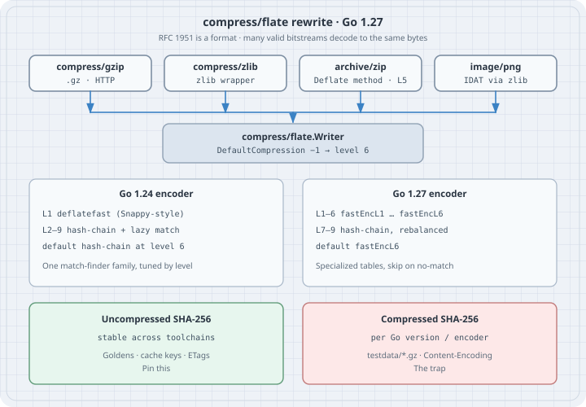

# Go 1.27 `compress/flate` Rewrite

Go **1.27** rewrote the DEFLATE encoder in `compress/flate`. Compression speed goes up for the common levels, and the exact encoded bytes change. `compress/gzip`, `compress/zlib`, `archive/zip`, and `image/png` all sit on that encoder, so their output changes too. The [Go 1.27 release notes](https://go.dev/doc/go1.27) say so in one paragraph. The [foundations tour](../01-foundations/01e-whats-new-in-go-1-27.qmd) repeats it as a table cell. This chapter measures it.

The format is still RFC 1951. Every gzip file we produced on Go 1.24.4 gunzips on Go 1.27.2, and the reverse. The decompressed SHA-256 is identical. The compressed SHA-256 is not. That is specified behaviour: `flate.NewWriter`, `gzip.NewWriter`, `zip.NewWriter`, and `png.Encode` all document that the exact bytes written are outside the [Go 1 compatibility promise](https://go.dev/doc/go1compat).

Everything below was compiled and run on one amd64 box (`Intel(R) Xeon(R) Processor`, 8 CPUs) with **Go 1.24.4** (`/usr/bin/go`) and **Go 1.27.2**. Treat the timings as one machine's numbers; use `-count=10` and `benchstat` before quoting them in a performance review. The release notes compare against Go 1.26; this box has no 1.26 toolchain, so the baseline here is 1.24.4. Neither the Go 1.25 nor the Go 1.26 release notes mention a `compress/flate` change.

## Mental model

```text
 gzip  zlib  zip  png
          │
          ▼
   compress/flate.Writer     DEFLATE bitstream (RFC 1951)
          │
          ▼
   flate.Reader / gzip.Reader / zip / png.Decode
```

- **DEFLATE is a format.** LZ77 copies plus Huffman coding. Many bitstreams decode to the same payload. A compressor is free to pick any valid encoding.
- **The wrappers only frame it.** gzip (RFC 1952) adds a 10-byte header, CRC-32, and ISIZE. zlib (RFC 1950) adds a 2-byte CMF/FLG header and an Adler-32. zip stores DEFLATE members (stdlib default: `flate.NewWriter(w, 5)` in `archive/zip/register.go`). PNG IDAT chunks go through `compress/zlib`.
- **DefaultCompression is still −1 → 6.** Both 1.24 and 1.27 map `DefaultCompression` to level 6 in `compressor.init`. The *algorithm* at 6 changed.
- **Go 1.24 encoder.** Level 1 (`BestSpeed`) is the Snappy-style matcher in `deflatefast.go`. Levels 2–9 are one hash-chain compressor with per-level `good` / `lazy` / `nice` / `chain` knobs.
- **Go 1.27 encoder.** Levels 1–6 are specialized match finders `fastEncL1` … `fastEncL6` (`deflatefast.go`, `level1.go`–`level6.go`): bigger/sparser hash tables, 4- and 7-byte hashes, skip-ahead on long literal runs. Levels 7–9 stay on the hash-chain path with rebalanced knobs (level 9 `chain` drops from 4096 to 1024). Tracked as [issue 75532](https://github.com/golang/go/issues/75532).
- **Tiny payloads.** On the 1.27 fast path, a flush of ≤32 bytes is written as a stored (uncompressed) DEFLATE block. A 23-byte gzip of `"desk ticket 42 is open\n"` contains that ASCII in the clear. The 1.24 encoder Huffman-coded the same string.

{fig-alt="Four packages gzip, zlib, zip, and png feed compress/flate.Writer. Go 1.24 uses a Snappy-style level 1 and hash-chain levels 2-9. Go 1.27 uses specialized fastEnc matchers for levels 1-6 and a rebalanced hash-chain for 7-9. Uncompressed SHA-256 is the stable identity; compressed SHA-256 is per toolchain."}

## Worked examples

Set up a module. The `go` line is 1.24 so both toolchains compile it; each `go` binary still links **its own** standard library.

```bash
mkdir flatebench && cd flatebench
go mod init example.com/flatebench   # go 1.24 in go.mod
go version
```

```
go version go1.24.4 linux/amd64
go version go1.27.2 linux/amd64
```

### Case 1: size, hash, and round-trip on the same inputs

Five 1 MiB payloads, generated in-process so both compilers see identical bytes: repeating HTML table rows, JSON records, Go-like source, zeros, and `math/rand/v2` with a fixed PCG seed. gzip header is pinned (`ModTime` zero, `OS` 255) so a hash difference is the DEFLATE payload, not the gzip timestamp.

```go
// compare.go — gzip/flate/zlib/zip/png size, hash, and round-trip check
package main

import (
	"archive/zip"
	"bytes"
	"compress/flate"
	"compress/gzip"
	"compress/zlib"
	"crypto/sha256"
	"encoding/hex"
	"fmt"
	"hash"
	"image"
	"image/color"
	"image/png"
	"io"
	"math/rand/v2"
	"os"
	"runtime"
	"strings"
	"time"
)

const payload = 1 << 20 // 1 MiB

func main() {
	mode := "compare"
	if len(os.Args) > 1 {
		mode = os.Args[1]
	}
	switch mode {
	case "dump-golden":
		dumpGolden()
		return
	case "check-golden":
		path := "testdata/ticket.gz"
		if len(os.Args) > 2 {
			path = os.Args[2]
		}
		checkGolden(path)
		return
	}

	fmt.Printf("go %s %s/%s\n", runtime.Version(), runtime.GOOS, runtime.GOARCH)
	fmt.Printf("compiler %s  payload %d bytes\n", runtime.Compiler, payload)

	inputs := []struct {
		name string
		data []byte
	}{
		{"html", makeHTML(payload)},
		{"json", makeJSON(payload)},
		{"src", makeSrc(payload)},
		{"zeros", makeZeros(payload)},
		{"rand", makeRand(payload)},
	}

	fmt.Println()
	fmt.Println("== gzip (ModTime zero, OS 255) ==")
	fmt.Printf("%-6s %5s %10s %10s %7s  %-16s  %-16s  %s\n",
		"input", "lvl", "in", "out", "ratio", "gz-sha256", "raw-sha256", "roundtrip")
	for _, in := range inputs {
		raw := sha256.Sum256(in.data)
		rawHex := hex.EncodeToString(raw[:])[:16]
		for _, lvl := range []int{gzip.BestSpeed, 6, gzip.DefaultCompression, gzip.BestCompression} {
			out, err := gzipBytes(in.data, lvl)
			must(err)
			back, err := gunzipBytes(out)
			must(err)
			ok := "OK"
			if !bytes.Equal(back, in.data) {
				ok = "FAIL"
			}
			sum := sha256.Sum256(out)
			ratio := float64(len(in.data)) / float64(len(out))
			fmt.Printf("%-6s %5s %10d %10d %7.2f  %-16s  %-16s  %s\n",
				in.name, lvlName(lvl), len(in.data), len(out), ratio,
				hex.EncodeToString(sum[:])[:16], rawHex, ok)
		}
	}

	fmt.Println()
	fmt.Println("== wrappers on html (default level) ==")
	html := inputs[0].data
	type row struct {
		pkg  string
		out  []byte
		back []byte
	}
	flateOut, err := flateBytes(html, flate.DefaultCompression)
	must(err)
	flateBack, err := inflateBytes(flateOut)
	must(err)
	zlibOut, err := zlibBytes(html, zlib.DefaultCompression)
	must(err)
	zlibBack, err := unzlibBytes(zlibOut)
	must(err)
	zipOut, err := zipBytes("tickets.html", html)
	must(err)
	zipBack, err := unzipFirst(zipOut)
	must(err)
	pngOut, err := pngBytes(makePattern(256, 256))
	must(err)
	pngBack, err := pngDecode(pngOut)
	must(err)
	pngRaw, err := pngBytesRaw(makePattern(256, 256))
	must(err)

	rows := []row{
		{"compress/flate", flateOut, flateBack},
		{"compress/zlib", zlibOut, zlibBack},
		{"archive/zip", zipOut, zipBack},
	}
	fmt.Printf("%-16s %10s  %-16s  %s\n", "package", "out", "out-sha256", "roundtrip")
	for _, r := range rows {
		sum := sha256.Sum256(r.out)
		ok := "OK"
		if !bytes.Equal(r.back, html) {
			ok = "FAIL"
		}
		fmt.Printf("%-16s %10d  %-16s  %s\n", r.pkg, len(r.out), hex.EncodeToString(sum[:])[:16], ok)
	}
	psum := sha256.Sum256(pngOut)
	ok := "OK"
	if !bytes.Equal(pngBack, pngRaw) {
		ok = "FAIL"
	}
	fmt.Printf("%-16s %10d  %-16s  %s  (256x256 NRGBA pixels)\n",
		"image/png", len(pngOut), hex.EncodeToString(psum[:])[:16], ok)

	fmt.Println()
	fmt.Println("raw-sha256 of html payload:", hex.EncodeToString(sha256Sum(html).Sum(nil)))
}

func lvlName(n int) string {
	switch n {
	case gzip.DefaultCompression:
		return "-1"
	case gzip.BestSpeed:
		return "1"
	case gzip.BestCompression:
		return "9"
	default:
		return fmt.Sprintf("%d", n)
	}
}

func gzipBytes(in []byte, level int) ([]byte, error) {
	var buf bytes.Buffer
	w, err := gzip.NewWriterLevel(&buf, level)
	if err != nil {
		return nil, err
	}
	// Keep the 10-byte gzip header stable: zero MTIME, OS=255 (package default).
	w.ModTime = time.Time{}
	if _, err := w.Write(in); err != nil {
		return nil, err
	}
	if err := w.Close(); err != nil {
		return nil, err
	}
	return buf.Bytes(), nil
}

func gunzipBytes(in []byte) ([]byte, error) {
	r, err := gzip.NewReader(bytes.NewReader(in))
	if err != nil {
		return nil, err
	}
	defer r.Close()
	return io.ReadAll(r)
}

func flateBytes(in []byte, level int) ([]byte, error) {
	var buf bytes.Buffer
	w, err := flate.NewWriter(&buf, level)
	if err != nil {
		return nil, err
	}
	if _, err := w.Write(in); err != nil {
		return nil, err
	}
	if err := w.Close(); err != nil {
		return nil, err
	}
	return buf.Bytes(), nil
}

func inflateBytes(in []byte) ([]byte, error) {
	r := flate.NewReader(bytes.NewReader(in))
	defer r.Close()
	return io.ReadAll(r)
}

func zlibBytes(in []byte, level int) ([]byte, error) {
	var buf bytes.Buffer
	w, err := zlib.NewWriterLevel(&buf, level)
	if err != nil {
		return nil, err
	}
	if _, err := w.Write(in); err != nil {
		return nil, err
	}
	if err := w.Close(); err != nil {
		return nil, err
	}
	return buf.Bytes(), nil
}

func unzlibBytes(in []byte) ([]byte, error) {
	r, err := zlib.NewReader(bytes.NewReader(in))
	if err != nil {
		return nil, err
	}
	defer r.Close()
	return io.ReadAll(r)
}

func zipBytes(name string, in []byte) ([]byte, error) {
	var buf bytes.Buffer
	zw := zip.NewWriter(&buf)
	h := &zip.FileHeader{
		Name:     name,
		Method:   zip.Deflate,
		Modified: time.Date(2026, 1, 1, 0, 0, 0, 0, time.UTC),
	}
	w, err := zw.CreateHeader(h)
	if err != nil {
		return nil, err
	}
	if _, err := w.Write(in); err != nil {
		return nil, err
	}
	if err := zw.Close(); err != nil {
		return nil, err
	}
	return buf.Bytes(), nil
}

func unzipFirst(in []byte) ([]byte, error) {
	r, err := zip.NewReader(bytes.NewReader(in), int64(len(in)))
	if err != nil {
		return nil, err
	}
	if len(r.File) == 0 {
		return nil, fmt.Errorf("empty zip")
	}
	rc, err := r.File[0].Open()
	if err != nil {
		return nil, err
	}
	defer rc.Close()
	return io.ReadAll(rc)
}

func pngBytes(img image.Image) ([]byte, error) {
	var buf bytes.Buffer
	if err := png.Encode(&buf, img); err != nil {
		return nil, err
	}
	return buf.Bytes(), nil
}

func pngDecode(in []byte) ([]byte, error) {
	img, err := png.Decode(bytes.NewReader(in))
	if err != nil {
		return nil, err
	}
	return pixels(img), nil
}

func pngBytesRaw(img image.Image) ([]byte, error) {
	return pixels(img), nil
}

func pixels(img image.Image) []byte {
	b := img.Bounds()
	out := make([]byte, 0, b.Dx()*b.Dy()*4)
	for y := b.Min.Y; y < b.Max.Y; y++ {
		for x := b.Min.X; x < b.Max.X; x++ {
			r, g, bl, a := img.At(x, y).RGBA()
			out = append(out, uint8(r>>8), uint8(g>>8), uint8(bl>>8), uint8(a>>8))
		}
	}
	return out
}

func makePattern(w, h int) *image.NRGBA {
	img := image.NewNRGBA(image.Rect(0, 0, w, h))
	for y := 0; y < h; y++ {
		for x := 0; x < w; x++ {
			img.SetNRGBA(x, y, color.NRGBA{
				R: uint8(x),
				G: uint8(y),
				B: uint8(x ^ y),
				A: 255,
			})
		}
	}
	return img
}

func makeHTML(n int) []byte {
	var b strings.Builder
	b.Grow(n)
	b.WriteString("<!doctype html><table>\n")
	for i := 0; b.Len() < n; i++ {
		fmt.Fprintf(&b, "<tr><td>%d</td><td>ticket-%05d</td><td>open</td></tr>\n", i, i%10000)
	}
	return []byte(b.String())[:n]
}

func makeJSON(n int) []byte {
	var b strings.Builder
	b.Grow(n)
	b.WriteString("[\n")
	for i := 0; b.Len() < n; i++ {
		fmt.Fprintf(&b, `{"id":%d,"desk":%d,"status":"open","note":"shift-handoff"},`+"\n", i, i%64)
	}
	return []byte(b.String())[:n]
}

func makeSrc(n int) []byte {
	var b strings.Builder
	b.Grow(n)
	b.WriteString("package tickets\n\n")
	for i := 0; b.Len() < n; i++ {
		fmt.Fprintf(&b, "func Ticket%d(id int) int {\n\treturn id + %d\n}\n\n", i, i%97)
	}
	return []byte(b.String())[:n]
}

func makeZeros(n int) []byte { return make([]byte, n) }

func makeRand(n int) []byte {
	r := rand.New(rand.NewPCG(1, 2))
	out := make([]byte, n)
	for i := range out {
		out[i] = byte(r.Uint64())
	}
	return out
}

func sha256Sum(in []byte) hash.Hash {
	h := sha256.New()
	h.Write(in)
	return h
}

func must(err error) {
	if err != nil {
		fmt.Fprintln(os.Stderr, err)
		os.Exit(1)
	}
}

const goldenPlain = "desk ticket 42 is open\n"

func dumpGolden() {
	plain := []byte(goldenPlain)
	gz, err := gzipBytes(plain, gzip.DefaultCompression)
	must(err)
	sum := sha256.Sum256(gz)
	back, err := gunzipBytes(gz)
	must(err)
	fmt.Printf("go %s\n", runtime.Version())
	fmt.Printf("plain      %q\n", plain)
	fmt.Printf("gz-len     %d\n", len(gz))
	fmt.Printf("gz-sha256  %s\n", hex.EncodeToString(sum[:]))
	fmt.Printf("raw-sha256 %s\n", hex.EncodeToString(sha256Sum(plain).Sum(nil)))
	fmt.Printf("roundtrip  equal=%t\n", bytes.Equal(back, plain))
	if err := os.MkdirAll("testdata", 0o755); err != nil {
		must(err)
	}
	must(os.WriteFile("testdata/ticket.gz", gz, 0o644))
	fmt.Println("wrote testdata/ticket.gz")
}

func checkGolden(path string) {
	want, err := os.ReadFile(path)
	must(err)
	plain := []byte(goldenPlain)
	got, err := gzipBytes(plain, gzip.DefaultCompression)
	must(err)
	fmt.Printf("go %s\n", runtime.Version())
	fmt.Printf("golden-len %d  got-len %d  bytes.Equal=%t\n",
		len(want), len(got), bytes.Equal(want, got))
	fmt.Printf("golden-sha %s\n", hex.EncodeToString(sha256Sum(want).Sum(nil)))
	fmt.Printf("got-sha    %s\n", hex.EncodeToString(sha256Sum(got).Sum(nil)))
	backWant, err := gunzipBytes(want)
	must(err)
	backGot, err := gunzipBytes(got)
	must(err)
	fmt.Printf("decompressed both equal to plaintext: %t\n",
		bytes.Equal(backWant, plain) && bytes.Equal(backGot, plain))
}
```

Run with each toolchain:

```bash
go run . compare
```

Go 1.24.4:

```
go go1.24.4 linux/amd64
compiler gc  payload 1048576 bytes

== gzip (ModTime zero, OS 255) ==
input    lvl         in        out   ratio  gz-sha256         raw-sha256        roundtrip
html       1    1048576      77292   13.57  c005423844182de7  61637fbd108880f5  OK
html       6    1048576      96502   10.87  428b44188b6f41e6  61637fbd108880f5  OK
html      -1    1048576      96502   10.87  428b44188b6f41e6  61637fbd108880f5  OK
html       9    1048576      94590   11.09  fb93a6bbbc7c4ca9  61637fbd108880f5  OK
json       1    1048576      91201   11.50  5763e289aa3d25e2  4ac94536f174eb53  OK
json       6    1048576      59902   17.50  aca0d2f41e45efe5  4ac94536f174eb53  OK
json      -1    1048576      59902   17.50  aca0d2f41e45efe5  4ac94536f174eb53  OK
json       9    1048576      58483   17.93  4e3ef76c7fa8a94e  4ac94536f174eb53  OK
src        1    1048576      95293   11.00  72c58bbc4941154b  cdbe71a0a85b33f3  OK
src        6    1048576      84826   12.36  f735df3449f8dc55  cdbe71a0a85b33f3  OK
src       -1    1048576      84826   12.36  f735df3449f8dc55  cdbe71a0a85b33f3  OK
src        9    1048576      84147   12.46  4fc2dd19ee60e63f  cdbe71a0a85b33f3  OK
zeros      1    1048576       1314  798.00  79ca984597031c3b  30e14955ebf13522  OK
zeros      6    1048576       1055  993.91  bde3e442fb3cc188  30e14955ebf13522  OK
zeros     -1    1048576       1055  993.91  bde3e442fb3cc188  30e14955ebf13522  OK
zeros      9    1048576       1055  993.91  54b6c6b02555e7c8  30e14955ebf13522  OK
rand       1    1048576    1048684    1.00  66c0a5cf5e3664ba  e5c076829d6c90d0  OK
rand       6    1048576    1048919    1.00  9adf9e5e6bcd5256  e5c076829d6c90d0  OK
rand      -1    1048576    1048919    1.00  9adf9e5e6bcd5256  e5c076829d6c90d0  OK
rand       9    1048576    1048919    1.00  bb4b0e520439e889  e5c076829d6c90d0  OK

== wrappers on html (default level) ==
package                 out  out-sha256        roundtrip
compress/flate        96484  501cf913b5e4b900  OK
compress/zlib         96490  c3ce7119592553a5  OK
archive/zip           96618  3dfd7073a0c877f8  OK
image/png              1331  c451c2edfc74f817  OK  (256x256 NRGBA pixels)

raw-sha256 of html payload: 61637fbd108880f5118af9b355b03f66852728b8d570a63273054f54fbd69193
```

Go 1.27.2:

```
go go1.27.2 linux/amd64
compiler gc  payload 1048576 bytes

== gzip (ModTime zero, OS 255) ==
input    lvl         in        out   ratio  gz-sha256         raw-sha256        roundtrip
html       1    1048576      91644   11.44  2d3456e2d741dc31  61637fbd108880f5  OK
html       6    1048576      87481   11.99  11ec593087f48eea  61637fbd108880f5  OK
html      -1    1048576      87481   11.99  11ec593087f48eea  61637fbd108880f5  OK
html       9    1048576      94629   11.08  1d7535cfdac8d876  61637fbd108880f5  OK
json       1    1048576      77007   13.62  f17a0b47455ec441  4ac94536f174eb53  OK
json       6    1048576      65530   16.00  fe7abdfead437225  4ac94536f174eb53  OK
json      -1    1048576      65530   16.00  fe7abdfead437225  4ac94536f174eb53  OK
json       9    1048576      58483   17.93  78c3ef660b0bc703  4ac94536f174eb53  OK
src        1    1048576      88792   11.81  c5eda44c599e79e0  cdbe71a0a85b33f3  OK
src        6    1048576      83020   12.63  a5683110fc5548e5  cdbe71a0a85b33f3  OK
src       -1    1048576      83020   12.63  a5683110fc5548e5  cdbe71a0a85b33f3  OK
src        9    1048576      82067   12.78  d4e23b10b1eec8fc  cdbe71a0a85b33f3  OK
zeros      1    1048576       1108  946.37  ad6ab41a1934f7a6  30e14955ebf13522  OK
zeros      6    1048576       2064  508.03  c526c6e898c7b3b3  30e14955ebf13522  OK
zeros     -1    1048576       2064  508.03  c526c6e898c7b3b3  30e14955ebf13522  OK
zeros      9    1048576       1052  996.75  d7851fe46f7c0b2b  30e14955ebf13522  OK
rand       1    1048576    1048681    1.00  0ac8e609f98233ba  e5c076829d6c90d0  OK
rand       6    1048576    1048681    1.00  eaadf3ddc6a3f090  e5c076829d6c90d0  OK
rand      -1    1048576    1048681    1.00  eaadf3ddc6a3f090  e5c076829d6c90d0  OK
rand       9    1048576    1048756    1.00  3760b3a40eda01d0  e5c076829d6c90d0  OK

== wrappers on html (default level) ==
package                 out  out-sha256        roundtrip
compress/flate        87463  081ee0c09dda84d1  OK
compress/zlib         87469  a086174a8991e822  OK
archive/zip           92617  b1a7a41d7ab9a425  OK
image/png              1911  9172898b0547d9a1  OK  (256x256 NRGBA pixels)

raw-sha256 of html payload: 61637fbd108880f5118af9b355b03f66852728b8d570a63273054f54fbd69193
```

Read the two tables together:

| gzip, 1 MiB | 1.24.4 out | 1.27.2 out | size Δ | raw-sha256 |
|-------------|------------|------------|--------|------------|
| html default (−1/6) | 96502 | 87481 | −9.3% | same `61637fbd108880f5…` |
| json default | 59902 | 65530 | **+9.4%** | same |
| src default | 84826 | 83020 | −2.1% | same |
| zeros default | 1055 | 2064 | **+95.6%** | same |
| html BestSpeed | 77292 | 91644 | +18.6% | same |
| json BestSpeed | 91201 | 77007 | −15.6% | same |
| json BestCompression | 58483 | 58483 | 0.0% | **hashes differ** (`4e3ef76c…` vs `78c3ef66…`) |

Every `raw-sha256` column matched. Every `gz-sha256` column moved, including level 9 (the hash-chain path was rebalanced) and including json level 9 where the *length* stayed 58483. `DefaultCompression` (−1) matched level 6 on both toolchains, which is the `level = 6` assignment in `compressor.init`.

The wrappers moved with flate. zip is level 5, so its size delta is a different mix. The 256×256 XOR PNG grew from 1331 to 1911 bytes; `png.Decode` still returned the same pixels.

### Case 2: throughput, same program, both compilers

```go
// compare_test.go — gzip encode throughput at levels 1, 6, 9 on the same payloads
package main

import (
	"bytes"
	"compress/gzip"
	"testing"
)

func BenchmarkGzip(b *testing.B) {
	inputs := []struct {
		name string
		data []byte
	}{
		{"html", makeHTML(payload)},
		{"json", makeJSON(payload)},
		{"src", makeSrc(payload)},
		{"zeros", makeZeros(payload)},
		{"rand", makeRand(payload)},
	}
	levels := []struct {
		name  string
		level int
	}{
		{"BestSpeed", gzip.BestSpeed},
		{"Default", gzip.DefaultCompression},
		{"BestCompression", gzip.BestCompression},
	}
	for _, in := range inputs {
		for _, lvl := range levels {
			b.Run(in.name+"/"+lvl.name, func(b *testing.B) {
				var buf bytes.Buffer
				w, err := gzip.NewWriterLevel(&buf, lvl.level)
				if err != nil {
					b.Fatal(err)
				}
				b.SetBytes(int64(len(in.data)))
				b.ReportAllocs()
				b.ResetTimer()
				for i := 0; i < b.N; i++ {
					buf.Reset()
					w.Reset(&buf)
					if _, err := w.Write(in.data); err != nil {
						b.Fatal(err)
					}
					if err := w.Close(); err != nil {
						b.Fatal(err)
					}
				}
			})
		}
	}
}
```

```bash
go test -bench=BenchmarkGzip -benchmem -count=3 -timeout=10m
```

Go 1.24.4 (median of three runs in **bold** in the summary table below):

```
goos: linux
goarch: amd64
pkg: example.com/flatebench
cpu: Intel(R) Xeon(R) Processor
BenchmarkGzip/html/BestSpeed-8         	     728	   1680827 ns/op	 623.85 MB/s	    2017 B/op	       0 allocs/op
BenchmarkGzip/html/BestSpeed-8         	     669	   1744571 ns/op	 601.05 MB/s	    2195 B/op	       0 allocs/op
BenchmarkGzip/html/BestSpeed-8         	     716	   1656501 ns/op	 633.01 MB/s	    2051 B/op	       0 allocs/op
BenchmarkGzip/html/Default-8           	     223	   5587074 ns/op	 187.68 MB/s	    4823 B/op	       0 allocs/op
BenchmarkGzip/html/Default-8           	     222	   5673796 ns/op	 184.81 MB/s	    4845 B/op	       0 allocs/op
BenchmarkGzip/html/Default-8           	     217	   5800967 ns/op	 180.76 MB/s	    4956 B/op	       0 allocs/op
BenchmarkGzip/html/BestCompression-8   	      19	  57169172 ns/op	  18.34 MB/s	   56613 B/op	       1 allocs/op
BenchmarkGzip/html/BestCompression-8   	      21	  55819114 ns/op	  18.79 MB/s	   51221 B/op	       1 allocs/op
BenchmarkGzip/html/BestCompression-8   	      21	  55182543 ns/op	  19.00 MB/s	   51221 B/op	       1 allocs/op
BenchmarkGzip/json/BestSpeed-8         	     708	   1795216 ns/op	 584.09 MB/s	    2074 B/op	       0 allocs/op
BenchmarkGzip/json/BestSpeed-8         	     682	   1737259 ns/op	 603.58 MB/s	    2153 B/op	       0 allocs/op
BenchmarkGzip/json/BestSpeed-8         	     693	   1792238 ns/op	 585.07 MB/s	    2119 B/op	       0 allocs/op
BenchmarkGzip/json/Default-8           	     147	   8194660 ns/op	 127.96 MB/s	    6425 B/op	       0 allocs/op
BenchmarkGzip/json/Default-8           	     151	   8558982 ns/op	 122.51 MB/s	    6255 B/op	       0 allocs/op
BenchmarkGzip/json/Default-8           	     146	   8015328 ns/op	 130.82 MB/s	    6469 B/op	       0 allocs/op
BenchmarkGzip/json/BestCompression-8   	      22	  50565283 ns/op	  20.74 MB/s	   42935 B/op	       1 allocs/op
BenchmarkGzip/json/BestCompression-8   	      24	  50330296 ns/op	  20.83 MB/s	   39357 B/op	       1 allocs/op
BenchmarkGzip/json/BestCompression-8   	      20	  50355120 ns/op	  20.82 MB/s	   47228 B/op	       1 allocs/op
BenchmarkGzip/src/BestSpeed-8          	     555	   2098503 ns/op	 499.68 MB/s	    2646 B/op	       0 allocs/op
BenchmarkGzip/src/BestSpeed-8          	     577	   2161365 ns/op	 485.15 MB/s	    2545 B/op	       0 allocs/op
BenchmarkGzip/src/BestSpeed-8          	     580	   2059333 ns/op	 509.18 MB/s	    2532 B/op	       0 allocs/op
BenchmarkGzip/src/Default-8            	     129	   9147193 ns/op	 114.63 MB/s	    8338 B/op	       0 allocs/op
BenchmarkGzip/src/Default-8            	     117	   9341347 ns/op	 112.25 MB/s	    9193 B/op	       0 allocs/op
BenchmarkGzip/src/Default-8            	     126	   9432083 ns/op	 111.17 MB/s	    8536 B/op	       0 allocs/op
BenchmarkGzip/src/BestCompression-8    	      15	  66869262 ns/op	  15.68 MB/s	   71709 B/op	       1 allocs/op
BenchmarkGzip/src/BestCompression-8    	      16	  71526839 ns/op	  14.66 MB/s	   67228 B/op	       1 allocs/op
BenchmarkGzip/src/BestCompression-8    	      16	  68514387 ns/op	  15.30 MB/s	   67228 B/op	       1 allocs/op
BenchmarkGzip/zeros/BestSpeed-8        	    1903	    681669 ns/op	1538.25 MB/s	     636 B/op	       0 allocs/op
BenchmarkGzip/zeros/BestSpeed-8        	    1948	    662424 ns/op	1582.94 MB/s	     621 B/op	       0 allocs/op
BenchmarkGzip/zeros/BestSpeed-8        	    1975	    703071 ns/op	1491.42 MB/s	     613 B/op	       0 allocs/op
BenchmarkGzip/zeros/Default-8          	     555	   2144923 ns/op	 488.86 MB/s	    1473 B/op	       0 allocs/op
BenchmarkGzip/zeros/Default-8          	     543	   2369568 ns/op	 442.52 MB/s	    1505 B/op	       0 allocs/op
BenchmarkGzip/zeros/Default-8          	     565	   2477097 ns/op	 423.31 MB/s	    1447 B/op	       0 allocs/op
BenchmarkGzip/zeros/BestCompression-8  	     514	   2277501 ns/op	 460.41 MB/s	    1590 B/op	       0 allocs/op
BenchmarkGzip/zeros/BestCompression-8  	     552	   2135341 ns/op	 491.06 MB/s	    1481 B/op	       0 allocs/op
BenchmarkGzip/zeros/BestCompression-8  	     565	   2136269 ns/op	 490.84 MB/s	    1447 B/op	       0 allocs/op
BenchmarkGzip/rand/BestSpeed-8         	     619	   1897473 ns/op	 552.62 MB/s	    5638 B/op	       0 allocs/op
BenchmarkGzip/rand/BestSpeed-8         	     619	   1986062 ns/op	 527.97 MB/s	    5638 B/op	       0 allocs/op
BenchmarkGzip/rand/BestSpeed-8         	     566	   1947840 ns/op	 538.33 MB/s	    6166 B/op	       0 allocs/op
BenchmarkGzip/rand/Default-8           	      85	  14065542 ns/op	  74.55 MB/s	   40149 B/op	       0 allocs/op
BenchmarkGzip/rand/Default-8           	      82	  13642761 ns/op	  76.86 MB/s	   41617 B/op	       0 allocs/op
BenchmarkGzip/rand/Default-8           	      88	  13715233 ns/op	  76.45 MB/s	   38780 B/op	       0 allocs/op
BenchmarkGzip/rand/BestCompression-8   	      69	  14763644 ns/op	  71.02 MB/s	   49459 B/op	       0 allocs/op
BenchmarkGzip/rand/BestCompression-8   	      88	  13559292 ns/op	  77.33 MB/s	   38780 B/op	       0 allocs/op
BenchmarkGzip/rand/BestCompression-8   	      75	  13673153 ns/op	  76.69 MB/s	   45502 B/op	       0 allocs/op
PASS
ok  	example.com/flatebench	66.179s
```

Go 1.27.2:

```
goos: linux
goarch: amd64
pkg: example.com/flatebench
cpu: Intel(R) Xeon(R) Processor
BenchmarkGzip/html/BestSpeed-8         	     742	   1647084 ns/op	 636.63 MB/s	    1449 B/op	       0 allocs/op
BenchmarkGzip/html/BestSpeed-8         	     723	   1639164 ns/op	 639.70 MB/s	    1487 B/op	       0 allocs/op
BenchmarkGzip/html/BestSpeed-8         	     724	   1621805 ns/op	 646.55 MB/s	    1485 B/op	       0 allocs/op
BenchmarkGzip/html/Default-8           	     381	   3136526 ns/op	 334.31 MB/s	    3511 B/op	       0 allocs/op
BenchmarkGzip/html/Default-8           	     381	   3538283 ns/op	 296.35 MB/s	    3511 B/op	       0 allocs/op
BenchmarkGzip/html/Default-8           	     351	   3190290 ns/op	 328.68 MB/s	    3811 B/op	       0 allocs/op
BenchmarkGzip/html/BestCompression-8   	      28	  42878880 ns/op	  24.45 MB/s	   50164 B/op	       0 allocs/op
BenchmarkGzip/html/BestCompression-8   	      27	  44121386 ns/op	  23.77 MB/s	   52022 B/op	       0 allocs/op
BenchmarkGzip/html/BestCompression-8   	      28	  43916651 ns/op	  23.88 MB/s	   50164 B/op	       0 allocs/op
BenchmarkGzip/json/BestSpeed-8         	    1143	   1058338 ns/op	 990.78 MB/s	     941 B/op	       0 allocs/op
BenchmarkGzip/json/BestSpeed-8         	    1051	   1052626 ns/op	 996.15 MB/s	    1023 B/op	       0 allocs/op
BenchmarkGzip/json/BestSpeed-8         	    1191	   1117643 ns/op	 938.20 MB/s	     903 B/op	       0 allocs/op
BenchmarkGzip/json/Default-8           	     429	   2760387 ns/op	 379.87 MB/s	    2812 B/op	       0 allocs/op
BenchmarkGzip/json/Default-8           	     447	   2821223 ns/op	 371.67 MB/s	    2699 B/op	       0 allocs/op
BenchmarkGzip/json/Default-8           	     447	   2752037 ns/op	 381.02 MB/s	    2699 B/op	       0 allocs/op
BenchmarkGzip/json/BestCompression-8   	      21	  49814303 ns/op	  21.05 MB/s	   60644 B/op	       1 allocs/op
BenchmarkGzip/json/BestCompression-8   	      21	  48911805 ns/op	  21.44 MB/s	   60644 B/op	       1 allocs/op
BenchmarkGzip/json/BestCompression-8   	      20	  50566658 ns/op	  20.74 MB/s	   63676 B/op	       1 allocs/op
BenchmarkGzip/src/BestSpeed-8          	     859	   1253314 ns/op	 836.64 MB/s	    1252 B/op	       0 allocs/op
BenchmarkGzip/src/BestSpeed-8          	    1017	   1248086 ns/op	 840.15 MB/s	    1057 B/op	       0 allocs/op
BenchmarkGzip/src/BestSpeed-8          	     926	   1251612 ns/op	 837.78 MB/s	    1161 B/op	       0 allocs/op
BenchmarkGzip/src/Default-8            	     380	   3177652 ns/op	 329.98 MB/s	    3520 B/op	       0 allocs/op
BenchmarkGzip/src/Default-8            	     378	   3323523 ns/op	 315.50 MB/s	    3539 B/op	       0 allocs/op
BenchmarkGzip/src/Default-8            	     372	   3175179 ns/op	 330.24 MB/s	    3596 B/op	       0 allocs/op
BenchmarkGzip/src/BestCompression-8    	      18	  64509597 ns/op	  16.25 MB/s	   78033 B/op	       1 allocs/op
BenchmarkGzip/src/BestCompression-8    	      16	  63102104 ns/op	  16.62 MB/s	   87788 B/op	       1 allocs/op
BenchmarkGzip/src/BestCompression-8    	      18	  62793482 ns/op	  16.70 MB/s	   78033 B/op	       1 allocs/op
BenchmarkGzip/zeros/BestSpeed-8        	    5313	    228883 ns/op	4581.27 MB/s	     153 B/op	       0 allocs/op
BenchmarkGzip/zeros/BestSpeed-8        	    5667	    229630 ns/op	4566.37 MB/s	     144 B/op	       0 allocs/op
BenchmarkGzip/zeros/BestSpeed-8        	    5532	    234105 ns/op	4479.08 MB/s	     147 B/op	       0 allocs/op
BenchmarkGzip/zeros/Default-8          	     831	   1441445 ns/op	 727.45 MB/s	    1304 B/op	       0 allocs/op
BenchmarkGzip/zeros/Default-8          	     914	   1398500 ns/op	 749.79 MB/s	    1185 B/op	       0 allocs/op
BenchmarkGzip/zeros/Default-8          	     906	   1424948 ns/op	 735.87 MB/s	    1196 B/op	       0 allocs/op
BenchmarkGzip/zeros/BestCompression-8  	     262	   4592256 ns/op	 228.34 MB/s	    4376 B/op	       0 allocs/op
BenchmarkGzip/zeros/BestCompression-8  	     247	   4859673 ns/op	 215.77 MB/s	    4641 B/op	       0 allocs/op
BenchmarkGzip/zeros/BestCompression-8  	     258	   4588996 ns/op	 228.50 MB/s	    4444 B/op	       0 allocs/op
BenchmarkGzip/rand/BestSpeed-8         	    7119	    160043 ns/op	6551.85 MB/s	     435 B/op	       0 allocs/op
BenchmarkGzip/rand/BestSpeed-8         	    7324	    155909 ns/op	6725.57 MB/s	     423 B/op	       0 allocs/op
BenchmarkGzip/rand/BestSpeed-8         	    7674	    171794 ns/op	6103.68 MB/s	     403 B/op	       0 allocs/op
BenchmarkGzip/rand/Default-8           	    4329	    235122 ns/op	4459.71 MB/s	     776 B/op	       0 allocs/op
BenchmarkGzip/rand/Default-8           	    5372	    229483 ns/op	4569.31 MB/s	     625 B/op	       0 allocs/op
BenchmarkGzip/rand/Default-8           	    4477	    226221 ns/op	4635.18 MB/s	     750 B/op	       0 allocs/op
BenchmarkGzip/rand/BestCompression-8   	     187	   6273550 ns/op	 167.14 MB/s	   19910 B/op	       0 allocs/op
BenchmarkGzip/rand/BestCompression-8   	     182	   6476233 ns/op	 161.91 MB/s	   20457 B/op	       0 allocs/op
BenchmarkGzip/rand/BestCompression-8   	     182	   6497071 ns/op	 161.39 MB/s	   20457 B/op	       0 allocs/op
PASS
ok  	example.com/flatebench	63.789s
```

Median of three runs, same 1 MiB inputs:

| gzip | 1.24.4 | 1.27.2 | speedup |
|------|--------|--------|---------|
| html Default | 184.81 MB/s | 328.68 MB/s | 1.78× |
| json Default | 127.96 MB/s | 379.87 MB/s | 2.97× |
| src Default | 112.25 MB/s | 329.98 MB/s | 2.94× |
| zeros Default | 442.52 MB/s | 735.87 MB/s | 1.66× |
| rand BestSpeed | 538.33 MB/s | 6551.85 MB/s | 12.2× |
| rand Default | 76.45 MB/s | 4569.31 MB/s | 59.8× |
| json BestCompression | 20.82 MB/s | 21.05 MB/s | ~1.01× |
| zeros BestCompression | 490.84 MB/s | 228.50 MB/s | 0.47× |

Default gzip on structured text is about **3×** on this box (json, src). Incompressible `rand` is the headline: the 1.27 matcher stops looking. Level 9 is still the old-style hash chain, so json `BestCompression` is a wash, and zeros at level 9 was **slower** here. Upgrade for levels 1–6; measure level 9 on your payload if that is the one you ship.

### Case 3: a 23-byte golden file

```bash
go run . dump-golden          # under 1.24.4, writes testdata/ticket.gz
go run . check-golden testdata/ticket.gz
```

Go 1.24.4 writes and confirms:

```
go go1.24.4
plain      "desk ticket 42 is open\n"
gz-len     47
gz-sha256  37fe167f389809d8dc0a08f8019d535d12ba226f0813f6d1fa55a03c8f7d7165
raw-sha256 46b9a55f46d55b888f5b5443c84004fa093c5d7a52e4794bc4908a379eb8b68c
roundtrip  equal=true
wrote testdata/ticket.gz
```

```
go go1.24.4
golden-len 47  got-len 47  bytes.Equal=true
golden-sha 37fe167f389809d8dc0a08f8019d535d12ba226f0813f6d1fa55a03c8f7d7165
got-sha    37fe167f389809d8dc0a08f8019d535d12ba226f0813f6d1fa55a03c8f7d7165
decompressed both equal to plaintext: true
```

The same golden under Go 1.27.2:

```
go go1.27.2
golden-len 47  got-len 48  bytes.Equal=false
golden-sha 37fe167f389809d8dc0a08f8019d535d12ba226f0813f6d1fa55a03c8f7d7165
got-sha    322cf646342214750d34acd529a6b712a75e61097545aeef27441818333da7d7
decompressed both equal to plaintext: true
```

Both files start `1f 8b 08 00 00 00 00 00 00 ff` (gzip magic, method 8, MTIME 0, OS 255). The 1.27 payload is a stored DEFLATE block: after the header you can read the ASCII `desk ticket 42 is open` in the gzip file. The CRC-32 trailer `63 2f 5e 64` and ISIZE `17 00 00 00` match, because the uncompressed bytes match.

### Case 4: each toolchain reads the other's gzip

```go
// cross.go — gunzip a file written by the other Go version
package main

import (
	"bytes"
	"compress/gzip"
	"fmt"
	"io"
	"os"
	"runtime"
)

func main() {
	b, err := os.ReadFile(os.Args[1])
	if err != nil {
		panic(err)
	}
	r, err := gzip.NewReader(bytes.NewReader(b))
	if err != nil {
		panic(err)
	}
	out, err := io.ReadAll(r)
	r.Close()
	if err != nil {
		panic(err)
	}
	fmt.Printf("%s read %s -> %q\n", runtime.Version(), os.Args[1], out)
}
```

```
go1.24.4 read /tmp/ticket-127.gz -> "desk ticket 42 is open\n"
go1.27.2 read /tmp/ticket-124.gz -> "desk ticket 42 is open\n"
```

Python's `gzip.decompress` accepted both files and returned the same 23 bytes. Interoperability holds. Byte identity does not.

## The trap

### Golden files of compressed bytes

`bytes.Equal(gotGzip, testdata/foo.gz)` fails on the first CI run after the toolchain bump. The program is fine. The encoder changed. The same trap hits `image/png` fixtures (IDAT), `archive/zip` testdata, and checked-in `.gz` assets. The 23-byte ticket above is the smallest reproduction: 47 bytes vs 48, both valid gzip.

### Cache keys, content hashes, ETags

If an HTTP handler gzips the body and then hashes the gzipped bytes for `ETag`, every 1.27 deploy looks like new content. Clients re-download. CDNs miss. The entity is the same. Hash the uncompressed representation (or a versioned encoding that you control), then gzip for transport. The same mistake appears as S3/object-store keys, Docker layer diffs of `.gz` files, and "content-addressed" caches whose address is the compressor output.

### Tiny payloads looking uncompressed

1.27's fast path stores ≤32-byte flushes raw. A test that greps a `.gz` for a secret, or that assumes gzip always hides the plaintext, is lying to itself on short writes. Huffman coding on 1.24 hid `"desk ticket 42 is open\n"`; 1.27 does not.

## The boring rule

- Compare **decompressed** content. `gunzip` then `bytes.Equal`. For PNG, decode pixels. For zip, read the member.
- Pin hashes on **uncompressed** data. If you need a cache key or ETag, hash the entity you would serve with `Content-Encoding: identity`.
- If a test must pin compressed bytes, pin the **Go version** next to the golden (`go 1.27.2` in the testdata README) and regenerate on purpose.
- Round-trip in CI: compress with this toolchain, decompress with this toolchain, compare to the original. That is the RFC 1951 contract.
- gzip `ModTime` is a second source of nondeterminism. Zero it when you hash gzip headers at all.

The stdlib already tells you. `go doc compress/flate.NewWriter` on 1.27.2:

```
Note that the exact bytes written to w are not covered by the Go 1
compatibility promise. Callers, including tests, should not depend on the
exact written bytes.
```

The same sentence is on `gzip.NewWriter`, `zip.NewWriter`, and `png.Encode`.

## Try this

1. Re-run `compare.go` and `BenchmarkGzip` on a payload from your service (JSON logs, protobuf, HTML). Record default-level size Δ and MB/s with `-count=10`.
2. Search your repo for `testdata/*.gz`, `*.png` goldens, and `bytes.Equal` against compressor output. Switch those tests to decompressed equality.
3. Encode the same `image.NRGBA` with `png.Encode` on 1.24 and 1.27; hash the file, then hash `png.Decode` pixels.
4. Build an `ETag` from `sha256(uncompressed)` and send gzip on the wire. Confirm two toolchains produce the same ETag and different `Content-Length`.
5. At level 9, confirm json can keep the same compressed *length* with a different hash. Decide whether your "size budget" tests should allow that.

## Sources

- Go 1.27 release notes, `compress/flate`: <https://go.dev/doc/go1.27>
- `compress/flate.NewWriter` compatibility note (and the same sentence on gzip, zip, png): `go doc compress/flate.NewWriter` (Go 1.27.2)
- Go 1 compatibility promise: <https://go.dev/doc/go1compat>
- RFC 1951 DEFLATE: <https://www.rfc-editor.org/rfc/rfc1951>
- RFC 1952 GZIP: <https://www.rfc-editor.org/rfc/rfc1952>
- RFC 1950 zlib: <https://www.rfc-editor.org/rfc/rfc1950>
- Issue 75532, `compress/gzip` performance: <https://github.com/golang/go/issues/75532>
- Encoder rewrite CL 707355; compatibility-note CL 774300: <https://go-review.googlesource.com/c/go/+/707355>, <https://go-review.googlesource.com/c/go/+/774300>
- Go 1.27.2 source: `src/compress/flate/deflate.go` (`DefaultCompression` → 6, `fastEnc` for 1–6), `deflatefast.go` / `level1.go`–`level6.go`, `deflateFast` stored-block path for ≤32-byte flushes; `src/archive/zip/register.go` (`flate.NewWriter(w, 5)`); `src/image/png/writer.go` (`levelToZlib`)
