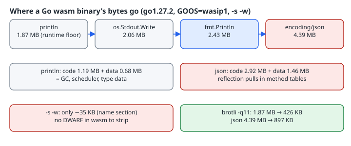

A Go "hello world" compiled to WebAssembly comes out at about 1.9 MB. People usually react by reaching for `-ldflags='-s -w'`, the flag that strips a native binary, and find that it barely changes the size. This chapter measures where the bytes actually go, which of the usual tricks matter on wasm, and what you trade if you leave the standard `gc` toolchain for TinyGo.

{fig-alt="println hello is 1.87 MB, os.Stdout.Write 2.06 MB, fmt.Println 2.43 MB, encoding/json 4.39 MB. Stripping with -s -w saves only the 35 KB name section; brotli brings println to 426 KB and json to 897 KB."}

## The four programs

Each program prints one line, using a progressively heavier part of the standard library:

```go
// println/main.go — the builtin, no imports
package main

func main() { println("hello") }

// raw/main.go — os only
package main

import "os"

func main() { os.Stdout.Write([]byte("hello\n")) }

// fmt/main.go
package main

import "fmt"

func main() { fmt.Println("hello") }

// json/main.go — reflection-driven encoding
package main

import (
	"encoding/json"
	"os"
)

type Msg struct {
	Text string `json:"text"`
}

func main() { json.NewEncoder(os.Stdout).Encode(Msg{"hello"}) }
```

Each one was built four ways: for `GOOS=wasip1` and `GOOS=js` (both `GOARCH=wasm`), each with and without `-trimpath -ldflags='-s -w'`.

## Measured sizes (go1.27.2, bytes)

```text
prog     goos         default        -s -w  gzip(-s -w)
println  wasip1       1906868      1869346       550756
println  js           1892424      1854868       547106
raw      wasip1       2106985      2063729       602868
raw      js           2147302      2103412       611967
fmt      wasip1       2475221      2426805       699957
fmt      js           2502043      2453043       706144
json     wasip1       4479337      4392256      1205460
json     js           4502542      4415042      1210327
native println  1895668
native fmt      2342537
```

The binaries actually run. The `js` builds were run with the toolchain's own `$(go env GOROOT)/lib/wasm/wasm_exec_node.js`, and the `wasip1` builds through Node's [`node:wasi`](https://nodejs.org/api/wasi.html) module (Node 20.19.2). Each printed `hello`, or `{"text":"hello"}` for the JSON program.

Three things stand out:

1. **The floor is the runtime, not your code.** A program with no imports is already 1.87 MB, about the same as the native amd64 build (1.90 MB). That megabyte-plus is the garbage collector, the goroutine scheduler, maps, panics and the type metadata they all need. This matches the [Go wiki](https://go.dev/wiki/WebAssembly): "the smallest possible size being around ~2MB."
2. **`js` and `wasip1` cost about the same.** They differ by under 2% in every row. The choice between them is about the host (browser vs WASI runtime), not size.
3. **Reflection is where it grows.** `fmt` adds about 560 KB over `println`. `encoding/json` more than doubles the binary. Reflect-based code must keep every method and type descriptor that might be looked up at run time, so the linker's dead-code elimination can remove far less. The wiki warns that "10MB+ is common" once real libraries are imported.

## Why `-s -w` does almost nothing here

On a native ELF binary, `-s -w` drops the symbol table and DWARF ([`cmd/link`](https://pkg.go.dev/cmd/link): `-s` "Omit the symbol table and debug information", `-w` "Omit the DWARF symbol table"), and that is often a large share of the file. A Go wasm module carries neither. To check, I parsed the sections of the module myself, using the section IDs from the [Wasm binary format spec](https://webassembly.github.io/spec/core/binary/modules.html):

```text
println-wasip1.wasm    {'function': 1251, 'element': 2388, 'code': 1185790, 'data': 681761, 'custom:name': 34897}
println-wasip1-sw.wasm {'function': 1251, 'element': 2388, 'code': 1185790, 'data': 679142}
raw-wasip1-sw.wasm     {'function': 1445, 'element': 2782, 'code': 1291244, 'data': 767246}
fmt-wasip1-sw.wasm     {'function': 1613, 'element': 3118, 'code': 1528856, 'data': 892198}
json-wasip1-sw.wasm    {'function': 2461, 'element': 4815, 'code': 2921058, 'data': 1462869}
```

(Sections under 1 KB are omitted.) The only thing `-s -w` removed was the 35 KB `name` custom section, which holds function names for stack traces in browser devtools, plus about 2.6 KB of data. The `code` section was byte-for-byte the same size. Keep `-s -w` if you don't need names in wasm stack traces, but expect about 2%. On the native amd64 builds of the same programs it saved about 35% (println 1,895,668 → 1,216,672 bytes; json 3,917,078 → 2,568,352).

`go tool nm` cannot help here. In go1.27.2 it rejects the module with `open json-wasip1.wasm: unrecognized object file`, which is why the script above walks the sections itself.

## What actually shrinks the download

**Compress it.** This is the first method the Go wiki recommends, and the numbers show why:

| program | `-s -w` | gzip -9 | brotli q11 |
|---|---:|---:|---:|
| println | 1,869,346 | 550,756 | 425,784 |
| fmt | 2,426,805 | 699,957 | 537,943 |
| json | 4,392,256 | 1,205,460 | 896,722 |

The brotli figures come from Python's `brotli` module at `quality=11`. Wasm code compresses about 4–5×. Serve `.wasm` with `Content-Encoding: br` (or gzip) and the transfer cost of the runtime floor drops to roughly 430 KB.

**Keep reflection out of the hot import graph.** Going from `fmt` to `os.Stdout.Write` saved 363 KB, and the same applies across a whole program. If a wasm module only needs to format a few numbers, use `strconv` and write bytes yourself. TinyGo's guide says the same about its compiler: "fmt is very large, so unless you absolutely need it, it is recommended to try to avoid it."

**Change compilers.** [TinyGo](https://tinygo.org/docs/guides/optimizing-binaries/) is an LLVM-based Go compiler with a much smaller runtime. Per its docs it already optimizes for size by default (`-opt=z`), and you can go further with `-no-debug`, `-panic=trap`, `-scheduler=none` (which removes `go` statements) and `-gc=leaking` (no GC at all; the docs say this is "for very short-lived programs only"). I did not run TinyGo here because it is not installed on the box, so I have not measured it. The trade-offs are documented, though: the scheduler and GC options remove language features, and TinyGo implements a subset of the standard library and of reflection. Test your actual program against it; don't assume it will build. The [WASI guide](https://tinygo.org/docs/guides/webassembly/wasi/) covers its `wasip1` target.

## Checklist

- [ ] Measure the module's sections, not just the file size: `code` and `data` are what count.
- [ ] Expect a floor of about 1.9 MB with `gc`. You can't remove the runtime with flags.
- [ ] `-s -w` saves about 35 KB (the name section) on wasm. That's fine, but not a fix.
- [ ] Serve with brotli or gzip. On these programs that cut the transfer 4–5×.
- [ ] Audit imports for reflection-heavy packages (`fmt`, `encoding/json`, template engines).
- [ ] If bytes on the wire still matter more than full Go semantics, evaluate TinyGo on *your* program.
