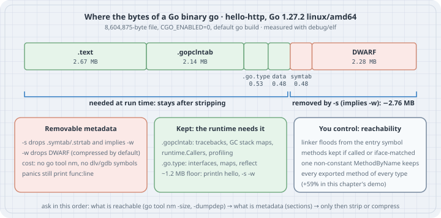

# Why Go Binaries Are Big: Sections, Reachability, and the Linker's Method Rules

## Thesis

A Go "hello world" that calls `fmt.Println` is 2.3 MB. A program that only registers an HTTP handler is 8.6 MB. Most advice stops at `-ldflags="-s -w"`, which removes about a third of the file. That flag removes metadata, though, not code. The code that stays is decided earlier, by the linker's **dead-code pass**: it starts at the entry point, follows every reference, and keeps only what it reaches. Methods get special rules, and one call to `reflect.Value.MethodByName` with a name the compiler cannot see makes the linker keep **every exported method of every reachable type**.

This chapter takes binaries apart with tools that ship with Go: `debug/elf` for sections, `go tool nm -size` for symbols, and the linker's own `-dumpdep` graph to see *why* a symbol was kept. It ends with a short list of changes that actually shrink a binary, ordered by what they cost you.

Verified on **Go 1.27.2** (linux/amd64, `CGO_ENABLED=0`), Linux 6.12, on 2026-10-19. Source links are pinned to the [`go1.27.2` tag](https://github.com/golang/go/tree/go1.27.2/src). All sizes below are from this machine; yours will differ by a few kilobytes between Go releases.

## Learning goals

- Split a Go executable into its sections and say which ones the program needs at run time
- Explain what `-s` and `-w` remove, and what you lose (and keep) when you strip
- Total symbol sizes per package from `go tool nm -size` to find who pays for the bytes
- Describe the linker's dead-code pass: roots, the flood fill, and the three ways a method can stay reachable
- Use `-ldflags=-dumpdep` to find the function that turned off method pruning
- Choose between stripping, avoiding dynamic reflection, and changing dependencies

## Mental model

{fig-alt="Stacked bar of the 8.6 MB hello-http binary built with Go 1.27.2: .text 2.67 MB, .gopclntab 2.14 MB, .go.type 0.53 MB, data 0.48 MB, symbol tables 0.48 MB and DWARF 2.28 MB. The symbol tables and DWARF, 2.76 MB, are removed by -s, which implies -w. Three panels: removable metadata; kept because the runtime needs it (pclntab, type descriptors, about a 1.2 MB floor); and reachability, where one non-constant MethodByName keeps every exported method of every reachable type."}

| Part of the file | What it is | Needed at run time? |
|------------------|------------|---------------------|
| `.text` | Machine code for every reachable function, including the runtime | Yes |
| `.gopclntab` | Maps each program counter to function, file and line; points at stack maps and other per-function data | Yes: tracebacks, `runtime.Callers`, profiling and the garbage collector's stack scan read it |
| `.go.type` | Type descriptors (`abi.Type`) and method tables | Yes: interfaces, maps, `reflect`, the GC |
| `.rodata`, `.data`, `.noptrdata` | Constants, strings, initialised globals | Yes |
| `.symtab`, `.strtab` | ELF symbol table for `nm`, debuggers and `perf` | No; `-s` removes it |
| `.debug_*` | DWARF for debuggers (compressed by default) | No; `-w` removes it, `-s` implies `-w` |

Two separate questions follow from the table:

1. **Metadata:** do you ship the symbol table and DWARF? That is a debugging trade-off, settled by a flag.
2. **Code:** what is reachable? That is a design question, settled by what your program and its dependencies *could* call.

## Worked examples

All listings live in one module. Every command below was run from its root (`/tmp/binsize` on the test machine, which is why that path appears in some output).

```go
// go.mod
module example.com/binsize

go 1.27
```

### Case 1: Three programs, two builds each

```go
// hello-println/main.go
package main

func main() {
	println("hello")
}
```

```go
// hello-fmt/main.go
package main

import "fmt"

func main() {
	fmt.Println("hello")
}
```

```go
// hello-http/main.go
package main

import (
	"fmt"
	"net/http"
	"os"
)

func main() {
	http.HandleFunc("/", func(w http.ResponseWriter, r *http.Request) {
		fmt.Fprintln(w, "hello")
	})
	if len(os.Args) > 1 && os.Args[1] == "serve" {
		http.ListenAndServe("127.0.0.1:8080", nil)
	}
}
```

A small script builds each one with default flags and with `-s -w`:

```sh
#!/bin/sh
# sizes.sh - build each program twice (default, and -s -w) and print bytes.
set -e
mkdir -p bin
printf '%-14s %9s %9s\n' program default '-s -w'
for p in "$@"; do
	CGO_ENABLED=0 go build -o bin/$p ./$p
	CGO_ENABLED=0 go build -ldflags='-s -w' -o bin/$p.sw ./$p
	printf '%-14s %9d %9d\n' $p $(stat -c %s bin/$p) $(stat -c %s bin/$p.sw)
done
```

```text
$ go version
go version go1.27.2 linux/amd64
$ ./sizes.sh hello-println hello-fmt hello-http
program          default     -s -w
hello-println    1895652   1220768
hello-fmt        2342505   1511584
hello-http       8604875   5841056
```

Three things to notice:

- **There is a floor.** A program that only calls the `println` builtin is still 1.2 MB stripped. That is the runtime: scheduler, garbage collector, allocator, maps, signal handling and the tables that describe them. Every Go executable carries it.
- **`fmt` costs about 290 KB stripped.** It formats through `reflect`, so it pulls in reflection and number formatting.
- **One `net/http` handler costs 4.3 MB more.** The rest of this chapter explains where that goes.

### Case 2: Sections: what `-s -w` actually removes

`debug/elf` in the standard library reads the section headers. This program prints every section of 16 KB or more, largest first:

```go
// sections/main.go: print the size of every ELF section in a binary,
// largest first, and how much of the file is debug information.
package main

import (
	"cmp"
	"debug/elf"
	"fmt"
	"log"
	"os"
	"slices"
	"strings"
)

func main() {
	f, err := elf.Open(os.Args[1])
	if err != nil {
		log.Fatal(err)
	}
	defer f.Close()

	secs := slices.Clone(f.Sections)
	slices.SortFunc(secs, func(a, b *elf.Section) int {
		return cmp.Compare(b.FileSize, a.FileSize)
	})

	var total, debug uint64
	for _, s := range secs {
		if s.Type == elf.SHT_NOBITS { // .bss/.noptrbss take no file space
			continue
		}
		total += s.FileSize
		if strings.HasPrefix(s.Name, ".debug_") || strings.HasPrefix(s.Name, ".zdebug_") {
			debug += s.FileSize
		}
		if s.FileSize >= 16<<10 {
			fmt.Printf("%-20s %9d\n", s.Name, s.FileSize)
		}
	}
	fmt.Printf("%-20s %9d\n", "sections total", total)
	fmt.Printf("%-20s %9d (%.0f%%)\n", "debug_*", debug, 100*float64(debug)/float64(total))
}
```

```text
$ go build -o bin/sections ./sections
$ bin/sections bin/hello-http
.text                  2673425
.gopclntab             2136688
.debug_info             930317
.go.type                532368
.debug_line             526276
.debug_loclists         503135
.strtab                 282633
.noptrdata              249601
.debug_rnglists         203263
.symtab                 196416
.rodata                 180633
.debug_frame            104330
.data                    53234
.debug_addr              16905
sections total         8594716
debug_*                2284636 (27%)
$ bin/sections bin/hello-http.sw
.text                  2673425
.gopclntab             2136688
.go.type                532368
.noptrdata              249601
.rodata                 180665
.data                    53234
sections total         5830949
debug_*                      0 (0%)
```

`-s -w` removed DWARF (2.28 MB) and the ELF symbol and string tables (0.48 MB). `.text`, `.gopclntab` and `.go.type` are byte-for-byte the same size. Stripping cannot touch them, because the program reads them while it runs.

The linker flags interact, and the [`cmd/link` documentation](https://pkg.go.dev/cmd/link) spells it out: `-s` "Omit the symbol table and debug information. Implies the -w flag, which can be negated with -w=0." DWARF is also compressed by default (`-compressdwarf`, default true):

```text
$ for f in "" "-s" "-w" "-s -w" "-compressdwarf=false"; do
>   CGO_ENABLED=0 go build -ldflags="$f" -o /tmp/hb ./hello-http
>   printf '%-24s %9d\n' "-ldflags='$f'" $(stat -c %s /tmp/hb)
> done
-ldflags=''                8604875
-ldflags='-s'              5841056
-ldflags='-w'              6320121
-ldflags='-s -w'           5841056
-ldflags='-compressdwarf=false'  11303171
```

`-s` alone already gives the `-s -w` size. Uncompressed DWARF would add another 2.7 MB, so "Go binaries are huge because of debug info" was more true before compression was the default than it is now.

### Case 3: What you lose by stripping, and what you keep

```go
// crash/main.go: does a stripped binary still give a useful panic?
package main

func divide(a, b int) int { return a / b }

func main() {
	println(divide(1, len("")))
}
```

```text
$ CGO_ENABLED=0 go build -ldflags='-s -w' -o bin/crash ./crash
$ bin/crash
panic: runtime error: integer divide by zero

goroutine 1 [running]:
main.divide(...)
	/tmp/binsize/crash/main.go:4
main.main()
	/tmp/binsize/crash/main.go:7 +0xa
$ go tool nm bin/crash
reading bin/crash: no symbol section
reading bin/crash: no symbols
$ go version -m bin/crash
bin/crash: go1.27.2
	path	example.com/binsize/crash
	mod	example.com/binsize	(devel)	
	build	-buildmode=exe
	build	-compiler=gc
	build	-ldflags="-s -w"
	build	CGO_ENABLED=0
	build	GOARCH=amd64
	build	GOOS=linux
	build	GOAMD64=v1
```

The panic still names functions, files and lines, and even the inlined frame (`main.divide(...)`). That information comes from `.gopclntab`, not from DWARF or the symbol table. Build info (`go version -m`) also survives, because it is stored as data rather than as a symbol, so tools that read it (such as `govulncheck -mode=binary`) still see the module list.

What you lose: `go tool nm`, `perf` and `gdb` symbol names, and source-level debugging in Delve, which needs DWARF. The panic above also shows a local build path. `-trimpath` replaces it with the module path, and saves a few kilobytes as a side effect:

```text
$ CGO_ENABLED=0 go build -trimpath -ldflags='-s -w' -o bin/crash.trim ./crash
$ bin/crash.trim
panic: runtime error: integer divide by zero

goroutine 1 [running]:
main.divide(...)
	example.com/binsize/crash/main.go:4
main.main()
	example.com/binsize/crash/main.go:7 +0xa
```

If you strip release binaries, archive the *unstripped* binary from the same build for later debugging. Rebuilding later with different flags gives a different binary: on this machine `hello-http` and `hello-http.sw` have the same `.gopclntab` bytes but differ in 11,175 bytes of `.text`, and their build IDs differ.

### Case 4: Who pays for the bytes? Symbols per package

`go tool nm -size` prints every symbol with its size and kind. The largest symbols in `hello-http` are a misleading place to start:

```text
$ go tool nm -size -sort size bin/hello-http > nm.txt
$ head -8 nm.txt
  9d30a0   33554432 B crypto/internal/fips140/drbg.memory
  8676e8     365096 r go:func.*
  99c780      93464 B runtime.mheap_
  96eae0      88064 D crypto/internal/fips140/nistec.p256PrecomputedEmbed
  9c20a0      69632 B runtime.cgroupScratch
  9ba880      30736 B crypto/internal/fips140/edwards25519.basepointTablePrecomp
  967160      19650 D vendor/golang.org/x/text/unicode/norm.decomps
  62ab60      19580 T crypto/internal/fips140/sha3.keccakF1600.abi0
```

The 32 MB "symbol" is kind `B`: it lives in `.bss`, which is zero-filled when the program loads and takes no space in the file. (It is address space, not file bytes. On Linux pages that are never touched are never backed by memory either.) Per-package totals that skip `.bss` are more useful:

```go
// pkgsize/main.go: read `go tool nm -size` output on stdin and total
// symbol sizes per package, so you can see who pays for the bytes.
package main

import (
	"bufio"
	"cmp"
	"fmt"
	"os"
	"slices"
	"strconv"
	"strings"
)

// pkgOf turns "net/http.(*conn).serve" into "net/http" and
// "type:*net/http.conn" into "net/http".
func pkgOf(sym string) string {
	sym = strings.TrimPrefix(sym, "type:")
	sym = strings.TrimPrefix(sym, "go:itab.")
	sym = strings.TrimLeft(sym, "*")
	slash := strings.LastIndexByte(sym, '/')
	if dot := strings.IndexByte(sym[slash+1:], '.'); dot >= 0 {
		return sym[:slash+1+dot]
	}
	return sym
}

func main() {
	sizes := map[string]int{}
	total := 0
	sc := bufio.NewScanner(os.Stdin)
	for sc.Scan() {
		// "addr size kind name"; generic names may contain spaces.
		f := strings.Fields(sc.Text())
		if len(f) < 4 {
			continue
		}
		n, err := strconv.Atoi(f[1])
		// U = undefined, B/b = .bss: zero-filled at load, no file bytes.
		if err != nil || f[2] == "U" || f[2] == "B" || f[2] == "b" {
			continue
		}
		sizes[pkgOf(strings.Join(f[3:], " "))] += n
		total += n
	}
	type row struct {
		pkg string
		n   int
	}
	var rows []row
	for p, n := range sizes {
		rows = append(rows, row{p, n})
	}
	slices.SortFunc(rows, func(a, b row) int { return cmp.Compare(b.n, a.n) })
	for _, r := range rows[:min(12, len(rows))] {
		fmt.Printf("%-32s %8d %5.1f%%\n", r.pkg, r.n, 100*float64(r.n)/float64(total))
	}
	fmt.Printf("%-32s %8d\n", "symbols total", total)
}
```

```text
$ go build -o bin/pkgsize ./pkgsize
$ go tool nm -size bin/hello-fmt | bin/pkgsize
runtime                            450642  58.3%
go:func                            126400  16.3%
fmt                                 31041   4.0%
internal/strconv                    28088   3.6%
reflect                             24936   3.2%
internal/runtime/gc/scan            17873   2.3%
internal/runtime/maps               14966   1.9%
internal/runtime/cgroup             10065   1.3%
syscall                              6642   0.9%
internal/sync                        6216   0.8%
internal/poll                        5683   0.7%
slices                               5363   0.7%
symbols total                      773461
$ go tool nm -size bin/hello-http | bin/pkgsize
runtime                            492631  15.2%
go:func                            365096  11.3%
crypto/tls                         251735   7.8%
crypto/internal/fips140/nistec     155922   4.8%
net                                136758   4.2%
net/http/internal/http2            128203   4.0%
net/http                           115662   3.6%
crypto/x509                        101560   3.1%
vendor/golang.org/x/text/unicode/norm    75715   2.3%
time                                66902   2.1%
math/big                            65955   2.0%
reflect                             61528   1.9%
symbols total                     3233351
```

The program never mentions TLS, yet `crypto/tls`, the FIPS 140 elliptic-curve code, `crypto/x509` and `math/big` are a fifth of its symbols. They are reachable: `net/http`'s server code handles `*tls.Conn` connections and HTTP/2, and the linker cannot know you will never pass it one. `go:func.*` is per-function metadata (stack maps and similar data that `.gopclntab` points to), so it grows with the amount of code.

The symbol totals are smaller than the file. `.gopclntab` appears in `nm` only as zero-sized boundary symbols (`runtime.pclntab`, `runtime.epclntab`), so the sections view and the symbols view answer different questions. Use both.

Importing a package is not the same as paying for it. Compare `net.ParseIP` with `netip.ParseAddr`:

```go
// ip-net/main.go
package main

import (
	"net"
	"os"
)

func main() {
	ip := net.ParseIP(os.Args[1])
	os.Stdout.WriteString(ip.String() + "\n")
}
```

```go
// ip-netip/main.go
package main

import (
	"net/netip"
	"os"
)

func main() {
	ip, err := netip.ParseAddr(os.Args[1])
	if err != nil {
		os.Exit(1)
	}
	os.Stdout.WriteString(ip.String() + "\n")
}
```

```text
$ for p in ip-net ip-netip; do
>   CGO_ENABLED=0 go build -ldflags='-s -w' -o bin/$p ./$p
>   printf '%-10s %8d bytes  %3d packages\n' $p $(stat -c %s bin/$p) $(go list -deps ./$p | wc -l)
>   bin/$p 2001:db8::1
> done
ip-net      1560736 bytes   67 packages
2001:db8::1
ip-netip    1405088 bytes   59 packages
2001:db8::1
```

All of package `net` is in the dependency graph, but the resolver, dialer and listener are unreachable from `ParseIP`, so the linker drops them. The 152 KB difference is what `ParseIP` and `net`'s package initialisation do reach (for example package `time` and the `GODEBUG` machinery in `internal/bisect`, both absent from the `netip` build), not 4 MB. What counts is what is *reachable*.

### Case 5: How the linker decides what is reachable

The dead-code pass is [`cmd/link/internal/ld/deadcode.go`](https://github.com/golang/go/blob/go1.27.2/src/cmd/link/internal/ld/deadcode.go). In a normal executable it starts from the entry symbol (which leads to `runtime.main`, `main.main` and every package's init tasks) plus `runtime.unreachableMethod`, then marks everything those symbols refer to, and so on. Functions are easy: a call is a relocation, so it gets followed.

Methods are the hard part, because a method can be called without a direct reference. The comment above `deadcode` lists the three ways:

> 1. direct call
> 2. through a reachable interface type
> 3. reflect.Value.Method (or MethodByName), or reflect.Type.Method (or MethodByName)

Case 2 is handled conservatively: every method of a type that was converted to an interface is kept if its name and signature match a method of *any* reachable interface type. Case 3 is the dramatic one:

> All functions that call reflect.Value.Method or reflect.Type.Method are REFLECTMETHODs. Functions that call reflect.Value.MethodByName or reflect.Type.MethodByName with a non-constant argument are REFLECTMETHODs, too. If we find a REFLECTMETHOD, we give up on static analysis, and mark all exported methods of all reachable types as reachable.
>
> If the argument to MethodByName is a compile-time constant, the compiler emits a relocation with the method name. Matching methods are kept in all reachable types.

To see the difference, generate a type with 300 exported methods, each doing a little real work. The generator carries a `//go:build ignore` constraint so it is not part of the module's packages:

```go
// gen/gen_big.go: write methods/big.go with 300 exported methods.
//go:build ignore

package main

import (
	"fmt"
	"os"
	"strings"
)

func main() {
	var b strings.Builder
	b.WriteString("// methods/big.go (generated): a type with 300 exported methods.\n")
	b.WriteString("package main\n\nimport \"strconv\"\n\ntype Big struct{ n int }\n\n")
	for i := range 300 {
		fmt.Fprintf(&b, "func (b *Big) M%d(s string) string "+
			"{ return strconv.Itoa(b.n+%d) + s + strconv.Quote(s[:len(s)/2]) }\n", i, i)
	}
	if err := os.WriteFile("methods/big.go", []byte(b.String()), 0o644); err != nil {
		panic(err)
	}
}
```

Then call one method three ways. `mode` is a constant, written into its own file by the build loop, so the two branches not taken are removed by the compiler:

```go
// methods/main.go: how a reflect call decides which methods survive linking.
package main

import (
	"fmt"
	"os"
	"reflect"
)

func main() {
	b := &Big{n: 1}
	switch mode {
	case "direct": // static call: the linker sees exactly one method used
		fmt.Println(b.M7("go"))
	case "const": // MethodByName with a constant: still only M7 is needed
		fmt.Println(reflect.ValueOf(b).MethodByName("M7").Call(
			[]reflect.Value{reflect.ValueOf("go")})[0])
	case "dynamic": // name known only at run time: every exported method may be called
		name := "M7"
		if len(os.Args) > 1 {
			name = os.Args[1]
		}
		fmt.Println(reflect.ValueOf(b).MethodByName(name).Call(
			[]reflect.Value{reflect.ValueOf("go")})[0])
	}
}
```

```text
$ mkdir -p methods && go run gen/gen_big.go
$ for m in direct const dynamic; do
>   printf 'package main\n\nconst mode = "%s"\n' $m > methods/mode.go
>   CGO_ENABLED=0 go build -o bin/methods-$m ./methods
>   printf '%-8s %8d bytes %4d Big methods %5d text symbols\n' $m \
>     $(stat -c %s bin/methods-$m) \
>     $(go tool nm bin/methods-$m | grep -cE ' main\.\(\*Big\)\.M[0-9]+$') \
>     $(go tool nm bin/methods-$m | grep -cE ' T ')
> done
direct    2343128 bytes    1 Big methods  1570 text symbols
const     2518294 bytes    1 Big methods  1662 text symbols
dynamic   3717576 bytes  300 Big methods  3225 text symbols
$ bin/methods-dynamic M42
43go"g"
```

- **direct**: one method survives.
- **const**: still one method. The extra 175 KB is `reflect.Value.Call` and its metadata (package `reflect` alone grows from 25 KB to 71 KB of symbols), not your methods.
- **dynamic**: all 300 `Big` methods survive, and so do about 1,260 *other* functions, because the rule applies to every reachable type. A diff of the two symbol lists shows exported methods of `reflect.Value`, `time.Time`, `os.File` and `internal/poll.FD` that nothing calls, plus the functions those methods call. The binary is 48% bigger than `const` and 59% bigger than `direct`.

### Case 6: Finding the function that turned pruning off

In a real program you did not write the `MethodByName` call yourself. `-ldflags=-dumpdep` makes the linker print every edge of its reachability graph as `from -> to`, and tags symbols with `<ReflectMethod>` and `<UsedInIface>` (see `dumpDepAddFlags` in `deadcode.go`). Filter it:

```sh
#!/bin/sh
# whyreflect.sh PKG - list the functions that switched off method pruning
# (the linker's <ReflectMethod> flag), excluding package reflect itself.
go build -o /dev/null -ldflags=-dumpdep "$@" 2>&1 |
	grep -oE '^[^ ]+ <ReflectMethod>' | sort -u | grep -v '^reflect\.' ||
	echo "none: method pruning is on"
```

```text
$ ./whyreflect.sh ./hello-http
none: method pruning is on
$ ./whyreflect.sh ./methods
main.main <ReflectMethod>
$ go build -ldflags=-dumpdep -o /dev/null ./methods 2>&1 | grep -F 'main.(*Big).M42'
type:*main.Big <UsedInIface> -> main.(*Big).M42
```

(`methods/mode.go` still says `dynamic` from the last loop iteration.) The last line is the whole explanation in one edge: `M42` is kept because the type `*Big` reached an interface, and a `ReflectMethod` function exists.

The most common real culprit is `text/template` (and `html/template`, which uses it). A template field like `{{.Name}}` may name a method, and the template engine looks it up by a name it only learns at run time:

```go
// tmpl/main.go: one text/template call, and what it costs in bytes.
package main

import (
	"os"
	"text/template"
)

type User struct{ Name string }

func main() {
	t := template.Must(template.New("hi").Parse("hello {{.Name}}\n"))
	t.Execute(os.Stdout, User{Name: "gopher"})
}
```

```text
$ CGO_ENABLED=0 go build -o bin/tmpl ./tmpl && bin/tmpl
hello gopher
$ stat -c '%s %n' bin/hello-fmt bin/tmpl
2342505 bin/hello-fmt
4345676 bin/tmpl
$ ./whyreflect.sh ./tmpl
text/template.(*state).evalField <ReflectMethod>
$ go tool nm -size bin/tmpl | bin/pkgsize | head -6
runtime                            474386  33.4%
go:func                            208912  14.7%
reflect                            138814   9.8%
time                                79477   5.6%
text/template/parse                 69079   4.9%
text/template                       61804   4.4%
```

One template almost doubles the "hello" binary, and `time` is now bigger than `text/template` itself: every exported method of `time.Time` and `time.Duration` is kept in case a template calls it (`go tool nm` finds 10 exported `time.Duration` methods in `bin/tmpl` and none in `bin/hello-fmt`). That is correct behaviour, not a bug. The template really could call any of them.

### Case 7: The shrink list, cheapest first

| Change | Saves here | Costs |
|--------|-----------:|-------|
| `-ldflags=-s` (implies `-w`) | 2.76 MB of 8.60 MB (32%) | No symbols for `nm`/`perf`/`gdb`, no Delve; panics unaffected. Archive the unstripped build. |
| `-trimpath` | ~12 KB | None for releases; also removes local paths from panics and build info |
| Replace a dynamic `MethodByName`/`Method(i)` with a constant name, a `switch`, or an interface | 1.2 MB in the `methods` demo | A little code; the set of callable methods becomes explicit |
| Avoid `text/template` in tiny tools (use `fmt` or `strings.Replacer`) | 2.0 MB vs `hello-fmt` | Less flexible output formatting |
| Drop a dependency whose reachable code is large (check with `pkgsize`, not with `go list -deps`) | Depends | Engineering time |

What is not on the list: hand-editing the ELF file, or packers. A packer such as UPX compresses the file and decompresses it into memory at start-up, which costs start-up time and memory, can trip malware scanners, and breaks tools that read the binary on disk (`go version -m`, `govulncheck`). It is not covered or measured here; read its documentation before you consider it.

## The trap

- **Treating `-s -w` as "the" size fix.** It removes only metadata. `.text`, `.gopclntab` and `.go.type` are unchanged, and in `hello-http` they are two thirds of the file.
- **Reading the largest `nm` symbols without the kind column.** `B`/`b` symbols live in `.bss` and take no file space. A 32 MB `B` symbol in a 6 MB binary is not a mistake.
- **Counting packages instead of reachable code.** `net` was fully in the dependency graph and cost 152 KB. `text/template` with one field cost 2 MB.
- **One dynamic reflection call in a shared library package.** `REFLECTMETHOD` is a whole-program switch. A helper in one package that calls `reflect.Value.Method(i)` makes every binary that reaches it keep all exported methods of all reachable types.
- **Stripping and then rebuilding to debug.** A later rebuild with different flags is a different binary. Keep the unstripped artifact from the release build.

## The boring rule

Measure before you strip, and strip last. Track the stripped size of each release binary in CI. When it jumps, run `pkgsize` on the before and after binaries and `whyreflect.sh` on the new one: a new `<ReflectMethod>` line or a new large package explains most jumps. Use `-trimpath` always and `-s` for release artifacts, and archive the unstripped build next to each release.

## Try this

1. Add `-ldflags=-w=0` to an `-s` build of `hello-http`. Which sections come back? Does the panic output change?
2. Replace the `MethodByName(name)` call in `methods/main.go` with a `switch name { case "M7": ... }` that calls methods directly. Re-run the size loop. How close to `direct` do you get?
3. Run `whyreflect.sh` on one of your own services. If it prints a line, follow the `-dumpdep` edges backwards (`grep -- '-> text/template'` and so on) until you reach your own code.
4. Diff `go tool nm bin/methods-const` and `go tool nm bin/methods-dynamic` (kind `T` only). Which standard-library types gained the most methods?
5. Build `hello-http` with `CGO_ENABLED=1` (if a C compiler is installed) and compare the size and `go version -m` output. Which part of `net` changed?

## Sources

Go source at the `go1.27.2` tag:

- Linker dead-code pass, roots, method rules and `-dumpdep` flags: <https://github.com/golang/go/blob/go1.27.2/src/cmd/link/internal/ld/deadcode.go>
- `reflect.Value.MethodByName` and `Method`: <https://github.com/golang/go/blob/go1.27.2/src/reflect/value.go#L1950>
- `text/template` field evaluation (`evalField`): <https://github.com/golang/go/blob/go1.27.2/src/text/template/exec.go#L682>

Go documentation:

- `cmd/link` flags (`-s`, `-w`, `-compressdwarf`, `-dumpdep`): <https://pkg.go.dev/cmd/link>
- `cmd/go` build flags (`-ldflags`, `-trimpath`) and `go version -m`: <https://pkg.go.dev/cmd/go>
- `go tool nm` (symbol kinds `T`, `D`, `B`, `R`, `U`): <https://pkg.go.dev/cmd/nm>
- `debug/elf`: <https://pkg.go.dev/debug/elf>
- `reflect.Value.MethodByName`: <https://pkg.go.dev/reflect#Value.MethodByName>
- Go 1.2 runtime symbol information (the design of the pc-value tables in `.gopclntab`): <https://go.dev/s/go12symtab>
- Debugging Go code with GDB (what DWARF provides): <https://go.dev/doc/gdb>
- Release history (Go 1.27.2, 2026-10-08): <https://go.dev/doc/devel/release>

Tools: Go 1.27.2 (`go build`, `go tool nm`, `go tool buildid`, `go version -m`), `debug/elf`, and GNU `objcopy` (for the `.text` comparison in Case 3).
