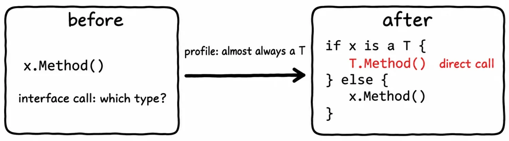
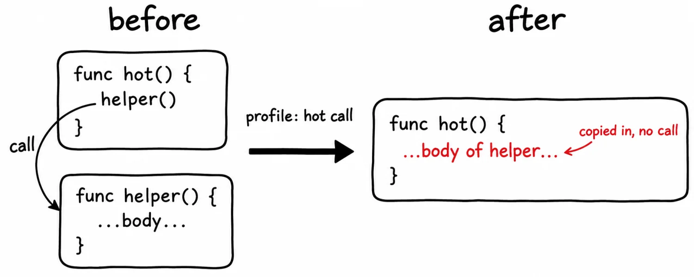
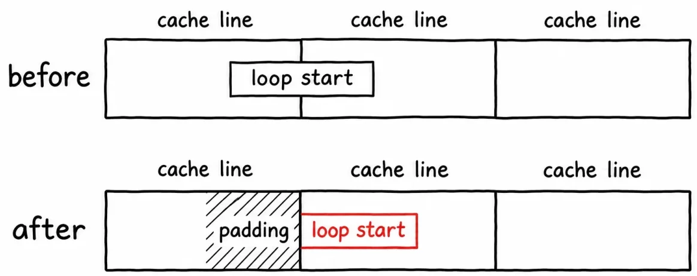
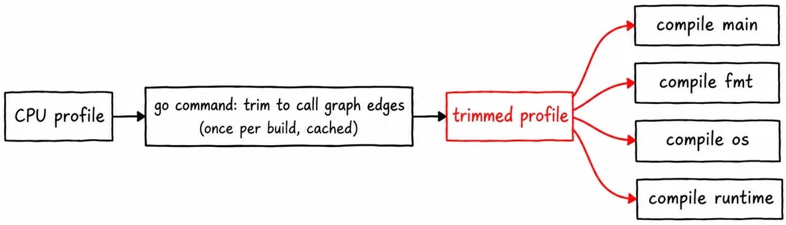
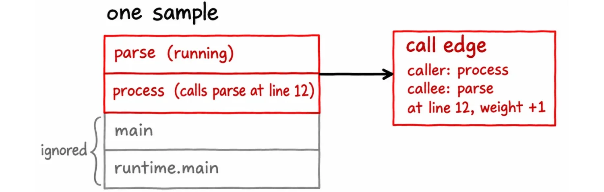
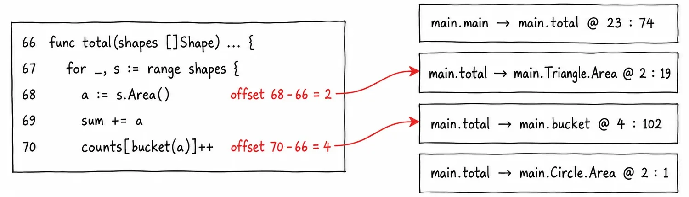
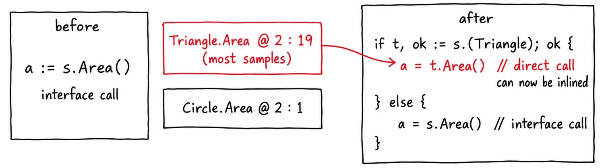
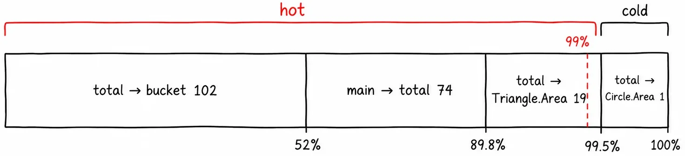
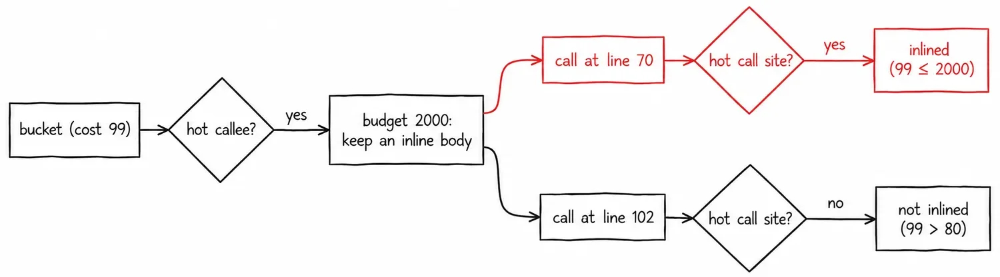
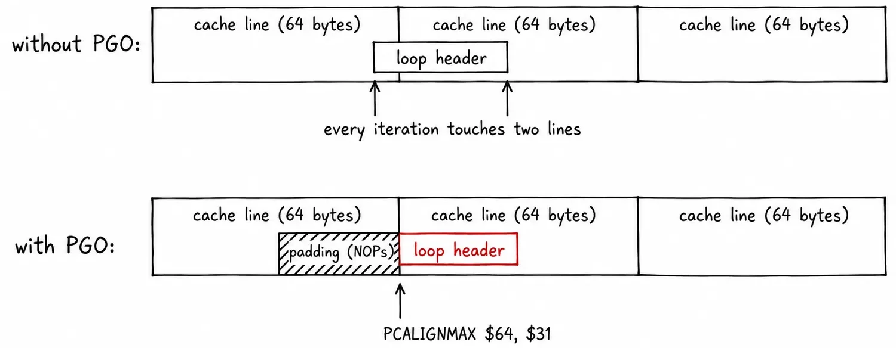

# Inside PGO: Devirtualization, Inlining Budgets, and Loop Alignment

## Overview

Profile-Guided Optimization (PGO) improves application performance without changing source code. Instead of rewriting compute kernels in vector assembly or restructuring logic, you record a CPU profile of your application under representative production load and provide it to the compiler during compilation (`go build -pgo=...`). The compiler uses execution frequencies to invest extra optimization effort on the code paths that actually consume runtime CPU cycles.

```text
 ┌────────────────────────────────────────────────────────────────────────┐
 │                           PGO Mental Model                             │
 │                                                                        │
 │   Production Workload  ──►  CPU Profile (pprof)                        │
 │                                    │                                   │
 │                                    ▼                                   │
 │   go build -pgo=...    ──►  Trim to Call Graph Edges (cached)          │
 │                                    │                                   │
 │                     ┌──────────────┼──────────────┐                    │
 │                     ▼              ▼              ▼                    │
 │               Optimization 1  Optimization 2  Optimization 3           │
 │               Guarded         Hot Inlining    Loop Alignment           │
 │               Devirtualize    (2000 budget)   (PCALIGNMAX on x86)      │
 └────────────────────────────────────────────────────────────────────────┘
```

> **Source & Scope:** This chapter synthesizes compiler internals from the Go compiler source code (`cmd/compile`, `cmd/internal/pgo`, `cmd/go`) as analyzed in [*Inside PGO*](https://internals-for-interns.com/posts/go-compiler-pgo/) (Jesús Espino / *Internals for Interns*, covering Go **1.27.3** on `amd64`). All code examples, edge models, and disassembly references reflect the production `gc` toolchain.

PGO applies three optimizations in a strictly ordered sequence:

1. **Guarded Devirtualization:** Turns indirect interface method dispatch into direct function calls based on the concrete type observed most frequently in the profile.
2. **Hot-Path Inlining:** Scales the compiler's inlining budget from 80 up to **2000** for call sites on hot call edges, eliminating call overhead and opening broader optimization windows.
3. **Loop Alignment (x86):** Emits `PCALIGNMAX` pseudo-instructions to align loop headers to 64-byte CPU cache lines, preventing high-frequency loop headers from straddling cache line boundaries.

Devirtualization runs first because inlining requires a direct call. Inlining runs second, which enlarges functions and pulls in hot callee bodies. Loop alignment runs last during code generation on the resulting machine code.

---

## The Three Optimizations at a Glance

### 1. Devirtualization: Interface Call to Direct Call

When code calls `x.Method()` on an interface, the compiler cannot know which concrete type `x` will hold at run time. The dispatch must be resolved indirectly through an interface table (`itab`).

{fig-alt="Before: interface call x.Method(). Profile says x is almost always type T. After: guarded type check if x is a T, directly call T.Method(), else fallback to interface call."}

If the profile shows that `x` is concrete type `T` 95% of the time, the compiler rewrites the call to check if `x` is `T`. If so, it invokes `T.Method()` directly; otherwise, it falls back to the original interface dispatch.

### 2. Inlining: Removing Function Call Overhead

The Go compiler already performs inlining without PGO, but it enforces a conservative default budget of **80** cost units to control binary bloat.

{fig-alt="Before: hot() calls helper(). With profile, helper() is hot and fits within the 2000 inline budget. After: helper() body is copied directly into hot(), eliminating the call."}

At hot call sites identified by the profile, the compiler raises that budget to **2000** (a 25x increase), allowing substantially larger functions to be inlined directly into their callers.

### 3. Loop Alignment: Eliminating Cache Line Straddles

Modern x86 CPUs (both `amd64` and `386`) fetch and decode instructions in 64-byte chunks known as **cache lines**.

{fig-alt="Before: loop start crosses a 64-byte cache line boundary, forcing every iteration to fetch two cache lines. After: padding fills the first cache line, and loop start aligns to the second line."}

If the header of an inner loop straddles two cache lines, instruction fetch units must touch both lines on every single iteration. PGO inserts padding instructions so that hot loop headers align cleanly to the start of a cache line.

---

## How the Profile Reaches the Compiler

Building with PGO begins with the `go` command:

```bash
# Explicit profile flag
go build -pgo=cpu.pprof -o app ./cmd/app

# Automatic discovery (looks for default.pgo in main package)
go build -pgo=auto -o app ./cmd/app

# Explicitly disabled
go build -pgo=off -o app ./cmd/app
```

> **Default Auto-Discovery:** By default, `-pgo` defaults to `auto`. When set to `auto`, the `go` command checks for a file named `default.pgo` in the main package directory (`setPGOProfilePath()`, `src/cmd/go/internal/load/pkg.go:3039`). If present, it is used automatically.

The raw CPU profile contains full stack traces, line-by-line samples, and memory allocation records. The compiler does not consume this raw file directly:

{fig-alt="CPU profile is trimmed to call graph edges by the go command, cached in the build cache, and broadcast to compile main, fmt, os, and runtime packages."}

1. **Trimming:** The `go` command extracts only **call graph edges** (caller, callee, call site offset, and sample weight). All other sample data is discarded.
2. **Caching:** The trimmed graph is hashed and stored in `GOCACHE`. Recompiling with the same profile reuses the cached edge map.
3. **Universal Broadcast:** The trimmed profile is passed to **every** package in the build graph, including `fmt`, `os`, `net/http`, and `runtime`. Hot application paths frequently terminate in standard library dependencies; compiling those libraries with the profile enables devirtualization and inlining deep within the dependency graph.

---

## What the Compiler Keeps: Call Graph Edges and Line Offsets

Every sample in a standard Go CPU profile records a snapshot of the operating system thread's call stack. PGO extracts only the top two active frames:

{fig-alt="One sample shows parse running, called by process at line 12, called by main. PGO keeps only caller: process, callee: parse, line offset, and increments weight by 1."}

- The function that was executing when the timer interrupt fired (`callee`).
- The function that directly invoked it (`caller`).
- The line offset within the caller where the call occurred.
- The sample count (`weight`).

In the compiler internals, this is represented by `NamedCallEdge` (`src/cmd/internal/pgo/pgo.go:24`).

### Why Line Offsets Instead of Line Numbers?

If PGO stored absolute file line numbers (e.g., `main.go:142`), inserting a single comment or import at the top of `main.go` would shift every line down, immediately invalidating the entire profile.

Instead, PGO records the **line offset** (`createNamedEdgeMap()`, `src/cmd/internal/pgo/pprof.go:78`):

$$\text{Line Offset} = \text{Call Site Line Number} - \text{Enclosing Function Start Line}$$

Consider a function starting at line 66 that calls `s.Area()` on line 68:

$$\text{Offset} = 68 - 66 = 2$$

If new code or comments are added *above* that function, pushing its declaration from line 66 to line 90, the call moves to line 92:

$$\text{Offset} = 92 - 90 = 2$$

Because the offset remains 2, the profile edge continues to match successfully.

> **Editing Caveat:** Offsets survive edits *outside* a function, but modifying code *inside* a function before the call site alters its relative offset. If a line is added inside `total()` above `s.Area()`, its offset shifts from 2 to 3. The compiler will find no edge at offset 3, silently falling back to non-PGO compilation for that call site until a fresh profile is gathered.

### Worked Example: The Shapes Benchmark

To see edge extraction in practice, consider an area calculation over a slice containing 1,000 shapes (two `Triangle`s for every `Circle`):

```go
package main

import "fmt"

type Shape interface{ Area() float64 }

type Triangle struct{ A, B, C float64 }
func (t Triangle) Area() float64 { /* Heron's formula */ return 1.5 }

type Circle struct{ R float64 }
func (c Circle) Area() float64 { return 3.14159 * c.R * c.R }

func bucket(a float64) int {
    // 16-case switch statement (inline cost = 99)
    switch {
    case a < 1:  return 0
    case a < 5:  return 1
    default:     return 15
    }
}

func total(shapes []Shape) (sum float64, counts [17]int) { // line 66
    for _, s := range shapes {
        a := s.Area()       // line 68 -> offset 2 (interface call)
        sum += a
        counts[bucket(a)]++ // line 70 -> offset 4 (direct call)
    }
    return sum, counts
}

func main() { // line 75
    shapes := makeShapes() // 2/3 Triangles, 1/3 Circles
    var sum float64
    for range 600_000 {
        s, _ := total(shapes) // line 98 -> offset 23
        sum += s
    }
    fmt.Printf("%.0f\n", sum)
    fmt.Println(bucket(sum))  // line 102 -> offset 27 (cold call)
}
```

Profiling this benchmark produces four distinct call graph edges:

{fig-alt="Excerpt of total() with offsets 2 and 4 mapped to call edge cards with caller, callee, offset, and weight."}

| Caller | Callee | Line Offset | Sample Weight | Role |
|--------|--------|-------------|---------------|------|
| `main.main` | `main.total` | 23 | 74 | Outer loop driver |
| `main.total` | `main.Triangle.Area` | 2 | 19 | Interface call (`s.Area()`) |
| `main.total` | `main.Circle.Area` | 2 | 1 | Interface call (`s.Area()`) |
| `main.total` | `main.bucket` | 4 | 102 | Inner classification |

Notice that offset 2 has two competing edges because `s.Area()` is invoked on both `Triangle` and `Circle`. Notice also that sample weights reflect execution time spent *while the callee was running*.

---

## Optimization 1: Guarded Devirtualization

When the compiler can statically prove the concrete type behind an interface (e.g., when an interface variable is instantiated immediately prior within the same function), it devirtualizes without PGO. But when interfaces receive parameters dynamically, static analysis cannot guarantee the underlying concrete type.

PGO inspects all edges matching the interface call's line offset and identifies the callee with the highest sample count (`findHotConcreteCallee()`, `src/cmd/compile/internal/devirtualize/pgo.go:660`).

In our shapes program, offset 2 has:
- `Triangle.Area`: 19 samples
- `Circle.Area`: 1 sample

`Triangle` wins decisively. The compiler then invokes `rewriteInterfaceCall()` (`src/cmd/compile/internal/devirtualize/pgo.go:493`):

{fig-alt="Before: a := s.Area(). After: if t, ok := s.(Triangle); ok { a = t.Area() } else { a = s.Area() }."}

```go
// Compiler transformation of: a := s.Area()
var a float64
if t, ok := s.(Triangle); ok {
    a = t.Area() // Direct call: can now be inlined!
} else {
    a = s.Area() // Fallback interface call: preserves full correctness
}
```

This pattern is called **guarded devirtualization**:
- **Safety:** If a `Circle` or custom shape arrives, the `else` branch executes the standard interface method table lookup. Correctness is 100% preserved.
- **Performance:** When `s` is a `Triangle`, the interface lookup overhead is eliminated. More crucially, `t.Area()` is now a direct function call, making it eligible for the inliner in the very next compiler pass.

---

## Optimization 2: Inlining with Scaled Budgets

Inlining removes function call prologue and epilogue overhead, eliminates parameter passing via registers/stack, and exposes the callee's statements to escape analysis and common subexpression elimination (CSE).

The compiler evaluates inlining viability by calculating an AST complexity score for each function. Functions with a score $\le 80$ are inlined by default.

With PGO, the compiler increases this threshold to **2000** for hot call sites.

### Selecting the Hot Call Sites: The 99% CDF Cut

The compiler does not select an arbitrary fixed number of call sites. Instead, it aggregates all profile edge weights, sorts them in descending order, and selects the minimum set of edges that cumulatively account for **99%** of total execution weight (`hotNodesFromCDF()`, `src/cmd/compile/internal/inline/inl.go:147`).

{fig-alt="Bar chart showing total to bucket (52%), main to total (89.8%), total to Triangle.Area (99.5%) covered by hot bracket, and Circle.Area (0.5%) in cold bracket."}

1. `total → bucket` (weight 102) brings the cumulative share to **52.0%**.
2. `main → total` (weight 74) brings the cumulative share to **89.8%**.
3. `total → Triangle.Area` (weight 19) brings the cumulative share to **99.5%**.
4. The 99% threshold is reached. The compiler cuts here.
5. `total → Circle.Area` (weight 1) is classified as **cold**.

The call sites within the 99% cut are designated **hot call sites**, and the targets they call (`bucket`, `total`, `Triangle.Area`) are designated **hot callees**.

### Two Checks, Two Budgets

A common misconception is that hot functions receive a 2000 budget everywhere in the program. In reality, the compiler evaluates two distinct conditions:

{fig-alt="Flowchart: bucket has cost 99. Is it a hot callee? Yes -> budget 2000 saves body. At line 70 (hot call site), 99 <= 2000 -> inlined. At line 102 (cold call site), 99 > 80 -> not inlined."}

1. **Is the target function a Hot Callee?**
   If a function is called by any edge in the 99% cut, its budget is set to 2000 (`inlineBudget()`, `src/cmd/compile/internal/inline/inl.go:210`). If its cost is $\le 2000$, the compiler retains an inlining representation of its AST body. (If not saved, the function cannot be inlined anywhere).
2. **Is this specific call location a Hot Call Site?**
   When processing a call to that function, the compiler checks if the call site itself is on a hot edge (`inlineCostOK()`, `src/cmd/compile/internal/inline/inl.go:975`):
   - At a **hot call site**: Callee cost up to **2000** is accepted.
   - At a **cold call site**: Callee cost must still fit the standard **80** budget.

#### Trace of `bucket` (Cost: 99)

- `bucket` is a hot callee (called frequently from line 70), so its body is preserved for inlining.
- **Call site at line 70** (inside `total()`): Line 70 is a hot call site. Cost 99 fits within the 2000 budget. **Inlined.**
- **Call site at line 102** (in `main()`, after the loop): Line 102 is never hit in the profile. It is a cold call site with an 80 limit. $99 > 80$. **Not inlined.** Remains a regular `CALL`.

#### Trace of `total` (Cost: 140 $\rightarrow$ 237)

- `total()` has an initial cost of 140 (exceeding 80).
- After `Triangle.Area` and `bucket` are inlined into `total()`, its cost expands to 237.
- At line 98 in `main()`, `main → total` is a hot call site.
- Cost $237 \le 2000$. **`total()` is fully inlined into `main()`!**

---

## Optimization 3: Loop Alignment on x86

The third PGO optimization operates in the backend SSA and code generation phases (`cmd/compile/internal/ssa` and `cmd/compile/internal/ssagen`). It aligns loop headers to 64-byte boundaries on `amd64` and `386`.

A function is classified as **PGO-hot** if it was marked as a hot callee or if a hot function was inlined into it. In our benchmark, both `total` and `main` are PGO-hot.

### The Problem: Cache Line Split Penalties

Instruction fetch units read code from L1 instruction cache in 64-byte blocks. When a loop header (the top of the loop that executes on every iteration) begins near the end of a 64-byte line, fetching the first block of instructions requires reading two separate cache lines:

{fig-alt="Top: Without PGO, loop header crosses cache lines, requiring two line reads per iteration. Bottom: With PGO, NOP padding aligns loop header to the start of the next 64-byte cache line."}

### The Solution: `PCALIGNMAX $64, $31`

To eliminate split reads without bloating the binary with excessive padding, the compiler inserts a `PCALIGNMAX` pseudo-directive before loop headers in PGO-hot functions:

```text
PCALIGNMAX $64, $31
```

This directive instructs the assembler:
- If the distance to the next 64-byte cache line boundary is **$\le 31$ bytes**, emit NOP instructions to pad out the line so the loop header starts exactly at offset 0 of the next cache line.
- If more than 31 bytes remain in the cache line, do nothing (the loop header is already deep enough within the line that its critical entry instructions fit without splitting).

```text
Without PGO:
  [Cache Line 0: ... other instructions ... | Loop Header Start (12 bytes)]
  [Cache Line 1: Loop Header End (20 bytes) ...                           ]
  --> Every iteration fetches Cache Line 0 AND Cache Line 1.

With PGO (PCALIGNMAX $64, $31):
  [Cache Line 0: ... other instructions ... | NOP NOP NOP padding        ]
  [Cache Line 1: Loop Header (32 bytes) ...                               ]
  --> Loop entry fits entirely inside Cache Line 1.
```

### Scope and Implementation

- **Loop Selection:** The compiler marks every loop within a PGO-hot function as hot (`looprotate.go:122`), without verifying the execution count of each loop individually.
- **Code Generation:** `genssa()` emits `PCALIGNMAX` for each marked loop header (`ssagen/ssa.go:7088`).
- **Platform Support:** Active only on `amd64` and `386`. Go compiler comments note that while loop alignment measurably benefits x86 architectures, benchmarks on Apple Silicon (arm64) showed negligible impact.

---

## Compiler Source Code Map

| Phase | Package | Key Functions & Line References |
|---|---|---|
| Profile Ingestion & Edge Trimming | `cmd/go/internal/load` | `setPGOProfilePath()` (`pkg.go:3039`) |
| Edge Representation | `cmd/internal/pgo` | `NamedCallEdge` (`pgo.go:24`), `createNamedEdgeMap()` (`pprof.go:78`) |
| Guarded Devirtualization | `cmd/compile/internal/devirtualize` | `findHotConcreteCallee()` (`pgo.go:660`), `rewriteInterfaceCall()` (`pgo.go:493`) |
| CDF Calculation & Cut | `cmd/compile/internal/inline` | `hotNodesFromCDF()` (`inl.go:147`) |
| Budget Scaling & Call Site Checks | `cmd/compile/internal/inline` | `inlineBudget()` (`inl.go:210`), `inlineCostOK()` (`inl.go:975`) |
| Loop Rotation & Alignment Marker | `cmd/compile/internal/ssa` | Loop tagging (`looprotate.go:122`) |
| Code Generation (`PCALIGNMAX`) | `cmd/compile/internal/ssagen` | Loop header alignment (`ssa.go:7088`) |

---

## Inspecting PGO Decisions in Your Own Binaries

You can observe every PGO optimization decision made by the compiler using `-gcflags`:

```bash
# Display devirtualization and inlining decisions
go build -pgo=default.pgo -gcflags="-m -m" ./... 2>&1 | grep -E "(pgo|devirtual|inline)"
```

Look for these diagnostic messages in the compiler output:

```text
./main.go:68:13: pgo-devirtualizing s.Area to Triangle.Area
./main.go:68:13: inlining call to Triangle.Area
./main.go:70:15: inlining call to bucket
./main.go:98:18: inlining call to total
```

To inspect generated loop alignment directives in assembly:

```bash
go build -pgo=default.pgo -gcflags="-S" ./... 2>&1 | grep -C 2 "PCALIGN"
```

---

## Production Impact and Practical Rules

### Real-World Speedups

According to Go team evaluations across representative production services, PGO yields an average throughput improvement of **2% to 14%**, accompanied by commensurate reductions in tail latency. Interface-heavy architectures (such as microservices relying heavily on middleware, serializers, and RPC layers) experience the highest benefits.

### Production Workflow Checklist

1. **Capture Realistic Profiles:** Record CPU profiles from actual production pods handling normal or peak traffic, rather than synthetic unit benchmarks.
2. **Commit `default.pgo`:** Store `default.pgo` in the main package directory of your service repository. CI/CD pipelines will automatically pick it up via `go build -pgo=auto`.
3. **Automate Profile Refresh:** Periodically recapture profiles (e.g., weekly or per release cycle) using continuous profiling tooling (`Google Cloud Profiler`, `Pyroscope`, or scheduled `curl` calls against `debug/pprof/cpu`).
4. **Recapture After Refactoring Hot Code:** Whenever you edit functions identified as hot in your profiles, the line offsets shift. Recapture profiles after significant hot-path refactoring to keep the compiler aligned.

---

## Related Chapters

- [PGO and Production Build Flags](186-pgo-and-build-flags.qmd) — Practical deployment flags (`-trimpath`, `-ldflags`, version stamping).
- [SIMD Without Assembly: simd/archsimd](186b-simd-with-archsimd.qmd) — Hardware vectorization for extreme compute hotspots.
- [Compiler, SSA, Inlining, and PGO](../25-go-deep-dives/209-compiler-ssa-pgo.qmd) — Mid-end SSA pipeline and escape analysis.
- [Article Radar: Internals for Interns](../25-go-deep-dives/246-internals-for-interns-radar.qmd) — Monorepo mapping of Go compiler and runtime deep dives.
