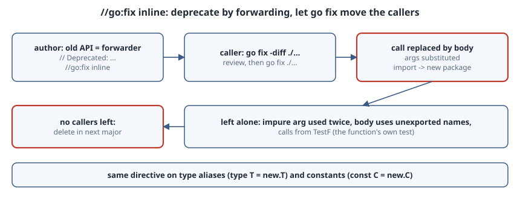

# Deprecating APIs with `//go:fix inline`

## Thesis

The usual way to retire an exported function is to mark it `// Deprecated:` and wait for callers to notice. Since Go 1.26, `go fix` can do the migration for them. You rewrite the old function as a **one-line forwarder** to the new API and add a `//go:fix inline` directive. From then on, `go fix ./...` in any caller's module replaces each call with the forwarder's body: arguments are substituted and imports are rewritten to the new package. The same directive works on **type aliases** and **constants**.

The rewrite comes from the same source-level inliner gopls uses for its "Inline call" refactoring, so it keeps the program's behaviour, including argument evaluation order. When it can't do that cleanly, it leaves the call alone.

This chapter runs the whole cycle on a small module with Go 1.27.2 and shows where the tool stops.

{fig-alt="Step 1: the library author rewrites the old API as a thin forwarder to the new one and marks it Deprecated plus //go:fix inline (functions, type aliases, constants). Step 2: callers run go fix -diff and then go fix; each call is replaced by the forwarder's body with arguments substituted, and imports are rewritten to the new package. Calls the inliner cannot rewrite safely, such as an impure argument used twice or a body that references unexported names, are left alone. Calls from the function's own TestF are skipped. Step 3: when no callers remain, delete the old API in the next major version."}

## The setup: a v1 package and its replacement

`example.com/desk/desk` is the old package. `deskv2` is the redesign. In it, `Open` takes an explicit priority and trims the title:

```go
// deskv2/deskv2.go
package deskv2

import "strings"

type Ticket struct {
	ID       int
	Title    string
	Priority int
}

// Open creates a ticket. Priority is now explicit.
func Open(id int, title string, priority int) Ticket {
	return Ticket{ID: id, Title: strings.TrimSpace(title), Priority: priority}
}

const DefaultPriority = 3
```

The old package keeps compiling, but each exported name is now a forwarder to `deskv2`, marked for inlining:

```go
// desk/desk.go
package desk

import "example.com/desk/deskv2"

// Deprecated: use deskv2.Ticket.
//
//go:fix inline
type Ticket = deskv2.Ticket

// Deprecated: use deskv2.Open with deskv2.DefaultPriority.
//
//go:fix inline
func Open(id int, title string) Ticket {
	return deskv2.Open(id, title, deskv2.DefaultPriority)
}

// Deprecated: use deskv2.DefaultPriority.
//
//go:fix inline
const Normal = deskv2.DefaultPriority
```

Three rules make this work:

- **The body is written in terms of the new API.** Whatever the body says is what will appear at the call sites. That is why `Open` spells out `deskv2.DefaultPriority` and doesn't hide it behind a helper.
- **`Ticket` is a type alias (`=`), not a new defined type.** Old and new values are the same type, so callers can migrate one file at a time.
- **A constant can be inlined only if it refers to another named constant.** `const Normal = 3` would not qualify. `const Normal = deskv2.DefaultPriority` does.

A caller that hasn't migrated yet:

```go
// cmd/triage/main.go
package main

import (
	"fmt"

	"example.com/desk/desk"
)

func label(t desk.Ticket) string {
	return fmt.Sprintf("#%d %s (p%d)", t.ID, t.Title, t.Priority)
}

func main() {
	a := desk.Open(101, " printer jam ")
	b := desk.Open(102, "VPN drops")
	fmt.Println(label(a))
	fmt.Println(label(b), b.Priority == desk.Normal)
}
```

## Preview with `go fix -diff`

Always look before writing. `-diff` prints a unified diff and exits non-zero if there's anything to change, so it also works as a CI gate:

```text
$ go run ./cmd/triage
#101 printer jam (p3)
#102 VPN drops (p3) true
$ go fix -diff ./...
--- cmd/triage/main.go (old)
+++ cmd/triage/main.go (new)
@@ -3,16 +3,16 @@
 import (
 	"fmt"
 
-	"example.com/desk/desk"
+	"example.com/desk/deskv2"
 )
 
-func label(t desk.Ticket) string {
+func label(t deskv2.Ticket) string {
 	return fmt.Sprintf("#%d %s (p%d)", t.ID, t.Title, t.Priority)
 }
 
 func main() {
-	a := desk.Open(101, " printer jam ")
-	b := desk.Open(102, "VPN drops")
+	a := deskv2.Open(101, " printer jam ", deskv2.DefaultPriority)
+	b := deskv2.Open(102, "VPN drops", deskv2.DefaultPriority)
 	fmt.Println(label(a))
-	fmt.Println(label(b), b.Priority == desk.Normal)
+	fmt.Println(label(b), b.Priority == deskv2.DefaultPriority)
 }
--- desk/desk.go (old)
+++ desk/desk.go (new)
@@ -11,7 +11,7 @@
 // Deprecated: use deskv2.Open with deskv2.DefaultPriority.
 //
 //go:fix inline
-func Open(id int, title string) Ticket {
+func Open(id int, title string) deskv2.Ticket {
 	return deskv2.Open(id, title, deskv2.DefaultPriority)
 }
 
exit status 1
```

(The last line comes from the lab script, which runs `echo "exit status $?"` after `go fix -diff`.)

Things to notice:

- **The import changed.** Once nothing in `main.go` refers to `desk`, the import is replaced with `deskv2`. This is how a module can move callers from `pkg` to `pkg/v2`.
- **The hidden default is now visible.** `deskv2.DefaultPriority` appears at each call site, so it's clear which callers took the default.
- **The alias is resolved everywhere**, including the signature of `desk.Open` itself in the declaring package. That is harmless: it's the same type.
- **`desk/desk_test.go` isn't in the diff.** It calls `Open` from `TestOpen`. The analyzer deliberately skips calls to `F` from its own `TestF`, because that test exists to exercise the old function.

## Apply, then prove nothing changed

```text
$ go fix ./... && go run ./cmd/triage && go test ./...
#101 printer jam (p3)
#102 VPN drops (p3) true
?   	example.com/desk/cmd/triage	[no test files]
ok  	example.com/desk/desk	0.002s
?   	example.com/desk/deskv2	[no test files]
$ go fix -diff ./... ; echo $?
0
```

The output is identical before and after, and a second `-diff` comes back empty. Commit this as its own change, separate from feature work, so that reviewers see only mechanical edits.

## Where the inliner stops

The inliner refuses any rewrite that would change behaviour. To see this, here is a package with a few more forwarders:

```go
// oldapi/oldapi.go (excerpt)

// Deprecated: use Area.
//
//go:fix inline
func Square(side int) int {
	return Area(side, side)
}

func Area(w, h int) int { return w * h }

// Deprecated: callers should stop normalizing; it is a no-op.
//
//go:fix inline
func Clean(s string) string {
	return normalize(s)
}

func normalize(s string) string { return s }
```

A caller in another package (the `StartsWithIgnoreCase` and `MaxItems` forwarders are written the same way as in `desk`):

```go
var calls int

func next() int { calls++; return calls * 3 }

func main() {
	fmt.Println(oldapi.StartsWithIgnoreCase("HTTP/1.1", "http/"))
	fmt.Println(oldapi.MaxItems)
	fmt.Println(oldapi.Square(7))
	fmt.Println(oldapi.Square(next()), "calls =", calls)
	fmt.Println(oldapi.Clean("x"))
}
```

```text
$ go fix -diff ./app
--- app/main.go (old)
+++ app/main.go (new)
@@ -11,9 +11,9 @@
 func next() int { calls++; return calls * 3 }
 
 func main() {
-	fmt.Println(oldapi.StartsWithIgnoreCase("HTTP/1.1", "http/"))
-	fmt.Println(oldapi.MaxItems)
-	fmt.Println(oldapi.Square(7))
+	fmt.Println(oldapi.HasPrefixFold("HTTP/1.1", "http/"))
+	fmt.Println(oldapi.DefaultLimit)
+	fmt.Println(oldapi.Area(7, 7))
 	fmt.Println(oldapi.Square(next()), "calls =", calls)
 	fmt.Println(oldapi.Clean("x"))
 }
```

- **`Square(7)` becomes `Area(7, 7)`.** The argument is a constant, so duplicating it is free.
- **`Square(next())` is left alone.** Writing `Area(next(), next())` would call `next` twice. A safe rewrite would need either a binding declaration (`var side = next()`) or a function literal (`func() int {...}()`). In this run it did neither, even when the statement was moved into its own `s := oldapi.Square(next())` line and `-inline.allow_binding_decl=true` was passed. The analyzer docs say it always throws away the function-literal form "on grounds of style", and binding declarations are only "permitted", never required.
- **`Clean("x")` is left alone.** Its body calls `normalize`, which `app` can't reference from another package. Inlining it would produce code that doesn't compile.

None of these skipped calls produced a warning from `go fix`; the calls just stay deprecated. Deprecation checkers such as staticcheck's SA1019 will still flag them, and a search for the old names finds them too. **Design the forwarder so it inlines:** use each parameter at most once (a parameter used twice only inlines when the argument has no side effects), and only reference exported names that callers can see. The lab's `Square` breaks the first rule because it uses `side` twice. A callers-first fix is to give the new API a single-argument form, or to accept that some calls will need a hand edit.

## A deprecation playbook

1. **Ship the new API first** (`deskv2`, or `pkg/v2`). It must be able to express every old call.
2. **Rewrite every old exported name as a forwarder** with `// Deprecated:` and `//go:fix inline`. Use a type alias for types, and a constant that names another constant for constants.
3. **Tell callers how to migrate** in the release notes: run `go fix -diff ./...`, review, then `go fix ./...`. That's one command instead of a migration guide.
4. **Hand-fix what's left**, using a search for the old package name. The cases above are the usual reasons calls get skipped.
5. **Remove the old names only in the next major version.** Until then, they're still part of your compatibility promise.

## Pitfalls

- **Forwarders with logic.** If the old function validates input, logs or recovers from panics, that code will be copied into every caller. Move it into the new API first.
- **Defined types instead of aliases.** `type Ticket deskv2.Ticket` creates a new type, so nothing can be inlined and old and new values don't mix.
- **Assuming every call was migrated.** Skipped calls don't produce a warning, so grep for the old package name after `go fix`.
- **Generated code.** `go fix` won't touch generated files. Fix the generator instead.
- **Version skew.** `go fix` applies these rewrites only from Go 1.26 on; on older toolchains the directive is just a comment. Until every caller has migrated, the forwarders have to keep working as ordinary functions.

## Takeaways

- `//go:fix inline` turns a deprecation notice into a migration that runs automatically, for functions, type aliases and constants.
- Write the forwarder body in terms of the new API, because that body is exactly what callers will end up with.
- `go fix -diff` previews the change and doubles as a CI check. `go fix` applies it, and the program's behaviour stays the same.
- The inliner will skip a call rather than change behaviour. Plan for a few hand edits, and design forwarders that inline cleanly.

## Sources

- Alan Donovan, ["//go:fix inline and the source-level inliner"](https://go.dev/blog/inliner), The Go Blog, 10 March 2026.
- ["Using go fix to modernize Go code"](https://go.dev/blog/gofix), The Go Blog.
- [Go 1.26 release notes](https://go.dev/doc/go1.26): the rewritten `go fix`.
- [`golang.org/x/tools/go/analysis/passes/inline`](https://pkg.go.dev/golang.org/x/tools/go/analysis/passes/inline): analyzer docs, flags, the `TestF` rule and constant rules (also available offline with `go tool fix help inline`).
- [`go fix` command documentation](https://pkg.go.dev/cmd/go#hdr-Update_packages_to_use_new_APIs).
- [Proposal: `//go:fix inline` directives (go.dev/issue/32816)](https://go.dev/issue/32816).
- [Go wiki: Deprecated](https://go.dev/wiki/Deprecated): the `// Deprecated:` comment convention.
