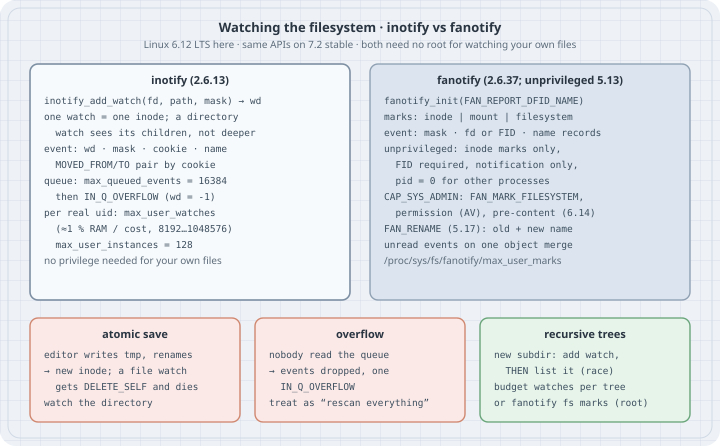

## Overview

**Thesis:** Linux can tell you when files change, so you do not have to poll. Two kernel APIs do this. **inotify** (Linux 2.6.13) watches individual inodes. It needs no privilege and is what `tail -f`, editors, file managers, build watchers and systemd `.path` units use. **fanotify** (2.6.37) can mark a whole mount or filesystem and can even *block* an open until a scanner answers. Those powers need `CAP_SYS_ADMIN`. Since Linux 5.13 there is also a restricted unprivileged mode. Both APIs have sharp edges that show up in production: watches are **not recursive**, the queue **overflows** and drops events, editors **replace** files instead of writing them, and every watch counts against **per-user limits**. When a watcher "randomly misses changes", one of those four is almost always the reason.

Typical operator and programmer jobs:

- Explain why a dev server or log shipper stopped reacting after an editor save, a `git checkout` or a log rotation.
- Find which process uses up the user's inotify watches when tools fail with "no space left on device" or "too many open files".
- Write a watcher that survives event bursts (handle `IN_Q_OVERFLOW`) and new subdirectories (the add-then-scan race).
- Decide when fanotify fits better (whole-filesystem audit, on-access scanning, pre-content hooks) and what it needs.

```bash
uname -r
python3 --version
tail --version | head -1
```

```text
6.12.94+
Python 3.13.5
tail (GNU coreutils) 9.7
```

All output below comes from a Debian 13 host, kernel 6.12 (an LTS series), x86_64, as an unprivileged user (`uid=1000`, no capabilities). Every listing ran there as shown. The examples call the syscalls through Python's standard `ctypes` module, so they need no extra packages. `inotifywait`/`inotifywatch` from **inotify-tools** wrap the same API on the command line. They were not installed on this box, so their use is described from their manual and not run.

{fig-alt="inotify versus fanotify. Left, inotify: a watch is an inode plus an event mask and returns a watch descriptor; watches are per directory and not recursive; each event carries wd, mask, cookie and name; the queue holds max_queued_events, 16384, and then reports IN_Q_OVERFLOW with wd minus one; limits are per real user: max_user_watches, about one percent of RAM divided by the cost of a watch, and max_user_instances, 128. Right, fanotify: a group with marks on an inode, a mount or a whole filesystem; events identify objects by file handle and name; unprivileged since 5.13 with inode marks only, file handles required, no permission events and no pid of other processes; with CAP_SYS_ADMIN, mount and filesystem marks, permission events and pre-content events; FAN_RENAME since 5.17 carries old and new name in one event; unread events on the same object merge. Bottom: three rules. Editors save by writing a new file and renaming it, so watch the directory, not the file. Overflow means lost events, so rescan. Recursive watching races, so add the watch and then scan the new directory."}

## Mental model

**inotify** works like this:

- `inotify_init1()` returns a file descriptor: an **instance** with its own event queue.
- `inotify_add_watch(fd, path, mask)` resolves `path` once, attaches a **watch** to that *inode* and returns a **watch descriptor** (`wd`, a small integer).
- From then on the kernel appends `struct inotify_event { wd, mask, cookie, len, name[] }` records to the queue, and you `read()` them. The fd works with `poll`/`epoll` like any other.

Three consequences follow, and most surprises come from them:

1. **A watch follows the inode, not the name.** If someone renames a new file over the watched one, your watch stays attached to the old inode. That inode is unlinked, you get `IN_DELETE_SELF` and `IN_IGNORED`, and the watch is gone.
2. **A directory watch sees its direct children only.** A change in `dir/sub/file` produces nothing on the watch for `dir`. Recursive watching means one watch per directory, added by you, with a race each time a directory appears.
3. **The queue is bounded.** After `max_queued_events` (16384 by default) unread events, further events are dropped and a single `IN_Q_OVERFLOW` event with `wd = -1` is queued. You learn that you lost something, but not what.

**fanotify** inverts the design:

- `fanotify_init()` creates a **group**, and `fanotify_mark()` attaches **marks** to an inode, a *mount* or a whole *filesystem*.
- Classic fanotify hands you an open **file descriptor** of the object in every event. That is why it needs `CAP_SYS_ADMIN`: a listener could otherwise gain access to files it could not open.
- In modern "FID" mode (`FAN_REPORT_FID`, `FAN_REPORT_DFID_NAME`, Linux 5.1 and 5.9) events carry a **file handle** plus the entry name instead.
- With FID reporting, an **unprivileged** user may use inode marks for notification-only events (Linux 5.13).
- A mount or filesystem mark removes the recursion problem entirely: everything below it is covered. Only privileged listeners get them.

## Syntax

```c
#include <sys/inotify.h>
int fd = inotify_init1(IN_NONBLOCK | IN_CLOEXEC);
int wd = inotify_add_watch(fd, "/srv/app/conf.d", IN_CLOSE_WRITE | IN_MOVED_TO | IN_DELETE);
inotify_rm_watch(fd, wd);
/* read(fd, buf, len) returns one or more struct inotify_event */

#include <sys/fanotify.h>
int g = fanotify_init(FAN_CLASS_NOTIF | FAN_REPORT_DFID_NAME, O_RDONLY);
fanotify_mark(g, FAN_MARK_ADD, FAN_CREATE | FAN_DELETE | FAN_MOVE | FAN_ONDIR, AT_FDCWD, "/srv/app");
/* privileged only: FAN_MARK_ADD | FAN_MARK_FILESYSTEM, FAN_OPEN_PERM, FAN_CLASS_CONTENT ... */
```

| Knob | Where | Default here | Meaning |
|------|-------|--------------|---------|
| `max_user_watches` | `/proc/sys/fs/inotify/` | 127859 | inotify watches per **real user ID**, across all their processes. Since 5.11 the default is 1 % of RAM divided by the cost of one watch, clamped to 8192…1048576. |
| `max_user_instances` | `/proc/sys/fs/inotify/` | 128 | inotify instances (fds) per real user ID |
| `max_queued_events` | `/proc/sys/fs/inotify/` | 16384 | queue length per instance before `IN_Q_OVERFLOW` |
| `max_user_marks` | `/proc/sys/fs/fanotify/` | 136162 | fanotify marks per user (scaled to RAM, like inotify) |
| `max_user_groups` | `/proc/sys/fs/fanotify/` | 128 | fanotify groups per user |
| `max_queued_events` | `/proc/sys/fs/fanotify/` | 16384 | per-group queue; `FAN_UNLIMITED_QUEUE` lifts it (privileged) |

```text
/proc/sys/fs/inotify/max_queued_events:16384
/proc/sys/fs/inotify/max_user_instances:128
/proc/sys/fs/inotify/max_user_watches:127859
/proc/sys/fs/fanotify/max_queued_events:16384
/proc/sys/fs/fanotify/max_user_groups:128
/proc/sys/fs/fanotify/max_user_marks:136162
MemTotal:       16386368 kB
```

(16 GiB of RAM: 1 % of 16386368 kB / 127859 ≈ 1.3 KiB "cost" per watch. The constant `INOTIFY_WATCH_COST` in `fs/notify/inotify/inotify_user.c` counts the mark plus two inodes it may pin.)

| inotify mask | Fires when |
|--------------|-----------|
| `IN_CREATE` / `IN_DELETE` | an entry appeared / vanished in a watched directory |
| `IN_MODIFY` | data was written (once per `write()`, merged if unread) |
| `IN_CLOSE_WRITE` | a file opened for writing was closed. **The "file is complete" signal.** |
| `IN_MOVED_FROM` / `IN_MOVED_TO` | rename out of / into a watched directory; the pair shares a `cookie` |
| `IN_ATTRIB` | metadata: mode, owner, timestamps, **link count** |
| `IN_DELETE_SELF` / `IN_MOVE_SELF` | the watched object itself was deleted / moved |
| `IN_IGNORED` | the watch was removed (explicitly, or because its inode died or the fs was unmounted) |
| `IN_Q_OVERFLOW` | events were dropped; `wd` is `-1` |
| `IN_ISDIR` | flag: the subject is a directory |

## Safety

- Watching is read-only. None of the examples change anything outside a fresh `mktemp -d` directory under `/tmp`.
- Raising the sysctls (`sysctl fs.inotify.max_user_watches=…`) needs root and affects every user on the host. It was **not run** here. Persist such changes in `/etc/sysctl.d/*.conf` only after you have found the process using them up (Example 4).
- fanotify **permission events** (`FAN_OPEN_PERM`, `FAN_ACCESS_PERM`, pre-content events) make other processes **wait** for your answer. A buggy listener that stops reading can hang every `open()` on the filesystem, including the shell you would use to kill it. Develop those on a throwaway VM, never on the host you are logged into.
- Do not deliberately exhaust `max_user_watches` or `max_user_instances` on a shared machine to "see the error". Every other process of your user ID (editors, desktop daemons, language servers) loses the ability to watch at the same moment. That is why this chapter describes `ENOSPC`/`EMFILE` from the documentation instead of triggering them.

## Examples with Explanations

### 1. One directory watch, everyday operations

A tiny wrapper, used by the next examples:

```python
# inotify.py — a tiny ctypes wrapper around inotify(7); no third-party modules
import ctypes, ctypes.util, os, struct

libc = ctypes.CDLL(ctypes.util.find_library("c"), use_errno=True)
libc.inotify_add_watch.argtypes = [ctypes.c_int, ctypes.c_char_p, ctypes.c_uint32]

MASKS = {  # <sys/inotify.h>
    "ACCESS": 0x1, "MODIFY": 0x2, "ATTRIB": 0x4, "CLOSE_WRITE": 0x8, "CLOSE_NOWRITE": 0x10,
    "OPEN": 0x20, "MOVED_FROM": 0x40, "MOVED_TO": 0x80, "CREATE": 0x100, "DELETE": 0x200,
    "DELETE_SELF": 0x400, "MOVE_SELF": 0x800, "UNMOUNT": 0x2000, "Q_OVERFLOW": 0x4000,
    "IGNORED": 0x8000, "ISDIR": 0x40000000,
}
IN_ALL_EVENTS = 0xFFF
IN_NONBLOCK, IN_CLOEXEC = os.O_NONBLOCK, os.O_CLOEXEC
EVENT = struct.Struct("iIII")            # wd, mask, cookie, len  (+ name[len])

def init(flags=IN_CLOEXEC):
    fd = libc.inotify_init1(flags)
    if fd < 0:
        raise OSError(ctypes.get_errno(), os.strerror(ctypes.get_errno()))
    return fd

def add_watch(fd, path, mask=IN_ALL_EVENTS):
    wd = libc.inotify_add_watch(fd, os.fsencode(path), mask)
    if wd < 0:
        e = ctypes.get_errno()
        raise OSError(e, os.strerror(e), path)
    return wd

def names(mask):
    return "|".join(n for n, b in MASKS.items() if mask & b)

def read_events(fd, bufsize=65536):
    """Yield (wd, mask, cookie, name) for everything currently queued."""
    try:
        buf = os.read(fd, bufsize)
    except BlockingIOError:
        return
    off = 0
    while off < len(buf):
        wd, mask, cookie, n = EVENT.unpack_from(buf, off)
        name = buf[off + EVENT.size: off + EVENT.size + n].rstrip(b"\0").decode()
        off += EVENT.size + n
        yield wd, mask, cookie, name
```

```python
# watch_dir.py — what one directory watch reports for everyday file operations
import os, shutil, tempfile, inotify

d = tempfile.mkdtemp(prefix="ino-")
fd = inotify.init(inotify.IN_NONBLOCK | inotify.IN_CLOEXEC)
wd = inotify.add_watch(fd, d)

def step(label, action):
    action()
    print(f"-- {label}")
    for wd_, mask, cookie, name in inotify.read_events(fd):
        extra = f"  cookie={cookie}" if cookie else ""
        print(f"   wd={wd_} {inotify.names(mask):<22} {name or '(the watched dir)'}{extra}")

p = os.path.join(d, "notes.txt")
step("echo hi > notes.txt", lambda: open(p, "w").write("hi\n"))
step("cat notes.txt", lambda: open(p).read())
step("chmod 600 notes.txt", lambda: os.chmod(p, 0o600))
step("mv notes.txt todo.txt", lambda: os.rename(p, os.path.join(d, "todo.txt")))
step("mkdir sub && touch sub/deep.txt", lambda: (os.mkdir(os.path.join(d, "sub")),
                                                   open(os.path.join(d, "sub", "deep.txt"), "w").close()))
step("rm -r the directory itself", lambda: shutil.rmtree(d))
```

```text
$ python3 watch_dir.py
-- echo hi > notes.txt
   wd=1 CREATE                 notes.txt
   wd=1 OPEN                   notes.txt
   wd=1 MODIFY                 notes.txt
   wd=1 CLOSE_WRITE            notes.txt
-- cat notes.txt
   wd=1 OPEN                   notes.txt
   wd=1 ACCESS                 notes.txt
   wd=1 CLOSE_NOWRITE          notes.txt
-- chmod 600 notes.txt
   wd=1 ATTRIB                 notes.txt
-- mv notes.txt todo.txt
   wd=1 MOVED_FROM             notes.txt  cookie=808168
   wd=1 MOVED_TO               todo.txt  cookie=808168
-- mkdir sub && touch sub/deep.txt
   wd=1 CREATE|ISDIR           sub
-- rm -r the directory itself
   wd=1 OPEN|ISDIR             (the watched dir)
   wd=1 ACCESS|ISDIR           (the watched dir)
   wd=1 DELETE                 todo.txt
   wd=1 OPEN|ISDIR             sub
   wd=1 ACCESS|ISDIR           sub
   wd=1 CLOSE_NOWRITE|ISDIR    sub
   wd=1 DELETE|ISDIR           sub
   wd=1 CLOSE_NOWRITE|ISDIR    (the watched dir)
   wd=1 DELETE_SELF            (the watched dir)
   wd=1 IGNORED                (the watched dir)
```

What to read from it:

- **Writing a file** gives `CREATE`, `OPEN`, `MODIFY`, `CLOSE_WRITE`. If you act on `MODIFY` you may read a half-written file. Act on `CLOSE_WRITE` (or on `MOVED_TO`, see Example 2).
- **Reading** produces events too (`OPEN`, `ACCESS`, `CLOSE_NOWRITE`). A watcher that subscribes to `IN_ALL_EVENTS` and reacts to everything will wake itself up by reading the files it was told about. Ask for the events you need.
- **Rename** is two events with the same `cookie`. If only one side is inside your watched set, you get only one half: a `MOVED_FROM` without a partner means "gone", a lone `MOVED_TO` means "appeared".
- **`mkdir sub && touch sub/deep.txt`**: only `CREATE|ISDIR sub`. `deep.txt` is invisible, because the watch on the parent does not cover grandchildren.
- **Removing the watched directory** ends with `DELETE_SELF` and `IGNORED`. The kernel dropped the watch, and the `wd` number may later be reused.

### 2. The editor trap: a watch on the file dies after the first save

Many editors and config tools (and `sed -i`, `install`, most deploy tools) save **atomically**: they write a temporary file and `rename()` it over the target. Readers then never see a half-written file, but the target is a *new inode*:

```python
# atomic_save.py — watch a FILE, then save it the way editors do (write temp, rename over)
import os, tempfile, inotify

d = tempfile.mkdtemp(prefix="ino-")
cfg = os.path.join(d, "app.conf")
open(cfg, "w").write("v=1\n")

fd = inotify.init(inotify.IN_NONBLOCK)
wd_file = inotify.add_watch(fd, cfg)            # watch the file itself
wd_dir = inotify.add_watch(fd, d, inotify.MASKS["CLOSE_WRITE"] | inotify.MASKS["MOVED_TO"])
who = {wd_file: "file-watch", wd_dir: "dir-watch "}

def save(text):                                 # atomic replace: new inode, same name
    tmp = cfg + ".tmp"
    open(tmp, "w").write(text)
    os.rename(tmp, cfg)

for n in (2, 3):
    save(f"v={n}\n")
    print(f"-- save #{n - 1} (v={n})")
    for wd, mask, cookie, name in inotify.read_events(fd):
        print(f"   {who.get(wd, wd)} {inotify.names(mask):<12} {name}")
```

```text
$ python3 atomic_save.py
-- save #1 (v=2)
   dir-watch  CLOSE_WRITE  app.conf.tmp
   dir-watch  MOVED_TO     app.conf
   file-watch ATTRIB       
   file-watch DELETE_SELF  
   file-watch IGNORED      
-- save #2 (v=3)
   dir-watch  CLOSE_WRITE  app.conf.tmp
   dir-watch  MOVED_TO     app.conf
```

The file watch sees the old inode lose its name (`ATTRIB`: the link count dropped), get freed (`DELETE_SELF`) and lose the watch (`IGNORED`). The second save is **silent** for it, and a program that watches the file stops reloading after the first edit. The directory watch keeps working: `MOVED_TO app.conf` is the one reliable "the new version is in place" signal.

GNU `tail` shows both strategies. `tail -f` follows the *descriptor* (one watch on the file, `IN_MODIFY` only). `tail -F` follows the *name*: it also watches the directory for creates, deletes and renames, so it can reopen a rotated or replaced log:

```bash
# tailf.sh — GNU tail -f / -F use inotify; see their watches in /proc
show() {   # print every inotify watch held by PID $1
  for fd in /proc/$1/fd/*; do
    [ "$(readlink "$fd")" = anon_inode:inotify ] && grep '^inotify' /proc/$1/fdinfo/${fd##*/} | cut -d' ' -f1-5
  done
}
f=$(mktemp)
printf 'file %s: ino %x   dir /tmp: ino %x\n' "$f" "$(stat -c %i "$f")" "$(stat -c %i /tmp)"
tail -f "$f" > /dev/null &  p1=$!
tail -F "$f" > /dev/null &  p2=$!
sleep 0.3
echo "tail -f:"; show $p1
echo "tail -F:"; show $p2
kill $p1 $p2; rm -f "$f"
```

```text
$ bash tailf.sh
file /tmp/tmp.NNcmyC9GoV: ino 17c178   dir /tmp: ino bd
tail -f:
inotify wd:1 ino:17c178 sdev:fe00010 mask:2
tail -F:
inotify wd:2 ino:17c178 sdev:fe00010 mask:c06
inotify wd:1 ino:bd sdev:fe00010 mask:784
```

The `fdinfo` lines name the watched inode in hex. Mask `2` is `IN_MODIFY`. Mask `c06` adds `IN_ATTRIB|IN_DELETE_SELF|IN_MOVE_SELF` on the file, and `784` on `/tmp` (inode `bd`) is `IN_ATTRIB|IN_MOVED_TO|IN_CREATE|IN_DELETE|IN_DELETE_SELF`. Use `tail -F` for logs that get rotated.

### 3. Overflow: what you get when you read too slowly

```python
# overflow.py — what happens when nobody reads the queue: IN_Q_OVERFLOW
import os, tempfile, inotify

limit = int(open("/proc/sys/fs/inotify/max_queued_events").read())
d = tempfile.mkdtemp(prefix="ino-")
fd = inotify.init(inotify.IN_NONBLOCK)
inotify.add_watch(fd, d, inotify.MASKS["CREATE"] | inotify.MASKS["CLOSE_WRITE"])

files = 10_000                       # 2 events each: CREATE + CLOSE_WRITE = 20,000 events
for i in range(files):
    open(os.path.join(d, f"f{i:05}"), "w").close()

got, overflow, last = 0, 0, None
while True:
    batch = list(inotify.read_events(fd))
    if not batch:
        break
    for wd, mask, cookie, name in batch:
        if mask & inotify.MASKS["Q_OVERFLOW"]:
            overflow += 1
            print(f"Q_OVERFLOW: wd={wd} name={name!r} after {got} events (last name {last})")
        else:
            got, last = got + 1, name
print(f"max_queued_events={limit}  generated={2 * files}  delivered={got}  lost={2 * files - got}")
```

```text
$ python3 overflow.py
Q_OVERFLOW: wd=-1 name='' after 16384 events (last name f08191)
max_queued_events=16384  generated=20000  delivered=16384  lost=3616
```

10,000 new files produced 20,000 events. The queue held exactly `max_queued_events` (16384 events, files `f00000` to `f08191`). The remaining 3616 events were dropped, and a single `IN_Q_OVERFLOW` with `wd=-1` marks the gap. One `git checkout`, `npm install` or `tar x` easily produces such a burst. A correct watcher therefore treats `IN_Q_OVERFLOW` as "my picture is stale": it rescans the tree, or closes the instance and rebuilds its watches. Reading faster (a dedicated reader thread, large `read()` buffers) makes it rarer but never impossible.

The inotify man page also notes that **identical consecutive unread events are coalesced** (same `wd`, mask, cookie and name). Ten quick `write()`s to one file can arrive as one `IN_MODIFY`, so you cannot count writes with inotify.

### 4. Who is using up the watches?

When a tool fails to add a watch, `inotify_add_watch()` returns `ENOSPC` ("No space left on device", a misleading message: the user's `max_user_watches` is exhausted, not the disk). When it cannot create an instance, `inotify_init1()` returns `EMFILE` ("Too many open files": `max_user_instances` reached). Both limits are **per real user ID**, so the culprit is often a *different* program of the same user, typically an IDE or language server that watches a whole `node_modules`. Every inotify fd lists its watches in `/proc/PID/fdinfo/FD`, one `inotify wd:` line per watch:

```python
# who_watches.py — count inotify instances and watches per process (only processes you may inspect)
import os, re

rows = []
for pid in filter(str.isdigit, os.listdir("/proc")):
    try:
        comm = open(f"/proc/{pid}/comm").read().strip()
        inst = watches = 0
        for fd in os.listdir(f"/proc/{pid}/fd"):
            if os.readlink(f"/proc/{pid}/fd/{fd}") == "anon_inode:inotify":
                inst += 1
                watches += sum(1 for l in open(f"/proc/{pid}/fdinfo/{fd}") if l.startswith("inotify wd:"))
        if inst:
            rows.append((watches, inst, int(pid), comm))
    except (PermissionError, FileNotFoundError, ProcessLookupError):
        continue
lim = {k: int(open(f"/proc/sys/fs/inotify/{k}").read()) for k in ("max_user_watches", "max_user_instances")}
print(f"limits: max_user_watches={lim['max_user_watches']} max_user_instances={lim['max_user_instances']}")
print(f"{'PID':>7} {'COMM':<16} {'INSTANCES':>9} {'WATCHES':>8}")
for w, i, pid, comm in sorted(rows, reverse=True)[:8]:
    print(f"{pid:>7} {comm:<16} {i:>9} {w:>8}")
print(f"total: {sum(r[1] for r in rows)} instances, {sum(r[0] for r in rows)} watches")
```

```text
$ python3 who_watches.py
limits: max_user_watches=127859 max_user_instances=128
    PID COMM             INSTANCES  WATCHES
 184516 node                     1       75
 189580 bamfdaemon               1        5
  18492 bamfdaemon               1        5
 189262 plank                    1        4
  25625 bamfdaemon               1        4
  25400 plank                    1        4
  18317 plank                    1        4
  14946 bamfdaemon               1        4
total: 17 instances, 128 watches
```

Run as yourself, it sees your own processes (`/proc/PID/fd` of other users needs root). On a busy developer machine the top entry is usually the editor or a file-watching dev server with tens of thousands of watches. Exclude build output and dependency directories in its settings before you raise the limit.

### 5. fanotify without root: what the 5.13 unprivileged mode allows

```python
# fan.py — unprivileged fanotify (Linux 5.13+): directory-entry events with FID + name records
import ctypes, ctypes.util, os, struct, tempfile

libc = ctypes.CDLL(ctypes.util.find_library("c"), use_errno=True)
libc.fanotify_mark.argtypes = [ctypes.c_int, ctypes.c_uint, ctypes.c_uint64, ctypes.c_int, ctypes.c_char_p]

# <linux/fanotify.h>
FAN_CLASS_NOTIF, FAN_REPORT_FID, FAN_REPORT_DIR_FID, FAN_REPORT_NAME = 0x0, 0x200, 0x400, 0x800
FAN_REPORT_DFID_NAME = FAN_REPORT_DIR_FID | FAN_REPORT_NAME
FAN_MARK_ADD, FAN_MARK_MOUNT, FAN_MARK_FILESYSTEM = 0x1, 0x10, 0x100
FAN_MOVED_FROM, FAN_MOVED_TO, FAN_CREATE, FAN_DELETE = 0x40, 0x80, 0x100, 0x200
FAN_ONDIR = 0x40000000
AT_FDCWD = -100
NAMES = {FAN_CREATE: "CREATE", FAN_MOVED_FROM: "MOVED_FROM", FAN_MOVED_TO: "MOVED_TO",
         FAN_DELETE: "DELETE", FAN_ONDIR: "ONDIR"}

def call(fn, *a):
    r = fn(*a)
    if r < 0:
        e = ctypes.get_errno()
        raise OSError(e, os.strerror(e))
    return r

FAN_CLASS_CONTENT, FAN_UNLIMITED_QUEUE = 0x4, 0x10
print("uid", os.getuid(), "CapEff", [l.split()[1] for l in open("/proc/self/status") if l.startswith("CapEff")][0])
for label, flags in [("FAN_CLASS_NOTIF (no FID)", FAN_CLASS_NOTIF),
                     ("FAN_CLASS_CONTENT|FID", FAN_CLASS_CONTENT | FAN_REPORT_FID),
                     ("FAN_UNLIMITED_QUEUE|FID", FAN_UNLIMITED_QUEUE | FAN_REPORT_FID)]:
    try:
        os.close(call(libc.fanotify_init, flags, os.O_RDONLY))
        print(f"fanotify_init({label:<26}) -> ok")
    except OSError as e:
        print(f"fanotify_init({label:<26}) -> {e.strerror}")
fd = call(libc.fanotify_init, FAN_CLASS_NOTIF | FAN_REPORT_DFID_NAME, os.O_RDONLY)
print(f"fanotify_init({'FAN_REPORT_DFID_NAME':<26}) -> fd {fd}")

d = tempfile.mkdtemp(prefix="fan-")
mask = FAN_CREATE | FAN_DELETE | FAN_MOVED_FROM | FAN_MOVED_TO | FAN_ONDIR
call(libc.fanotify_mark, fd, FAN_MARK_ADD, mask, AT_FDCWD, d.encode())
print(f"fanotify_mark({'inode mark (directory)':<26}) -> ok")

for label, flags, m in [("FAN_MARK_FILESYSTEM", FAN_MARK_ADD | FAN_MARK_FILESYSTEM, FAN_CREATE),
                        ("FAN_MARK_MOUNT", FAN_MARK_ADD | FAN_MARK_MOUNT, FAN_CREATE)]:
    try:
        call(libc.fanotify_mark, fd, flags, m, AT_FDCWD, d.encode())
        print(f"fanotify_mark({label:<26}) -> ok")
    except OSError as e:
        print(f"fanotify_mark({label:<26}) -> {e.strerror}")

os.mkdir(f"{d}/sub")
open(f"{d}/a.txt", "w").close()
os.rename(f"{d}/a.txt", f"{d}/b.txt")
os.unlink(f"{d}/b.txt")
os.spawnlp(os.P_WAIT, "touch", "touch", f"{d}/by-child")     # an event from another process

META = struct.Struct("IBBHQii")        # event_len, vers, reserved, metadata_len, mask, fd, pid
buf, off = os.read(fd, 65536), 0
while off < len(buf):
    ev_len, vers, _, meta_len, emask, efd, pid = META.unpack_from(buf, off)
    info, name = off + meta_len, None
    while info < off + ev_len:                                   # info records follow the metadata
        itype, _, ilen = struct.unpack_from("BBH", buf, info)
        if itype == 2:                                           # FAN_EVENT_INFO_TYPE_DFID_NAME
            hbytes, = struct.unpack_from("I", buf, info + 4 + 8)  # skip header + fsid
            name = buf[info + 4 + 8 + 8 + hbytes: info + ilen].split(b"\0")[0].decode()
        info += ilen
    who = "self" if pid == os.getpid() else pid
    print(f"  {'|'.join(v for k, v in NAMES.items() if emask & k):<18} name={name:<9} fd={efd} pid={who}")
    off += ev_len
os.unlink(f"{d}/by-child"); os.rmdir(f"{d}/sub"); os.rmdir(d)
```

```text
$ python3 fan.py
uid 1000 CapEff 0000000000000000
fanotify_init(FAN_CLASS_NOTIF (no FID)  ) -> Operation not permitted
fanotify_init(FAN_CLASS_CONTENT|FID     ) -> Operation not permitted
fanotify_init(FAN_UNLIMITED_QUEUE|FID   ) -> Operation not permitted
fanotify_init(FAN_REPORT_DFID_NAME      ) -> fd 5
fanotify_mark(inode mark (directory)    ) -> ok
fanotify_mark(FAN_MARK_FILESYSTEM       ) -> Operation not permitted
fanotify_mark(FAN_MARK_MOUNT            ) -> Operation not permitted
  CREATE|ONDIR       name=sub       fd=-1 pid=self
  CREATE|MOVED_FROM  name=a.txt     fd=-1 pid=self
  MOVED_TO|DELETE    name=b.txt     fd=-1 pid=self
  CREATE             name=by-child  fd=-1 pid=0
```

Line by line:

- **Classic mode (event carries an fd) is refused** to an unprivileged user (`EPERM`). So are content/permission classes and the unlimited queue.
- **FID mode with names works** (`FAN_REPORT_DFID_NAME`): each event identifies the *parent directory* by file handle and carries the entry name. `fd=-1` because no fd is opened for you.
- **Only inode marks.** `FAN_MARK_FILESYSTEM` and `FAN_MARK_MOUNT` fail with `EPERM`. Without root, fanotify is not recursive either.
- **Events merge.** `CREATE|MOVED_FROM a.txt` and `MOVED_TO|DELETE b.txt` are each *one* event: unread events for the same directory entry from the same process collapse into one record with several mask bits. The final state is clear (a.txt came and left, b.txt came and left), but the order is not. inotify kept the order (Example 1).
- **No pid for other processes.** The `touch` child shows `pid=0`. An unprivileged listener only learns the pid when it caused the event itself.

The man page `fanotify_init(2)` lists exactly these restrictions for unprivileged callers. fanotify renames are better than inotify's cookie pairs since **Linux 5.17** (backported to 5.15.154 and 5.10.220): `FAN_RENAME` delivers *one* event with both the old and the new directory+name records, even across two marked directories:

```python
# fan_rename.py — FAN_RENAME (Linux 5.17+): one event carrying both the old and the new name
import ctypes, ctypes.util, os, struct, tempfile

libc = ctypes.CDLL(ctypes.util.find_library("c"), use_errno=True)
libc.fanotify_mark.argtypes = [ctypes.c_int, ctypes.c_uint, ctypes.c_uint64, ctypes.c_int, ctypes.c_char_p]
FAN_REPORT_DFID_NAME, FAN_MARK_ADD, FAN_RENAME, AT_FDCWD = 0xC00, 0x1, 0x10000000, -100
INFO = {2: "DFID_NAME", 10: "OLD_DFID_NAME", 12: "NEW_DFID_NAME"}   # FAN_EVENT_INFO_TYPE_*

fd = libc.fanotify_init(FAN_REPORT_DFID_NAME, os.O_RDONLY)
d = tempfile.mkdtemp(prefix="fan-")
os.mkdir(f"{d}/inbox"); os.mkdir(f"{d}/done")
for sub in ("inbox", "done"):
    assert libc.fanotify_mark(fd, FAN_MARK_ADD, FAN_RENAME, AT_FDCWD, f"{d}/{sub}".encode()) == 0
open(f"{d}/inbox/job-42", "w").close()
os.rename(f"{d}/inbox/job-42", f"{d}/done/job-42.ok")

buf = os.read(fd, 4096)
ev_len, _, _, meta_len, mask, _, _ = struct.unpack_from("IBBHQii", buf, 0)
print(f"one event, mask=0x{mask:x} (FAN_RENAME), {ev_len} bytes")
off = meta_len
while off < ev_len:
    itype, _, ilen = struct.unpack_from("BBH", buf, off)
    hbytes, = struct.unpack_from("I", buf, off + 12)
    name = buf[off + 20 + hbytes: off + ilen].split(b"\0")[0].decode()
    print(f"  {INFO.get(itype, itype):<14} name={name}")
    off += ilen
```

```text
$ python3 fan_rename.py
one event, mask=0x10000000 (FAN_RENAME), 100 bytes
  OLD_DFID_NAME  name=job-42
  NEW_DFID_NAME  name=job-42.ok
```

### 6. What privileged fanotify adds (from the docs, not run)

With `CAP_SYS_ADMIN` (not available here, so none of this was run):

- `FAN_MARK_FILESYSTEM` covers every object on a filesystem, and `FAN_MARK_MOUNT` covers a mount. That is the scalable answer to "watch this huge tree": one mark instead of a watch per directory, no add-then-scan race. Mount marks cannot report directory-entry events (`FAN_CREATE` and friends); use a filesystem mark for those.
- **Permission events** (`FAN_OPEN_PERM`, `FAN_OPEN_EXEC_PERM`, `FAN_ACCESS_PERM`, class `FAN_CLASS_CONTENT`) make the opener wait until the listener writes `FAN_ALLOW` or `FAN_DENY`. This is how on-access virus scanners and some DLP tools work.
- **Pre-content events** (`FAN_PRE_ACCESS`, class `FAN_CLASS_PRE_CONTENT`, Linux 6.14) fire before a range of a file is read and come with the offset and length. A hierarchical-storage manager can fill in the data on demand.
- **Mount-namespace marks** (`FAN_MARK_MNTNS` with `FAN_REPORT_MNT`, Linux 6.14) report `FAN_MNT_ATTACH`/`FAN_MNT_DETACH` when mounts appear or disappear in a namespace.
- `FAN_REPORT_PIDFD` (5.15) returns a pidfd for the event's process instead of a pid that could be recycled, and `FAN_UNLIMITED_QUEUE` removes the 16384-event bound.

## The trap

**Trap: "I watch the config file, so I will see every change."** You see changes until the first atomic save replaces the inode (Example 2). Then `IN_IGNORED`, and silence. Watch the **directory**, filter by name, and react to `CLOSE_WRITE` and `MOVED_TO`.

**Trap: "inotify is recursive if I pass a directory."** It is not (Example 1). Recursive watchers add one watch per directory. When `IN_CREATE|IN_ISDIR` arrives, files may already exist inside the new directory before your watch is in place. The man page's advice: add the watch **first**, then list the directory and treat what you find as created.

**Trap: "No space left on device — the disk is full."** From `inotify_add_watch()` it means `max_user_watches` is exhausted for your user ID. `df` is irrelevant. Count watches per process (Example 4) before raising the limit.

**Trap: "Events tell me exactly what happened."** They can be dropped (`IN_Q_OVERFLOW`, Example 3), coalesced (identical inotify events) or merged (fanotify, Example 5). Use events as **hints to look**, then `stat`/scan to learn the real state.

## Notes & Pitfalls

- **Not every filesystem reports.** Changes made by *other* machines on NFS, SMB, FUSE or 9p (including many VM and container bind/shared folders) do not generate local events, because the kernel never sees them. Pseudo-filesystems such as `/proc`, `/sys` and `/dev/pts` cannot be monitored with inotify either (inotify(7)). Watchers on these need polling; most watcher libraries have a polling fallback setting.
- **Bind mounts and overlays:** inotify watches inodes, so a change through any path to the same inode is reported. On overlayfs, a watch on a merged file sees changes made through the overlay, not direct edits to a lower layer.
- **`IN_MODIFY` on `mmap` writes is not reported.** Writes through a shared memory mapping (`mmap`, `msync`, `munmap`) do not produce events (inotify(7), "Limitations and caveats").
- **Watch descriptors are reused** after `IN_IGNORED`. Drop the `wd → path` entry from your map when you see it, or late events will be attributed to the wrong path.
- **Renames across watched directories** need the cookie to pair `MOVED_FROM`/`MOVED_TO`. The two events are usually adjacent, but not guaranteed to arrive in the same `read()`.
- **systemd `.path` units** (`PathChanged=`, `PathModified=`, `DirectoryNotEmpty=`) are inotify watches held by PID 1 and the user manager, with the same non-recursive and atomic-save behaviour. `PathChanged=` fires on `CLOSE_WRITE` and moves, `PathModified=` also on every write.
- Containers share the host kernel. Processes that run as the same host UID draw on the same `max_user_watches` budget, even when they are in different containers.

## The boring rule

Watch **directories**, not files. Act on `IN_CLOSE_WRITE` and `IN_MOVED_TO`, never on `IN_MODIFY`. Treat `IN_Q_OVERFLOW` as "rescan". When you see a new subdirectory, add the watch before you list it. When a watcher says "no space left on device", count watches per process before you touch the sysctl. Reach for fanotify only when you need whole-filesystem coverage or a say in `open()`, and test permission events on a machine you can afford to hang.

## Related Commands

- `tail -F` follows a log by name across rotation (inotify on the directory); `tail -f` follows the descriptor.
- `inotifywait` / `inotifywatch` (inotify-tools) are inotify on the command line: `inotifywait -m -e close_write,moved_to dir/`. Not installed here; see their manual.
- `fatrace` and `fsnotifywait` (inotify-tools 4.x, fanotify-based) give filesystem-wide views and need root.
- `systemctl list-units --type=path` lists inotify-driven systemd path units.
- `find /proc/*/fd -lname anon_inode:inotify 2>/dev/null` finds every inotify fd you may inspect.
- `stat -c %i FILE` gives the inode number to match against `fdinfo` `ino:` (hex).

## Try this

1. In `watch_dir.py`, add a watch for `sub` as soon as `CREATE|ISDIR sub` arrives, then `touch sub/deep.txt`. Now create `sub2/a/b/c` with one `os.makedirs()` call and see how many levels you catch without the "scan after adding" step.
2. Change `atomic_save.py` to write the file in place (`open(cfg, "w")`). Which watch now reports the save, and with which events?
3. Lower the burst in `overflow.py` until no overflow happens, then read the queue from a thread while generating events. How much further can you push it?
4. In `fan.py`, add `FAN_REPORT_TARGET_FID` (Linux 5.17) to `fanotify_init()` and print how many info records each event carries.
5. Run `who_watches.py` while your editor opens a large project, and again after excluding its dependency directory from file watching.

## Verification

- Run unprivileged on this box: Debian 13 (trixie), Linux **6.12.94+** (x86_64), Python **3.13.5** (standard library `ctypes` only), GNU coreutils **9.7**. `uid=1000`, `CapEff 0000000000000000`. All output above is pasted from one run of the listed scripts. Cookies, inode numbers, PIDs and watch counts change between runs.
- Kernel limits read from `/proc/sys/fs/inotify` and `/proc/sys/fs/fanotify`. The default formula for `max_user_watches` was checked in `fs/notify/inotify/inotify_user.c` (v6.12), and the fanotify defaults in `fs/notify/fanotify/fanotify_user.c`.
- Checked against kernel.org on 2026-10-19: stable **7.2.11**, mainline **7.3-rc7**, longterm **6.18.57** and **6.12.113**. The APIs used here are unchanged on those kernels. The main fanotify additions since 6.12 are pre-content events (`FAN_PRE_ACCESS`) and mount-namespace marks, both in 6.14.
- **Not run:** raising the sysctls (root), exhausting `max_user_watches`/`max_user_instances` to trigger `ENOSPC`/`EMFILE` (would disturb other processes on a shared host), privileged fanotify (filesystem/mount marks, permission and pre-content events, `FAN_REPORT_PIDFD`), `inotifywait`, `fatrace` and `fsnotifywait` (not installed; nothing was installed for this chapter). Those parts are written from the man pages and kernel sources below.
- No packages installed, no root, no `sudo`.

## Sources

- man7: [`inotify(7)`](https://man7.org/linux/man-pages/man7/inotify.7.html) (events, limits, coalescing, the recursive-watch race, overflow advice, BUGS), [`inotify_add_watch(2)`](https://man7.org/linux/man-pages/man2/inotify_add_watch.2.html) (`ENOSPC`), [`inotify_init(2)`](https://man7.org/linux/man-pages/man2/inotify_init.2.html) (`EMFILE`), [`fanotify(7)`](https://man7.org/linux/man-pages/man7/fanotify.7.html) (event merging, info records), [`fanotify_init(2)`](https://man7.org/linux/man-pages/man2/fanotify_init.2.html) (unprivileged restrictions, `FAN_REPORT_*`), [`fanotify_mark(2)`](https://man7.org/linux/man-pages/man2/fanotify_mark.2.html) (`FAN_RENAME`, `FAN_PRE_ACCESS`, mark types), [`proc_pid_fdinfo(5)`](https://man7.org/linux/man-pages/man5/proc_pid_fdinfo.5.html)
- Kernel docs: [inotify — a powerful yet simple file change notification system](https://docs.kernel.org/filesystems/inotify.html); [Documentation for /proc/sys/fs/](https://docs.kernel.org/admin-guide/sysctl/fs.html)
- Linux sources: [`fs/notify/inotify/inotify_user.c`](https://git.kernel.org/pub/scm/linux/kernel/git/torvalds/linux.git/tree/fs/notify/inotify/inotify_user.c) (`INOTIFY_WATCH_COST`, default limits), [`fs/notify/fanotify/fanotify_user.c`](https://git.kernel.org/pub/scm/linux/kernel/git/torvalds/linux.git/tree/fs/notify/fanotify/fanotify_user.c) (unprivileged checks, defaults)
- Kernel merge "fsnotify_hsm_for_v6.14-rc1" (pre-content events): <https://git.kernel.org/pub/scm/linux/kernel/git/torvalds/linux.git/commit/?id=8883957b3c9de2087fb6cf9691c1188cccf1ac9c>
- GNU coreutils manual, [`tail` invocation](https://www.gnu.org/software/coreutils/manual/html_node/tail-invocation.html) (`--follow=name` vs `descriptor`, `-F`)
- systemd: [`systemd.path(5)`](https://www.freedesktop.org/software/systemd/man/latest/systemd.path.html)
- kernel.org release list (versions checked 2026-10-19): <https://www.kernel.org/>
