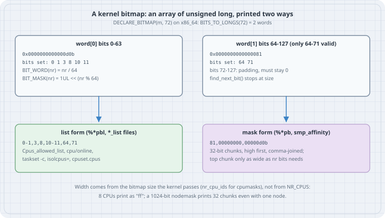

## Overview

**Thesis:** every "which CPUs" or "which NUMA nodes" answer the kernel gives you is a **bitmap**: an array of `unsigned long` where bit *n* means CPU *n* (or node *n*). The kernel prints that one structure in two text forms. One is a **list** (`0-1,3,8`). The other is a **mask** of comma-separated 32-bit hex chunks (`81,00000000,00000d0b`). Know the two forms and the arithmetic behind them, and `Cpus_allowed`, `taskset -p`, `smp_affinity`, `cpu/online` and `core_cpus` all read the same way.

Typical jobs this chapter covers:

- Turn `Cpus_allowed: 3a` into "CPUs 1, 3, 4, 5" in your head, and back again.
- Know why the same file says `ff` on one box and `00000000,000000ff` on another.
- Choose between the `*_list` file and the mask file in a script, and parse either one correctly.
- Read kernel code that uses `DECLARE_BITMAP`, `set_bit` and `for_each_set_bit` without guessing.

```bash
uname -r
gcc --version | head -1
nproc
id -u
```

```text
6.12.94+
gcc (Debian 14.2.0-19) 14.2.0
8
1000
```

Every listing below ran on a Debian 13 host with kernel 6.12, x86_64, 8 vCPUs and one NUMA node, as an unprivileged user (`uid=1000`). Nothing needs root.

{fig-alt="Top: DECLARE_BITMAP(m, 72) on x86_64 is two unsigned long words. Word 0 holds bits 0 to 63 and here equals 0x0d0b, bits 0, 1, 3, 8, 10 and 11. Word 1 holds bits 64 to 127, but only 64 to 71 are valid; it equals 0x81, bits 64 and 71. BIT_WORD(nr) is nr divided by 64 and BIT_MASK(nr) is 1 shifted left by nr modulo 64. Bottom left, list form as printed by %*pbl and the _list files: 0-1,3,8,10-11,64,71, used by Cpus_allowed_list, cpu/online, taskset -c, isolcpus and cpuset.cpus. Bottom right, mask form as printed by %*pb and smp_affinity: 81,00000000,00000d0b, 32-bit chunks with the most significant first, and the top chunk only as wide as the bit count needs. The width comes from the size the kernel passes, nr_cpu_ids for cpumasks, so 8 CPUs print as ff, while a 1024-bit nodemask prints 32 chunks even with one node."}

## Mental model

```text
  bitmap of N bits  =  unsigned long word[BITS_TO_LONGS(N)]
  bit nr lives in   word[nr / BITS_PER_LONG]   at   1UL << (nr % BITS_PER_LONG)

  printed as a list :  ranges, ascending, comma separated        0-1,3,8,10-11
  printed as a mask :  hex, 32 bits per chunk, high chunk first  81,00000000,00000d0b
                       the highest chunk is only as wide as N needs
```

Three facts carry the chapter:

1. **Bit number = CPU number.** There is no other mapping. CPU 5 is bit 5, which is `0x20` in the lowest chunk.
2. **The width of a mask follows the bitmap's size, not the number of set bits.** For cpumasks that size is `nr_cpu_ids`, the number of possible CPU ids on this boot. It is not `NR_CPUS`, the compile-time maximum.
3. **Lists are for humans and for writing; masks are compact but width-dependent.** For scripts, prefer the `*_list` file when one exists.

## Case 1 — The same bits, two files

The kernel shows the calling task's allowed CPUs and memory nodes in `/proc/self/status`, once as a mask and once as a list:

```bash
grep -E 'Cpus_allowed|Mems_allowed' /proc/self/status
```

```text
Cpus_allowed:	ff
Cpus_allowed_list:	0-7
Mems_allowed:	00000000,00000000,00000000,00000000,00000000,00000000,00000000,00000000,00000000,00000000,00000000,00000000,00000000,00000000,00000000,00000000,00000000,00000000,00000000,00000000,00000000,00000000,00000000,00000000,00000000,00000000,00000000,00000000,00000000,00000000,00000000,00000001
Mems_allowed_list:	0
```

`Cpus_allowed` is two hex digits because this boot has `nr_cpu_ids = 8`, so the bitmap is 8 bits wide. `Mems_allowed` is a nodemask sized by the kernel's configured maximum number of nodes, here 1024 bits, which is 32 chunks. Only the lowest bit is set: node 0. The `_list` lines say the same thing in one token each.

Narrow the affinity with `taskset` and both forms follow:

```bash
taskset -p $$
taskset -c 0,2 grep Cpus_allowed /proc/self/status
taskset -c 0-7:2 sh -c 'grep Cpus_allowed_list /proc/self/status'
```

```text
pid 1241299's current affinity mask: ff
Cpus_allowed:	05
Cpus_allowed_list:	0,2
Cpus_allowed_list:	0,2,4,6
```

`05` is binary `0000 0101`: bits 0 and 2. The last line shows the stride syntax `first-last:step` that util-linux accepts in `taskset -c`. The kernel accepts a related list syntax for boot parameters such as `isolcpus=` and `nohz_full=`. Its form is `first-last:used/group`; for example, `0-7:2/4` selects CPUs 0, 1, 4 and 5. It is described under "cpu lists" in the kernel parameters documentation.

## Case 2 — Sysfs: lists and masks side by side

The CPU topology directory has both forms for many attributes:

```bash
cd /sys/devices/system/cpu
cat possible present online
for f in cpu0/topology/core_cpus cpu0/topology/core_cpus_list \
         cpu0/topology/package_cpus_list kernel_max; do
  printf '%-34s %s\n' "$f" "$(cat $f)"
done
cat /sys/devices/system/node/node0/cpumap /sys/devices/system/node/node0/cpulist
cat /proc/irq/default_smp_affinity
cat /proc/irq/*/smp_affinity_list | sort | uniq -c
```

```text
0-7
0-7
0-7
cpu0/topology/core_cpus            01
cpu0/topology/core_cpus_list       0
cpu0/topology/package_cpus_list    0-7
kernel_max                         63
ff
0-7
ff
     21 0-7
```

`kernel_max` is `NR_CPUS - 1`. This kernel was built for up to 64 CPUs, but the masks are two hex digits wide because the boot found 8 possible CPUs. Copy a mask from this box to a host with 96 possible CPUs and it has a different width and comma layout. Code that parses masks with a fixed width breaks there; code that reads the `_list` file does not.

`core_cpus` is `01` because each vCPU here is its own core, with no SMT sibling. On a bare-metal host with hyper-threading, `core_cpus_list` for CPU 0 typically reads something like `0,48`.

## Case 3 — The arithmetic, in user space

The kernel's bitmap API lives in `include/linux/bitmap.h` and `include/linux/bitops.h`. The core idioms are short enough to copy into a user-space program. The point is to watch the words and the printed forms agree. Kernel code calls the real functions; it does not open-code them.

```c
/* bitmap.c: a user-space copy of the kernel bitmap idioms (include/linux/bitmap.h) */
#define _GNU_SOURCE
#include <limits.h>
#include <sched.h>
#include <stdio.h>
#include <stdlib.h>
#include <string.h>

#define BITS_PER_LONG     (sizeof(long) * CHAR_BIT)
#define BITS_TO_LONGS(n)  (((n) + BITS_PER_LONG - 1) / BITS_PER_LONG)
#define DECLARE_BITMAP(name, bits) unsigned long name[BITS_TO_LONGS(bits)]
#define BIT_WORD(nr)      ((nr) / BITS_PER_LONG)
#define BIT_MASK(nr)      (1UL << ((nr) % BITS_PER_LONG))

static void set_bit(unsigned nr, unsigned long *a)   { a[BIT_WORD(nr)] |=  BIT_MASK(nr); }
static void clear_bit(unsigned nr, unsigned long *a) { a[BIT_WORD(nr)] &= ~BIT_MASK(nr); }
static int  test_bit(unsigned nr, const unsigned long *a) { return !!(a[BIT_WORD(nr)] & BIT_MASK(nr)); }

static unsigned find_next_bit(const unsigned long *a, unsigned size, unsigned off)
{
    while (off < size) {
        unsigned long w = a[BIT_WORD(off)] & (~0UL << (off % BITS_PER_LONG));
        if (w) {
            unsigned r = BIT_WORD(off) * BITS_PER_LONG + __builtin_ctzl(w);
            return r < size ? r : size;
        }
        off = (BIT_WORD(off) + 1) * BITS_PER_LONG;
    }
    return size;
}
#define for_each_set_bit(b, a, size) \
    for ((b) = find_next_bit((a), (size), 0); (b) < (size); (b) = find_next_bit((a), (size), (b) + 1))

static unsigned bitmap_weight(const unsigned long *a, unsigned size)
{
    unsigned w = 0;
    for (unsigned i = 0; i < BITS_TO_LONGS(size); i++)
        w += __builtin_popcountl(a[i]);
    return w;
}

/* "%*pbl" style: 0-3,8,10-11 */
static void print_list(const unsigned long *a, unsigned size)
{
    unsigned b, first = 1;
    for (b = find_next_bit(a, size, 0); b < size; ) {
        unsigned e = b;
        while (e + 1 < size && test_bit(e + 1, a)) e++;
        printf(first ? "%u" : ",%u", b);
        if (e > b) printf("-%u", e);
        first = 0;
        b = find_next_bit(a, size, e + 1);
    }
    printf("\n");
}

/* "%*pb" style: 32-bit hex words, most significant first, comma separated */
static void print_mask(const unsigned long *a, unsigned size)
{
    int words = (size + 31) / 32;
    int top = size % 32 ? (size % 32 + 3) / 4 : 8;   /* first chunk is only as wide as needed */
    for (int i = words - 1; i >= 0; i--) {
        unsigned long v = a[(i * 32) / BITS_PER_LONG] >> ((i * 32) % BITS_PER_LONG);
        if (i == words - 1) printf("%0*lx", top, v & 0xffffffffUL);
        else                printf(",%08lx", v & 0xffffffffUL);
    }
    printf("\n");
}

int main(void)
{
    enum { NBITS = 72 };            /* deliberately not a multiple of 64 */
    DECLARE_BITMAP(m, NBITS) = {0};
    unsigned b;

    printf("BITS_PER_LONG=%zu  BITS_TO_LONGS(%d)=%zu  sizeof(m)=%zu bytes\n",
           BITS_PER_LONG, NBITS, BITS_TO_LONGS(NBITS), sizeof(m));

    for (b = 0; b < 4; b++) set_bit(b, m);
    set_bit(8, m); set_bit(10, m); set_bit(11, m);
    set_bit(64, m); set_bit(71, m);
    clear_bit(2, m);

    printf("weight=%u  test_bit(3)=%d test_bit(2)=%d\n", bitmap_weight(m, NBITS),
           test_bit(3, m), test_bit(2, m));
    printf("for_each_set_bit:");
    for_each_set_bit(b, m, NBITS) printf(" %u", b);
    printf("\nlist: "); print_list(m, NBITS);
    printf("mask: "); print_mask(m, NBITS);
    printf("word[0]=%#018lx word[1]=%#018lx\n", m[0], m[1]);

    /* The same structure the scheduler hands back */
    cpu_set_t cs;
    CPU_ZERO(&cs);
    if (sched_getaffinity(0, sizeof(cs), &cs) != 0) { perror("sched_getaffinity"); return 1; }
    printf("cpu_set_t: %zu bytes (%zu bits), CPU_COUNT=%d\n",
           sizeof(cs), sizeof(cs) * CHAR_BIT, CPU_COUNT(&cs));
    printf("affinity list: "); print_list((unsigned long *)&cs, 8);
    printf("affinity mask: "); print_mask((unsigned long *)&cs, 8);
    return 0;
}
```

```bash
gcc -O2 -Wall -Wextra -o bitmap bitmap.c && ./bitmap
echo ---
taskset -c 1,3-5 ./bitmap | tail -2
```

```text
BITS_PER_LONG=64  BITS_TO_LONGS(72)=2  sizeof(m)=16 bytes
weight=8  test_bit(3)=1 test_bit(2)=0
for_each_set_bit: 0 1 3 8 10 11 64 71
list: 0-1,3,8,10-11,64,71
mask: 81,00000000,00000d0b
word[0]=0x0000000000000d0b word[1]=0x0000000000000081
cpu_set_t: 128 bytes (1024 bits), CPU_COUNT=8
affinity list: 0-7
affinity mask: ff
---
affinity list: 1,3-5
affinity mask: 3a
```

Read the output against the diagram:

- **72 bits need two longs.** `BITS_TO_LONGS` rounds up, so bits 72 to 127 of word 1 are padding. The kernel's helpers mask the last word with `BITMAP_LAST_WORD_MASK(nbits)`, and every search takes a `size`, so padding bits never show up as CPUs.
- **`word[0] = 0xd0b`** is bits 0, 1, 3, 8, 10, 11 (`1101 0000 1011`). Bit 2 was set and then cleared.
- **The mask form splits the bitmap into 32-bit chunks, high chunk first.** With 72 bits the top chunk holds 8 bits, so it prints as two digits (`81`). That matches the kernel's `%*pb` output and `Cpus_allowed`.
- **`for_each_set_bit` is a `find_next_bit` loop.** The search is word-at-a-time with count-trailing-zeros, so walking a sparse 4096-CPU mask costs about 64 word loads, not 4096 bit tests.
- **glibc's `cpu_set_t` is a 1024-bit bitmap** laid out the same way. That is why the cast to `unsigned long *` works on Linux. Portable code should use the `CPU_*` macros instead. `taskset -c 1,3-5` gives mask `3a` = `0011 1010` = CPUs 1, 3, 4, 5.

## Case 4 — Converting by hand and in a script

Mask to list, one chunk at a time (here `3a`):

```text
  hex  3    a
  bin  0011 1010
  bit  7654 3210   → bits 1,3,4,5  → list 1,3-5
```

For more than 32 CPUs, strip the commas, read the whole string as one hex number, and test bits from 0 upward. In bash, arithmetic is 64-bit, so a mask over 64 bits must be handled chunk by chunk. Usually the simplest correct script reads the list file instead:

```bash
# list → individual CPU ids, no width assumptions
expand_list() {
  local IFS=, part
  for part in $1; do
    if [[ $part == *-* ]]; then seq "${part%-*}" "${part#*-}"; else echo "$part"; fi
  done
}
expand_list "$(cat /sys/devices/system/cpu/online)" | paste -sd' '
expand_list "1,3-5" | paste -sd' '
```

```text
0 1 2 3 4 5 6 7
1 3 4 5
```

This helper handles the plain `a-b` and `a,b` forms that sysfs prints. It does not handle the `:used/group` stride syntax, which appears only on input, in boot parameters and `taskset -c`.

## Where you will meet each form

| You see | Form | Typical files and tools |
|---|---|---|
| `0-3,8` | list | `/sys/devices/system/cpu/{possible,present,online,offline,isolated}`, `*_list` topology files, `Cpus_allowed_list`, cgroup v2 `cpuset.cpus`, `taskset -c`, `isolcpus=`, `nohz_full=` |
| `ff`, `00000000,000000ff` | mask | `Cpus_allowed`, `Mems_allowed`, `taskset -p`, `/proc/irq/*/smp_affinity`, `/proc/irq/default_smp_affinity`, topology `core_cpus`, node `cpumap` |
| `[0, 1, 3]` | JSON array | `lscpu -J`, not a kernel format |

When writing, IRQ affinity accepts both (`smp_affinity` takes a mask, `smp_affinity_list` takes a list). Writing either one needs root. The list form is harder to get wrong.

## Gotchas

- **Width differs between hosts.** A mask is only meaningful together with its bitmap size. Never compare mask strings across machines; compare lists or sets of CPU ids.
- **Empty is still a valid answer.** `isolated` and `offline` print an empty line when no CPU is in the set. A parser must accept an empty string.
- **Possible is not online.** Bitmaps are sized by possible CPUs. Hot-pluggable or offline CPUs keep their bit positions; `online` tells you which are usable now.
- **`cpu_set_t` has a ceiling.** It is fixed at 1024 bits. On hosts with more possible CPUs, use `CPU_ALLOC` and `CPU_ALLOC_SIZE`, or `sched_getaffinity` fails with `EINVAL`, as `sched_setaffinity(2)` documents.
- **Atomic vs non-atomic in kernel code.** `set_bit` and `clear_bit` are atomic read-modify-write operations. `__set_bit` and `__clear_bit` are the non-atomic variants for bitmaps that a lock already protects. The user-space copy above is non-atomic.

## Quick reference

| Operation | Kernel API | Notes |
|---|---|---|
| Declare | `DECLARE_BITMAP(name, nbits)` | `unsigned long name[BITS_TO_LONGS(nbits)]` |
| Set / clear / test | `set_bit`, `clear_bit`, `test_bit` | atomic; `__set_bit` is the non-atomic form |
| Count | `bitmap_weight(src, nbits)` | popcount over words |
| Iterate | `for_each_set_bit(bit, addr, size)` | `find_next_bit` loop |
| Combine | `bitmap_and`, `bitmap_or`, `bitmap_andnot` | word-wise |
| Print | `%*pb` (mask), `%*pbl` (list) | width = number of bits |
| Parse | `bitmap_parselist`, `bitmap_parse` | list with `:used/group`, hex mask |
| CPU wrappers | `cpumask_*`, `for_each_cpu`, `cpumask_pr_args()` | sized by `nr_cpu_ids` |

## Sources

- Linux kernel documentation, "How to get printk format specifiers right", bitmap section (`%*pb`, `%*pbl`): <https://docs.kernel.org/core-api/printk-formats.html>
- Linux kernel documentation, "Basic C Library Functions": bitmap operations (`bitmap_parselist`, `bitmap_weight`, …): <https://docs.kernel.org/core-api/kernel-api.html>
- Linux kernel documentation, kernel parameters, "cpu lists" syntax: <https://docs.kernel.org/admin-guide/kernel-parameters.html>
- Linux kernel ABI, `/sys/devices/system/cpu/` (possible, present, online, topology): <https://docs.kernel.org/admin-guide/abi-stable.html> and <https://docs.kernel.org/admin-guide/cputopology.html>
- Kernel source, `include/linux/bitmap.h`, `include/linux/find.h`, `lib/bitmap-str.c`: <https://git.kernel.org/pub/scm/linux/kernel/git/torvalds/linux.git/tree/include/linux/bitmap.h>
- `proc_pid_status(5)` (`Cpus_allowed`, `Mems_allowed`): <https://man7.org/linux/man-pages/man5/proc_pid_status.5.html>
- `sched_setaffinity(2)` and `CPU_SET(3)`: <https://man7.org/linux/man-pages/man2/sched_setaffinity.2.html>, <https://man7.org/linux/man-pages/man3/CPU_SET.3.html>
- `taskset(1)`, util-linux: <https://man7.org/linux/man-pages/man1/taskset.1.html>
