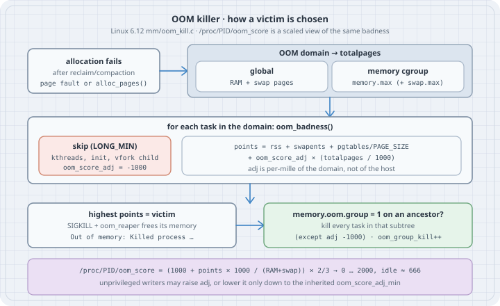

## Overview

**Thesis:** when a Linux host or a memory cgroup runs out of memory and reclaim cannot help, the kernel kills one process, and it picks the one with the highest **badness**. Badness is not a mystery heuristic. It is **resident memory + swap + page tables**, plus a per-process bias called **`oom_score_adj`**, measured in thousandths of the memory the OOM domain has. `choom` (util-linux) reads and sets that bias; `/proc/PID/oom_score` shows the result. If you know the formula, you can predict which process dies, steer the choice away from the database and toward the batch job, and read an `OOMKilled` without guessing.

Typical operator jobs:

- Explain why a particular process was killed (it was the biggest in its domain, or someone gave it a large `oom_score_adj`).
- Start a disposable job so it dies first: `choom -n 500 -- ./batch`.
- Protect a critical daemon, with the right tool (a unit setting or a privileged write, not a shell trick).
- Decide whether a container should lose one process or all of them (`memory.oom.group`).

```bash
# Debian/Ubuntu/Fedora: part of util-linux, installed by default
choom --version
uname -r
```

```text
choom from util-linux 2.41.5
6.12.94+
```

All output below comes from a Debian 13 host with 16 GiB of RAM, **no swap**, kernel 6.12, as an unprivileged user (`uid=1000`, no capabilities). The kernel code quoted is `mm/oom_kill.c` and `fs/proc/base.c` from Linux 6.12. Nothing in this chapter triggers a real OOM kill: on a shared machine that would kill someone else's work. The kill path is described from the kernel source.

{fig-alt="Flow diagram. An allocation fails after reclaim. The OOM domain is either global, where totalpages is RAM plus swap, or one memory cgroup, where totalpages is memory.max plus swap. For each task the kernel skips kernel threads, init, vfork children and tasks with oom_score_adj -1000, and computes points as rss plus swap entries plus page-table pages plus oom_score_adj times totalpages over 1000. The task with the highest points is killed. If an ancestor cgroup has memory.oom.group set to 1, every task in that subtree is killed too, except tasks at -1000. A footer gives the /proc/PID/oom_score formula: 1000 plus points times 1000 over RAM plus swap, times two thirds, so an idle process reads about 666."}

## Mental model

```text
  allocation fails, reclaim and compaction did not help
           │
           ▼
  OOM domain ──► global:        totalpages = RAM pages + swap pages
             └─► memory cgroup: totalpages = memory.max (+ swap.max) in pages
           │
           ▼  for every task in the domain   (oom_badness, mm/oom_kill.c)
     skip  kernel threads, global init, a vfork child, oom_score_adj == -1000
     points = rss + swap entries + page-table pages
            + oom_score_adj × (totalpages / 1000)
           │
           ▼
  highest points wins ─► SIGKILL, oom_reaper frees its anonymous memory
           │
           └─► an ancestor cgroup (up to the OOM domain) has memory.oom.group = 1?
                 → kill every task in that cgroup subtree too (except -1000)
```

Three facts carry the whole topic:

1. **The base score is size.** Only memory the kernel can take back counts: RSS (anon + file + shmem), swap entries, and page-table pages. CPU time, age, nice value, and root-ness are not in the formula (they were, long ago; the heuristic was replaced in Linux 2.6.36).
2. **`oom_score_adj` is per-mille of the OOM domain.** `+100` means "pretend I use 10 % more of *this domain's* memory." On a 16 GiB host that is about 1.6 GiB. Inside a 512 MiB container it is 51 MiB.
3. **`/proc/PID/oom_score` is a display scale, not the raw number.** `fs/proc/base.c` maps badness into 0–2000 with `(1000 + points × 1000 / totalpages) × 2 / 3`. A tiny process reads **666**, not 0. `-1000` reads **0** and means "never chosen."

Values of `oom_score_adj` and what they mean:

| `oom_score_adj` | Effect |
|---|---|
| `-1000` | `OOM_SCORE_ADJ_MIN`: the task is never chosen and is spared by `memory.oom.group` kills |
| `-999` … `-1` | Subtract up to 99.9 % of the domain from the score: strong protection, still killable |
| `0` | Default. Pure size. |
| `1` … `999` | Add a handicap: chosen earlier than a bigger neighbour |
| `1000` | `OOM_SCORE_ADJ_MAX`: chosen first in practice, whatever its size |

The value lives in the process's `signal_struct`, so every thread of a process shares one value. It is copied to children on `fork()` and survives `execve()`. That is why `choom -n 300 -- cmd` works: `choom` sets its own value, then execs `cmd`.

## Syntax

```bash
choom -p PID                    # show score and adjust value
choom -n ADJ -p PID             # set oom_score_adj of a running process
choom -n ADJ [--] COMMAND ARGS  # run COMMAND with oom_score_adj = ADJ
```

| Interface | Meaning |
|---|---|
| `/proc/PID/oom_score` | Read-only, 0–2000 display of current badness. Recomputed on every read. |
| `/proc/PID/oom_score_adj` | Read/write, `-1000` … `1000`. Out-of-range writes fail with `EINVAL`. |
| `/proc/PID/oom_adj` | Legacy, `-17` … `15`, a scaled view of the same value (`-17` = disable). The kernel logs a deprecation warning on write. Do not use it. |
| `memory.oom.group` (cgroup v2) | `1` = kill the cgroup's whole subtree together when one of its tasks is the victim. |
| `memory.events` (cgroup v2) | Counters: `oom` (limit hit), `oom_kill` (processes killed), `oom_group_kill` (group kills). |
| `vm.panic_on_oom`, `vm.oom_kill_allocating_task`, `vm.oom_dump_tasks` | Global policy: panic instead of kill, kill the allocator instead of scanning, print the task table. |

Who may write `oom_score_adj` (`__set_oom_adj()` in `fs/proc/base.c`):

- Anyone allowed to write the `/proc` file (the process owner, or root) may **raise** it.
- Lowering is allowed only down to the task's **`oom_score_adj_min`**. Going lower needs `CAP_SYS_RESOURCE` and fails with `EACCES` otherwise.
- `oom_score_adj_min` is set whenever a writer **with** `CAP_SYS_RESOURCE` sets the value, and it is **inherited** on `fork()`. It is not visible in `/proc`.

## Safety

- Do not "test" the OOM killer on a shared host. `stress-ng --vm` or an allocation loop with no limit kills whatever is biggest, which is rarely your test. Use a memory cgroup with a limit (`systemd-run --user -p MemoryMax=…` on a host with a user manager), a VM, or a disposable container.
- `-1000` on a process that leaks memory moves the kill to its neighbours, and in the worst case leaves a host with nothing killable: `Out of memory and no killable processes...` followed by `panic("System is deadlocked on memory")`.
- Setting `oom_score_adj` on a running process affects only that process (and other processes sharing its address space through `CLONE_VM`, which the kernel keeps in sync). Children started later inherit it. Children started earlier do not change.
- Container runtimes and the kubelet rewrite `oom_score_adj` for container processes. A manual change inside a container can be overwritten on restart.

## Examples with Explanations

### 1. Read the three numbers for one process

```sh
#!/bin/sh
# oom_inspect.sh — the three OOM files for one process (default: this shell)
pid=${1:-$$}
printf 'pid            %s (%s)\n' "$pid" "$(cat /proc/$pid/comm)"
printf 'oom_score      %s\n' "$(cat /proc/$pid/oom_score)"
printf 'oom_score_adj  %s\n' "$(cat /proc/$pid/oom_score_adj)"
printf 'oom_adj        %s   (legacy, -17..15)\n' "$(cat /proc/$pid/oom_adj)"
grep -E '^(VmRSS|RssAnon|RssFile|RssShmem|VmSwap|VmPTE):' /proc/$pid/status
```

```bash
chmod +x oom_inspect.sh && ./oom_inspect.sh
```

```text
pid            32554 (oom_inspect.sh)
oom_score      666
oom_score_adj  0
oom_adj        0   (legacy, -17..15)
VmRSS:	    1884 kB
RssAnon:	     120 kB
RssFile:	    1764 kB
RssShmem:	       0 kB
VmPTE:	      48 kB
VmSwap:	       0 kB
```

A 2 MiB shell reads **666**. That is the scale's zero point: `(1000 + 0) × 2 / 3`. The memory lines are what the kernel adds up: `VmRSS` (the sum of the three `Rss*` lines), `VmSwap`, and `VmPTE` (page tables).

### 2. Watch the score follow resident memory, and check the formula

```python
# oom_grow.py — watch /proc/self/oom_score follow RSS, and check the kernel formula
import mmap, os

PAGE = os.sysconf("SC_PAGE_SIZE")

def meminfo_kb(key):
    with open("/proc/meminfo") as f:
        for line in f:
            if line.startswith(key + ":"):
                return int(line.split()[1])

# proc_oom_score(): totalpages = totalram_pages() + total_swap_pages
totalpages = (meminfo_kb("MemTotal") + meminfo_kb("SwapTotal")) * 1024 // PAGE

def status_kb(key):
    with open("/proc/self/status") as f:
        for line in f:
            if line.startswith(key + ":"):
                return int(line.split()[1])

def predicted(adj):
    if adj == -1000:
        return 0                                  # OOM_SCORE_ADJ_MIN: never a candidate
    # oom_badness(): rss + swapents + page-table pages, plus adj * (totalpages/1000)
    pts = (status_kb("VmRSS") + status_kb("VmSwap") + status_kb("VmPTE")) * 1024 // PAGE
    badness = pts + adj * (totalpages // 1000)
    # proc_oom_score(): scale into 0..2000 with C integer division
    q = abs(badness * 1000) // totalpages          # C '/' truncates toward zero
    return (1000 + (q if badness >= 0 else -q)) * 2 // 3

def show(label):
    adj = int(open("/proc/self/oom_score_adj").read())
    score = int(open("/proc/self/oom_score").read())
    print(f"{label:<16} VmRSS={status_kb('VmRSS')//1024:>5} MiB  adj={adj:>5}  "
          f"oom_score={score:>4}  predicted={predicted(adj):>4}")

print(f"totalpages={totalpages} ({totalpages*PAGE>>20} MiB RAM+swap)")
show("start")
chunks = []
for gib in (1, 2, 3):
    m = mmap.mmap(-1, 1 << 30)            # anonymous, private
    for off in range(0, 1 << 30, PAGE):   # touch every page so it counts in RSS
        m[off] = 1
    chunks.append(m)
    show(f"+{gib} GiB touched")
for adj in (500, 1000, -500, -1000):
    with open("/proc/self/oom_score_adj", "w") as f:
        f.write(str(adj))
    show(f"adj -> {adj}")
```

```bash
python3 oom_grow.py
```

```text
totalpages=4096592 (16002 MiB RAM+swap)
start            VmRSS=    9 MiB  adj=    0  oom_score= 666  predicted= 666
+1 GiB touched   VmRSS= 1033 MiB  adj=    0  oom_score= 709  predicted= 709
+2 GiB touched   VmRSS= 2057 MiB  adj=    0  oom_score= 752  predicted= 752
+3 GiB touched   VmRSS= 3081 MiB  adj=    0  oom_score= 794  predicted= 794
adj -> 500       VmRSS= 3081 MiB  adj=  500  oom_score=1128  predicted=1128
adj -> 1000      VmRSS= 3081 MiB  adj= 1000  oom_score=1461  predicted=1461
adj -> -500      VmRSS= 3081 MiB  adj= -500  oom_score= 462  predicted= 462
adj -> -1000     VmRSS= 3081 MiB  adj=-1000  oom_score=   0  predicted=   0
```

Read it as arithmetic, not as magic:

- Each touched GiB is 6.4 % of 16 GiB, so it adds `64 × 2/3 ≈ 43` display points (666 → 709 → 752 → 794). An `mmap` that was never touched would add nothing: virtual size is not in the formula.
- `+500` adds `500 × 2/3 ≈ 333`, the same as owning half the machine. A 3 GiB process with `+500` now outranks a 9 GiB process with `0`.
- `-500` subtracts the same amount. The process is still a candidate. Only `-1000` takes it out (`0`).
- The prediction matches the kernel exactly once you use C integer division (truncate toward zero). With floats the first line reads 667.

The `-500` and `-1000` writes succeeded here without privileges. Example 3 explains why, and why that is not true everywhere.

### 3. What an unprivileged user may change

```sh
#!/bin/sh
# oom_adj_perms.sh — what this (unprivileged) user may do with oom_score_adj
set -u
echo "== who am I"
id -u; grep CapEff /proc/self/status
echo "== choom starts a child with an adjusted score (inherited across fork+exec)"
choom -n 300 -- sh -c 'echo "child adj=$(cat /proc/self/oom_score_adj) score=$(cat /proc/self/oom_score) oom_adj=$(cat /proc/self/oom_adj)"'

echo "== raise, then lower back to 0"
sh -c '
  echo 800 > /proc/self/oom_score_adj && echo "raised:  $(cat /proc/self/oom_score_adj)"
  echo 0   > /proc/self/oom_score_adj && echo "lowered: $(cat /proc/self/oom_score_adj)"
'

echo "== go below 0 without CAP_SYS_RESOURCE"
choom -n -500 -- sh -c 'echo "child adj=$(cat /proc/self/oom_score_adj) score=$(cat /proc/self/oom_score)"'
echo "choom exit=$?"
echo "== why: the floor (oom_score_adj_min) is inherited from an ancestor"
choom -p 1
cat /proc/1/comm

echo "== out of range"
python3 -c '
import os
fd = os.open("/proc/self/oom_score_adj", os.O_WRONLY)
try:
    os.write(fd, b"1001")
except OSError as e:
    print("write 1001:", e.errno, e.strerror)
'
```

```bash
chmod +x oom_adj_perms.sh && ./oom_adj_perms.sh
```

```text
== who am I
1000
CapEff:	0000000000000000
== choom starts a child with an adjusted score (inherited across fork+exec)
child adj=300 score=866 oom_adj=5
== raise, then lower back to 0
raised:  800
lowered: 0
== go below 0 without CAP_SYS_RESOURCE
child adj=-500 score=334
choom exit=0
== why: the floor (oom_score_adj_min) is inherited from an ancestor
pid 1's current OOM score: 0
pid 1's current OOM score adjust value: -1000
tini
== out of range
write 1001: 22 Invalid argument
```

The surprise is the `-500` line. An unprivileged user with no capabilities protected a process. The kernel did not skip a check. This machine is a container whose init (`tini`, PID 1) was set to `-1000` by a privileged runtime. That write also set **`oom_score_adj_min = -1000`**, and `copy_signal()` / `copy_oom_score_adj()` in `kernel/fork.c` copy both the value and the floor to every descendant. Later processes raised their own value back to 0, but the floor stayed at `-1000`, so any of them may lower it again.

On a normal host, where systemd starts your session with `oom_score_adj_min = 0`, the same `choom -n -500` fails:

```text
choom: failed to set score adjust value: Permission denied
```

(That line is the `EACCES` path in `__set_oom_adj()`. It was **not** reproduced on this host: no process here has a floor of 0, and setting one needs `CAP_SYS_RESOURCE`.)

`oom_adj=5` for `adj=300` is the legacy scale: `300 × 17 / 1000 = 5` (truncated). `-1000` maps to `-17` (`OOM_DISABLE`) and anything that would exceed 15 is clamped to 15.

### 4. Rank the candidates before the kernel has to

```sh
#!/bin/sh
# oom_rank.sh — who would the global OOM killer pick first? (highest oom_score)
printf '%7s %6s %5s %9s  %s\n' PID SCORE ADJ RSS_MiB COMM
for d in /proc/[0-9]*; do
  pid=${d#/proc/}
  s=$(cat "$d/oom_score" 2>/dev/null) || continue
  a=$(cat "$d/oom_score_adj" 2>/dev/null) || continue
  r=$(awk '/^VmRSS:/ {print int($2/1024)}' "$d/status" 2>/dev/null)
  c=$(cat "$d/comm" 2>/dev/null)
  printf '%7s %6s %5s %9s  %s\n' "$pid" "$s" "$a" "${r:-0}" "$c"
done | sort -k2,2nr | head -n "${1:-8}"
```

```bash
chmod +x oom_rank.sh && ./oom_rank.sh 8
./oom_rank.sh 400 | awk '$2==0' | head -5
```

```text
    PID  SCORE   ADJ   RSS_MiB  COMM
  24938    671     0       125  node
    237    670     0        84  node
  11824    669     0        67  Xvfb
  14393    669     0        68  node
  17838    669     0        77  node
  25026    669     0        76  xfwm4
  25400    669     0        76  plank
    221    668     0        34  node
```

```text
      1      0 -1000         0  tini
      7      0 -1000         8  pod-daemon
    305      0 -1000         4  bash
    350      0 -1000         3  bash
    356      0 -1000        82  node
```

The first table is the kill order for a global OOM right now: the largest resident process (`node`, 125 MiB) is first. The scores are close because every process here is small against 16 GiB; a single 1 GiB process would jump to about 709. The second table shows processes that will never be picked. An 82 MiB `node` sits at 0 because it inherited `-1000` from its parents. That is the usual way production hosts end up with a large unkillable process nobody chose to protect.

### 5. The same `oom_score_adj` means different things in different domains

```python
# oom_adj_weight.py — oom_score_adj is per-mille of the OOM *domain*, not of the host
MiB = 256  # 4 KiB pages per MiB

def badness(rss_mib, adj, total_mib):
    totalpages = total_mib * MiB
    return rss_mib * MiB + adj * (totalpages // 1000)   # oom_badness()

for name, total in (("host, 16 GiB RAM+swap", 16384), ("container, memory.max=512M", 512)):
    print(f"{name}: 1 adj point = {total*MiB//1000} pages = {total*MiB//1000/MiB:.2f} MiB")
    a = badness(300, 0, total)    # big, untouched process
    b = badness(100, 300, total)  # small helper marked "kill me first"
    pick = "A (300 MiB, adj 0)" if a > b else "B (100 MiB, adj 300)"
    print(f"  A={a:>8} pages  B={b:>8} pages  -> victim {pick}")
```

```bash
python3 oom_adj_weight.py
```

```text
host, 16 GiB RAM+swap: 1 adj point = 4194 pages = 16.38 MiB
  A=   76800 pages  B= 1283800 pages  -> victim B (100 MiB, adj 300)
container, memory.max=512M: 1 adj point = 131 pages = 0.51 MiB
  A=   76800 pages  B=   64900 pages  -> victim A (300 MiB, adj 0)
```

For a cgroup OOM, `oom_kill.c` sets `totalpages = mem_cgroup_get_max(memcg)`, the cgroup's limit (plus swap allowance), not the host's RAM. The helper's `+300` is worth about 4.8 GiB on the host but only 154 MiB inside a 512 MiB limit. Same processes, same adjust values, different victim. `/proc/PID/oom_score` always uses the **host** total, so it cannot tell you the ranking inside a container's own OOM.

### 6. Read the cgroup's OOM counters and group setting

```bash
cat /proc/self/cgroup
cat /sys/fs/cgroup/agent/memory.max /sys/fs/cgroup/agent/memory.oom.group
cat /sys/fs/cgroup/agent/memory.events
```

```text
0::/agent
max
0
low 0
high 0
max 0
oom 0
oom_kill 0
oom_group_kill 0
```

`memory.events` is where a cgroup OOM leaves evidence even after the logs rotate. `oom` counts how often the limit was hit with an allocation about to fail. `oom_kill` counts processes killed. `oom_group_kill` counts kills of the whole group. They are hierarchical: a kill in a child cgroup shows up in its parents too (`memory.events.local` has the cgroup's own numbers). Here the cgroup has no limit and nothing was killed. The files are owned by root, so `memory.oom.group` could not be changed in this run.

When `memory.oom.group` is `1`, `mem_cgroup_get_oom_group()` walks from the victim's cgroup up to the OOM domain and picks the **highest** cgroup that has it set. Every task in that subtree is killed, except tasks at `-1000` and init. The kernel log then contains:

```text
Tasks in /system.slice/app.service are going to be killed due to memory.oom.group set
```

(Format from `mem_cgroup_print_oom_group()`; not produced on this host.)

### 7. Make the policy stick: systemd units and Kubernetes (not run here)

This host has no systemd (PID 1 is `tini`), so these are written from the `systemd.exec(5)`, `systemd.service(5)`, and Kubernetes documentation:

```ini
# /etc/systemd/system/batch-report.service.d/oom.conf
[Service]
OOMScoreAdjust=500     # this unit's processes are preferred victims
OOMPolicy=kill         # one OOM kill => systemd sets memory.oom.group=1, whole unit dies
```

```ini
# /etc/systemd/system/postgresql.service.d/oom.conf
[Service]
OOMScoreAdjust=-900    # strong protection, still killable as a last resort
```

`OOMScoreAdjust=` takes `-1000` … `1000` and is applied by the service manager, which has the capability to set a negative value (and therefore a negative floor for the unit's children). `OOMPolicy=` is `continue`, `stop`, or `kill`. `kill` sets `memory.oom.group=1` on the unit's cgroup; `stop` lets systemd stop the remaining processes cleanly. `stop` and `kill` both leave the unit in the `oom-kill` failed state, where `Restart=` can apply.

The kubelet sets `oom_score_adj` from the pod's QoS class:

| QoS class | `oom_score_adj` |
|---|---|
| Guaranteed (and `system-node-critical` pods) | `-997` |
| BestEffort | `1000` |
| Burstable | `min(max(2, 1000 − 1000 × memoryRequest / nodeMemoryCapacity), 999)` |

On cgroup v2 nodes the kubelet also sets `memory.oom.group=1` on each **container** cgroup unless `singleProcessOOMKill: true` is set. So a multi-process container loses all its processes on one OOM kill, which the pod sees as `OOMKilled` and restarts per `restartPolicy`. Inside the container, the limit is the domain (Example 5), so the biggest process *in that container* is the victim, not the biggest on the node.

## The trap

**Trap: "only root can lower `oom_score_adj`."** The check is against an inherited, invisible floor (`oom_score_adj_min`), not against your uid. Example 3 lowered a process to `-500` with `CapEff: 0` because PID 1 had been set to `-1000` by a privileged writer. If a container runtime or a supervisor gives its init `-1000`, every process in that tree can protect itself. Look at the ancestors (`choom -p 1`, the supervisor PID) before you trust that "nobody can opt out."

**Trap: "`oom_score` 666 means the process is a big target."** 666 is the bottom of the scale for a tiny process with `adj 0`. The range is 0–2000: 0 is "never," 666 is "uses nothing," 1333 is "uses everything" (or `+1000` with nothing). Compare scores with each other, not with an absolute threshold.

**Trap: "the score in `/proc` is what the cgroup OOM uses."** `/proc/PID/oom_score` is scaled by host RAM + swap. A memcg OOM scales `oom_score_adj` by the cgroup's limit. Example 5 shows the same pair of processes giving different victims.

**Trap: "set the database to `-1000` and the problem is solved."** If the database is the process growing without bound, `-1000` moves the kill to everything else, including `sshd` and the agent you would use to fix it. Prefer a strong negative value (`-900`) and a memory limit on the noisy neighbours.

**Trap: "`VmSize` / virtual memory decides it."** The formula uses resident pages, swap entries, and page tables. A process that reserved 64 GiB and touched 100 MiB scores as 100 MiB.

## Notes & Pitfalls

- `vm.panic_on_oom=1` panics instead of killing (`2` panics even for cgroup-constrained OOMs). `vm.oom_kill_allocating_task=1` kills the task that triggered the OOM instead of scanning, which is cheaper on huge process tables but chooses badly. Both are `0` here; `vm.oom_dump_tasks=1` prints the task table (`[ pid ] uid tgid total_vm rss … oom_score_adj name`) before the kill.
- The victim line in the kernel log is `Out of memory: Killed process PID (comm) total-vm:…kB, anon-rss:…kB, file-rss:…kB, shmem-rss:…kB, UID:… pgtables:…kB oom_score_adj:…`. For a cgroup OOM the prefix is `Memory cgroup out of memory`. `journalctl -k -g 'Killed process'` or `dmesg -T | grep -i 'killed process'` find it.
- The kernel OOM killer acts only when allocation would otherwise fail. Long stalls under memory pressure come first. `systemd-oomd` acts earlier, on pressure (PSI) or swap use, and kills whole cgroups; the kubelet evicts whole pods at its eviction thresholds. Neither uses `oom_score_adj` to make that choice.
- `/proc/PID/oom_adj` writes log `oom_adj is deprecated, please use /proc/PID/oom_score_adj instead.` once per boot.

## The boring rule

Size decides; `oom_score_adj` only tilts, and it tilts in per-mille of the domain that ran out. Set the tilt where the process is started (a unit's `OOMScoreAdjust=`, the kubelet's QoS, `choom -n` for ad-hoc jobs). Give disposable work a positive value, give critical services a strong negative value instead of `-1000`, and put a memory limit on anything that can grow.

## Related Commands

- `ulimit` / `prlimit` — per-process limits; `RLIMIT_AS` makes `malloc` fail, which is a different failure from an OOM kill.
- `nice` / `renice` — CPU priority. It does not affect OOM choice.
- `ps -o pid,rss,comm` / `top` — RSS, the main input to the score.
- `free`, `/proc/meminfo` — `MemTotal` + `SwapTotal` is the global domain size.
- `systemd-run --user -p MemoryMax=… --scope cmd` — run a command in a limited cgroup, the safe way to watch a real OOM kill.

## Try this

1. Run `oom_grow.py` with 1, 2, 3 GiB on your machine and predict each `oom_score` before it prints. Then add swap (or test on a host that has it) and see the numbers fall: `totalpages` grows, the same RSS is a smaller share.
2. Start two copies of a 1 GiB allocator, one under `choom -n 100`. Which `oom_score` is higher, and by how much? Check against `100 × 2/3`.
3. On a host with a user systemd manager: `systemd-run --user -p MemoryMax=200M -p MemorySwapMax=0 --wait python3 -c 'b = bytearray(400 << 20)'`. Read the unit cgroup's `memory.events` and `journalctl -k -g 'Memory cgroup out of memory'`.
4. In a test cgroup, start `sh -c 'sleep 600 & python3 alloc.py'`, set `memory.oom.group` to `0` and then `1`, and see whether `sleep` survives the kill.
5. Run `./oom_rank.sh 400 | awk '$3 < 0'` on a production host. For every negative value, find who set it (unit file, kubelet, runtime) and whether it was intended.

## Verification

- Run unprivileged on this box: Debian 13 (trixie), Linux **6.12.94+**, 16 GiB RAM, no swap, util-linux **choom 2.41.5**, Python **3.13.5**, `uid=1000`, `CapEff` 0, cgroup v2 (`0::/agent`). All output above is pasted from those runs.
- `oom_grow.py` touched up to 3 GiB of anonymous memory (about 19 % of RAM, well inside `MemAvailable`) and compared `/proc/self/oom_score` with `oom_badness()` + `proc_oom_score()` from Linux 6.12: all eight lines match exactly.
- **Not run:** a real OOM kill (shared host), writes to `memory.oom.group` / `memory.max` (cgroup files are root-owned), the `EACCES` path for lowering below the floor (no process here has a floor of 0), systemd `OOMScoreAdjust=` / `OOMPolicy=` (no systemd on this host), and the kubelet. These are written from the kernel source and the documentation listed below.
- No packages installed, no root, no `sudo`.

## Sources

- Linux 6.12 `mm/oom_kill.c` — `oom_badness()`, `constrained_alloc()` (`totalpages` for global vs memcg), `oom_kill_process()`, `__oom_kill_process()` log line: <https://git.kernel.org/pub/scm/linux/kernel/git/stable/linux.git/tree/mm/oom_kill.c?h=linux-6.12.y>
- Linux 6.12 `fs/proc/base.c` — `proc_oom_score()` (0–2000 scaling), `__set_oom_adj()` (`EACCES`, `oom_score_adj_min`), legacy `oom_adj` mapping: <https://git.kernel.org/pub/scm/linux/kernel/git/stable/linux.git/tree/fs/proc/base.c?h=linux-6.12.y>
- Linux 6.12 `kernel/fork.c` — `copy_signal()` / `copy_oom_score_adj()` (value and floor inherited)
- Linux 6.12 `mm/memcontrol.c` — `mem_cgroup_get_oom_group()`, `mem_cgroup_print_oom_group()`
- Kernel docs — [Control Group v2: `memory.oom.group`, `memory.events`](https://docs.kernel.org/admin-guide/cgroup-v2.html)
- Kernel docs — [The /proc filesystem: `oom_adj` & `oom_score_adj`, `oom_score`](https://docs.kernel.org/filesystems/proc.html)
- Kernel docs — [`/proc/sys/vm`: `panic_on_oom`, `oom_kill_allocating_task`, `oom_dump_tasks`](https://docs.kernel.org/admin-guide/sysctl/vm.html)
- man7 — [`proc_pid_oom_score_adj(5)`](https://man7.org/linux/man-pages/man5/proc_pid_oom_score_adj.5.html), [`proc_pid_oom_score(5)`](https://man7.org/linux/man-pages/man5/proc_pid_oom_score.5.html), [`choom(1)`](https://man7.org/linux/man-pages/man1/choom.1.html)
- systemd — [`systemd.exec(5)` `OOMScoreAdjust=`](https://www.freedesktop.org/software/systemd/man/latest/systemd.exec.html), [`systemd.service(5)` `OOMPolicy=`](https://www.freedesktop.org/software/systemd/man/latest/systemd.service.html)
- Kubernetes — [Node-pressure eviction: node out of memory behavior](https://kubernetes.io/docs/concepts/scheduling-eviction/node-pressure-eviction/), [KubeletConfiguration `singleProcessOOMKill`](https://kubernetes.io/docs/reference/config-api/kubelet-config.v1beta1/)
