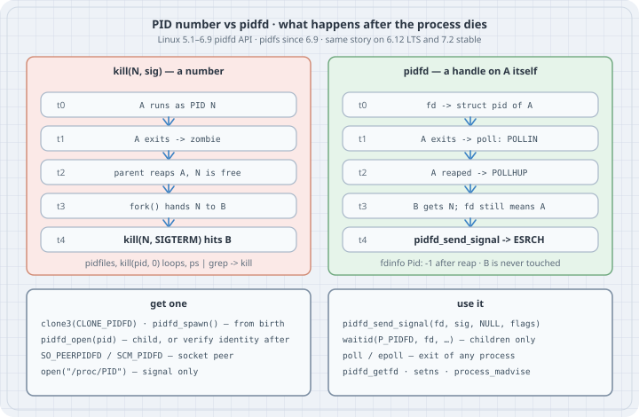

## Overview

**Thesis:** a PID is a number, and the kernel recycles numbers. Between "I saved PID 4242" and "`kill(4242, SIGTERM)`" the process can exit, be reaped, and its number can be handed to a stranger, so the signal lands on the wrong process. A **pidfd** is a file descriptor that refers to *one specific process*. It cannot be retargeted: once that process has gone, every operation on the descriptor fails with `ESRCH` instead of touching whoever now owns the number. With a pidfd you can signal a process, wait for it, poll for its exit (even when it is not your child), copy a descriptor out of it, and learn which process is on the other end of a Unix socket. None of this needs root.

Typical operator and programmer jobs:

- A supervisor or job runner that kills jobs past a deadline without ever hitting a recycled PID.
- Waiting for a process that is **not** your child (a daemon from a pidfile, a peer) without a `kill(pid, 0)` polling loop.
- Turning a PID from a pidfile or `ps` into a handle you can trust, by checking identity *after* opening.
- Recognising pidfd-based code in systemd, D-Bus, polkit, container runtimes and language runtimes, and reading it in `/proc/PID/fdinfo`.

```bash
uname -r
python3 --version
ldd --version | head -1
gcc --version | head -1
```

```text
6.12.94+
Python 3.13.5
ldd (Debian GLIBC 2.41-12+deb13u4) 2.41
gcc (Debian 14.2.0-19) 14.2.0
```

All output below comes from a Debian 13 host, kernel 6.12 (an LTS series), as an unprivileged user (`uid=1000`, `CapEff: 0`), in a container whose PID 1 is a root-owned `tini`. Every listing ran there as shown. Kernel features newer than 6.12 are marked as such and were not run.

{fig-alt="Two columns. Left, kill with a number: at t0 process A runs as PID N; at t1 A exits and becomes a zombie; at t2 its parent reaps it and N is free; at t3 fork hands N to process B; at t4 kill(N, SIGTERM) hits B. Right, a pidfd: at t0 the fd refers to A's struct pid; at t1 A exits and poll reports POLLIN; at t2 A is reaped and poll reports POLLHUP; at t3 B gets number N but the fd still means A; at t4 pidfd_send_signal fails with ESRCH. Below, ways to get a pidfd: clone3 with CLONE_PIDFD or pidfd_spawn from birth, pidfd_open for a child or with an identity check, SO_PEERPIDFD or SCM_PIDFD for a socket peer, open of /proc/PID for signalling only. Ways to use one: pidfd_send_signal, waitid with P_PIDFD for children, poll or epoll for the exit of any process, pidfd_getfd, setns and process_madvise."}

## Mental model

```text
  PID number                          pidfd
  ──────────                          ─────
  an int in a table of pid_max        an fd → the kernel's struct pid for ONE process
  freed when the zombie is reaped     holds a reference: the struct pid outlives the
  then reissued to the next fork()    process, but never moves to another process
          │                                   │
  kill(N, sig)  ─► whoever is N now   pidfd_send_signal(fd) ─► that process, or ESRCH
  waitpid(N)    ─► children only      waitid(P_PIDFD, fd)   ─► children only
  kill(N, 0) loop ─► "is N alive?"    poll/epoll(fd)        ─► POLLIN on exit (any process)
                                                            ─► POLLHUP once it is reaped
```

Four facts carry the whole topic:

1. **The race is between "reaped" and "reused".** A PID cannot be reused while it is a zombie. It is freed when the parent (or a subreaper, or init) calls `wait*()`. After that the next `fork()` that reaches that number gets it. Your own unreaped child is therefore safe to `pidfd_open()`; a PID you read from a file or from `ps` is not, until you check.
2. **A pidfd pins the identity, not the process.** It does not keep the process alive or stop the reap. It keeps the kernel's `struct pid` alive, so the descriptor can always answer "is *that* process still around?" honestly.
3. **Exit is an fd event.** The descriptor becomes readable when the process exits (for a process, when its *last* thread exits) and reports hang-up once it has been reaped. That puts process exits into the same `poll`/`epoll`/`io_uring` loop as sockets and timers.
4. **Opening is free, acting is checked.** Anyone may open a pidfd for any visible process. Signalling it needs the same permission as `kill(2)`; `pidfd_getfd(2)` needs ptrace-attach permission.

## Syntax

The calls, the kernel that introduced them, and the libc wrappers (glibc 2.36 added `pidfd_open`, `pidfd_send_signal`, `pidfd_getfd`; 2.39 added `pidfd_spawn`, `pidfd_spawnp` and `pidfd_getpid`; Python has `os.pidfd_open`, `signal.pidfd_send_signal` and `os.waitid(os.P_PIDFD, …)` since 3.9):

| Call | Since | What it does |
|---|---|---|
| `pidfd_send_signal(pidfd, sig, info, flags)` | 5.1 | Signal the process the fd refers to. `ESRCH` once it has been reaped. |
| `clone(CLONE_PIDFD)` / `clone3(.flags = CLONE_PIDFD)` | 5.2 / 5.3 | Create a child and get its pidfd atomically, before anyone can reap it. |
| `pidfd_open(pid, flags)` | 5.3 | Open a pidfd for an existing PID. Close-on-exec is always set. |
| `waitid(P_PIDFD, pidfd, &info, options)` | 5.4 | Wait for / reap a **child** through its pidfd. `ECHILD` for non-children. |
| `pidfd_getfd(pidfd, targetfd, 0)` | 5.6 | Duplicate another process's fd into yours (needs `PTRACE_MODE_ATTACH_REALCREDS`). |
| `SO_PEERPIDFD` / `SCM_PIDFD` | 6.5 | Get the pidfd of a Unix-socket peer / of a message's sender. |
| `PIDFD_NONBLOCK` (open flag) | 5.10 | `waitid()` returns `EAGAIN` instead of blocking. |
| pidfs, `PIDFD_THREAD`, `PIDFD_SIGNAL_{THREAD,THREAD_GROUP,PROCESS_GROUP}` | 6.9 | pidfds get their own filesystem and inode numbers; thread pidfds; signal scope flags. |
| `ioctl(pidfd, PIDFD_GET_INFO, &info)` | 6.13 | pid/tgid/ppid, credentials, cgroup id without `/proc` (not on this 6.12 box). |
| `PIDFD_INFO_EXIT` | 6.15 | Exit status after the process has been reaped (not on this 6.12 box). |

Things that are also pidfds, or close: a descriptor from `open("/proc/PID", O_DIRECTORY)` works with `pidfd_send_signal()` but cannot be polled or waited on. A pidfd also works as the target of `setns(2)` (join that process's namespaces) and `process_madvise(2)`.

What you see from outside:

| Interface | Shows |
|---|---|
| `readlink /proc/PID/fd/N` | `anon_inode:[pidfd]` (kept for compatibility, even on pidfs) |
| `/proc/PID/fdinfo/N` | `Pid:` the process's PID in your namespace, `-1` after it was reaped; `NSpid:` the PID in each nested namespace |
| `fstat()` on 6.9+ | `st_ino` identifies the process (pidfs); two pidfds for the same process have the same inode |

## Safety

- Every example signals only its own children. Example 5 aims at PID 1 with **signal 0** only, which checks permission and delivers nothing. Do not "test" with a real signal on someone else's process.
- A pidfd held open keeps a small kernel object (`struct pid`) alive, not the process. Close them: a supervisor that leaks one per job leaks file descriptors until `EMFILE`.
- `pidfd_getfd()` gives you a *duplicate*: the file offset and status flags are shared with the target. Reading from it moves the target's offset too.
- Some programs set `SIGCHLD` to `SIG_IGN` (or use `SA_NOCLDWAIT`). Their children are reaped automatically, so `pidfd_open(child)` after `fork()` can already race. Use `CLONE_PIDFD` or `pidfd_spawn()` there.

## Examples with Explanations

### 1. One child, one pidfd: inspect, poll, signal, reap, use again

```python
# pidfd_basics.py — one child, one pidfd: inspect, poll, signal, reap, then use it again
import os, select, signal, subprocess

child = subprocess.Popen(["sleep", "60"])
fd = os.pidfd_open(child.pid)                 # a file descriptor that *is* this process

def fdinfo(fd):
    with open(f"/proc/self/fdinfo/{fd}") as f:
        return {k: v.strip() for k, v in (l.split(":", 1) for l in f)}

print("child pid      ", child.pid)
print("pidfd          ", fd, "->", os.readlink(f"/proc/self/fd/{fd}"))
print("fdinfo Pid     ", fdinfo(fd)["Pid"], "| NSpid", fdinfo(fd)["NSpid"])

p = select.poll()
p.register(fd, select.POLLIN)
print("poll (running) ", p.poll(0))           # [] : not readable while alive

signal.pidfd_send_signal(fd, signal.SIGTERM)  # signal the process, not a number
print("poll (exited)  ", p.poll(1000))        # readable once it has exited

info = os.waitid(os.P_PIDFD, fd, os.WEXITED)  # reap through the same handle
print("waitid         ", f"si_pid={info.si_pid} si_code={info.si_code}"
      f" (CLD_KILLED={os.CLD_KILLED}) si_status={info.si_status}"
      f" ({signal.Signals(info.si_status).name})")
print("fdinfo Pid     ", fdinfo(fd)["Pid"], "(after reap)")
ev = p.poll(0)[0][1]
print("poll (reaped)  ", f"revents=0x{ev:x}", "POLLIN|POLLHUP" if ev == select.POLLIN | select.POLLHUP else "")

try:
    signal.pidfd_send_signal(fd, signal.SIGKILL)
except ProcessLookupError as e:
    print("signal again   ", e.__class__.__name__, f"errno={e.errno}")
child.returncode = -15                       # tell Popen we already reaped it
os.close(fd)
```

```bash
python3 pidfd_basics.py
```

```text
child pid       111127
pidfd           5 -> anon_inode:[pidfd]
fdinfo Pid      111127 | NSpid 111127
poll (running)  []
poll (exited)   [(5, 1)]
waitid          si_pid=111127 si_code=2 (CLD_KILLED=2) si_status=15 (SIGTERM)
fdinfo Pid      -1 (after reap)
poll (reaped)   revents=0x11 POLLIN|POLLHUP
signal again    ProcessLookupError errno=3
```

The life of a pidfd in nine lines. While the child runs, `poll` returns nothing. After `SIGTERM` it becomes readable (`POLLIN`, event `1`). `waitid(P_PIDFD)` reaps through the same handle and reports `CLD_KILLED` with `SIGTERM`. After the reap, `fdinfo` shows `Pid: -1`, `poll` reports `POLLIN|POLLHUP` (`0x11`), and a second signal fails with `ESRCH` (errno 3). The PID number is now free for anyone; the descriptor still means the dead process and nothing else.

### 2. A pidfd has its own identity (pidfs, Linux 6.9+)

```python
# pidfs_identity.py — on Linux 6.9+ a pidfd lives on pidfs; its inode number names the process
import ctypes, os, subprocess

class Statfs(ctypes.Structure):
    _fields_ = [("f_type", ctypes.c_long), ("rest", ctypes.c_byte * 112)]
libc = ctypes.CDLL(None, use_errno=True)

a = subprocess.Popen(["sleep", "30"])
fd1 = os.pidfd_open(a.pid)
fd2 = os.pidfd_open(a.pid)          # a second, independent open of the same process
b = subprocess.Popen(["sleep", "30"])
fd3 = os.pidfd_open(b.pid)

sfs = Statfs()
libc.fstatfs(fd1, ctypes.byref(sfs))
print(f"f_type        0x{sfs.f_type & 0xffffffff:08x}  (PID_FS_MAGIC is 0x50494446, 'PIDF')")
for name, fd in (("a, open #1", fd1), ("a, open #2", fd2), ("b", fd3)):
    st = os.fstat(fd)
    print(f"{name:12}  st_dev={st.st_dev} st_ino={st.st_ino}")
for p in (a, b):
    p.kill(); p.wait()
```

```bash
python3 pidfs_identity.py
```

```text
f_type        0x50494446  (PID_FS_MAGIC is 0x50494446, 'PIDF')
a, open #1    st_dev=5 st_ino=114794
a, open #2    st_dev=5 st_ino=114794
b             st_dev=5 st_ino=114795
```

Since Linux 6.9 pidfds live on **pidfs**, a tiny internal filesystem (`PID_FS_MAGIC`). Two separate opens of the same process have the **same inode**; a different process has a different one. On 64-bit kernels pidfs takes inode numbers from a 64-bit counter that is not reset during a boot, so the inode is a stable process identity you can store and compare, which the PID never was. On older kernels the fd is an anonymous inode and all pidfds share one inode, so do not rely on this below 6.9.

### 3. Wait for a process that is not your child

```python
# watch_nonchild.py — wait for a process that is NOT our child, without polling kill(pid, 0)
import os, select, subprocess, sys, time

# A double fork: the shell exits at once, so `sleep` is re-parented away from us.
out = subprocess.run(["sh", "-c", "sleep 2 >/dev/null 2>&1 & echo $!"],
                     capture_output=True, text=True, check=True)
pid = int(out.stdout)
with open(f"/proc/{pid}/stat") as f:
    ppid = int(f.read().rsplit(")", 1)[1].split()[1])
print(f"target pid {pid}, its parent is {ppid}, we are {os.getpid()}")

fd = os.pidfd_open(pid)
try:
    os.waitid(os.P_PIDFD, fd, os.WEXITED | os.WNOHANG)
except ChildProcessError as e:
    print("waitid on a non-child:", e.__class__.__name__, f"errno={e.errno}")

t0 = time.monotonic()
ready = select.select([fd], [], [], 10)[0]   # sleeps in the kernel, no busy loop
print(f"readable after {time.monotonic() - t0:.2f}s: {ready == [fd]}")
os.close(fd)
```

```bash
python3 watch_nonchild.py
```

```text
target pid 111133, its parent is 52, we are 111131
waitid on a non-child: ChildProcessError errno=10
readable after 2.00s: True
```

The shell exits at once, so `sleep` is re-parented to the nearest subreaper (PID 52 in this container, init on a plain host). We cannot reap it, and `waitid(P_PIDFD)` says so with `ECHILD` (errno 10). We can still *watch* it: `select` blocks in the kernel and wakes when the process exits, after exactly its 2 s. Before pidfds the options were a `kill(pid, 0)` polling loop (busy and racy: a reused PID looks "alive") or `ptrace`. Here we opened the pidfd while the process was certainly alive and was certainly the one we started; for a PID from somewhere else, see Example 6.

### 4. Get the pidfd at birth: `clone3(CLONE_PIDFD)` and `pidfd_spawnp()`

```c
// born_with_pidfd.c — get the pidfd at creation time: clone3(CLONE_PIDFD) and pidfd_spawnp()
#define _GNU_SOURCE
#include <errno.h>
#include <linux/sched.h>    // struct clone_args, CLONE_PIDFD
#include <signal.h>
#include <spawn.h>          // pidfd_spawnp (glibc 2.39+)
#include <stdint.h>
#include <stdio.h>
#include <stdlib.h>
#include <string.h>
#include <sys/pidfd.h>      // pidfd_getpid, pidfd_send_signal (glibc 2.36+)
#include <sys/syscall.h>
#include <sys/wait.h>
#include <unistd.h>

extern char **environ;

static void reap(const char *who, int pidfd) {
    siginfo_t si = {0};
    if (waitid(P_PIDFD, pidfd, &si, WEXITED) == -1) { perror("waitid"); exit(1); }
    printf("%-14s reaped pid %d: %s %d\n", who, si.si_pid,
           si.si_code == CLD_EXITED ? "exit" : "signal", si.si_status);
}

int main(void) {
    // 1. clone3: the kernel writes the pidfd into args.pidfd before either side runs on.
    int pidfd = -1;
    struct clone_args args = {
        .flags = CLONE_PIDFD,
        .pidfd = (uint64_t)(uintptr_t)&pidfd,
        .exit_signal = SIGCHLD,
    };
    long pid = syscall(SYS_clone3, &args, sizeof args);
    if (pid == -1) { perror("clone3"); return 1; }
    if (pid == 0) _exit(7);                       // child
    printf("clone3         pid %ld, pidfd %d, pidfd_getpid -> %d\n",
           pid, pidfd, pidfd_getpid(pidfd));
    reap("clone3", pidfd);
    close(pidfd);

    // 2. pidfd_spawnp: posix_spawn that hands back a pidfd instead of a PID.
    char *argv[] = {"sleep", "30", NULL};
    int err = pidfd_spawnp(&pidfd, "sleep", NULL, NULL, argv, environ);
    if (err) { errno = err; perror("pidfd_spawnp"); return 1; }
    printf("pidfd_spawnp   pidfd %d, pidfd_getpid -> %d\n", pidfd, pidfd_getpid(pidfd));
    if (pidfd_send_signal(pidfd, SIGTERM, NULL, 0) == -1) { perror("pidfd_send_signal"); return 1; }
    reap("pidfd_spawnp", pidfd);

    // 3. After the reap the handle is dead, but it can never point at someone else.
    pid_t gone = pidfd_getpid(pidfd);
    printf("pidfd_getpid   after reap -> %d (%s)\n", gone, strerror(errno));
    close(pidfd);
    return 0;
}
```

```bash
gcc -Wall -Wextra -O2 -o born_with_pidfd born_with_pidfd.c && ./born_with_pidfd
```

```text
clone3         pid 113166, pidfd 5, pidfd_getpid -> 113166
clone3         reaped pid 113166: exit 7
pidfd_spawnp   pidfd 5, pidfd_getpid -> 113167
pidfd_spawnp   reaped pid 113167: signal 15
pidfd_getpid   after reap -> -1 (No such process)
```

With `CLONE_PIDFD` the kernel writes the new child's pidfd into `args.pidfd` as part of the same system call that creates the child, so there is no window in which a signal handler or another thread could reap it first. `pidfd_spawnp()` (glibc 2.39) is the same idea with the `posix_spawn` interface: you never even see a PID unless you ask `pidfd_getpid()`. After the reap, `pidfd_getpid()` returns `-1` with `ESRCH`. This is the pattern for libraries and runtimes that do not control the process-wide `SIGCHLD` disposition.

### 5. Opening is free, using it is permission-checked

```python
# pidfd_perms.py — opening a pidfd is not permission to use it: signal 0 and pidfd_getfd
import ctypes, os, signal, subprocess, time

libc = ctypes.CDLL(None, use_errno=True)
def getfd(pidfd, targetfd):                    # glibc 2.36+: pidfd_getfd(2)
    r = libc.pidfd_getfd(pidfd, targetfd, 0)
    if r < 0:
        e = ctypes.get_errno(); raise OSError(e, os.strerror(e))
    return r

# Our own child keeps a file open on fd 3; we copy that fd out of it.
with open("/tmp/pidfd-demo.txt", "w") as f:
    f.write("held open by the child\n")
child = subprocess.Popen(["sh", "-c", "exec 3</tmp/pidfd-demo.txt; exec sleep 30"])
time.sleep(0.2)                                # let the shell open fd 3
fd = os.pidfd_open(child.pid)
mine = getfd(fd, 3)
print("child fd 3 ->", os.readlink(f"/proc/self/fd/{mine}"), "|", os.read(mine, 64).decode().strip())
signal.pidfd_send_signal(fd, 0)                # signal 0: permission check only
print("signal 0 to child: ok")
child.kill(); child.wait()

# PID 1 belongs to root. Anyone may open a pidfd for it (watching is harmless) ...
one = os.pidfd_open(1)
print("pidfd_open(1): ok, fd", one)
for what, call in (("pidfd_send_signal(sig 0)", lambda: signal.pidfd_send_signal(one, 0)),
                   ("pidfd_getfd(fd 0)", lambda: getfd(one, 0))):
    try:
        call(); print(what, "ok")
    except OSError as e:
        print(f"{what}: {e.__class__.__name__} errno={e.errno} ({os.strerror(e.errno)})")
```

```bash
python3 pidfd_perms.py
```

```text
child fd 3 -> /tmp/pidfd-demo.txt | held open by the child
signal 0 to child: ok
pidfd_open(1): ok, fd 7
pidfd_send_signal(sig 0): PermissionError errno=1 (Operation not permitted)
pidfd_getfd(fd 0): PermissionError errno=1 (Operation not permitted)
```

`pidfd_getfd()` copied file descriptor 3 out of our own child: same user, so ptrace-attach permission holds (no Yama LSM on this host; with `kernel.yama.ptrace_scope=1` only a parent/ancestor may do it, and at `2` or `3` you need `CAP_SYS_PTRACE` or nobody can). For PID 1, owned by root, `pidfd_open()` succeeds (watching the exit of PID 1 is harmless) but signal 0 and `pidfd_getfd()` both fail with `EPERM`. The pidfd is a name, not a capability: the checks are the same ones `kill(2)` and `ptrace(2)` make.

### 6. From a pidfile to a pidfd you can trust

```python
# pidfile_open.py — turn a PID from a pidfile into a pidfd you can trust
import os, subprocess, sys

def starttime(pid):
    """Field 22 of /proc/PID/stat: start time in clock ticks since boot."""
    with open(f"/proc/{pid}/stat") as f:
        return int(f.read().rsplit(")", 1)[1].split()[19])

def open_verified(pid, expected_start):
    """pidfd_open first, *then* check identity: if the PID was recycled before
    the open, the start time read afterwards is the newcomer's and won't match."""
    try:
        fd = os.pidfd_open(pid)
    except ProcessLookupError:
        return None, "gone (ESRCH)"
    try:
        if starttime(pid) != expected_start:
            os.close(fd); return None, "PID now belongs to a different process"
    except FileNotFoundError:
        os.close(fd); return None, "exited while checking"
    return fd, "verified"

daemon = subprocess.Popen(["sleep", "30"])
record = (daemon.pid, starttime(daemon.pid))      # what a careful pidfile stores
print("pidfile record       ", record)

fd, why = open_verified(*record);           print("same process         ", why)
fd2, why = open_verified(record[0], record[1] + 1)
print("start time mismatch  ", why, "  (simulated reuse)")
daemon.kill(); daemon.wait()
fd3, why = open_verified(*record);          print("after it exited      ", why)
```

```bash
python3 pidfile_open.py
```

```text
pidfile record        (113156, 842250)
same process          verified
start time mismatch   PID now belongs to a different process   (simulated reuse)
after it exited       gone (ESRCH)
```

The order matters: **open first, then verify**. If the PID had been recycled before `pidfd_open()`, the start time read afterwards belongs to the newcomer and does not match the record, so we close and refuse. If it matches, the pidfd was opened on the right process, and from then on the descriptor cannot drift. Checking first and opening second leaves the race open. The middle line simulates reuse with a wrong start time: forcing a real PID wrap on a shared host means burning through the whole PID space (Example 8). On 6.9+ you can also store the pidfs inode from Example 2 instead of the start time.

### 7. A supervisor: deadlines, escalation and process groups in one `epoll` loop

```python
# supervise.py — run jobs with deadlines: one epoll set of pidfds, no SIGCHLD handler, no PID guessing
import os, select, signal, subprocess, time

PIDFD_SIGNAL_PROCESS_GROUP = 4                  # <linux/pidfd.h>, Linux 6.9+

JOBS = {"fast": ["sleep", "0.3"], "fails": ["sh", "-c", "exit 3"],
        "hangs": ["sleep", "60"], "stubborn": ["sh", "-c", "trap '' TERM; sleep 60"]}
DEADLINE, GRACE = 1.0, 0.5                      # seconds

ep = select.epoll()
jobs = {}                                       # pidfd -> dict
t0 = time.monotonic()
for name, argv in JOBS.items():
    p = subprocess.Popen(argv, start_new_session=True)   # job = its own process group
    fd = os.pidfd_open(p.pid)                   # safe: our child, not yet reaped
    ep.register(fd, select.EPOLLIN)
    jobs[fd] = dict(name=name, popen=p, due=t0 + DEADLINE, next_sig=signal.SIGTERM)

def log(job, msg):
    print(f"{time.monotonic() - t0:5.2f}s  {job['name']:8} pid {job['popen'].pid}  {msg}")

while jobs:
    timeout = max(0.0, min(j["due"] for j in jobs.values()) - time.monotonic())
    for fd, _ in ep.poll(timeout):              # exited: reap through the same handle
        job = jobs.pop(fd)
        info = os.waitid(os.P_PIDFD, fd, os.WEXITED)
        if info.si_code == os.CLD_EXITED:
            job["popen"].returncode = info.si_status
            log(job, f"exit {info.si_status}")
        else:
            job["popen"].returncode = -info.si_status
            log(job, f"killed by {signal.Signals(info.si_status).name}")
        ep.unregister(fd); os.close(fd)
    for fd, job in jobs.items():
        if time.monotonic() >= job["due"]:
            log(job, f"deadline, {job['next_sig'].name} to its process group via pidfd")
            signal.pidfd_send_signal(fd, job["next_sig"], None,   # cannot hit a recycled PID
                                     PIDFD_SIGNAL_PROCESS_GROUP)
            job["next_sig"], job["due"] = signal.SIGKILL, time.monotonic() + GRACE

leftovers = subprocess.run(["pgrep", "-f", "sleep 60"], capture_output=True, text=True).stdout.split()
print("left behind:", leftovers or "nothing")
```

```bash
python3 supervise.py
```

```text
 0.00s  fails    pid 113159  exit 3
 0.30s  fast     pid 113158  exit 0
 1.00s  hangs    pid 113160  deadline, SIGTERM to its process group via pidfd
 1.00s  stubborn pid 113161  deadline, SIGTERM to its process group via pidfd
 1.00s  hangs    pid 113160  killed by SIGTERM
 1.50s  stubborn pid 113161  deadline, SIGKILL to its process group via pidfd
 1.50s  stubborn pid 113161  killed by SIGKILL
left behind: nothing
```

No `SIGCHLD` handler, no `waitpid(-1)` loop, no PID bookkeeping: each job is one pidfd in one `epoll` set, and the loop's timeout is the nearest deadline. `fails` and `fast` are reaped as they exit. At 1 s `hangs` gets `SIGTERM` and dies; `stubborn` ignores it, so 0.5 s later it gets `SIGKILL`. Every signal goes through the pidfd, so a job that exited a microsecond earlier yields `ESRCH`, never a stranger.

The first draft of this script signalled only the job's own process. Its `sh -c "trap '' TERM; sleep 60"` died to `SIGKILL`, but the `sleep 60` child (which inherited the ignored `SIGTERM`) was left running as an orphan. Starting each job in its own session (`start_new_session=True`, so the job's PID is its process-group ID) and passing `PIDFD_SIGNAL_PROCESS_GROUP` (Linux 6.9+) signals the whole group through the pidfd, and `pgrep` confirms nothing is left behind. On older kernels, or for jobs that create their own sessions, put each job in a cgroup and use `cgroup.kill` instead.

### 8. How fast PIDs come around

```python
# pid_odometer.py — how fast does this host burn through PIDs, and when does the counter wrap?
import os, time

def fork_and_reap():
    pid = os.fork()
    if pid == 0:
        os._exit(0)                     # child: exit at once
    os.waitpid(pid, 0)                  # parent: reap, which frees the PID number
    return pid

pid_max = int(open("/proc/sys/kernel/pid_max").read())
N = 2000
first = fork_and_reap()
t0 = time.monotonic()
for _ in range(N):
    last = fork_and_reap()
rate = N / (time.monotonic() - t0)
print(f"pid_max          {pid_max}")
print(f"{N} forks       pid {first} -> {last}  (+{last - first}; other processes took the rest)")
print(f"fork+reap rate   {rate:,.0f}/s from one Python loop")
print(f"full wrap        {pid_max / rate / 60:.1f} min at that rate  (with pid_max 32768: {32768 / rate:.1f} s)")
```

```bash
python3 pid_odometer.py
```

```text
pid_max          4194304
2000 forks       pid 111144 -> 113154  (+2010; other processes took the rest)
fork+reap rate   2,278/s from one Python loop
full wrap        30.7 min at that rate  (with pid_max 32768: 14.4 s)
```

One single-threaded Python loop advances the PID counter by about 2,300 per second; other processes on the host took a few numbers in between. This host's `pid_max` is 4194304, the value systemd's `50-pid-max.conf` sets on 64-bit systems; at that rate a wrap takes about half an hour. The kernel's own default is 32768 or 1024 per possible CPU, whichever is larger, so hosts without that sysctl (minimal images, many containers, small machines) wrap in about **14 seconds** at the same rate. A busy CI runner or a fork-heavy shell script does better than one Python loop. "PIDs are effectively unique" is a statement about load, not a guarantee.

### 9. Who is on the other end of this socket?

```c
// peer_pidfd.c — who is on the other end of this Unix socket? SO_PEERCRED vs SO_PEERPIDFD
#define _GNU_SOURCE
#include <poll.h>
#include <stdio.h>
#include <sys/pidfd.h>
#include <sys/socket.h>
#include <sys/un.h>
#include <sys/wait.h>
#include <unistd.h>

#ifndef SO_PEERPIDFD
#define SO_PEERPIDFD 77              // <asm-generic/socket.h>, Linux 6.5+
#endif

int main(void) {
    struct sockaddr_un a = {.sun_family = AF_UNIX};
    snprintf(a.sun_path, sizeof a.sun_path, "/tmp/peer-pidfd.%d", getpid());
    int srv = socket(AF_UNIX, SOCK_STREAM, 0);
    unlink(a.sun_path);
    if (bind(srv, (void *)&a, sizeof a) || listen(srv, 1)) { perror("bind/listen"); return 1; }

    pid_t client = fork();
    if (client == 0) {                         // client: connect, linger, exit
        int c = socket(AF_UNIX, SOCK_STREAM, 0);
        connect(c, (void *)&a, sizeof a);
        sleep(1);
        _exit(0);
    }
    int conn = accept(srv, NULL, NULL);

    struct ucred cr; socklen_t len = sizeof cr;
    getsockopt(conn, SOL_SOCKET, SO_PEERCRED, &cr, &len);
    int pfd; len = sizeof pfd;
    if (getsockopt(conn, SOL_SOCKET, SO_PEERPIDFD, &pfd, &len)) { perror("SO_PEERPIDFD"); return 1; }
    printf("SO_PEERCRED   pid=%d uid=%d (a number, valid at connect time)\n", cr.pid, cr.uid);
    printf("SO_PEERPIDFD  fd=%d -> pid %d (a handle on that exact process)\n", pfd, pidfd_getpid(pfd));

    struct pollfd p = {.fd = pfd, .events = POLLIN};
    int n = poll(&p, 1, 3000);
    printf("peer exit seen by poll(pidfd): %s\n", n == 1 ? "yes" : "no");
    waitpid(client, NULL, 0);
    unlink(a.sun_path);
    return 0;
}
```

```bash
gcc -Wall -Wextra -O2 -o peer_pidfd peer_pidfd.c && ./peer_pidfd
```

```text
SO_PEERCRED   pid=113169 uid=1000 (a number, valid at connect time)
SO_PEERPIDFD  fd=7 -> pid 113169 (a handle on that exact process)
peer exit seen by poll(pidfd): yes
```

`SO_PEERCRED` returns the peer's PID as a number recorded at `connect()`. By the time a service acts on it (looks up `/proc/PID/exe`, asks polkit whether *that* process may do something), the process may have exited and the number may be someone else's. That is the class of bug behind several polkit/D-Bus authorisation issues. `SO_PEERPIDFD` (Linux 6.5) returns a pidfd for the peer instead; `SCM_PIDFD` does the same per message. Here the server also learns from `poll()` when the client process exits. D-Bus brokers and systemd use these for exactly this reason.

## The trap

**Trap: "check, then act."** `if os.path.exists(f"/proc/{pid}")` followed by `os.kill(pid, sig)` is the race, not a fix for it. So is reading `/proc/PID/comm` and then calling `kill`. The only safe order is to get a handle first and then check that the handle is the right process (Example 6).

**Trap: "`pidfd_open()` makes any PID safe."** It makes the *descriptor* stable from the moment it is opened. If the PID was already recycled before the call, you now hold a perfectly stable handle on the wrong process. For children: open before you reap, or get the fd at creation. For anything else: verify after opening.

**Trap: "a readable pidfd means the process was reaped."** Readable (`POLLIN`) means it exited and is a zombie. `POLLHUP` means it was reaped. For a non-child you will usually see both together, because its parent reaps it immediately. For your own child, it stays a zombie until you call `waitid()`.

**Trap: "signalling the pidfd stops the job."** It signals one process (or one thread). Shell pipelines, `sh -c` wrappers and daemons have children. Use `PIDFD_SIGNAL_PROCESS_GROUP` with one process group per job, or a cgroup and `cgroup.kill` (Example 7).

**Trap: "a pidfd is a capability."** It is a reference. Holding one does not give you the right to signal or inspect the process; every operation is permission-checked when you make it (Example 5). Passing a pidfd to another process over a socket gives it the same name, not more power.

## Notes & Pitfalls

- `waitid(P_PIDFD)` only reaps your own children, exactly like `waitpid()`. For other processes, a pidfd tells you *when* they exit but not their exit status. Linux 6.15 added `PIDFD_INFO_EXIT` to `PIDFD_GET_INFO`, which returns the exit status after the process has been reaped (by anyone), as long as you held the pidfd.
- `PIDFD_NONBLOCK` affects `waitid()` only (`EAGAIN` while the process runs). `poll` is always non-blocking with a zero timeout.
- A process pidfd becomes readable when the **last thread** exits. If the thread-group leader exits early while other threads run, the pidfd stays quiet. `PIDFD_THREAD` (6.9+) gives a per-thread pidfd that fires when that thread exits.
- The pidfd follows the process across `execve()`: the process is the same, only its program changed. If you need "the program I started", verify `/proc/PID/exe` or `comm` through `/proc` after opening, as in Example 6.
- systemd, D-Bus brokers, polkit and container runtimes track processes and socket peers by pidfd where the kernel supports it (the 6.13 `PIDFD_GET_INFO` merge message names systemd, dbus, dbus-daemon and polkit as users). The procps `kill` on this host (procps-ng 4.0.4) still takes plain numbers, so the shell route remains racy.
- Kernels before 5.3 have none of this except `pidfd_send_signal()` on a `/proc/PID` directory fd (5.1). Linux 7.2 is the current stable series; everything in this chapter's tables up to 6.15 is in it.

## The boring rule

Treat a PID as a hint, never as an address. Get the pidfd at creation (`CLONE_PIDFD`, `pidfd_spawn`), or open it while the process is your unreaped child, or open first and verify identity after. Then do everything through the descriptor: signal with `pidfd_send_signal`, watch with `poll`/`epoll`, reap with `waitid(P_PIDFD)`, and close it when you are done.

## Related Commands

- `kill`, `pkill`, `killall` — signal by PID or by name; all number-based from the shell.
- `ps -o pid,lstart,cmd`, `/proc/PID/stat` field 22 — the start time used to verify identity.
- `timeout` — runs a command with a deadline; `supervise.py` is the multi-job version.
- `nsenter` — joins a process's namespaces; `setns(2)` accepts a pidfd for the same job.
- `ss -xp` — Unix-socket peers by PID; `SO_PEERPIDFD` is the race-free version for programs.

## Try this

1. Run `pidfd_basics.py` under `strace -f -e trace=pidfd_open,pidfd_send_signal,waitid` (where `strace` is available) and match each line of output to a system call.
2. Change `watch_nonchild.py` to watch a process from `pgrep -n sshd` (or any long-lived daemon), then restart that daemon. Does the pidfd fire? Does the new instance have a different pidfs inode (6.9+)?
3. In `supervise.py`, remove `PIDFD_SIGNAL_PROCESS_GROUP` and `start_new_session=True`, run it, and find the orphan with `pgrep -a -f 'sleep 60'`. Then kill it with `SIGKILL` (it ignores `SIGTERM`).
4. Write a pidfile format that stores `pid starttime` (or `pid pidfs-inode` on 6.9+) and change a shell `kill $(cat app.pid)` script to call a small helper built from `pidfile_open.py`.
5. On a 6.13+ kernel, call `ioctl(pidfd, PIDFD_GET_INFO, &info)` and compare `info.ppid` and `info.ruid` with `/proc/PID/status`. On 6.15+, request `PIDFD_INFO_EXIT` after a non-child exits and read its exit code.

## Verification

- Run unprivileged on this box: Debian 13 (trixie), Linux **6.12.94+**, glibc **2.41**, gcc **14.2.0**, Python **3.13.5**, `uid=1000`, `CapEff` 0. All output above is pasted from those runs; PIDs differ between runs.
- Checked against kernel.org on 2026-10-18: stable **7.2.11**, mainline **7.3-rc7**, longterm **6.18.57** and **6.12.113**. Everything this host runs exists in all of them.
- **Not run:** a real PID wrap (it would mean hundreds of thousands of forks on a shared host; Example 6 simulates the mismatch), `PIDFD_GET_INFO` and `PIDFD_INFO_EXIT` (need 6.13 / 6.15), Yama `ptrace_scope` levels (Yama is not enabled here), and `strace` (not installed; nothing was installed for this chapter). These are written from the man pages and kernel sources below.
- No packages installed, no root, no `sudo`.

## Sources

- man7 — [`pidfd_open(2)`](https://man7.org/linux/man-pages/man2/pidfd_open.2.html) (zombie/reap conditions, poll semantics, `PIDFD_THREAD`), [`pidfd_send_signal(2)`](https://man7.org/linux/man-pages/man2/pidfd_send_signal.2.html) (`ESRCH`, scope flags), [`pidfd_getfd(2)`](https://man7.org/linux/man-pages/man2/pidfd_getfd.2.html), [`clone(2)` `CLONE_PIDFD`](https://man7.org/linux/man-pages/man2/clone.2.html), [`waitid(2)` `P_PIDFD`](https://man7.org/linux/man-pages/man2/waitid.2.html), [`proc_pid_fdinfo(5)`](https://man7.org/linux/man-pages/man5/proc_pid_fdinfo.5.html)
- Linux `include/uapi/linux/pidfd.h` — `PIDFD_*` flags, `struct pidfd_info`, `PIDFD_GET_INFO`: <https://git.kernel.org/pub/scm/linux/kernel/git/torvalds/linux.git/tree/include/uapi/linux/pidfd.h>
- Linux `fs/pidfs.c` (pidfs, poll, fdinfo) and `kernel/pid.c` (`pidfd_open`, `pidfd_getfd`): <https://git.kernel.org/pub/scm/linux/kernel/git/torvalds/linux.git/tree/fs/pidfs.c>
- Kernel merge for 6.13 `PIDFD_GET_INFO` ("vfs-6.13.pidfs") and LWN, [Two pidfd tweaks: PIDFD_GET_INFO and PIDFD_SELF](https://lwn.net/Articles/992991/)
- Kernel Newbies — [Linux 6.5: `SO_PEERPIDFD`, `SCM_PIDFD`](https://kernelnewbies.org/Linux_6.5), [Linux 6.9: pidfs, thread pidfds](https://kernelnewbies.org/Linux_6.9), [Linux 6.15: `PIDFD_INFO_EXIT`](https://kernelnewbies.org/Linux_6.15)
- glibc NEWS — 2.36 (`pidfd_open`, `pidfd_getfd`, `pidfd_send_signal`) and 2.39 (`pidfd_spawn`, `pidfd_spawnp`, `pidfd_getpid`): <https://sourceware.org/git/?p=glibc.git;a=blob_plain;f=NEWS;hb=HEAD>
- Python — [`os.pidfd_open`](https://docs.python.org/3/library/os.html#os.pidfd_open), [`signal.pidfd_send_signal`](https://docs.python.org/3/library/signal.html#signal.pidfd_send_signal), [`os.waitid`](https://docs.python.org/3/library/os.html#os.waitid)
- kernel.org release list (versions checked 2026-10-18): <https://www.kernel.org/>
