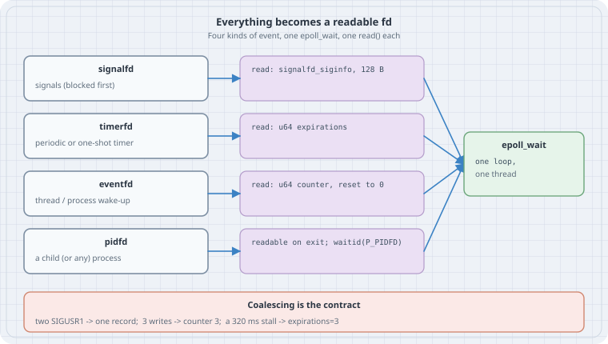

# Everything is an fd: signalfd, timerfd and eventfd in one epoll loop

## Overview

**Thesis:** Linux can turn signals, timers, cross-thread wake-ups and process exits into **file descriptors**. Once they are fds, a single `epoll_wait()` loop handles all of them, in order, on one thread. You get no async-signal-safety rules, no `EINTR` storms from handlers, and no self-pipe trick. The price is a small contract you must know: you have to **read** each fd to clear it, and what you read is a **count or a record, not one event per wake-up**.

| Descriptor | Since | Replaces | `read()` returns |
|---|---|---|---|
| `signalfd` | 2.6.22 | signal handlers, the self-pipe trick | one `struct signalfd_siginfo` (128 bytes) per pending signal |
| `timerfd` | 2.6.25 | `setitimer`/`SIGALRM`, sleep-based ticks | `uint64_t` expirations since the last read |
| `eventfd` | 2.6.22 | a pipe used only to wake another thread | `uint64_t` counter, then reset to 0 (or 1 at a time with `EFD_SEMAPHORE`) |
| `pidfd` | 5.3 (`waitid(P_PIDFD)` 5.4) | `SIGCHLD` + `waitpid` | not read: it becomes *readable* when the process exits |

Where you meet these: systemd's `sd-event` loop is built on all four. libuv (`uv_async_send`) and Go's netpoller use an eventfd on Linux to wake a sleeping loop. Seeing `anon_inode:[eventfd]` in `ls -l /proc/PID/fd` of a stuck service is far less mysterious once you have written this loop yourself. pidfds get their own chapter in this part; here they are just one more fd in the loop.

## Mental model

{fig-alt="Four event sources on the left, each turned into a file descriptor. Signals SIGUSR1 and SIGTERM, blocked with sigprocmask, queue on a signalfd; each read returns a 128-byte signalfd_siginfo. A periodic timer is a timerfd; read returns a 64-bit count of expirations since the last read. Another thread writes to an eventfd; read returns the summed 64-bit counter and resets it to zero. A child process is a pidfd; it becomes readable when the child exits, then waitid with P_PIDFD reaps it. All four are registered with one epoll instance, and the loop calls epoll_wait, then reads whichever fd is ready. A note says coalescing is the contract: two SIGUSR1 give one record, three writes give counter 3, and a 320 ms stall gives expirations=3."}

```text
  sigprocmask(BLOCK) ─► signalfd ─┐
  timerfd_settime    ─► timerfd  ─┤
  write(efd, 1)      ─► eventfd  ─┼─► epoll_wait ─► read()/waitid() the ready fd
  fork / pidfd_open  ─► pidfd    ─┘
```

Three rules carry the chapter:

1. **Block before you signalfd.** A signal that is not blocked is still delivered the old way (default action or handler). The signalfd only sees signals that stay *pending*.
2. **Read to clear.** epoll is level-triggered by default. An fd you don't drain is reported again on every `epoll_wait`, and the loop spins.
3. **Counts, not queues.** Standard signals of the same number merge while pending. eventfd adds up writes. timerfd counts expirations you missed. Design handlers for "at least one happened".

## Syntax

```c
#include <sys/signalfd.h>   // int signalfd(int fd, const sigset_t *mask, int flags);  SFD_NONBLOCK | SFD_CLOEXEC
#include <sys/timerfd.h>    // int timerfd_create(int clockid, int flags);              TFD_NONBLOCK | TFD_CLOEXEC
                            // int timerfd_settime(int fd, int flags, const struct itimerspec *new, struct itimerspec *old);
#include <sys/eventfd.h>    // int eventfd(unsigned int initval, int flags);           EFD_NONBLOCK | EFD_CLOEXEC | EFD_SEMAPHORE
#include <sys/epoll.h>      // epoll_create1, epoll_ctl(EPOLL_CTL_ADD), epoll_wait
// pidfd_open(pid, 0) via syscall(SYS_pidfd_open, ...) or glibc 2.36+ <sys/pidfd.h>
```

Python exposes `os.eventfd` (3.10+) and `os.timerfd_create`/`os.timerfd_settime` (3.13+). It has no `signalfd`; Python code uses `signal.set_wakeup_fd` for the same job.

## Safety

- Everything here is unprivileged and only touches your own process and its children.
- Always pass the `*_CLOEXEC` flags. Otherwise every program you `exec` inherits your timers and counters.
- Use `*_NONBLOCK` and read until `EAGAIN` when several records may be queued, as with signalfd.

## Examples with Explanations

Run on Linux 6.12, glibc, GCC and Python 3.13. All outputs are genuine.

### 1. One loop, four kinds of event

```c
// fdloop.c: one epoll loop where signals, a timer, a thread's wake-ups and a
// child's exit all arrive as readable file descriptors.
// build: cc -O2 -Wall -pthread -o fdloop fdloop.c
#define _GNU_SOURCE
#include <errno.h>
#include <pthread.h>
#include <signal.h>
#include <stdint.h>
#include <stdio.h>
#include <stdlib.h>
#include <string.h>
#include <sys/epoll.h>
#include <sys/eventfd.h>
#include <sys/signalfd.h>
#include <sys/syscall.h>
#include <sys/timerfd.h>
#include <sys/wait.h>
#include <time.h>
#include <unistd.h>

static struct timespec t0;
static double ms(void) {
    struct timespec t; clock_gettime(CLOCK_MONOTONIC, &t);
    return (t.tv_sec - t0.tv_sec) * 1e3 + (t.tv_nsec - t0.tv_nsec) / 1e6;
}
static void die(const char *m) { perror(m); exit(1); }

static void *worker(void *arg) {          // posts three "jobs done" in a row
    int efd = *(int *)arg; uint64_t one = 1;
    usleep(50 * 1000);
    for (int i = 0; i < 3; i++)
        if (write(efd, &one, sizeof one) != sizeof one) die("eventfd write");
    return NULL;
}

static void show(const char *name, int fd) {
    char path[64], target[128];
    snprintf(path, sizeof path, "/proc/self/fd/%d", fd);
    ssize_t n = readlink(path, target, sizeof target - 1);
    target[n < 0 ? 0 : n] = 0;
    printf("  fd %d %-9s -> %s\n", fd, name, target);
}

int main(void) {
    clock_gettime(CLOCK_MONOTONIC, &t0);

    // 1. Signals: block them first, so they queue for the signalfd instead of
    //    running a handler. Blocking before creating threads makes every thread inherit it.
    sigset_t mask; sigemptyset(&mask);
    sigaddset(&mask, SIGUSR1); sigaddset(&mask, SIGTERM);
    if (sigprocmask(SIG_BLOCK, &mask, NULL)) die("sigprocmask");
    int sfd = signalfd(-1, &mask, SFD_CLOEXEC | SFD_NONBLOCK);

    // 2. A periodic timer: first expiry after 100 ms, then every 100 ms.
    int tfd = timerfd_create(CLOCK_MONOTONIC, TFD_CLOEXEC | TFD_NONBLOCK);
    struct itimerspec its = { .it_interval = {0, 100000000}, .it_value = {0, 100000000} };
    if (timerfd_settime(tfd, 0, &its, NULL)) die("timerfd_settime");

    // 3. A counter another thread can bump.
    int efd = eventfd(0, EFD_CLOEXEC | EFD_NONBLOCK);

    // 4. A child that exits with status 7 after 450 ms, watched through a pidfd.
    pid_t pid = fork();
    if (pid == 0) { usleep(450 * 1000); _exit(7); }
    int pfd = syscall(SYS_pidfd_open, pid, 0);
    if (sfd < 0 || tfd < 0 || efd < 0 || pfd < 0) die("creating fds");

    puts("what the descriptors are:");
    show("signalfd", sfd); show("timerfd", tfd); show("eventfd", efd); show("pidfd", pfd);

    int ep = epoll_create1(EPOLL_CLOEXEC);
    int fds[] = { sfd, tfd, efd, pfd };
    for (int i = 0; i < 4; i++) {
        struct epoll_event ev = { .events = EPOLLIN, .data.fd = fds[i] };
        if (epoll_ctl(ep, EPOLL_CTL_ADD, fds[i], &ev)) die("epoll_ctl");
    }

    pthread_t th; pthread_create(&th, NULL, worker, &efd);
    kill(getpid(), SIGUSR1); kill(getpid(), SIGUSR1);   // two of the same standard signal

    puts("event loop:");
    int ticks = 0;
    for (;;) {
        struct epoll_event evs[4];
        int n = epoll_wait(ep, evs, 4, -1);
        if (n < 0) { if (errno == EINTR) continue; die("epoll_wait"); }
        for (int i = 0; i < n; i++) {
            int fd = evs[i].data.fd;
            if (fd == tfd) {
                uint64_t exp; if (read(tfd, &exp, sizeof exp) != sizeof exp) die("read timerfd");
                printf("%7.1f ms  timerfd  expirations=%llu\n", ms(), (unsigned long long)exp);
                if (++ticks == 2) { usleep(320 * 1000); printf("%7.1f ms  (loop was busy for 320 ms)\n", ms()); }
            } else if (fd == efd) {
                uint64_t c; if (read(efd, &c, sizeof c) != sizeof c) die("read eventfd");
                printf("%7.1f ms  eventfd  counter=%llu (then reset to 0)\n", ms(), (unsigned long long)c);
            } else if (fd == pfd) {
                siginfo_t si = {0};
                if (waitid(P_PIDFD, pfd, &si, WEXITED)) die("waitid");
                printf("%7.1f ms  pidfd    child %d exited, status %d\n", ms(), si.si_pid, si.si_status);
                epoll_ctl(ep, EPOLL_CTL_DEL, pfd, NULL); close(pfd);
                kill(getpid(), SIGTERM);                       // ask ourselves to stop
            } else if (fd == sfd) {
                struct signalfd_siginfo si;
                while (read(sfd, &si, sizeof si) == sizeof si) {
                    printf("%7.1f ms  signalfd %s from pid %u\n", ms(), strsignal(si.ssi_signo), si.ssi_pid);
                    if (si.ssi_signo == SIGTERM) { pthread_join(th, NULL); puts("clean exit"); return 0; }
                }
            }
        }
    }
}
```

```text
$ cc -O2 -Wall -pthread -o fdloop fdloop.c && ./fdloop
what the descriptors are:
  fd 5 signalfd  -> anon_inode:[signalfd]
  fd 6 timerfd   -> anon_inode:[timerfd]
  fd 7 eventfd   -> anon_inode:[eventfd]
  fd 8 pidfd     -> anon_inode:[pidfd]
event loop:
    0.2 ms  signalfd User defined signal 1 from pid 1582492
   50.6 ms  eventfd  counter=3 (then reset to 0)
  100.1 ms  timerfd  expirations=1
  200.2 ms  timerfd  expirations=1
  520.3 ms  (loop was busy for 320 ms)
  520.3 ms  timerfd  expirations=3
  520.3 ms  pidfd    child 1582493 exited, status 7
  520.3 ms  signalfd Terminated from pid 1582492
clean exit
```

Line by line:

- **`/proc/self/fd`** shows every object as an anonymous inode named after its type. That is how you spot these in someone else's process with `ls -l /proc/PID/fd`. The exact link name for pidfds varies with kernel version and config.
- **`signalfd … from pid`**: two `kill(SIGUSR1)` calls produced **one** record. Standard signals are a pending *bit*, not a queue (real-time signals, `SIGRTMIN+n`, do queue). The record also carries the sender's PID (`ssi_pid`), which a classic handler only gets through `SA_SIGINFO`.
- **`eventfd counter=3`**: the worker wrote `1` three times before the loop woke. One wake-up, one read, total 3.
- **`timerfd expirations=3`**: the loop stalled for 320 ms after the second tick. The timer did not queue three events; it counted them, and one read returned `3`. A periodic job can use that number to catch up, or decide to skip.
- **`pidfd`**: the child's exit made the pidfd readable. `waitid(P_PIDFD)` reaped it and returned status 7. No `SIGCHLD` handler was involved.
- The process then sent itself `SIGTERM`, which arrived as just another fd event. The loop shut down cleanly, joining the worker thread, instead of being killed half-way through.

### 2. The kernel's view: `/proc/self/fdinfo`, and `EFD_SEMAPHORE`

```python
# fdinfo.py: the kernel's view of an eventfd and a timerfd, and EFD_SEMAPHORE (Python 3.13+)
import os, time

def fdinfo(fd):
    lines = open(f"/proc/self/fdinfo/{fd}").read().splitlines()
    return [l for l in lines if not l.startswith(("pos:", "flags:", "mnt_id:", "ino:"))]

e = os.eventfd(0, os.EFD_CLOEXEC | os.EFD_NONBLOCK)
os.eventfd_write(e, 5)
print("eventfd after write(5):", fdinfo(e))
print("read ->", os.eventfd_read(e), "| read again ->", end=" ")
try: os.eventfd_read(e)
except BlockingIOError: print("EAGAIN (counter is 0)")

s = os.eventfd(3, os.EFD_SEMAPHORE | os.EFD_NONBLOCK)
got = []
while True:
    try: got.append(os.eventfd_read(s))
    except BlockingIOError: break
print("EFD_SEMAPHORE, initial 3: reads ->", got)

t = os.timerfd_create(time.CLOCK_MONOTONIC, flags=os.TFD_NONBLOCK)
os.timerfd_settime(t, initial=2.0, interval=0.5)
print("timerfd armed:", fdinfo(t))
```

```text
$ python3 fdinfo.py
eventfd after write(5): ['eventfd-count:                5', 'eventfd-id: 117', 'eventfd-semaphore: 0']
read -> 5 | read again -> EAGAIN (counter is 0)
EFD_SEMAPHORE, initial 3: reads -> [1, 1, 1]
timerfd armed: ['clockid: 1', 'ticks: 0', 'settime flags: 00', 'it_value: (1, 999977754)', 'it_interval: (0, 500000000)']
```

`fdinfo` is the debugging view for someone else's process too (`/proc/PID/fdinfo/FD`, readable by the same user). It shows an eventfd's pending count and a timerfd's clock (`1` = `CLOCK_MONOTONIC`), time to next expiry and interval. A plain eventfd hands the whole sum to one reader. With `EFD_SEMAPHORE`, each read takes **1**, so N waiting workers can each claim one unit.

### 3. The trap: the blocked mask leaks into children

The mask you set for the signalfd is inherited across `fork` **and** `execve`. Anything you start from the loop begins life with those signals blocked:

```python
# maskleak.py: a blocked signal mask survives fork+exec, so a child can't be stopped with SIGTERM
import signal, subprocess
signal.pthread_sigmask(signal.SIG_BLOCK, {signal.SIGTERM, signal.SIGUSR1})
out = subprocess.run(["grep", "SigBlk", "/proc/self/status"], capture_output=True, text=True).stdout
print("child", out.strip(), "(signal N is bit N-1: 0x200 = SIGUSR1, 0x4000 = SIGTERM)")
p = subprocess.Popen(["sleep", "30"]); p.terminate()
try: p.wait(timeout=1); print("sleep stopped by SIGTERM")
except subprocess.TimeoutExpired: print("sleep ignored SIGTERM for 1 s (blocked); killing"); p.kill(); p.wait()
```

```text
$ python3 maskleak.py
child SigBlk:	0000000000004200 (signal N is bit N-1: 0x200 = SIGUSR1, 0x4000 = SIGTERM)
sleep ignored SIGTERM for 1 s (blocked); killing
```

`SigBlk` in `/proc/PID/status` is a bitmask (signal N is bit N−1), and the child's shows both signals still blocked. `sleep` never sees `SIGTERM`; only `SIGKILL`, which cannot be blocked, gets rid of it. This is a classic cause of "my service manager can't stop the worker", because the supervisor's signalfd setup leaked into the workers. The fix is to unblock in the child between `fork` and `exec` (`sigprocmask(SIG_SETMASK, &old, NULL)`), or to use `posix_spawn` with `posix_spawnattr_setsigmask`.

## The trap

Forgetting that threads have their own masks. Block the signals in `main` **before** creating any thread, as `fdloop.c` does, so every thread inherits the block. If one thread still has `SIGTERM` unblocked, the kernel may deliver the signal to that thread with its default action, killing the process, and the signalfd never sees it.

## Notes & Pitfalls

- **Reads must be the right size.** eventfd and timerfd reads need an 8-byte buffer (`EINVAL` otherwise). signalfd needs room for at least one 128-byte `signalfd_siginfo`.
- **eventfd writes of `0xffffffffffffffff` fail** with `EINVAL`. A write that would overflow the counter blocks, or returns `EAGAIN` with `EFD_NONBLOCK`.
- **`CLOCK_MONOTONIC` vs `CLOCK_REALTIME`.** Use monotonic for intervals. For wall-clock alarms use realtime with `TFD_TIMER_ABSTIME`, and add `TFD_TIMER_CANCEL_ON_SET` to hear about clock jumps (the read fails with `ECANCELED`).
- **`CLOCK_BOOTTIME`** keeps counting through suspend. The `*_ALARM` clocks can wake the system, but they need `CAP_WAKE_ALARM`.
- **A signalfd sees only the signals in its mask** that are pending for the process or for the reading thread. Signals aimed at another thread (`pthread_kill`) stay with that thread.
- **epoll and fork.** A child shares the parent's epoll instance and its registrations. Create event loops after forking, not before.

## The boring rule

Block signals first, before threads. Create every fd with `CLOEXEC|NONBLOCK`. Drain what epoll reports, and treat every read as "N things happened". Restore the signal mask in children before `exec`.

## Related Commands

- `pidfd` (this part): process handles, including the identity checks this chapter skips
- `strace -e trace=signalfd4,timerfd_create,timerfd_settime,eventfd2,epoll_wait`: watch a real event loop's setup
- `ls -l /proc/PID/fd`, `cat /proc/PID/fdinfo/FD`, `grep Sig /proc/PID/status`

## Try this

1. Change `fdloop.c` to send `SIGRTMIN` twice instead of `SIGUSR1` (add it to the mask). How many signalfd records do you get now?
2. Comment out the `read()` in the timerfd branch and run it under `timeout 1`. Count how often the loop wakes. That is level triggering.
3. Create the eventfd with `EFD_SEMAPHORE` and see what the loop prints for the worker's three writes.
4. Find a long-running process on your machine (`systemd --user`, a browser, an editor) and list which anonymous-inode fds it holds: `ls -l /proc/PID/fd | grep anon_inode`.

## Verification

- `fdloop.c` was built with GCC (`-Wall`, no warnings) and run on Linux 6.12. `fdinfo.py` and `maskleak.py` were run on Python 3.13.5 on the same machine. All outputs above are unedited.
- Timings (50, 100, 200, 520 ms) are wall-clock and will vary slightly; the counts (1 SIGUSR1 record, counter 3, expirations 3, status 7) are deterministic.
- Kernel version numbers in the table come from the man pages listed below.

## Sources

- signalfd(2): <https://man7.org/linux/man-pages/man2/signalfd.2.html>
- timerfd_create(2): <https://man7.org/linux/man-pages/man2/timerfd_create.2.html>
- eventfd(2): <https://man7.org/linux/man-pages/man2/eventfd.2.html>
- epoll(7): <https://man7.org/linux/man-pages/man7/epoll.7.html>
- pidfd_open(2) and waitid(2): <https://man7.org/linux/man-pages/man2/pidfd_open.2.html>, <https://man7.org/linux/man-pages/man2/waitid.2.html>
- signal(7), standard vs real-time signal queueing: <https://man7.org/linux/man-pages/man7/signal.7.html>
- proc_pid_fdinfo(5): <https://man7.org/linux/man-pages/man5/proc_pid_fdinfo.5.html>
- Python `os` module, eventfd and timerfd: <https://docs.python.org/3/library/os.html#os.eventfd>
