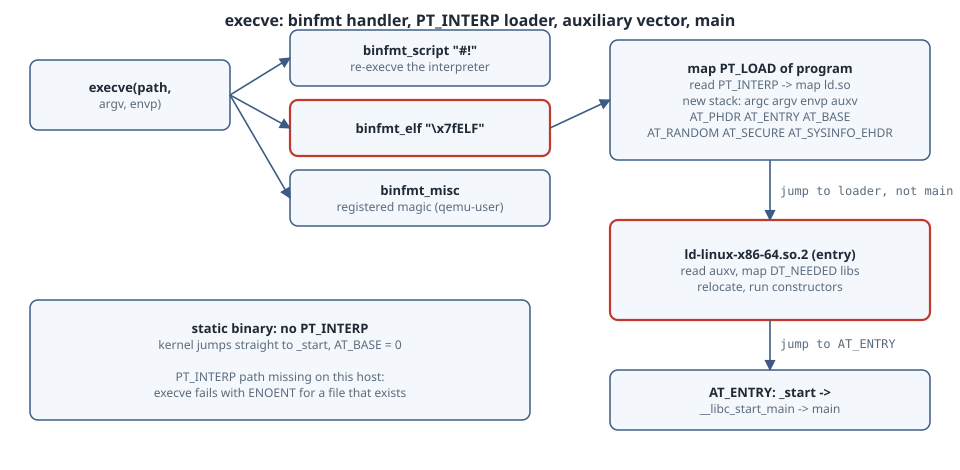

# How programs get run: execve, binfmt_elf, PT_INTERP and the auxiliary vector

## Overview

**Thesis:** when you type `./hello`, the kernel does not "run main". `execve(2)` asks a **binary format handler** to recognise the file, maps its `PT_LOAD` segments, and, for a dynamically linked program, also maps the **interpreter** named in `PT_INTERP` (the dynamic loader, `ld-linux-x86-64.so.2` on x86-64 glibc). The kernel then jumps to the *loader's* entry point and hands it a small table of facts, the **auxiliary vector** (auxv). The loader uses auxv to find the program, loads its libraries, runs constructors, and only then calls `main`.

| Step | Who | What you can inspect |
|---|---|---|
| Recognise the file | kernel: `binfmt_script` (`#!`), `binfmt_elf`, `binfmt_misc` | `head -c4 FILE`, `/proc/sys/fs/binfmt_misc/` |
| Map the program | kernel (`binfmt_elf`) | `readelf -lW FILE` (`LOAD` rows) |
| Map the interpreter | kernel, from `PT_INTERP` | `readelf -lW FILE \| grep interpreter` |
| Build the stack: argv, envp, **auxv** | kernel | `LD_SHOW_AUXV=1 PROG`, `/proc/PID/auxv`, `getauxval(3)` |
| Load libraries, relocate, run init | user space: `ld.so` | `/proc/PID/maps`, `LD_DEBUG=libs` |
| `_start` → `__libc_start_main` → `main` | libc | your program |

Why it matters day to day: the famous "**No such file or directory**" for a file that plainly exists (a binary copied from another distro, an Alpine binary on glibc, a Nix-built binary outside Nix, a script with CRLF in its `#!` line) is the kernel failing to open the *interpreter*, not your file.

## Mental model

{fig-alt="Left to right: execve(path, argv, envp) goes to the kernel, which tries binary format handlers in turn: binfmt_script for files starting with #!, binfmt_elf for files starting with 0x7f ELF, and binfmt_misc for registered magic or extensions. binfmt_elf maps the PT_LOAD segments of the program, reads PT_INTERP, maps the interpreter ld-linux-x86-64.so.2, and builds the new stack with argc, argv, envp and the auxiliary vector containing AT_PHDR, AT_ENTRY, AT_BASE, AT_RANDOM, AT_SECURE and AT_SYSINFO_EHDR. Control goes to the loader's entry point, not the program's. The loader reads auxv, maps libc and other DT_NEEDED libraries, applies relocations, runs constructors and jumps to AT_ENTRY, which is _start, then __libc_start_main, then main. A note says a static binary has no PT_INTERP, so the kernel jumps straight to _start and AT_BASE is 0."}

```text
execve(path) ─► binfmt_script?  "#!interp arg"  → execve(interp, [interp, arg, path, ...])
             ─► binfmt_elf?     "\x7fELF"        → map PT_LOAD, map PT_INTERP, push argv/envp/auxv
             ─► binfmt_misc?    registered magic → e.g. qemu-user, wine, java
                                    │
                    jump to ld.so entry (or to _start if static)
                                    │
             ld.so: read auxv → map DT_NEEDED libs → relocate → init → jump AT_ENTRY → main
```

Three facts carry the chapter:

1. **`PT_INTERP` is a path, baked into the binary.** If it does not exist on this machine, `execve` fails with `ENOENT`, even though the file you named exists.
2. **The loader is just an ELF file you can run directly.** `/lib64/ld-linux-x86-64.so.2 ./prog` loads `prog` itself, which is how `ldd` and Nix's `patchelf`-free wrappers work.
3. **auxv is the kernel→user-space handshake.** `AT_PHDR`/`AT_ENTRY` tell the loader where the program is, `AT_BASE` where the loader is, `AT_RANDOM` seeds the stack canary, `AT_SECURE` says "setuid, ignore `LD_*` variables", and `AT_SYSINFO_EHDR` is the vDSO.

## Syntax

```c
#include <unistd.h>
int execve(const char *path, char *const argv[], char *const envp[]);
int execveat(int dirfd, const char *path, char *const argv[], char *const envp[], int flags);  // AT_EMPTY_PATH: exec an fd

#include <sys/auxv.h>
unsigned long getauxval(unsigned long type);   // AT_PHDR, AT_ENTRY, AT_BASE, AT_RANDOM, AT_SECURE, AT_EXECFN, ...
```

```bash
readelf -hW PROG            # ELF header: Type (EXEC vs DYN = PIE) and entry point
readelf -lW PROG            # program headers: INTERP, LOAD, DYNAMIC, GNU_STACK, GNU_RELRO
LD_SHOW_AUXV=1 PROG         # glibc's loader prints the auxv it received, then runs PROG
od -An -tx8 /proc/PID/auxv  # the raw (type, value) pairs of a running process
```

## Safety

- Everything here is read-only inspection of your own binaries and processes. No root is needed.
- The "broken interpreter" demo patches a **copy** of a binary in `/tmp`. Never patch system binaries in place.
- `LD_SHOW_AUXV`, `LD_DEBUG` and `LD_LIBRARY_PATH` are ignored for setuid programs (`AT_SECURE=1`). That is a security feature, not a bug.

## Examples with Explanations

### 1. A PIE, a static binary, and their program headers

A tiny C program prints a few auxv entries with `getauxval(3)`:

```c
#include <stdio.h>
#include <sys/auxv.h>
#include <elf.h>
#include <link.h>
int main(int argc, char **argv) {
    printf("main() reached, argv[0]=%s\n", argv[0]);
    printf("AT_PHDR   = %#lx (program headers of the executable)\n", getauxval(AT_PHDR));
    printf("AT_ENTRY  = %#lx (entry point of the executable)\n", getauxval(AT_ENTRY));
    printf("AT_BASE   = %#lx (load address of the interpreter)\n", getauxval(AT_BASE));
    printf("AT_PAGESZ = %lu\n", getauxval(AT_PAGESZ));
    printf("AT_SECURE = %lu\n", getauxval(AT_SECURE));
    printf("AT_EXECFN = %s\n", (char *)getauxval(AT_EXECFN));
    printf("AT_RANDOM = %#lx (16 random bytes for stack canary / pointer guard)\n", getauxval(AT_RANDOM));
    return 0;
}
```

```text
$ gcc -O2 -Wall -o hello hello.c
$ gcc -O2 -Wall -static -o hello-static hello.c
$ readelf -hW hello | grep -E 'Type|Entry'
  Type:                              DYN (Position-Independent Executable file)
  Entry point address:               0x1140
$ readelf -lW hello | sed -n '/Program Headers/,/GNU_RELRO/p'
Program Headers:
  Type           Offset   VirtAddr           PhysAddr           FileSiz  MemSiz   Flg Align
  PHDR           0x000040 0x0000000000000040 0x0000000000000040 0x000310 0x000310 R   0x8
  INTERP         0x000394 0x0000000000000394 0x0000000000000394 0x00001c 0x00001c R   0x1
      [Requesting program interpreter: /lib64/ld-linux-x86-64.so.2]
  LOAD           0x000000 0x0000000000000000 0x0000000000000000 0x000680 0x000680 R   0x1000
  LOAD           0x001000 0x0000000000001000 0x0000000000001000 0x000235 0x000235 R E 0x1000
  LOAD           0x002000 0x0000000000002000 0x0000000000002000 0x00023c 0x00023c R   0x1000
  LOAD           0x002dd0 0x0000000000003dd0 0x0000000000003dd0 0x000250 0x000258 RW  0x1000
  DYNAMIC        0x002de0 0x0000000000003de0 0x0000000000003de0 0x0001e0 0x0001e0 RW  0x8
  NOTE           0x000350 0x0000000000000350 0x0000000000000350 0x000020 0x000020 R   0x8
  NOTE           0x000370 0x0000000000000370 0x0000000000000370 0x000024 0x000024 R   0x4
  NOTE           0x00221c 0x000000000000221c 0x000000000000221c 0x000020 0x000020 R   0x4
  GNU_PROPERTY   0x000350 0x0000000000000350 0x0000000000000350 0x000020 0x000020 R   0x8
  GNU_EH_FRAME   0x002148 0x0000000000002148 0x0000000000002148 0x00002c 0x00002c R   0x4
  GNU_STACK      0x000000 0x0000000000000000 0x0000000000000000 0x000000 0x000000 RW  0x10
  GNU_RELRO      0x002dd0 0x0000000000003dd0 0x0000000000003dd0 0x000230 0x000230 R   0x1
```

Read it top to bottom:

- **`Type: DYN`** is a position-independent executable. Its addresses start at 0 and the kernel picks a random base (ASLR).
- **`INTERP`** is 0x1c = 28 bytes: the 27-character path plus a NUL. That one string decides which loader runs.
- Four **`LOAD`** segments with flags `R`, `R E`, `R`, `RW`: headers, code, read-only data, writable data. The kernel `mmap`s each with those permissions.
- **`GNU_STACK` `RW`** (no `E`) asks for a non-executable stack. **`GNU_RELRO`** is a range the loader makes read-only after relocation.

Now run both:

```text
$ ./hello
main() reached, argv[0]=./hello
AT_PHDR   = 0x55f3a870c040 (program headers of the executable)
AT_ENTRY  = 0x55f3a870d140 (entry point of the executable)
AT_BASE   = 0x7f42f153d000 (load address of the interpreter)
AT_PAGESZ = 4096
AT_SECURE = 0
AT_EXECFN = ./hello
AT_RANDOM = 0x7ffe54264479 (16 random bytes for stack canary / pointer guard)

$ ./hello-static
main() reached, argv[0]=./hello-static
AT_PHDR   = 0x400040 (program headers of the executable)
AT_ENTRY  = 0x4016a0 (entry point of the executable)
AT_BASE   = 0 (load address of the interpreter)
AT_PAGESZ = 4096
AT_SECURE = 0
AT_EXECFN = ./hello-static
AT_RANDOM = 0x7ffd0c796b29 (16 random bytes for stack canary / pointer guard)
$ readelf -hW hello-static | grep Type; readelf -lW hello-static | grep -c INTERP
  Type:                              EXEC (Executable file)
0
```

The PIE's `AT_BASE` is where the kernel mapped `ld-linux-x86-64.so.2`. The static binary is `EXEC` at the fixed address 0x400000, has **no** `INTERP` header, and gets `AT_BASE = 0`: the kernel jumped straight to its `_start`. The addresses change on every run (ASLR); the `0x...040` offset of `AT_PHDR` and the `...140` offset of `AT_ENTRY` match `readelf`'s `PHDR` offset (0x40) and entry point (0x1140).

### 2. Everything the kernel told the loader: `LD_SHOW_AUXV`

```text
$ LD_SHOW_AUXV=1 ./hello | head -22
AT_SYSINFO_EHDR:      0x7fa1b8fec000
AT_MINSIGSTKSZ:       11952
AT_HWCAP:             1fabfbff
AT_PAGESZ:            4096
AT_CLKTCK:            100
AT_PHDR:              0x55d1fe9a0040
AT_PHENT:             56
AT_PHNUM:             14
AT_BASE:              0x7fa1b8fee000
AT_FLAGS:             0x0
AT_ENTRY:             0x55d1fe9a1140
AT_UID:               1000
AT_EUID:              1000
AT_GID:               1000
AT_EGID:              1000
AT_SECURE:            0
AT_RANDOM:            0x7ffc82d7b3e9
AT_HWCAP2:            0x2
AT_EXECFN:            ./hello
AT_PLATFORM:          x86_64
AT_RSEQ_FEATURE_SIZE: 28
AT_RSEQ_ALIGN:        32
```

The entries worth knowing:

| Entry | Meaning |
|---|---|
| `AT_SYSINFO_EHDR` | address of the vDSO's ELF header (how `clock_gettime` avoids a syscall) |
| `AT_HWCAP`, `AT_HWCAP2`, `AT_PLATFORM` | CPU feature bits; glibc uses them to pick optimised `memcpy` and `glibc-hwcaps` library directories |
| `AT_PHDR`, `AT_PHENT`, `AT_PHNUM` | where the program's headers are, their size (56) and count (14, as `readelf` said) |
| `AT_BASE`, `AT_ENTRY` | the loader's base and the program's entry point |
| `AT_UID`..`AT_EGID`, `AT_SECURE` | real and effective IDs; `AT_SECURE=1` for setuid/setgid/file-capability programs |
| `AT_RANDOM` | 16 kernel-random bytes on the stack, used for the stack protector canary and pointer mangling |
| `AT_EXECFN` | the path passed to `execve` |
| `AT_MINSIGSTKSZ`, `AT_RSEQ_*` | newer entries: minimum signal stack for this CPU (AVX-512 state is big), restartable-sequences layout |

### 3. The loader is a program

```text
$ ls -l /lib64/ld-linux-x86-64.so.2 | awk '{print $1, $(NF-2), $(NF-1), $NF}'
lrwxrwxrwx /lib64/ld-linux-x86-64.so.2 -> ../lib/x86_64-linux-gnu/ld-linux-x86-64.so.2
$ /lib64/ld-linux-x86-64.so.2 ./hello
main() reached, argv[0]=./hello
AT_PHDR   = 0x7fdc18bf1040 (program headers of the executable)
AT_ENTRY  = 0x7fdc18bf2140 (entry point of the executable)
AT_BASE   = 0 (load address of the interpreter)
AT_PAGESZ = 4096
AT_SECURE = 0
AT_EXECFN = ./hello
AT_RANDOM = 0x7ffd68b77d09 (16 random bytes for stack canary / pointer guard)
```

Run that way, the *kernel* executed `ld-linux-x86-64.so.2` (so from the kernel's point of view there is no interpreter: `AT_BASE = 0`), and the loader mapped `./hello` itself. This is the escape hatch when `PT_INTERP` points somewhere that does not exist. It is not a way around `noexec` mounts for ELF files: the loader has to `mmap` the program with `PROT_EXEC`, and the kernel refuses that on a `noexec` mount. Script interpreters are different (`python3 /mnt/noexec/x.py` only reads the file), which is why `noexec` is a speed bump, not a sandbox.

Here is the result in a running process, filtered to the interesting mappings of a small program that prints its own `/proc/self/maps`:

```text
$ ./maps | grep -E 'ld-linux|libc|vdso|stack|/maps' | awk '{print $1, $2, $6}'
560196c94000-560196c95000 r--p /tmp/execlab/maps
560196c95000-560196c96000 r-xp /tmp/execlab/maps
560196c96000-560196c97000 r--p /tmp/execlab/maps
560196c97000-560196c98000 r--p /tmp/execlab/maps
560196c98000-560196c99000 rw-p /tmp/execlab/maps
7f7411605000-7f741162d000 r--p /usr/lib/x86_64-linux-gnu/libc.so.6
7f741162d000-7f7411790000 r-xp /usr/lib/x86_64-linux-gnu/libc.so.6
7f7411790000-7f74117e6000 r--p /usr/lib/x86_64-linux-gnu/libc.so.6
7f74117e6000-7f74117ea000 r--p /usr/lib/x86_64-linux-gnu/libc.so.6
7f74117ea000-7f74117ec000 rw-p /usr/lib/x86_64-linux-gnu/libc.so.6
7f741180a000-7f741180c000 r-xp [vdso]
7f741180c000-7f741180d000 r--p /usr/lib/x86_64-linux-gnu/ld-linux-x86-64.so.2
7f741180d000-7f7411835000 r-xp /usr/lib/x86_64-linux-gnu/ld-linux-x86-64.so.2
7f7411835000-7f7411840000 r--p /usr/lib/x86_64-linux-gnu/ld-linux-x86-64.so.2
7f7411840000-7f7411842000 r--p /usr/lib/x86_64-linux-gnu/ld-linux-x86-64.so.2
7f7411842000-7f7411843000 rw-p /usr/lib/x86_64-linux-gnu/ld-linux-x86-64.so.2
7fff9b777000-7fff9b799000 rw-p [stack]
```

The program's five mappings sit at a random `0x55...` base, libc and the loader near the top of the address space, the `[vdso]` from `AT_SYSINFO_EHDR`, and `[stack]`, where argv, envp and auxv were written.

### 4. "No such file or directory" for a file that exists

Copy the binary and change one byte-for-byte equal-length string in `PT_INTERP`, as if it came from a system with a different loader path:

```text
$ readelf -lW hello-badinterp | grep interpreter
      [Requesting program interpreter: /lib64/ld-gonex-x86-64.so.2]
$ ls -l hello-badinterp
-rwxr-xr-x 16008 hello-badinterp
$ ./hello-badinterp
run.sh: line 4: ./hello-badinterp: cannot execute: required file not found
exit=127
$ python3 -c "import os; os.execv(\"./hello-badinterp\", [\"x\"])"
FileNotFoundError: [Errno 2] No such file or directory
$ head -1 s.sh; ./s.sh
#!/no/such/shell
run.sh: line 6: ./s.sh: cannot execute: required file not found
exit=127
```

The file is there and executable, yet `execve` returns `ENOENT` (bash 5.2 now words this as "required file not found"; older shells print the misleading "No such file or directory"). The missing file is `/lib64/ld-gonex-x86-64.so.2`. A `#!` line naming a missing interpreter fails the same way, because `binfmt_script` turns it into a second `execve` of the interpreter. A Windows-edited script whose first line is `#!/bin/sh\r` fails for the same reason: the interpreter it asks for is `/bin/sh\r`.

Fixes, in order of preference: install a build for this platform; run it through the right loader (`/path/to/ld.so ./prog`); or rewrite the header with `patchelf --set-interpreter` (on a copy).

## The trap: `ldd` runs code

`ldd` is a shell script that runs the program's loader with `LD_TRACE_LOADED_OBJECTS=1`. With a hostile or simply foreign binary, a custom `PT_INTERP` means "running `ldd` on it" executes an attacker-chosen loader. The ldd(1) man page says so. For untrusted files, read the headers instead: `readelf -dW FILE | grep NEEDED` and `readelf -lW FILE | grep interpreter` never execute anything.

## Notes and pitfalls

- **Order of handlers.** The kernel tries the registered formats in turn. `binfmt_misc` entries (`/proc/sys/fs/binfmt_misc/`, usually set up by systemd-binfmt) are how `qemu-user` lets an arm64 binary "just run" on x86-64. Inside containers that directory is often not mounted.
- **`#!` limits.** The kernel reads only the first line, up to 255 bytes (`BINPRM_BUF_SIZE` 256), and passes **at most one** argument: `#!/usr/bin/env python3 -u` passes `"python3 -u"` as one word. `env -S` exists to split it.
- **Static-PIE** binaries (`-static-pie`) are `DYN` with no `INTERP`: they relocate themselves.
- **Executing from an fd.** `execveat(fd, "", ..., AT_EMPTY_PATH)` and `fexecve(3)` run a file you already opened, which is how `memfd_create` + exec works. `/proc/PID/exe` then points at `/memfd:...`.
- **What `argv[0]` is** is entirely up to the caller of `execve`; `AT_EXECFN` and `/proc/self/exe` are the honest answers.
- **Setuid binaries** get `AT_SECURE=1`; the loader then ignores `LD_PRELOAD` paths with slashes, `LD_LIBRARY_PATH` and `LD_SHOW_AUXV`.

## The boring rule

When a binary "isn't found", run `readelf -lW FILE | grep interpreter` and check that path. Read auxv with `LD_SHOW_AUXV=1` or `getauxval`, never by walking past `envp` yourself. Use `readelf`, not `ldd`, on files you do not trust.

## Related Commands

- `readelf -hW`, `readelf -lW`, `readelf -dW` (binutils)
- `LD_SHOW_AUXV=1`, `LD_DEBUG=libs`, `/lib64/ld-linux-x86-64.so.2 --list PROG`
- `cat /proc/PID/maps`, `od -An -tx8 /proc/PID/auxv`, `ls -l /proc/PID/exe`
- `ls /proc/sys/fs/binfmt_misc/`, `systemd-binfmt`

## Try this

1. Run `LD_SHOW_AUXV=1 /bin/true` and `LD_SHOW_AUXV=1 ./hello-static`. Which one prints nothing, and why?
2. Run `LD_DEBUG=libs ./hello 2>&1 | head` and find where the loader looks for `libc.so.6`.
3. Compare `readelf -lW` for a binary built with `-z execstack` and without. What changes in `GNU_STACK`?
4. Write a script whose first line is `#!/usr/bin/env python3 -u`. What error do you get, and how does `#!/usr/bin/env -S python3 -u` fix it?

## Verification

- `hello.c` and `maps.c` were built with GCC (`-O2 -Wall`, no warnings) against glibc 2.41 (Debian 13) and run on Linux 6.12 x86-64. The bad-interpreter demo ran under bash 5.2.37 and Python 3.13.
- All outputs above are unedited. Addresses differ from run to run because of ASLR; offsets, sizes, counts and error codes are stable.

## Sources

- execve(2): <https://man7.org/linux/man-pages/man2/execve.2.html>
- getauxval(3): <https://man7.org/linux/man-pages/man3/getauxval.3.html>
- ld.so(8) (`LD_SHOW_AUXV`, `AT_SECURE`, running the loader directly): <https://man7.org/linux/man-pages/man8/ld.so.8.html>
- ldd(1), the security note: <https://man7.org/linux/man-pages/man1/ldd.1.html>
- elf(5): <https://man7.org/linux/man-pages/man5/elf.5.html>
- Kernel docs, binfmt_misc: <https://docs.kernel.org/admin-guide/binfmt-misc.html>
- Kernel source, `fs/binfmt_elf.c` (`load_elf_binary`, `create_elf_tables`): <https://github.com/torvalds/linux/blob/master/fs/binfmt_elf.c>
- LWN, "How programs get run" and "How programs get run: ELF binaries" (David Drysdale): <https://lwn.net/Articles/630727/>, <https://lwn.net/Articles/631631/>
