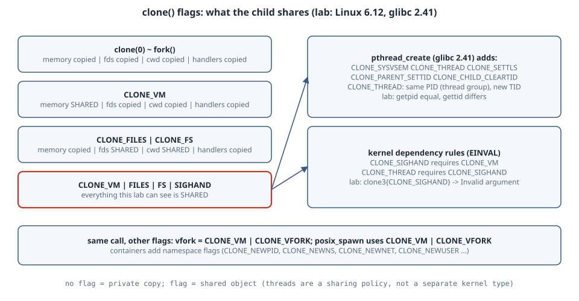

# Threads Are Just clone() Flags: What CLONE_VM, FILES, FS and SIGHAND Share

## Learning goals

- See that Linux has no separate "thread" object. `fork()`, `pthread_create()` and container runtimes are all `clone()` with different **sharing flags**.
- Prove what each of `CLONE_VM`, `CLONE_FILES`, `CLONE_FS` and `CLONE_SIGHAND` shares, by changing state in a child and inspecting it in the parent.
- Call `clone3()` directly with `struct clone_args`.
- Read the exact flag set glibc passes for a pthread, and the kernel rules that stop nonsensical combinations.

Version note: run on Linux **6.12** with gcc 14.2 and glibc 2.41 (Debian 13), as an ordinary user. `strace` is not installed on the box, so the glibc flag set is quoted from source instead of traced.

{fig-alt="Four rows, each a clone call with a different flag set, showing whether memory, the file-descriptor table, filesystem information such as the current directory, and signal handlers are shared with or copied from the parent. With no flags, as with fork, everything is copied. With CLONE_VM only, memory is shared and the rest is copied. With CLONE_FILES and CLONE_FS, the fd table and current directory are shared but memory is copied. With CLONE_VM, CLONE_FILES, CLONE_FS and CLONE_SIGHAND, everything is shared. A side note lists what glibc's pthread_create adds on top: CLONE_SYSVSEM, CLONE_THREAD, CLONE_SETTLS, CLONE_PARENT_SETTID and CLONE_CHILD_CLEARTID. CLONE_THREAD puts the child in the same thread group, so it has the same PID with a new TID. The kernel rejects CLONE_SIGHAND without CLONE_VM, and CLONE_THREAD without CLONE_SIGHAND, with EINVAL."}

## The flags in this lab

From [clone(2)](https://man7.org/linux/man-pages/man2/clone.2.html):

| Flag | If set, the child shares the parent's... |
|---|---|
| `CLONE_VM` | memory (same address space; writes are visible both ways) |
| `CLONE_FILES` | file-descriptor table (open/close in one affects the other) |
| `CLONE_FS` | filesystem info: root, cwd, umask |
| `CLONE_SIGHAND` | table of signal handlers (requires `CLONE_VM`) |
| `CLONE_THREAD` | thread group, so the same PID with a different TID (requires `CLONE_SIGHAND`) |

Without a flag, the child gets a **copy** of that resource, which is exactly what `fork()` gives you.

## Lab 1: change it in the child, look in the parent

The child sets a global, closes an fd, `chdir`s to `/tmp`, and installs a `SIGUSR1` handler. The parent then checks which of those changes it can see.

```c
// What does a clone() child share with its parent? Try four flag sets.
#define _GNU_SOURCE
#include <fcntl.h>
#include <linux/sched.h>    /* struct clone_args */
#include <sched.h>
#include <signal.h>
#include <stdio.h>
#include <stdlib.h>
#include <string.h>
#include <sys/syscall.h>
#include <sys/wait.h>
#include <unistd.h>
#include <errno.h>

static int counter = 0;
static int fd = -1;
static void on_usr1(int s) { (void)s; }

static int child(void *arg) {
    (void)arg;
    counter = 42;                    /* memory   (CLONE_VM)      */
    close(fd);                       /* fd table (CLONE_FILES)   */
    chdir("/tmp");                   /* cwd      (CLONE_FS)      */
    signal(SIGUSR1, on_usr1);        /* handlers (CLONE_SIGHAND) */
    return 0;
}

static void report(const char *name, int flags) {
    counter = 0;
    fd = open("/dev/null", O_RDONLY);
    chdir("/");
    signal(SIGUSR1, SIG_DFL);

    size_t sz = 1 << 16;
    char *stack = malloc(sz);
    pid_t pid = clone(child, stack + sz, flags | SIGCHLD, NULL);
    waitpid(pid, NULL, 0);
    free(stack);

    char cwd[64]; getcwd(cwd, sizeof cwd);
    struct sigaction sa; sigaction(SIGUSR1, NULL, &sa);
    printf("%-34s memory:%-7s fds:%-7s cwd:%-7s sighand:%s\n", name,
           counter == 42 ? "shared" : "copied",
           fcntl(fd, F_GETFD) == -1 ? "shared" : "copied",
           strcmp(cwd, "/tmp") == 0 ? "shared" : "copied",
           sa.sa_handler == on_usr1 ? "shared" : "copied");
    if (fcntl(fd, F_GETFD) != -1) close(fd);
}

int main(void) {
    report("0 (like fork)", 0);
    report("CLONE_VM", CLONE_VM);
    report("CLONE_FILES|CLONE_FS", CLONE_FILES | CLONE_FS);
    report("CLONE_VM|FILES|FS|SIGHAND", CLONE_VM | CLONE_FILES | CLONE_FS | CLONE_SIGHAND);

    /* clone3: same idea, arguments in a struct; returns like fork(). */
    struct clone_args ca = { .flags = CLONE_FILES, .exit_signal = SIGCHLD };
    fd = open("/dev/null", O_RDONLY);
    long r = syscall(SYS_clone3, &ca, sizeof ca);
    if (r == 0) { close(fd); _exit(0); }
    waitpid(r, NULL, 0);
    printf("%-34s fds:%s (child closed fd %d)\n", "clone3 {.flags=CLONE_FILES}",
           fcntl(fd, F_GETFD) == -1 ? "shared" : "copied", fd);

    /* What pthread_create actually asks for: */
    printf("\nthread-like set rejected without CLONE_VM? ");
    struct clone_args bad = { .flags = CLONE_SIGHAND, .exit_signal = SIGCHLD };
    r = syscall(SYS_clone3, &bad, sizeof bad);
    if (r == 0) _exit(0);
    if (r > 0) { waitpid(r, NULL, 0); puts("no (accepted)"); }
    else printf("yes: %s\n", strerror(errno));
    return 0;
}
```

```text
$ gcc -O0 -Wall -o shares shares.c && ./shares
0 (like fork)                      memory:copied  fds:copied  cwd:copied  sighand:copied
CLONE_VM                           memory:shared  fds:copied  cwd:copied  sighand:copied
CLONE_FILES|CLONE_FS               memory:copied  fds:shared  cwd:shared  sighand:copied
CLONE_VM|FILES|FS|SIGHAND          memory:shared  fds:shared  cwd:shared  sighand:shared
clone3 {.flags=CLONE_FILES}        fds:shared (child closed fd 5)

thread-like set rejected without CLONE_VM? yes: Invalid argument
```

Each row matches the table. The four "thread-ish" flags together share everything this lab can see, which is what makes the child feel like a thread. `clone3()` takes the same flags in a `struct clone_args`, and the kernel enforces the dependency rules: `CLONE_SIGHAND` without `CLONE_VM` gives `EINVAL` ("Since Linux 2.6.0", per clone(2)). A shared handler table over separate memory would point at handler addresses that mean nothing in the other address space.

Note that the glibc `clone()` wrapper needs a caller-allocated stack, here `malloc`ed, passed as its *top* because the stack grows down on x86-64. Raw `clone3()` with no stack behaves like `fork()` and uses a copy-on-write duplicate of the current stack. That is safe only because this example does not pass `CLONE_VM`.

## Lab 2: what CLONE_THREAD adds

glibc 2.41, [`nptl/pthread_create.c`](https://sourceware.org/git/?p=glibc.git;a=blob;f=nptl/pthread_create.c;hb=refs/heads/release/2.41/master):

```c
const int clone_flags = (CLONE_VM | CLONE_FS | CLONE_FILES | CLONE_SYSVSEM
                         | CLONE_SIGHAND | CLONE_THREAD
                         | CLONE_SETTLS | CLONE_PARENT_SETTID
                         | CLONE_CHILD_CLEARTID
                         | 0);
```

Beyond Lab 1's four flags:

- `CLONE_SYSVSEM` shares System V semaphore undo lists.
- `CLONE_SETTLS` gives the thread its own thread-local storage.
- `CLONE_PARENT_SETTID`/`CLONE_CHILD_CLEARTID` let `pthread_join` find out when the thread exits, through a futex on the TID word.
- `CLONE_THREAD` makes the child part of the same thread group:

```c
// A pthread is a clone with CLONE_THREAD: same PID (thread group), new TID.
#define _GNU_SOURCE
#include <pthread.h>
#include <stdio.h>
#include <unistd.h>
#include <sys/wait.h>

static void *worker(void *arg) {
    (void)arg;
    printf("thread: getpid=%d gettid=%d\n", getpid(), gettid());
    return NULL;
}

int main(void) {
    printf("main:   getpid=%d gettid=%d\n", getpid(), gettid());
    pthread_t t;
    pthread_create(&t, NULL, worker, NULL);
    pthread_join(t, NULL);
    fflush(stdout);                 /* don't duplicate buffered output */
    pid_t c = fork();
    if (c == 0) { printf("fork:   getpid=%d gettid=%d\n", getpid(), gettid()); fflush(stdout); _exit(0); }
    waitpid(c, NULL, 0);
    return 0;
}
```

```text
$ gcc -Wall -o thread thread.c && ./thread
main:   getpid=1685152 gettid=1685152
thread: getpid=1685152 gettid=1685154
fork:   getpid=1685155 gettid=1685155
```

`getpid()` returns the **thread-group ID**, so it is the same for the main thread and the pthread, while `gettid()` differs. The forked child has a new PID that equals its TID. This is why `ps` shows one process and `ps -L` or `/proc/PID/task/` shows the threads.

## Where else these flags show up

- **Containers** use the same call with *namespace* flags (`CLONE_NEWPID`, `CLONE_NEWNS`, `CLONE_NEWNET`, `CLONE_NEWUSER`, …) instead of, or alongside, sharing flags. That is the subject of the namespace chapters.
- **`vfork()`** is `CLONE_VM | CLONE_VFORK`: the child borrows the parent's memory until it `execve`s.
- **`posix_spawn`** in glibc uses `CLONE_VM | CLONE_VFORK` internally for speed.

## Try this

1. Add `CLONE_THREAD` to the last `report()` row. Why does `waitpid()` now fail, and what does clone(2) say about the exit signal of a thread?
2. Pass `CLONE_THREAD` without `CLONE_SIGHAND` to `clone3()` and confirm the second `EINVAL` rule.
3. Run `./thread` with `sleep(30)` in the worker and compare `ls /proc/<pid>/task` against `ps -o nlwp <pid>`.

## Sources

- clone(2), flags and `EINVAL` conditions: <https://man7.org/linux/man-pages/man2/clone.2.html>
- glibc 2.41 `nptl/pthread_create.c` (`clone_flags`): <https://sourceware.org/git/?p=glibc.git;a=blob;f=nptl/pthread_create.c;hb=refs/heads/release/2.41/master>
- gettid(2) and getpid(2): <https://man7.org/linux/man-pages/man2/gettid.2.html>
- vfork(2): <https://man7.org/linux/man-pages/man2/vfork.2.html>
- glibc 2.41 `sysdeps/unix/sysv/linux/spawni.c` (posix_spawn uses `CLONE_VM | CLONE_VFORK`): <https://sourceware.org/git/?p=glibc.git;a=blob;f=sysdeps/unix/sysv/linux/spawni.c;hb=refs/heads/release/2.41/master>
- Linux `include/uapi/linux/sched.h` (`struct clone_args`, flag values): <https://git.kernel.org/pub/scm/linux/kernel/git/torvalds/linux.git/tree/include/uapi/linux/sched.h?h=v6.12>
