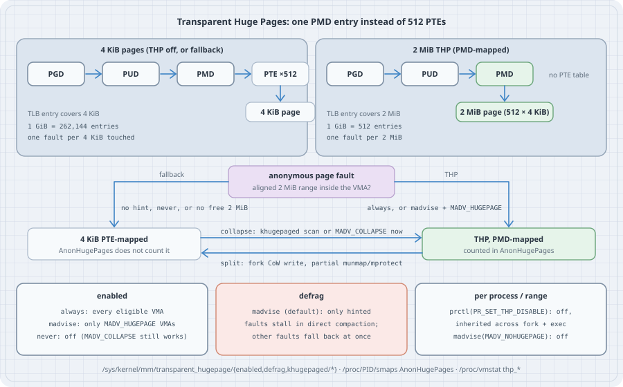

## Overview

**Thesis:** Transparent Huge Pages (THP) let the kernel back anonymous memory with 2 MiB pages instead of 4 KiB ones, without the application asking. One 2 MiB page is mapped by a single page-middle-directory (PMD) entry instead of 512 PTEs, so it costs one page fault instead of 512, and one TLB entry instead of 512. The price is paid elsewhere: the kernel may stall a page fault to **compact** memory into a free 2 MiB block, a sparse write can make a process resident for 2 MiB instead of 4 KiB, and `fork()` plus writes splits huge mappings back into small ones. Which side wins depends on the workload, so the kernel offers a policy (`always`, `madvise`, `never`), and every serious database (Redis, Valkey, MongoDB, many JVM guides) tells you what it wants. This page shows how to read the policy, see which processes really have huge pages, measure the fault, bloat and copy-on-write effects, and turn THP on or off for one process or one range.

Typical operator jobs:

- Answer "is THP on?" correctly. It is not one switch: there is a global policy, a defrag policy, per-size policies (mTHP), a per-process flag, and per-range advice.
- Find out which processes actually hold huge pages (`AnonHugePages`), and whether faults are falling back or stalling in compaction (`/proc/vmstat`).
- Follow a database's advice ("disable THP") without breaking the JVM next to it that wants THP, using `madvise` and per-process controls.
- Explain a latency spike or an RSS jump after enabling `always`.

```bash
uname -r
cat /sys/kernel/mm/transparent_hugepage/enabled
cat /sys/kernel/mm/transparent_hugepage/hpage_pmd_size
```

```text
6.12.94+
always [madvise] never
2097152
```

All output below comes from a Debian 13 host (a virtual machine) with 16 GiB of RAM, **no swap**, kernel 6.12, x86-64, run as an unprivileged user (`uid=1000`, no capabilities). Python 3.13.5 and GCC 14.2 come with the box; nothing was installed. Every `/sys/kernel/mm/transparent_hugepage` file is root-writable only, so all policy *changes* in this page are described from the kernel documentation and not run here. Everything a normal user can do (read the policy, `madvise`, `prctl`, read `smaps`) was run.

{fig-alt="Top: with 4 KiB pages a lookup goes PGD, PUD, PMD, then a PTE table of 512 entries, then a 4 KiB page; a 1 GiB region needs 262,144 TLB entries and one fault per 4 KiB. With a THP the PMD entry maps a 2 MiB page directly, with no PTE table; 1 GiB needs 512 TLB entries and one fault per 2 MiB. Middle: an anonymous page fault in an aligned 2 MiB range gets a THP when enabled is always, or madvise plus MADV_HUGEPAGE; otherwise, or if no free 2 MiB block exists, it falls back to 4 KiB PTE-mapped pages, which AnonHugePages does not count. khugepaged or MADV_COLLAPSE collapse 4 KiB pages into a THP; a copy-on-write write after fork or a partial munmap or mprotect splits the PMD back. Bottom: enabled is always, madvise or never (MADV_COLLAPSE still works with never); defrag madvise, the default, stalls only hinted faults in direct compaction and other faults fall back at once; per process prctl PR_SET_THP_DISABLE, inherited across fork and exec, and per range MADV_NOHUGEPAGE."}

## Mental model

```text
  anonymous write fault at address A
        │
        ▼  is the aligned 2 MiB range around A inside one VMA,
        │  and is THP allowed here?
        │      enabled=always                       → yes
        │      enabled=madvise and VMA has MADV_HUGEPAGE → yes
        │      enabled=never, MADV_NOHUGEPAGE, PR_SET_THP_DISABLE → no
        ▼
  try to allocate 2 MiB of physically contiguous memory
        │  free block?           → map it with one PMD entry   (thp_fault_alloc)
        │  none: defrag policy says stall? → direct compaction  (compact_stall)
        │  still none / no stall → fall back to a 4 KiB page    (thp_fault_fallback)
        ▼
  later, in the background or on request
        khugepaged / MADV_COLLAPSE: 512 small pages → one THP   (thp_collapse_alloc)
        CoW after fork, partial munmap/mprotect: PMD → 512 PTEs (thp_split_pmd)
```

Four facts carry the topic:

1. **THP is about anonymous memory** (heap, `mmap(MAP_ANONYMOUS)`) and tmpfs/shmem. Page-cache THPs for regular files exist on newer kernels but are a separate story. `AnonHugePages` counts only PMD-mapped anonymous THPs.
2. **The win is mostly the TLB, not the fault.** The kernel documentation says the 512× fewer faults are "almost completely irrelevant" next to the TLB effect: fewer misses, and a shorter page walk per miss. It also says that inside a VM the TLB only gets 2 MiB entries if *both* the guest and the hypervisor use huge pages.
3. **The cost is contiguity.** A 2 MiB page needs 512 physically contiguous, aligned 4 KiB frames. On a long-running host they are often not free, so the kernel must either compact memory (a stall, inside your page fault) or give up (fallback).
4. **Policies only affect future faults.** Changing `enabled` does not split or collapse existing pages. Restart the process to get the new behaviour everywhere.

## Syntax

There is no `thp` command. The interface is files and two system calls:

```bash
cat  /sys/kernel/mm/transparent_hugepage/enabled           # global policy, brackets = current
echo madvise > /sys/kernel/mm/transparent_hugepage/enabled  # root only; lost on reboot
grep AnonHugePages /proc/meminfo                            # system-wide PMD-mapped anon THP
grep AnonHugePages /proc/PID/smaps_rollup                   # one process
grep -E '^thp_|^compact_stall' /proc/vmstat                 # success, fallback, split counters
```

```c
madvise(addr, len, MADV_HUGEPAGE);    // allow THP for this range (needed when enabled=madvise)
madvise(addr, len, MADV_NOHUGEPAGE);  // forbid THP for this range
madvise(addr, len, MADV_COLLAPSE);    // collapse this range to THPs now (Linux 6.1+)
prctl(PR_SET_THP_DISABLE, 1, 0, 0, 0); // no THP for this process; inherited by fork and exec
```

| File under `/sys/kernel/mm/transparent_hugepage/` | Meaning |
|---|---|
| `enabled` | `always`: any eligible anonymous VMA. `madvise`: only `MADV_HUGEPAGE` ranges. `never`: off (but see `MADV_COLLAPSE`). |
| `defrag` | What a fault does when no 2 MiB block is free. `always`: stall in direct reclaim/compaction. `defer`: wake `kswapd`/`kcompactd`, fall back now. `defer+madvise`: stall for `MADV_HUGEPAGE` ranges, defer for others. `madvise` (default): stall only for `MADV_HUGEPAGE` ranges. `never`: never stall. |
| `hugepages-<size>kB/enabled` | Per-size policy for multi-size THP (mTHP, Linux 6.8+): `always`, `inherit` (use top-level `enabled`), `madvise`, `never`. By default 2048 kB is `inherit` and the rest `never`. |
| `shmem_enabled` | Policy for tmpfs/shmem (`always`, `within_size`, `advise`, `never`, `deny`, `force`). |
| `use_zero_page` | `1`: a read fault maps the shared huge zero page. |
| `shrink_underused` | `1`: under memory pressure, split THPs whose zero-filled subpages exceed `khugepaged/max_ptes_none`. |
| `khugepaged/pages_to_scan`, `scan_sleep_millisecs` | Background collapse rate: pages scanned per pass, and sleep between passes. |
| `khugepaged/max_ptes_none` | How many of the 512 small pages may be *unmapped* and still be collapsed (filled with zeros). `511` = collapse even a range with one page in it. |
| `khugepaged/max_ptes_swap`, `max_ptes_shared` | How many swapped-out or shared pages may be in a range khugepaged collapses. |
| `khugepaged/pages_collapsed`, `full_scans` | Progress counters. |

Boot-time default: `transparent_hugepage=always|madvise|never` on the kernel command line, and `thp_anon=` for per-size policy. Distributions choose differently; this Debian kernel defaults to `madvise`, and some distributions ship `always`.

## Safety

- Changing `enabled` or `defrag` is root-only and affects every process on the host, including ones you do not own. Change it in a maintenance window. It does not undo existing huge pages; restart the services that matter.
- Setting `khugepaged/scan_sleep_millisecs` to 0 makes khugepaged spin on one CPU. Setting `max_ptes_none` high (the default 511) lets khugepaged *grow* RSS: a range with one resident 4 KiB page becomes 2 MiB.
- `enabled=always` with `defrag=always` puts compaction directly into page faults for every process. That is a known source of multi-millisecond latency spikes on fragmented hosts.
- Writes to `/sys` do not survive a reboot. Persist with the kernel command line, or a boot-time unit such as a `tmpfiles.d` line `w /sys/kernel/mm/transparent_hugepage/enabled - - - - madvise`.

## Examples with Explanations

### 1. Read the whole policy, not just `enabled`

```sh
#!/bin/sh
# thp_settings.sh - read-only THP report: policy, khugepaged, mTHP sizes, counters
T=/sys/kernel/mm/transparent_hugepage
echo "kernel $(uname -r), PMD huge page $(( $(cat $T/hpage_pmd_size) / 1024 )) KiB"
for f in enabled defrag shmem_enabled use_zero_page shrink_underused; do
    [ -r "$T/$f" ] && printf '  %-16s %s\n' "$f" "$(cat $T/$f)"
done
echo "khugepaged:"
for f in pages_to_scan scan_sleep_millisecs alloc_sleep_millisecs defrag \
         max_ptes_none max_ptes_swap max_ptes_shared full_scans pages_collapsed; do
    printf '  %-22s %s\n' "$f" "$(cat $T/khugepaged/$f)"
done
echo "per-size anon policy (mTHP):"
for d in $T/hugepages-*kB; do
    if [ -r "$d/enabled" ]; then pol=$(cat "$d/enabled"); else pol="(no anon control: shmem-only size)"; fi
    printf '  %-10s %s\n' "${d##*/hugepages-}" "$pol"
done | sort -n
echo "counters (/proc/vmstat):"
grep -E '^(thp_fault_alloc|thp_fault_fallback|thp_collapse_alloc|thp_split_pmd|compact_stall) ' /proc/vmstat | sed 's/^/  /'
grep AnonHugePages /proc/meminfo | sed 's/^/  /'
```

```bash
./thp_settings.sh
```

```text
kernel 6.12.94+, PMD huge page 2048 KiB
  enabled          always [madvise] never
  defrag           always defer defer+madvise [madvise] never
  shmem_enabled    always within_size advise [never] deny force
  use_zero_page    1
  shrink_underused 1
khugepaged:
  pages_to_scan          4096
  scan_sleep_millisecs   10000
  alloc_sleep_millisecs  60000
  defrag                 1
  max_ptes_none          511
  max_ptes_swap          64
  max_ptes_shared        256
  full_scans             32
  pages_collapsed        22
per-size anon policy (mTHP):
  8kB        (no anon control: shmem-only size)
  16kB       always inherit madvise [never]
  32kB       always inherit madvise [never]
  64kB       always inherit madvise [never]
  128kB      always inherit madvise [never]
  256kB      always inherit madvise [never]
  512kB      always inherit madvise [never]
  1024kB     always inherit madvise [never]
  2048kB     always [inherit] madvise never
counters (/proc/vmstat):
  compact_stall 2631
  thp_fault_alloc 3006
  thp_fault_fallback 706
  thp_collapse_alloc 118
  thp_split_pmd 204
  AnonHugePages:         0 kB
```

How to read it:

- `enabled [madvise]` with `hugepages-2048kB [inherit]`: 2 MiB THPs only where a program asked with `MADV_HUGEPAGE`. All smaller mTHP sizes are `never`. `8kB` has no anonymous control because anonymous mTHP starts at order 2 (16 kB); order 1 exists only for shmem/file memory.
- `defrag [madvise]`: a hinted fault may stall in compaction, an unhinted one never does.
- `max_ptes_none 511`: khugepaged would collapse a range with a single resident page.
- The counters are cumulative since boot and system-wide. `thp_fault_fallback` 706 next to `thp_fault_alloc` 3006 says about one in five huge-page faults on this host could not get a 2 MiB block. `compact_stall` 2631 says processes have stalled in direct compaction thousands of times. Read them as deltas around an event, as the next examples do.
- `AnonHugePages: 0 kB`: right now nobody on this host holds a PMD-mapped anonymous THP.

### 2. What `MADV_HUGEPAGE` changes on first touch

A small helper module is shared by the Python listings below. It uses only the standard library: `ctypes` calls `madvise(2)` and `prctl(2)` directly, because Python's `mmap` module has `MADV_HUGEPAGE` but not `MADV_COLLAPSE`.

```python
# thp_util.py - small helpers shared by the THP listings (Linux, Python 3 stdlib only)
import ctypes, mmap, os, re, resource

MB = 1 << 20
MADV_COLLAPSE = 25          # <asm-generic/mman-common.h>, Linux 6.1+; Python's mmap module lacks it
PR_SET_THP_DISABLE = 41     # <linux/prctl.h>, Linux 3.15+
PR_GET_THP_DISABLE = 42
libc = ctypes.CDLL(None, use_errno=True)
libc.madvise.argtypes = [ctypes.c_void_p, ctypes.c_size_t, ctypes.c_int]
libc.prctl.argtypes = [ctypes.c_int, ctypes.c_ulong, ctypes.c_ulong, ctypes.c_ulong, ctypes.c_ulong]

def anon_map(size):
    """Private anonymous mapping; returns (mmap object, start address)."""
    m = mmap.mmap(-1, size, flags=mmap.MAP_PRIVATE | mmap.MAP_ANONYMOUS)
    return m, ctypes.addressof(ctypes.c_char.from_buffer(m))

def madvise(addr, size, advice):
    """Raw madvise(2) so we can pass advice values the mmap module does not know."""
    if libc.madvise(addr, size, advice) != 0:
        e = ctypes.get_errno()
        return f"{os.strerror(e)} ({e})"
    return "ok"

def touch(m, size, step=4096):
    """Write one byte every `step` bytes; returns minor page faults taken."""
    before = resource.getrusage(resource.RUSAGE_SELF).ru_minflt
    for off in range(0, size, step):
        m[off] = 1
    return resource.getrusage(resource.RUSAGE_SELF).ru_minflt - before

def smaps(addr, pid="self"):
    """The /proc/PID/smaps fields of the VMA that starts at addr (sizes in kB)."""
    fields, mine = {}, False
    with open(f"/proc/{pid}/smaps") as f:
        for line in f:
            head = line.split()
            if re.match(r"^[0-9a-f]+-[0-9a-f]+$", head[0]):        # a new VMA header line
                if mine:
                    break
                mine = head[0].startswith(f"{addr:x}-")
            elif mine:
                fields[head[0].rstrip(":")] = int(head[1]) if head[1].isdigit() else head[1]
    return fields

def vmstat(*names):
    with open("/proc/vmstat") as f:
        d = dict(line.split() for line in f)
    return {n: int(d.get(n, 0)) for n in names}
```

```python
# thp_fault.py - what MADV_HUGEPAGE changes on first touch (enabled=madvise host)
import mmap, time
from thp_util import MB, anon_map, madvise, touch, smaps, vmstat

SIZE = 256 * MB
print(open("/sys/kernel/mm/transparent_hugepage/enabled").read().strip(), "<- enabled")
print(f"{'mapping':<15}{'2M-aligned':>11}{'minor faults':>14}{'touch ms':>10}{'Rss kB':>9}"
      f"{'AnonHuge kB':>13}{'fault_alloc +':>15}{'fallback +':>12}{'compact_stall +':>17}")
C = ("thp_fault_alloc", "thp_fault_fallback", "compact_stall")
for label, advice in (("plain mmap", None), ("MADV_HUGEPAGE", mmap.MADV_HUGEPAGE)):
    m, addr = anon_map(SIZE)
    if advice is not None:
        assert madvise(addr, SIZE, advice) == "ok"
    v0 = vmstat(*C)
    t0 = time.perf_counter()
    faults = touch(m, SIZE)
    ms = (time.perf_counter() - t0) * 1000
    v1 = vmstat(*C)
    d = [v1[k] - v0[k] for k in C]
    s = smaps(addr)
    print(f"{label:<15}{str(addr % (2 * MB) == 0):>11}{faults:>14}{ms:>10.0f}{s['Rss']:>9}"
          f"{s['AnonHugePages']:>13}{d[0]:>15}{d[1]:>12}{d[2]:>17}")
    m.close()
```

```bash
python3 thp_fault.py; sleep 5; python3 thp_fault.py
```

```text
always [madvise] never <- enabled
mapping         2M-aligned  minor faults  touch ms   Rss kB  AnonHuge kB  fault_alloc +  fallback +  compact_stall +
plain mmap            True         65536       198   262144            0              0           0                0
MADV_HUGEPAGE         True          4216       267   262144       245760            120           8               68
always [madvise] never <- enabled
mapping         2M-aligned  minor faults  touch ms   Rss kB  AnonHuge kB  fault_alloc +  fallback +  compact_stall +
plain mmap            True         65536       208   262144            0              0           0                0
MADV_HUGEPAGE         True           128       194   262144       262144            128           0               17
```

Read it row by row:

- **Plain mapping:** 65,536 faults for 256 MiB, one per 4 KiB page, and `AnonHugePages` 0. With `enabled=madvise` an unhinted range never gets THPs.
- **`MADV_HUGEPAGE`, second run:** 128 faults, one per 2 MiB, the whole 256 MiB is huge, and `thp_fault_alloc` went up by 128. Still, `compact_stall` rose by 17: even a fully successful run can stall in direct compaction first.
- **`MADV_HUGEPAGE`, first run:** only 120 of 128 blocks got a THP. 8 fell back to small pages (hence 4,216 faults), and there were 68 compaction stalls. The same program on the same host gets a different answer depending on how fragmented physical memory is at that moment.
- **The time column is not a THP benchmark.** It is dominated by the Python loop writing 65,536 bytes either way. It shows that the hinted run is not reliably faster on first touch: it trades 512× fewer faults for zeroing 2 MiB at a time and sometimes compacting.

The mapping is 2 MiB-aligned without asking: Linux 6.12 places anonymous mappings whose length is a multiple of 2 MiB on a 2 MiB boundary (`__get_unmapped_area()` in `mm/mmap.c`; older kernels may not). A THP can only map an aligned 2 MiB range that lies wholly inside one VMA. With a misaligned or smaller mapping, the ragged ends always use 4 KiB pages.

### 3. "Touch 1 byte, get 2 MiB": the bloat effect

```python
# thp_bloat.py - "touch 1 byte, get 2 MiB": sparse writes with and without THP
import mmap
from thp_util import MB, anon_map, madvise, touch, smaps

SIZE = 64 * MB
print(f"{'mapping':<16}{'bytes written':>14}{'minor faults':>14}{'Rss kB':>9}{'AnonHugePages kB':>18}")
for label, advice in (("plain mmap", None), ("MADV_HUGEPAGE", mmap.MADV_HUGEPAGE)):
    m, addr = anon_map(SIZE)
    if advice is not None:
        madvise(addr, SIZE, advice)
    faults = touch(m, SIZE, step=2 * MB)        # one byte in each 2 MiB block
    s = smaps(addr)
    print(f"{label:<16}{SIZE // (2 * MB):>14}{faults:>14}{s['Rss']:>9}{s['AnonHugePages']:>18}")
    m.close()
```

```bash
python3 thp_bloat.py
```

```text
mapping          bytes written  minor faults   Rss kB  AnonHugePages kB
plain mmap                  32            32      128                 0
MADV_HUGEPAGE               32            32    65536             65536
```

The same 32 one-byte writes make the process resident for 128 KiB with small pages and for **64 MiB** with THP: 512 times more. This is the case the kernel documentation warns about ("an application may mmap a large region but only touch 1 byte of it"). It is why `enabled=always` can raise RSS for allocators that leave holes in their arenas, and why `madvise` is the conservative default. `shrink_underused=1` lets the kernel split such mostly-zero THPs again, but only under memory pressure.

### 4. Collapse now, collapse later, or never

`MADV_HUGEPAGE` affects *future* faults. Memory already faulted with 4 KiB pages stays small until something collapses it: khugepaged in the background, or `MADV_COLLAPSE` synchronously.

```python
# thp_collapse.py - MADV_COLLAPSE (synchronous collapse) and PR_SET_THP_DISABLE
import sys
from thp_util import (MB, MADV_COLLAPSE, PR_SET_THP_DISABLE, PR_GET_THP_DISABLE,
                      libc, anon_map, madvise, touch, smaps)
import mmap

SIZE = 64 * MB

def show(step, addr):
    s = smaps(addr)
    print(f"  {step:<44} AnonHugePages {s['AnonHugePages']:>6} kB   THPeligible {s['THPeligible']}")

mode = sys.argv[1] if len(sys.argv) > 1 else "hint"       # hint | collapse-only | disabled
if mode == "disabled":
    print("prctl(PR_SET_THP_DISABLE, 1) ->", libc.prctl(PR_SET_THP_DISABLE, 1, 0, 0, 0),
          "| PR_GET_THP_DISABLE ->", libc.prctl(PR_GET_THP_DISABLE, 0, 0, 0, 0))
print(f"mode {mode}:")
m, addr = anon_map(SIZE)
touch(m, SIZE)
show("touched with 4 KiB pages, no advice", addr)
if mode != "collapse-only":
    print("  madvise(MADV_HUGEPAGE)  ->", madvise(addr, SIZE, mmap.MADV_HUGEPAGE))
    show("after MADV_HUGEPAGE (nothing re-faults)", addr)
print("  madvise(MADV_COLLAPSE)  ->", madvise(addr, SIZE, MADV_COLLAPSE))
show("after MADV_COLLAPSE", addr)
```

```bash
for m in hint collapse-only disabled; do python3 thp_collapse.py $m; done
```

```text
mode hint:
  touched with 4 KiB pages, no advice          AnonHugePages      0 kB   THPeligible 0
  madvise(MADV_HUGEPAGE)  -> ok
  after MADV_HUGEPAGE (nothing re-faults)      AnonHugePages      0 kB   THPeligible 1
  madvise(MADV_COLLAPSE)  -> ok
  after MADV_COLLAPSE                          AnonHugePages  65536 kB   THPeligible 1
mode collapse-only:
  touched with 4 KiB pages, no advice          AnonHugePages      0 kB   THPeligible 0
  madvise(MADV_COLLAPSE)  -> ok
  after MADV_COLLAPSE                          AnonHugePages  65536 kB   THPeligible 0
prctl(PR_SET_THP_DISABLE, 1) -> 0 | PR_GET_THP_DISABLE -> 1
mode disabled:
  touched with 4 KiB pages, no advice          AnonHugePages      0 kB   THPeligible 0
  madvise(MADV_HUGEPAGE)  -> ok
  after MADV_HUGEPAGE (nothing re-faults)      AnonHugePages      0 kB   THPeligible 0
  madvise(MADV_COLLAPSE)  -> Invalid argument (22)
  after MADV_COLLAPSE                          AnonHugePages      0 kB   THPeligible 0
```

What it shows:

- **`hint`:** `MADV_HUGEPAGE` alone changes nothing in memory that is already resident (it only flips `THPeligible` to 1). `MADV_COLLAPSE` turns the 64 MiB into THPs immediately, in the calling thread, paying the copy cost there.
- **`collapse-only`:** `MADV_COLLAPSE` works without `MADV_HUGEPAGE`, even with `enabled=madvise`. The kernel documentation says it ignores the sysfs `enabled` setting, even `never`. The range is collapsed although it is still not eligible for *fault-time* THPs (`THPeligible 0`).
- **`disabled`:** after `prctl(PR_SET_THP_DISABLE, 1)` both the hint and the collapse are refused. `MADV_COLLAPSE` fails with `EINVAL` because `thp_vma_allowable_order()` sees the process's `MMF_DISABLE_THP` flag (`mm/khugepaged.c`, `include/linux/huge_mm.h` in 6.12). This is the only control that beats `MADV_COLLAPSE`, apart from `MADV_NOHUGEPAGE` on the range.

Without `MADV_COLLAPSE`, khugepaged gets there eventually:

```python
# thp_khugepaged.py - let khugepaged collapse an MADV_HUGEPAGE region in the background
import mmap, time
from thp_util import MB, anon_map, madvise, touch, smaps

KH = "/sys/kernel/mm/transparent_hugepage/khugepaged/"
def kh(name):
    return int(open(KH + name).read())

SIZE = 16 * MB
m, addr = anon_map(SIZE)
touch(m, SIZE)                                  # 4096 small pages, faulted before the hint
madvise(addr, SIZE, mmap.MADV_HUGEPAGE)         # registers this mm with khugepaged
print(f"scan_sleep_millisecs={kh('scan_sleep_millisecs')} pages_to_scan={kh('pages_to_scan')} "
      f"max_ptes_none={kh('max_ptes_none')}")
c0, f0, t0 = kh("pages_collapsed"), kh("full_scans"), time.time()
last = -1
while time.time() - t0 < 180:
    huge = smaps(addr)["AnonHugePages"]
    if huge != last:
        print(f"t={time.time() - t0:5.1f}s  AnonHugePages {huge:>6} kB   "
              f"pages_collapsed +{kh('pages_collapsed') - c0}   full_scans +{kh('full_scans') - f0}")
        last = huge
    if huge == SIZE // 1024:
        break
    time.sleep(0.5)
```

```bash
python3 thp_khugepaged.py
```

```text
scan_sleep_millisecs=10000 pages_to_scan=4096 max_ptes_none=511
t=  0.0s  AnonHugePages      0 kB   pages_collapsed +0   full_scans +0
t= 10.0s  AnonHugePages  16384 kB   pages_collapsed +8   full_scans +0
```

The `MADV_HUGEPAGE` call registered this process with khugepaged. One pass later (`scan_sleep_millisecs` = 10 s), the 16 MiB had been collapsed into 8 THPs. On a busy host with many registered processes, khugepaged's 4096 pages per 10 s can take minutes to reach your range. That is why "THP coverage slowly creeps up after start" is normal, and why `MADV_COLLAPSE` exists.

### 5. `fork()` and copy-on-write: the Redis case

Redis, Valkey and similar servers `fork()` to write a snapshot while the parent keeps serving writes. Every write after the fork is a copy-on-write fault on a page shared with the child.

```python
# thp_fork_cow.py - copy-on-write of a THP after fork(): what does one write cost?
import mmap, os
from thp_util import MB, anon_map, madvise, touch, smaps, vmstat

SIZE = 64 * MB
m, addr = anon_map(SIZE)
madvise(addr, SIZE, mmap.MADV_HUGEPAGE)
touch(m, SIZE)
s = smaps(addr)
print(f"parent before fork: Rss {s['Rss']} kB, AnonHugePages {s['AnonHugePages']} kB")

v0 = vmstat("thp_split_pmd", "thp_split_page", "thp_deferred_split_page")
r, w = os.pipe()
pid = os.fork()
if pid == 0:                                    # child: one byte into each 2 MiB block
    os.close(r)
    faults = touch(m, SIZE, step=2 * MB)
    s = smaps(addr)
    os.write(w, f"{faults} {s['Private_Dirty']} {s['Shared_Dirty']} {s['AnonHugePages']}".encode())
    os._exit(0)
os.close(w)
faults, priv, shared, huge = map(int, os.read(r, 200).split())
os.waitpid(pid, 0)
v1 = vmstat(*v0)
print(f"child wrote 32 bytes: {faults} minor faults, Private_Dirty {priv} kB, "
      f"Shared_Dirty {shared} kB, AnonHugePages {huge} kB")
print("vmstat deltas:", {k: v1[k] - v0[k] for k in v0})
s = smaps(addr)
print(f"parent after child exit: Rss {s['Rss']} kB, AnonHugePages {s['AnonHugePages']} kB")
```

```bash
python3 thp_fork_cow.py
```

```text
parent before fork: Rss 65536 kB, AnonHugePages 65536 kB
child wrote 32 bytes: 45 minor faults, Private_Dirty 128 kB, Shared_Dirty 65408 kB, AnonHugePages 0 kB
vmstat deltas: {'thp_split_pmd': 32, 'thp_split_page': 0, 'thp_deferred_split_page': 0}
parent after child exit: Rss 65536 kB, AnonHugePages 65536 kB
```

32 one-byte writes in the child cost 32 × 4 KiB = **128 KiB** of copied memory, not 32 × 2 MiB. Each write split the writer's PMD (`thp_split_pmd` +32) and copied one 4 KiB page; the rest stayed shared (`Shared_Dirty` 65,408 kB). The writer's mapping is no longer PMD-mapped (`AnonHugePages 0`), while the parent kept its THPs.

This is Linux 5.8+ behaviour (`do_huge_pmd_wp_page()` in `mm/huge_memory.c` ends in `__split_huge_pmd(...)` and `VM_FAULT_FALLBACK`). The commit that introduced it ("thp: change CoW semantics for anon-THP") names Redis as the workload that made THP unusable before. Older kernels allocated and copied a whole new 2 MiB page on the first write, so a snapshot under write load could double memory and stall. That is where the classic "disable THP for Redis" advice comes from. On current kernels the remaining costs are the split itself, the loss of huge pages in the writer until khugepaged re-collapses them, the bloat from Example 3, and compaction stalls at fault time from Example 2. That is enough for Redis to still refuse THP, but as a latency choice, not because a fork doubles memory.

What Redis and Valkey actually do (source: `redis.conf`/`valkey.conf`, `src/server.c`, `src/syscheck.c`): at start-up they read `/sys/kernel/mm/transparent_hugepage/enabled`. Only if it says `[always]` do they call `prctl(PR_SET_THP_DISABLE, 1, 0, 0, 0)` for themselves (config `disable-thp yes`, the default). They log the warning "You have Transparent Huge Pages (THP) support enabled in your kernel" only if that call fails. With `madvise` or `never` they do nothing: they never ask for THP, so they never get it.

### 6. Which processes hold huge pages, and does it help?

```sh
#!/bin/sh
# thp_top.sh - which processes hold PMD-sized THPs? (smaps_rollup; readable PIDs only)
printf '%8s %8s %12s %12s  %s\n' PID THP_en "Rss kB" "AnonHuge kB" COMMAND
for d in /proc/[0-9]*; do
    r=$(grep -E '^(Rss|AnonHugePages):' "$d/smaps_rollup" 2>/dev/null | awk '{printf "%s ", $2}')
    [ -n "$r" ] || continue                     # not ours (or a kernel thread): skip
    en=$(awk '/^THP_enabled:/ {print $2}' "$d/status" 2>/dev/null)
    set -- $r
    printf '%8s %8s %12s %12s  %s\n' "${d#/proc/}" "$en" "$1" "$2" "$(cut -c1-40 "$d/comm")"
done | sort -k4,4nr | head -6
```

```python
# thp_hold.py - hold 128 MiB of MADV_HUGEPAGE memory for 30 s (a stand-in "server")
import mmap, time
from thp_util import MB, anon_map, madvise, touch
m, addr = anon_map(128 * MB)
madvise(addr, 128 * MB, mmap.MADV_HUGEPAGE)
touch(m, 128 * MB)
time.sleep(30)
```

```bash
python3 thp_hold.py & sleep 2; ./thp_top.sh; kill $!
```

```text
     PID   THP_en       Rss kB  AnonHuge kB  COMMAND
   79455        1       141612       131072  python3
     203        1        30732            0  websockify
     208        1         1992            0  bash
     209        1         1908            0  flock
     210        1        29860            0  node
     221        1        37212            0  node
```

`THP_en` is the `THP_enabled:` line of `/proc/PID/status`: `0` means the process has `PR_SET_THP_DISABLE`. Without root you only see your own processes. As root, the same loop over every PID is the quickest audit after changing the policy.

Whether huge pages *help* is a measurement, not an assumption. This listing chases pointers through 1 GiB, one dependent load per randomly chosen 4 KiB page, so nearly every load is a TLB miss with small pages:

```c
// thp_chase.c - dependent loads, one per 4 KiB page, across 1 GiB:
// measures what a TLB miss costs with 4 KiB pages vs 2 MiB THPs.
// build: cc -O2 -o thp_chase thp_chase.c     run: ./thp_chase [huge]
#define _GNU_SOURCE
#include <stdint.h>
#include <stdio.h>
#include <stdlib.h>
#include <string.h>
#include <sys/mman.h>
#include <time.h>

#define SIZE   (1UL << 30)
#define PAGE   4096UL
#define NPAGES (SIZE / PAGE)
#define LOADS  20000000UL

static uint64_t rng = 20261017;
static uint64_t next_rand(void) {               // xorshift64*
    rng ^= rng >> 12; rng ^= rng << 25; rng ^= rng >> 27;
    return rng * 2685821657736338717ULL;
}

static long anon_huge_kb(void) {                // whole-process AnonHugePages
    FILE *f = fopen("/proc/self/smaps_rollup", "r");
    char line[256]; long kb = -1;
    while (f && fgets(line, sizeof line, f))
        if (sscanf(line, "AnonHugePages: %ld kB", &kb) == 1) break;
    if (f) fclose(f);
    return kb;
}

int main(int argc, char **argv) {
    int huge = argc > 1 && strcmp(argv[1], "huge") == 0;
    char *base = mmap(NULL, SIZE, PROT_READ | PROT_WRITE,
                      MAP_PRIVATE | MAP_ANONYMOUS, -1, 0);
    if (base == MAP_FAILED) { perror("mmap"); return 1; }
    if (huge && madvise(base, SIZE, MADV_HUGEPAGE) != 0) { perror("madvise"); return 1; }

    // Sattolo's algorithm: a random single cycle through every page.
    uint32_t *order = malloc(NPAGES * sizeof *order);
    for (uint32_t i = 0; i < NPAGES; i++) order[i] = i;
    for (uint32_t i = NPAGES - 1; i > 0; i--) {
        uint32_t j = next_rand() % i, t = order[i];
        order[i] = order[j]; order[j] = t;
    }
    // Node in page order[i] (at a random cache line) points to the node in page order[i+1].
    uint32_t *line = malloc(NPAGES * sizeof *line);
    for (uint32_t p = 0; p < NPAGES; p++) line[p] = (next_rand() % (PAGE / 64)) * 64;
    for (uint32_t i = 0; i < NPAGES; i++) {
        uint32_t a = order[i], b = order[(i + 1) % NPAGES];
        *(char **)(base + a * PAGE + line[a]) = base + b * PAGE + line[b];
    }
    free(order); free(line);

    char **p = (char **)(base + 0 * PAGE);      // any node is on the cycle; find page 0's node
    for (uint32_t off = 0; off < PAGE; off += 64)
        if (*(char **)(base + off)) { p = (char **)(base + off); break; }

    struct timespec t0, t1;
    clock_gettime(CLOCK_MONOTONIC, &t0);
    for (unsigned long i = 0; i < LOADS; i++) p = (char **)*p;
    clock_gettime(CLOCK_MONOTONIC, &t1);
    double ns = ((t1.tv_sec - t0.tv_sec) * 1e9 + (t1.tv_nsec - t0.tv_nsec)) / LOADS;

    printf("%-14s AnonHugePages %5ld MiB   %6.1f ns per dependent load   (end %p)\n",
           huge ? "MADV_HUGEPAGE" : "plain mmap", anon_huge_kb() / 1024, ns, (void *)p);
    return 0;
}
```

```bash
cc -O2 -Wall -o thp_chase thp_chase.c && for i in 1 2 3; do ./thp_chase; ./thp_chase huge; done
```

```text
plain mmap     AnonHugePages     0 MiB    182.2 ns per dependent load   (end 0x7f691b942e80)
MADV_HUGEPAGE  AnonHugePages   970 MiB    191.9 ns per dependent load   (end 0x7f0e7b942e80)
plain mmap     AnonHugePages     0 MiB    204.4 ns per dependent load   (end 0x7f9803342e80)
MADV_HUGEPAGE  AnonHugePages   914 MiB    163.8 ns per dependent load   (end 0x7fe9ee742e80)
plain mmap     AnonHugePages     0 MiB    185.3 ns per dependent load   (end 0x7f4755b42e80)
MADV_HUGEPAGE  AnonHugePages   930 MiB    222.1 ns per dependent load   (end 0x7f195d342e80)
```

On this machine there is **no measurable difference**: the two sets of runs overlap (164–222 ns against 182–204 ns), and both are dominated by cache misses to DRAM. Also, only 914–970 of the 1024 MiB got THPs. The box is a shared virtual machine. As fact 2 in the mental model says, the guest's 2 MiB pages only become 2 MiB TLB entries if the hypervisor also backs guest memory with huge pages, which a guest cannot see. On bare metal, or a VM with huge-page-backed memory, this same listing is the right test. Run it before arguing for or against THP from someone else's benchmark.

### 7. Make the policy stick (root; not run here)

```bash
# one-off, until reboot
echo madvise | sudo tee /sys/kernel/mm/transparent_hugepage/enabled
echo madvise | sudo tee /sys/kernel/mm/transparent_hugepage/defrag

# at boot: kernel command line (GRUB_CMDLINE_LINUX in /etc/default/grub, then update-grub)
transparent_hugepage=madvise

# or a tmpfiles.d drop-in, /etc/tmpfiles.d/thp.conf
w /sys/kernel/mm/transparent_hugepage/enabled - - - - madvise
```

Pick the policy for the host, then let programs opt in or out:

- **`madvise` host** (the common choice): programs that want THP say so. Examples are the JVM with `-XX:+UseTransparentHugePages`, and allocators such as jemalloc or tcmalloc configured to use THP. Redis/Valkey get none.
- **`always` host:** everything eligible gets THP. Programs that do not want it opt out with `prctl(PR_SET_THP_DISABLE)`, which Redis and Valkey do by default. Because the flag is inherited across `fork` and `execve`, a tiny wrapper that sets it and then `exec`s the service opts out any program.
- **`never`:** only `MADV_COLLAPSE` can still produce THPs.

## The trap

**Trap: "`enabled` says `never`/`madvise`, so this process has no huge pages."** `madvise` hosts give THPs to any range that asked. `MADV_COLLAPSE` ignores `enabled` entirely (Example 4). Per-size `hugepages-*kB/enabled` can turn on mTHP even when the top-level value is `never`. And existing THPs survive a policy change. Check `AnonHugePages` in the process's `smaps_rollup`, not the policy file.

**Trap: "`AnonHugePages` is the THP total."** It counts only *PMD-mapped* anonymous THPs. mTHP folios (16 kB–1 MB) and THPs that have been PTE-mapped after a split are not in it. Use `hugepages-<size>kB/stats/nr_anon` for per-size counts.

**Trap: "THP makes memory faster."** Example 6 shows a case where it does not, and Examples 2 and 3 show what it can cost: compaction stalls inside page faults and 512× RSS for sparse writes. THP is a trade-off. Measure your workload on your platform.

**Trap: "disable THP" means `echo never`.** For one database that is a host-wide change that also takes huge pages away from a JVM or a VM next to it. With `madvise` as the host policy, Redis already gets none, and other programs can still opt in.

## Notes & Pitfalls

- Static huge pages (`HugePages_Total`, `hugetlbfs`, `vm.nr_hugepages`, `MAP_HUGETLB`) are a different mechanism: reserved up front, never swapped, never split, not affected by any setting on this page. Do not confuse `Hugepagesize` in `/proc/meminfo` with THP.
- A read fault on an untouched THP-eligible range maps the shared **huge zero page** (`use_zero_page=1`). The first write then takes a CoW fault, which on 5.8+ splits it into 4 KiB pages. Pre-touching memory with reads (`atomic_add(0)` style) therefore defeats THP; use writes or `madvise(MADV_POPULATE_WRITE)` (Linux 5.14+).
- `mprotect()` or `munmap()` on part of a 2 MiB range splits the PMD (`thp_split_pmd`). Allocators that release memory in small pieces erode THP coverage over time.
- Inside a memory cgroup, a THP is charged 2 MiB at once. `thp_fault_fallback_charge` counts faults that fell back because the cgroup limit was near.
- Reading `/proc/PID/smaps` walks every VMA and is expensive on large processes. Use `smaps_rollup` for totals.

## The boring rule

Run hosts with `enabled=madvise` and `defrag=madvise` unless you have measured a reason not to. Let the programs that benefit opt in with `MADV_HUGEPAGE`, and let the ones that suffer opt out with `PR_SET_THP_DISABLE`. Judge results by `AnonHugePages` per process and by deltas of `thp_fault_fallback` and `compact_stall` in `/proc/vmstat`, not by the policy file.

## Related Commands

- `pmap -X PID` shows the `AnonHugePages` column per mapping, the same data as `smaps`.
- `vmstat 1` / `sar -B` report page faults and reclaim; pair them with `/proc/vmstat` deltas.
- `perf stat -e dTLB-load-misses,dTLB-loads` measures TLB misses directly (on bare metal or a VM that exposes PMU counters).
- `free` / `/proc/meminfo` give `AnonHugePages` (THP) and `HugePages_*` (static hugetlb), which are two different things.

## Try this

1. Run `thp_fault.py` several times, ideally on a busy host. Plot `fallback +` against `compact_stall +`. When does the hinted run get *slower* than the plain one?
2. Change `thp_bloat.py` to write one byte every 64 KiB, then every 4 KiB. At what density does THP stop costing extra RSS?
3. In `thp_fork_cow.py`, let the *parent* write after the fork instead of the child. Whose `AnonHugePages` drops now? (That is the Redis case: the parent serves writes during `BGSAVE`.)
4. Write a 10-line C wrapper `nothp` that calls `prctl(PR_SET_THP_DISABLE, 1, 0, 0, 0)` and then `execvp(argv[1], argv + 1)`. Run `./nothp python3 thp_fault.py` and check that the hinted row shows no huge pages, and `grep THP_enabled /proc/self/status` prints 0.
5. On a machine where you have root and no shared tenants, run `thp_chase` under `enabled=never` and `enabled=always`, with `perf stat -e dTLB-load-misses`. Compare the result to Example 6.

## Verification

- Run unprivileged on this box: Debian 13, Linux **6.12.94+** x86-64 (a VM), 16 GiB RAM, no swap, Python **3.13.5**, GCC **14.2**, `uid=1000`. THP policy `enabled=madvise`, `defrag=madvise`. All output above is pasted from those runs, unedited.
- The `/proc/vmstat` deltas are system-wide, so other processes could add to them. Each listing's window is under a second, and the totals match the mapping (for example 120 + 8 = 128 blocks of 2 MiB).
- The behaviour claims were checked against the Linux 6.12 source: `do_huge_pmd_wp_page()` (split on CoW, `mm/huge_memory.c`), `madvise_collapse()` → `thp_vma_allowable_order()` → `vma_thp_disabled()` (`EINVAL` under `PR_SET_THP_DISABLE`), and `THP_ORDERS_ALL_ANON` excluding orders 0 and 1 (`include/linux/huge_mm.h`). Redis behaviour was checked against `redis.conf`, `src/server.c` (`THPDisable()`), `src/syscheck.c` (`checkTHPEnabled()`), and `valkey.conf`.
- **Not run:** any write to `/sys/kernel/mm/transparent_hugepage/*` (root-only, and host-wide on a shared machine), the boot-time options, `tmpfiles.d`, `perf stat` TLB counters, and Redis/Valkey themselves (not installed). These are written from the kernel documentation and project sources below.
- No packages installed, no root, no `sudo`.

## Sources

- Kernel docs — [Transparent Hugepage Support](https://docs.kernel.org/admin-guide/mm/transhuge.html) (sysfs controls, `defrag` modes, khugepaged, `MADV_COLLAPSE` vs `never`, process controls, `/proc/vmstat` counters), and the [6.12 version](https://docs.kernel.org/6.12/admin-guide/mm/transhuge.html)
- Kernel docs — [The /proc filesystem](https://docs.kernel.org/filesystems/proc.html): `smaps` `AnonHugePages`, `THPeligible`; `status` `THP_enabled`
- Linux 6.12 `mm/huge_memory.c` (`do_huge_pmd_wp_page()`), `mm/khugepaged.c` (`madvise_collapse()`), `include/linux/huge_mm.h` (`THP_ORDERS_ALL_ANON`, `vma_thp_disabled()`): <https://git.kernel.org/pub/scm/linux/kernel/git/stable/linux.git/tree/mm?h=linux-6.12.y>
- Commit 3917c80280c9, "thp: change CoW semantics for anon-THP" (Linux 5.8): <https://git.kernel.org/pub/scm/linux/kernel/git/torvalds/linux.git/commit/?id=3917c80280c9>
- man7 — [`madvise(2)`](https://man7.org/linux/man-pages/man2/madvise.2.html) (`MADV_HUGEPAGE`, `MADV_NOHUGEPAGE`, `MADV_COLLAPSE`), [`PR_SET_THP_DISABLE(2const)`](https://man7.org/linux/man-pages/man2/PR_SET_THP_DISABLE.2const.html)
- Redis — [`redis.conf` (`disable-thp`)](https://github.com/redis/redis/blob/unstable/redis.conf), [`src/server.c`](https://github.com/redis/redis/blob/unstable/src/server.c), [`src/syscheck.c`](https://github.com/redis/redis/blob/unstable/src/syscheck.c); Valkey — [`valkey.conf`](https://github.com/valkey-io/valkey/blob/unstable/valkey.conf)
- systemd — [`tmpfiles.d(5)`](https://www.freedesktop.org/software/systemd/man/latest/tmpfiles.d.html) (`w` lines)
