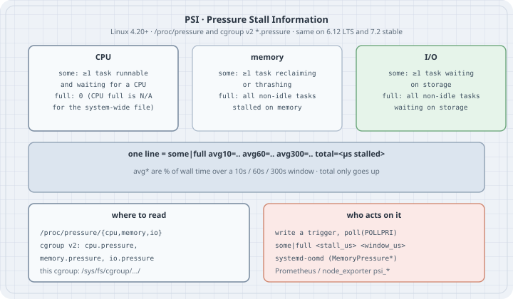

## Overview

**Thesis:** load average and `%CPU` tell you that the machine is *busy*. They do not tell you that work is *waiting*. A host at 70 % CPU can be fine; a host whose tasks spend 20 % of wall time stalled on memory is not, even if CPU looks idle. **Pressure Stall Information (PSI)** measures the share of time that tasks are stalled on **CPU**, **memory** or **I/O**. It is exported for the whole system under `/proc/pressure/` and for every cgroup v2 under `cpu.pressure`, `memory.pressure` and `io.pressure`. `systemd-oomd`, autoscalers and node exporters all read it. If you can read one pressure file and say what `some` versus `full` means, you can tell a saturated resource from a busy one before the OOM killer or a timeout does.

Typical operator jobs:

- Decide whether a latency spike is CPU contention, reclaim, or disk wait.
- Compare pressure inside one cgroup with the host (noisy neighbour vs whole-machine).
- Arm a userspace trigger that wakes on `poll()` when pressure crosses a threshold.
- Read the numbers `systemd-oomd` and Prometheus already scrape.

```bash
uname -r
ls /proc/pressure/
head -n2 /proc/pressure/cpu /proc/pressure/memory /proc/pressure/io
```

```text
6.12.94+
cpu
io
memory
==> /proc/pressure/cpu <==
some avg10=0.00 avg60=0.07 avg300=0.14 total=92264483
full avg10=0.00 avg60=0.00 avg300=0.00 total=0

==> /proc/pressure/memory <==
some avg10=0.00 avg60=0.00 avg300=0.00 total=27581617
full avg10=0.00 avg60=0.00 avg300=0.00 total=27295372

==> /proc/pressure/io <==
some avg10=0.00 avg60=0.01 avg300=0.01 total=41292135
full avg10=0.00 avg60=0.00 avg300=0.01 total=39967137
```

All output below comes from a Debian 13 host, kernel 6.12, as an unprivileged user (`uid=1000`) inside the `/agent` cgroup. PSI has been on by default since Linux 4.20 (`CONFIG_PSI=y`). Linux 7.2 (current stable) keeps the same interface.

{fig-alt="Three cards for CPU, memory and I/O. Each has a some line meaning at least one task is stalled, and a full line meaning all non-idle tasks are stalled; CPU full is not meaningful system-wide. A middle band shows the line format: some or full, avg10 avg60 avg300 as percentages of wall time, and total in microseconds. Bottom left: read from /proc/pressure or from cgroup v2 cpu.pressure, memory.pressure and io.pressure. Bottom right: consumers, a pollable trigger written as some or full stall_us window_us, systemd-oomd MemoryPressure settings, and Prometheus node_exporter psi metrics."}

## Mental model

```text
  resource contended?
           │
           ▼
  for every non-idle task in the domain (system or one cgroup)
     is it stalled waiting for that resource right now?
           │
           ├─ at least one yes  →  add this sample to "some"
           └─ every one  yes  →  add this sample to "full"
           │
           ▼
  avg10 / avg60 / avg300 = % of wall time over that window
  total                  = cumulative stalled µs (monotonic)
```

Three facts:

1. **`some` means someone is waiting.** At least one runnable task could not make progress because of that resource. Latency for *that* task is already hurt.
2. **`full` means everyone is waiting.** All non-idle tasks in the domain are stalled on it. Forward progress for the domain has stopped. For **CPU**, system-wide `full` is not defined the same way (idle time exists; the system-wide CPU file's `full` line is zeros); cgroup `cpu.pressure` *does* report `full` when every task in that cgroup is waiting for CPU.
3. **`avg*` is a percentage; `total` is a counter.** `avg10=18.05` means "over the last ~10 s, tasks were under some-pressure about 18 % of the time." `total` only rises. Derivatives of `total` are what monitors graph.

`free` and load average answer different questions. `free`'s `available` estimates reclaimable cache; PSI `memory` measures tasks actually stalled on reclaim or thrashing. Load average counts runnable+uninterruptible tasks; PSI `cpu` measures time spent *waiting* for a CPU. Use both.

## Syntax

| File | Domain |
|---|---|
| `/proc/pressure/cpu`, `memory`, `io` | Whole system (all tasks visible in this PID namespace's view of the host) |
| `cpu.pressure`, `memory.pressure`, `io.pressure` under a cgroup v2 directory | That cgroup's tasks only |
| `cgroup.pressure` | `0`/`1` kill-switch for pressure accounting in that cgroup (rare to touch) |

Line format (kernel docs):

```text
some avg10=<pct> avg60=<pct> avg300=<pct> total=<µs>
full avg10=<pct> avg60=<pct> avg300=<pct> total=<µs>
```

Triggers (write to the same file, then `poll` for `POLLPRI`):

```text
some|full <stall_us> <window_us>
```

Meaning: wake me if, inside any window of `window_us` microseconds, the cumulative stall time for `some` or `full` reaches `stall_us`. Example: `some 100000 1000000` = "100 ms of some-stall in any 1 s window." Writing and polling need write permission on the pressure file (often root for `/proc/pressure`; cgroup ownership varies).

## Safety

- Reading pressure files is always safe. Writing a trigger is safe but needs write access; a forgotten trigger stays armed until the writer closes the fd.
- Generating CPU or memory pressure on a shared host hurts neighbours. The CPU demo below uses processes inside this cgroup for a few seconds only. Do not leave a burn loop running.
- PSI is not an OOM killer. `systemd-oomd` *consumes* memory pressure (and swap) to decide when to kill; the kernel OOM killer still uses the badness score from the `choom` chapter.

## Examples with Explanations

### 1. Read the three system files as a table

```python
# read_psi.py — parse /proc/pressure/{cpu,memory,io} into a table
import pathlib

def parse(path):
    out = {}
    for line in pathlib.Path(path).read_text().splitlines():
        kind, *fields = line.split()
        out[kind] = {k: float(v) if "." in v else int(v)
                     for k, v in (f.split("=", 1) for f in fields)}
    return out

print(f"{'file':22} {'some avg10':>10} {'avg60':>8} {'avg300':>8} {'total_us':>12}"
      f"  {'full avg10':>10} {'total_us':>12}")
for name in ("cpu", "memory", "io"):
    p = parse(f"/proc/pressure/{name}")
    s, f = p["some"], p["full"]
    print(f"/proc/pressure/{name:6} {s['avg10']:10.2f} {s['avg60']:8.2f} {s['avg300']:8.2f}"
          f" {s['total']:12}  {f['avg10']:10.2f} {f['total']:12}")
```

```bash
python3 read_psi.py
```

```text
file                   some avg10    avg60   avg300     total_us  full avg10     total_us
/proc/pressure/cpu          0.00     0.07     0.14     92264483        0.00            0
/proc/pressure/memory       0.00     0.00     0.00     27581617        0.00     27295372
/proc/pressure/io           0.00     0.01     0.01     41292135        0.00     39967137
```

An idle box: `avg*` near zero, `total` already in the tens of millions of microseconds from earlier life. System-wide CPU `full.total` stays 0. Memory and I/O do report `full`. Numbers here are a snapshot; yours will differ.

### 2. Make CPU `some` move (processes, not threads)

Python threads share the GIL, so a thread burn loop does not create real CPU contention. Processes do.

```python
# cpu_pressure.py — burn N*cpus processes and watch this cgroup's cpu.pressure
import os, pathlib, time, multiprocessing as mp

def burn(seconds):
    end = time.perf_counter() + seconds
    x = 0
    while time.perf_counter() < end:
        x = (x * 3 + 1) & 0xFFFFFFFF

def psi(path):
    some = full = None
    for line in pathlib.Path(path).read_text().splitlines():
        kind, *fields = line.split()
        vals = {k: (float(v) if "." in v else int(v))
                for k, v in (f.split("=", 1) for f in fields)}
        if kind == "some":
            some = vals
        else:
            full = vals
    return some, full

cg = "/sys/fs/cgroup" + pathlib.Path("/proc/self/cgroup").read_text().strip().split(":")[-1]
path = f"{cg}/cpu.pressure"
ncpu = os.cpu_count() or 1
workers, sec = ncpu * 2, 4.0
print(f"cgroup {cg}, host CPUs {ncpu}, {workers} burn *processes* for {sec}s")
print(f"before  {pathlib.Path(path).read_text().splitlines()[0]}")
t0_some, _ = psi(path)
t0 = time.perf_counter()
procs = [mp.Process(target=burn, args=(sec,)) for _ in range(workers)]
for p in procs:
    p.start()
for i in range(4):
    time.sleep(sec / 4)
    print(f"  t+{(i + 1) * sec / 4:.1f}s  {pathlib.Path(path).read_text().splitlines()[0]}")
for p in procs:
    p.join()
some, _ = psi(path)
print(f"after   {pathlib.Path(path).read_text().splitlines()[0]}")
print(f"wall {time.perf_counter() - t0:.2f}s; some.total +{some['total'] - t0_some['total']} µs"
      f" ({(some['total'] - t0_some['total']) / 1e6:.2f}s)")
print(f"host    {pathlib.Path('/proc/pressure/cpu').read_text().splitlines()[0]}")
```

```bash
python3 cpu_pressure.py
```

```text
cgroup /sys/fs/cgroup/agent, host CPUs 8, 16 burn *processes* for 4.0s
before  some avg10=0.18 avg60=0.06 avg300=0.08 total=86659330
  t+1.0s  some avg10=2.14 avg60=0.41 avg300=0.16 total=87526472
  t+2.0s  some avg10=2.14 avg60=0.41 avg300=0.16 total=88435842
  t+3.0s  some avg10=18.05 avg60=3.34 avg300=0.77 total=89352205
  t+4.0s  some avg10=18.05 avg60=3.34 avg300=0.77 total=90291051
after   some avg10=18.05 avg60=3.34 avg300=0.77 total=90291051
wall 4.02s; some.total +3631721 µs (3.63s)
host    some avg10=27.19 avg60=5.29 avg300=1.23 total=96002136
```

Sixteen processes on eight CPUs: about half the wall time, someone in this cgroup is waiting for a CPU. `some.total` grew by 3.63 s of stall over 4.02 s of wall clock. `avg10` climbed to 18 % (the 10 s window still holds quieter history). The host line is higher (27 %) because other cgroups were runnable too. Reading the **cgroup** file answers "is *my* service stalled?"; reading `/proc/pressure` answers "is the machine stalled?"

### 3. Triggers with `poll()` (not run here — write denied)

```text
# conceptual — needs write permission on the pressure file
fd = open("/sys/fs/cgroup/…/cpu.pressure", "r+")
fd.write("some 100000 1000000")   # 100 ms of some-stall in any 1 s window
# poll(fd, POLLPRI) blocks until the condition holds; reading the fd acks it
```

On this box, `open(…/agent/cpu.pressure, O_RDWR)` returns `EACCES` for uid 1000, so the trigger was not armed. The interface and the `some|full <stall_us> <window_us>` grammar are from the kernel PSI documentation. Userspace that owns its cgroup (a systemd user service with `Delegate=`, a container runtime) can write the trigger and wait in one event loop next to its sockets.

### 4. What `systemd-oomd` does with memory pressure (docs)

`systemd-oomd` does not wait for the kernel OOM killer. It watches `memory.pressure` (and swap activity) on selected cgroups and kills a whole cgroup when pressure stays high. Unit knobs (see `oomd.conf(5)` and `systemd.resource-control(5)`):

| Knob | Role |
|---|---|
| `ManagedOOMMemoryPressure=` / `ManagedOOMMemoryPressureLimit=` | Enable monitoring; kill when `avg10` (or the configured metric) exceeds the limit |
| `ManagedOOMPreference=` | `avoid` / `omit` to protect a unit |
| `DefaultMemoryPressureDurationSec=` (oomd.conf) | How long pressure must stay high |

No systemd is running on this box; the table is from the systemd manuals. The important design point: oomd acts on **pressure**, which appears while reclaim is still working, not on the allocation failure that trips the kernel OOM killer.

## The trap

**Trap: "high `%CPU` means high CPU pressure."** A single busy loop on an otherwise idle 8-CPU host shows ~12 % CPU and ~0 PSI `some`. PSI rises when tasks *wait*. Use it for latency, not for utilisation billing.

**Trap: "threads will do for a CPU PSI demo."** Under CPython they will not (Example 2). Use processes, or a C/`stress-ng` burn.

**Trap: "`avg10` should jump the instant I start load."** It is an exponentially-weighted window of about ten seconds. Watch `total` for an immediate counter; watch `avg10` for the smoothed signal monitors alert on.

**Trap: "system-wide CPU `full` will tell me the machine is wedged."** The system-wide CPU file's `full` line stays at 0. Use cgroup `cpu.pressure`'s `full`, or look at `some` plus runnable counts.

**Trap: "PSI replaces the OOM killer."** It feeds policies that act *earlier*. The kernel OOM killer and `oom_score_adj` (see the `choom` chapter) still exist for the hard case.

## Notes & Pitfalls

- Containers: the relevant file is usually the container's own `*.pressure`, not `/proc/pressure`. A quiet container on a hot host has low cgroup pressure and high host pressure.
- `full` for memory is the dangerous one: every task is stuck in reclaim or thrashing. That is the signal oomd is built around.
- Pressure accounting can be disabled per cgroup with `cgroup.pressure=0` (rarely what you want).
- Off-CPU profiles (`offcputime`, `perf`) explain *why* a task waited; PSI tells you *how much* waiting is happening for a whole domain, cheaply.

## The boring rule

When latency is bad, read `cpu.pressure`, `memory.pressure` and `io.pressure` for the service's cgroup *and* `/proc/pressure` for the host. `some` means someone waited; `full` means everyone did. Act on pressure before you act on OOM kills.

## Related Commands

- `free`, `/proc/meminfo` — capacity and reclaimable cache; not stall time.
- `vmstat 1`, `iostat -xz 1`, `mpstat -P ALL 1` — utilisation and wait breakdowns that pair with PSI.
- `choom`, `/proc/PID/oom_score` — hard OOM policy after reclaim has failed.
- `systemd-oomd` / `oomctl` — userspace killer driven by memory PSI.

## Try this

1. Re-run `cpu_pressure.py` with `workers = ncpu` (no oversubscribe). Does `some.total` still grow?
2. On a host where you can write the cgroup pressure file, arm `some 50000 1000000`, start the burn, and time `poll(POLLPRI)`.
3. Compare `/proc/pressure/memory` with `memory.pressure` of a memory-limited `systemd-run --user -p MemoryMax=512M` scope while allocating inside it.
4. Graph `rate(psi_cpu_some_stall_seconds_total[1m])` (or your exporter's equivalent) next to p99 latency for one service.

## Verification

- Run unprivileged on this box: Debian 13, Linux **6.12.94+**, Python **3.13.5**, cgroup v2 (`0::/agent`), `uid=1000`. Examples 1 and 2 are pasted from those runs.
- Kernel interface checked against [PSI — Pressure Stall Information](https://docs.kernel.org/accounting/psi.html) and confirmed present on Linux 7.2 (current stable as of 2026-10-18, kernel.org).
- **Not run:** writing a PSI trigger (`EACCES` on this cgroup's `cpu.pressure`; a further attempt to write `/proc/pressure` was not pursued under the run rules), `systemd-oomd` (no systemd here), and a deliberate memory-pressure demo (4 GiB touch on a 16 GiB host with ~10 GiB available did not move `memory.pressure`; a truthful demo needs a tight `MemoryMax=` and was skipped rather than fabricated). These are described from the docs above.
- No packages installed, no root, no `sudo`.

## Sources

- Kernel docs — [PSI - Pressure Stall Information](https://docs.kernel.org/accounting/psi.html) (interface, `some`/`full`, triggers)
- Kernel docs — [Control Group v2: Pressure Stall Information](https://docs.kernel.org/admin-guide/cgroup-v2.html#pressure-stall-information)
- systemd — [`oomd.conf(5)`](https://www.freedesktop.org/software/systemd/man/latest/oomd.conf.html), [`systemd.resource-control(5)` `ManagedOOM*`](https://www.freedesktop.org/software/systemd/man/latest/systemd.resource-control.html)
- Prometheus node_exporter — PSI collectors (`psi_cpu_*`, `psi_memory_*`, `psi_io_*`)
- kernel.org release list (versions checked 2026-10-18): <https://www.kernel.org/>
