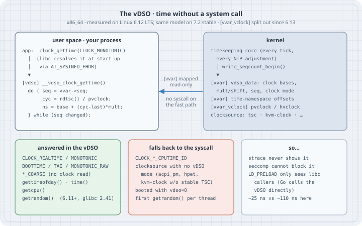

## Overview

**Thesis:** some "system calls" are not system calls. The kernel maps a small shared library, the **vDSO** (virtual dynamic shared object), into every process, together with a read-only data page, **`[vvar]`**, that the kernel keeps up to date. `clock_gettime()`, `gettimeofday()`, `time()`, `getcpu()` and, since Linux 6.11, `getrandom()` are answered by code in that library running in user space. No mode switch, no syscall entry, no seccomp check, nothing for `strace` to print. That is why a timestamp costs tens of nanoseconds instead of a hundred or more, and why several debugging and sandboxing habits quietly stop working for exactly these calls.

Typical operator and programmer jobs:

- Explain why `strace` shows no `clock_gettime` for a program that obviously reads the time.
- Check that time reads on a VM or container host are on the fast path, and recognise when they have fallen back to the slow one (clocksource, `vdso=0`).
- Write seccomp profiles that do not break programs on a different host.
- Understand why time faking with `LD_PRELOAD` works for some programs and not for others, and how time namespaces shift clocks for a container without touching the host.

```bash
uname -r
ldd --version | head -1
gcc --version | head -1
go version
```

```text
6.12.94+
ldd (Debian GLIBC 2.41-12+deb13u4) 2.41
gcc (Debian 14.2.0-19) 14.2.0
go version go1.27.2 linux/amd64
```

All output below comes from a Debian 13 host, kernel 6.12 (an LTS series), x86_64 under KVM, as an unprivileged user (`uid=1000`). Every listing ran there as shown. Behaviour that differs on newer kernels is called out where it matters.

{fig-alt="Left, user space: the program calls clock_gettime in libc, libc jumps into the kernel-provided vDSO, which reads a sequence counter in the vvar page, reads the CPU clock (TSC or paravirt clock), scales it, and retries if the sequence changed. Right, kernel: the timekeeping core updates the vvar data on every tick under a sequence counter; there is a time-namespace offsets page and, since 6.13, a separate vvar_vclock mapping for pvclock and hvclock. An arrow shows vvar mapped read-only into the process, with no syscall on the fast path. Bottom left, answered in the vDSO: realtime, monotonic, boottime, TAI, raw and coarse clocks, gettimeofday, time, getcpu, getrandom since 6.11 with glibc 2.41. Bottom middle, falls back to the syscall: CPU-time clocks, clocksources with no vDSO mode such as acpi_pm, hpet or kvm-clock without a stable TSC, booting with vdso=0, the first getrandom per thread. Bottom right: strace never shows it, seccomp cannot block it, LD_PRELOAD only sees callers that go through libc, about 25 ns against 110 ns here."}

## Mental model

```text
  exec()                      kernel maps [vvar] (data, read-only) + [vdso] (code, r-x)
    │                         and passes the vDSO's address in the aux vector (AT_SYSINFO_EHDR)
    ▼
  ld.so / libc start-up       finds __vdso_clock_gettime etc. in that ELF image, keeps pointers
    │
    ▼
  clock_gettime(MONOTONIC)    libc → __vdso_clock_gettime()           (user space, ring 3)
                                 ├─ clock mode usable?  no ──► real syscall (fallback)
                                 └─ yes: loop { read seq; read TSC / pvclock;
                                                ns = base + (cycles − last) × mult >> shift }
                                         until seq unchanged
  meanwhile, on every tick:   timekeeping core rewrites base/mult/last in [vvar]
                              between write_seqcount_begin() / _end()
```

Four facts carry the whole topic:

1. **It is a real ELF shared object.** The vDSO has a symbol table, versioned symbols (`LINUX_2.6`), a build ID and a note with the kernel version. You can copy it out of `/proc/self/mem` and read it with `readelf` (Example 2). It is not a file on disk; the kernel generates the mapping.
2. **The kernel publishes, user space computes.** The kernel never runs on behalf of the caller. It keeps a few numbers current in `[vvar]` (clock bases, multiplier and shift, the last cycle count, a sequence counter, the clock mode) and the vDSO turns a raw CPU counter into nanoseconds with them. The sequence counter makes the read consistent without a lock: if the kernel was mid-update, the vDSO reads again.
3. **The fast path depends on the clocksource.** The vDSO can only read clocks that user space can read directly: the TSC, or a hypervisor's paravirtual clock page (KVM's `pvclock`, Hyper-V's `hvclock`). If the current clocksource has no vDSO mode (for example `acpi_pm` or `hpet`, or `kvm-clock` when the host does not mark the TSC stable), every call silently falls back to the real syscall.
4. **Not every clock lives there.** Wall-clock and monotonic-family clocks do. Per-process and per-thread CPU-time clocks (`CLOCK_PROCESS_CPUTIME_ID`, `CLOCK_THREAD_CPUTIME_ID`) need the scheduler's accounting, so they always enter the kernel (Example 4).

## Syntax

There is no command for the vDSO. You look at it through these interfaces:

| Interface | What it shows |
|---|---|
| `/proc/PID/maps` | `[vdso]` (code, `r-xp`), `[vvar]` (data, `r--p`), on x86 also `[vvar_vclock]` since 6.13, and the legacy `[vsyscall]` page |
| `/proc/PID/smaps` `VmFlags` | `[vvar]` is `pf io dd`: a PFN mapping of kernel memory, excluded from core dumps |
| `LD_SHOW_AUXV=1 cmd` | `AT_SYSINFO_EHDR`: the address the kernel handed to the dynamic loader |
| `/proc/self/mem` + `readelf` | the vDSO image itself: exported functions, version, notes (Example 2) |
| `/sys/devices/system/clocksource/clocksource0/` | `current_clocksource` and `available_clocksource` (whether a vDSO-readable clock is in use) |
| `/proc/PID/timens_offsets` | per–time-namespace offsets for `monotonic` and `boottime` (Linux 5.6+) |
| `vdso=0` (x86 boot parameter) | disables the vDSO; every call becomes a syscall |

What the x86_64 vDSO exports on this 6.12 kernel, and which glibc wrapper uses it:

| vDSO symbol | libc call that uses it | Notes |
|---|---|---|
| `__vdso_clock_gettime` | `clock_gettime()` | realtime, monotonic, boottime, TAI, raw, coarse clocks |
| `__vdso_gettimeofday` | `gettimeofday()` | same machinery, microsecond result |
| `__vdso_time` | `time()` | seconds only; reads `[vvar]`, no clock read |
| `__vdso_clock_getres` | `clock_getres()` | resolution of each clock |
| `__vdso_getcpu` | `getcpu()`, `sched_getcpu()` | CPU and NUMA node via `RDPID`, or the `LSL` segment-limit trick on older CPUs |
| `__vdso_getrandom` | `getrandom()`, `arc4random()` | Linux 6.11+ on x86_64; used by glibc 2.41+ with per-thread state |

## Safety

- Everything in this chapter is read-only for the system. The seccomp filter in Example 4 applies to that one test process only and disappears with it.
- Example 6 creates a user and time namespace with `unshare`. It needs no privilege and changes clocks only inside the namespace; the host's clocks are untouched.
- Example 7 builds an `LD_PRELOAD` library that fakes the wall clock. Keep it in a scratch directory. Never export `LD_PRELOAD` globally or put it in `/etc/ld.so.preload`.
- Do not "test" `vdso=0` on a production host's kernel command line: it slows every timestamp in every process.

## Examples with Explanations

### 1. Find the vDSO in a process

Every process has the two mappings. Their addresses change from run to run (ASLR), and the kernel tells the dynamic loader where the vDSO is through the aux vector.

```bash
grep -E '\[(vvar|vvar_vclock|vdso|vsyscall)\]' /proc/self/maps
LD_SHOW_AUXV=1 /bin/true | grep SYSINFO_EHDR
awk '/\[vvar\]/{f=1} f && /^VmFlags/{print "[vvar] " $0; exit}' /proc/self/smaps
```

```text
7fc269370000-7fc269374000 r--p 00000000 00:00 0                          [vvar]
7fc269374000-7fc269376000 r-xp 00000000 00:00 0                          [vdso]
ffffffffff600000-ffffffffff601000 --xp 00000000 00:00 0                  [vsyscall]
AT_SYSINFO_EHDR:      0x7fa6fc2bf000
[vvar] VmFlags: rd mr pf io de dd 
```

Read it as:

- `[vdso]` is two pages of code, readable and executable. `[vvar]` is four pages of data, read-only, directly before it. On 6.12 those four pages are the vDSO data page (which also holds the getrandom generation counter), the time-namespace page, and the KVM `pvclock` and Hyper-V `hvclock` pages. From 6.13 the two hypervisor clock pages moved into their own `[vvar_vclock]` mapping on x86, so a newer kernel prints one more line.
- `AT_SYSINFO_EHDR` belongs to a different process (`/bin/true`), so its address differs from the `grep` above. That is ASLR, not a mistake.
- `pf io dd` in `VmFlags`: a page-frame mapping of kernel memory, not ordinary anonymous memory, and excluded from core dumps (`dd`, "do not dump").
- `[vsyscall]` at a fixed address is the 2000s-era predecessor. With `CONFIG_LEGACY_VSYSCALL_XONLY=y` (as here) it is execute-only and every call into it traps into the kernel and is emulated. Nothing modern uses it; it exists for very old static binaries.

### 2. Copy the vDSO out and read it like any shared library

The mapping is a complete ELF image. Python can read it from `/proc/self/mem` because a process may read its own memory.

```python
# dump_vdso.py — copy this process's [vdso] mapping out of /proc/self/mem into vdso.so
with open("/proc/self/maps") as maps:
    for line in maps:
        if line.rstrip().endswith("[vdso]"):
            lo, hi = (int(x, 16) for x in line.split()[0].split("-"))
            break
with open("/proc/self/mem", "rb") as mem:
    mem.seek(lo)
    image = mem.read(hi - lo)
open("vdso.so", "wb").write(image)
print(f"[vdso] {lo:#x}-{hi:#x}  {hi - lo} bytes  magic={image[:4]!r}")
```

```bash
python3 dump_vdso.py
readelf -W --dyn-syms vdso.so | grep -E 'FUNC +GLOBAL'
readelf -n vdso.so | sed -n '4,5p'
```

```text
[vdso] 0x7f7e5b63a000-0x7f7e5b63c000  8192 bytes  magic=b'\x7fELF'
     2: 0000000000000e80     5 FUNC    GLOBAL DEFAULT   12 __vdso_gettimeofday@@LINUX_2.6
     4: 0000000000000ed0    93 FUNC    GLOBAL DEFAULT   12 __vdso_clock_getres@@LINUX_2.6
     6: 0000000000000e90    41 FUNC    GLOBAL DEFAULT   12 __vdso_time@@LINUX_2.6
     7: 0000000000000f60   904 FUNC    GLOBAL DEFAULT   12 __vdso_getrandom@@LINUX_2.6
     9: 0000000000000ec0     5 FUNC    GLOBAL DEFAULT   12 __vdso_clock_gettime@@LINUX_2.6
    11: 0000000000000f30    37 FUNC    GLOBAL DEFAULT   12 __vdso_getcpu@@LINUX_2.6
  Linux                0x00000004	Unknown note type: (0x00000000)
   description data: 5e 0c 06 00 
```

Six exported functions, all versioned `LINUX_2.6` (the ABI version string, not the kernel version). Each also has a weak alias without the `__vdso_` prefix (`clock_gettime@@LINUX_2.6` and so on), filtered out here. `__vdso_getrandom` is the newest: x86_64 got it in Linux 6.11. The note is the kernel version as a little-endian `LINUX_VERSION_CODE`: `0x00060c5e` is 6.12.94, matching `uname -r`. The 5-byte `__vdso_clock_gettime` is a jump to the real implementation, which is internal to the image.

### 3. What the fast path is worth

Five million calls each: the libc call (which goes to the vDSO), the coarse clock, the same clock forced through `syscall()`, and `getpid()`, about the cheapest real syscall there is.

```c
// bench.c — cost of one call: vDSO clock_gettime vs the real syscall vs getpid
#define _GNU_SOURCE
#include <stdio.h>
#include <sys/syscall.h>
#include <time.h>
#include <unistd.h>

#define N 5000000

static double now_ns(void) {
    struct timespec t;
    clock_gettime(CLOCK_MONOTONIC, &t);
    return t.tv_sec * 1e9 + t.tv_nsec;
}

int main(void) {
    struct timespec ts;
    double t0, t1;

    t0 = now_ns();
    for (int i = 0; i < N; i++) clock_gettime(CLOCK_MONOTONIC, &ts);           // libc -> vDSO
    t1 = now_ns();
    printf("clock_gettime(MONOTONIC)        via libc/vDSO : %6.1f ns/call\n", (t1 - t0) / N);

    t0 = now_ns();
    for (int i = 0; i < N; i++) clock_gettime(CLOCK_MONOTONIC_COARSE, &ts);    // vDSO, no clock read
    t1 = now_ns();
    printf("clock_gettime(MONOTONIC_COARSE) via libc/vDSO : %6.1f ns/call\n", (t1 - t0) / N);

    t0 = now_ns();
    for (int i = 0; i < N; i++) syscall(SYS_clock_gettime, CLOCK_MONOTONIC, &ts); // forced syscall
    t1 = now_ns();
    printf("clock_gettime(MONOTONIC)        via syscall() : %6.1f ns/call\n", (t1 - t0) / N);

    t0 = now_ns();
    for (int i = 0; i < N; i++) syscall(SYS_getpid);                           // cheapest real syscall
    t1 = now_ns();
    printf("getpid()                        via syscall() : %6.1f ns/call\n", (t1 - t0) / N);

    clock_getres(CLOCK_MONOTONIC, &ts);
    printf("resolution: MONOTONIC %ld ns, ", ts.tv_nsec);
    clock_getres(CLOCK_MONOTONIC_COARSE, &ts);
    printf("MONOTONIC_COARSE %ld ns (one tick)\n", ts.tv_nsec);
    return 0;
}
```

```bash
gcc -O2 -Wall -o bench bench.c && ./bench
```

```text
clock_gettime(MONOTONIC)        via libc/vDSO :   26.5 ns/call
clock_gettime(MONOTONIC_COARSE) via libc/vDSO :    4.2 ns/call
clock_gettime(MONOTONIC)        via syscall() :  109.3 ns/call
getpid()                        via syscall() :   65.7 ns/call
resolution: MONOTONIC 1 ns, MONOTONIC_COARSE 4000000 ns (one tick)
```

On this KVM guest the vDSO path is about four times cheaper than the syscall for the same answer. Repeated runs gave 24–29 ns for the vDSO and 108–114 ns for the syscall; the first run of the session once showed 56 ns while the CPU frequency settled. The coarse clock is cheaper still because it reads no hardware counter at all: it returns the time of the last tick. Its resolution is one tick, 4 ms at `CONFIG_HZ=250`. The syscall costs more than `getpid()` because it does the same clock read *plus* the kernel entry and exit (with the mitigations this kernel enables).

Absolute numbers depend on the CPU, the hypervisor and Spectre/Meltdown mitigations. On bare metal with a TSC clocksource the vDSO read is typically lower. The ratio is the point.

### 4. Proof that the kernel is not involved: seccomp cannot see it

`strace` is not installed here, so use a stronger witness. A seccomp filter runs on *every* system call. This program installs one that makes the time syscalls fail with `EPERM`, then calls the libc functions anyway.

```c
// noclock.c — forbid the clock_gettime/gettimeofday/time/getcpu/getrandom *syscalls* with seccomp,
// then see which libc calls still work: those answered in the vDSO never enter the kernel.
#define _GNU_SOURCE
#include <errno.h>
#include <linux/filter.h>
#include <linux/seccomp.h>
#include <sched.h>
#include <stddef.h>
#include <stdio.h>
#include <string.h>
#include <sys/prctl.h>
#include <sys/random.h>
#include <sys/syscall.h>
#include <sys/time.h>
#include <time.h>
#include <unistd.h>

#define DENY(nr) BPF_JUMP(BPF_JMP | BPF_JEQ | BPF_K, (nr), 0, 1), \
                 BPF_STMT(BPF_RET | BPF_K, SECCOMP_RET_ERRNO | EPERM)

static void forbid_time_syscalls(void) {
    struct sock_filter f[] = {
        BPF_STMT(BPF_LD | BPF_W | BPF_ABS, offsetof(struct seccomp_data, nr)),
        DENY(SYS_clock_gettime), DENY(SYS_gettimeofday), DENY(SYS_time),
        DENY(SYS_getcpu), DENY(SYS_getrandom),
        BPF_STMT(BPF_RET | BPF_K, SECCOMP_RET_ALLOW),
    };   // (x86_64 only: a real filter must also check seccomp_data.arch)
    struct sock_fprog prog = { .len = sizeof f / sizeof f[0], .filter = f };
    prctl(PR_SET_NO_NEW_PRIVS, 1, 0, 0, 0);          // lets an unprivileged process install a filter
    if (prctl(PR_SET_SECCOMP, SECCOMP_MODE_FILTER, &prog)) { perror("seccomp"); _exit(1); }
}

static void clk(const char *name, clockid_t id) {
    struct timespec ts;
    int r = clock_gettime(id, &ts);
    printf("  clock_gettime(%-25s -> %s\n", name, r == 0 ? "ok   (vDSO)" : strerror(errno));
}

int main(void) {
    struct timespec ts; struct timeval tv; unsigned cpu; char buf[16];

    getrandom(buf, sizeof buf, 0);    // first call seeds this thread's vDSO RNG state (a real syscall)
    forbid_time_syscalls();
    puts("syscalls denied: clock_gettime gettimeofday time getcpu getrandom");

    printf("  syscall(SYS_clock_gettime)              -> %s\n",
           syscall(SYS_clock_gettime, CLOCK_MONOTONIC, &ts) == 0 ? "ok" : strerror(errno));
    clk("CLOCK_REALTIME)", CLOCK_REALTIME);
    clk("CLOCK_MONOTONIC)", CLOCK_MONOTONIC);
    clk("CLOCK_MONOTONIC_RAW)", CLOCK_MONOTONIC_RAW);
    clk("CLOCK_BOOTTIME)", CLOCK_BOOTTIME);
    clk("CLOCK_TAI)", CLOCK_TAI);
    clk("CLOCK_REALTIME_COARSE)", CLOCK_REALTIME_COARSE);
    clk("CLOCK_PROCESS_CPUTIME_ID)", CLOCK_PROCESS_CPUTIME_ID);
    clk("CLOCK_THREAD_CPUTIME_ID)", CLOCK_THREAD_CPUTIME_ID);

    printf("  gettimeofday()                          -> %s\n", gettimeofday(&tv, NULL) == 0 ? "ok   (vDSO)" : strerror(errno));
    printf("  time()                                  -> %s\n", time(NULL) != (time_t)-1 ? "ok   (vDSO)" : strerror(errno));
    printf("  getcpu()                                -> %s\n", getcpu(&cpu, NULL) == 0 ? "ok   (vDSO)" : strerror(errno));
    ssize_t n = getrandom(buf, sizeof buf, 0);
    printf("  getrandom(16 bytes)                     -> %s\n", n == (ssize_t)sizeof buf ? "ok   (vDSO)" : strerror(errno));
    return 0;
}
```

```bash
gcc -O2 -Wall -o noclock noclock.c && ./noclock
```

```text
syscalls denied: clock_gettime gettimeofday time getcpu getrandom
  syscall(SYS_clock_gettime)              -> Operation not permitted
  clock_gettime(CLOCK_REALTIME)           -> ok   (vDSO)
  clock_gettime(CLOCK_MONOTONIC)          -> ok   (vDSO)
  clock_gettime(CLOCK_MONOTONIC_RAW)      -> ok   (vDSO)
  clock_gettime(CLOCK_BOOTTIME)           -> ok   (vDSO)
  clock_gettime(CLOCK_TAI)                -> ok   (vDSO)
  clock_gettime(CLOCK_REALTIME_COARSE)    -> ok   (vDSO)
  clock_gettime(CLOCK_PROCESS_CPUTIME_ID) -> Operation not permitted
  clock_gettime(CLOCK_THREAD_CPUTIME_ID)  -> Operation not permitted
  gettimeofday()                          -> ok   (vDSO)
  time()                                  -> ok   (vDSO)
  getcpu()                                -> ok   (vDSO)
  getrandom(16 bytes)                     -> ok   (vDSO)
```

Line by line:

- The direct `syscall()` is refused: the filter works.
- Every wall-clock and monotonic-family clock still works, because no syscall happened. `gettimeofday()`, `time()` and `getcpu()` likewise.
- The two **CPU-time clocks fail**. They are not in the vDSO; libc's vDSO call returned "not handled here" and libc fell back to the real syscall, which the filter refused. This is the fallback path made visible.
- `getrandom()` works, but only because the program called it once *before* installing the filter. In the first version of this program, without that line, it failed with `EPERM`. On a thread's first call glibc allocates the vDSO random state with `mmap()`, and the vDSO seeds that state with one real `getrandom` syscall; after that, random bytes come from the vDSO.

### 5. Is this host on the fast path?

The vDSO is only fast if the clocksource is one it can read.

```bash
cat /sys/devices/system/clocksource/clocksource0/current_clocksource
cat /sys/devices/system/clocksource/clocksource0/available_clocksource
grep -o -w -E 'constant_tsc|nonstop_tsc' /proc/cpuinfo | sort | uniq -c
tr ' ' '\n' < /proc/cmdline | grep -E '^(clocksource|tsc|vdso)='
```

```text
kvm-clock
kvm-clock 
      8 constant_tsc
      8 nonstop_tsc
clocksource=kvm-clock
tsc=unstable
```

This guest was booted with `tsc=unstable clocksource=kvm-clock`, so the TSC is not even offered as a clocksource and `kvm-clock` is the only choice. `kvm-clock` gets a vDSO mode (`VDSO_CLOCKMODE_PVCLOCK`) only when the host sets `PVCLOCK_TSC_STABLE_BIT`; otherwise every `clock_gettime()` is a syscall. Example 3 shows 26 ns against 109 ns, so on this host the bit is set and the vDSO path is live.

How to tell on a host you cannot benchmark: if `current_clocksource` is `tsc`, `kvm-clock` with the stable bit, or `hyperv_clocksource_tsc_page`, the vDSO path is available. If it is `hpet` or `acpi_pm` (often after the kernel logged "Marking TSC unstable" in `dmesg`), expect the syscall path. The HPET's vDSO support was removed in Linux 4.6 because mapping that hardware to user space was slow and unsafe. Switching clocksource (writing `current_clocksource`) needs root and was **not run** here.

### 6. Time namespaces: the vDSO answers differently per namespace

Since Linux 5.6 a **time namespace** can shift `CLOCK_MONOTONIC` and `CLOCK_BOOTTIME` (not the wall clock) for the processes inside it. The vDSO honours the shift without a syscall: processes in the namespace get an extra `[vvar]` page with their offsets.

```c
// clocks.c — print CLOCK_MONOTONIC and CLOCK_BOOTTIME (both answered by the vDSO)
#include <stdio.h>
#include <time.h>
int main(void) {
    struct timespec m, b;
    clock_gettime(CLOCK_MONOTONIC, &m);
    clock_gettime(CLOCK_BOOTTIME, &b);
    printf("monotonic %10ld s   boottime %10ld s\n", (long)m.tv_sec, (long)b.tv_sec);
    return 0;
}
```

```bash
gcc -O2 -o clocks clocks.c
./clocks; cut -d' ' -f1 /proc/uptime
unshare --user --map-root-user --time --monotonic 86400 --boottime 31536000 \
  sh -c './clocks; cut -d" " -f1 /proc/uptime; cat /proc/self/timens_offsets'
```

```text
monotonic      23363 s   boottime      23363 s
23363.59
monotonic     109763 s   boottime   31559363 s
31559363.59
monotonic       86400         0
boottime     31536000         0
```

Inside the namespace the machine has apparently been up a year and a day: `CLOCK_MONOTONIC` is shifted by one day, `CLOCK_BOOTTIME` and `/proc/uptime` by 365 days. A user namespace is enough privilege to create a time namespace, so this ran as `uid=1000`. Offsets can only be set before the first process enters the namespace; `unshare --time` applies them to the child it starts. Container tools use this to give a restored or migrated container a monotonic clock that does not jump backwards.

### 7. The `LD_PRELOAD` trap: who calls the vDSO directly?

Tools like `faketime` interpose libc's `clock_gettime()`. That works for programs that go through libc. It does not work for programs that find and call the vDSO themselves.

```c
// fake2000.c — LD_PRELOAD shim: interpose libc's clock_gettime and report 2000-01-01 for CLOCK_REALTIME
#define _GNU_SOURCE
#include <dlfcn.h>
#include <time.h>
int clock_gettime(clockid_t id, struct timespec *ts) {
    static int (*real)(clockid_t, struct timespec *);
    if (!real) real = dlsym(RTLD_NEXT, "clock_gettime");
    int r = real(id, ts);
    if (r == 0 && id == CLOCK_REALTIME) ts->tv_sec = 946684800;   // 2000-01-01T00:00:00Z
    return r;
}
```

```go
// now.go — the Go runtime calls __vdso_clock_gettime itself, not libc
package main

import (
	"fmt"
	"time"
)

func main() { fmt.Println("go time.Now():", time.Now().UTC().Format(time.RFC3339)) }
```

```bash
gcc -O2 -shared -fPIC -o fake2000.so fake2000.c
CGO_ENABLED=1 go build -ldflags=-linkmode=external -o now-go-dyn now.go
date -u +'date: %FT%TZ'
LD_PRELOAD=./fake2000.so date -u +'date: %FT%TZ'
readelf -d now-go-dyn | grep NEEDED
LD_PRELOAD=./fake2000.so ./now-go-dyn
```

```text
date: 2026-10-19T03:19:08Z
date: 2000-01-01T00:00:00Z
 0x0000000000000001 (NEEDED)             Shared library: [libc.so.6]
go time.Now(): 2026-10-19T03:19:08Z
```

`date` goes through libc, so the shim catches it and reports 2000. The Go binary is deliberately linked against libc here (external linking), so the shim *is* loaded into it (`LD_DEBUG=files` lists `fake2000.so`), and still Go reports the real time: the Go runtime parses the vDSO from the aux vector at start-up and calls `__vdso_clock_gettime` itself. A default, statically linked Go binary does not run the dynamic loader at all, so `LD_PRELOAD` never even applies. The same is true of other runtimes that call the vDSO directly. To fake time for those, use a time namespace (Example 6, monotonic and boottime only) or a VM.

## The trap

**Trap: "`strace` shows no `clock_gettime`, so the program doesn't read the clock."** vDSO calls never enter the kernel, so syscall tracers cannot see them. Use a uprobe on `__vdso_clock_gettime` (via `perf probe` or `bpftrace`) or `ltrace` on the libc wrapper. A `clock_gettime` line in `strace` output usually means you are on the *slow* path: a CPU-time clock, a clocksource without a vDSO mode, or `vdso=0`.

**Trap: "my seccomp profile blocks `clock_gettime`, and the program still works, so it doesn't need it."** It works *here*, on a host whose clocksource the vDSO can read. Move it to a VM with an unstable TSC, or ask for a CPU-time clock, and the fallback syscall is refused (Example 4). Container default profiles allow the time syscalls for this reason. Never deny them on the assumption that the vDSO covers you.

**Trap: "a slow `clock_gettime()` is an application problem."** If a profile shows the time syscall at the top of a hot loop, check the clocksource first (Example 5). A host that switched from `tsc` to `hpet` after "clocksource watchdog" messages turns every timestamp into a syscall.

**Trap: "`CLOCK_MONOTONIC_COARSE` is a cheaper `CLOCK_MONOTONIC`."** It is cheaper because it does not read a clock. Its resolution is a whole tick (4 ms here). Fine for "roughly when", wrong for measuring anything shorter than a few ticks.

## Notes & Pitfalls

- The vDSO is per architecture. arm64, riscv, powerpc, s390 and loongarch have their own images and symbol names (for example `__kernel_clock_gettime` on arm64). The generic code in `lib/vdso/` is shared; the set of exported functions differs. `vdso(7)` lists them per architecture.
- 32-bit processes on x86_64 get a 32-bit vDSO with `__vdso_clock_gettime64` for the y2038-safe call.
- glibc resolves the vDSO once at start-up. If you `dlopen()` a library that calls `clock_gettime()`, it still ends up in the same vDSO code.
- The vDSO getrandom keeps per-thread state in memory that glibc maps with the flags the kernel asks for (`MAP_DROPPABLE`, Linux 6.11): the kernel may drop those pages under memory pressure instead of swapping them, they are left out of core dumps, and they are zeroed in a `fork()` child, so a child cannot replay its parent's random stream.
- On 6.13+ x86 kernels, the `[vvar_vclock]` mapping faults with `SIGBUS` if you read it directly while the hypervisor clock is not in use. Tools that walk `/proc/self/maps` and read every mapping (some test suites, some memory dumpers) must skip the `[vvar*]` entries.
- `[vvar]` and `[vdso]` do not count towards a process's RSS in any meaningful way; they are shared kernel pages.

## The boring rule

Read the time through libc and let it use the vDSO. When something about timestamps looks odd, check three things in order: is the clocksource vDSO-readable (`current_clocksource`), is the clock one the vDSO serves (not a CPU-time clock), and is the tool you are using able to see user-space calls at all (`strace` and seccomp are not). Never deny the time syscalls in a sandbox just because the fast path hides them.

## Related Commands

- `strace` — traces real syscalls; vDSO calls are invisible to it.
- `ltrace` — traces libc calls, so it does see `clock_gettime()` from a C program.
- `perf` — `perf probe -x` on the dumped symbol or `perf stat -e raw_syscalls:sys_enter` to count real syscalls.
- `pmap` — lists `[vdso]` and `[vvar]` among a process's mappings.
- `unshare` — `--time --monotonic --boottime` creates a time namespace.

## Try this

1. Change `bench.c` to measure `CLOCK_PROCESS_CPUTIME_ID` through libc. How does it compare with the forced syscall of `CLOCK_MONOTONIC`? Why?
2. In `noclock.c`, remove the `getrandom()` call before `forbid_time_syscalls()` and confirm the first `getrandom()` fails. Then start a second thread after installing the filter and call `getrandom()` there.
3. Use `objdump -d vdso.so` on the dumped image and find the `rdtscp`/`rdtsc` or the `pvclock` read inside the implementation `__vdso_clock_gettime` jumps to.
4. Run `LD_SHOW_AUXV=1` on a static binary (`gcc -static`). Does it still get `AT_SYSINFO_EHDR`? Does `clock_gettime()` in it still avoid the syscall (check with the seccomp trick)?
5. On a machine where you can, compare `bench` under `current_clocksource=tsc` and `hpet` (root, test machine only), and confirm the vDSO line turns into syscall cost.

## Verification

- Run unprivileged on this box: Debian 13 (trixie), Linux **6.12.94+** (x86_64 KVM guest, `kvm-clock`), glibc **2.41**, gcc **14.2.0**, GNU readelf **2.44**, Go **1.27.2**, Python **3.13.5**. All output above is pasted from those runs; addresses and timings change between runs.
- Kernel config checked from `/proc/config.gz`: `CONFIG_GENERIC_GETTIMEOFDAY=y`, `CONFIG_VDSO_GETRANDOM=y`, `CONFIG_TIME_NS=y`, `CONFIG_GENERIC_VDSO_TIME_NS=y`, `CONFIG_PARAVIRT_CLOCK=y`, `CONFIG_HZ=250`, `CONFIG_LEGACY_VSYSCALL_XONLY=y`.
- Checked against kernel.org on 2026-10-19: stable **7.2.11**, mainline **7.3-rc7**, longterm **6.18.57** and **6.12.113**. The `[vvar_vclock]` split (commit `e93d2521b27f`) was confirmed to be in v6.13 and not in v6.12.
- **Not run:** `strace`, `ltrace`, `perf` and `bpftrace` (not installed; nothing was installed for this chapter), switching clocksource or booting with `vdso=0` (root / reboot). Those parts are written from the man pages and kernel sources below.
- No packages installed, no root, no `sudo`.

## Sources

- man7 — [`vdso(7)`](https://man7.org/linux/man-pages/man7/vdso.7.html) (per-architecture symbol lists, `AT_SYSINFO_EHDR`), [`clock_gettime(2)`](https://man7.org/linux/man-pages/man2/clock_gettime.2.html), [`time_namespaces(7)`](https://man7.org/linux/man-pages/man7/time_namespaces.7.html), [`getauxval(3)`](https://man7.org/linux/man-pages/man3/getauxval.3.html), [`seccomp(2)`](https://man7.org/linux/man-pages/man2/seccomp.2.html), [`getrandom(2)`](https://man7.org/linux/man-pages/man2/getrandom.2.html)
- Linux sources — [`lib/vdso/gettimeofday.c`](https://git.kernel.org/pub/scm/linux/kernel/git/torvalds/linux.git/tree/lib/vdso/gettimeofday.c) (seqcount loop, clock masks, fallbacks), [`lib/vdso/getrandom.c`](https://git.kernel.org/pub/scm/linux/kernel/git/torvalds/linux.git/tree/lib/vdso/getrandom.c), [`arch/x86/entry/vdso/`](https://git.kernel.org/pub/scm/linux/kernel/git/torvalds/linux.git/tree/arch/x86/entry/vdso), [`arch/x86/kernel/kvmclock.c`](https://git.kernel.org/pub/scm/linux/kernel/git/torvalds/linux.git/tree/arch/x86/kernel/kvmclock.c) (`PVCLOCK_TSC_STABLE_BIT` → `VDSO_CLOCKMODE_PVCLOCK`)
- Kernel commits — `1ed95e52d902` "x86/vdso: Remove direct HPET access through the vDSO" (v4.6); `e93d2521b27f` "x86/vdso: Split virtual clock pages into dedicated mapping" (v6.13)
- Kernel docs — [Timekeeping: clock sources, clock events, sched_clock](https://docs.kernel.org/timers/timekeeping.html); [kernel parameters](https://docs.kernel.org/admin-guide/kernel-parameters.html) (`vdso=`, `clocksource=`, `tsc=`, `vsyscall=`)
- glibc — commit "linux: Add support for getrandom vDSO" (glibc 2.41; x86_64 with Linux 6.11): <https://sourceware.org/git/?p=glibc.git;a=commit;h=461cab1de747f3842f27a5d24977d78d561d45f9>
- Go — `runtime/vdso_linux_amd64.go` (the runtime's own vDSO symbol lookup): <https://go.dev/src/runtime/vdso_linux_amd64.go>
- kernel.org release list (versions checked 2026-10-19): <https://www.kernel.org/>
