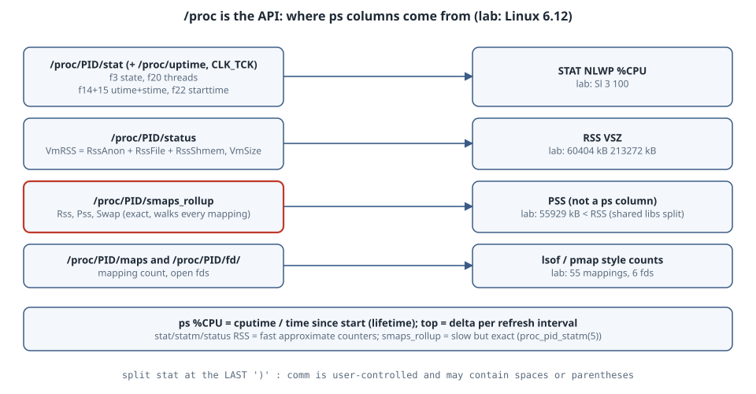

# /proc Is the API: Rebuilding ps Columns from stat, status and smaps_rollup

## Learning goals

- Know which `/proc/PID/*` file each familiar `ps`/`top` column comes from, and parse `/proc/PID/stat` correctly, since `comm` can contain spaces and parentheses.
- Compute `ps`'s `%CPU` yourself, and understand why it is a **lifetime average**, not "right now".
- Tell RSS, PSS and VSZ apart, and know which `/proc` numbers are fast-but-approximate and which are slow-but-exact.
- Count mappings and open fds without any tool beyond `ls`.

Version note: run on Linux **6.12** with Python 3 and procps `ps`, as an ordinary user, against a test process started for the lab. The output is pasted verbatim.

{fig-alt="On the left are files under /proc/PID: stat, status, smaps_rollup, maps and the fd directory, plus /proc/uptime. On the right are ps columns. STAT, the thread count NLWP and %CPU come from stat fields 3, 20, 14, 15 and 22 together with /proc/uptime and the clock-tick rate. RSS and VSZ come from status VmRSS and VmSize, which are split into anonymous, file and shmem parts. PSS, the proportional share of shared pages, comes only from smaps_rollup, which is slower but exact. The mapping count comes from maps and the open-fd count from the fd directory. A note warns that %CPU in ps is CPU time divided by elapsed time since the process started, while top shows the rate over its refresh interval, and that the RSS in stat and statm is a fast approximation, whereas smaps_rollup is exact."}

## The files

| Column | Source | Notes |
|---|---|---|
| `STAT` | `/proc/PID/stat` field 3 | state letter; `ps` adds `l` (multi-threaded) and others |
| `NLWP` | `stat` field 20 (`num_threads`), `status` `Threads:` | threads = `ls /proc/PID/task` |
| `%CPU` | `stat` 14+15 (`utime`, `stime`, in clock ticks) and 22 (`starttime`) with `/proc/uptime` | ticks ÷ `sysconf(_SC_CLK_TCK)` |
| `RSS` | `status` `VmRSS` (= `RssAnon` + `RssFile` + `RssShmem`), `stat` field 24 in pages | fast counters (see below) |
| `VSZ` | `status` `VmSize` | address space, not memory used |
| PSS | `smaps_rollup` `Pss` | shared pages divided among their sharers |
| maps / fds | `/proc/PID/maps` lines, `/proc/PID/fd/` entries | |

Field numbers follow [proc_pid_stat(5)](https://man7.org/linux/man-pages/man5/proc_pid_stat.5.html), which counts from 1. The only safe way to split `stat` is to cut at the **last** `)`, because `comm` is user-controlled.

## Lab: a mini-ps

The test process allocates and touches 50 MiB, runs two spinning threads, and holds a file open:

```python
import threading, time
blob = bytearray(50 * 1024 * 1024)          # 50 MiB, touched below
for i in range(0, len(blob), 4096): blob[i] = 1
def spin():
    t = time.time()
    while time.time() - t < 30: pass
for _ in range(2): threading.Thread(target=spin, daemon=True).start()
f = open('/etc/hostname'); time.sleep(30)
```

```python
#!/usr/bin/env python3
"""Rebuild a few ps/top columns straight from /proc, then compare with ps."""
import os, sys, time

pid = int(sys.argv[1])
HZ = os.sysconf('SC_CLK_TCK')
PAGE = os.sysconf('SC_PAGE_SIZE')

def stat(pid):
    raw = open(f'/proc/{pid}/stat').read()
    comm = raw[raw.index('(') + 1:raw.rindex(')')]        # comm may contain spaces
    f = raw[raw.rindex(')') + 2:].split()                  # f[0] is field 3 (state)
    return comm, f

comm, f = stat(pid)
state, ppid = f[0], int(f[1])
utime, stime = int(f[11]), int(f[12])                      # fields 14, 15
nthreads, starttime = int(f[17]), int(f[19])               # fields 20, 22
rss_pages = int(f[21])                                     # field 24
uptime = float(open('/proc/uptime').read().split()[0])
age = uptime - starttime / HZ

status = dict(l.split(':', 1) for l in open(f'/proc/{pid}/status'))
rollup = {l.split(':')[0]: l.split()[1] for l in open(f'/proc/{pid}/smaps_rollup').readlines()[1:]}
fds = os.listdir(f'/proc/{pid}/fd')
maps = open(f'/proc/{pid}/maps').read().splitlines()

print(f"comm={comm} state={state} ppid={ppid} threads={nthreads}")
print(f"cpu: utime+stime={(utime+stime)/HZ:.2f}s over {age:.2f}s -> lifetime %CPU {(utime+stime)/HZ/age*100:.1f}")
print(f"rss: stat {rss_pages*PAGE//1024} kB | status VmRSS {status['VmRSS'].split()[0]} kB"
      f" (anon {status['RssAnon'].split()[0]} + file {status['RssFile'].split()[0]} + shmem {status['RssShmem'].split()[0]})")
print(f"smaps_rollup: Rss {rollup['Rss']} kB, Pss {rollup['Pss']} kB, Swap {rollup['Swap']} kB")
print(f"vsz: status VmSize {status['VmSize'].split()[0]} kB, mappings {len(maps)}, open fds {len(fds)}")
```

```text
$ python3 busy.py &
$ python3 minips.py 1686991
comm=python3 state=S ppid=1686984 threads=3
cpu: utime+stime=3.01s over 3.01s -> lifetime %CPU 100.0
rss: stat 60220 kB | status VmRSS 60404 kB (anon 54464 + file 5940 + shmem 0)
smaps_rollup: Rss 60404 kB, Pss 55929 kB, Swap 0 kB
vsz: status VmSize 213272 kB, mappings 55, open fds 6
$ ps -o pid,stat,nlwp,%cpu,rss,vsz,comm -p 1686991
    PID STAT NLWP %CPU   RSS    VSZ COMMAND
1686991 Sl      3  100 60404 213272 python3
```

## Reading the numbers

- **Every column matches.** `NLWP 3`, `RSS 60404`, `VSZ 213272` and `%CPU 100` are exactly what the script derived. `ps` is a formatter over these files.
- **`%CPU` is a lifetime ratio.** [ps(1)](https://man7.org/linux/man-pages/man1/ps.1.html): "the CPU time used divided by the time the process has been running". Two threads spin, but CPython's GIL lets only one run Python bytecode at a time, so the process used 3.01 s of CPU in 3.01 s of life. A process that was busy an hour ago and is idle now still shows a high `%CPU` in `ps`. `top` instead shows the delta over its refresh interval.
- **Two RSS numbers, 184 kB apart.** `stat` field 24 said 60220 kB and `VmRSS` said 60404 kB. The two were read moments apart, and the per-process counters are a scalability optimisation. [proc_pid_statm(5)](https://man7.org/linux/man-pages/man5/proc_pid_statm.5.html) says some values "are inaccurate because of a kernel-internal scalability optimization. If accurate values are required, use /proc/pid/smaps or /proc/pid/smaps_rollup instead, which are much slower".
- **PSS < RSS.** 55929 kB vs 60404 kB. The 5940 kB of file-backed RSS is mostly the Python binary and shared libraries, which other processes map too, so [proc_pid_smaps(5)](https://man7.org/linux/man-pages/man5/proc_pid_smaps.5.html)'s "proportional share" charges this process only part of it. For "how much RAM would I get back by killing these?", add up PSS (or anonymous RSS), not RSS.
- **VSZ is 3.5× RSS** because of reserved but untouched address space (thread stacks, allocator arenas). It is not memory pressure.

## Practical rules

- For scripts, read `/proc` directly rather than parsing `ps` output: it is stable, documented and cheap.
- Use `status` or `statm` for quick RSS, and `smaps_rollup` when the number must be exact or you need PSS or Swap. `smaps_rollup` walks every mapping, so do not poll it at high frequency on huge processes.
- For "CPU right now", sample `utime + stime` twice and divide by the interval, which is what `top` does.

## Try this

1. Run the script against PID 1 or another user's process. Which files can you read, and which return `EACCES`? (proc(5) describes the ptrace access-mode checks.)
2. Start the test process, wait 60 s after the spinners stop, and compare `ps -o %cpu` with two `stat` samples one second apart.
3. Start two copies of `busy.py` and watch the `Pss` of each fall while `Rss` stays the same.

## Sources

- proc_pid_stat(5): <https://man7.org/linux/man-pages/man5/proc_pid_stat.5.html>
- proc_pid_status(5): <https://man7.org/linux/man-pages/man5/proc_pid_status.5.html>
- proc_pid_statm(5): <https://man7.org/linux/man-pages/man5/proc_pid_statm.5.html>
- proc_pid_smaps(5): <https://man7.org/linux/man-pages/man5/proc_pid_smaps.5.html>
- ps(1), `%cpu`: <https://man7.org/linux/man-pages/man1/ps.1.html>
- Linux kernel documentation, *The /proc Filesystem* (including `smaps_rollup`): <https://docs.kernel.org/filesystems/proc.html>
