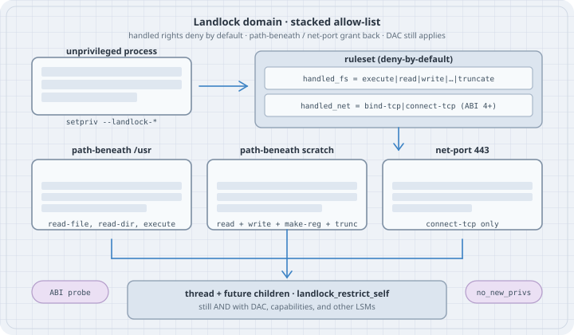

# Landlock from the command line: setpriv

## Overview

**Thesis:** **Landlock** is a stackable Linux Security Module that lets an ordinary process impose an extra **allow-list** on itself and its future children: filesystem actions on path hierarchies, and (from ABI 4) TCP bind/connect on port numbers. **`setpriv --landlock-access` / `--landlock-rule`** (util-linux **2.41**) is the command-line front end for the filesystem half. Handled rights are denied by default; rules grant selected rights back. The domain is **best-effort across ABI versions**, and it **only subtracts** from what DAC, capabilities, and other LSMs already allow.

This chapter is the operator view: probe the ABI, sandbox a command with `setpriv`, and drive TCP policy through the same three syscalls `setpriv` wraps. It is not a container runtime, and it does not replace user namespaces (`unshare`).

Companion pages in this book: `15-services-and-runtime/12-unshare.md` (namespaces), `07-io-uring-seccomp.md` (seccomp / io_uring policy), `04-getcap.md` (file capabilities).

{fig-alt="Unprivileged process calls setpriv to build a Landlock ruleset. Handled filesystem and TCP rights are deny-by-default. path-beneath rules grant read/exec on /usr and read/write on a scratch directory; a net-port rule grants TCP connect to port 443. The enforced domain applies to the thread and its children and still combines with DAC and other LSMs. ABI probe and no_new_privs sit alongside."}

## Mental model

```text
  unprivileged process
           │
           │  1. landlock_create_ruleset(handled_access_*)
           │       handled bits = "these actions are now deny-by-default"
           │  2. landlock_add_rule()  (optional, repeatable)
           │       path-beneath /usr      → read-file, read-dir, execute
           │       path-beneath scratch   → read + write + make-reg + truncate
           │       net-port 443           → connect-tcp          (ABI 4+)
           │  3. prctl(PR_SET_NO_NEW_PRIVS)     (required without CAP_SYS_ADMIN)
           │  4. landlock_restrict_self()
           │       policy sticks on this thread and every future child
           ▼
  access is allowed only if EVERY layer agrees:
       Landlock domain  ∧  DAC (mode/owner)  ∧  other LSMs  ∧  capabilities
```

A **ruleset** names the actions it *handles*. Anything handled and not granted by a rule is denied (`EACCES` for filesystem and TCP; `EPERM` for scoped IPC). Anything *not* handled is left to the rest of the system — that is the compatibility contract: a newer kernel will not suddenly start denying actions the program never listed.

`setpriv` does steps 1–4 then `execve`s the program. util-linux **2.41.5** implements filesystem rules (`Access: fs`, `path-beneath`, rights through `truncate`). TCP, `ioctl_dev`, and IPC scopes exist in the kernel on this host (ABI 6) and are driven below with the raw syscalls. Check `setpriv --help` on your build: later util-linux documents `net:connect-tcp` and `net-port:connect-tcp:PORT` in the same flag pair.

| ABI | Mainline kernel (orientation) | What it added |
|-----|-------------------------------|---------------|
| 1 | 5.13 | Filesystem rights: execute, read/write file, read dir, remove, make-* |
| 2 | 5.19 | `LANDLOCK_ACCESS_FS_REFER` (cross-directory rename/link) |
| 3 | 6.2 | `LANDLOCK_ACCESS_FS_TRUNCATE` |
| 4 | 6.7 | `LANDLOCK_ACCESS_NET_BIND_TCP`, `CONNECT_TCP` |
| 5 | 6.10 | `LANDLOCK_ACCESS_FS_IOCTL_DEV` |
| 6 | 6.12 | `LANDLOCK_SCOPE_ABSTRACT_UNIX_SOCKET`, `LANDLOCK_SCOPE_SIGNAL` |
| 7 | 6.15 | Audit / `LANDLOCK_RESTRICT_SELF_LOG_*` (observability) |
| 8 | 7.0 | `LANDLOCK_RESTRICT_SELF_TSYNC` (process-wide enforce) |
| 9 | 7.1 | `LANDLOCK_ACCESS_FS_RESOLVE_UNIX` |
| 10 | 7.2 | UDP bind/connect-send; per-object quiet/audit flags |

Kernel versions are orientation only. Distros backport. **Always probe the ABI.** This box is Linux **6.12.94+** and reports **ABI 6**: filesystem through `ioctl_dev`, TCP, and IPC scopes. Audit flags, TSYNC, pathname UNIX resolve, and UDP need a newer ABI than this kernel.

## Syntax

```bash
setpriv --landlock-access fs[:right,right,...] \
        --landlock-rule path-beneath:right,right,...:/path \
        [further --landlock-rule ...] \
        program [args...]
```

| Piece | Meaning |
|-------|---------|
| `--landlock-access fs` | Handle every filesystem right this `setpriv` was built with (2.41.5: through `truncate`). Denied unless a rule grants it. |
| `--landlock-access fs:truncate,write-file` | Handle only those rights. Unlisted actions stay unrestricted by this ruleset. |
| `--landlock-rule path-beneath:ACCESS:/PATH` | Allow `ACCESS` on the hierarchy under `PATH` (opened `O_PATH`). Repeatable. |
| `--no-new-privs` | `setpriv` already sets `no_new_privs` when it applies Landlock. Useful on its own for other drops. |

`setpriv --help` prints the rights and rule types the binary actually implements:

```text
Landlock accesses:
 Access: fs
 Rule types: path-beneath
 Rules: execute,write-file,read-file,read-dir,remove-dir,remove-file,make-char,make-dir,make-reg,make-sock,make-fifo,make-block,make-sym,refer,truncate
```

Kernel syscalls (what `setpriv` wraps; also the TCP path on 2.41):

```text
landlock_create_ruleset(attr, size, flags)   /* flags: VERSION=1, ERRATA=2 */
landlock_add_rule(fd, PATH_BENEATH|NET_PORT, attr, 0)
landlock_restrict_self(fd, flags)
```

## Safety

- Landlock is **self-restriction**. It cannot confer a right DAC withholds. A mode-`000` file stays unreadable after you "allow" the directory.
- Once `landlock_restrict_self` succeeds, the policy **cannot be removed**, only stacked tighter. Children inherit it.
- Unprivileged enforce requires **`no_new_privs`**. Skipping that step returns `EPERM`. `CAP_SYS_ADMIN` can skip `no_new_privs`; leaving it unset then lets a later setuid/file-cap exec become a confused deputy inside the domain.
- Files (and sockets) **already open** when the ruleset is enforced keep their previous Landlock rights. Close what you do not want the sandbox to keep.
- `setpriv --landlock-access fs` with **no rules** denies execute of the program itself (`exit 126`).
- This page does not present breakout recipes, kernel builds, or LSM bypasses.

## Examples with Explanations

Tested unprivileged on **Linux 6.12.94+**, Landlock **ABI 6**, **util-linux 2.41.5**, Python **3.13.5**, GCC **14.2.0**. `/sys/kernel/security/lsm` is `capability,landlock,selinux`. `dmesg` contains `landlock: Up and running.`

### 1. Probe the ABI (runs here)

```python
# landlock_abi_probe.py — landlock_create_ruleset(NULL, 0, VERSION|ERRATA)
import ctypes, os, errno

libc = ctypes.CDLL(None, use_errno=True)
libc.syscall.restype = ctypes.c_long
NR_CREATE = 444
VERSION, ERRATA = 1 << 0, 1 << 1

def create(flags):
    ctypes.set_errno(0)
    r = libc.syscall(ctypes.c_long(NR_CREATE), None, ctypes.c_size_t(0),
                     ctypes.c_uint(flags))
    return r, ctypes.get_errno()

abi, e = create(VERSION)
print(f"landlock_create_ruleset(NULL, 0, VERSION) = {abi}"
      + (f" errno={e} ({errno.errorcode.get(e)} {os.strerror(e)})" if abi < 0 else ""))

errata, e = create(ERRATA)
if errata < 0:
    print(f"ERRATA = {errata} errno={e} ({errno.errorcode.get(e)} {os.strerror(e)})")
else:
    bits = [i + 1 for i in range(64) if errata & (1 << i)]
    print(f"landlock_create_ruleset(NULL, 0, ERRATA) = {errata} "
          f"(fixed errata numbers: {bits or 'none'})")

print(f"uname: {os.uname().release}")
print(f"lsm: {open('/sys/kernel/security/lsm').read().strip()}")
```

```bash
python3 landlock_abi_probe.py
```

```text
landlock_create_ruleset(NULL, 0, VERSION) = 6
landlock_create_ruleset(NULL, 0, ERRATA) = 7 (fixed errata numbers: [1, 2, 3])
uname: 6.12.94+
lsm: capability,landlock,selinux
```

`6` is ABI 6: `ioctl_dev` and IPC scopes are present; audit flags (ABI 7) are not. `ENOSYS` would mean the kernel was built without Landlock; `EOPNOTSUPP` would mean it is compiled in but disabled at boot (`lsm=` without `landlock`).

The errata bitmask is optional. Kernel docs recommend that almost every program **ignore** it and keep best-effort sandboxing. Bits 1–3 set means this 6.12 kernel includes the TCP-socket-identification, scoped-signal, and disconnected-directory fixes.

Confirm the LSM list and the boot banner:

```bash
cat /sys/kernel/security/lsm
dmesg | grep -i landlock
setpriv --version
```

```text
capability,landlock,selinux
[    0.169094] LSM: initializing lsm=capability,landlock,selinux
[    0.169094] landlock: Up and running.
setpriv from util-linux 2.41.5
```

### 2. Read-only `/usr`, writable scratch (runs here)

Merged-usr layout: `/bin`, `/lib`, and `/lib64` are symlinks into `/usr`, so one `path-beneath` on `/usr` covers the dynamic linker and `dash`/`cat`/`python3`. `/etc` is a different hierarchy.

```bash
# landlock_usr_scratch.sh — RO /usr + RW /tmp/ll-scratch
mkdir -p /tmp/ll-scratch
echo hello-scratch > /tmp/ll-scratch/note.txt

RO=read-file,read-dir,execute
RW=read-file,read-dir,write-file,remove-file,make-reg,truncate,make-dir,remove-dir

setpriv --landlock-access fs \
  --landlock-rule "path-beneath:${RO}:/usr" \
  --landlock-rule "path-beneath:${RW}:/tmp/ll-scratch" \
  /usr/bin/sh -c '
echo "-- read /usr --"
/usr/bin/head -n 2 /usr/lib/os-release
echo "-- read scratch --"
/usr/bin/cat /tmp/ll-scratch/note.txt
echo landlocked-write > /tmp/ll-scratch/out.txt
echo "-- wrote scratch --"
/usr/bin/cat /tmp/ll-scratch/out.txt
echo "-- read /etc/passwd --"
/usr/bin/cat /etc/passwd
echo "-- write /tmp --"
echo nope > /tmp/ll-should-fail
'
```

```text
-- read /usr --
PRETTY_NAME="Debian GNU/Linux 13 (trixie)"
NAME="Debian GNU/Linux"
-- read scratch --
hello-scratch
-- wrote scratch --
landlocked-write
-- read /etc/passwd --
cat: /etc/passwd: Permission denied
-- write /tmp --
/usr/bin/sh: 12: cannot create /tmp/ll-should-fail: Permission denied
```

`Permission denied` here is **`EACCES` (13)**. The same sandbox under Python:

```bash
setpriv --landlock-access fs \
  --landlock-rule "path-beneath:${RO}:/usr" \
  --landlock-rule "path-beneath:${RW}:/tmp/ll-scratch" \
  /usr/bin/python3.13 -c 'import errno
for p, mode in [("/etc/passwd", "r"), ("/usr/bin/sh", "rb"),
                ("/tmp/ll-scratch/out.txt", "a")]:
    try:
        open(p, mode)
        print(f"open({p!r}, {mode!r}): ok")
    except OSError as e:
        print(f"open({p!r}, {mode!r}): errno={e.errno} ({errno.errorcode[e.errno]}) {e.strerror}")
'
```

```text
open('/etc/passwd', 'r'): errno=13 (EACCES) Permission denied
open('/usr/bin/sh', 'rb'): ok
open('/tmp/ll-scratch/out.txt', 'a'): ok
```

With **no** rules, execute of the program is itself denied:

```bash
setpriv --landlock-access fs /usr/bin/true; echo exit:$?
```

```text
setpriv: failed to execute /usr/bin/true: Permission denied
exit:126
```

`setpriv` sets `no_new_privs` as part of applying Landlock. A nested `setpriv --dump` (with `/proc` also allowed so the SELinux label can be read) shows `no_new_privs: 1`.

### 3. Landlock does not outrank DAC (runs here)

```bash
echo secret-data > /tmp/ll-scratch/secret-dac
chmod 000 /tmp/ll-scratch/secret-dac
python3 -c 'import errno
try:
    open("/tmp/ll-scratch/secret-dac")
except OSError as e:
    print(f"no-landlock: errno={e.errno} ({errno.errorcode[e.errno]}) {e.strerror}")
'
setpriv --landlock-access fs \
  --landlock-rule path-beneath:read-file,read-dir,execute:/usr \
  --landlock-rule path-beneath:read-file,read-dir,write-file,remove-file,make-reg,truncate,make-dir,remove-dir:/tmp/ll-scratch \
  /usr/bin/python3.13 -c 'import errno
try:
    open("/tmp/ll-scratch/secret-dac")
except OSError as e:
    print(f"landlock-RW: errno={e.errno} ({errno.errorcode[e.errno]}) {e.strerror}")
'
```

```text
no-landlock: errno=13 (EACCES) Permission denied
landlock-RW: errno=13 (EACCES) Permission denied
```

The ruleset grants `read-file` on that hierarchy. Mode `000` still wins. Landlock is an extra deny layer.

### 4. Block TCP connect and bind (runs here)

util-linux **2.41.5** does not implement `net:` in `--landlock-access` (see The trap). The kernel on this host does. Same three syscalls, ABI 4+ `handled_access_net`:

```python
# landlock_tcp_deny.py — handle bind-tcp|connect-tcp, add no port rules
import ctypes, os, errno, socket

libc = ctypes.CDLL(None, use_errno=True)
libc.syscall.restype = ctypes.c_long
libc.prctl.restype = ctypes.c_int
NR_CREATE, NR_ADD, NR_RESTRICT = 444, 445, 446
PR_SET_NO_NEW_PRIVS = 38
LANDLOCK_RULE_NET_PORT = 2
NET_BIND_TCP, NET_CONNECT_TCP = 1 << 0, 1 << 1

class RulesetAttr(ctypes.Structure):
    _fields_ = [("handled_access_fs", ctypes.c_uint64),
                ("handled_access_net", ctypes.c_uint64),
                ("scoped", ctypes.c_uint64)]

class NetPortAttr(ctypes.Structure):
    _fields_ = [("allowed_access", ctypes.c_uint64),
                ("port", ctypes.c_uint64)]

def must(r, what):
    if r < 0:
        e = ctypes.get_errno()
        raise OSError(e, os.strerror(e), what)
    return r

attr = RulesetAttr(0, NET_BIND_TCP | NET_CONNECT_TCP, 0)
ctypes.set_errno(0)
fd = must(libc.syscall(ctypes.c_long(NR_CREATE), ctypes.byref(attr),
                       ctypes.c_size_t(ctypes.sizeof(attr)), ctypes.c_uint(0)),
          "create_ruleset")
print(f"ruleset fd={fd} handled_access_net=bind-tcp|connect-tcp (no port allow-rules)")
ctypes.set_errno(0)
must(libc.prctl(PR_SET_NO_NEW_PRIVS, 1, 0, 0, 0), "nnp")
ctypes.set_errno(0)
must(libc.syscall(ctypes.c_long(NR_RESTRICT), ctypes.c_int(fd), ctypes.c_uint(0)),
     "restrict")
os.close(fd)
print("restricted self")

def try_connect(host, port):
    s = socket.socket(socket.AF_INET, socket.SOCK_STREAM)
    s.settimeout(3)
    try:
        s.connect((host, port))
        print(f"connect({host},{port}): ok peer={s.getpeername()}")
    except OSError as e:
        print(f"connect({host},{port}): errno={e.errno} ({errno.errorcode.get(e.errno)}) {e.strerror}")
    finally:
        s.close()

def try_bind(port):
    s = socket.socket(socket.AF_INET, socket.SOCK_STREAM)
    s.setsockopt(socket.SOL_SOCKET, socket.SO_REUSEADDR, 1)
    try:
        s.bind(("127.0.0.1", port))
        print(f"bind(127.0.0.1,{port}): ok {s.getsockname()}")
    except OSError as e:
        print(f"bind(127.0.0.1,{port}): errno={e.errno} ({errno.errorcode.get(e.errno)}) {e.strerror}")
    finally:
        s.close()

try_connect("1.1.1.1", 443)
try_connect("127.0.0.1", 9)
try_bind(0)
try_bind(18080)
```

```bash
python3 landlock_tcp_deny.py
```

```text
ruleset fd=5 handled_access_net=bind-tcp|connect-tcp (no port allow-rules)
restricted self
connect(1.1.1.1,443): errno=13 (EACCES) Permission denied
connect(127.0.0.1,9): errno=13 (EACCES) Permission denied
bind(127.0.0.1,0): errno=13 (EACCES) Permission denied
bind(127.0.0.1,18080): errno=13 (EACCES) Permission denied
```

UDP, UNIX sockets, and already-open descriptors are outside this ruleset. Port `0` on bind means "the ephemeral range"; handling `bind-tcp` without a port-0 rule denies that too.

### 5. Allow TCP connect to 443 only (runs here)

```python
# landlock_tcp_allow443.py — connect-tcp allowed only to port 443
import ctypes, os, errno, socket

libc = ctypes.CDLL(None, use_errno=True)
libc.syscall.restype = ctypes.c_long
libc.prctl.restype = ctypes.c_int
NR_CREATE, NR_ADD, NR_RESTRICT = 444, 445, 446
PR_SET_NO_NEW_PRIVS = 38
LANDLOCK_RULE_NET_PORT = 2
NET_BIND_TCP, NET_CONNECT_TCP = 1 << 0, 1 << 1

class RulesetAttr(ctypes.Structure):
    _fields_ = [("handled_access_fs", ctypes.c_uint64),
                ("handled_access_net", ctypes.c_uint64),
                ("scoped", ctypes.c_uint64)]

class NetPortAttr(ctypes.Structure):
    _fields_ = [("allowed_access", ctypes.c_uint64),
                ("port", ctypes.c_uint64)]

def must(r, what):
    if r < 0:
        e = ctypes.get_errno()
        raise OSError(e, os.strerror(e), what)
    return r

attr = RulesetAttr(0, NET_BIND_TCP | NET_CONNECT_TCP, 0)
ctypes.set_errno(0)
fd = must(libc.syscall(ctypes.c_long(NR_CREATE), ctypes.byref(attr),
                       ctypes.c_size_t(ctypes.sizeof(attr)), ctypes.c_uint(0)),
          "create_ruleset")
rule = NetPortAttr(NET_CONNECT_TCP, 443)
ctypes.set_errno(0)
must(libc.syscall(ctypes.c_long(NR_ADD), ctypes.c_int(fd),
                  ctypes.c_int(LANDLOCK_RULE_NET_PORT),
                  ctypes.byref(rule), ctypes.c_uint(0)), "add_rule")
must(libc.prctl(PR_SET_NO_NEW_PRIVS, 1, 0, 0, 0), "nnp")
ctypes.set_errno(0)
must(libc.syscall(ctypes.c_long(NR_RESTRICT), ctypes.c_int(fd), ctypes.c_uint(0)),
     "restrict")
os.close(fd)
print("restricted: connect-tcp allowed only to port 443")

def try_connect(host, port):
    s = socket.socket(socket.AF_INET, socket.SOCK_STREAM)
    s.settimeout(3)
    try:
        s.connect((host, port))
        print(f"connect({host},{port}): ok peer={s.getpeername()}")
    except OSError as e:
        print(f"connect({host},{port}): errno={e.errno} ({errno.errorcode.get(e.errno)}) {e.strerror}")
    finally:
        s.close()

try_connect("1.1.1.1", 443)
try_connect("1.1.1.1", 80)
try_connect("1.1.1.1", 53)
```

```bash
python3 landlock_tcp_allow443.py
```

```text
restricted: connect-tcp allowed only to port 443
connect(1.1.1.1,443): ok peer=('1.1.1.1', 443)
connect(1.1.1.1,80): errno=13 (EACCES) Permission denied
connect(1.1.1.1,53): errno=13 (EACCES) Permission denied
```

Later util-linux expresses the same policy as `setpriv --landlock-access net:connect-tcp --landlock-rule net-port:connect-tcp:443 …` once `setpriv --help` lists `Access: net`. This 2.41.5 binary does not.

### 6. `EPERM`: missing `no_new_privs`, and scoped signals (runs here)

Filesystem and TCP denials return **`EACCES`**. Two common **`EPERM`** cases:

```python
# landlock_eperm.py — restrict_self without nnp; scoped signal to parent
import ctypes, os, errno, signal

libc = ctypes.CDLL(None, use_errno=True)
libc.syscall.restype = ctypes.c_long
libc.prctl.restype = ctypes.c_int
NR_CREATE, NR_RESTRICT = 444, 446
PR_SET_NO_NEW_PRIVS = 38
SCOPE_SIGNAL = 1 << 1
FS_READ_FILE = 1 << 2

class RulesetAttr(ctypes.Structure):
    _fields_ = [("handled_access_fs", ctypes.c_uint64),
                ("handled_access_net", ctypes.c_uint64),
                ("scoped", ctypes.c_uint64)]

attr = RulesetAttr(FS_READ_FILE, 0, 0)
ctypes.set_errno(0)
fd = libc.syscall(ctypes.c_long(NR_CREATE), ctypes.byref(attr),
                  ctypes.c_size_t(24), ctypes.c_uint(0))
ctypes.set_errno(0)
r = libc.syscall(ctypes.c_long(NR_RESTRICT), ctypes.c_int(fd), ctypes.c_uint(0))
e = ctypes.get_errno()
print(f"restrict_self without nnp: ret={r} errno={e} ({errno.errorcode.get(e)}) {os.strerror(e)}",
      flush=True)
os.close(fd)

parent = os.getpid()
pid = os.fork()
if pid == 0:
    attr = RulesetAttr(0, 0, SCOPE_SIGNAL)
    ctypes.set_errno(0)
    fd = libc.syscall(ctypes.c_long(NR_CREATE), ctypes.byref(attr),
                      ctypes.c_size_t(24), ctypes.c_uint(0))
    libc.prctl(PR_SET_NO_NEW_PRIVS, 1, 0, 0, 0)
    libc.syscall(ctypes.c_long(NR_RESTRICT), ctypes.c_int(fd), ctypes.c_uint(0))
    try:
        os.kill(parent, 0)
        print("kill(parent, 0): ok", flush=True)
    except OSError as e:
        print(f"kill(parent, 0): errno={e.errno} ({errno.errorcode.get(e.errno)}) {e.strerror}",
              flush=True)
    os._exit(0)
signal.signal(signal.SIGUSR1, lambda *a: None)
os.waitpid(pid, 0)
```

```bash
python3 landlock_eperm.py
```

```text
restrict_self without nnp: ret=-1 errno=1 (EPERM) Operation not permitted
kill(parent, 0): errno=1 (EPERM) Operation not permitted
```

ABI 6 `LANDLOCK_SCOPE_SIGNAL` confines outgoing signals to the same (or a nested) Landlock domain. The parent is outside, so `kill` returns `EPERM`. Abstract UNIX sockets use the sibling scope flag and also deny with `EPERM`.

## The trap

**Trap: "`--landlock-access net:connect-tcp` sandboxes TCP on util-linux 2.41`."** On **2.41.5**, `parse_landlock_access` only honours `fs` and `fs:…`. Any other prefix is a silent no-op: `setpriv --landlock-access net:connect-tcp` still connected to `1.1.1.1:443` here. `setpriv --landlock-rule net-port:connect-tcp:443` errors (`invalid landlock rule`). Read the `Landlock accesses:` block from `setpriv --help` before copying flags from a newer man page.

**Trap: "a `path-beneath` rule grants access."** It grants Landlock's slice of the right, on that inode hierarchy. Mode bits, ownership, mount flags, and SELinux still have to agree. Example 3 is the short form: `chmod 000` plus a RW ruleset is still `EACCES`.

**Trap: "handled rights are an allow-list of what the program may do."** They are a deny-by-default *set of actions this ruleset cares about*. Omitting `truncate` from `handled_access_fs` leaves truncation unrestricted by Landlock (ABI 3+). `setpriv --landlock-access fs` handles everything it was compiled with, including `refer` and `truncate`; that is **stricter**, and on an ABI 1 kernel those extra bits make `landlock_create_ruleset` fail with `EINVAL`. The kernel docs' best-effort pattern is: probe ABI, then *mask off* unknown rights. `setpriv` 2.41 does not do that mask.

**Trap: "ABI 6 has audit logs."** Observability (`LANDLOCK_RESTRICT_SELF_LOG_*`, `AUDIT_LANDLOCK_ACCESS`) is ABI **7** / Linux **6.15**. This 6.12 kernel stops at scopes. Process-wide `TSYNC` is ABI 8; UDP is ABI 10. Probe; do not guess from `uname`.

## The boring rule

Name every action you intend to deny in `handled_access_*` / `--landlock-access`, then grant the hierarchies and ports the program actually needs with rules. Probe the ABI and degrade. Keep `no_new_privs`. Treat Landlock as one more AND-clause next to DAC.

## Try this

1. Re-run Example 2 and add `--landlock-rule path-beneath:read-file,read-dir:/etc`. Confirm `cat /etc/passwd` works and `echo x > /etc/hostname` still fails.
2. Handle only `fs:truncate` with a rule on the scratch dir, then `os.truncate` a scratch file (allowed) and `/etc/hostname` (`EACCES`). Then handle `write-file,truncate` but grant only `write-file` on scratch: append works, `truncate` returns `EACCES`. (Both were run here.)
3. On a 2.42+/devel `setpriv` whose `--help` lists `Access: net`, express Example 5 as `--landlock-access net:connect-tcp --landlock-rule net-port:connect-tcp:443`.
4. On Linux 6.15+ (ABI 7+), read [Landlock audit](https://docs.kernel.org/admin-guide/LSM/landlock.html#audit) and watch one denied `connect` as `AUDIT_LANDLOCK_ACCESS`.

## Verification

- All numbered examples compiled/run on this box: Linux **6.12.94+**, Landlock **ABI 6**, util-linux **setpriv 2.41.5**, Python **3.13.5**, user `uid=1000`. Output pasted above.
- ABI probe used `landlock_create_ruleset` via `ctypes` (`__NR_landlock_create_ruleset` = 444) with `LANDLOCK_CREATE_RULESET_VERSION` / `_ERRATA` from `/usr/include/linux/landlock.h`.
- TCP examples used the same UAPI (`handled_access_net`, `LANDLOCK_RULE_NET_PORT`). `setpriv --landlock-access net:…` was tried and is a no-op on 2.41.5; that trial is in The trap, not sold as a working sandbox.
- `ioctl-dev` is in the kernel UAPI here (`LANDLOCK_ACCESS_FS_IOCTL_DEV`) and is **not** accepted by this `setpriv` (`could not parse landlock fs access: ioctl-dev`).
- **No** package installs, **no** root, **no** kernel builds. `dmesg` was readable unprivileged on this host. Audit examples (ABI 7) are documentation-only.

## Sources

- Kernel userspace API — [Landlock: unprivileged access control](https://docs.kernel.org/userspace-api/landlock.html) (ABI table, best-effort mask, TCP/UDP, scopes, audit flags; dated August 2026)
- Kernel admin guide — [Landlock LSM](https://docs.kernel.org/admin-guide/LSM/landlock.html) (audit record types)
- man7 — [`landlock(7)`](https://man7.org/linux/man-pages/man7/landlock.7.html), [`landlock_create_ruleset(2)`](https://man7.org/linux/man-pages/man2/landlock_create_ruleset.2.html), [`landlock_add_rule(2)`](https://man7.org/linux/man-pages/man2/landlock_add_rule.2.html), [`landlock_restrict_self(2)`](https://man7.org/linux/man-pages/man2/landlock_restrict_self.2.html)
- man7 — [`setpriv(1)`](https://man7.org/linux/man-pages/man1/setpriv.1.html) (util-linux; `--landlock-access` / `--landlock-rule`)
- util-linux 2.41.5 source — [`sys-utils/setpriv-landlock.c`](https://github.com/util-linux/util-linux/blob/v2.41.5/sys-utils/setpriv-landlock.c) (filesystem-only parser)
- UAPI on this host — `/usr/include/linux/landlock.h`
- Kernel sample — [`samples/landlock/sandboxer.c`](https://git.kernel.org/pub/scm/linux/kernel/git/stable/linux.git/tree/samples/landlock/sandboxer.c)
- Landlock project — [news / ABI timeline](https://landlock.io/news/)
