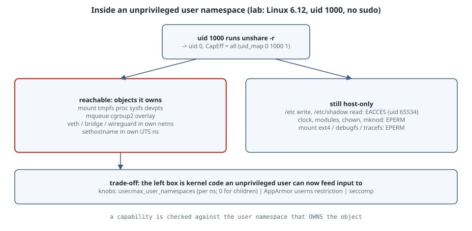

# Unprivileged User Namespaces: What "root" Inside One Can Reach

## Overview

**Thesis:** When an ordinary user runs `unshare -r`, they get uid 0 and a **full capability set**. Those capabilities are valid only over objects owned by the new user namespace, so host files, the clock and kernel modules stay out of reach. But they also unlock kernel code that used to be reachable only by real root: mounting filesystems, rtnetlink, netfilter, cgroup and IPC setup. Unprivileged user namespaces are therefore a good **isolation** tool, because rootless containers, browser sandboxes and Flatpak all depend on them. They are also a real **attack surface**: a bug in any of that newly reachable code becomes a local privilege escalation. Whether to allow them depends on the host. This chapter measures both sides on one kernel and shows the knobs.

Version note: every probe below ran as uid 1000 on Linux **6.12.94** (x86_64, a minimal cloud kernel) with util-linux `unshare` and Python 3.13. No sudo was used. The distribution knobs (Ubuntu's AppArmor restriction, Debian's sysctl) are not present on this kernel. They are cited from their documentation and marked as not run.

{fig-alt="An ordinary user, uid 1000, runs unshare -r and becomes uid 0 with all capabilities inside a new user namespace, mapped by uid_map 0 1000 1. Left, what that namespace root can do, because the objects belong to namespaces it owns: mount tmpfs, proc, sysfs, devpts, mqueue, cgroup2 and overlay, create veth, bridge and wireguard links in its own network namespace, set the hostname of its own UTS namespace. Right, what stays host-only: write /etc or read /etc/shadow (EACCES, owned by unmapped uid 65534), set the clock, load kernel modules, chown to a host uid, mknod devices, mount ext4 or debugfs (EPERM). Bottom, the trade-off: the left column is kernel code an unprivileged user can now reach, so a bug there becomes a privilege escalation. The knobs: user.max_user_namespaces, which is per namespace and can be set to 0 for children, Ubuntu's AppArmor userns restriction, and custom seccomp profiles."}

## Mental model

```text
host (initial user namespace)              new user namespace  (unshare -r)
  uid 1000, CapEff = 0                        uid 0, CapEff = all
                         uid_map: "0 1000 1"
  owns: /, /etc, devices, clock, modules     owns: the mount/net/uts/ipc/pid/cgroup
                                                   namespaces created with it
```

A capability is checked **against the user namespace that owns the object**. Inside the new namespace, `CAP_SYS_ADMIN` lets you mount a tmpfs into a mount namespace you own. It does nothing to the host's `/etc`. Host files belong to uids that are not in `uid_map`, so they appear as the overflow uid 65534 and the ordinary permission bits apply to you as "other" ([user_namespaces(7)](https://man7.org/linux/man-pages/man7/user_namespaces.7.html)).

The catch is that "you may mount a tmpfs" or "you may configure a network namespace" means the kernel now runs its filesystem-parameter, netlink and netfilter code **on input from an unprivileged user**. That code was written and hardened at a time when only root could reach it.

## Examples with Explanations

### 1. What namespace-root can and cannot do (runs here)

```python
"""Run as uid 0 inside a fresh user namespace (unshare -rmnpf --mount-proc). Probe what that 'root' can do."""
import ctypes, os, errno, socket, time
libc = ctypes.CDLL(None, use_errno=True)
def mount(src, tgt, fstype, data=None):
    os.makedirs(tgt, exist_ok=True)
    r = libc.mount(src.encode(), tgt.encode(), fstype.encode(), 0, data.encode() if data else None)
    return "ok" if r == 0 else errno.errorcode[ctypes.get_errno()]
def attempt(f):
    try: f(); return "ok"
    except OSError as e: return errno.errorcode[e.errno]

st = dict(l.split(":\t") for l in open("/proc/self/status").read().splitlines() if ":\t" in l)
print("uid/gid inside      :", os.getuid(), os.getgid(), "| uid_map:", open("/proc/self/uid_map").read().split())
print("CapEff              :", st["CapEff"].strip())
print("owner of / and /etc/shadow:", os.stat("/").st_uid, os.stat("/etc/shadow").st_uid, "(65534 = unmapped host uid)")

print("\n-- filesystems: mount(2) as namespace root")
for fs in ["tmpfs", "ramfs", "proc", "sysfs", "mqueue", "devpts", "cgroup2", "bpf", "overlay", "ext4", "debugfs", "tracefs", "securityfs"]:
    data = {"overlay": "lowerdir=/usr,upperdir=/tmp/up/u,workdir=/tmp/up/w", "devpts": "newinstance,ptmxmode=0666"}.get(fs)
    if fs == "overlay":
        os.makedirs("/tmp/up", exist_ok=True); mount("none", "/tmp/up", "tmpfs"); os.makedirs("/tmp/up/u"); os.makedirs("/tmp/up/w")
    if fs == "fuse": continue
    print(f"  {fs:10s} {mount('none' if fs != 'ext4' else '/dev/null', '/tmp/m-' + fs, fs, data)}")

print("\n-- things that stay host-only")
print("  write /etc/hostname     :", attempt(lambda: open("/etc/hostname", "a")))
print("  read /etc/shadow        :", attempt(lambda: open("/etc/shadow").read()))
print("  sethostname (own UTS ns):", attempt(lambda: socket.sethostname("lab")), "->", socket.gethostname())
print("  clock_settime           :", attempt(lambda: time.clock_settime(time.CLOCK_REALTIME, time.time())))
print("  init_module/finit_module:", "EPERM" if libc.syscall(313, -1, b"", 0) != 0 and ctypes.get_errno() == errno.EPERM else errno.errorcode.get(ctypes.get_errno()))
print("  chown host file to 0    :", attempt(lambda: os.chown("/etc/hostname", 0, 0)))
print("  mknod char device       :", attempt(lambda: os.mknod("/tmp/null2", 0o020666, os.makedev(1, 3))))
```

```bash
unshare -rmnpfiuC --mount-proc python3 probe.py   # user+mount+net+pid+ipc+uts+cgroup namespaces
```

```text
uid/gid inside      : 0 0 | uid_map: ['0', '1000', '1']
CapEff              : 000001ffffffffff
owner of / and /etc/shadow: 65534 65534 (65534 = unmapped host uid)

-- filesystems: mount(2) as namespace root
  tmpfs      ok
  ramfs      ok
  proc       ok
  sysfs      ok
  mqueue     ok
  devpts     ok
  cgroup2    ok
  bpf        EPERM
  overlay    ok
  ext4       EPERM
  debugfs    EPERM
  tracefs    EPERM
  securityfs EPERM

-- things that stay host-only
  write /etc/hostname     : EACCES
  read /etc/shadow        : EACCES
  sethostname (own UTS ns): ok -> lab
  clock_settime           : EPERM
  init_module/finit_module: EPERM
  chown host file to 0    : EPERM
  mknod char device       : EPERM
```

Reading it:

- **`CapEff 000001ffffffffff`** has all 41 capability bits set. That is "root" as far as the capability checks are concerned. `uid_map` is `0 1000 1`, so uid 0 here is uid 1000 on the host.
- **Mounts.** tmpfs, ramfs, proc, sysfs, devpts, mqueue, cgroup2 and overlay all work. These are the filesystem types that [user_namespaces(7)](https://man7.org/linux/man-pages/man7/user_namespaces.7.html) lists as mountable with `CAP_SYS_ADMIN` in the namespace that owns the mount namespace. mqueue and cgroup2 need their own IPC and cgroup namespaces; without `-i` and `-C`, the first run of this probe got `EPERM` for both. ext4, debugfs, tracefs and securityfs are refused, because block-based filesystems and the kernel's debug interfaces require `CAP_SYS_ADMIN` in the *initial* namespace. The man page also lists bpf, but on this 6.12 kernel a direct `mount(2)` of bpffs from inside the namespace got `EPERM`. Newer kernels gate a bpffs owned by a user namespace through the BPF token setup, which needs a privileged helper.
- **Host-only.** Writing `/etc/hostname` and reading `/etc/shadow` fail with `EACCES`: these are ordinary permission checks against an unmapped owner. The clock, `finit_module`, `chown` to a host uid and `mknod` of a character device fail with `EPERM`: these capabilities are only honoured in the initial namespace. `sethostname` works, but it changes only this namespace's UTS name.

### 2. The network stack is now yours to configure (runs here)

```python
"""Inside the user+net namespace: which rtnetlink link kinds can namespace-root create?"""
from pyroute2 import IPRoute
from pyroute2.netlink.exceptions import NetlinkError
import errno
ip = IPRoute()
ip.link("add", ifname="v0", kind="veth", peer="v0p"); base = ip.link_lookup(ifname="v0")[0]
kinds = {"dummy": {}, "bridge": {}, "veth": {"peer": "t-vethp"}, "bond": {}, "vrf": {"vrf_table": 10},
         "vlan": {"link": base, "vlan_id": 7}, "macvlan": {"link": base, "macvlan_mode": "bridge"},
         "ipvlan": {"link": base}, "vxlan": {"vxlan_id": 42, "vxlan_port": 4789},
         "geneve": {"geneve_id": 7, "geneve_remote": "192.0.2.1"}, "gre": {"gre_remote": "192.0.2.1"},
         "ipip": {"ipip_remote": "192.0.2.1"}, "sit": {"sit_remote": "192.0.2.1"},
         "wireguard": {}, "ifb": {}, "nlmon": {}, "team": {}, "macsec": {"link": base}}
ok, no = [], []
for k, extra in kinds.items():
    try:
        ip.link("add", ifname="t-" + k, kind=k, **extra); ok.append(k)
    except NetlinkError as e:
        no.append(f"{k}({errno.errorcode.get(e.code, e.code)})")
print("created  :", " ".join(ok))
print("refused  :", " ".join(no))
```

```bash
unshare -rn /workspace/venv-qos/bin/python links.py     # pyroute2 0.9.7 in a venv
/workspace/venv-qos/bin/python links.py                 # same script, no namespace
```

```text
created  : bridge veth wireguard
refused  : dummy(ENOTSUP) bond(ENOTSUP) vrf(ENOTSUP) vlan(ENOTSUP) macvlan(ENOTSUP) ipvlan(ENOTSUP) vxlan(ENOTSUP) geneve(ENOTSUP) gre(ENOTSUP) ipip(ENOTSUP) sit(ENOTSUP) ifb(ENOTSUP) nlmon(ENOTSUP) team(ENOTSUP) macsec(ENOTSUP)
```

Without a user namespace:

```text
pyroute2.netlink.exceptions.NetlinkError: (1, 'Operation not permitted')
```

Inside the namespace, uid 1000 created bridge, veth and WireGuard interfaces, which are kernel drivers it could not touch a second earlier. Without the namespace, the very first request gets `EPERM`. The `ENOTSUP` list is this minimal kernel saying "not built". On a distribution kernel, most of those link types are modules, and rtnetlink can load a module on request for a link kind. So the code an unprivileged user can reach is whatever the host kernel has built in **or can load**. The same is true of netfilter (nf_tables), traffic control and the other netlink families that check `CAP_NET_ADMIN` against the namespace.

That is the attack-surface argument in concrete form. Two well-known examples:

- [CVE-2022-0185](https://nvd.nist.gov/vuln/detail/CVE-2022-0185), a heap overflow in the filesystem-context parameter parser, needed `CAP_SYS_ADMIN`.
- [CVE-2023-32233](https://nvd.nist.gov/vuln/detail/CVE-2023-32233), a use-after-free in nf_tables, needed `CAP_NET_ADMIN`.

On hosts that allow unprivileged user namespaces, the capability each one needed is exactly what `unshare -r` hands out.

### 3. Limits are per namespace, and a sandbox can deny nesting (runs here)

```sh
#!/bin/sh
# nest.sh — run inside `unshare -r`: user.max_user_namespaces is per user namespace
echo "limit seen in this ns: $(cat /proc/sys/user/max_user_namespaces)"
unshare -r sh -c 'echo "nested unshare -r    : ok, uid $(id -u)"'
echo 0 > /proc/sys/user/max_user_namespaces && echo "set limit in this ns : $(cat /proc/sys/user/max_user_namespaces)"
unshare -r true 2>&1 | sed 's/^/nested unshare -r    : /'
```

```bash
unshare -r ./nest.sh; echo "host value: $(cat /proc/sys/user/max_user_namespaces)"
```

```text
limit seen in this ns: 2147483647
nested unshare -r    : ok, uid 0
set limit in this ns : 0
nested unshare -r    : unshare: unshare failed: No space left on device
host value: 63991
```

`/proc/sys/user/max_user_namespaces` is a **per-user-namespace** limit ([sysctl/user.rst](https://docs.kernel.org/admin-guide/sysctl/user.html)). The host value is 63991 here, and the new namespace starts with its own value of 2147483647. Creating a namespace is charged against the limits of every ancestor as well, so raising your own value does not let you escape the host's. Lowering it to 0 inside a sandbox makes `unshare` fail with `ENOSPC` for everything that runs inside, while the host is unaffected. This is how a sandbox stops its payload from making further user namespaces, and with it the extra reach shown in Example 2.

## Choosing a policy (not run here)

| Knob | Scope | Effect | Breaks |
|---|---|---|---|
| `sysctl user.max_user_namespaces=0` | whole host | no new user namespaces for anyone | rootless Podman/Docker, Chromium/Firefox sandboxes, Flatpak/bubblewrap |
| Ubuntu 23.10+/24.04 `kernel.apparmor_restrict_unprivileged_userns=1` | per program | unconfined programs get a namespace but no capabilities in it; AppArmor profiles with `userns,` are exempt | programs without a profile that need capabilities in the namespace |
| Debian `kernel.unprivileged_userns_clone=0` (Debian kernel patch) | whole host | unprivileged `CLONE_NEWUSER` refused | same as the first row; the file does not exist on mainline kernels like this one |
| A sandbox's own `max_user_namespaces=0` (Example 3) | one sandbox | its children cannot nest | nothing outside the sandbox |
| A custom container seccomp profile | one container | can deny `clone`/`unshare` with `CLONE_NEWUSER`; note that Docker's *default* profile gates namespace flags behind `CAP_SYS_ADMIN` **except** `CLONE_NEWUSER` / `unshare --user` | rootless tools *inside* the container |

## The trap

The trap is thinking "it's only root inside a namespace, so it's harmless". The capability checks hold: Example 1 shows the host's files, clock and modules really are out of reach. But every `ok` in Examples 1 and 2 is a kernel subsystem that parses input from an unprivileged user. The trap in the other direction is setting `user.max_user_namespaces=0` on a developer laptop or a CI runner and then wondering why browsers lose their sandbox and rootless containers stop starting.

## The boring rule

- **Shared multi-user hosts and servers that run no rootless containers:** restrict. Use Ubuntu's AppArmor restriction with profiles for the tools that need user namespaces, or set the sysctl to 0 if nothing needs them.
- **Desktops, CI runners and container hosts:** allow, keep the kernel patched quickly, and have sandboxes set their own `max_user_namespaces=0` for untrusted payloads.

Either way, check what your host actually does: `cat /proc/sys/user/max_user_namespaces`, and `unshare -r id`.

## Try this

1. Run `unshare -r grep Cap /proc/self/status` and decode `CapEff` with `capsh --decode=` where it is available.
2. Re-run Example 1 without `-i` and `-C`, and watch mqueue and cgroup2 flip to `EPERM`.
3. On Ubuntu 24.04 (not run here): `sysctl kernel.apparmor_restrict_unprivileged_userns`, then `unshare -r -n ip link add br0 type bridge`. Compare the result with and without an AppArmor profile that grants `userns,`.

## Sources

- user_namespaces(7): <https://man7.org/linux/man-pages/man7/user_namespaces.7.html>
- capabilities(7): <https://man7.org/linux/man-pages/man7/capabilities.7.html>
- unshare(1): <https://man7.org/linux/man-pages/man1/unshare.1.html>
- Linux kernel, Documentation for /proc/sys/user: <https://docs.kernel.org/admin-guide/sysctl/user.html>
- AppArmor wiki, unprivileged user namespace restrictions: <https://gitlab.com/apparmor/apparmor/-/wikis/unprivileged_userns_restriction>
- Docker docs, seccomp security profiles: <https://docs.docker.com/engine/security/seccomp/>
- NVD, CVE-2022-0185: <https://nvd.nist.gov/vuln/detail/CVE-2022-0185>; CVE-2023-32233: <https://nvd.nist.gov/vuln/detail/CVE-2023-32233>
- pyroute2: <https://docs.pyroute2.org/>
