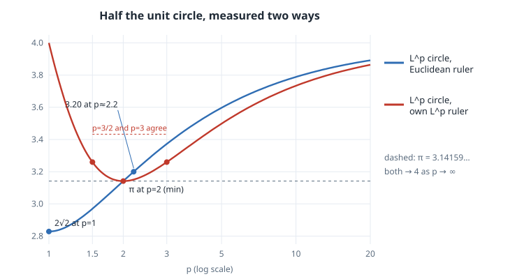

# How Big Is π? The Unit Circle Under L^p Norms

## Thesis

"π is half the perimeter of the unit circle" is a definition with two hidden choices. You must choose **which circle**, meaning the set of points at distance 1 from the origin, and **which ruler** you use to measure its length. Both depend on how you measure distance. Swap the Euclidean distance for an $L^p$ norm and the number changes. 3Blue1Brown's Pi Day post keeps the ordinary ruler and changes the circle, which gives $2\sqrt2$ in taxicab geometry and about $3.20$ at $p \approx 2.2$. The more intrinsic choice measures the $L^p$ circle with its own $L^p$ ruler. That gives a curve with a beautiful shape: it equals $4$ at both ends, reaches its **minimum exactly at $p = 2$, where it equals $3.14159\ldots$**, and takes equal values at conjugate exponents, $\pi_p = \pi_q$ when $1/p + 1/q = 1$. This chapter derives the integral, computes both versions two independent ways, and checks every number quoted above.

## Mental model

{fig-alt="Plot of 'pi' against p from 1 to 20 on a log axis. Blue curve: the L^p unit circle measured with an ordinary Euclidean ruler; it rises from 2 root 2 = 2.83 at p = 1 through pi at p = 2 and 3.20 near p = 2.2 towards 4. Red curve: the L^p circle measured with its own L^p ruler; it falls from 4 at p = 1 to a minimum of pi at p = 2 and climbs back towards 4, with equal values at conjugate exponents such as p = 3/2 and p = 3."}

**The circle.** For $1 \le p \le \infty$ the $L^p$ norm on $\mathbb R^2$ is $\|(x,y)\|_p = (|x|^p + |y|^p)^{1/p}$, with $\|(x,y)\|_\infty = \max(|x|,|y|)$. Its unit circle is
$$
C_p = \{(x, y) : |x|^p + |y|^p = 1\}.
$$
At $p = 1$ it is a diamond with vertices $(\pm1, 0)$ and $(0, \pm1)$. At $p = 2$ it is the round circle. As $p \to \infty$ it fills out to the square $[-1,1]^2$. The unit balls are nested and grow with $p$: if $|x|, |y| \le 1$ then $|x|^{p'} + |y|^{p'} \le |x|^p + |y|^p$ for $p' > p$.

**The ruler.** The length of a curve in the norm $\|\cdot\|_r$ is $\int \|(dx, dy)\|_r$, the limit of inscribed polygon lengths with each chord measured in $\|\cdot\|_r$. Write the upper arc as a graph $y = (1 - x^p)^{1/p}$, so that
$$
y'(x) = -\,x^{p-1}\,(1 - x^p)^{1/p - 1}.
$$
$C_p$ is symmetric under $x \mapsto -x$, $y \mapsto -y$ and $x \leftrightarrow y$, and every $L^r$ norm is invariant under the same swaps. So the curve splits into 8 congruent arcs. One of them runs from $(0, 1)$ to the diagonal point $(c, c)$ with $c = 2^{-1/p}$. Half the perimeter is 4 such arcs:
$$
\pi_{p}^{(r)} \;=\; 4 \int_0^{2^{-1/p}} \bigl(1 + |y'(x)|^r\bigr)^{1/r}\,dx .
$$
- **3Blue1Brown's version:** $r = 2$, the $L^p$ circle and a Euclidean ruler.
- **The intrinsic version:** $r = p$, the $L^p$ circle and its own ruler. This is Keller and Vakil's $\pi_p$.

**Closed forms at the ends.**

- $p = 1$, the diamond:
  - With a Euclidean ruler, each side is $\sqrt2$ long. The upper half has two sides, so the value is $2\sqrt2 \approx 2.828$.
  - With the taxicab ruler, each side is $|\Delta x| + |\Delta y| = 2$, so the value is $4$.
- $p = \infty$, the square: the upper half runs $(1,0) \to (1,1) \to (-1,1) \to (-1,0)$, with legs $1 + 2 + 1$. Each leg is axis-parallel, so every $L^r$ ruler agrees: the value is $4$.

**Why the Euclidean-ruler curve rises.** For two convex regions $K \subseteq L$ in the plane, the perimeter of $K$ is at most that of $L$. Cauchy's formula writes the perimeter as $\int_0^{\pi} w(\theta)\,d\theta$, where $w(\theta)$ is the width in direction $\theta$, and widths only grow when the region grows. The $L^p$ balls grow with $p$, so the Euclidean-ruler value increases from $2\sqrt2$ to $4$. Of these $L^p$ circles only $p = 2$ is rotation-invariant, which is the sense in which "π is a constant" depends on the metric.

**Why the intrinsic curve is a valley.** Adler and Tanton (2000) proved that $\pi_p$ is smallest at $p = 2$. They also asked whether $\pi_p = \pi_q$ for conjugate exponents. Keller and Vakil (2009) gave an elementary proof that it is. The underlying reason is that the unit balls of $L^p$ and $L^q$ are *polar* (dual) to each other, and a theorem of Schäffer says dual unit circles have equal self-perimeters.

## Worked example

The script below computes both versions in two independent ways. The first is Gauss–Legendre quadrature of the integral above. The substitution $x = c\,s^4$ smooths out the $x^{p-1}$ cusp at $0$ when $1 < p < 2$. The second is a brute-force inscribed polygon with $2^{18}$ chords, each measured in the chosen norm. It then solves for the $p$ at which 3Blue1Brown's value hits $3.2$, scans the intrinsic curve for its minimum, and tests conjugate pairs. numpy 2.5.4, CPython.

```python
"""How big is 'pi' when the circle and/or the ruler use an L^p norm?  numpy only."""
import numpy as np

def norm(dx, dy, r):
    if np.isinf(r): return np.maximum(abs(dx), abs(dy))
    return (abs(dx) ** r + abs(dy) ** r) ** (1 / r)

def half_perimeter(p, r, n=200):
    """Half the perimeter of {|x|^p + |y|^p = 1}, measured with the L^r norm.
    By symmetry it is 4 x the arc from (0,1) to the diagonal point (c, c), c = 2^(-1/p),
    where the curve is the graph y = (1 - x^p)^(1/p).  Gauss-Legendre after x = c*s^4."""
    c = 2.0 ** (-1 / p)
    s, w = np.polynomial.legendre.leggauss(n)
    s, w = (s + 1) / 2, w / 2                         # nodes on [0, 1]
    x, dxds = c * s ** 4, 4 * c * s ** 3              # the substitution kills the x^(p-1) cusp at 0
    dydx = -x ** (p - 1) * (1 - x ** p) ** (1 / p - 1)
    return 4 * np.sum(w * norm(1.0, dydx, r) * dxds)

def polygon(p, r, m=2**18):
    """Independent check: an inscribed polygon with m vertices on the upper half, measured in L^r."""
    t = np.linspace(0, np.pi, m + 1)
    c, s = np.cos(t), np.sin(t)
    c[abs(c) < 1e-12] = 0.0          # sin(pi) is 1.2e-16 in floating point, and 1.2e-16**(2/10) is 6.6e-4:
    s[abs(s) < 1e-12] = 0.0          # without this snap the polygon ends 6.6e-4 short of the axis
    x = np.sign(c) * abs(c) ** (2 / p)
    y = np.sign(s) * abs(s) ** (2 / p)
    return norm(np.diff(x), np.diff(y), r).sum()

print("p      Euclidean ruler   (polygon check)    own-norm ruler   (polygon check)")
for p in [1.0, 1.25, 1.5, 2.0, 2.2, 3.0, 4.0, 10.0]:
    e, ep = half_perimeter(p, 2), polygon(p, 2)
    o, op = half_perimeter(p, p), polygon(p, p)
    print(f"{p:<6} {e:.10f}    ({ep:.10f})   {o:.10f}   ({op:.10f})")
sq = np.array([[1, 0], [1, 1], [-1, 1], [-1, 0]], float)      # p = inf: the unit 'circle' is a square
d = np.diff(sq, axis=0)
print(f"inf    {norm(d[:, 0], d[:, 1], 2).sum():.10f}    (square, exact)  {norm(d[:, 0], d[:, 1], np.inf).sum():.10f}")
print(f"closed forms: 2*sqrt(2) = {2*np.sqrt(2):.10f}   pi = {np.pi:.10f}")

# The two methods disagree for large p: is it the quadrature or the polygon?
for p in [4.0, 10.0]:
    g = "  ".join(f"n={n}: {half_perimeter(p, 2, n):.10f}" for n in (50, 200, 800))
    q = "  ".join(f"m=2^{k}: {polygon(p, 2, 2**k):.10f}" for k in (14, 18, 22))
    print(f"p={p:<4} Gauss {g}\n       polygon {q}")

# 3Blue1Brown's 'p ~ 2.2 gives 3.20': solve Euclidean-ruler pi_p = 3.2 by bisection.
lo, hi = 2.0, 3.0
for _ in range(60):
    mid = (lo + hi) / 2
    lo, hi = (mid, hi) if half_perimeter(mid, 2) < 3.2 else (lo, mid)
print(f"Euclidean ruler: pi_p = 3.2 at p = {lo:.6f}")

# Own-norm ruler: the minimum is at p = 2, and conjugate exponents give the same value.
ps = np.linspace(1.0, 6.0, 5001)
vals = np.array([half_perimeter(p, p) for p in ps])
k = vals.argmin()
print(f"own-norm ruler: min over p in [1,6] at p = {ps[k]:.4f}, value {vals[k]:.10f}")
for p in [1.25, 1.5, 3.0, 4.0]:
    q = p / (p - 1)
    print(f"  p = {p:<5} q = {q:<8.5g} pi_p = {half_perimeter(p, p):.12f}  pi_q = {half_perimeter(q, q):.12f}")
```

Output:

```text
p      Euclidean ruler   (polygon check)    own-norm ruler   (polygon check)
1.0    2.8284271247    (2.8284271247)   4.0000000000   (4.0000000000)
1.25   2.8789718433    (2.8789718433)   3.4984568080   (3.4984568080)
1.5    2.9696807173    (2.9696807173)   3.2597679931   (3.2597679930)
2.0    3.1415926536    (3.1415926536)   3.1415926536   (3.1415926536)
2.2    3.1989223052    (3.1989223052)   3.1506699245   (3.1506699245)
3.0    3.3724965701    (3.3724965700)   3.2597679931   (3.2597679930)
4.0    3.5088489718    (3.5088489718)   3.3969348236   (3.3969348236)
10.0   3.7887041586    (3.7887041586)   3.7339608092   (3.7339608092)
inf    4.0000000000    (square, exact)  4.0000000000
closed forms: 2*sqrt(2) = 2.8284271247   pi = 3.1415926536
p=4.0  Gauss n=50: 3.5088489718  n=200: 3.5088489718  n=800: 3.5088489718
       polygon m=2^14: 3.5088489678  m=2^18: 3.5088489718  m=2^22: 3.5088489718
p=10.0 Gauss n=50: 3.7887041586  n=200: 3.7887041586  n=800: 3.7887041586
       polygon m=2^14: 3.7887041565  m=2^18: 3.7887041586  m=2^22: 3.7887041586
Euclidean ruler: pi_p = 3.2 at p = 2.203991
own-norm ruler: min over p in [1,6] at p = 2.0000, value 3.1415926536
  p = 1.25  q = 5        pi_p = 3.498456808045  pi_q = 3.498456808045
  p = 1.5   q = 3        pi_p = 3.259767993059  pi_q = 3.259767993059
  p = 3.0   q = 1.5      pi_p = 3.259767993059  pi_q = 3.259767993059
  p = 4.0   q = 1.3333   pi_p = 3.396934823628  pi_q = 3.396934823628
```

### Reading it

- **3Blue1Brown's numbers check out.**
  - At $p = 1$ the Euclidean-ruler value is $2.8284271247 = 2\sqrt2$.
  - At $p = 2.2$ it is $3.1989$, so "3.20" is right to two decimals.
  - The exact crossing $\pi^{(2)}_p = 3.2$ is at $p = 2.203991$.
  - The column increases with $p$ and tends to $4$, as the nested-balls argument predicts.
- **The intrinsic value is a valley with its floor at π.** It is $4$ at $p = 1$ and at $p = \infty$. On a grid of 5001 values in $[1, 6]$ the minimum sits at exactly $p = 2.0000$ with value $3.1415926536$. The two columns cross only at $p = 2$, where both rulers agree on the round circle.
- **Conjugate exponents agree to all 12 printed digits.** The pairs are $p = 3/2$ with $q = 3$ ($3.259767993059$), $5/4$ with $5$, and $4$ with $4/3$. This is the Keller–Vakil / Schäffer duality, observed numerically. It is not an artefact of the method, because the quadrature for $p$ and for $q$ integrates two different functions over two different intervals.
- **Two methods, one answer, but only after a bug fix.** On the first run the polygon column came out *short* for large $p$: $3.7880471$ instead of $3.7887042$ at $p = 10$, and the gap did not shrink as $m$ grew. That pointed to a fixed missing piece rather than discretisation error. The cause was that `np.sin(np.pi)` is $1.22 \times 10^{-16}$, not $0$, and the superellipse parametrisation raises it to the power $2/p$: $(1.22\times10^{-16})^{0.2} = 6.6 \times 10^{-4}$. So the last vertex sat $6.6 \times 10^{-4}$ above the axis and the polygon stopped short by exactly that much. Snapping values below $10^{-12}$ to zero fixed it. After the fix the two methods agree to 10 digits, and both converge: Gauss is already stable at $n = 50$, while the polygon converges from below, as an inscribed polygon must.

## Pitfalls

- **Say which ruler you mean.** "π in taxicab geometry" is $2\sqrt2$ with a Euclidean ruler but $4$ with a taxicab ruler. Both numbers appear in the literature and popular posts. Fix the convention before you compare values.
- **Small powers amplify rounding.** $|t|^{2/p}$ turns $10^{-16}$ into $10^{-3}$ when $p = 10$. Any parametrisation of the form $\cos^{2/p}$ needs exact zeros at the axes. A convergence study that converges to the wrong number is the symptom.
- **Endpoint singularities slow quadrature.** For $1 < p < 2$ the integrand behaves like $x^{p-1}$ near $0$, which is continuous but not smooth. Plain Gauss–Legendre then converges slowly. A power substitution such as $x = c s^4$ restores fast convergence. Check by doubling $n$.
- **$p < 1$ is not a norm.** For $p < 1$ the "unit ball" is not convex and the triangle inequality fails. The own-norm "length" is then not a length in the metric sense, so keep $p \ge 1$.

## Try this

1. Do the $p = \infty$ case by hand with both rulers. Then explain why the $p = 10$ values in the table are still about $0.2$ below $4$.
2. Use Cauchy's perimeter formula to write out the proof that the Euclidean-ruler value is increasing in $p$. Where does convexity of $C_p$ enter?
3. Find both $p$ with intrinsic $\pi_p = 3.3$ by bisection on each side of $2$, and check that they are conjugate.
4. Measure the $L^p$ circle with the $L^q$ ruler, $q = p/(p-1)$, for a few $p$. Is that "mixed" value symmetric under $p \leftrightarrow q$? Explain what you find using the symmetry $x \leftrightarrow y$.

## Sources

- 3Blue1Brown, Pi Day post on $\pi$ under $L^p$ norms (inspiration): <https://x.com/3blue1brown/status/2032853679162724501>
- J. B. Keller and R. Vakil, "$\pi_p$, the value of $\pi$ in $\ell_p$", *American Mathematical Monthly* 116(10) (2009), 931–935. <https://doi.org/10.4169/000298909X477069>. Preprint: <https://math.stanford.edu/~vakil/files/07-0333.pdf>
- C. L. Adler and J. Tanton, "π is the minimum value for Pi", *College Mathematics Journal* 31(2) (2000), 102–106. <https://doi.org/10.1080/07468342.2000.11974122>
- Cauchy–Crofton formula, including "given two nested convex closed curves, the inner one is shorter" and Cauchy's surface area formula: <https://en.wikipedia.org/wiki/Crofton_formula>
- NumPy `numpy.polynomial.legendre.leggauss`: <https://numpy.org/doc/stable/reference/generated/numpy.polynomial.legendre.leggauss.html>
