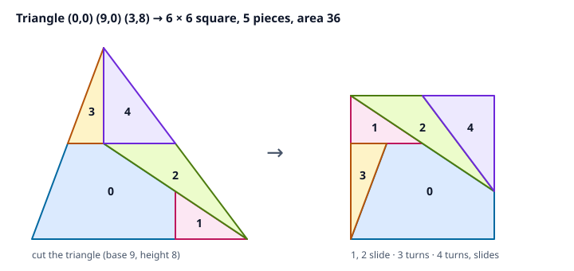

# Squaring the Triangle: Equal Area Means Cut-and-Rearrange

## Thesis

Take any triangle and any square of the same area. You can always cut the triangle into finitely many straight-edged pieces and slide and turn them into the square. More generally, any two polygons of equal area can be cut into each other. This is the **Wallace–Bolyai–Gerwien theorem**: Wallace proved it in 1807, and Bolyai and Gerwien proved it independently in the 1830s. The proof is a construction you can run. This chapter runs it in exact rational arithmetic, turning a 9-by-8 triangle into a 6×6 square in five pieces, and checks the result with no floating point. It then explains why the same statement fails for solids (Dehn) and what changes for a circle (Tarski, Laczkovich).

## Mental model

{fig-alt="Left: the triangle with corners (0,0), (9,0) and (3,8), cut into five coloured pieces numbered 0 to 4. Piece 0 is a large pentagon along the base. Piece 1 is a small right triangle at the bottom right. Piece 2 is a thin triangle above it. Pieces 3 and 4 are the two halves of the top of the triangle, above the line at half height, split by a vertical line from the apex. Right: the same five pieces forming a 6 by 6 square. Piece 0 sits at the bottom where it was. Piece 3 is turned half a turn into the lower-left corner. Pieces 1 and 2 are slid into the top left. Piece 4 is turned and slid into the top right."}

Call two polygons **equidecomposable** if one can be cut into finitely many polygonal pieces that reassemble, by rigid motions, into the other. Pieces may touch only along their edges. Area is preserved by cutting and by motion, so equal area is necessary. The theorem says it is also sufficient. The constructive proof has four moves:

1. **Triangle → rectangle.** Put the triangle's base $b$ on a line, with the foot of the altitude inside the base. The longest side always works. Cut along the mid-line at height $h/2$, then drop a vertical cut from the apex to the mid-line. Turning each small top triangle half a turn about the end of the mid-line fills the two corners. The result is a $b \times h/2$ rectangle in 3 pieces.
2. **Rectangle → square.** For a $W \times H$ rectangle with $H \le W \le 4H$, let $s = \sqrt{WH}$. Cut along the line from $(0, s)$ to $(W, 0)$, and add one vertical cut at $x = s$. That gives 3 pieces. The two right triangles that stick out of the square are congruent to the two gaps, and each reaches its gap by a translation. If $W > 4H$, first halve the rectangle and stack the halves; each halving cuts the ratio $W/H$ by a factor of 4.
3. **Transitivity.** If $A$ cuts into $B$ and $B$ cuts into $C$, overlay the two cut patterns on $B$. Each overlap region is a piece that goes from $A$ to $C$. This is the step the code below does literally.
4. **Any polygon.** Triangulate it, square each triangle, and convert each square into a rectangle of width 1 using step 2 in reverse. Stack the rectangles into one $1 \times \text{area}$ rectangle. Do the same for the second polygon and compose using step 3.

Steps 1 and 2 use only half-turns and translations, never reflections, so the pieces never need to be flipped over.

## Worked example

Triangle $(0,0), (9,0), (3,8)$ has area 36. Step 1 gives a $9 \times 4$ rectangle. Since $9 \le 4 \cdot 4$, step 2 applies with $s = 6$. The coordinates were chosen so that $s$ is rational and every vertex is an exact `Fraction`. The script composes the two dissections by clipping convex polygons (Sutherland–Hodgman) and then checks the result exactly.

```{.python filename="square_triangle.py"}
"""Dissect a triangle into a square with exact rational arithmetic, and check it."""
from fractions import Fraction as F

def area(P):  # shoelace, signed -> abs
    return abs(sum(P[i][0] * P[i - 1][1] - P[i - 1][0] * P[i][1] for i in range(len(P)))) / 2

def clip(P, Q):  # Sutherland-Hodgman: convex P intersected with convex Q (both CCW)
    def inside(p, a, b):
        return (b[0] - a[0]) * (p[1] - a[1]) - (b[1] - a[1]) * (p[0] - a[0]) >= 0
    def cut(p, q, a, b):
        x1, y1 = p; x2, y2 = q; x3, y3 = a; x4, y4 = b
        d = (x1 - x2) * (y3 - y4) - (y1 - y2) * (x3 - x4)
        t = ((x1 - x3) * (y3 - y4) - (y1 - y3) * (x3 - x4)) / d
        return (x1 + t * (x2 - x1), y1 + t * (y2 - y1))
    out = P
    for i in range(len(Q)):
        a, b = Q[i - 1], Q[i]
        inp, out = out, []
        for j in range(len(inp)):
            p, q = inp[j - 1], inp[j]
            if inside(q, a, b):
                if not inside(p, a, b):
                    out.append(cut(p, q, a, b))
                out.append(q)
            elif inside(p, a, b):
                out.append(cut(p, q, a, b))
        if not out:
            return []
    return out

def ccw(P):
    s = sum(P[i - 1][0] * P[i][1] - P[i][0] * P[i - 1][1] for i in range(len(P)))
    return P if s > 0 else P[::-1]

rot180 = lambda c: (lambda p: (2 * c[0] - p[0], 2 * c[1] - p[1]))
shift = lambda d: (lambda p: (p[0] + d[0], p[1] + d[1]))
ident = lambda p: p

# Triangle: base b on the x-axis, apex (p, h) with 0 <= p <= b.
b, h, p = F(9), F(8), F(3)
T = [(F(0), F(0)), (b, F(0)), (p, h)]
W, H = b, h / 2                      # step 1 target: W x H rectangle
s = F(6); assert s * s == W * H      # chosen so the square side is rational
assert H <= s <= W <= 4 * H          # condition for the 3-piece rectangle->square step
print(f"triangle {[(int(x), int(y)) for x, y in T]}  area {area(T)}")
print(f"rectangle {W} x {H}  area {W*H}   square side {s}  area {s*s}")

# Step 1: triangle -> rectangle (cut along the mid-line, then down from the apex).
m = h / 2
step1 = [  # (piece in triangle, motion into rectangle)
    ([(F(0), F(0)), (b, F(0)), ((p + b) / 2, m), (p / 2, m)], ident),
    ([(p / 2, m), (p, m), (p, h)], rot180((p / 2, m))),
    ([(p, m), ((p + b) / 2, m), (p, h)], rot180(((p + b) / 2, m))),
]
# Step 2: rectangle -> square (cut along the line from (0, s) to (W, 0)).
x1 = W - s
step2 = [  # (piece in rectangle, motion into square)
    ([(F(0), F(0)), (s, F(0)), (s, s - H), (x1, H), (F(0), H)], ident),
    ([(s, F(0)), (W, F(0)), (s, s - H)], shift((-s, H))),
    ([(x1, H), (W, F(0)), (W, H)], shift((s - W, s - H))),
]

# Compose: every non-empty overlap of a step-1 image with a step-2 piece is one final piece.
pieces = []
names1 = ["stays", "turned 180", "turned 180"]
names2 = ["stays", "slid", "slid"]
for (P1, f1), n1 in zip(step1, names1):
    img1 = ccw([f1(v) for v in P1])
    for (P2, f2), n2 in zip(step2, names2):
        part = clip(img1, ccw(P2))
        if part and area(part) > 0:
            # pull the part back into the triangle (rot180 and ident are involutions;
            # a 180-degree turn about c is its own inverse)
            part = [v for i, v in enumerate(part) if v != part[i - 1]]  # drop repeated vertices
            src = [f1(v) for v in part]
            dst = [f2(v) for v in part]
            pieces.append((ccw(src), ccw(dst), f"{n1}, then {n2}"))

print(f"\nfinal pieces: {len(pieces)}")
for k, (src, dst, how) in enumerate(pieces):
    fmt = lambda P: " ".join(f"({x},{y})" for x, y in P)
    print(f"  piece {k}: area {str(area(src)):>2}  {how:23} triangle {fmt(src)}")
    print(f"  {'':34} square   {fmt(dst)}")

# Exact checks.
S = [(F(0), F(0)), (s, F(0)), (s, s), (F(0), s)]
def overlaps(group):
    return max((area(clip(A, B)) if clip(A, B) else 0)
               for i, A in enumerate(group) for B in group[i + 1:])
src_all = [a for a, _, _ in pieces]; dst_all = [d for _, d, _ in pieces]
print("\nchecks (exact rationals):")
print("  sum of piece areas       =", sum(area(a) for a in src_all))
print("  pieces inside triangle   =", all(area(clip(a, ccw(T))) == area(a) for a in src_all))
print("  pieces inside square     =", all(area(clip(d, S)) == area(d) for d in dst_all))
print("  max overlap in triangle  =", overlaps(src_all))
print("  max overlap in square    =", overlaps(dst_all))
print("  areas preserved by moves =", all(area(a) == area(d) for a, d, _ in pieces))

```

Output (verbatim, Python 3, standard library only):

```text
triangle [(0, 0), (9, 0), (3, 8)]  area 36
rectangle 9 x 4  area 36   square side 6  area 36

final pieces: 5
  piece 0: area 18  stays, then stays       triangle (0,0) (6,0) (6,2) (3,4) (3/2,4)
                                     square   (0,0) (6,0) (6,2) (3,4) (3/2,4)
  piece 1: area  3  stays, then slid        triangle (6,2) (6,0) (9,0)
                                     square   (0,6) (0,4) (3,4)
  piece 2: area  6  stays, then slid        triangle (9,0) (6,4) (3,4)
                                     square   (6,2) (3,6) (0,6)
  piece 3: area  3  turned 180, then stays  triangle (3/2,4) (3,4) (3,8)
                                     square   (3/2,4) (0,4) (0,0)
  piece 4: area  6  turned 180, then slid   triangle (3,4) (6,4) (3,8)
                                     square   (6,6) (3,6) (6,2)

checks (exact rationals):
  sum of piece areas       = 36
  pieces inside triangle   = True
  pieces inside square     = True
  max overlap in triangle  = 0
  max overlap in square    = 0
  areas preserved by moves = True
```

### Reading it

- Overlaying 3 pieces on 3 pieces could give up to 9 regions. Only 5 are non-empty. Each top triangle (pieces 3 and 4) falls inside a single piece of the second dissection, so it is not cut again.
- Piece 0, with area 18 and half the total, never moves. Piece 3 turns and then stays. Pieces 1 and 2 only slide. Piece 4 turns and then slides. These are the motions the theorem needs.
- The checks are a complete proof that the dissection is correct, not a numerical spot check. All pieces lie inside the square, their interiors are pairwise disjoint (every overlap has area exactly 0), and their areas sum to 36, the square's area. So they tile it with no gaps. The same three facts hold in the triangle. Because the arithmetic is rational, "0" means zero.
- The classic minimum for an equilateral triangle is 4 pieces, Dudeney's "Haberdasher's Puzzle" in *The Canterbury Puzzles* (1907). The general algorithm makes no attempt to minimise pieces. Finding the fewest pieces for a given pair of polygons is a separate, much harder search.

## Pitfalls

- **Picking the wrong base in step 1.** If the foot of the altitude lands outside the base (an obtuse angle at the base), the vertical cut leaves the triangle. Use the longest side as the base.
- **Forgetting the aspect-ratio condition in step 2.** The 3-piece slide needs $H \le s \le W$ and $s \le 2H$, which together give $W \le 4H$. Outside that range, the vertical cut at $x = s$ falls to the wrong side of the slanted cut and the pieces overlap. The `assert` in the script is there for this reason.
- **Assuming the idea extends to 3-D.** It does not. Hilbert's third problem (1900) asked whether equal-volume polyhedra are always equidecomposable, and Dehn answered no the same year. The **Dehn invariant**, $\sum_{\text{edges}} \ell_e \otimes \theta_e \in \mathbb{R} \otimes_{\mathbb{Q}} \mathbb{R}/\pi\mathbb{Q}$, is unchanged by cutting. It is 0 for a cube, whose dihedral angles are all $\pi/2$. It is non-zero for the regular tetrahedron, whose dihedral angle $\arccos(1/3)$ is not a rational multiple of $\pi$.
- **Assuming a circle can be squared this way.** A disc has no polygonal dissection into a square, because curved edges cannot be matched by straight ones. With arbitrary point-set pieces, Laczkovich (1990) showed that a disc *can* be cut into a square using translations only, with about $10^{50}$ non-measurable pieces. Marks and Unger (2017) made the pieces Borel sets.

## Try this

1. Change the apex to $(p, 8)$ for $p = 0$, $4.5$ and $9$. How many final pieces do you get, and why does $p = 0$ (a right triangle) need fewer?
2. Try the $8 \times 4.5$ rectangle you get from base 8 and height 9 (area 36). Does the 3-piece step 2 still apply? Generalise the script to halve and stack when $W > 4H$.
3. Use $s = \sqrt{WH}$ irrational, such as base 6 and height 4, and represent coordinates in $\mathbb{Q}(\sqrt{3})$ as pairs of `Fraction`s. Which operations in `clip` still work exactly?
4. Compute the Dehn invariant of a cube and a regular tetrahedron of volume 1, and confirm that the cube's is 0 because its dihedral angle $\pi/2$ is a rational multiple of $\pi$.

## Sources

- Wallace–Bolyai–Gerwien theorem (statement and history): <https://en.wikipedia.org/wiki/Wallace%E2%80%93Bolyai%E2%80%93Gerwien_theorem>
- Hilbert's third problem and Dehn's 1900/1901 solution: <https://en.wikipedia.org/wiki/Hilbert%27s_third_problem>
- Dehn invariant: <https://en.wikipedia.org/wiki/Dehn_invariant>
- H. E. Dudeney, *The Canterbury Puzzles* (1907), No. 26, "The Haberdasher's Puzzle" (Project Gutenberg): <https://www.gutenberg.org/ebooks/27635>
- M. Laczkovich, "Equidecomposability and discrepancy; a solution of Tarski's circle-squaring problem", *J. reine angew. Math.* 404 (1990) 77–117, doi:10.1515/crll.1990.404.77
- A. Marks and S. Unger, "Borel circle squaring", *Annals of Mathematics* 186 (2017): <https://arxiv.org/abs/1612.05833>
- Tarski's circle-squaring problem: <https://en.wikipedia.org/wiki/Tarski%27s_circle-squaring_problem>
