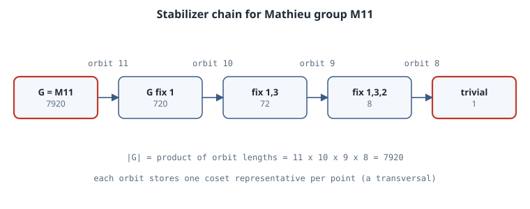

# Schreier–Sims: Computing with Permutation Groups

## Thesis

A group given by a handful of permutations can be astronomically large. The Rubik's cube group has six generators and 43,252,003,274,489,856,000 elements. You cannot list it. But you can still answer "how big is it?" and "is this position reachable?" exactly, in a fraction of a second. The **Schreier–Sims algorithm** makes that possible. It builds a *base and strong generating set* (BSGS): a chain of subgroups, each fixing one more point, together with a table of coset representatives at every level. Once you have the chain, the group order is a product of small numbers, and testing membership takes one pass down the chain.

## Mental model

{fig-alt="A stabilizer chain: M11 of order 7920 fixes point 1 to give a subgroup of index 11, then point 3 (index 10), point 2 (index 9), point 4 (index 8), ending at the trivial group. The order is the product 11 x 10 x 9 x 8."}

Pick points $b_1, b_2, \dots, b_k$ (the **base**) and build the chain of stabilizers

$$
G = G^{(0)} \ge G^{(1)} \ge \dots \ge G^{(k)} = 1,\qquad G^{(i)} = \{g \in G : b_1^g = b_1, \dots, b_i^g = b_i\}.
$$

By the orbit–stabilizer theorem, the index $[G^{(i-1)} : G^{(i)}]$ equals the size of the orbit $\Delta_i = b_i^{G^{(i-1)}}$. So

$$
|G| = \prod_{i=1}^{k} |\Delta_i|.
$$

At each level, store one permutation $u_x \in G^{(i-1)}$ for every point $x \in \Delta_i$, chosen so that $b_i^{u_x} = x$. These form the **transversal**. A generating set is *strong* if, for every $i$, the generators that fix $b_1,\dots,b_{i}$ already generate $G^{(i)}$.

## Three ideas that make it work

**1. Orbits and transversals are a graph search.** Starting from $b_i$, apply every generator and record how you reached each new point. That is breadth-first search on at most $n$ vertices.

**2. Schreier's lemma gives generators for the stabilizer.** Let $G = \langle S \rangle$ and let $u_x$ be a transversal for the orbit of $b$. Then the stabilizer $G_b$ is generated by the **Schreier generators**

$$
u_x \, s \, u_{x^s}^{-1}, \qquad x \in \Delta,\ s \in S.
$$

Each one maps $b \mapsto x \mapsto x^s \mapsto b$, so it fixes $b$. The lemma says these elements also generate *all* of $G_b$.

**3. Sifting tests membership and filters redundant generators.** To test $g$, look up the representative $u$ with $b_1^u = b_1^g$ and replace $g$ by $g u^{-1}$, which now fixes $b_1$. Repeat at every level. If $b_i^g$ ever falls outside $\Delta_i$, or if anything other than the identity is left at the end, then $g \notin G$. Schreier–Sims sifts every Schreier generator through the levels built so far. Generators that sift to the identity are already accounted for. Anything left over is a new element of a deeper stabilizer, so it becomes a new generator there.

There are many Schreier generators, but most sift to the identity, and the chain has length at most $n$. The result is an algorithm that runs in time polynomial in the degree $n$ and the number of generators, rather than in $|G|$. Sims introduced it around 1970. Seress's *Permutation Group Algorithms* gives the complexity analysis and the faster randomized variants that systems like GAP use in practice.

## Worked example: a complete implementation

Permutations are tuples acting on $\{0,\dots,n-1\}$. The composition `mul(p, q)` means "apply `p`, then `q`", matching the right-action convention $x^{pq} = (x^p)^q$ used above.

```python
# schreier_sims.py -- base and strong generating set, group order, membership
from math import prod

def cyc(n, *cycles):                       # 1-based cycle notation -> tuple
    p = list(range(n))
    for c in cycles:
        for a, b in zip(c, c[1:] + c[:1]):
            p[a - 1] = b - 1
    return tuple(p)

def mul(p, q):                             # apply p, then q
    return tuple(q[i] for i in p)

def inv(p):
    r = [0] * len(p)
    for i, j in enumerate(p):
        r[j] = i
    return tuple(r)

class Level:                               # one point of the base
    def __init__(self, point, n):
        self.point, self.gens = point, []
        self.trans = {point: tuple(range(n))}   # orbit point -> coset rep u, point^u = it

    def extend_orbit(self):
        frontier = list(self.trans)
        while frontier:
            x = frontier.pop()
            for g in self.gens:
                y = g[x]
                if y not in self.trans:
                    self.trans[y] = mul(self.trans[x], g)
                    frontier.append(y)

def sift(levels, g):
    for lv in levels:
        y = g[lv.point]
        if y not in lv.trans:
            return g, lv
        g = mul(g, inv(lv.trans[y]))
    return g, None

def schreier_sims(gens, n):
    ident = tuple(range(n))
    levels = []
    def add_gen(i, g):
        if i == len(levels):
            levels.append(Level(next(x for x in range(n) if g[x] != x), n))
        lv = levels[i]
        lv.gens.append(g)
        lv.extend_orbit()
        # Schreier generators: u_x * s * u_{x^s}^-1 for every orbit point and generator
        for x, u in list(lv.trans.items()):
            for s in lv.gens:
                h = mul(mul(u, s), inv(lv.trans[s[x]]))
                r, _ = sift(levels[i + 1:], h)
                if r != ident:
                    add_gen(i + 1, r)
    for g in gens:
        r, _ = sift(levels, g)
        if r != ident:
            add_gen(0, r)
    return levels

def order(levels):
    return prod(len(lv.trans) for lv in levels)

def contains(levels, g):
    r, _ = sift(levels, g)
    return r == tuple(range(len(g)))

def closure_size(gens):                    # brute force, small groups only
    seen = {tuple(range(len(gens[0])))}
    frontier = list(seen)
    while frontier:
        x = frontier.pop()
        for g in gens:
            y = mul(x, g)
            if y not in seen:
                seen.add(y); frontier.append(y)
    return len(seen)

m11 = [cyc(11, (1,2,3,4,5,6,7,8,9,10,11)), cyc(11, (3,7,11,8), (4,10,5,6))]
L = schreier_sims(m11, 11)
print("M11 order", order(L), "base", [lv.point + 1 for lv in L],
      "orbits", [len(lv.trans) for lv in L], "brute force", closure_size(m11))

m12 = [cyc(12, (1,2,3,4,5,6,7,8,9,10,11)), cyc(12, (3,7,11,8), (4,10,5,6)),
       cyc(12, (1,12), (2,11), (3,6), (4,8), (5,9), (7,10))]
L = schreier_sims(m12, 12)
print("M12 order", order(L), "orbits", [len(lv.trans) for lv in L])

cube = [cyc(48, (1,3,8,6),(2,5,7,4),(9,33,25,17),(10,34,26,18),(11,35,27,19)),
        cyc(48, (9,11,16,14),(10,13,15,12),(1,17,41,40),(4,20,44,37),(6,22,46,35)),
        cyc(48, (17,19,24,22),(18,21,23,20),(6,25,43,16),(7,28,42,13),(8,30,41,11)),
        cyc(48, (25,27,32,30),(26,29,31,28),(3,38,43,19),(5,36,45,21),(8,33,48,24)),
        cyc(48, (33,35,40,38),(34,37,39,36),(3,9,46,32),(2,12,47,29),(1,14,48,27)),
        cyc(48, (41,43,48,46),(42,45,47,44),(14,22,30,38),(15,23,31,39),(16,24,32,40))]
L = schreier_sims(cube, 48)
print("Rubik order", order(L))
print("orbit sizes", [len(lv.trans) for lv in L])
flip = cyc(48, (2, 34))                    # flip one edge in place (facelets 2 and 34)
twist = cyc(48, (1, 9, 35))                # twist one corner in place
print("single edge flip in group?", contains(L, flip))
print("single corner twist in group?", contains(L, twist))
print("edge flip pair in group?", contains(L, mul(cyc(48, (2, 34)), cyc(48, (7, 18)))))
```

Output (CPython 3.15.0, about 0.15 s wall time for the whole script):

```text
M11 order 7920 base [1, 3, 2, 4] orbits [11, 10, 9, 8] brute force 7920
M12 order 95040 orbits [12, 11, 10, 9, 8]
Rubik order 43252003274489856000
orbit sizes [24, 24, 21, 18, 15, 12, 22, 20, 18, 16, 9, 14, 12, 10, 8, 6, 6, 2]
single edge flip in group? False
single corner twist in group? False
edge flip pair in group? True
```

### Reading the output

- **Mathieu $M_{11}$** has order $7920 = 11 \cdot 10 \cdot 9 \cdot 8$. Each step fixes one more point, so the orbit lengths 11, 10, 9, 8 mean $M_{11}$ is *sharply 4-transitive* on 11 points. The brute-force closure enumerates all 7920 elements and agrees. That check is possible only because the group is small.
- **$M_{12}$** has order $95040 = 12 \cdot 11 \cdot 10 \cdot 9 \cdot 8$, so it is sharply 5-transitive. Brute force would still be feasible here. For the cube it would not.
- **The Rubik's cube group** comes out at $43{,}252{,}003{,}274{,}489{,}856{,}000 = 2^{27} 3^{14} 5^3 7^2 11$. The 48 numbers are the movable facelets (centres are fixed). The six generators are quarter turns of the faces, labelled in the style of the classic GAP cube example. The chain has 18 levels, and the order is the product of the 18 orbit sizes.
- **Membership is the parity argument, done by machine.** Flipping a single edge, or twisting a single corner, is not reachable. Flipping two edges at once is reachable. These are exactly the "orientation sum" invariants that cube solvers learn. Here they fall out of sifting a single permutation, with no theory required.

## Why the chain is a good data structure

- **Order:** a product of at most $n$ numbers.
- **Membership:** one sift of at most $k \le n$ levels. Each level costs one dictionary lookup and one multiplication.
- **Uniform random elements:** choose a uniformly random $u$ at each level and multiply the choices together. Every element of $G$ factors uniquely as $u_k \cdots u_1$, so the product is exactly uniform. This is how you get fair random cube scrambles.
- **Words for elements:** if each transversal element remembers the generator word that built it, sifting a reachable position also returns a word that solves it. Those words are correct but long. Short solutions need different algorithms.

## Pitfalls

- **Left vs right actions.** Mathematicians often write $x^g$ with composition from left to right; many libraries compose like functions, right to left. Mixing the two silently produces the wrong group. A cheap test is to check that `order` matches a brute-force closure on a small group before you trust the code on a large one, which is what the M11 line above does.
- **0-based vs 1-based points.** Cycle notation in papers and GAP is 1-based. `cyc` converts it here.
- **Deterministic vs randomized.** The version above is the deterministic textbook algorithm. Production systems use random Schreier–Sims, which samples random elements instead of all Schreier generators. It is much faster but is correct only with high probability unless you add a verification step. GAP documents how it handles this (see "Stabilizer Chains" in the GAP reference manual's permutation group chapter).
- **Base choice matters for speed, not correctness.** Any base works. A base of points with long orbits keeps the chain short.

## Exercises

1. Add a function `random_element(levels)` that returns a uniform element by picking one representative per level. Sample 10,000 cube elements and check that the corner-orientation sum is always $0 \bmod 3$.
2. Prove Schreier's lemma: if $h \in G_b$ is written as a word in $S$, insert $u^{-1} u$ pairs to rewrite it as a product of Schreier generators.
3. Compute the order of $S_{20}$ from the generators $(1\,2)$ and $(1\,2\,\dots\,20)$, and confirm it equals $20!$.
4. Form the group generated by only the front and right quarter turns of the cube. What is its order? Compare it with the full group.

## Sources

- Charles C. Sims, "Computational methods in the study of permutation groups," in *Computational Problems in Abstract Algebra* (Pergamon, 1970): the original algorithm.
- Ákos Seress, *Permutation Group Algorithms*, Cambridge Tracts in Mathematics 152 (Cambridge University Press, 2003): complexity analysis and the randomized variants.
- Derek F. Holt, Bettina Eick, Eamonn A. O'Brien, *Handbook of Computational Group Theory* (Chapman & Hall/CRC, 2005), Chapter 4.
- GAP Reference Manual, [Chapter 43: Permutation Groups](https://docs.gap-system.org/doc/ref/chap43.html), including stabilizer chains.
- SymPy documentation, [Permutation groups: `schreier_sims`](https://docs.sympy.org/latest/modules/combinatorics/perm_groups.html), a readable Python implementation to compare against.
