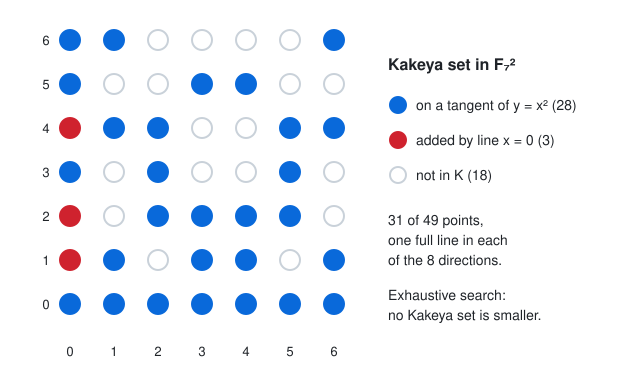

# Kakeya Sets over Finite Fields: Dvir's Polynomial Method

## Thesis

A **Kakeya set** in $\mathbb F_q^n$ is a set of points that contains a full line in every direction. You might hope to pack all those lines into a small region by making them overlap. Zeev Dvir proved in 2008 that you cannot: every Kakeya set has at least $\binom{q+n-1}{n} \ge q^n/n!$ points, which is a fixed fraction of the whole space. The proof is half a page long. It uses no geometry at all, only one fact: *a nonzero polynomial of low degree cannot vanish everywhere.* This chapter states the problem and proves Dvir's bound. It then checks everything by computer:
- the exact smallest Kakeya sets in the plane, found by exhaustive search
- a conic construction that attains that minimum
- the linear-algebra statement at the heart of Dvir's proof, on random Kakeya sets in $\mathbb F_q^3$

The real-number version of the problem, for $\mathbb R^3$, was resolved only in a 2025 preprint by Hong Wang and Joshua Zahl.

## Mental model

{fig-alt="A 7 by 7 grid of points with coordinates 0 to 6. Thirty-one points are filled. Twenty-eight blue points lie on the seven tangent lines to the parabola y = x squared over F_7. Three red points at (0,1), (0,2) and (0,4) are added by the vertical line x = 0. Eighteen points are hollow and not in the set. A legend notes that the set contains a full line in each of the 8 directions and that exhaustive search finds no smaller Kakeya set."}

**Lines and directions.** In $\mathbb F_q^n$, a line is $\{b + tv : t \in \mathbb F_q\}$ for a base point $b$ and a nonzero direction $v$. Every line has exactly $q$ points. Two directions are the same if one is a scalar multiple of the other, so there are $(q^n - 1)/(q - 1)$ directions. That is $q+1$ in the plane: the slopes $0, 1, \dots, q-1$ plus vertical. A Kakeya set needs one line per direction, so it is the union of $q+1$ lines in the plane and $q^2+q+1$ lines in 3-space.

**Why there is a floor.** In the plane, any two non-parallel lines meet in exactly one point. Take the $q+1$ chosen lines in some order. The $k$-th line meets the $k-1$ earlier ones in at most $k-1$ points, so it contributes at least $q-(k-1)$ new points. Summing gives $|K| \ge q + (q-1) + \dots + 1 = q(q+1)/2$, about half the plane. That argument does not generalise: in 3-space most pairs of lines do not meet at all, and the counting runs out of steam.

**Dvir's argument.** It works for any $n$. Suppose $|K| < \binom{q+n-1}{n}$, which is the number of monomials of degree at most $q-1$ in $n$ variables. Requiring a polynomial to vanish at each point of $K$ is one linear equation on its coefficients. There are more unknowns than equations, so some **nonzero polynomial $P$ of degree $d \le q-1$ vanishes on all of $K$**. Let $P_d$ be its top-degree homogeneous part. It is nonzero, and $d \ge 1$ because a nonzero constant cannot vanish on a nonempty set. Now take any direction $v$, and let $b$ be the base point of the line in direction $v$ that lies inside $K$. The one-variable polynomial
$$
g(t) = P(b + tv)
$$
has degree at most $d \le q-1$ but vanishes at all $q$ values of $t$. So it is the zero polynomial. In particular its $t^d$ coefficient is zero, and that coefficient is exactly $P_d(v)$. Because $P_d$ is homogeneous, it then vanishes at every nonzero multiple of $v$, and it vanishes at $0$ too. So **$P_d$ vanishes on all of $\mathbb F_q^n$**. But a nonzero polynomial whose degree in each variable is less than $q$ cannot vanish everywhere (induct on the number of variables, using the one-variable root count). That is a contradiction. Hence
$$
|K| \;\ge\; \binom{q+n-1}{n} \;\ge\; \frac{q^n}{n!}.
$$

The contradiction comes from a statement you can test by computer: *no nonzero polynomial of degree $\le q-1$ vanishes on a Kakeya set.* Equivalently, the matrix that evaluates all such monomials at the points of $K$ has full column rank.

**The plane, exactly.** For odd $q$, Blokhuis and Mazzocca determined the true minimum: $q(q+1)/2 + (q-1)/2$. They also showed which sets attain it: the $q+1$ lines of a "dual oval", meaning a set of lines no three of which pass through one point. For our purposes, these are the tangent lines to a conic. Concretely:
- The tangent to $y = x^2$ at $(a, a^2)$ is $y = 2ax - a^2$. Because $2$ is invertible when $q$ is odd, these $q$ tangents cover all $q$ slopes.
- The vertical line $x = 0$ covers the last direction.

The figure shows the result for $q = 7$.

## Worked example

The script below does three things:

- It finds the **exact** smallest Kakeya set in $\mathbb F_q^2$ for $q = 3, 5, 7$. Each step chooses one of the $q$ parallel lines in the next direction and removes duplicate partial unions. Translation symmetry lets it fix the first line.
- It builds the conic construction and checks it is Kakeya.
- It tests Dvir's key statement: a rank computation mod $q$ on random Kakeya sets in $\mathbb F_q^3$, plus a control set of the same size that is not Kakeya.

```{.python filename="kakeya.py"}
"""Finite-field Kakeya sets: exact minimum in F_q^2, the conic construction,
and Dvir's polynomial-method bound checked by linear algebra mod q (q prime)."""
import itertools, random
from math import comb
import numpy as np

def directions(q, n):
    """One representative per direction in F_q^n: first nonzero coordinate = 1."""
    out = []
    for v in itertools.product(range(q), repeat=n):
        nz = [c for c in v if c]
        if nz and next(c for c in v if c) == 1:
            out.append(v)
    return out

def line(q, base, d):
    return {tuple((b + t * c) % q for b, c in zip(base, d)) for t in range(q)}

# ---- 1. exact minimum Kakeya set in F_q^2 by exhaustive search ----
def min_kakeya_plane(q):
    dirs = directions(q, 2)                      # q+1 directions
    # for each direction, the q parallel lines as bitmasks over q^2 points
    masks = []
    for d in dirs:
        seen, ls = set(), []
        for x, y in itertools.product(range(q), repeat=2):
            L = frozenset(line(q, (x, y), d))
            if L not in seen:
                seen.add(L)
                ls.append(sum(1 << (a * q + b) for a, b in L))
        masks.append(ls)
    # WLOG fix the first direction's line (translations are symmetries)
    best = q * q
    acc = np.array([masks[0][0]], dtype=object)
    for ls in masks[1:]:
        acc = np.array([a | m for a in acc for m in ls], dtype=object)
        acc = np.unique(acc)                     # dedupe partial unions
    sizes = [bin(int(a)).count("1") for a in acc]
    return min(sizes), len(acc)

# ---- 2. conic construction: tangent lines to y = x^2 plus one vertical line ----
def conic_kakeya(q):
    inv2 = pow(2, -1, q)
    K = set()
    for a in range(q):                           # tangent at (a, a^2): y = 2a x - a^2
        K |= line(q, (0, (-a * a) % q), (1, (2 * a) % q))
    K |= line(q, (0, 0), (0, 1))                 # vertical direction
    return K

def is_kakeya(K, q, n):
    pts = set(K)
    for d in directions(q, n):
        if not any(line(q, b, d) <= pts for b in pts):
            return False
    return True

# ---- 3. Dvir: no nonzero poly of degree <= q-1 vanishes on a Kakeya set ----
def rank_mod_p(M, p):
    M = M.copy() % p
    r = 0
    rows, cols = M.shape
    for c in range(cols):
        piv = next((i for i in range(r, rows) if M[i, c]), None)
        if piv is None:
            continue
        M[[r, piv]] = M[[piv, r]]
        M[r] = (M[r] * pow(int(M[r, c]), -1, p)) % p
        for i in range(rows):
            if i != r and M[i, c]:
                M[i] = (M[i] - M[i, c] * M[r]) % p
        r += 1
        if r == rows:
            break
    return r

def monomials(n, deg):
    return [e for e in itertools.product(range(deg + 1), repeat=n) if sum(e) <= deg]

def eval_matrix(K, mons, p):
    pts = np.array(sorted(K), dtype=np.int64)
    cols = [np.prod([pow_vec(pts[:, i], e[i], p) for i in range(len(e))], axis=0) % p
            for e in mons]
    return np.stack(cols, axis=1)

def pow_vec(v, k, p):
    out = np.ones_like(v)
    for _ in range(k):
        out = (out * v) % p
    return out

def random_kakeya(q, n, rng):
    K = set()
    for d in directions(q, n):
        base = tuple(rng.randrange(q) for _ in range(n))
        K |= line(q, base, d)
    return K

if __name__ == "__main__":
    print("== F_q^2: exhaustive minimum vs conic construction vs bounds ==")
    print(f"{'q':>2} {'exact min':>9} {'conic':>5} {'BM q(q+1)/2+(q-1)/2':>20} {'Dvir C(q+1,2)':>13} {'unions searched':>15}")
    for q in (3, 5, 7):
        m, nunions = min_kakeya_plane(q)
        K = conic_kakeya(q)
        assert is_kakeya(K, q, 2)
        print(f"{q:>2} {m:>9} {len(K):>5} {q*(q+1)//2 + (q-1)//2:>20} {comb(q+1, 2):>13} {nunions:>15}")

    print("\n== F_q^3: random Kakeya sets (one random line per direction) ==")
    rng = random.Random(2026)
    print(f"{'q':>2} {'|K|':>4} {'q^3':>4} {'Dvir C(q+2,3)':>13} {'#monomials deg<=q-1':>19} {'rank of eval':>12} {'vanishing polys':>15}")
    for q in (3, 5, 7):
        K = random_kakeya(q, 3, rng)
        assert is_kakeya(K, q, 3)
        mons = monomials(3, q - 1)
        r = rank_mod_p(eval_matrix(K, mons, q), q)
        print(f"{q:>2} {len(K):>4} {q**3:>4} {comb(q+2, 3):>13} {len(mons):>19} {r:>12} {len(mons)-r:>15}")

    print("\n== the bound is about degree q-1: a non-Kakeya set of the same size ==")
    q = 5
    K = random_kakeya(q, 3, random.Random(7))
    mons = monomials(3, q - 1)
    # same size, but every point on a few planes z in {0,1,..}: not Kakeya
    flat = sorted(itertools.product(range(q), repeat=3), key=lambda v: (v[2], v[0], v[1]))[:len(K)]
    r = rank_mod_p(eval_matrix(set(flat), mons, q), q)
    print(f"|K|={len(K)} random Kakeya set; |S|={len(flat)} points filling planes z=0..{flat[-1][2]}: Kakeya? {is_kakeya(flat, q, 3)}; "
          f"vanishing polys of degree<=4: {len(mons)-r}")
```

Output (Python 3, numpy 2.5.4, under a second of CPU):

```text
== F_q^2: exhaustive minimum vs conic construction vs bounds ==
 q exact min conic  BM q(q+1)/2+(q-1)/2 Dvir C(q+1,2) unions searched
 3         7     7                    7             6              16
 5        17    17                   17            15            2946
 7        31    31                   31            28          820499

== F_q^3: random Kakeya sets (one random line per direction) ==
 q  |K|  q^3 Dvir C(q+2,3) #monomials deg<=q-1 rank of eval vanishing polys
 3   22   27            10                  10           10               0
 5   92  125            35                  35           35               0
 7  225  343            84                  84           84               0

== the bound is about degree q-1: a non-Kakeya set of the same size ==
|K|=93 random Kakeya set; |S|=93 points filling planes z=0..3: Kakeya? False; vanishing polys of degree<=4: 1
```

### Reading it

- **The plane is solved, and the search agrees.** For $q = 3, 5, 7$, exhaustive search finds minima of $7, 17, 31$. These match the Blokhuis–Mazzocca value $q(q+1)/2 + (q-1)/2$ exactly, and the conic construction attains it. For $q = 7$, the last column means about 820 thousand distinct unions of 8 lines were compared, and none had fewer than 31 points. Dvir's general bound, $\binom{q+1}{2} = 6, 15, 28$, sits just below. In the plane it is the same as the elementary counting bound $q(q+1)/2$, short by only $(q-1)/2$.
- **The key statement holds in 3-space.** For each random Kakeya set, the evaluation matrix has rank equal to the number of monomials of degree $\le q-1$ ($10, 35, 84$), so the space of vanishing polynomials is $\{0\}$. That is the exact claim the proof needs, and it is why $|K| \ge 10, 35, 84$.
- **The bound is loose in 3-space.** Random Kakeya sets have 22, 92 and 225 points, against Dvir's floor of 10, 35 and 84. The true minimum for $n \ge 3$ is still not known exactly. Dvir's bound is about $q^3/6$. Dvir, Kopparty, Saraf and Sudan raised it to $q^n/2^n$ with the "method of multiplicities", and they note that this is tight to within a factor of about 2 as $q \to \infty$. Random sets have about $0.66\,q^3$ points, close to the $(1-1/e)q^3$ you would expect if $q^3$ points were thrown at random.
- **It is the lines, not the size.** The control set has 93 points, the same as a Kakeya set, but it fills the planes $z = 0, \dots, 3$. The polynomial $z(z-1)(z-2)(z-3)$, of degree $4 = q-1$, vanishes on it, and the rank computation finds exactly that one. The "full line in every direction" property is what rules such polynomials out: on a Kakeya set, the vanishing would be forced at every direction.

## Pitfalls

- **"Direction" means a line through the origin, not a vector.** Counting $q^n - 1$ directions instead of $(q^n-1)/(q-1)$ makes Kakeya sets look harder to build than they are. It also breaks the homogeneity step, which relies on $P_d(\lambda v) = \lambda^d P_d(v)$.
- **Degree $\le q-1$ is essential.** At degree $q$ the argument fails: $x^q - x$ vanishes on all of $\mathbb F_q$. This is why the bound is $\binom{q+n-1}{n}$ and not something larger.
- **Prime vs prime-power fields.** The lab does arithmetic mod $q$, so it needs $q$ prime. Dvir's theorem holds for every finite field, but checking $q = 4, 8, 9$ needs real $\mathbb F_{p^k}$ arithmetic, not integers mod $q$.
- **Even $q$ is different.** Over $\mathbb F_{2^k}$, the tangent lines of a conic all pass through one point, its nucleus, so the construction above breaks. But even-$q$ planes contain hyperovals, and these give Kakeya sets that meet the elementary bound $q(q+1)/2$ exactly. The $(q-1)/2$ surplus is an odd-$q$ phenomenon (Blokhuis–Mazzocca).
- **The finite and real problems are related but not the same.** Dvir's proof does not transfer to $\mathbb R^n$, where a Besicovitch set contains a unit segment in every direction and can have measure zero. There the question is about Hausdorff dimension. Wang and Zahl's 2025 proof for $\mathbb R^3$ is a 127-page multiscale argument about unions of tubes.

## Try this

1. Add $q = 11$ to the plane search. Does it finish? Estimate the number of partial unions before running it, and compare with $q(q+1)/2 + (q-1)/2 = 71$.
2. Replace `random_kakeya` with a greedy construction: for each direction, choose the line that adds the fewest new points. How close to $\binom{q+2}{3}$ does it get for $q = 5, 7$?
3. Extend the rank check to a set that is **almost** Kakeya: delete one point from a random Kakeya set until a vanishing polynomial of degree $\le q-1$ appears. How many deletions does it take?
4. Prove the planar bound $|K| \ge q(q+1)/2$ by the polynomial method instead of by counting intersections. Which monomials do you need?

## Sources

- Zeev Dvir, "On the size of Kakeya sets in finite fields", *J. Amer. Math. Soc.* 22 (2009), 1093–1097: <https://doi.org/10.1090/S0894-0347-08-00607-3> (preprint <https://arxiv.org/abs/0803.2336>)
- Aart Blokhuis and Francesco Mazzocca, "The finite field Kakeya problem", in *Building Bridges Between Mathematics and Computer Science*, Bolyai Society Mathematical Studies 19 (2008), 205–218: <https://arxiv.org/abs/0911.4370>
- Hong Wang and Joshua Zahl, "Volume estimates for unions of convex sets, and the Kakeya set conjecture in three dimensions" (2025): <https://arxiv.org/abs/2502.17655>
- Zeev Dvir, Swastik Kopparty, Shubhangi Saraf and Madhu Sudan, "Extensions to the method of multiplicities, with applications to Kakeya sets and mergers" (2009): <https://arxiv.org/abs/0901.2529>
- Terence Tao, "Dvir's proof of the finite field Kakeya conjecture" (2008): <https://terrytao.wordpress.com/2008/03/24/dvirs-proof-of-the-finite-field-kakeya-conjecture/>
- Breakthrough Prize, 2026 laureates (Hong Wang, New Horizons in Mathematics): <https://breakthroughprize.org/News/98>
