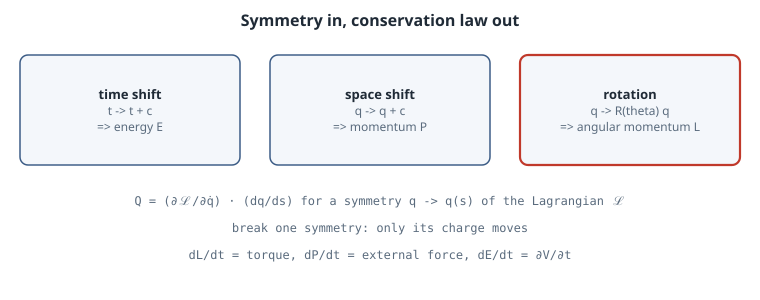

# Noether's Theorem: Symmetries Are Conservation Laws

## Thesis

Energy is conserved *because* the laws of motion do not change from one moment to the next. Momentum is conserved because they do not change from place to place, and angular momentum because they do not depend on direction. Emmy Noether's 1918 theorem turns this into a recipe: every continuous symmetry of a Lagrangian produces a conserved quantity, and it tells you which one. The converse is just as useful in practice. **Break one symmetry and exactly its conserved quantity starts to change**, at a rate you can compute. This chapter derives the recipe in a few lines of calculus and then checks every claim numerically: break each symmetry in turn and watch which number moves.

## Mental model

{fig-alt="Table of Noether pairs. Time translation symmetry gives conserved energy. Space translation gives conserved total momentum. Rotation gives conserved angular momentum. Breaking a symmetry makes only its own charge change, at a rate equal to the derivative of the Lagrangian along the broken symmetry: torque for rotation, external force for translation, partial V over partial t for time."}

**Setup.** A system with coordinates $q(t)$ and Lagrangian $\mathcal L(q, \dot q, t)$, for a particle $\mathcal L = \tfrac12 |\dot q|^2 - V(q, t)$, moves so that the Euler–Lagrange equations hold:

$$
\frac{d}{dt}\frac{\partial \mathcal L}{\partial \dot q} = \frac{\partial \mathcal L}{\partial q}.
$$

**The theorem, in its simplest form.** Suppose a one-parameter family $q \mapsto q + s\,\xi(q) + O(s^2)$ leaves $\mathcal L$ unchanged to first order: $\delta \mathcal L = \frac{\partial \mathcal L}{\partial q}\cdot\xi + \frac{\partial \mathcal L}{\partial \dot q}\cdot\dot\xi = 0$. Define the **Noether charge**

$$
Q = \frac{\partial \mathcal L}{\partial \dot q} \cdot \xi .
$$

Then, by the product rule and Euler–Lagrange,

$$
\dot Q = \Big(\frac{d}{dt}\frac{\partial \mathcal L}{\partial \dot q}\Big)\cdot\xi + \frac{\partial \mathcal L}{\partial \dot q}\cdot\dot\xi = \frac{\partial \mathcal L}{\partial q}\cdot\xi + \frac{\partial \mathcal L}{\partial \dot q}\cdot\dot\xi = \delta\mathcal L .
$$

So $Q$ is conserved exactly when $\delta \mathcal L = 0$. The same line also gives the **broken-symmetry law**: $\dot Q = \delta \mathcal L$.

**The three classical pairs.**

| Symmetry | $\xi$ | Charge $Q$ | If broken, $\dot Q =$ |
|---|---|---|---|
| translation in $x$ | $(1, 0)$ | momentum $p_x = \dot x$ | external force $-\partial V/\partial x$ |
| rotation | $(-y, x)$ | angular momentum $L = x\dot y - y\dot x$ | torque $-(x\,\partial_y V - y\,\partial_x V)$ |
| time shift | (the time direction) | energy $E = \dot q\cdot\frac{\partial\mathcal L}{\partial\dot q} - \mathcal L$ | $-\partial\mathcal L/\partial t = \partial V/\partial t$ |

**Discrete Noether.** A *variational integrator* discretises the action, not the equations. Velocity Verlet is the integrator that comes from $\mathcal L_d(q_0, q_1) = h\big[\tfrac12|(q_1-q_0)/h|^2 - \tfrac12(V(q_0) + V(q_1))\big]$. If $V$ is rotation-invariant, so is $\mathcal L_d$, and a discrete Noether theorem makes Verlet conserve angular momentum *exactly*, up to rounding, at any step size. A general-purpose method like RK4 has no such guarantee for quadratic invariants.

## Worked example

The script is standard-library Python. It has one unit-mass particle in three potentials:

- Kepler, which is symmetric under rotations and time shifts
- "squashed", where $+0.05x^2$ breaks rotation
- "pulsing", where a coupling of $1 + 0.3\sin t$ breaks time shifts

It then checks the torque law, momentum for two bodies with and without a uniform field, and the discrete-Noether claim.

```python
"""Noether's theorem, numerically: each continuous symmetry of the Lagrangian gives a conserved quantity, and breaking it breaks exactly that one."""
import math

def grad(V, x, y, t, h=1e-6):        # central-difference gradient, so any V(x, y, t) can be plugged in
    return ((V(x + h, y, t) - V(x - h, y, t)) / (2 * h), (V(x, y + h, t) - V(x, y - h, t)) / (2 * h))

def verlet(V, state, dt, steps, grad=grad):
    """Velocity Verlet for a unit-mass particle: the discrete Euler-Lagrange equations of a variational integrator."""
    x, y, vx, vy, t = state; gx, gy = grad(V, x, y, t)
    for _ in range(steps):
        vx -= 0.5 * dt * gx; vy -= 0.5 * dt * gy
        x += dt * vx; y += dt * vy; t += dt
        gx, gy = grad(V, x, y, t)
        vx -= 0.5 * dt * gx; vy -= 0.5 * dt * gy
    return x, y, vx, vy, t

def rk4(V, state, dt, steps, grad=grad):
    def f(s):
        x, y, vx, vy, t = s; gx, gy = grad(V, x, y, t); return (vx, vy, -gx, -gy, 1.0)
    s = state
    for _ in range(steps):
        k1 = f(s); k2 = f([a + dt / 2 * b for a, b in zip(s, k1)])
        k3 = f([a + dt / 2 * b for a, b in zip(s, k2)]); k4 = f([a + dt * b for a, b in zip(s, k3)])
        s = [a + dt / 6 * (b + 2 * c + 2 * d + e) for a, b, c, d, e in zip(s, k1, k2, k3, k4)]
    return tuple(s)

energy = lambda V, s: 0.5 * (s[2] ** 2 + s[3] ** 2) + V(s[0], s[1], s[4])   # Noether charge of t -> t + c
ang_mom = lambda s: s[0] * s[3] - s[1] * s[2]                                # Noether charge of rotation

kepler   = lambda x, y, t: -1 / math.hypot(x, y)                             # symmetric under rotation and time shift
squashed = lambda x, y, t: -1 / math.hypot(x, y) + 0.05 * x * x              # rotation symmetry broken
pulsing  = lambda x, y, t: -(1 + 0.3 * math.sin(t)) / math.hypot(x, y)       # time-shift symmetry broken

s0 = (1.0, 0.0, 0.0, 1.2, 0.0)        # an eccentric bound orbit (E = -0.28)
dt, steps = 1e-3, 50_000             # 50 time units, about 6 orbits
print(f"{'potential':10} {'symmetry kept':16} {'E start':>8} {'E end':>8} {'|dE|':>8} {'L start':>7} {'L end':>7} {'|dL|':>8}")
for name, V, kept in [("kepler", kepler, "rotation + time"), ("squashed", squashed, "time only"), ("pulsing", pulsing, "rotation only")]:
    s1 = verlet(V, s0, dt, steps)
    e0, e1, l0, l1 = energy(V, s0), energy(V, s1), ang_mom(s0), ang_mom(s1)
    print(f"{name:10} {kept:16} {e0:8.4f} {e1:8.4f} {abs(e1 - e0):8.1e} {l0:7.4f} {l1:7.4f} {abs(l1 - l0):8.1e}")

# The broken charge changes at exactly the rate Noether predicts: dL/dt = torque = -(x dV/dy - y dV/dx).
s, L_pred = s0, ang_mom(s0)
for _ in range(steps):
    gx, gy = grad(squashed, s[0], s[1], s[4]); tq0 = -(s[0] * gy - s[1] * gx)
    s = verlet(squashed, s, dt, 1)
    gx, gy = grad(squashed, s[0], s[1], s[4]); L_pred += 0.5 * dt * (tq0 - (s[0] * gy - s[1] * gx))
print(f"\nsquashed: L measured {ang_mom(s):.6f}  vs  L0 + integral of torque {L_pred:.6f}")

# Translation symmetry: two bodies with a potential in (r1 - r2) only. Total momentum is the Noether charge.
def two_body(field, steps=20_000, dt=1e-3):
    q = [-0.5, 0.0, 0.5, 0.0]; v = [0.0, -0.4, 0.3, 0.5]          # x1 y1 x2 y2, unit masses
    def acc(q):
        dx, dy = q[0] - q[2], q[1] - q[3]; r3 = math.hypot(dx, dy) ** 3
        return [-dx / r3, -dy / r3 - field, dx / r3, dy / r3 - field]     # optional uniform field on both
    a = acc(q)
    for _ in range(steps):
        v = [vi + 0.5 * dt * ai for vi, ai in zip(v, a)]; q = [qi + dt * vi for qi, vi in zip(q, v)]
        a = acc(q); v = [vi + 0.5 * dt * ai for vi, ai in zip(v, a)]
    return (v[0] + v[2], v[1] + v[3])
print(f"two-body, no field:      total momentum {two_body(0.0)[0]:+.6f}, {two_body(0.0)[1]:+.6f}   (start +0.3, +0.1)")
print(f"two-body, field g = 0.1: total momentum {two_body(0.1)[0]:+.6f}, {two_body(0.1)[1]:+.6f}   (Newton: +0.3, 0.1 - 2*0.1*20 = -3.9)")

# Discrete Noether: Verlet's discrete Lagrangian is exactly rotation-invariant, so it conserves L to rounding; RK4 does not.
# (Exact radial gradient here: the finite-difference one is not exactly radial, which would itself break the symmetry.)
exact = lambda V, x, y, t: (x / math.hypot(x, y) ** 3, y / math.hypot(x, y) ** 3)
dt, steps = 0.05, 20_000
for name, method in [("verlet", verlet), ("rk4", rk4)]:
    s1 = method(kepler, s0, dt, steps, grad=exact)
    print(f"dt={dt} x {steps} steps, {name:6}: |dL| = {abs(ang_mom(s1) - ang_mom(s0)):.2e}   |dE| = {abs(energy(kepler, s1) - energy(kepler, s0)):.2e}")
```

Output (CPython 3.15.0, under 1 s):

```text
potential  symmetry kept     E start    E end     |dE| L start   L end     |dL|
kepler     rotation + time   -0.2800  -0.2800  7.8e-08  1.2000  1.2000  9.6e-12
squashed   time only         -0.2300  -0.2300  6.9e-08  1.2000  1.2374  3.7e-02
pulsing    rotation only     -0.2800   0.1403  4.2e-01  1.2000  1.2000  7.1e-11

squashed: L measured 1.237363  vs  L0 + integral of torque 1.237363
two-body, no field:      total momentum +0.300000, +0.100000   (start +0.3, +0.1)
two-body, field g = 0.1: total momentum +0.300000, -3.900000   (Newton: +0.3, 0.1 - 2*0.1*20 = -3.9)
dt=0.05 x 20000 steps, verlet: |dL| = 1.84e-14   |dE| = 1.96e-04
dt=0.05 x 20000 steps, rk4   : |dL| = 6.66e-07   |dE| = 8.62e-07
```

**Reading it.**

- **One broken symmetry, one moving charge.**
  - In the Kepler potential, both $E$ and $L$ hold to the integrator's precision ($|\Delta E| \approx 10^{-7}$, $|\Delta L| \approx 10^{-11}$).
  - Squashing the potential moves $L$ by $0.037$ while $E$ stays put.
  - Pulsing the coupling changes $E$ from $-0.28$ to $+0.14$, so the coupling pumps the orbit up to positive energy. $L$ stays put.
- **The rate law holds.** Integrating the torque $-(x\,\partial_y V - y\,\partial_x V)$ along the squashed trajectory reproduces the measured $L$ to all six printed digits. A broken symmetry is not chaos; it tells you exactly how the charge moves.
- **Translation.** With an interaction that depends only on $r_1 - r_2$, total momentum is unchanged to six digits. A uniform field $g = 0.1$ on both unit masses for 20 time units changes $P_y$ by exactly $-2 \cdot 0.1 \cdot 20 = -4$, so it goes from $0.1$ to $-3.9$, and leaves $P_x$ alone, because the field is still symmetric under $x$-translation.
- **Discrete Noether.** At a coarse $h = 0.05$ over 20,000 steps, Verlet's $L$ drifts by $2 \times 10^{-14}$, which is rounding. RK4's drifts by $7 \times 10^{-7}$, about $10^7$ times more. RK4 has the smaller energy error over this horizon because it is fourth order. Exact conservation of $L$ comes from the symmetry of the scheme, not from its order. The first table used a finite-difference gradient, whose tiny non-radial error itself breaks the rotation symmetry slightly. That is why $|\Delta L|$ there is $10^{-11}$, not $10^{-14}$.

## Pitfalls

- **Symmetry of the Lagrangian, not of the orbit.** An elliptical orbit is not rotation-symmetric, but the Lagrangian is, and that is what matters.
- **Discrete symmetries give no Noether charge.** Reflection or time reversal gives selection rules, not conserved numbers. Noether needs a *continuous* family.
- **Up to a total derivative.** A transformation that changes $\mathcal L$ by $\frac{d}{dt}F$ is still a symmetry, and the charge becomes $Q - F$. Galilean boosts work this way. Their charge gives the uniform motion of the centre of mass.
- **Numerical symmetry breaking.** A discretisation can break a symmetry the physics has, for example a non-radial finite-difference gradient, or a grid that is not rotation-invariant. The resulting "violation" of conservation is a bug in the method, not in Noether.

## Exercises

1. Show that $\dot E = \partial V/\partial t$ for the pulsing potential, and check it numerically by integrating $\partial V/\partial t$ along the trajectory, as the script does for torque.
2. The Kepler problem has an extra conserved vector, the Laplace–Runge–Lenz vector $A = v \times L - \hat r$. Measure it with Verlet. Then show that the squashed potential, and also any $V \propto -1/r^{1+\epsilon}$, makes it precess.
3. Write the discrete Euler–Lagrange equations for $\mathcal L_d$ above and confirm that they are velocity Verlet.
4. Replace the uniform field with $V = 0.1\,y$ on body 1 only. Which momentum components are still conserved?

## Sources

- E. Noether, "Invariante Variationsprobleme", *Nachr. Ges. Wiss. Göttingen, Math.-Phys. Kl.* (1918) 235–257. English translation by M. A. Tavel, "Invariant Variation Problems". [arXiv:physics/0503066](https://arxiv.org/abs/physics/0503066)
- J. E. Marsden, M. West, "Discrete mechanics and variational integrators", *Acta Numerica* 10 (2001) 357–514. This is the source of discrete Noether.
- E. Hairer, C. Lubich, G. Wanner, *Geometric Numerical Integration*, 2nd ed., Springer (2006), Ch. IV (conservation of first integrals) and VI.6 (variational integrators).
- L. D. Landau, E. M. Lifshitz, *Mechanics*, 3rd ed., §§6–9 (energy, momentum, angular momentum from homogeneity and isotropy).
- S. Wegsman, "How Noether's Theorem Revolutionized Physics", *Quanta Magazine* (2025). [quantamagazine.org](https://www.quantamagazine.org/how-noethers-theorem-revolutionized-physics-20250207/)
