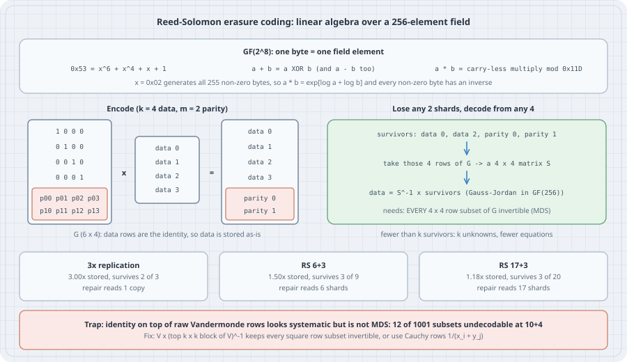

Keeping three copies of every object is the simplest way not to lose data, and at exabyte scale it is ruinously expensive: two of every three disks hold nothing new. The Apache Hadoop documentation puts it plainly: "the default 3x replication scheme in HDFS has 200% overhead in storage space", while "in typical Erasure Coding (EC) setups, the storage overhead is no more than 50%". Backblaze stores each file as 17 data pieces plus 3 parity pieces, and "the original file can then be reconstructed from any 17 of the 20 pieces". That costs 18% extra instead of 200%, and still survives three failures.

The trick is **Reed–Solomon coding**. It is linear algebra, with one twist: the arithmetic happens in a field with exactly 256 elements, so that every byte is a number you can multiply and, more importantly, divide. This chapter builds that field from polynomials modulo 2, finds every modulus that works, encodes and rebuilds real bytes, checks **every** possible set of surviving shards, and then shows a coding matrix that looks right and silently fails for 12 of the 1,001 ways to lose 4 shards out of 14. All listings are complete Python files using only the standard library. They were run with **Python 3.13.5**, and the outputs are pasted unedited.

{fig-alt="Top: in GF(2^8) one byte is one field element; 0x53 is x^6 + x^4 + x + 1; addition is XOR and so is subtraction; multiplication is carry-less multiply modulo 0x11D; x = 0x02 generates all 255 non-zero bytes so products use exp and log tables and every non-zero byte has an inverse. Middle left: encoding with k = 4 data and m = 2 parity multiplies a 6 by 4 matrix G, identity on top and two parity rows below, by four data shards, giving the data shards unchanged plus parity 0 and parity 1. Middle right: lose any two shards, for example keep data 0, data 2, parity 0 and parity 1; take those four rows of G as a 4 by 4 matrix S; data equals S inverse times the survivors, computed by Gauss-Jordan in GF(256); this needs every 4 by 4 row subset of G to be invertible (MDS); with fewer than k survivors there are k unknowns and fewer equations. Bottom: 3x replication stores 3.00x and survives 2 of 3, repair reads 1 copy; RS 6+3 stores 1.50x and survives 3 of 9, repair reads 6 shards; RS 17+3 stores 1.18x and survives 3 of 20, repair reads 17 shards. Trap: identity on top of raw Vandermonde rows looks systematic but is not MDS, 12 of 1001 subsets are undecodable at 10+4; fix with V times the inverse of its top k by k block, or Cauchy rows 1/(x_i + y_j)."}

## 1. The problem as linear algebra

Cut a stripe of data into $k$ equal **data shards** $d_0,\dots,d_{k-1}$ and look at one byte position across all of them: a vector $d\in F^k$. Store $n=k+m$ shards whose bytes at that position are

$$
c = G\,d,\qquad G\in F^{\,n\times k}.
$$

If the top $k$ rows of $G$ are the identity, the first $k$ stored shards *are* the data (the code is **systematic**), and the other $m$ rows compute **parity**. After failures, some set $R$ of $k$ shards survives. Their bytes are $c_R = G_R\,d$, where $G_R$ is the $k\times k$ matrix made of the surviving rows, so

$$
d = G_R^{-1}\,c_R .
$$

Decoding works for *every* loss of up to $m$ shards exactly when **every** $k\times k$ row subset of $G$ is invertible. Such a code is called **maximum distance separable (MDS)**. It meets the Singleton bound: no code that stores $n$ shards for $k$ shards of data can survive more than $n-k$ arbitrary losses, because with fewer than $k$ shards left you have $k$ unknowns and fewer equations.

Two questions remain. Which number system $F$ makes "invert" possible for bytes? And how do you build a $G$ with the MDS property?

## 2. Bytes need a field, and $\mathbb{Z}/256$ is not one

Gaussian elimination divides. Ordinary arithmetic modulo 256 cannot divide by any even number: $2\cdot 128\equiv 0$, so 2 has no inverse. Arithmetic modulo a prime $p$ is a field, but 257 values do not fit in a byte. The answer is **GF(2^8)**: read a byte $b_7\dots b_0$ as the polynomial $b_7x^7+\dots+b_0$ with coefficients mod 2, add polynomials (XOR), and multiply them modulo an **irreducible** degree-8 polynomial. This is the same construction as $\mathbb{Z}/p$: a polynomial that cannot be factored plays the part of a prime. This chapter uses $P(x)=x^8+x^4+x^3+x^2+1$ (`0x11D`), the modulus in Backblaze's open-source Reed–Solomon library (`GENERATING_POLYNOMIAL = 29`, the low byte of `0x11D`).

```python
# gf256.py: the field GF(2^8) that Reed-Solomon storage codes compute in
# A byte b7..b0 is the polynomial b7*x^7 + ... + b0 with coefficients mod 2.
# Products are reduced modulo P(x) = x^8 + x^4 + x^3 + x^2 + 1 (0x11D).
POLY = 0x11D

def mul_slow(a, b, poly=POLY):
    """Carry-less multiply with reduction: the definition, one bit at a time."""
    r = 0
    while b:
        if b & 1:
            r ^= a          # adding polynomials over GF(2) is XOR
        b >>= 1
        a <<= 1
        if a & 0x100:       # degree reached 8: subtract (XOR) the modulus
            a ^= poly
    return r

# x (the byte 0x02) generates every non-zero element, so log/exp tables replace multiplication.
EXP = [0] * 510
LOG = [0] * 256
v = 1
for i in range(255):
    EXP[i] = v
    LOG[v] = i
    v = mul_slow(v, 2)
for i in range(255, 510):
    EXP[i] = EXP[i - 255]   # doubled table: no "mod 255" needed in mul

def add(a, b):
    return a ^ b            # also subtraction: every element is its own negative

def mul(a, b):
    if a == 0 or b == 0:
        return 0
    return EXP[LOG[a] + LOG[b]]

def inv(a):
    if a == 0:
        raise ZeroDivisionError("0 has no inverse in GF(256)")
    return EXP[255 - LOG[a]]

def div(a, b):
    return mul(a, inv(b))

def power(a, n):
    if n == 0:
        return 1
    if a == 0:
        return 0
    return EXP[(LOG[a] * n) % 255]


if __name__ == "__main__":
    print("order of x = 0x02:", next(i for i in range(1, 256) if EXP[i] == 1))
    print("tables agree with bit-by-bit multiply on all 65,536 pairs:",
          all(mul(a, b) == mul_slow(a, b) for a in range(256) for b in range(256)))
    print("every non-zero byte has an inverse:", all(mul(a, inv(a)) == 1 for a in range(1, 256)))
    print("0x53 * 0xCA =", hex(mul(0x53, 0xCA)), "| 0x53 + 0xCA =", hex(add(0x53, 0xCA)))
    print("inverse of 0x53 =", hex(inv(0x53)))
    print("same product with AES's modulus 0x11B:", hex(mul_slow(0x53, 0xCA, 0x11B)))

    # Why not ordinary arithmetic mod 256? Z/256 is a ring, not a field.
    from math import gcd
    no_inv = [a for a in range(1, 256) if gcd(a, 256) != 1]
    print("non-zero bytes with no inverse mod 256:", len(no_inv), "(every even byte)")
    print("in Z/256, 2 * 128 =", (2 * 128) % 256, "-> two non-zero numbers multiply to zero")
```

```bash
python gf256.py
```

Output:

```text
order of x = 0x02: 255
tables agree with bit-by-bit multiply on all 65,536 pairs: True
every non-zero byte has an inverse: True
0x53 * 0xCA = 0x8f | 0x53 + 0xCA = 0x99
inverse of 0x53 = 0x8c
same product with AES's modulus 0x11B: 0x1
non-zero bytes with no inverse mod 256: 127 (every even byte)
in Z/256, 2 * 128 = 0 -> two non-zero numbers multiply to zero
```

The tables are not an approximation. They agree with the bit-by-bit definition on all 65,536 products. Two details matter in practice:

- **Addition is XOR, and so is subtraction.** In characteristic 2 every element is its own negative, so all the minus signs in Gaussian elimination disappear.
- **The modulus changes the arithmetic.** The same bytes `0x53 * 0xCA` give `0x8f` here and `0x01` under AES's modulus `0x11B` (FIPS 197): in AES's field they are inverses, in this one they are not. Two implementations that disagree on $P(x)$ will each "work" and produce incompatible parity. A storage format must fix its field.

## 3. Which moduli work?

A modulus gives a field if it is irreducible. For log/exp tables you want more: the element $x$ (`0x02`) should **generate** all 255 non-zero elements, which makes the polynomial **primitive**. There are only 256 monic degree-8 candidates, so check them all:

```python
# polys.py: which degree-8 moduli give a field, and which make x a generator?
from gf256 import mul_slow

def is_irreducible(p):
    """p has degree 8; it is irreducible iff no polynomial of degree 1..4 divides it."""
    def mod(a, b):
        db = b.bit_length()
        while a.bit_length() >= db:
            a ^= b << (a.bit_length() - db)
        return a
    return all(mod(p, d) != 0 for d in range(2, 32))   # all divisors of degree 1..4

def order_of_x(p):
    v, n = 2, 1
    while v != 1:
        v, n = mul_slow(v, 2, p), n + 1
        if n > 255:
            return None          # x is not invertible: p is reducible
    return n

irreducible = [p for p in range(0x100, 0x200) if is_irreducible(p)]
primitive = [p for p in irreducible if order_of_x(p) == 255]
print("monic degree-8 polynomials over GF(2):", 256)
print("irreducible (each gives a field with 256 elements):", len(irreducible))
print("primitive (x itself generates all 255 non-zero elements):", len(primitive))
print("primitive, low byte only:", [p & 0xFF for p in primitive])
print("AES modulus 0x11B irreducible:", is_irreducible(0x11B), "| order of x:", order_of_x(0x11B))
print("0x11D: irreducible:", is_irreducible(0x11D), "| order of x:", order_of_x(0x11D))
```

```bash
python polys.py
```

Output:

```text
monic degree-8 polynomials over GF(2): 256
irreducible (each gives a field with 256 elements): 30
primitive (x itself generates all 255 non-zero elements): 16
primitive, low byte only: [29, 43, 45, 77, 95, 99, 101, 105, 113, 135, 141, 169, 195, 207, 231, 245]
AES modulus 0x11B irreducible: True | order of x: 51
0x11D: irreducible: True | order of x: 255
```

Thirty moduli give a field. Sixteen of them make $x$ a generator, which matches the count $\varphi(255)/8=128/8=16$ of primitive polynomials of degree 8. The list of sixteen low bytes is exactly the list in the comment above `GENERATING_POLYNOMIAL` in Backblaze's `Galois.java` ("29, 43, 45, 77, …, 245"). AES's `0x11B` is irreducible, so it gives a perfectly good field, but it is *not* primitive: $x$ has order 51 there. Log/exp tables for AES's field therefore use another generator, such as `0x03` (order 255 under `0x11B`, checked on this box). Every one of the thirty choices gives the same field up to relabelling; what differs is only which byte stands for which element.

## 4. Encoding is a matrix product

Matrices over GF(256) need only the four operations above. `invert` is ordinary Gauss–Jordan elimination with the field's `add`, `mul` and `inv`. The module also contains three ways to build a systematic $n\times k$ coding matrix, compared in the next section.

```python
# gfmatrix.py: matrices over GF(256), and three ways to build a k-of-n coding matrix
from gf256 import add, mul, inv, power

def matmul(A, B):
    out = []
    for row in A:
        r = []
        for j in range(len(B[0])):
            s = 0
            for t, a in enumerate(row):
                s = add(s, mul(a, B[t][j]))
            r.append(s)
        out.append(r)
    return out

def invert(M):
    """Gauss-Jordan over GF(256). Returns None if M is singular."""
    n = len(M)
    A = [list(row) + [int(i == j) for j in range(n)] for i, row in enumerate(M)]
    for col in range(n):
        piv = next((r for r in range(col, n) if A[r][col]), None)
        if piv is None:
            return None
        A[col], A[piv] = A[piv], A[col]
        f = inv(A[col][col])
        A[col] = [mul(f, x) for x in A[col]]
        for r in range(n):
            if r != col and A[r][col]:
                g = A[r][col]
                A[r] = [add(x, mul(g, y)) for x, y in zip(A[r], A[col])]
    return [row[n:] for row in A]

def vandermonde(n, k, points=None):
    points = list(range(n)) if points is None else points
    return [[power(x, j) for j in range(k)] for x in points]

def systematic_vandermonde(k, m):
    """Backblaze's construction: V (n x k, distinct points 0..n-1) times inverse of its top k x k block."""
    V = vandermonde(k + m, k)
    return matmul(V, invert(V[:k]))

def naive_identity_plus_vandermonde(k, m):
    """Identity on top, raw Vandermonde rows j^i (j = 1..k) underneath: looks right, is not always MDS."""
    I = [[int(i == j) for j in range(k)] for i in range(k)]
    return I + [[power(j, i) for j in range(1, k + 1)] for i in range(m)]

def cauchy_systematic(k, m):
    """Identity on top, Cauchy rows 1/(x_i + y_j) underneath, with x's and y's all distinct."""
    xs, ys = list(range(k, k + m)), list(range(k))
    I = [[int(i == j) for j in range(k)] for i in range(k)]
    return I + [[inv(add(x, y)) for y in ys] for x in xs]
```

The construction used for real data is Backblaze's. Start from a **Vandermonde** matrix $V$ with rows $(1, x_r, x_r^2,\dots,x_r^{k-1})$ at $n$ distinct points $x_r=0,1,\dots,n-1$. Any $k$ of its rows form a square Vandermonde matrix with distinct points, whose determinant $\prod_{i<j}(x_j-x_i)$ is non-zero in any field. Then multiply on the right by the inverse of the top $k\times k$ block. That turns the top into the identity, and because right-multiplying by an invertible matrix scales every $k\times k$ minor by the same non-zero determinant, it keeps every square row subset invertible. In Backblaze's words from the source: "This will make the top square be the identity matrix, but preserve the property that any square subset of rows is invertible."

```python
# rs.py: encode a file into k data + m parity shards, lose any m, rebuild the original bytes
import random
from gf256 import add, mul
from gfmatrix import invert, systematic_vandermonde

def encode(data: bytes, k: int, m: int):
    size = -(-len(data) // k)                       # shard length, rounded up
    padded = data + bytes(size * k - len(data))
    shards = [list(padded[i * size:(i + 1) * size]) for i in range(k)]
    G = systematic_vandermonde(k, m)
    parity = []
    for row in G[k:]:                               # data rows are the identity: copy, don't compute
        p = [0] * size
        for coef, shard in zip(row, shards):
            if coef:
                p = [add(x, mul(coef, b)) for x, b in zip(p, shard)]
        parity.append(p)
    return [bytes(s) for s in shards + parity], len(data)

def decode(surviving: dict, k: int, m: int, length: int) -> bytes:
    if len(surviving) < k:
        raise ValueError(f"need {k} shards, have {len(surviving)}: {k} unknowns per byte column, "
                         f"only {len(surviving)} equations")
    G = systematic_vandermonde(k, m)
    rows = sorted(surviving)[:k]                    # any k survivors will do
    D = invert([G[r] for r in rows])                # k x k decoding matrix
    size = len(surviving[rows[0]])
    data = []
    for drow in D:
        out = [0] * size
        for coef, r in zip(drow, rows):
            if coef:
                out = [add(x, mul(coef, b)) for x, b in zip(out, surviving[r])]
        data.append(bytes(out))
    return b"".join(data)[:length]

if __name__ == "__main__":
    k, m = 6, 3
    msg = b"Erasure coding stores a stripe once, plus parity. Any 6 of these 9 shards rebuild it."
    shards, n = encode(msg, k, m)
    stored = sum(map(len, shards))
    print(f"{len(msg)} bytes (padded to {k * len(shards[0])}) -> {k}+{m} shards of {len(shards[0])} bytes, "
          f"stored {stored} bytes = {stored / (k * len(shards[0])):.2f}x the padded data")
    print("data shard 0 is the plain bytes:", shards[0])
    print("parity shard 6:", shards[6].hex())
    random.seed(7)
    trials = 0
    for lost in [(6, 7, 8), (0, 1, 2), (0, 4, 8)] + [tuple(random.sample(range(9), 3)) for _ in range(50)]:
        surv = {i: s for i, s in enumerate(shards) if i not in lost}
        assert decode(surv, k, m, n) == msg, lost
        trials += 1
    print(f"rebuilt the exact message after {trials} different 3-shard losses")
    surv = {i: s for i, s in enumerate(shards) if i not in (0, 1, 2, 3)}
    try:
        decode(surv, k, m, n)
    except ValueError as e:
        print("losing 4 shards:", e)
```

```bash
python rs.py
```

Output:

```text
85 bytes (padded to 90) -> 6+3 shards of 15 bytes, stored 135 bytes = 1.50x the padded data
data shard 0 is the plain bytes: b'Erasure coding '
parity shard 6: 9a0e0842c172c3a8e5bcb09ec10d5f
rebuilt the exact message after 53 different 3-shard losses
losing 4 shards: need 6 shards, have 5: 6 unknowns per byte column, only 5 equations
```

Data shard 0 is the original bytes, so reads that find all data shards healthy never touch the parity. Any three losses were repaired, including losing three data shards (`(0, 1, 2)`), where the data is recovered entirely from parity. The fourth loss is not a bug in the decoder. Six unknowns per byte column with five equations has 256 solutions per column, and no algorithm can pick the right one.

## 5. Check every survivor set, not a few

Random erasure tests like the 53 above are reassuring but prove nothing about the other subsets. For storage-sized parameters the number of subsets is small enough to check them all. The script below does that for three constructions, all of which have the identity on top:

```python
# mds_check.py: is EVERY choice of k surviving shards decodable? Check all of them.
from itertools import combinations
from math import comb
from gfmatrix import invert, systematic_vandermonde, naive_identity_plus_vandermonde, cauchy_systematic

def singular_subsets(G, k):
    return [rows for rows in combinations(range(len(G)), k) if invert([G[r] for r in rows]) is None]

for k, m in [(4, 2), (6, 3), (10, 4), (17, 3)]:
    print(f"k={k}, m={m}: {comb(k + m, k)} ways to keep {k} of {k + m} shards")
    for name, build in [("systematic Vandermonde (V * top^-1)", systematic_vandermonde),
                        ("identity + raw Vandermonde rows   ", naive_identity_plus_vandermonde),
                        ("identity + Cauchy rows            ", cauchy_systematic)]:
        G = build(k, m)
        assert G[:k] == [[int(i == j) for j in range(k)] for i in range(k)], "not systematic"
        bad = singular_subsets(G, k)
        print(f"   {name}  undecodable subsets: {len(bad)}" + (f"  e.g. keep {bad[0]}" if bad else ""))
```

```bash
python mds_check.py
```

Output:

```text
k=4, m=2: 15 ways to keep 4 of 6 shards
   systematic Vandermonde (V * top^-1)  undecodable subsets: 0
   identity + raw Vandermonde rows     undecodable subsets: 0
   identity + Cauchy rows              undecodable subsets: 0
k=6, m=3: 84 ways to keep 6 of 9 shards
   systematic Vandermonde (V * top^-1)  undecodable subsets: 0
   identity + raw Vandermonde rows     undecodable subsets: 0
   identity + Cauchy rows              undecodable subsets: 0
k=10, m=4: 1001 ways to keep 10 of 14 shards
   systematic Vandermonde (V * top^-1)  undecodable subsets: 0
   identity + raw Vandermonde rows     undecodable subsets: 12  e.g. keep (0, 1, 2, 3, 6, 7, 8, 10, 12, 13)
   identity + Cauchy rows              undecodable subsets: 0
k=17, m=3: 1140 ways to keep 17 of 20 shards
   systematic Vandermonde (V * top^-1)  undecodable subsets: 0
   identity + raw Vandermonde rows     undecodable subsets: 0
   identity + Cauchy rows              undecodable subsets: 0
```

The Backblaze construction and the Cauchy construction pass every subset at every size. (A Cauchy matrix $1/(x_i+y_j)$ with all $x$'s and $y$'s distinct has every square submatrix invertible, so stacking it under the identity is MDS by construction.) The middle construction, which simply stacks the identity on top of raw Vandermonde rows $j^i$, passes at 4+2, 6+3 and 17+3, and fails at 10+4: there are **12** ways to lose four shards that it cannot recover from.

## 6. The trap: why identity-plus-Vandermonde breaks

The failure has a precise cause. Take the first bad subset found above: data shards 4, 5 and 9 are lost, and parity rows 0, 2 and 3 survive. The identity rows of the survivors pin down the other seven data bytes, so decoding comes down to a $3\times 3$ system in the three lost data values. Its matrix has entries $x^{e}$ for the lost points $x\in\{5,6,10\}$ (data shard $j$ sits at the point $j+1$) and the surviving powers $e\in\{0,2,3\}$. Because the power 1 is missing, this is a *generalized* Vandermonde matrix, and its determinant is the ordinary Vandermonde product times a Schur polynomial. For the exponents $\{0,2,3\}$ that polynomial is $e_2=x_1x_2+x_1x_3+x_2x_3$:

```python
# why_naive_fails.py: the undecodable subset from mds_check.py, reduced to a 3 x 3 determinant
from gf256 import add, mul, power

# keep (0,1,2,3,6,7,8,10,12,13) of k=10, m=4: data shards 4, 5, 9 are lost, parity rows 0, 2, 3 survive.
lost_points = [5, 6, 10]          # data shard j is evaluated at the point j + 1
powers = [0, 2, 3]                # parity row i holds the powers j^i

M = [[power(x, e) for x in lost_points] for e in powers]
def det3(A):
    a, b, c = A[0]; d, e, f = A[1]; g, h, i = A[2]
    t1 = mul(a, add(mul(e, i), mul(f, h)))
    t2 = mul(b, add(mul(d, i), mul(f, g)))
    t3 = mul(c, add(mul(d, h), mul(e, g)))
    return add(add(t1, t2), t3)   # signs vanish: -1 = +1 in characteristic 2
print("the 3 x 3 block the decoder must invert:", [[hex(v) for v in row] for row in M])
print("its determinant:", det3(M))

x1, x2, x3 = lost_points
vandermonde_part = mul(mul(add(x1, x2), add(x1, x3)), add(x2, x3))
e2 = add(add(mul(x1, x2), mul(x1, x3)), mul(x2, x3))
print("Vandermonde factor (x1+x2)(x1+x3)(x2+x3):", vandermonde_part, "(non-zero: points are distinct)")
print("missing-power factor e2 = x1x2 + x1x3 + x2x3:", e2)
```

```bash
python why_naive_fails.py
```

Output:

```text
the 3 x 3 block the decoder must invert: [['0x1', '0x1', '0x1'], ['0x11', '0x14', '0x44'], ['0x55', '0x78', '0x92']]
its determinant: 0
Vandermonde factor (x1+x2)(x1+x3)(x2+x3): 204 (non-zero: points are distinct)
missing-power factor e2 = x1x2 + x1x3 + x2x3: 0
```

The Vandermonde factor is non-zero because the points are distinct. The extra factor $e_2$ happens to be zero in GF(256), so the block is singular and those four losses are unrecoverable. The construction is not MDS because "identity rows plus Vandermonde rows" is not a Vandermonde matrix. Only the rows of $V$ itself have the any-$k$-rows property. This exact pitfall made it into print: Plank's widely used 1997 *Software—Practice & Experience* tutorial presented an information dispersal matrix that, as Plank and Ding's 2003 correction puts it, "does not have the properties claimed -- that the deletion of any m rows results in an invertable n\*n matrix" (their $n$ is this chapter's $k$). The correction derives the coding matrix from a Vandermonde matrix by elementary column operations. That is the same idea as multiplying by the inverse of the top block.

Two habits prevent this class of bug. Derive $G$ from a construction with a proof (Vandermonde times the inverse of its top block, or Cauchy). Then, for the parameters you actually ship, verify *all* $\binom{n}{k}$ subsets once, as `mds_check.py` does. At 4+2, 6+3 and 17+3 the naive matrix happens to be fine. At 10+4 a random test has to hit one of 12 bad subsets out of 1,001 (about 1.2%) to notice anything.

## 7. Replication versus Reed–Solomon, in numbers

Three numbers decide the trade-off: raw bytes stored per usable byte, how many simultaneous losses a stripe survives, and how much must be read to rebuild one lost shard. The listing below also computes the probability of losing a stripe when each shard independently fails with probability $p$ before it can be repaired. That is a deliberately simple model, labelled as such: real failures are correlated, which is why shards are spread across failure domains (disks, hosts, racks, zones).

```python
# durability.py: replication vs Reed-Solomon on the three numbers an operator cares about
from math import comb

def p_loss(n, k, p):
    """Probability that more than n - k of n shards fail, each independently with probability p."""
    return sum(comb(n, j) * p**j * (1 - p) ** (n - j) for j in range(n - k + 1, n + 1))

schemes = [("2x replication", 2, 1), ("3x replication", 3, 1), ("RS 6+3 (HDFS RS-6-3)", 9, 6),
           ("RS 10+4 (HDFS RS-10-4)", 14, 10), ("RS 17+3 (Backblaze Vault)", 20, 17)]
print(f"{'scheme':27s} {'raw/usable':>10s} {'overhead':>9s} {'survives':>9s} {'repair reads':>13s}"
      f" {'P(loss) p=1e-2':>15s} {'p=1e-3':>9s}")
for name, n, k in schemes:
    print(f"{name:27s} {n / k:10.2f} {100 * (n - k) / k:8.0f}% {n - k:>3d} of {n:<3d} {k:>6d} shards"
          f" {p_loss(n, k, 1e-2):15.1e} {p_loss(n, k, 1e-3):9.1e}")
```

```bash
python durability.py
```

Output:

```text
scheme                      raw/usable  overhead  survives  repair reads  P(loss) p=1e-2    p=1e-3
2x replication                    2.00      100%   1 of 2        1 shards         1.0e-04   1.0e-06
3x replication                    3.00      200%   2 of 3        1 shards         1.0e-06   1.0e-09
RS 6+3 (HDFS RS-6-3)              1.50       50%   3 of 9        6 shards         1.2e-06   1.3e-10
RS 10+4 (HDFS RS-10-4)            1.40       40%   4 of 14      10 shards         1.9e-07   2.0e-12
RS 17+3 (Backblaze Vault)         1.18       18%   3 of 20      17 shards         4.3e-05   4.8e-09
```

Read the table one column at a time:

- **Storage.** RS 10+4 survives *four* losses while storing 1.40× the data, against 3.00× for triple replication, which survives two. This is the whole economic argument.
- **Loss probability depends on $p$.** At $p=10^{-2}$, RS 6+3 is slightly *worse* than 3× replication ($1.2\times10^{-6}$ vs $1.0\times10^{-6}$), because nine shards give more chances for four failures. At $p=10^{-3}$ it is nearly eight times better. Fast repair (small $p$ per repair window) is what makes wide codes safe. RS 17+3 trades durability for overhead: at 1.18× it is the cheapest by far, and in this model its loss probability is higher than RS 6+3's. Backblaze accepts that trade: a Vault "is comprised of 20 Storage Pods, with the data evenly spread across all 20 pods", and each file is stored as those 20 shards.
- **Repair is the hidden cost.** Rebuilding one lost replica reads one copy. Rebuilding one lost RS shard reads $k$ shards (6, 10 or 17) across the network. This is why Windows Azure Storage introduced **Local Reconstruction Codes** (Huang et al., USENIX ATC 2012): their LRC (12, 2, 2) splits 12 data fragments into two local groups of six, each with its own parity, plus two global parities. Most single failures are then repaired from six fragments instead of twelve, at 1.33× overhead.

The HDFS built-in erasure-coding policies sit at the conservative end of the table: `RS-3-2-1024k`, `RS-6-3-1024k`, `RS-10-4-1024k`, the older `RS-LEGACY-6-3-1024k` and `XOR-2-1-1024k`. The names encode the codec, the data and parity counts, and the striping cell size.

## Exercises

1. Change `POLY` in `gf256.py` to `0x11B` (AES). Which check in the `__main__` block fails first, and why? Fix it by building the tables with generator `0x03`, and confirm that the tables then agree with `mul_slow(a, b, 0x11B)` on all 65,536 pairs.
2. Using `mds_check.py`, find the smallest $(k, m)$ for which `naive_identity_plus_vandermonde` is not MDS. Is there a pattern in which subsets fail?
3. Prove that if every $k\times k$ row subset of $V$ is invertible and $T$ is any invertible $k\times k$ matrix, then every $k\times k$ row subset of $VT$ is invertible. (Hint: $\det\big((VT)_R\big)=\det(V_R)\det(T)$.)
4. With `p_loss`, find the per-shard failure probability $p$ at which RS 6+3 and 3× replication have equal stripe-loss probability. What does that tell you about the repair-time budget an RS 6+3 cluster needs?
5. In GF(256), how many points are available for a Vandermonde matrix with distinct points? What is the largest $n=k+m$ this gives, and does it match Backblaze's limit of "no more than 256 shards total"?
6. A Reed–Solomon *error*-correcting code (unknown corrupted positions, as on a CD or in a QR code) can correct only $\lfloor m/2\rfloor$ errors with $m$ parity symbols, while erasure coding recovers $m$ losses. Explain the factor of two using the counting argument from Section 1.

## Sources

- I. S. Reed and G. Solomon, "Polynomial Codes Over Certain Finite Fields", *Journal of the Society for Industrial and Applied Mathematics* 8(2), 300–304, 1960.
- J. S. Plank, "A Tutorial on Reed–Solomon Coding for Fault-Tolerance in RAID-like Systems", *Software—Practice & Experience* 27(9), 995–1012, 1997; and J. S. Plank and Y. Ding, "Note: Correction to the 1997 Tutorial on Reed–Solomon Coding", *Software—Practice & Experience* 35(2), 189–194, 2005 (technical report UT-CS-03-504, 2003): <https://web.eecs.utk.edu/~jplank/plank/papers/CS-03-504.html>.
- Backblaze, "Backblaze Open-sources Reed-Solomon Erasure Coding Source Code" (B. Beach, 2015): <https://www.backblaze.com/blog/reed-solomon/>, and the library source, `Galois.java` and `ReedSolomon.java` (`buildMatrix`, `vandermonde`): <https://github.com/Backblaze/JavaReedSolomon>.
- Backblaze, "Backblaze Vaults: Zettabyte-Scale Cloud Storage Architecture" (B. Beach, 2015): <https://www.backblaze.com/blog/vault-cloud-storage-architecture/>.
- Apache Hadoop, *HDFS Erasure Coding* (purpose, overhead figures, built-in policies): <https://hadoop.apache.org/docs/stable/hadoop-project-dist/hadoop-hdfs/HDFSErasureCoding.html>.
- C. Huang, H. Simitci, Y. Xu, A. Ogus, B. Calder, P. Gopalan, J. Li and S. Yekhanin, "Erasure Coding in Windows Azure Storage", USENIX ATC 2012.
- NIST FIPS 197, *Advanced Encryption Standard (AES)* (the field GF(2^8) with modulus `0x11B`): <https://csrc.nist.gov/pubs/fips/197/final>.
- R. Lidl and H. Niederreiter, *Finite Fields*, Cambridge University Press (irreducible and primitive polynomials, counting formulas).
- I. G. Macdonald, *Symmetric Functions and Hall Polynomials*, 2nd ed., Oxford University Press, 1995 (generalized Vandermonde determinants as Schur polynomials times the Vandermonde product).
