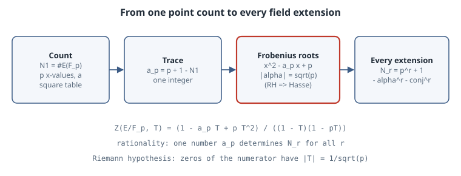

# Counting Points mod p: Hasse's Bound and the Weil Zeta Function

## Thesis

Take a cubic like $y^2 = x^3 + x + 1$ and count its solutions modulo a prime $p$. You get roughly $p$ of them, and the error is never larger than $2\sqrt p$. That is **Hasse's theorem** (1933). It is the simplest case of the **Weil conjectures** (1949), which say that point counts over all the finite fields $\mathbb F_{p}, \mathbb F_{p^2}, \mathbb F_{p^3}, \dots$ are packaged in a *rational* generating function whose zeros sit on a "critical line", exactly like the Riemann hypothesis. For curves Weil proved this himself. For general varieties it took Dwork (rationality, 1960), Grothendieck's étale cohomology, and Deligne (the Riemann hypothesis, 1974). This chapter does not reproduce those proofs. It does something you can check in a few seconds: count points by brute force, then watch every prediction of the theory come true on real numbers.

## Mental model

{fig-alt="Pipeline for an elliptic curve over F_p. Count points N_1 = #E(F_p). Set a_p = p + 1 - N_1. Factor x^2 - a_p x + p into Frobenius roots alpha and its conjugate, with absolute value square root of p, which is the Riemann hypothesis for the curve and gives Hasse's bound. Then Z(T) = (1 - a_p T + p T^2) / ((1 - T)(1 - pT)) is rational and predicts N_r = p^r + 1 - alpha^r - conjugate alpha^r for every extension degree r."}

**The curve.** An elliptic curve $E: y^2 = x^3 + ax + b$ over $\mathbb F_p$ ($p > 3$) needs $4a^3 + 27b^2 \not\equiv 0 \pmod p$, otherwise it is singular mod $p$. Its group $E(\mathbb F_p)$ is the affine solutions plus one **point at infinity**.

**The heuristic.** For each $x$, the right-hand side is a square for about half the $x$ values, and each non-zero square has two square roots. So $N_1 = \#E(\mathbb F_p) \approx p + 1$. Write the error as the **trace of Frobenius**

$$
a_p = p + 1 - \#E(\mathbb F_p).
$$

**Hasse's bound.** $|a_p| \le 2\sqrt p$. Equivalently, the polynomial $x^2 - a_p x + p$ has complex-conjugate roots $\alpha, \bar\alpha$ with $|\alpha| = \sqrt p$.

**The zeta function.** Weil's generating function is $Z(E/\mathbb F_p, T) = \exp\big(\sum_{r \ge 1} N_r T^r / r\big)$, where $N_r = \#E(\mathbb F_{p^r})$. For an elliptic curve it is

$$
Z(E/\mathbb F_p, T) = \frac{1 - a_p T + p T^2}{(1 - T)(1 - pT)} = \frac{(1 - \alpha T)(1 - \bar\alpha T)}{(1 - T)(1 - pT)}.
$$

Taking the logarithm and comparing coefficients gives

$$
N_r = p^r + 1 - \alpha^r - \bar\alpha^r.
$$

Read the conjectures off this formula:

- **Rationality.** $Z$ is a ratio of polynomials, so the single integer $a_p$ determines $N_r$ for every $r$.
- **Functional equation.** $Z(1/(pT)) = Z(T)$, a symmetry that swaps the factors.
- **Riemann hypothesis.** The zeros of the numerator are at $T = 1/\alpha, 1/\bar\alpha$, so $|T| = p^{-1/2}$. Substituting $T = p^{-s}$ puts every zero on $\operatorname{Re}(s) = 1/2$.

The Riemann hypothesis *is* Hasse's bound: $|\alpha| = \sqrt p$ implies $|a_p| = |\alpha + \bar\alpha| \le 2\sqrt p$.

**How the angles are distributed.** Write $a_p = 2\sqrt p\cos\theta_p$. For a curve **without complex multiplication** (CM), the Sato–Tate theorem (Clozel–Harris–Shepherd-Barron–Taylor 2008, Barnet-Lamb–Geraghty–Harris–Taylor 2011) says $\theta_p$ is distributed with density $\tfrac{2}{\pi}\sin^2\theta$ on $[0, \pi]$. CM curves behave differently. For example, $y^2 = x^3 - x$ has $a_p = 0$ for every $p \equiv 3 \pmod 4$, and $y^2 = x^3 + 1$ has $a_p = 0$ for every $p \equiv 2 \pmod 3$.

## Worked example

The script uses only the standard library. Affine points are counted with a table of how many square roots each residue has, so one pass over $x$ suffices. For $\mathbb F_{p^2}$ it builds the field as $\mathbb F_p[i]/(i^2 - n)$, with $n$ a quadratic non-residue, and counts by brute force over all $p^2$ values of $x$ and $y$. That brute-force count is the independent check of the zeta-function prediction.

```python
"""Counting points on elliptic curves over F_p: Hasse's bound, the Weil zeta function, and the Riemann hypothesis for curves."""
import cmath, math

def count_affine(a, b, p):
    """#{(x, y) in F_p^2 : y^2 = x^3 + a x + b}, using a table of square counts."""
    sq = [0] * p
    for y in range(p): sq[y * y % p] += 1
    return sum(sq[(x * x * x + a * x + b) % p] for x in range(p))

def count_ext(a, b, p, r):
    """Points over F_{p^r} for r = 2, by brute force in F_p[i]/(i^2 - n) with n a non-residue."""
    assert r == 2
    n = next(c for c in range(2, p) if pow(c, (p - 1) // 2, p) == p - 1)
    mul = lambda u, v: ((u[0]*v[0] + n*u[1]*v[1]) % p, (u[0]*v[1] + u[1]*v[0]) % p)
    add = lambda *us: (sum(u[0] for u in us) % p, sum(u[1] for u in us) % p)
    els = [(x, y) for x in range(p) for y in range(p)]
    sq = {}
    for y in els: s = mul(y, y); sq[s] = sq.get(s, 0) + 1
    tot = 0
    for x in els:
        rhs = add(mul(mul(x, x), x), mul((a % p, 0), x), (b % p, 0))
        tot += sq.get(rhs, 0)
    return tot + 1                                    # + point at infinity

curves = [(2, 3), (-1, 0), (0, 1), (1, 1), (7, 11)]
primes = [5, 7, 11, 13, 101, 1009, 10007]
print(f"{'curve':>16} {'p':>6} {'#E(F_p)':>8} {'a_p':>5} {'2*sqrt(p)':>9}  |a_p|<=2sqrt(p)")
worst = 0.0
for a, b in curves:
    for p in primes:
        if (4 * a**3 + 27 * b**2) % p == 0: continue  # singular mod p: skip
        N = count_affine(a, b, p) + 1                 # + point at infinity
        ap = p + 1 - N; worst = max(worst, abs(ap) / (2 * math.sqrt(p)))
        if p in (5, 101, 10007):
            print(f"y^2=x^3{a:+d}x{b:+d} {p:6d} {N:8d} {ap:5d} {2*math.sqrt(p):9.2f}  {abs(ap) <= 2*math.sqrt(p)}")
print(f"max |a_p| / 2sqrt(p) over all {len(curves)}x{len(primes)} cases: {worst:.3f}\n")

# Weil: Z(E/F_p, T) = (1 - a_p T + p T^2) / ((1 - T)(1 - pT)). Predict #E(F_{p^2}) from #E(F_p) alone.
print("rationality check: #E(F_{p^2}) predicted from a_p vs brute force over F_{p^2}")
for a, b in [(2, 3), (1, 1), (7, 11)]:
    for p in (5, 7, 11, 13, 17, 19, 23):
        if (4 * a**3 + 27 * b**2) % p == 0: continue
        ap = p + 1 - (count_affine(a, b, p) + 1)
        alpha = (ap + cmath.sqrt(ap * ap - 4 * p)) / 2      # root of x^2 - a_p x + p
        pred = p**2 + 1 - (alpha**2 + alpha.conjugate()**2).real
        brute = count_ext(a, b, p, 2)
        print(f"  y^2=x^3{a:+d}x{b:+d} p={p:2d}: a_p={ap:+3d} |alpha|={abs(alpha):.4f}=sqrt(p)={math.sqrt(p):.4f}"
              f"  predicted {round(pred):4d}  brute {brute:4d}  {round(pred) == brute}")

# Sato-Tate: theta_p with a_p = 2 sqrt(p) cos(theta_p) is distributed like (2/pi) sin^2(theta) for non-CM curves.
a, b = 1, 1
sieve = bytearray([1]) * 20001; sieve[:2] = b"\0\0"
for i in range(2, 142):
    if sieve[i]: sieve[i*i::i] = bytearray(len(sieve[i*i::i]))
ps = [p for p in range(5, 20001) if sieve[p] and (4 * a**3 + 27 * b**2) % p]
th = [math.acos((p + 1 - count_affine(a, b, p) - 1) / (2 * math.sqrt(p))) for p in ps]
bins = [0] * 6
for t in th: bins[min(5, int(t / (math.pi / 6)))] += 1
print(f"\nSato-Tate for y^2=x^3+x+1 over {len(ps)} primes < 20000 (bins of pi/6):")
for i, c in enumerate(bins):
    lo, hi = i * math.pi / 6, (i + 1) * math.pi / 6
    expect = (hi - lo - (math.sin(2*hi) - math.sin(2*lo)) / 2) / math.pi * len(ps)
    print(f"  [{i}pi/6,{i+1}pi/6)  observed {c:5d}  sin^2 law {expect:7.1f}")
```

Output (CPython 3.15.0, about 3 s):

```text
           curve      p  #E(F_p)   a_p 2*sqrt(p)  |a_p|<=2sqrt(p)
y^2=x^3+2x+3    101       96     6     20.10  True
y^2=x^3+2x+3  10007     9846   162    200.07  True
y^2=x^3-1x+0      5        8    -2      4.47  True
y^2=x^3-1x+0    101      104    -2     20.10  True
y^2=x^3-1x+0  10007    10008     0    200.07  True
y^2=x^3+0x+1      5        6     0      4.47  True
y^2=x^3+0x+1    101      102     0     20.10  True
y^2=x^3+0x+1  10007    10008     0    200.07  True
y^2=x^3+1x+1      5        9    -3      4.47  True
y^2=x^3+1x+1    101      105    -3     20.10  True
y^2=x^3+1x+1  10007    10065   -57    200.07  True
y^2=x^3+7x+11      5        7    -1      4.47  True
y^2=x^3+7x+11    101      102     0     20.10  True
y^2=x^3+7x+11  10007     9831   177    200.07  True
max |a_p| / 2sqrt(p) over all 5x7 cases: 0.976

rationality check: #E(F_{p^2}) predicted from a_p vs brute force over F_{p^2}
  y^2=x^3+2x+3 p= 7: a_p= +2 |alpha|=2.6458=sqrt(p)=2.6458  predicted   60  brute   60  True
  y^2=x^3+2x+3 p=13: a_p= -4 |alpha|=3.6056=sqrt(p)=3.6056  predicted  180  brute  180  True
  y^2=x^3+2x+3 p=17: a_p= -4 |alpha|=4.1231=sqrt(p)=4.1231  predicted  308  brute  308  True
  y^2=x^3+2x+3 p=19: a_p= +0 |alpha|=4.3589=sqrt(p)=4.3589  predicted  400  brute  400  True
  y^2=x^3+2x+3 p=23: a_p= +0 |alpha|=4.7958=sqrt(p)=4.7958  predicted  576  brute  576  True
  y^2=x^3+1x+1 p= 5: a_p= -3 |alpha|=2.2361=sqrt(p)=2.2361  predicted   27  brute   27  True
  y^2=x^3+1x+1 p= 7: a_p= +3 |alpha|=2.6458=sqrt(p)=2.6458  predicted   55  brute   55  True
  y^2=x^3+1x+1 p=11: a_p= -2 |alpha|=3.3166=sqrt(p)=3.3166  predicted  140  brute  140  True
  y^2=x^3+1x+1 p=13: a_p= -4 |alpha|=3.6056=sqrt(p)=3.6056  predicted  180  brute  180  True
  y^2=x^3+1x+1 p=17: a_p= +0 |alpha|=4.1231=sqrt(p)=4.1231  predicted  324  brute  324  True
  y^2=x^3+1x+1 p=19: a_p= -1 |alpha|=4.3589=sqrt(p)=4.3589  predicted  399  brute  399  True
  y^2=x^3+1x+1 p=23: a_p= -4 |alpha|=4.7958=sqrt(p)=4.7958  predicted  560  brute  560  True
  y^2=x^3+7x+11 p= 5: a_p= -1 |alpha|=2.2361=sqrt(p)=2.2361  predicted   35  brute   35  True
  y^2=x^3+7x+11 p= 7: a_p= +5 |alpha|=2.6458=sqrt(p)=2.6458  predicted   39  brute   39  True
  y^2=x^3+7x+11 p=11: a_p= +0 |alpha|=3.3166=sqrt(p)=3.3166  predicted  144  brute  144  True
  y^2=x^3+7x+11 p=13: a_p= +4 |alpha|=3.6056=sqrt(p)=3.6056  predicted  180  brute  180  True
  y^2=x^3+7x+11 p=17: a_p= -3 |alpha|=4.1231=sqrt(p)=4.1231  predicted  315  brute  315  True
  y^2=x^3+7x+11 p=19: a_p= +4 |alpha|=4.3589=sqrt(p)=4.3589  predicted  384  brute  384  True
  y^2=x^3+7x+11 p=23: a_p= -4 |alpha|=4.7958=sqrt(p)=4.7958  predicted  560  brute  560  True

Sato-Tate for y^2=x^3+x+1 over 2259 primes < 20000 (bins of pi/6):
  [0pi/6,1pi/6)  observed    69  sin^2 law    65.1
  [1pi/6,2pi/6)  observed   350  sin^2 law   376.5
  [2pi/6,3pi/6)  observed   701  sin^2 law   687.9
  [3pi/6,4pi/6)  observed   706  sin^2 law   687.9
  [4pi/6,5pi/6)  observed   369  sin^2 law   376.5
  [5pi/6,6pi/6)  observed    64  sin^2 law    65.1
```

**Reading it.**

- **Hasse.** In every non-singular pair of the $5 \times 7$ grid, $|a_p| \le 2\sqrt p$. The largest ratio is $0.976$, so the bound is close to sharp. At $p = 10007$ the counts are within $200$ of $10008$.
- **CM fingerprints.** $10007 \equiv 3 \pmod 4$ and $10007 \equiv 2 \pmod 3$, so both CM curves land on $a_p = 0$ exactly, which is $p + 1 = 10008$ points. At $p = 101 \equiv 1 \pmod 4$, $y^2 = x^3 - x$ has $a_p = -2 \neq 0$. At $p = 5$ and $p = 101$, both $\equiv 2 \pmod 3$, $y^2 = x^3 + 1$ is back at $0$.
- **Rationality and RH.** For every prime tested, the count over $\mathbb F_{p^2}$ predicted from $a_p$ alone, $p^2 + 1 - (\alpha^2 + \bar\alpha^2) = p^2 + 1 - (a_p^2 - 2p)$, matches the brute-force count of $(x, y) \in \mathbb F_{p^2}^2$. In every row $|\alpha| = \sqrt p$ to the printed precision. Pairs where the curve is singular mod $p$, such as $y^2 = x^3 + 2x + 3$ at $p = 5$ and $p = 11$ (because $4\cdot 8 + 27\cdot 9 = 275 = 5^2\cdot 11$), are skipped, as the theory requires.
- **Sato–Tate.** $y^2 = x^3 + x + 1$ has $j = 1728\cdot 4/31$, which is not an integer, so it has no CM. Over 2259 primes, its six bins track $\tfrac{2}{\pi}\sin^2\theta$ closely (701 and 706 observed against 687.9 expected in the middle bins, and 69 and 64 against 65.1 at the ends). The angle clusters near $\pi/2$, which means $a_p$ is usually *small* relative to $2\sqrt p$.

## Pitfalls

- **Forgetting the point at infinity.** Affine counts are $N_1 - 1$. Off-by-one here breaks every identity above.
- **Singular reductions.** If $p \mid 4a^3 + 27b^2$, the reduction is not an elliptic curve and $a_p$ means something else (it lies in $\{-1, 0, 1\}$). Skip those primes or treat them separately.
- **$p = 2, 3$.** The short form $y^2 = x^3 + ax + b$ needs $p > 3$. Use the general Weierstrass form for small primes.
- **Reading Sato–Tate into CM curves.** CM curves follow a different distribution, with half the primes at $a_p = 0$. Check $j$ or CM before testing $\sin^2$.
- **Floating point in $\alpha^r$.** The prediction is an integer. Compute $\alpha^r + \bar\alpha^r$ with the integer recurrence $s_r = a_p s_{r-1} - p\, s_{r-2}$ (where $s_0 = 2$ and $s_1 = a_p$) when $r$ is large, not with complex powers.

## Exercises

1. Use the recurrence $s_r = a_p s_{r-1} - p s_{r-2}$ to predict $\#E(\mathbb F_{p^3})$ for $y^2 = x^3 + x + 1$ at $p = 5$, then verify by building $\mathbb F_{125} = \mathbb F_5[t]/(t^3 + t + 1)$ (check that this cubic is irreducible first).
2. Verify the functional equation $Z(1/(pT)) = Z(T)$ symbolically from the closed form.
3. For $y^2 = x^3 - x$, tabulate $a_p$ for $p \equiv 1 \pmod 4$ and check that $a_p \equiv 2 \pmod 4$ in each case. Relate it to writing $p = u^2 + v^2$.
4. Find the curve–prime pair (with $p < 1000$) that maximises $|a_p|/2\sqrt p$. How close to $1$ can you get?

## Sources

- H. Hasse, "Zur Theorie der abstrakten elliptischen Funktionenkörper I–III", *J. reine angew. Math.* 175 (1936). The bound was announced in 1933.
- A. Weil, "Numbers of solutions of equations in finite fields", *Bull. AMS* 55 (1949) 497–508. [doi:10.1090/S0002-9904-1949-09219-4](https://doi.org/10.1090/S0002-9904-1949-09219-4)
- P. Deligne, "La conjecture de Weil. I", *Publ. Math. IHÉS* 43 (1974) 273–307. [doi:10.1007/BF02684373](https://doi.org/10.1007/BF02684373)
- J. H. Silverman, *The Arithmetic of Elliptic Curves*, 2nd ed., Springer GTM 106 (2009), Ch. V (elliptic curves over finite fields).
- T. Barnet-Lamb, D. Geraghty, M. Harris, R. Taylor, "A family of Calabi–Yau varieties and potential automorphy II", *Publ. RIMS* 47 (2011). This paper completes Sato–Tate for non-CM elliptic curves over $\mathbb Q$.
