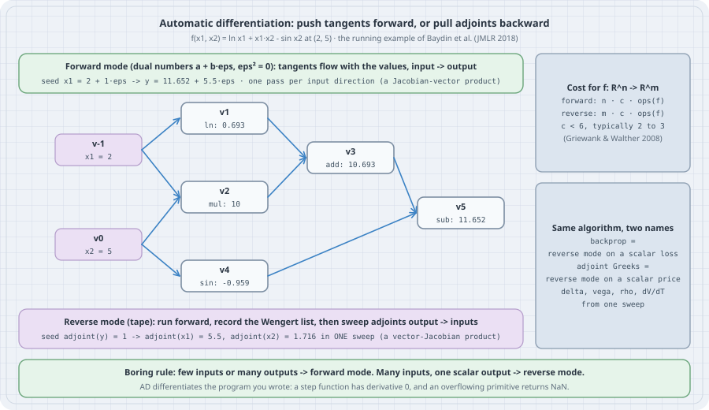

# Automatic Differentiation from First Principles

There are three ways to get a derivative out of a computer. **Symbolic differentiation** manipulates formulas, and the expressions can grow exponentially. **Finite differences** evaluate $f$ twice and divide, which costs one extra evaluation per input and loses about half the digits to cancellation. **Automatic differentiation (AD)** does neither. It runs the program and applies the chain rule to each elementary operation as it executes, so the result is exact to floating-point rounding and costs a small constant factor more than the program itself.

AD comes in two modes, and choosing between them is the whole game. **Forward mode** pushes a tangent from the inputs to the outputs alongside the values, and dual numbers make it a class of about forty lines. **Reverse mode** records the computation on a *tape* and then pulls adjoints from the output back to every input in one sweep. Backpropagation in neural networks is reverse mode applied to a scalar loss. "Adjoint Greeks" in quantitative finance are reverse mode applied to a scalar price. They are the same algorithm under two names.

This chapter builds both modes from scratch, reproduces the worked example of the standard survey (Baydin et al., *JMLR* 2018), measures the $n$ versus $1$ cost asymmetry, computes four Black–Scholes sensitivities from one reverse sweep, and cross-checks everything against SymPy and PyTorch. The trap at the end is the one that catches practitioners: AD differentiates the program you wrote, not the function you meant.

All listings run on **CPython 3.13.5** in a venv with NumPy 2.5.4, SymPy 1.14.0 and PyTorch 2.14.1 (CPU), installed with `pip install numpy sympy torch`. Timings come from a shared 8-core box, so compare the ratios, not the absolute times.

## 1. Mental model: one graph, two directions

{fig-alt="Forward and reverse mode automatic differentiation on f(x1, x2) = ln x1 + x1 x2 - sin x2 at (2, 5). The Wengert list as a graph: inputs v-1 = x1 = 2 and v0 = x2 = 5; v1 = ln v-1, v2 = v-1 times v0, v4 = sin v0, v3 = v1 + v2, v5 = v3 - v4 = 11.652. Forward mode pushes tangents with dual numbers from inputs to output, one pass per input direction, giving dy/dx1 = 5.5 when x1 is seeded. Reverse mode records the tape, then pulls adjoints from the output back to all inputs in one sweep, giving 5.5 and 1.716. Cost for f from R^n to R^m: forward n c ops(f), reverse m c ops(f), c below 6 and typically 2 to 3. Backprop is reverse mode on a scalar loss; adjoint Monte Carlo Greeks are reverse mode on a scalar price."}

Any program that computes $y=f(x)$ from elementary operations can be written as a **Wengert list** (Wengert, 1964). This is a sequence of intermediate variables $v_i = \phi_i(v_{j}, v_{k})$, each depending on earlier ones. The chain rule then gives two recurrences:

- **Forward (tangent) mode.** Carry $\dot v_i = \partial v_i/\partial x \cdot \dot x$ next to every $v_i$: $\dot v_i = \sum_j \frac{\partial \phi_i}{\partial v_j}\,\dot v_j$. One pass computes one Jacobian–vector product $J\dot x$.
- **Reverse (adjoint) mode.** After the forward pass, carry $\bar v_i = \partial y/\partial v_i$ backwards: $\bar v_j = \sum_{i:\,j\to i} \bar v_i\,\frac{\partial \phi_i}{\partial v_j}$, seeded with $\bar y = 1$. One sweep computes one vector–Jacobian product $\bar y^\top J$, which for scalar $y$ is the whole gradient.

For $f:\mathbb{R}^n\to\mathbb{R}^m$ with operation count $\mathrm{ops}(f)$, the full Jacobian costs $n\,c\,\mathrm{ops}(f)$ in forward mode and $m\,c\,\mathrm{ops}(f)$ in reverse mode, "where $c$ is a constant guaranteed to be $c<6$ and typically $c\sim[2,3]$" (Baydin et al., citing Griewank and Walther, 2008). Training a network has $n$ in the billions and $m=1$, which is why every deep-learning framework is built around reverse mode.

## 2. Forward mode is arithmetic in $\mathbb{R}[\varepsilon]/(\varepsilon^2)$

A **dual number** is $a+b\varepsilon$ with $\varepsilon^2=0$. Multiplying two of them gives $(a+b\varepsilon)(c+d\varepsilon)=ac+(ad+bc)\varepsilon$, which is the product rule. More generally, for any smooth $g$, Taylor's theorem gives $g(a+b\varepsilon)=g(a)+g'(a)\,b\,\varepsilon$, because every higher power of $\varepsilon$ vanishes. So if you evaluate $f$ on $x+1\cdot\varepsilon$, the $\varepsilon$ coefficient of the result is $f'(x)$. You only need to define each primitive's rule once.

```python
```python
# dual.py: forward-mode AD with dual numbers a + b*eps, eps**2 = 0
import math


class Dual:
    __slots__ = ("val", "eps")

    def __init__(self, val, eps=0.0):
        self.val, self.eps = val, eps

    @staticmethod
    def lift(x):
        return x if isinstance(x, Dual) else Dual(x, 0.0)

    def __add__(self, o):
        o = Dual.lift(o)
        return Dual(self.val + o.val, self.eps + o.eps)

    __radd__ = __add__

    def __sub__(self, o):
        o = Dual.lift(o)
        return Dual(self.val - o.val, self.eps - o.eps)

    def __rsub__(self, o):
        return Dual.lift(o) - self

    def __mul__(self, o):                      # (a + b eps)(c + d eps) = ac + (ad + bc) eps
        o = Dual.lift(o)
        return Dual(self.val * o.val, self.val * o.eps + self.eps * o.val)

    __rmul__ = __mul__

    def __truediv__(self, o):
        o = Dual.lift(o)
        return Dual(self.val / o.val, (self.eps * o.val - self.val * o.eps) / o.val ** 2)

    def __repr__(self):
        return f"{self.val:.6f} + {self.eps:.6f}eps"


def sin(x):
    x = Dual.lift(x)
    return Dual(math.sin(x.val), math.cos(x.val) * x.eps)


def log(x):
    x = Dual.lift(x)
    return Dual(math.log(x.val), x.eps / x.val)


def exp(x):
    x = Dual.lift(x)
    e = math.exp(x.val)
    return Dual(e, e * x.eps)


def f(x1, x2):                                 # the running example of Baydin et al. (2018)
    return log(x1) + x1 * x2 - sin(x2)


if __name__ == "__main__":
    # one forward pass per input direction
    print("f(2, 5) seeded on x1:", f(Dual(2.0, 1.0), Dual(5.0, 0.0)))
    print("f(2, 5) seeded on x2:", f(Dual(2.0, 0.0), Dual(5.0, 1.0)))
    # any direction at once: a Jacobian-vector product J @ [1, 2]
    print("directional derivative along (1, 2):", f(Dual(2.0, 1.0), Dual(5.0, 2.0)).eps)

    # it differentiates programs, loops included
    def newton_sqrt(a, steps=6):
        x = a / 2 if not isinstance(a, Dual) else Dual(a.val / 2, a.eps / 2)
        for _ in range(steps):
            x = 0.5 * (x + a / x)
        return x

    r = newton_sqrt(Dual(2.0, 1.0))
    print(f"d/da sqrt(a) at a=2 through 6 Newton steps: {r.eps:.15f}  exact 1/(2*sqrt 2) = {1 / (2 * math.sqrt(2)):.15f}")

    # check against SymPy
    import sympy as sp
    a, b = sp.symbols("x1 x2")
    expr = sp.log(a) + a * b - sp.sin(b)
    print("sympy:", [round(float(sp.diff(expr, v).subs({a: 2, b: 5})), 6) for v in (a, b)])
```
```

```bash
python dual.py
```

Output:

```text
f(2, 5) seeded on x1: 11.652071 + 5.500000eps
f(2, 5) seeded on x2: 11.652071 + 1.716338eps
directional derivative along (1, 2): 8.932675629073547
d/da sqrt(a) at a=2 through 6 Newton steps: 0.353553390593274  exact 1/(2*sqrt 2) = 0.353553390593274
sympy: [5.5, 1.716338]
```

The value $11.652071$ and the derivatives $5.5$ and $1.716338$ are exactly the numbers in the survey's forward-mode table. Three points:

- **One pass per direction.** Getting both partials took two passes. Seeding $(\dot x_1,\dot x_2)=(1,2)$ gives $5.5+2\cdot 1.716=8.933$ in a single pass. That is a directional derivative (a Jacobian–vector product), and it is all one forward pass can give you.
- **Programs, not formulas.** `newton_sqrt` runs a loop with data-dependent arithmetic, and the dual number goes through it unchanged. Its derivative matches $1/(2\sqrt2)$ to all 15 printed digits, because six Newton steps have converged. AD differentiates the *iteration*. Here the iteration has converged, so the result agrees with the derivative of the limit. That agreement is not automatic, as section 6 shows.
- **SymPy agrees**, but SymPy needed the closed-form expression. AD needed only the executable code.

## 3. Reverse mode: record a tape, sweep it backwards

Reverse mode needs the graph, so the forward pass records every operation together with its *local* partial derivatives. The backward pass walks that record in reverse order and accumulates $\bar v_{\text{parent}} \mathrel{+}= \bar v_{\text{child}}\cdot\partial(\text{child})/\partial(\text{parent})$. A node with several children, such as $x_1$ (used by `log` and by `mul`), receives the sum of their contributions, which is the multivariable chain rule. The implementation below accepts NumPy arrays as well as floats, so the same 117 lines handle the Monte Carlo example in section 5.

```python
```python
# tape.py: reverse-mode AD on a Wengert list (tape); values may be floats or NumPy arrays
import numpy as np

TAPE = []                                       # every Var created, in evaluation order


class Var:
    def __init__(self, value, parents=(), op="input"):
        self.value = np.asarray(value, dtype=float)
        self.parents = parents                  # tuple of (parent Var, local derivative)
        self.op = op
        self.grad = None
        TAPE.append(self)

    # elementary operations: value, plus the local partial derivative for each parent
    def __add__(self, o):
        o = lift(o)
        return Var(self.value + o.value, ((self, 1.0), (o, 1.0)), "add")

    __radd__ = __add__

    def __sub__(self, o):
        o = lift(o)
        return Var(self.value - o.value, ((self, 1.0), (o, -1.0)), "sub")

    def __rsub__(self, o):
        return lift(o) - self

    def __neg__(self):
        return Var(-self.value, ((self, -1.0),), "neg")

    def __mul__(self, o):
        o = lift(o)
        return Var(self.value * o.value, ((self, o.value), (o, self.value)), "mul")

    __rmul__ = __mul__

    def __truediv__(self, o):
        o = lift(o)
        return Var(self.value / o.value, ((self, 1 / o.value), (o, -self.value / o.value ** 2)), "div")

    def __rtruediv__(self, o):
        return lift(o) / self


def lift(x):
    return x if isinstance(x, Var) else Var(x, (), "const")


def exp(x):
    x = lift(x)
    e = np.exp(x.value)
    return Var(e, ((x, e),), "exp")


def log(x):
    x = lift(x)
    return Var(np.log(x.value), ((x, 1 / x.value),), "log")


def sin(x):
    x = lift(x)
    return Var(np.sin(x.value), ((x, np.cos(x.value)),), "sin")


def sqrt(x):
    x = lift(x)
    s = np.sqrt(x.value)
    return Var(s, ((x, 0.5 / s),), "sqrt")


def relu(x):                                    # max(x, 0): derivative 1 where x > 0, else 0
    x = lift(x)
    return Var(np.maximum(x.value, 0.0), ((x, (x.value > 0).astype(float)),), "relu")


def step(x):                                    # 1{x > 0}: derivative 0 almost everywhere
    x = lift(x)
    return Var((x.value > 0).astype(float), ((x, np.zeros_like(x.value)),), "step")


def sigmoid(x):                                 # 1/(1+e^-x) without overflow; derivative s(1-s)
    x = lift(x)
    v = x.value
    e = np.exp(-np.abs(v))
    s = np.where(v >= 0, 1 / (1 + e), e / (1 + e))
    return Var(s, ((x, s * (1 - s)),), "sigmoid")


def mean(x):
    x = lift(x)
    n = x.value.size
    return Var(x.value.mean(), ((x, np.full(x.value.shape, 1.0 / n)),), "mean")


def unbroadcast(g, shape):
    """Sum a gradient back down to the shape of the value it belongs to."""
    while g.ndim > len(shape):
        g = g.sum(axis=0)
    for i, s in enumerate(shape):
        if s == 1 and g.shape[i] != 1:
            g = g.sum(axis=i, keepdims=True)
    return g


def backward(out):
    """One reverse sweep: adjoint(v) = sum over children c of adjoint(c) * dc/dv."""
    for v in TAPE:
        v.grad = np.zeros_like(v.value)
    out.grad = np.ones_like(out.value)
    for v in reversed(TAPE):                    # the tape is already a topological order
        for p, local in v.parents:
            p.grad = p.grad + unbroadcast(v.grad * local, p.value.shape)


def reset():
    TAPE.clear()
```
```

```python
```python
# tape_demo.py: the Wengert list for f(x1, x2) = ln x1 + x1*x2 - sin x2, forward and reverse
import tape as ad

x1, x2 = ad.Var(2.0), ad.Var(5.0)
y = ad.log(x1) + x1 * x2 - ad.sin(x2)
ad.backward(y)

names = {id(v): f"v{i - 1}" for i, v in enumerate(ad.TAPE)}
print(f"{'node':>5} {'op':>6} {'inputs':>10} {'value':>10} {'adjoint':>10}")
for v in ad.TAPE:
    ins = ",".join(names[id(p)] for p, _ in v.parents)
    print(f"{names[id(v)]:>5} {v.op:>6} {ins:>10} {float(v.value):10.4f} {float(v.grad):10.4f}")
print(f"\ny = {float(y.value):.4f}   dy/dx1 = {float(x1.grad):.4f}   dy/dx2 = {float(x2.grad):.4f}")

import torch
t1 = torch.tensor(2.0, dtype=torch.float64, requires_grad=True)
t2 = torch.tensor(5.0, dtype=torch.float64, requires_grad=True)
ty = torch.log(t1) + t1 * t2 - torch.sin(t2)
ty.backward()
print(f"torch {torch.__version__}: dy/dx1 = {t1.grad.item():.4f}   dy/dx2 = {t2.grad.item():.4f}")
```
```

```bash
python tape_demo.py
```

Output:

```text
 node     op     inputs      value    adjoint
  v-1  input                2.0000     5.5000
   v0  input                5.0000     1.7163
   v1    log        v-1     0.6931     1.0000
   v2    mul     v-1,v0    10.0000     1.0000
   v3    add      v1,v2    10.6931     1.0000
   v4    sin         v0    -0.9589    -1.0000
   v5    sub      v3,v4    11.6521     1.0000

y = 11.6521   dy/dx1 = 5.5000   dy/dx2 = 1.7163
torch 2.14.1+cu130: dy/dx1 = 5.5000   dy/dx2 = 1.7163
```

The printed tape is the survey's three-part table: the node names $v_{-1},v_0,\dots,v_5$, the primal values, and the adjoints $\bar v_4=-1$, $\bar v_0 = \bar v_2\cdot x_1 + \bar v_4\cos x_2 = 2 - \cos 5\cdot 1 = 1.7163$. Both partials come from one sweep. PyTorch's `autograd` builds the same kind of graph and gives the same two numbers.

## 4. The cost asymmetry, measured

Take $f(x)=\sum_i \sin(x_i)\,x_{i+1}+\log(1+x_i^2)$ with $n$ inputs. A forward-mode gradient needs $n$ passes over $O(n)$ work, which is $O(n^2)$. Reverse mode needs one forward pass and one backward pass, which is $O(n)$.

```python
```python
# cost.py: gradient of f: R^n -> R by n forward-mode passes vs one reverse sweep
import math
import random
import time

import dual
import tape as ad


def f(xs, sin, log):
    n = len(xs)
    total = 0.0
    for i in range(n):
        total = total + sin(xs[i]) * xs[(i + 1) % n] + log(1.0 + xs[i] * xs[i])
    return total


def grad_forward(x):
    g = []
    for j in range(len(x)):                         # one pass per input direction
        xs = [dual.Dual(v, 1.0 if i == j else 0.0) for i, v in enumerate(x)]
        g.append(f(xs, dual.sin, dual.log).eps)
    return g


def grad_reverse(x):
    ad.reset()
    xs = [ad.Var(v) for v in x]
    y = f(xs, ad.sin, ad.log)
    ops = len(ad.TAPE)
    ad.backward(y)
    return [float(v.grad) for v in xs], ops


def plain(x):
    return f(x, math.sin, math.log)


rng = random.Random(1)
print(f"{'n':>5} {'tape nodes':>10} {'fwd-mode s':>11} {'rev-mode s':>11} {'plain f s':>10} {'max |diff|':>11}")
for n in (10, 100, 1000):
    x = [rng.uniform(-2, 2) for _ in range(n)]
    t0 = time.perf_counter(); gf = grad_forward(x); t1 = time.perf_counter()
    gr, ops = grad_reverse(x); t2 = time.perf_counter()
    plain(x); t3 = time.perf_counter()
    diff = max(abs(a - b) for a, b in zip(gf, gr))
    print(f"{n:5d} {ops:10d} {t1 - t0:11.4f} {t2 - t1:11.4f} {t3 - t2:10.6f} {diff:11.1e}")

# where forward mode wins: g: R -> R^m (one input, many outputs) needs one dual pass
m = 1000
t0 = time.perf_counter()
out = [dual.sin(dual.Dual(0.3, 1.0) * k) for k in range(1, m + 1)]   # d/dt sin(k t) = k cos(k t)
t1 = time.perf_counter()
print(f"\nR -> R^{m}: one forward pass gives all {m} derivatives in {t1 - t0:.4f} s;"
      f" check out[9].eps = {out[9].eps:.6f} vs 10*cos(3) = {10 * math.cos(3.0):.6f}")
```
```

```bash
python cost.py
```

Output:

```text
    n tape nodes  fwd-mode s  rev-mode s  plain f s  max |diff|
   10         91      0.0002      0.0003   0.000004     2.2e-16
  100        901      0.0143      0.0024   0.000014     4.4e-16
 1000       9001      1.5269      0.0284   0.000114     4.4e-16

R -> R^1000: one forward pass gives all 1000 derivatives in 0.0007 s; check out[9].eps = -9.899925 vs 10*cos(3) = -9.899925
```

Going from $n=100$ to $n=1000$ multiplies forward mode's time by about $100\times$ (quadratic), while reverse mode's time grows by about $10\times$ (linear). Both gradients agree to $4\times10^{-16}$. The last line is the mirror case: for $g:\mathbb{R}\to\mathbb{R}^{1000}$, one forward pass gives all 1000 derivatives, where reverse mode would need 1000 sweeps.

The "plain f" column is the honest footnote. In pure Python, the tape costs hundreds of times more than evaluating $f$, because every operation allocates a `Var` and a NumPy scalar. The $c<6$ bound counts *arithmetic*, not interpreter overhead. Production AD systems get close to the bound by working on whole tensors per operation (PyTorch, JAX) or by transforming source code at compile time. Section 5 already benefits from this: there, one tape node holds 400,000 values.

## 5. Adjoint Greeks: backprop for a price

Under Black–Scholes, $S_T = S_0\exp\big((r-\tfrac12\sigma^2)T+\sigma\sqrt T Z\big)$ with $Z\sim N(0,1)$. A European call is worth $V=\mathbb{E}\big[e^{-rT}\max(S_T-K,0)\big]$. A Monte Carlo pricer averages the discounted payoff over many draws of $Z$. Its sensitivities (the **Greeks**: delta $\partial V/\partial S_0$, vega $\partial V/\partial\sigma$, rho $\partial V/\partial r$, and $\partial V/\partial T$) are a gradient of one scalar with respect to several inputs. That is reverse mode's best case. Giles and Glasserman's "Smoking adjoints" (2006) brought this observation to finance: the pathwise derivatives of every input come from one adjoint sweep, at a cost independent of how many inputs there are.

```python
```python
# greeks.py: adjoint (reverse-mode) Monte Carlo Greeks for a European call, vs Black-Scholes
import math

import numpy as np

import tape as ad


def Phi(x):
    return 0.5 * (1 + math.erf(x / math.sqrt(2)))


def phi(x):
    return math.exp(-x * x / 2) / math.sqrt(2 * math.pi)


def bs_call(S, K, r, sig, T):
    d1 = (math.log(S / K) + (r + sig ** 2 / 2) * T) / (sig * math.sqrt(T))
    d2 = d1 - sig * math.sqrt(T)
    price = S * Phi(d1) - K * math.exp(-r * T) * Phi(d2)
    return price, {"delta": Phi(d1), "vega": S * phi(d1) * math.sqrt(T),
                   "rho": K * T * math.exp(-r * T) * Phi(d2),
                   "dT": S * phi(d1) * sig / (2 * math.sqrt(T)) + r * K * math.exp(-r * T) * Phi(d2)}


def mc_call(params, Z, K):
    S0, r, sig, T = params
    ST = S0 * ad.exp((r - sig * sig * 0.5) * T + sig * ad.sqrt(T) * Z)
    return ad.mean(ad.exp(-r * T) * ad.relu(ST - K))


S0, K, r, sig, T = 100.0, 105.0, 0.03, 0.2, 1.0
Z = np.random.default_rng(7).standard_normal(400_000)

ad.reset()
params = [ad.Var(v) for v in (S0, r, sig, T)]
price = mc_call(params, Z, K)
ad.backward(price)                                   # ONE reverse sweep -> every sensitivity
mc = dict(zip(("delta", "rho", "vega", "dT"), (float(p.grad) for p in params)))

exact_price, exact = bs_call(S0, K, r, sig, T)
print(f"paths {Z.size}, tape nodes {len(ad.TAPE)}")
print(f"{'':>7} {'Monte Carlo + AD':>17} {'Black-Scholes':>14}")
print(f"{'price':>7} {float(price.value):17.4f} {exact_price:14.4f}")
for k in ("delta", "vega", "rho", "dT"):
    print(f"{k:>7} {mc[k]:17.4f} {exact[k]:14.4f}")
```
```

```bash
python greeks.py
```

Output:

```text
paths 400000, tape nodes 24
         Monte Carlo + AD  Black-Scholes
  price            7.1205         7.1281
  delta            0.5027         0.5024
   vega           39.8508        39.8935
    rho           43.1492        43.1133
     dT            5.2796         5.2827
```

One backward sweep over a 24-node tape (each node a vector of 400,000 paths) produced all four sensitivities. They agree with the closed-form Black–Scholes values to Monte Carlo accuracy (the price itself is off by 0.008, well inside one Monte Carlo standard error of 0.020). The listing hard-codes the `max` payoff's derivative as $\mathbf 1\{S_T>K\}$, which is the *pathwise* estimator. It is valid here because the payoff is continuous in $S_0$. PyTorch, given the same random numbers, gives the same Greeks to every printed digit:

```python
```python
# torch_check.py: the same adjoint Greeks from PyTorch's reverse mode, and a forward-mode JVP
import numpy as np
import torch
from torch.func import jvp

Z = torch.from_numpy(np.random.default_rng(7).standard_normal(400_000))   # same paths as greeks.py
K = 105.0


def price(S0, r, sig, T):
    ST = S0 * torch.exp((r - sig * sig / 2) * T + sig * torch.sqrt(T) * Z)
    return (torch.exp(-r * T) * torch.relu(ST - K)).mean()


args = [torch.tensor(v, dtype=torch.float64, requires_grad=True) for v in (100.0, 0.03, 0.2, 1.0)]
p = price(*args)
p.backward()
print("torch", torch.__version__, "reverse mode:",
      dict(zip(("delta", "rho", "vega", "dT"), (round(a.grad.item(), 4) for a in args))))

primals = tuple(a.detach() for a in args)
tangent = tuple(torch.tensor(t, dtype=torch.float64) for t in (1.0, 0.0, 0.0, 0.0))
_, d = jvp(price, primals, tangent)                 # one forward pass = one directional derivative
print(f"forward mode (jvp along S0): delta = {d.item():.4f}")
```
```

```bash
python -W ignore::FutureWarning torch_check.py
```

Output:

```text
torch 2.14.1+cu130 reverse mode: {'delta': 0.5027, 'rho': 43.1492, 'vega': 39.8508, 'dT': 5.2796}
forward mode (jvp along S0): delta = 0.5027
```

`torch.func.jvp` is PyTorch's forward mode, and it gives the same delta from one forward pass along $S_0$. To get four Greeks by forward mode you would need four such passes. A real trading book has thousands of inputs (every point on every curve), so the reverse sweep's advantage grows with the size of the book.

## 6. The trap: AD differentiates the program, not the mathematics

Swap the call for a **digital** option that pays 1 if $S_T>K$. The price $e^{-rT}\,\mathbb{P}(S_T>K)$ is a smooth function of $S_0$ with a strictly positive delta. The *program*, however, computes `step(S_T - K)`, and that step's derivative is 0 everywhere it exists.

```python
```python
# digital.py: the trap. AD differentiates the program, and a step function's derivative is 0
import math

import numpy as np

import tape as ad

S0, K, r, sig, T = 100.0, 105.0, 0.03, 0.2, 1.0
d2 = (math.log(S0 / K) + (r - sig ** 2 / 2) * T) / (sig * math.sqrt(T))
exact_delta = math.exp(-r * T) * math.exp(-d2 * d2 / 2) / math.sqrt(2 * math.pi) / (S0 * sig * math.sqrt(T))


def digital(S, Z, payoff):
    ST = S * ad.exp((r - sig * sig / 2) * T + sig * math.sqrt(T) * Z)
    return ad.mean(math.exp(-r * T) * payoff(ST - K))


def ad_delta(Z, payoff):
    ad.reset()
    S = ad.Var(S0)
    price = digital(S, Z, payoff)
    ad.backward(price)
    return float(price.value), float(S.grad)


def naive_smooth(w):                               # sigmoid((S_T - K) / w), written the textbook way
    return lambda x: 1.0 / (1.0 + ad.exp(-x / w))


def stable_smooth(w):                              # same function, overflow-free primitive
    return lambda x: ad.sigmoid(x / w)


print(f"exact Black-Scholes delta of the digital call: {exact_delta:.5f}\n")
for seed in (1, 2):
    Z = np.random.default_rng(seed).standard_normal(400_000)
    p, d = ad_delta(Z, ad.step)
    ad.reset()
    h = 0.5                                        # bump-and-revalue, same random numbers
    up = float(digital(ad.Var(S0 + h), Z, ad.step).value)
    dn = float(digital(ad.Var(S0 - h), Z, ad.step).value)
    print(f"seed {seed}: price {p:.5f}  AD delta (step) {d:.5f}  central difference h={h}: {(up - dn) / (2 * h):.5f}")
    for w in (5.0, 1.0, 0.2, 0.05):
        with np.errstate(over="ignore", invalid="ignore"):
            _, naive = ad_delta(Z, naive_smooth(w))
        _, stable = ad_delta(Z, stable_smooth(w))
        print(f"         sigmoid width {w:>4}: AD delta naive {naive:.5f}   stable {stable:.5f}")
```
```

```bash
python digital.py
```

Output:

```text
exact Black-Scholes delta of the digital call: 0.01900

seed 1: price 0.40989  AD delta (step) 0.00000  central difference h=0.5: 0.01873
         sigmoid width  5.0: AD delta naive 0.01762   stable 0.01762
         sigmoid width  1.0: AD delta naive 0.01902   stable 0.01902
         sigmoid width  0.2: AD delta naive 0.01880   stable 0.01880
         sigmoid width 0.05: AD delta naive nan   stable 0.01888
seed 2: price 0.41168  AD delta (step) 0.00000  central difference h=0.5: 0.01906
         sigmoid width  5.0: AD delta naive 0.01759   stable 0.01759
         sigmoid width  1.0: AD delta naive 0.01904   stable 0.01904
         sigmoid width  0.2: AD delta naive 0.01910   stable 0.01910
         sigmoid width 0.05: AD delta naive nan   stable 0.01937
```

- **Exact zero, silently.** The AD delta is `0.00000` for both seeds. No warning appears and no NaN is produced: it is a confident, wrong answer. The pathwise method requires the payoff to be (Lipschitz) continuous, and a digital payoff is not. The same failure appears with `round`, `argmax`, integer casts, `if x > threshold:` branches, and sorting, in any AD system.
- **The fixes all trade something.** Bump-and-revalue with common random numbers works here, but costs two extra pricings per input. Smoothing the step with a sigmoid of width $w$ restores a derivative, with bias at large $w$ ($0.0176$ against $0.0190$ at $w=5$) and variance at small $w$ ($0.0189$ and $0.0194$ for the two seeds at $w=0.05$). The likelihood-ratio method, which differentiates the density instead of the payoff, is the standard unbiased alternative.
- **The second trap is in the same table.** Written the textbook way, $1/(1+e^{-x/w})$, the sigmoid overflows to `inf` for paths deep out of the money at $w=0.05$. Its local derivative becomes `inf · 0 = nan`, and one NaN poisons the mean. The overflow-free primitive (`ad.sigmoid`, which uses $e^{-|x|}$) is the same function and gives the right answer. AD is exact for the operations you actually execute, so numerically unstable code produces unstable derivatives.

The boring rules:

1. **Pick the mode by shape.** Few inputs, or a directional derivative: forward mode (`jvp`). Many inputs and a scalar output: reverse mode (`vjp`, `grad`, `backward`). For Hessian–vector products, run forward over reverse.
2. **Check every new gradient once** against central differences at a random point, in float64.
3. **Look for piecewise-constant code on the path to the output**: steps, comparisons, rounding, indexing by a computed integer. AD returns zero through all of them. Smooth them, or use an estimator that does not differentiate them.
4. **Use stable primitives** (`log1p`, `logsumexp`, `sigmoid`, `hypot`). The survey makes the same point: the derivative inherits the program's numerics.

## 7. Try this

1. Add `cos`, `tanh` and `pow` to `dual.py` and `tape.py`, and check $\frac{d}{dx}x^x$ at $x=1.5$ against SymPy.
2. Nest forward mode: compute $f''(x)$ for $f(x)=x\sin x$ by making a `Dual` whose parts are themselves `Dual`s. Then read about *perturbation confusion* (Siskind and Pearlmutter) and build an example where two untagged $\varepsilon$s get mixed up.
3. Extend `greeks.py` to an arithmetic-average Asian call with 52 monitoring dates. How large is the tape, and how long does the reverse sweep take compared with the forward pricing?
4. Compute gamma ($\partial^2V/\partial S_0^2$) for the European call by applying `tape.py` to the pathwise delta expression. Explain the result using section 6.
5. Replace `newton_sqrt`'s fixed 6 steps with "stop when `abs(x*x - a) < 1e-3`" and differentiate at $a=2$. How far is the derivative from $1/(2\sqrt2)$, and why?

## Checkpoint

- State the dual-number rule $g(a+b\varepsilon)=g(a)+g'(a)b\varepsilon$ and use it to derive the product and quotient rules.
- Write the forward and reverse recurrences on a Wengert list, and say which one computes $J\dot x$ and which computes $\bar y^\top J$.
- Explain why the gradient of a scalar loss with $n$ parameters costs $O(1)$ evaluations in reverse mode and $O(n)$ in forward mode.
- Explain why backprop and adjoint Greeks are the same algorithm.
- Give two programs whose AD derivative is wrong even though every primitive is implemented correctly.

## Summary

AD applies the chain rule to the executed program, one elementary operation at a time. Forward mode is arithmetic on dual numbers and gives one directional derivative per pass. Reverse mode records a tape and gives a whole gradient per sweep, at a cost within a small constant factor of the program (Griewank and Walther's $c<6$). That constant is the reason training billion-parameter networks and computing thousand-input risk are both feasible. AD is exact for the program you wrote, which also means it is exactly wrong when the program contains steps, branches or unstable primitives.

## Sources

- A. G. Baydin, B. A. Pearlmutter, A. A. Radul, J. M. Siskind, "Automatic differentiation in machine learning: a survey", *Journal of Machine Learning Research* 18(153):1–43, 2018, [arXiv:1502.05767](https://arxiv.org/abs/1502.05767). Running example $f(x_1,x_2)=\ln x_1+x_1x_2-\sin x_2$ (Tables 2–3), the cost statement $c<6$, $c\sim[2,3]$ (§3.2), perturbation confusion and numerics (§5).
- A. Griewank, A. Walther, *Evaluating Derivatives: Principles and Techniques of Algorithmic Differentiation*, 2nd ed., SIAM, 2008.
- R. E. Wengert, "A simple automatic derivative evaluation program", *Communications of the ACM* 7(8):463–464, 1964.
- M. Giles, P. Glasserman, "Smoking adjoints: fast Monte Carlo Greeks", *Risk*, January 2006. P. Glasserman, *Monte Carlo Methods in Financial Engineering*, Springer, 2003, ch. 7 (pathwise and likelihood-ratio estimators, and why the pathwise method needs continuous payoffs).
- J. M. Siskind, B. A. Pearlmutter, "Perturbation confusion and referential transparency", IFL 2005.
- PyTorch 2.14 documentation: [`torch.autograd`](https://docs.pytorch.org/docs/stable/autograd.html) and [`torch.func.jvp` / `vjp`](https://docs.pytorch.org/docs/stable/func.api.html).
