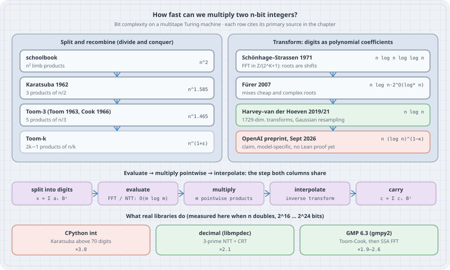

Multiplying two $n$-digit numbers the way school teaches takes $n^2$ digit products. For most of history nobody suspected that could be improved. In 1960 Kolmogorov conjectured that $n^2$ was optimal, and within a week of hearing that conjecture, his student Karatsuba refuted it. Sixty years of work then pushed the cost down to $O(n\log n)$ (Harvey and van der Hoeven, *Annals of Mathematics*, 2021), the bound Schönhage and Strassen had conjectured to be optimal in 1971. In October 2026 an AI-produced preprint claimed to go *below* $n\log n$ by a factor $(\log n)^{\kappa}$ with $\kappa = 2^{-182}$, and a community race pushed $\kappa$ to about $0.0017$ within days.

This chapter builds the whole ladder from one idea, **split, multiply smaller pieces, recombine**, and makes each rung concrete. You will count the limb products of Karatsuba and Toom-3 exactly, multiply exactly with a number-theoretic transform, measure which algorithm your Python is actually running, and compute how much the 2026 claim saves for inputs of any physically possible size. The trap is the oldest bug in FFT multiplication: floating-point rounding that silently returns a wrong product, and a correctness check that cannot see it.

All listings run on **CPython 3.15.0**. Listings that import `numpy` or `gmpy2` use a throwaway venv (`uv venv venv-mult --python 3.15 && VIRTUAL_ENV=venv-mult uv pip install gmpy2 numpy`, which installs gmpy2 2.3.2 on GMP 6.3.0 and NumPy 2.5.4). Timings come from a shared 8-core box, so read the ratios.

## 1. Mental model: digits are polynomial coefficients

{fig-alt="Left column, split and recombine: schoolbook n squared limb products; Karatsuba 1962, 3 products of n/2, n^1.585; Toom-3 (Toom 1963, Cook 1966), 5 products of n/3, n^1.465; Toom-k, 2k-1 products of n/k, n^(1+epsilon). Right column, transforms: Schoenhage-Strassen 1971, FFT in Z/(2^K+1) where roots are shifts, n log n log log n; Fuerer 2007, n log n 2^O(log* n); Harvey-van der Hoeven 2019/2021, 1729-dimensional transforms and Gaussian resampling, n log n; OpenAI preprint September 2026, n (log n)^(1-kappa), a model-specific claim with no Lean proof yet. Middle row: split into digits, evaluate with FFT or NTT in O(m log m), m pointwise products, inverse transform, carry. Bottom: measured when n doubles from 2^16 to 2^24 bits: CPython int x3.0 (Karatsuba above 70 digits), decimal libmpdec x2.1 (3-prime NTT plus CRT), GMP 6.3 via gmpy2 x1.9 to 2.6 (Toom-Cook then SSA FFT)."}

Write an integer in base $B$ (a *limb* is one base-$B$ digit, for example $B=2^{32}$):

$$
x=\sum_{i=0}^{m-1}a_iB^i = A(B),\qquad y=\sum_{j=0}^{m-1}b_jB^j = C(B).
$$

Then $xy = (AC)(B)$. The product polynomial's coefficients are the **convolution** $c_k=\sum_{i+j=k}a_ib_j$, and a final carry pass turns them back into digits. Every algorithm in this chapter computes $AC$ in some cleverer way than forming all $m^2$ products $a_ib_j$:

- **Split and recombine.** Cut $A$ into $k$ pieces, evaluate the piece-polynomial at $2k-1$ points, multiply the $2k-1$ values recursively, and interpolate. Karatsuba is $k=2$ and Toom-3 is $k=3$. Cost: $T(n) = (2k-1)\,T(n/k) + O(n)$, so $T(n)=\Theta\!\left(n^{\log_k(2k-1)}\right)$.
- **Transform.** Evaluate at $N\ge 2m-1$ roots of unity all at once with a fast Fourier transform (FFT) in $O(N\log N)$ ring operations, multiply pointwise, and transform back. The difficulty is finding a ring where the roots of unity exist and the coefficients fit, and that is what separates Schönhage–Strassen, Fürer, Harvey–van der Hoeven and the 2026 claim.
- **The model matters.** These bounds count bit operations on a **multitape Turing machine**: a fixed number of one-dimensional tapes, with no random access. In a unit-cost RAM with constant-time access to arbitrary memory, multiplication is known to be easier (Schönhage's linear-time result on storage-modification machines is the classic example). So "$n\log n$ is optimal" was always a conjecture about one specific model.

## 2. Karatsuba: three half-size products instead of four

Split each operand in half, $x=x_1B^h+x_0$ and $y=y_1B^h+y_0$:

$$
xy = z_2B^{2h} + z_1B^h + z_0,\quad z_0=x_0y_0,\; z_2=x_1y_1,\; z_1=(x_0+x_1)(y_0+y_1)-z_0-z_2 .
$$

That is three multiplications of size $h$ instead of four. The extra additions and subtractions are linear in $n$. So $T(n)=3T(n/2)+O(n)$, which gives $n^{\log_2 3}\approx n^{1.585}$. Toom-3 splits into thirds, evaluates the quadratic piece-polynomials at $0, 1, -1, -2, \infty$, multiplies the **five** values, and interpolates, which gives $n^{\log_3 5}\approx n^{1.465}$. Timings on a shared box are noisy, so the listing below counts **leaf products** (one-limb by one-limb multiplications) instead of measuring time. It also checks every result against Python's own `*`.

```python
# count_mults.py: schoolbook vs Karatsuba vs Toom-3, counted in limb products
import math
import random

W = 32                       # limb width in bits
MASK = (1 << W) - 1
calls = 0


widest = 0


def leaf(a, b):
    """One 'hardware' multiplication of two (small) limbs."""
    global calls, widest
    calls += 1
    widest = max(widest, a.bit_length(), b.bit_length())
    return a * b


def schoolbook(x, y, n):
    xs = [(x >> (W * i)) & MASK for i in range(n)]
    ys = [(y >> (W * j)) & MASK for j in range(n)]
    return sum(leaf(a, b) << (W * (i + j)) for i, a in enumerate(xs) for j, b in enumerate(ys))


def karatsuba(x, y, n):
    """x, y < 2**(W*n), n a power of two."""
    if n == 1:
        return leaf(x, y)
    h = n // 2
    s = W * h
    m = (1 << s) - 1
    x0, x1, y0, y1 = x & m, x >> s, y & m, y >> s
    z0 = karatsuba(x0, y0, h)
    z2 = karatsuba(x1, y1, h)
    a, b = x0 + x1, y0 + y1                        # may carry one bit past h limbs
    ca, cb, a0, b0 = a >> s, b >> s, a & m, b & m
    mid = karatsuba(a0, b0, h)
    mid += ((b0 if ca else 0) + (a0 if cb else 0)) << s   # carries: shifts and adds only
    mid += (ca & cb) << (2 * s)
    z1 = mid - z0 - z2
    return z0 + (z1 << s) + (z2 << (2 * s))


def toom3(x, y, n):
    """Toom-Cook 3-way: 5 products of a third of the size. n a power of three."""
    if n == 1:
        return leaf(x, y)
    k = n // 3
    s = W * k
    m = (1 << s) - 1

    def split(v):
        return v & m, (v >> s) & m, v >> (2 * s)

    def evaluate(p0, p1, p2):           # p(t) = p0 + p1 t + p2 t^2 at 0, 1, -1, -2, inf
        return [p0, p0 + p1 + p2, p0 - p1 + p2, p0 - 2 * p1 + 4 * p2, p2]

    def mul(a, b):                      # values may be negative and a few bits wider
        sign = -1 if (a < 0) != (b < 0) else 1
        return sign * toom3(abs(a), abs(b), k)   # extra bits ride along to the leaves

    r0, r1, rm1, rm2, rinf = (mul(a, b) for a, b in zip(evaluate(*split(x)), evaluate(*split(y))))
    # interpolation (Bodrato's sequence): only additions, shifts, exact small divisions
    c0, c4 = r0, rinf
    c3 = (rm2 - r1) // 3
    c1 = (r1 - rm1) // 2
    c2 = rm1 - r0
    c3 = (c2 - c3) // 2 + 2 * rinf
    c2 = c2 + c1 - c4
    c1 = c1 - c3
    return c0 + (c1 << s) + (c2 << (2 * s)) + (c3 << (3 * s)) + (c4 << (4 * s))


def count(fn, n, trials=20):
    global calls
    rng = random.Random(n)
    total = 0
    for _ in range(trials):
        x, y = rng.getrandbits(W * n), rng.getrandbits(W * n)
        calls = 0
        assert fn(x, y, n) == x * y, fn.__name__
        total += calls
    return total / trials


print("limbs   schoolbook   karatsuba    ratio_to_n^1.585")
for e in range(1, 9):
    n = 2 ** e
    sb, ka = count(schoolbook, n), count(karatsuba, n)
    print(f"{n:5d}  {sb:11.0f}  {ka:10.0f}    {ka / n ** math.log2(3):.3f}")
print()
print("limbs   schoolbook   toom3        ratio_to_n^1.465")
for e in range(1, 6):
    n = 3 ** e
    sb, tc = count(schoolbook, n), count(toom3, n)
    print(f"{n:5d}  {sb:11.0f}  {tc:10.1f}    {tc / n ** math.log(5, 3):.3f}")
print(f"widest leaf operand seen: {widest} bits (limb = {W} bits)")
print(f"\nexponents: schoolbook 2, Karatsuba log2(3) = {math.log2(3):.4f}, Toom-3 log3(5) = {math.log(5, 3):.4f}")
```

```bash
python3.15 count_mults.py
```

Output:

```text
limbs   schoolbook   karatsuba    ratio_to_n^1.585
    2            4           3    1.000
    4           16           9    1.000
    8           64          27    1.000
   16          256          81    1.000
   32         1024         243    1.000
   64         4096         729    1.000
  128        16384        2187    1.000
  256        65536        6561    1.000

limbs   schoolbook   toom3        ratio_to_n^1.465
    3            9         5.0    1.000
    9           81        25.0    1.000
   27          729       125.0    1.000
   81         6561       625.0    1.000
  243        59049      3125.0    1.000
widest leaf operand seen: 43 bits (limb = 32 bits)

exponents: schoolbook 2, Karatsuba log2(3) = 1.5850, Toom-3 log3(5) = 1.4650
```

The counts are *exactly* $3^{\log_2 n}$ and $5^{\log_3 n}$: the ratio column is 1.000 at every size, and all 20 random products per row matched `x * y`. At 256 limbs (8,192 bits) Karatsuba does 6,561 leaf products where schoolbook does 65,536. Two engineering details are visible. First, $x_0+x_1$ can carry one bit past $h$ limbs. The listing handles the carry with shifts and adds, so it costs no extra multiplication. Second, Toom's evaluation points ($-2$ in particular) make the values a few bits *wider* than a limb. Here the widest leaf operand was 43 bits for 32-bit limbs after five levels. Real libraries reserve an extra limb for this. The interpolation step uses only additions, shifts, and exact division by 2 and 3 (Bodrato's sequence).

Why not just go to Toom-$k$ for large $k$? The exponent $\log_k(2k-1)\to 1$, but the interpolation constants grow with $k$, so each fixed $k$ wins only over a range of sizes. That is why real libraries switch between several Toom variants by size, as Section 5 shows. To get rid of the "$+\varepsilon$" in the exponent you need transforms.

## 3. Transforms: evaluate everywhere at once

Evaluating a degree-$(N-1)$ polynomial at the $N$ powers of a primitive $N$-th root of unity $\omega$ is a discrete Fourier transform, and the FFT does it in $O(N\log N)$ ring operations by splitting even and odd coefficients. Over the complex numbers that means floating-point arithmetic and rounding error (see Section 7). Over $\mathbb{Z}/p\mathbb{Z}$ with $p = c\cdot 2^k + 1$ prime, the field has $2^k$-th roots of unity and every operation is exact. That is a **number-theoretic transform (NTT)**. The catch is a *budget*. The true convolution coefficients must be smaller than $p$, otherwise they wrap around mod $p$, and they can be as large as $m\,(B-1)^2$.

```python
# ntt_mult.py: exact multiplication by a number-theoretic transform (NTT)
import random
import time

P = 998244353            # 119 * 2^23 + 1: has 2^23-th roots of unity
G = 3                    # a primitive root mod P
BASE_BITS = 8            # one coefficient = one byte


def ntt(a, invert=False):
    n = len(a)
    j = 0
    for i in range(1, n):                     # bit-reversal permutation
        bit = n >> 1
        while j & bit:
            j ^= bit
            bit >>= 1
        j |= bit
        if i < j:
            a[i], a[j] = a[j], a[i]
    length = 2
    while length <= n:                        # log2(n) butterfly layers
        w_len = pow(G, (P - 1) // length, P)
        if invert:
            w_len = pow(w_len, P - 2, P)
        half = length // 2
        ws = [1] * half
        for k in range(1, half):
            ws[k] = ws[k - 1] * w_len % P
        for start in range(0, n, length):
            for k in range(half):
                u = a[start + k]
                v = a[start + k + half] * ws[k] % P
                a[start + k] = (u + v) % P
                a[start + k + half] = (u - v) % P
        length <<= 1
    if invert:
        n_inv = pow(n, P - 2, P)
        for i in range(n):
            a[i] = a[i] * n_inv % P


def to_coeffs(x, n):
    mask = (1 << BASE_BITS) - 1
    return [(x >> (BASE_BITS * i)) & mask for i in range(n)]


def ntt_multiply(x, y):
    m = max(x.bit_length(), y.bit_length()) // BASE_BITS + 1
    n = 1
    while n < 2 * m:
        n <<= 1
    # every convolution coefficient is < m * 255^2; it must stay below P to be exact
    assert m * ((1 << BASE_BITS) - 1) ** 2 < P, "coefficients would wrap mod P"
    a, b = to_coeffs(x, n), to_coeffs(y, n)
    ntt(a)
    ntt(b)
    c = [u * v % P for u, v in zip(a, b)]     # pointwise product: n multiplications
    ntt(c, invert=True)
    return sum(ci << (BASE_BITS * i) for i, ci in enumerate(c)), n


rng = random.Random(7)
limit = (P - 1) // ((1 << BASE_BITS) - 1) ** 2
print(f"coefficient budget: m * 255^2 < P  =>  at most {limit} bytes ({limit * BASE_BITS} bits) per operand")
for bits in (1_000, 10_000, 100_000, 120_000, 130_000):
    x, y = rng.getrandbits(bits), rng.getrandbits(bits)
    t0 = time.perf_counter()
    try:
        z, n = ntt_multiply(x, y)
    except AssertionError as e:
        print(f"{bits:>9} bits  AssertionError: {e}")
        continue
    dt = time.perf_counter() - t0
    print(f"{bits:>9} bits  transform length {n:>7}  exact={z == x * y}  {dt:6.2f} s")
```

```bash
python3.15 ntt_mult.py
```

Output:

```text
coefficient budget: m * 255^2 < P  =>  at most 15351 bytes (122808 bits) per operand
     1000 bits  transform length     256  exact=True    0.00 s
    10000 bits  transform length    4096  exact=True    0.01 s
   100000 bits  transform length   32768  exact=True    0.29 s
   120000 bits  transform length   32768  exact=True    0.28 s
   130000 bits  AssertionError: coefficients would wrap mod P
```

Up to the budget the product is exact, and the work is three transforms of length $N$ (each $\tfrac N2\log_2 N$ butterflies) plus $N$ pointwise products. Pure Python is slow, but the shape is $N\log N$. Past the budget the method breaks, and that budget is the whole story of fast multiplication. There are two ways out:

1. **Several primes and the Chinese remainder theorem.** Run the NTT modulo three primes and reconstruct each coefficient by CRT. libmpdec (the C library behind Python's `decimal`) does exactly this: `_mpd_fntmul` in `Modules/_decimal/libmpdec/mpdecimal.c` convolves modulo three primes. For the very largest sizes it wraps the transform in Karatsuba (`_mpd_kmul_fnt`). Any fixed number of primes still has a ceiling, so this is engineering, not asymptotics.
2. **Make the ring grow with $n$.** Schönhage and Strassen (1971) work in $\mathbb{Z}/(2^K+1)\mathbb{Z}$, where $2$ is a $2K$-th root of unity. Multiplying by a root is then a *shift*, which costs $O(K)$ bit operations, not a multiplication. The pointwise products are themselves big multiplications, which they do recursively. The recursion is $\log\log n$ levels deep, and that is where $O(n\log n\log\log n)$ comes from.

## 4. From $\log\log n$ to $n\log n$

The rest of the ladder is about shrinking the cost of that recursion:

| Year | Result | Bound (multitape TM) | Key idea |
|---|---|---|---|
| 1962 | Karatsuba–Ofman | $O(n^{1.585})$ | 3 half-size products |
| 1963/66 | Toom; Cook | $O(n^{1+\varepsilon})$, any $\varepsilon>0$ | evaluate/interpolate at $2k-1$ points |
| 1971 | Schönhage–Strassen | $O(n\log n\log\log n)$ | FFT over $\mathbb{Z}/(2^K+1)$; conjectured $\Theta(n\log n)$ optimal |
| 2007 | Fürer | $n\log n\cdot 2^{O(\log^* n)}$ | mixes cheap polynomial roots with complex roots |
| 2014–19 | Harvey–van der Hoeven–Lecerf; Harvey–van der Hoeven; Covanov–Thomé | $O(n\log n\, 8^{\log^* n})$, then $4^{\log^* n}$ | sharper constants in Fürer's exponent |
| 2019/2021 | Harvey–van der Hoeven | $O(n\log n)$ | Gaussian resampling → multidimensional power-of-two transforms |
| 2026 (claim) | OpenAI preprint | $O\big(n(\log n)^{1-\kappa}\big)$, $\kappa=2^{-182}$ | linear networks that cut tape movement and butterfly cost |

Harvey and van der Hoeven's algorithm turns a one-dimensional transform of awkward length into a $d$-dimensional one whose side lengths are powers of two, by "resampling" through a Gaussian. Their proof takes $d = 1729$, and the bound only takes effect beyond an astronomically large threshold. They note that more technical refinements reduce the dimension needed to $d\ge 9$. The 1729-dimensional Fourier transform in the X post that prompted this chapter is real, and it is a proof device, not an implementation strategy. No library runs it.

## 5. What your machine actually runs

Asymptotic rungs are one thing. Here is what three multipliers available from Python do when the operand size doubles:

```python
# time_backends.py: measured growth of three real multipliers
import decimal
import math
import random
import sys
import time

import gmpy2

ctx = decimal.Context(prec=decimal.MAX_PREC, Emax=decimal.MAX_EMAX)


def best(f, reps=3):
    t = float("inf")
    for _ in range(reps):
        t0 = time.perf_counter()
        f()
        t = min(t, time.perf_counter() - t0)
    return t


rng = random.Random(1)
rows = []
for e in range(16, 25):                       # 2^16 .. 2^24 bits (about 20k .. 5M digits)
    bits = 2 ** e
    x, y = rng.getrandbits(bits) | 1, rng.getrandbits(bits) | 1
    gx, gy = gmpy2.mpz(x), gmpy2.mpz(y)
    digits = int(bits * math.log10(2))           # same size in decimal digits
    dx = decimal.Decimal("".join(rng.choices("0123456789", k=digits)))   # random coefficients
    dy = decimal.Decimal("".join(rng.choices("0123456789", k=digits)))
    rows.append((bits, best(lambda: x * y), best(lambda: ctx.multiply(dx, dy)), best(lambda: gx * gy)))

print(sys.version.split()[0], "| decimal", decimal.__libmpdec_version__, "| GMP", gmpy2.mp_version().split()[-1])
print(f"{'bits':>9} {'int ms':>9} {'x':>5} {'decimal ms':>11} {'x':>5} {'gmpy2 ms':>9} {'x':>5}")
prev = None
for r in rows:
    if prev:
        g = [r[i] / prev[i] for i in (1, 2, 3)]
        print(f"{r[0]:9d} {r[1]*1e3:9.2f} {g[0]:5.2f} {r[2]*1e3:11.2f} {g[1]:5.2f} {r[3]*1e3:9.3f} {g[2]:5.2f}")
    else:
        print(f"{r[0]:9d} {r[1]*1e3:9.2f} {'':>5} {r[2]*1e3:11.2f} {'':>5} {r[3]*1e3:9.3f}")
    prev = r
print("doubling n: x3.00 = Karatsuba (n^1.585); x2.0-2.2 = n log n territory")
```

```bash
venv-mult/bin/python time_backends.py
```

Output:

```text
3.15.0 | decimal 4.0.0 | GMP 6.3.0
     bits    int ms     x  decimal ms     x  gmpy2 ms     x
    65536      0.92              1.99           0.090
   131072      2.60  2.84        4.48  2.26     0.278  3.08
   262144      8.38  3.22        9.74  2.17     0.600  2.16
   524288     24.09  2.87       20.18  2.07     1.387  2.31
  1048576     71.09  2.95       42.15  2.09     2.620  1.89
  2097152    218.45  3.07       89.92  2.13     6.683  2.55
  4194304    647.81  2.97      185.88  2.07    12.736  1.91
  8388608   1906.78  2.94      389.29  2.09    31.759  2.49
 16777216   5713.79  3.00      818.72  2.10    67.639  2.13
doubling n: x3.00 = Karatsuba (n^1.585); x2.0-2.2 = n log n territory
```

The "x" columns are the time ratio when $n$ doubles. A Karatsuba-type algorithm should give $2^{1.585} = 3.0$, and an $n\log n$-type algorithm should give just over 2.

- **CPython `int`**: ×2.84–3.22, i.e. ×3 within noise at every size. CPython switches from schoolbook to Karatsuba above `KARATSUBA_CUTOFF` = 70 internal 30-bit digits (`Objects/longobject.c`) and has no Toom or FFT path. At 16 Mbit, one product takes 5.7 s.
- **`decimal`**: ×2.07–2.26. libmpdec dispatches by size in `_mpd_qmul`: schoolbook for short operands, Karatsuba when the result is ≤ 1024 words, and the three-prime NTT (`_mpd_fntmul`) above that. These operands are already in NTT territory at the first row. At 16 Mbit it is 7× faster than `int`, even though it works in base $10^{19}$.
- **GMP** (through gmpy2): ×1.89–3.08, noisier because each call is fast, and about 80× faster than `int` at 16 Mbit. GMP moves through Toom-2/3/4/6/8 variants and then a Schönhage–Strassen FFT modulo $2^N+1$, at thresholds tuned per CPU (GMP manual, "Multiplication Algorithms").

So the "Karatsuba row" from Section 2 is what `x * y` does in Python. If your code multiplies million-digit integers, use `gmpy2`, or at least `decimal` with an unbounded context.

## 6. The 2026 claim: below $n\log n$, but by how much?

On 6 October 2026 (UTC) OpenAI's `openai/math` repository published *Integer multiplication below $n\log n$* (dated 23 September 2026). Its Theorem 1 gives a deterministic multitape Turing machine with running time $O\big(n(\lg n)^{1-\kappa}\big)$, $\kappa = 2^{-182}$. The paper presents this as disproving the Schönhage–Strassen $n\log n$ optimality conjecture *in that model*. The construction keeps Harvey–van der Hoeven's resampling. It speeds up the two operations that cost $\Theta(n\log n)$ on tapes, address rearrangements and butterfly layers, using finite linear networks with a rank saving (Sections 3–5 of the paper). Community repositories quickly tightened $\kappa$. As of 17 October 2026, `CrocSwap/integer-mult-bounds` lists a reviewed value $\kappa\approx 0.00167$, explicitly *conditional* on the OpenAI framework and "not a complete Lean multiplication theorem".

What does a power saving in the logarithm mean in practice?

```python
# kappa.py: how much does O(n (lg n)^(1-kappa)) save over O(n lg n)?
import math

claims = {
    "OpenAI preprint (2026-09-23)": 2.0 ** -182,
    "community, reviewed (2026-10-17)": 836330098538459 / 500000000000000000,
}
sizes = {
    "1 GB operands  (n = 2^33 bits)": 33,
    "every atom (n = 2^266 bits)": 266,
    "n = 2^(2^64) bits": 2 ** 64,
}
print("speedup factor (lg n)^kappa, ignoring constants:")
for who, kappa in claims.items():
    print(f"  {who}: kappa = {kappa:.6g}")
    for label, lg in sizes.items():
        gain = math.expm1(kappa * math.log(lg))      # (lg n)^kappa - 1, without cancellation
        print(f"    {label:<32} {gain:.3e}  (factor 1 + that)")
# how large must n be before the saving reaches 1%?
for who, kappa in claims.items():
    lg_needed = math.log(1.01) / kappa               # ln(lg n) >= ln(1.01) / kappa
    print(f"{who}: 1% saving needs ln(lg n) >= {lg_needed:.3e}, "
          f"i.e. lg n >= e^{lg_needed:.3e}")
```

```bash
python3.15 kappa.py
```

Output:

```text
speedup factor (lg n)^kappa, ignoring constants:
  OpenAI preprint (2026-09-23): kappa = 1.63133e-55
    1 GB operands  (n = 2^33 bits)   5.704e-55  (factor 1 + that)
    every atom (n = 2^266 bits)      9.109e-55  (factor 1 + that)
    n = 2^(2^64) bits                7.237e-54  (factor 1 + that)
  community, reviewed (2026-10-17): kappa = 0.00167266
    1 GB operands  (n = 2^33 bits)   5.866e-03  (factor 1 + that)
    every atom (n = 2^266 bits)      9.383e-03  (factor 1 + that)
    n = 2^(2^64) bits                7.702e-02  (factor 1 + that)
OpenAI preprint (2026-09-23): 1% saving needs ln(lg n) >= 6.100e+52, i.e. lg n >= e^6.100e+52
community, reviewed (2026-10-17): 1% saving needs ln(lg n) >= 5.949e+00, i.e. lg n >= e^5.949e+00
```

With the original $\kappa=2^{-182}$, the speedup factor is $1 + 10^{-54}$ even for inputs with $2^{2^{64}}$ bits. The result matters for *mathematics*: it refutes a 55-year-old optimality conjecture in that model, and through the Harvey–van der Hoeven reduction it gives faster matrix transposition on tapes too. It has no effect on any multiplication that will ever run. The community value gives about 0.6% at gigabyte sizes, and only before constants that the paper itself calls "extremely large".

How to read a claim like this:

1. **Check the model.** The statement is about fixed multitape Turing machines. It says nothing new about RAM-model or real-hardware costs.
2. **Check the verification status.** OpenAI's catalogue (`lean/formalization.yaml`) lists formalizations for about 42% of the collection's top-line results. As of 18 October 2026 this manuscript is not among them, and the same release withdrew three other manuscripts on 7 October after a sign error was found. Community refinements verify arithmetic certificates in Lean, not the multiplication algorithm.
3. **Separate exponent records from speed.** A larger $\kappa$ is a better theorem, not a faster program.

## 7. The trap: floating-point FFTs return wrong products silently

The quickest way to write "fast multiplication" is a complex FFT in `float64`, and it is how many first implementations go wrong. The convolution is computed approximately and then rounded to the nearest integer. That is correct only while the accumulated rounding error stays below $0.5$, and the coefficients themselves must stay below $2^{53}$, where `float64` stops representing every integer.

```python
# float_fft_trap.py: floating-point FFT multiplication is exact only while rounding error < 0.5
import random

import numpy as np


def limbs(x, nbytes, limb_bytes):
    raw = np.frombuffer(x.to_bytes(nbytes, "little"), dtype=np.uint8).astype(np.float64)
    weights = 256.0 ** np.arange(limb_bytes)
    return raw.reshape(-1, limb_bytes) @ weights               # little-endian limbs


def fft_multiply(x, y, limb_bytes):
    nbytes = -(-max(x.bit_length(), y.bit_length()) // (8 * limb_bytes)) * limb_bytes
    a, b = limbs(x, nbytes, limb_bytes), limbs(y, nbytes, limb_bytes)
    n = 1 << (2 * len(a) - 1).bit_length()
    c = np.fft.irfft(np.fft.rfft(a, n) * np.fft.rfft(b, n), n)
    worst = float(np.max(np.abs(c - np.rint(c))))             # distance from the nearest integer
    out, carry, base = [], 0, 1 << (8 * limb_bytes)
    for v in map(int, np.rint(c)):                            # carry propagation, linear time
        carry += v
        out.append(carry % base)
        carry //= base
    data = b"".join(v.to_bytes(limb_bytes, "little") for v in out)
    return int.from_bytes(data, "little") + (carry << (8 * limb_bytes * len(out))), worst


rng = random.Random(3)
print("limb bits  operand bits  max |c - round(c)|  exact")
for limb_bytes in (2, 3):
    for bits in (2 ** 14, 2 ** 16, 2 ** 18, 2 ** 20, 2 ** 22, 2 ** 24):
        x = rng.getrandbits(bits) | (1 << (bits - 1))
        y = rng.getrandbits(bits) | (1 << (bits - 1))
        z, worst = fft_multiply(x, y, limb_bytes)
        print(f"{8 * limb_bytes:9d}  {bits:12d}  {worst:18.6f}  {z == x * y}")
```

```bash
venv-mult/bin/python float_fft_trap.py
```

Output:

```text
limb bits  operand bits  max |c - round(c)|  exact
       16         16384            0.000244  True
       16         65536            0.001221  True
       16        262144            0.009766  True
       16       1048576            0.031250  True
       16       4194304            0.156250  True
       16      16777216            0.500000  False
       24         16384            0.000000  False
       24         65536            0.000000  False
       24        262144            0.000000  False
       24       1048576            0.000000  False
       24       4194304            0.000000  False
       24      16777216            0.000000  False
```

With 16-bit limbs the worst rounding distance grows steadily with length: 0.0002, 0.001, 0.01, 0.03, 0.16, then **0.5 and a wrong product** at 16 Mbit. That is the expected $\sqrt{N}$-ish error growth eating the safety margin. The 24-bit rows are worse: *every* product is wrong, yet the "max distance from an integer" check reports **0.000000**. Coefficients reach $m\cdot 2^{48} > 2^{53}$, where adjacent doubles are 32 or more apart. Every float there is already an integer, so rounding looks perfect while the low bits are gone. A test that only checks closeness to integers can pass on output that is wrong.

The boring rules:

1. **Prove the budget, don't sample it.** For an exact transform, show $m(B-1)^2 < p$ (or below the CRT modulus). For a float FFT, use a published error bound for your FFT and keep a wide margin. `ntt_mult.py` asserts its budget before it computes anything.
2. **Never accept a float-FFT product without an independent check**, such as a comparison modulo a random 61-bit prime (`(x % q) * (y % q) % q == z % q`), which costs $O(n)$.
3. **Use the libraries.** GMP, libmpdec and FLINT have done the threshold tuning and error analysis. Python's `int` is fine below roughly 10,000 digits. Above that, use `gmpy2`.

## 8. Try this

1. Add Toom-2.5 (split one operand in 3, the other in 2, evaluate at 4 points) to `count_mults.py` for unbalanced operands. What is the leaf count for $3^a\times 2^b$ limbs?
2. Change `BASE_BITS` in `ntt_mult.py` to 4 and to 12. How do the budget and the transform length change for a 100,000-bit product? Which is faster in pure Python, and why?
3. Add a second prime $p_2 = 7\cdot 2^{26}+1$ to `ntt_mult.py` and reconstruct coefficients by CRT. How far does the budget move?
4. In `float_fft_trap.py`, add the modular check from the trap section and confirm that it catches every wrong row.
5. Using `kappa.py`, find the smallest $\kappa$ for which the saving reaches 1% at $n = 2^{40}$ bits.

## Checkpoint

- Derive Karatsuba's identity and solve $T(n)=3T(n/2)+O(n)$.
- Explain why Toom-$k$ costs $n^{\log_k(2k-1)}$ and why large $k$ is not free.
- State the evaluate → pointwise multiply → interpolate pipeline, and the coefficient budget an exact NTT must respect.
- Name the bound and key idea of Schönhage–Strassen, Fürer and Harvey–van der Hoeven, and the model in which they hold.
- Explain what $O(n(\log n)^{1-\kappa})$ with $\kappa=2^{-182}$ does and does not change.

## Summary

Every fast multiplication algorithm is polynomial multiplication in disguise. Divide-and-conquer methods (Karatsuba, Toom–Cook) evaluate at a few points and pay $n^{1+\varepsilon}$. Transform methods evaluate at $N$ roots of unity at once and pay $n\log n$ times whatever it costs to find a ring big enough for the coefficients. The 1971 → 2021 progress removed that overhead completely, and the 2026 claim shaves a $(\log n)^{\kappa}$ factor off what was thought to be the floor. In practice, Python's `int` is a Karatsuba machine, `decimal` is an NTT machine, and GMP is a Toom-and-FFT machine. An FFT you write yourself is correct only up to a budget you have proved.

## Sources

- A. Karatsuba, Yu. Ofman, "Multiplication of many-digital numbers by automatic computers", *Doklady Akad. Nauk SSSR* 145 (1962); A. L. Toom (1963); S. A. Cook, PhD thesis, Harvard (1966).
- A. Schönhage, V. Strassen, "Schnelle Multiplikation großer Zahlen", *Computing* 7 (1971) 281–292.
- M. Fürer, "Faster integer multiplication", *STOC 2007*; *SIAM J. Comput.* 39(3) (2009).
- D. Harvey, J. van der Hoeven, "Integer multiplication in time $O(n\log n)$", *Annals of Mathematics* 193(2) (2021), [doi:10.4007/annals.2021.193.2.4](https://doi.org/10.4007/annals.2021.193.2.4), open copy [hal-02070778](https://hal.science/hal-02070778) (Section 5: $d=1729$; Section 5.4: $d\ge 9$).
- OpenAI, [*Integer multiplication below $n\log n$*](https://github.com/openai/math/blob/main/preprints/Integer-multiplication-below-n-log-n-September-23-2026/paper.pdf), preprint dated 23 September 2026, released 6 October 2026 (Theorem 1; §1.5 historical context; §1.7 lower-bound scope). Repository [README](https://github.com/openai/math), [history](https://github.com/openai/math/blob/main/history.md) and `lean/formalization.yaml`.
- [CrocSwap/integer-mult-bounds](https://github.com/CrocSwap/integer-mult-bounds): community refinements of $\kappa$, conditional on the OpenAI framework (README as of 17 October 2026).
- CPython 3.15 source: [`Objects/longobject.c`](https://github.com/python/cpython/blob/3.15/Objects/longobject.c) (`KARATSUBA_CUTOFF`), [`Modules/_decimal/libmpdec/mpdecimal.c`](https://github.com/python/cpython/blob/3.15/Modules/_decimal/libmpdec/mpdecimal.c) (`_mpd_qmul`, `_mpd_kmul`, `_mpd_fntmul`, `_mpd_kmul_fnt`).
- [GNU MP manual: Multiplication Algorithms](https://gmplib.org/manual/Multiplication-Algorithms) (Toom variants, FFT multiplication, thresholds).
- M. Bodrato, "Towards optimal Toom-Cook multiplication for univariate and multivariate polynomials in characteristic 2 and 0", *WAIFI 2007* (interpolation sequences).
