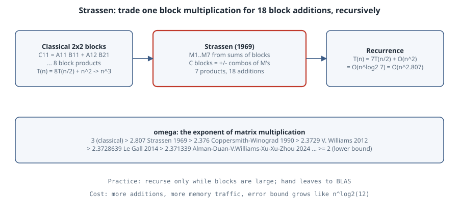

# Strassen's algorithm and the exponent of matrix multiplication

## Thesis

Multiplying two $n\times n$ matrices by the textbook rule costs $n^3$ scalar multiplications. In 1969 Volker Strassen showed that a $2\times 2$ product can be done with **7** multiplications instead of 8, at the price of extra additions. Because the entries can themselves be matrix blocks, the saving compounds under recursion and gives $O(n^{\log_2 7}) \approx O(n^{2.807})$. That single observation opened one of the longest-running races in mathematics: the hunt for $\omega$, the smallest exponent such that matrices can be multiplied in $O(n^{\omega+\varepsilon})$ operations for every $\varepsilon>0$. Today we know $2 \le \omega < 2.371339$.

This chapter derives Strassen's identities, counts the multiplications exactly, checks the algorithm on integers where there is no rounding to hide behind, and measures the two costs that keep it rare in practice: weaker floating-point error bounds, and losing to a tuned BLAS at realistic sizes.

Listings run on CPython 3.15.0 with NumPy 2.5.4 (`uv venv venv --python 3.15.0 && VIRTUAL_ENV=venv uv pip install numpy`). BLAS is pinned to one thread (`OPENBLAS_NUM_THREADS=1`) so the timing comparison is fair to the single-threaded recursion.

## Mental model

{fig-alt="Left: a 2 by 2 block product needs 8 block multiplications classically. Middle: Strassen forms 7 products M1 to M7 from sums and differences of blocks, then recombines them with additions. Right: T(n) = 7T(n/2) + O(n^2) gives n^2.807. Bottom: omega timeline from 3 through 2.807 (1969), 2.376 (1990), 2.3729 (2012), 2.3728639 (2014) to 2.371339 (2024), with lower bound 2."}

Split $A$, $B$ and $C=AB$ into $2\times2$ blocks of size $n/2$. Strassen's seven products are

$$
\begin{aligned}
M_1 &= (A_{11}+A_{22})(B_{11}+B_{22}), & M_2 &= (A_{21}+A_{22})B_{11},\\
M_3 &= A_{11}(B_{12}-B_{22}), & M_4 &= A_{22}(B_{21}-B_{11}),\\
M_5 &= (A_{11}+A_{12})B_{22}, & M_6 &= (A_{21}-A_{11})(B_{11}+B_{12}),\\
M_7 &= (A_{12}-A_{22})(B_{21}+B_{22}),
\end{aligned}
$$

and the result blocks are

$$
C_{11} = M_1+M_4-M_5+M_7,\quad C_{12}=M_3+M_5,\quad C_{21}=M_2+M_4,\quad C_{22}=M_1-M_2+M_3+M_6 .
$$

Check one entry by expanding: $M_3+M_5 = A_{11}B_{12}-A_{11}B_{22}+A_{11}B_{22}+A_{12}B_{22} = A_{11}B_{12}+A_{12}B_{22} = C_{12}$. Nothing in the derivation uses commutativity of multiplication, which is exactly why it is safe to apply recursively to blocks.

The recursion does 7 half-size products and a constant number (18) of half-size additions:

$$
T(n) = 7\,T(n/2) + \Theta(n^2) \;\Longrightarrow\; T(n) = \Theta\!\left(n^{\log_2 7}\right),\quad \log_2 7 \approx 2.8074 .
$$

(This is the master theorem case where the leaves dominate: $7 > 2^2$.) If you stop at blocks of size $n_0$ and multiply those classically, the scalar multiplication count is exactly $7^{\log_2(n/n_0)}\, n_0^3$.

## Worked example

```python
# strassen.py -- 7 products instead of 8, counted, checked, and timed
import numpy as np, time

MULS = 0
def strassen(A, B, leaf=64):
    global MULS
    n = A.shape[0]
    if n <= leaf:
        MULS += n ** 3                     # scalar multiplications in the leaf
        return A @ B
    k = n // 2
    A11, A12, A21, A22 = A[:k, :k], A[:k, k:], A[k:, :k], A[k:, k:]
    B11, B12, B21, B22 = B[:k, :k], B[:k, k:], B[k:, :k], B[k:, k:]
    M1 = strassen(A11 + A22, B11 + B22, leaf)
    M2 = strassen(A21 + A22, B11, leaf)
    M3 = strassen(A11, B12 - B22, leaf)
    M4 = strassen(A22, B21 - B11, leaf)
    M5 = strassen(A11 + A12, B22, leaf)
    M6 = strassen(A21 - A11, B11 + B12, leaf)
    M7 = strassen(A12 - A22, B21 + B22, leaf)
    C = np.empty_like(A)
    C[:k, :k] = M1 + M4 - M5 + M7
    C[:k, k:] = M3 + M5
    C[k:, :k] = M2 + M4
    C[k:, k:] = M1 - M2 + M3 + M6
    return C

# 1. exact check on integers (no rounding at all)
rng = np.random.default_rng(1)
A = rng.integers(-9, 10, (64, 64)); B = rng.integers(-9, 10, (64, 64))
MULS = 0
print("int64 exact match:", np.array_equal(strassen(A, B, leaf=1), A @ B),
      "scalar muls:", MULS, "vs n^3 =", 64 ** 3, "7^6 =", 7 ** 6)

# 2. multiplication count vs leaf size
A = rng.integers(-9, 10, (1024, 1024)); B = rng.integers(-9, 10, (1024, 1024))
for leaf in (16, 64, 256, 1024):
    MULS = 0; strassen(A, B, leaf)
    print(f"n=1024 leaf={leaf:5d} muls={MULS:11d}  ratio to n^3 = {MULS / 1024**3:.3f}")

# 3. floating-point error vs exact (float64 reference computed in higher precision)
for n in (256, 1024):
    X = rng.standard_normal((n, n)); Y = rng.standard_normal((n, n))
    ref = X.astype(np.longdouble) @ Y.astype(np.longdouble)
    for name, f in (("classical", lambda: X @ Y),
                    ("strassen leaf=16", lambda: strassen(X, Y, 16))):
        err = float(np.abs(f() - ref).max() / np.abs(ref).max())
        print(f"n={n:5d} {name:16s} rel max err = {err:.2e}")

# 4. wall time against the BLAS this NumPy links
for n in (1024, 2048, 4096):
    X = rng.standard_normal((n, n)); Y = rng.standard_normal((n, n))
    t = time.perf_counter(); X @ Y; tb = time.perf_counter() - t
    t = time.perf_counter(); strassen(X, Y, 512); ts = time.perf_counter() - t
    print(f"n={n:5d} BLAS {tb:6.3f}s   strassen(leaf=512) {ts:6.3f}s")
```

```bash
OPENBLAS_NUM_THREADS=1 venv/bin/python strassen.py
```

```text
int64 exact match: True scalar muls: 117649 vs n^3 = 262144 7^6 = 117649
n=1024 leaf=   16 muls=  481890304  ratio to n^3 = 0.449
n=1024 leaf=   64 muls=  629407744  ratio to n^3 = 0.586
n=1024 leaf=  256 muls=  822083584  ratio to n^3 = 0.766
n=1024 leaf= 1024 muls= 1073741824  ratio to n^3 = 1.000
n=  256 classical        rel max err = 9.70e-16
n=  256 strassen leaf=16 rel max err = 4.94e-15
n= 1024 classical        rel max err = 9.17e-16
n= 1024 strassen leaf=16 rel max err = 2.36e-14
n= 1024 BLAS  0.022s   strassen(leaf=512)  0.030s
n= 2048 BLAS  0.185s   strassen(leaf=512)  0.272s
n= 4096 BLAS  1.356s   strassen(leaf=512)  3.200s
```

How to read it:

- **Exactness.** On integer matrices the recursion all the way down to $1\times1$ matches `A @ B` exactly, and uses $7^6 = 117{,}649$ scalar multiplications instead of $64^3 = 262{,}144$. The counter agrees with the formula $7^{\log_2(n/n_0)}n_0^3$.
- **Where the saving comes from.** For $n=1024$, each level of recursion multiplies the count by $7/8$. With leaf 1024 (no recursion) the ratio is 1. Leaf 256 means two levels, $(7/8)^2 = 0.766$. Leaf 64 is $(7/8)^4 = 0.586$, and leaf 16 is $(7/8)^6 = 0.449$. The asymptotic win is real but slow: you need six levels of recursion to halve the multiplications.
- **Error.** Classical `@` has a relative max error near $10^{-15}$ at both sizes. Strassen is about 5× worse at $n=256$ and about 26× worse at $n=1024$, and the gap grows with depth. That matches the theory: classical multiplication has a componentwise bound $|C-\hat C| \le \gamma_n |A||B|$. Strassen only satisfies a **normwise** bound whose constant grows like $(n/n_0)^{\log_2 12}\approx (n/n_0)^{3.585}$ (Higham, *Accuracy and Stability of Numerical Algorithms*, §23.2.2). It is still stable in the normwise sense, but small entries of $C$ can lose all their relative accuracy.
- **Speed.** Recursing down to $512\times512$ leaves, Strassen loses to single-threaded OpenBLAS at every size here. At $n=4096$ (three levels) it takes 3.20 s against 1.36 s. The 18 additions are memory-bound passes over $n^2/4$ blocks, and they also break each BLAS call into smaller, less cache-friendly pieces. Careful implementations (Huang, Smith, Henry and van de Geijn, *Strassen's Algorithm Reloaded*, SC16) fuse the additions into the GEMM packing routines and do get 1.1–1.3× speedups at large sizes. A NumPy-level recursion cannot.

## The exponent $\omega$

Strassen's algorithm is a bilinear algorithm of **rank 7** for the $2\times2$ matrix multiplication tensor $\langle 2,2,2\rangle$. Any bilinear algorithm of rank $r$ for $\langle k,k,k\rangle$ gives $\omega \le \log_k r$. Winograd showed 7 is optimal for $2\times 2$, so improving $\omega$ required larger base cases and then much subtler tools: border rank (Bini et al.), the asymptotic sum inequality (Schönhage), and the laser method on the Coppersmith–Winograd tensor.

| Year | Bound on $\omega$ | Who |
|---|---|---|
| — | 3 | classical |
| 1969 | 2.8074 | Strassen |
| 1979 | 2.780 | Bini, Capovani, Lotti, Romani (border rank) |
| 1981 | 2.522 | Schönhage (asymptotic sum inequality) |
| 1990 | 2.3755 | Coppersmith, Winograd |
| 2012 | 2.3729 | Vassilevska Williams |
| 2014 | 2.3728639 | Le Gall |
| 2021 | 2.3728596 | Alman, Vassilevska Williams |
| 2023 | 2.371866 | Duan, Wu, Zhou |
| 2024 | 2.371552 | Vassilevska Williams, Xu, Xu, Zhou |
| 2024 | 2.371339 | Alman, Duan, Vassilevska Williams, Xu, Xu, Zhou |

Three cautions when you read about new records:

1. **Galactic constants.** Every bound after Strassen's (and a few close relatives) hides constants so large that the algorithms are never run. "Better $\omega$" is a theorem about exponents, not a faster library.
2. **Small fixed sizes are a different game.** Finding low-rank algorithms for specific shapes, for example AlphaTensor's 47 multiplications for $4\times4$ over $\mathbb{F}_2$ (Fawzi et al., *Nature* 2022), can matter for real kernels. But a rank $r$ for $\langle 4,4,4\rangle$ only implies $\omega \le \log_4 r$, which is nowhere near the record.
3. **Field matters.** Some algorithms work only over $\mathbb{F}_2$ or need division by small integers. A claim "for all fields" or "over $\mathbb{Z}$" is a stronger statement and should be checked as such. Formal proofs (in Lean, for instance) of the *identities* are cheap to check. Proofs of *asymptotic* bounds are not.

## Boring rule

Use your BLAS. Strassen is the right mental model for why $n^3$ is not a law of nature, and the right algorithm for exact arithmetic on huge matrices (integers, finite fields, polynomials), where additions are cheap relative to multiplications and rounding error does not exist. For floating-point work, the normwise-only error bound and the memory traffic usually make it a loss.

## Exercises

1. Prove $C_{11} = M_1+M_4-M_5+M_7$ by expanding. Which products cancel?
2. Count the block additions in the listing and confirm there are 18.
3. Change `strassen` to pad odd sizes with a zero row and column. What is the multiplication count for $n=1000$ with leaf 16?
4. Compute $\log_4 47$ and $\log_4 49$. How do they compare with $\log_2 7$?
5. Find a matrix pair where Strassen's result has a *small entry* with large relative error while classical multiplication is accurate. (Hint: make $C_{12}$ tiny by cancellation.)

## Sources

- V. Strassen, "Gaussian elimination is not optimal", *Numerische Mathematik* 13 (1969) 354–356.
- D. Coppersmith, S. Winograd, "Matrix multiplication via arithmetic progressions", *J. Symbolic Computation* 9 (1990) 251–280.
- F. Le Gall, "Powers of tensors and fast matrix multiplication", ISSAC 2014, [arXiv:1401.7714](https://arxiv.org/abs/1401.7714).
- J. Alman, R. Duan, V. Vassilevska Williams, Y. Xu, Z. Xu, R. Zhou, "More asymmetry yields faster matrix multiplication", SODA 2025, [arXiv:2404.16349](https://arxiv.org/abs/2404.16349).
- N. J. Higham, *Accuracy and Stability of Numerical Algorithms*, 2nd ed., SIAM 2002, ch. 23.
- J. Huang, T. M. Smith, G. M. Henry, R. A. van de Geijn, "Strassen's Algorithm Reloaded", SC16.
- A. Fawzi et al., "Discovering faster matrix multiplication algorithms with reinforcement learning", *Nature* 610 (2022) 47–53.
