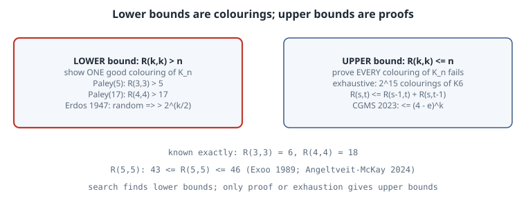

# Ramsey Numbers: Order You Cannot Avoid

## Thesis

Colour every edge of a complete graph red or blue. If the graph is large enough, you *cannot* avoid a monochromatic clique of size $k$. The smallest such size is the **Ramsey number** $R(k,k)$. Among any six people, three are mutual friends or three are mutual strangers, which says $R(3,3) = 6$. The numbers are easy to define and very hard to compute:

- $R(4,4) = 18$ has been known since 1955.
- $R(5,5)$ is still only known to lie between 43 and 46.
- The best general lower bound is still essentially Erdős's 1947 random-colouring argument.

The asymmetry is the lesson. A **lower bound** needs one good colouring, which you can find by cleverness, symmetry, randomness or search. An **upper bound** needs a proof that *every* colouring fails. This chapter does both kinds by computer, for the cases that fit.

## Mental model

{fig-alt="Number line for R(k,k). Left side: lower bounds come from exhibiting a 2-colouring of K_n with no monochromatic K_k, for example Paley(5) for R(3,3) > 5 and Paley(17) for R(4,4) > 17, or from Erdos's probabilistic argument that such a colouring exists. Right side: upper bounds need a proof that every colouring of K_n contains one, for example exhaustive search for R(3,3) <= 6, or the recursion R(s,t) <= R(s-1,t) + R(s,t-1). For R(5,5) the gap is 43 to 46."}

**Definition.** $R(s,t)$ is the least $n$ such that every red/blue colouring of the edges of $K_n$ contains a red $K_s$ or a blue $K_t$. Ramsey (1930) proved it is finite.

**Upper bound by recursion.** Pick a vertex $v$ of $K_n$ with $n = R(s-1,t) + R(s,t-1)$. It has $n - 1$ edges, so either $R(s-1,t)$ of them are red or $R(s,t-1)$ are blue (pigeonhole). In the first case, the red neighbourhood contains a blue $K_t$ or a red $K_{s-1}$, and adding $v$ to the latter gives a red $K_s$. The blue case is symmetric. Hence

$$
R(s,t) \le R(s-1,t) + R(s,t-1), \qquad R(k,k) \le \binom{2k-2}{k-1} < 4^k.
$$

For decades the base 4 did not move. Campos, Griffiths, Morris and Sahasrabudhe (2023) finally lowered it to $4 - \varepsilon$, about $3.993$. Gupta, Ndiaye, Norin and Wei (2024) then optimised the method to $3.8$.

**Lower bound by randomness.** Colour $K_n$ by fair coin flips. A fixed $k$-set is monochromatic with probability $2^{1 - \binom k2}$, so the expected number of monochromatic $K_k$ is $\binom nk 2^{1-\binom k2}$. If that is $< 1$, *some* colouring has none. This gives $R(k,k) > 2^{k/2}$ for $k \ge 3$ (Erdős 1947). The argument proves the colouring exists without telling you what it is. Nobody knows an explicit construction that comes close.

**Lower bound by symmetry.** The **Paley graph** $P_q$ ($q \equiv 1 \pmod 4$ prime) joins $i$ and $j$ in red when $i - j$ is a non-zero square mod $q$. $-1$ is a square, so this is well defined, and multiplying by a non-square maps red to blue. So $P_q$ is isomorphic to its complement, which means a red $K_4$ exists iff a blue one does. $P_5$ is the pentagon, and $P_{17}$ is the witness for $R(4,4) > 17$.

## Worked example

The script uses only the standard library:

- It checks $R(3,3) = 6$ by brute force.
- It checks the Paley witnesses.
- It shows that Paley(17) cannot be extended to 18 vertices.
- It evaluates Erdős's bound.
- It compares a naive local search against a search restricted to circulant (rotation-symmetric) colourings.

```python
"""Ramsey numbers by computation: R(3,3) = 6 exhaustively, R(4,4) > 17 via the Paley graph, and a local search."""
import itertools, math, random, time

def edges(n): return list(itertools.combinations(range(n), 2))

def mono_clique(n, red, k):
    """Return a k-set whose edges are all red or all blue, or None. `red` is a set of edges (i<j)."""
    for S in itertools.combinations(range(n), k):
        cols = {(e in red) for e in itertools.combinations(S, 2)}
        if len(cols) == 1: return S
    return None

# 1) R(3,3) = 6: some 2-colouring of K5 avoids monochromatic triangles; none of K6 does.
for n in (5, 6):
    E = edges(n); good = 0
    for mask in range(1 << len(E)):
        red = {E[i] for i in range(len(E)) if mask >> i & 1}
        if mono_clique(n, red, 3) is None: good += 1
    print(f"K{n}: {1 << len(E):6d} colourings, {good:3d} with no monochromatic triangle")

# 2) Paley graph P17: i~j iff i-j is a nonzero square mod 17. Self-complementary, so no K4 => no independent 4-set.
def paley(q):
    QR = {x * x % q for x in range(1, q)}
    return {(i, j) for i, j in edges(q) if (j - i) % q in QR}
for q, k in [(5, 3), (17, 4)]:
    red = paley(q)
    print(f"Paley({q}): {len(red)} red / {len(edges(q)) - len(red)} blue edges, monochromatic K{k}: {mono_clique(q, red, k)}"
          f"  => R({k},{k}) > {q}")
# Paley(17) cannot be extended: every way to colour an 18th vertex's 17 edges creates a monochromatic K4.
# (That alone is not R(4,4) <= 18; that needs the 1955 counting argument, or the uniqueness of this graph.)
red17 = paley(17); bad = 0; t0 = time.perf_counter()
cliques = {c: [S for S in itertools.combinations(range(17), 3) if {(e in red17) for e in itertools.combinations(S, 2)} == {c}]
           for c in (True, False)}
for mask in range(1 << 17):
    reds = {v for v in range(17) if mask >> v & 1}
    if any(set(S) <= reds for S in cliques[True]) or any(not (set(S) & reds) for S in cliques[False]): bad += 1
print(f"extend Paley(17) by vertex 17: {bad} of {1 << 17} colourings of its edges create a monochromatic K4"
      f"  ({time.perf_counter() - t0:.1f} s)")

# 3) Erdos 1947: a random colouring of K_n has E[#mono K_k] = C(n,k) 2^(1 - C(k,2)); < 1 means a good colouring exists.
for k in (4, 5, 10, 20):
    n = max(n for n in range(k, 10**6) if math.comb(n, k) * 2.0 ** (1 - math.comb(k, 2)) < 1)
    print(f"k={k:2d}: Erdos guarantees R(k,k) > {n:6d}   (2^(k/2) = {2 ** (k / 2):8.1f})")

# 4) Local search: minimise #monochromatic K4 on K_n by flipping edges (a tiny version of how lower bounds are hunted).
def search(n, k, steps, seed):
    rng = random.Random(seed); E = edges(n)
    col = {e: rng.random() < 0.5 for e in E}
    subsets = list(itertools.combinations(range(n), k))
    by_edge = {e: [S for S in subsets if e[0] in S and e[1] in S] for e in E}
    mono = lambda S: len({col[e] for e in itertools.combinations(S, 2)}) == 1
    bad = sum(mono(S) for S in subsets); best = bad
    for step in range(steps):
        if bad == 0: return 0, step
        e = rng.choice(E); before = sum(mono(S) for S in by_edge[e])
        col[e] = not col[e]; delta = sum(mono(S) for S in by_edge[e]) - before
        if delta <= 0 or rng.random() < math.exp(-delta / 0.6): bad += delta
        else: col[e] = not col[e]
        best = min(best, bad)
    return best, steps
for n in (17,):
    for seed in range(3):
        best, used = search(n, 4, 40000, seed)
        print(f"local search K{n}, seed {seed}: fewest monochromatic K4 = {best} (steps {used})")

# 5) Symmetry shrinks the search: circulant colourings of K17 (colour depends only on the distance |i-j| mod 17, 1..8).
t0 = time.perf_counter(); hits = []
for mask in range(1 << 8):
    D = {d for d in range(1, 9) if mask >> (d - 1) & 1}
    red = {(i, j) for i, j in edges(17) if min((j - i) % 17, (i - j) % 17) in D}
    if mono_clique(17, red, 4) is None: hits.append(sorted(D))
print(f"circulant K17: {len(hits)} of 256 distance sets avoid monochromatic K4: {hits}  ({time.perf_counter() - t0:.1f} s)")
print("quadratic residues mod 17 as distances:", sorted({min(x * x % 17, 17 - x * x % 17) for x in range(1, 17)}))
```

Output (CPython 3.15.0, about 15 s, mostly the local search):

```text
K5:   1024 colourings,  12 with no monochromatic triangle
K6:  32768 colourings,   0 with no monochromatic triangle
Paley(5): 5 red / 5 blue edges, monochromatic K3: None  => R(3,3) > 5
Paley(17): 68 red / 68 blue edges, monochromatic K4: None  => R(4,4) > 17
extend Paley(17) by vertex 17: 131072 of 131072 colourings of its edges create a monochromatic K4  (0.4 s)
k= 4: Erdos guarantees R(k,k) >      6   (2^(k/2) =      4.0)
k= 5: Erdos guarantees R(k,k) >     11   (2^(k/2) =      5.7)
k=10: Erdos guarantees R(k,k) >    100   (2^(k/2) =     32.0)
k=20: Erdos guarantees R(k,k) >   5817   (2^(k/2) =   1024.0)
local search K17, seed 0: fewest monochromatic K4 = 8 (steps 40000)
local search K17, seed 1: fewest monochromatic K4 = 10 (steps 40000)
local search K17, seed 2: fewest monochromatic K4 = 9 (steps 40000)
circulant K17: 2 of 256 distance sets avoid monochromatic K4: [[3, 5, 6, 7], [1, 2, 4, 8]]  (0.0 s)
quadratic residues mod 17 as distances: [1, 2, 4, 8]
```

**Reading it.**

- **$R(3,3) = 6$, by exhaustion.** Of the $2^{10}$ colourings of $K_5$, exactly 12 avoid a monochromatic triangle. They are the 12 labelled ways to draw a pentagon in red with the pentagram in blue. None of the $2^{15}$ colourings of $K_6$ avoids one, so that is the proof.
- **Witnesses.** Paley(5) and Paley(17) split their edges evenly (5/5 and 68/68) and contain no monochromatic triangle and no monochromatic $K_4$ respectively. That gives $R(3,3) > 5$ and $R(4,4) > 17$.
- **Paley(17) is maximal.** All $2^{17}$ ways to attach an 18th vertex create a monochromatic $K_4$. Taken alone, that does not prove $R(4,4) \le 18$, because some *other* 17-vertex colouring might extend. The upper bound comes from the recursion: $R(4,4) \le 2R(3,4) = 18$, with Greenwood and Gleason's $R(3,4) = 9$.
- **Erdős is far from the truth for small $k$.** It only guarantees $R(4,4) > 6$ and $R(5,5) > 11$, against the true 18 and at least 43. Asymptotically, however, it beats every explicit construction known. At $k = 20$ it guarantees $R > 5817$, well past $2^{10} = 1024$.
- **Symmetry beats blind search.** In 40,000 steps, a naive annealer over all $2^{136}$ colourings of $K_{17}$ stalls at 8–10 monochromatic $K_4$s. Restricting to circulant colourings, where colour depends only on the distance $|i - j| \bmod 17$, leaves only $2^8 = 256$ candidates. Exhaustive search over them finds exactly two: the quadratic residues $\{1, 2, 4, 8\}$ (Paley) and its complement. Many computer lower-bound hunts follow the same recipe: pick a structured family, then search hard inside it.

## Pitfalls

- **Lower bounds are not values.** "We found a colouring of $K_{42}$ with no monochromatic $K_5$" says $R(5,5) \ge 43$. It says nothing about whether $R(5,5) = 43$.
- **Extension failure is not an upper bound.** One colouring failing to extend is evidence, not proof. You must rule out every colouring of $K_n$, usually up to isomorphism, which is where the hard computation goes.
- **Counting monochromatic cliques is expensive.** $\binom{n}{k}$ subsets per check. Use incremental updates (only the $k$-sets containing the flipped edge), as the local search does.
- **Off-by-one in the convention.** "$R(4,4) > 17$" and "$R(4,4) \ge 18$" are the same statement. Mixing them up in a table changes the claimed bound.

## Exercises

1. Prove that the 12 good colourings of $K_5$ are exactly the pentagon/pentagram splits, and that $5!/10 = 12$ counts them.
2. Show $R(3,4) \le 9$ with the parity refinement of the recursion: if both $R(s-1,t)$ and $R(s,t-1)$ are even, the bound improves by 1. Then find a circulant colouring of $K_8$ with no red triangle and no blue $K_4$.
3. Adapt the circulant search to $K_{n}$ with $n \le 42$, looking for colourings with no monochromatic $K_5$. How large an $n$ can you reach in a minute?
4. Use the Lovász local lemma to improve Erdős's bound by a factor of about $\sqrt2 \cdot e^{-1} \cdot k$.

## Sources

- F. P. Ramsey, "On a problem of formal logic", *Proc. London Math. Soc.* (2) 30 (1930) 264–286.
- P. Erdős, G. Szekeres, "A combinatorial problem in geometry", *Compositio Math.* 2 (1935) 463–470.
- P. Erdős, "Some remarks on the theory of graphs", *Bull. AMS* 53 (1947) 292–294.
- R. E. Greenwood, A. M. Gleason, "Combinatorial relations and chromatic graphs", *Canad. J. Math.* 7 (1955) 1–7.
- M. Campos, S. Griffiths, R. Morris, J. Sahasrabudhe, "An exponential improvement for diagonal Ramsey". [arXiv:2303.09521](https://arxiv.org/abs/2303.09521)
- V. Angeltveit, B. D. McKay, "$R(5,5) \le 46$". [arXiv:2409.15709](https://arxiv.org/abs/2409.15709)
- P. Gupta, N. Ndiaye, S. Norin, L. Wei, "Optimizing the CGMS upper bound on Ramsey numbers". [arXiv:2407.19026](https://arxiv.org/abs/2407.19026)
- S. Radziszowski, "Small Ramsey Numbers", *Electronic J. Combinatorics*, Dynamic Survey DS1. [combinatorics.org](https://www.combinatorics.org/ojs/index.php/eljc/article/view/DS1)
