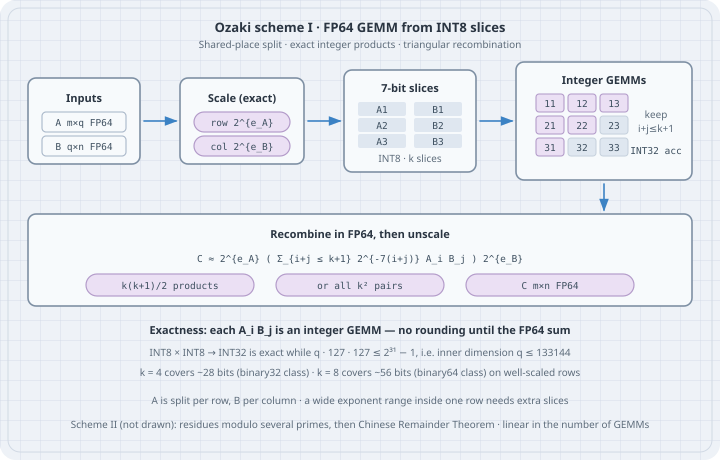

Matrix multiplication is the operation scientific computing and machine learning both spend their lives inside: $C \leftarrow AB$ for $A\in\mathbb{R}^{m\times q}$, $B\in\mathbb{R}^{q\times n}$. In IEEE binary64 that product is DGEMM, and for decades it was a hardware primitive. On current AI-oriented accelerators it is not. Low-precision matrix engines (INT8, FP8, FP16, BF16) are one to two orders of magnitude faster than native FP64, and some parts have started to treat FP64 as something to *synthesize*. The **Ozaki scheme** is the mathematics of that synthesis: split each floating-point matrix into a handful of short integer slices so that every slice-pair product is *exact*, accumulate those products in integer arithmetic, and recombine.

This chapter teaches the 2012 error-free transformation (now called Ozaki scheme I), the INT8 form that Ootomo, Ozaki, and Yokota put on tensor cores, and the 2025/26 CRT variant (Ozaki scheme II). It then implements scheme I in NumPy with `int8` slices and `int32`/`int64` accumulation, and compares it with `float64` GEMM, `float32` GEMM, and an `mpmath` reference on a small case.

All listings are complete Python files. They were run with **Python 3.13.5**, **NumPy 2.5.3**, and **mpmath 1.3.0**. Outputs are pasted unedited. This machine has no GPU and no vendor BLAS beyond NumPy; hardware throughputs quoted in §1 come from the cited papers and from the CUDA 13.4 release notes, not from a run here.

## 1. Why emulate binary64 matrix products

A binary64 number carries a 53-bit significand (52 stored bits plus the hidden 1) and an 11-bit exponent field. The unit roundoff is $u=2^{-53}\approx 1.11\times 10^{-16}$. Native FP64 matrix units used to be a selling point of scientific GPUs. The accelerators built for training and inference put that budget into low-precision tensor cores instead.

Ozaki, Uchino, and Imamura (Table 1 of the Ozaki scheme II paper, arXiv:2504.08009v4, citing NVIDIA's 2024 dense-data specifications) list a Blackwell B200 at 40 TFLOPS of FP64 and 4500 TOPS of INT8 tensor-core throughput: a ratio of about 110. CUDA Toolkit 13.4's cuBLAS release notes then report *emulated* DGEMM — Ozaki I or II, chosen automatically — reaching up to 175 TFLOPS on B200. Those figures were not measured on this box. The point they establish is the one this chapter needs: if you can turn one FP64 GEMM into a few dozen *exact* INT8 GEMMs, the INT8 units win on throughput, and the mathematics decides whether the answer is still a binary64 answer.

Iterative refinement recovers FP64 *linear solves* from a cheap factorization. It does not help when the application needs every matrix product itself to be accurate: electronic-structure contractions, spectral methods, some eigenvalue solvers. Those codes want DGEMM. The Ozaki scheme is DGEMM built out of integer GEMMs.

## 2. Mental model: error-free splitting, then exact products

Write a working-precision matrix as a sum of slices whose significands are short:

$$
A = \sum_{i=1}^{k} 2^{-7i}\,2^{e_A} A_i + R_A, \qquad
B = \sum_{j=1}^{k} 2^{-7j}\,2^{e_B} B_j + R_B,
$$

where each $A_i, B_j$ has **integer** entries that fit in signed 8-bit storage, $e_A$ is a diagonal of per-row powers of two, $e_B$ is per-column, and the remainders $R_A, R_B$ are what you drop when you stop after $k$ slices. The product expands as

$$
AB \;=\; 2^{e_A}\Biggl(\sum_{i=1}^{k}\sum_{j=1}^{k} 2^{-7(i+j)}\, A_i B_j\Biggr) 2^{e_B} \;+\; \text{dropped terms}.
$$

Two facts make this useful.

1. **Each $A_i B_j$ is an integer matrix product.** INT8 $\times$ INT8 with INT32 (or INT64) accumulation is exact as long as the inner dimension $q$ is small enough that the accumulator cannot wrap. There is no rounding inside the GEMM.
2. **The weights are powers of two.** Scaling by $2^{\pm 7(i+j)}$ and by $2^{e_A}$, $2^{e_B}$ is exact in binary floating-point (no overflow or underflow). The only rounding in the whole algorithm is the final FP64 sum of the weighted integer products, plus whatever you chose to drop.

The original 2012 paper (Ozaki, Ogita, Oishi, Rump) did the same split in *floating-point* GEMM: choose the slice width so that $2\beta+\lceil\log_2 q\rceil$ bits fit in the 53-bit significand, and each $A_i B_j$ is error-free in binary64. The INT8 form, due to Ootomo, Ozaki, and Yokota (IJHPCA 2024), moves that exactness into the integer tensor core and stores the slices in one byte. Later papers call this **Ozaki scheme I**.

The number of products is $k^2$ if you keep every pair, or

$$
\frac{k(k+1)}{2}
$$

if you keep only the most significant pairs $i+j\le k+1$ (1-based). That triangle is the usual production choice: the discarded products sit below working precision when $k$ is large enough for the data.



## 3. Binary64 layout, and what "exact integer GEMM" means

```python
# demo_fp64_bits.py - IEEE 754 binary64 layout of a few constants
import struct

def unpack64(x: float):
    u = struct.unpack(">Q", struct.pack(">d", x))[0]
    sign = (u >> 63) & 1
    exp = (u >> 52) & 0x7FF
    man = u & ((1 << 52) - 1)
    return u, sign, exp, man

for label, x in (
    ("1.0", 1.0),
    ("-2.5", -2.5),
    ("0.1", 0.1),
    ("2**53", 2.0**53),
    ("2**53+1", 2.0**53 + 1.0),
):
    u, s, e, m = unpack64(x)
    bias = 1023
    print(f"{label:10} value={x:24.1f}  sign={s}  E={e - bias:4d}  "
          f"frac=0x{m:013x}")
print("(2**53 + 1) == 2**53 in binary64?", (2.0**53 + 1.0) == 2.0**53)
import numpy as np
print("numpy finfo(float64).eps =", np.finfo(np.float64).eps, " = 2**-52")
print("unit roundoff u = 2**-53 =", 2.0**-53)
```

```bash
python3 demo_fp64_bits.py
```

```text
1.0        value=                     1.0  sign=0  E=   0  frac=0x0000000000000
-2.5       value=                    -2.5  sign=1  E=   1  frac=0x4000000000000
0.1        value=                     0.1  sign=0  E=  -4  frac=0x999999999999a
2**53      value=      9007199254740992.0  sign=0  E=  53  frac=0x0000000000000
2**53+1    value=      9007199254740992.0  sign=0  E=  53  frac=0x0000000000000
(2**53 + 1) == 2**53 in binary64? True
numpy finfo(float64).eps = 2.220446049250313e-16  = 2**-52
unit roundoff u = 2**-53 = 1.1102230246251565e-16
```

The last two lines of the bit dump are the same pattern. Above $2^{53}$, binary64 cannot represent consecutive integers, so $2^{53}+1$ collapses onto $2^{53}$. Integer GEMM does not have that problem: every integer in the accumulator's range is representable. The hardware constraint is the *width* of the accumulator.

Signed INT8 holds $\{-128,\ldots,127\}$. A product of two such entries is at most $127\cdot 127=16129$. Summing $q$ of them into a signed INT32 (max $2^{31}-1=2147483647$) is exact provided

$$
q\cdot 127\cdot 127 \;\le\; 2^{31}-1 \qquad\Rightarrow\qquad q \;\le\; 133144.
$$

Ootomo et al. take a slightly different form, shrinking the slice width $\beta$ when $q$ is huge:

$$
\beta \;=\; \min\bigl(7,\; \lfloor(31-\log_2 q)/2\rfloor\bigr),
$$

so that $q\cdot 2^{2\beta}$ stays inside 31 bits. For every inner dimension in this chapter, $q=8$ or $q=3$, so $\beta=7$ and INT32 is far from wrapping; the listings still accumulate in `int64` as well and check that the two agree.

## 4. Shared-place splitting

Elementwise splitting (double-double, "cast to FP16 and subtract") peels leading bits of *each entry independently*. Ozaki splitting is **shared-place**: every entry of a *row of $A$* is scaled by the same power of two, chosen from that row's maximum magnitude, and then sliced at the same binary place. Columns of $B$ are scaled independently. Two consequences:

- every product $A_i[r,:]\,B_j[:,c]$ has a common scale, so the integer GEMM is a homogeneous inner product;
- a row whose entries span many orders of magnitude spends slices on the large entries, and the small ones may not appear until late. That is the trap in §7.

The scaling is $e = \lceil\log_2 M\rceil + 1$ with $M=\max|x|$ along the row (or column), so the scaled values lie in $(-1/2,1/2]$. Then $\mathrm{round}(R\cdot 2^{7})$ fits in $\{-64,\ldots,64\}\subset$ INT8. Multiplying or dividing by a power of two is exact in binary64.

```python
# ozaki.py - Ozaki scheme I: FP64 GEMM via int8 slices and integer accumulation
"""Ozaki scheme I (shared-place slicing) for binary64 matrix multiplication.

Each row of A and each column of B is scaled by a power of two (exact),
then the scaled mantissa is peeled into 7-bit integer slices. Every
slice-pair product is an exact integer GEMM; the floating-point answer
is the scaled sum of those products.
"""
from __future__ import annotations

import numpy as np

BITS = 7  # bits per slice; 2**7 = 128 fits in signed int8 after |R| <= 0.5 scaling


def _row_col_exponents(M: np.ndarray, axis: int) -> np.ndarray:
    """Power-of-two exponents so that |M| * 2^{-e} <= 1/2 along `axis`.

    axis=1: one exponent per row (for A). axis=0: one exponent per column (for B).
    """
    absmax = np.max(np.abs(M), axis=axis, keepdims=True)
    absmax = np.where(absmax == 0.0, 1.0, absmax)
    # ceil(log2(absmax)) + 1  =>  scaled values in (-1/2, 1/2]
    e = np.ceil(np.log2(absmax)).astype(np.int64) + 1
    return e


def split_slices(
    M: np.ndarray, nslices: int, axis: int, bits: int = BITS
) -> tuple[list[np.ndarray], np.ndarray]:
    """Return (list of int8 slices, per-row-or-column exponents)."""
    M = np.asarray(M, dtype=np.float64)
    e = _row_col_exponents(M, axis)
    R = np.ldexp(M, -e)  # M * 2^{-e}, exact
    out: list[np.ndarray] = []
    for i in range(1, nslices + 1):
        P = np.rint(np.ldexp(R, bits * i))  # round(R * 2^{bits*i})
        # After the |R|<=1/2 scaling, |P| <= 2^{bits-1} = 64 for bits=7.
        if np.any(np.abs(P) > 127):
            raise OverflowError("slice escaped int8; scaling is wrong")
        out.append(P.astype(np.int8))
        R = R - np.ldexp(P, -bits * i)  # exact: P is integer, scale is 2^{-k}
    return out, e


def ozaki_gemm(
    A: np.ndarray,
    B: np.ndarray,
    nslices: int,
    *,
    bits: int = BITS,
    triangular: bool = True,
    acc_dtype=np.int64,
) -> np.ndarray:
    """Approximate A @ B by k (or k(k+1)/2) exact integer GEMMs.

    triangular=True keeps pairs (i, j) with i+j <= nslices+1 (1-based),
    which is k(k+1)/2 products: the most significant slice pairs.
    triangular=False uses all k^2 products.
    """
    A = np.asarray(A, dtype=np.float64)
    B = np.asarray(B, dtype=np.float64)
    As, ea = split_slices(A, nslices, axis=1, bits=bits)
    Bs, eb = split_slices(B, nslices, axis=0, bits=bits)
    m, n = A.shape[0], B.shape[1]
    C = np.zeros((m, n), dtype=np.float64)
    nprod = 0
    for i in range(nslices):
        jmax = (nslices - i) if triangular else nslices  # 1-based: i+1+j+1 <= k+1
        for j in range(jmax):
            P = As[i].astype(acc_dtype, copy=False) @ Bs[j].astype(acc_dtype, copy=False)
            C += np.ldexp(P.astype(np.float64), -bits * ((i + 1) + (j + 1)))
            nprod += 1
    # Unscale: C[r,c] *= 2^{ea[r]} * 2^{eb[c]}
    C = np.ldexp(C, ea + eb.reshape(1, -1))
    return C


def n_products(nslices: int, triangular: bool = True) -> int:
    k = nslices
    return k * (k + 1) // 2 if triangular else k * k
```

Peel $\pi$ into eight slices. Eight $\times$ 7 bits is 56 bits, which covers the 53-bit significand, so the reconstruction is exact in binary64:

```python
# demo_split_scalar.py - peel one binary64 number into 7-bit integer slices
import numpy as np
from ozaki import BITS, split_slices

x = np.float64(np.pi)
print("x =", np.format_float_scientific(x, unique=True, precision=17))
print("binary64 value of pi:", x)

# Treat x as a 1x1 matrix; split along axis=1 (the dummy column axis)
slices, e = split_slices(np.array([[x]]), nslices=8, axis=1)
print("per-row exponent e =", int(e[0, 0]), " so scaled R = x * 2^{-e} =", x * 2.0 ** -int(e[0, 0]))
print()
print(f"{'i':>3} {'P_i (int8)':>12} {'weight 2^{-7i}':>16} {'term P*2^{-7i}*2^e':>24} {'running sum':>24}")
acc = 0.0
ee = int(e[0, 0])
for i, P in enumerate(slices, start=1):
    p = int(P[0, 0])
    term = np.ldexp(float(p), -BITS * i + ee)
    acc += term
    print(f"{i:3d} {p:12d} {2.0**(-BITS*i):16.3e} {term:24.17g} {acc:24.17g}")
print()
print("reconstruction - x =", acc - x)
print("|rel err| =", abs(acc - x) / abs(x))
print("slices as int8:", [int(P[0, 0]) for P in slices])
```

```bash
python3 demo_split_scalar.py
```

```text
x = 3.141592653589793e+00
binary64 value of pi: 3.141592653589793
per-row exponent e = 3  so scaled R = x * 2^{-e} = 0.39269908169872414

  i   P_i (int8)   weight 2^{-7i}       term P*2^{-7i}*2^e              running sum
  1           50        7.812e-03                    3.125                    3.125
  2           34        6.104e-05             0.0166015625             3.1416015625
  3           -2        4.768e-07       -7.62939453125e-06       3.1415939331054688
  4          -43        3.725e-09  -1.2814998626708984e-06       3.1415926516056061
  5            9        2.910e-11   2.0954757928848267e-09       3.1415926537010819
  6          -61        2.274e-13  -1.1095835361629725e-10       3.1415926535901235
  7          -23        1.776e-15  -3.2684965844964609e-13       3.1415926535897967
  8          -32        1.388e-17  -3.5527136788005009e-15       3.1415926535897931

reconstruction - x = 0.0
|rel err| = 0.0
slices as int8: [50, 34, -2, -43, 9, -61, -23, -32]
```

After four slices the running sum already agrees with $\pi$ to nine digits. Slice 8 contributes a few units in the last place and lands exactly on the binary64 value of $\pi$.

## 5. Worked example: a 2×2 product, by hand and by slices

Take

$$
A=\begin{pmatrix}3/2&-1/4\\3/4&2\end{pmatrix},\qquad
B=\begin{pmatrix}4&1/2\\-1&3\end{pmatrix}.
$$

Every entry is a small dyadic rational, so it is exact in binary64, and the product is exact in $\mathbb{Q}$:

$$
AB=\begin{pmatrix}25/4&0\\1&51/8\end{pmatrix}
=\begin{pmatrix}6.25&0\\1&6.375\end{pmatrix}.
$$

```python
# demo_2x2.py - a 2x2 product, slice by slice, compared with exact Fraction arithmetic
from fractions import Fraction
import numpy as np
from ozaki import BITS, ozaki_gemm, split_slices, n_products

A = np.array([[1.5, -0.25],
              [0.75, 2.0]], dtype=np.float64)
B = np.array([[4.0, 0.5],
              [-1.0, 3.0]], dtype=np.float64)

def frac_gemm(A, B):
    C = np.empty((2, 2), dtype=object)
    for i in range(2):
        for j in range(2):
            C[i, j] = sum(Fraction(A[i, t]) * Fraction(B[t, j]) for t in range(2))
    return C

C_exact = frac_gemm(A, B)
print("A =\n", A)
print("B =\n", B)
print("exact AB (Fraction):", [[C_exact[i, j] for j in range(2)] for i in range(2)])

As, ea = split_slices(A, nslices=3, axis=1)
Bs, eb = split_slices(B, nslices=3, axis=0)
print("row exponents e_A =", ea.ravel().tolist())
print("col exponents e_B =", eb.ravel().tolist())
print("A slices (int8):", [S.tolist() for S in As])
print("B slices (int8):", [S.tolist() for S in Bs])

print("non-zero integer GEMMs:")
for i, Ai in enumerate(As, 1):
    for j, Bj in enumerate(Bs, 1):
        P = Ai.astype(np.int64) @ Bj.astype(np.int64)
        if np.any(P):
            print(f"  A[{i}] @ B[{j}] =\n{P}   weight 2^{-BITS*(i+j)}")

C_tri = ozaki_gemm(A, B, nslices=3, triangular=True)
C_full = ozaki_gemm(A, B, nslices=3, triangular=False)
print("ozaki triangular (6 products):\n", C_tri)
print("ozaki full (9 products):\n", C_full)
print("float64 A@B:\n", A @ B)
print("max |ozaki_tri - exact| =",
      max(abs(float(C_tri[i, j]) - float(C_exact[i, j])) for i in range(2) for j in range(2)))
print("n_products tri/full =", n_products(3, True), n_products(3, False))
```

```bash
python3 demo_2x2.py
```

```text
A =
 [[ 1.5  -0.25]
 [ 0.75  2.  ]]
B =
 [[ 4.   0.5]
 [-1.   3. ]]
exact AB (Fraction): [[Fraction(25, 4), Fraction(0, 1)], [Fraction(1, 1), Fraction(51, 8)]]
row exponents e_A = [2, 2]
col exponents e_B = [3, 3]
A slices (int8): [[[48, -8], [24, 64]], [[0, 0], [0, 0]], [[0, 0], [0, 0]]]
B slices (int8): [[[64, 8], [-16, 48]], [[0, 0], [0, 0]], [[0, 0], [0, 0]]]
non-zero integer GEMMs:
  A[1] @ B[1] =
[[3200    0]
 [ 512 3264]]   weight 2^-14
ozaki triangular (6 products):
 [[6.25  0.   ]
 [1.    6.375]]
ozaki full (9 products):
 [[6.25  0.   ]
 [1.    6.375]]
float64 A@B:
 [[6.25  0.   ]
 [1.    6.375]]
max |ozaki_tri - exact| = 0.0
n_products tri/full = 6 9
```

One slice of each matrix captures everything, because these dyadics have only a few significant bits. The $(1,1)$ entry of the integer product is $48\cdot 64 + (-8)\cdot(-16)=3200$. Unscaling is exact:

$$
3200\cdot 2^{-14}\cdot 2^{2}\cdot 2^{3} \;=\; 3200\cdot 2^{-9} \;=\; 3200/512 \;=\; 6.25.
$$

Slices 2 and 3 are the zero matrix, so the triangular six-product sum and the full nine-product sum agree with each other, with `float64` GEMM, and with `Fraction`.

## 6. Worked example: 8×8 random GEMM against mpmath

The 2×2 case is too kind. Draw $A,B$ with i.i.d. standard-normal binary64 entries, compute a reference product in `mpmath` at 50 decimal digits (the inputs are still binary64; the reference is the exact real product of those dyadics, rounded once to binary64 at the end), and compare Ozaki, NumPy `float64`, and NumPy `float32`.

```python
# demo_compare.py - Ozaki vs float64 vs float32 vs mpmath on a small random GEMM
import numpy as np
from mpmath import mpf, mp
from ozaki import ozaki_gemm, n_products

mp.dps = 50  # ~166 bits; enough to treat the reference as exact for binary64 inputs


def mp_gemm(A: np.ndarray, B: np.ndarray) -> np.ndarray:
    m, k = A.shape
    n = B.shape[1]
    C = np.empty((m, n), dtype=np.float64)
    for i in range(m):
        for j in range(n):
            s = mpf(0)
            for t in range(k):
                s += mpf(A[i, t]) * mpf(B[t, j])
            C[i, j] = float(s)
    return C


def rel_max(C, Cref):
    return float(np.max(np.abs(C - Cref)) / np.max(np.abs(Cref)))


rng = np.random.default_rng(0)
m = k = n = 8
A = rng.standard_normal((m, k))
B = rng.standard_normal((k, n))

print(f"shape {m}x{k}  times  {k}x{n},  seed=0,  N(0,1) binary64 entries")
print("mpmath dps =", mp.dps)
Cref = mp_gemm(A, B)
C64 = A @ B
C32 = (A.astype(np.float32) @ B.astype(np.float32)).astype(np.float64)

print(f"{'method':<28} {'max rel err vs mp':>18} {'nprod':>8}")
print(f"{'mpmath reference':<28} {0.0:18.6e} {'-':>8}")
print(f"{'numpy float64 GEMM':<28} {rel_max(C64, Cref):18.6e} {1:8d}")
print(f"{'numpy float32 GEMM':<28} {rel_max(C32, Cref):18.6e} {1:8d}")
for s in (2, 3, 4, 5, 6, 7, 8, 9):
    for tri in (True, False):
        C = ozaki_gemm(A, B, nslices=s, triangular=tri)
        tag = "tri" if tri else "full"
        print(f"{'ozaki k='+str(s)+' '+tag:<28} {rel_max(C, Cref):18.6e} {n_products(s, tri):8d}")
```

```bash
python3 demo_compare.py
```

```text
shape 8x8  times  8x8,  seed=0,  N(0,1) binary64 entries
mpmath dps = 50
method                        max rel err vs mp    nprod
mpmath reference                   0.000000e+00        -
numpy float64 GEMM                 5.306960e-17        1
numpy float32 GEMM                 1.040517e-07        1
ozaki k=2 tri                      1.724797e-04        3
ozaki k=2 full                     1.207295e-04        4
ozaki k=3 tri                      1.552715e-06        6
ozaki k=3 full                     7.117836e-07        9
ozaki k=4 tri                      2.774233e-08       10
ozaki k=4 full                     6.648553e-09       16
ozaki k=5 tri                      1.521374e-10       15
ozaki k=5 full                     5.074156e-11       25
ozaki k=6 tri                      7.847668e-13       21
ozaki k=6 full                     5.155181e-13       36
ozaki k=7 tri                      1.042818e-14       28
ozaki k=7 full                     3.184176e-15       49
ozaki k=8 tri                      2.122784e-16       36
ozaki k=8 full                     2.122784e-16       64
ozaki k=9 tri                      2.122784e-16       45
ozaki k=9 full                     2.122784e-16       81
```

Read the table against the bit budget. Each slice is 7 bits, so $k=4$ covers 28 bits (binary32 has a 24-bit significand) and lands at $10^{-8}$, matching the `float32` GEMM's $1.04\times 10^{-7}$ to order of magnitude and then beating it. $k=7$ covers 49 bits, short of binary64's 53, and the error is $10^{-14}$ — close, not there. $k=8$ covers 56 bits and the error drops to $2.1\times 10^{-16}$, the same ulp-scale as native `float64` GEMM ($5.3\times 10^{-17}$). Extra slices past 8 do not help: recombination is already in binary64, and the leftover products sit below a ulp. The triangular sum at $k=8$ equals the full $k^2$ sum, which is the whole point of dropping $i+j>k+1$.

On this $8\times 8$ case, `int32` and `int64` accumulation produce bitwise-identical $C$ (`max |C_int32 - C_int64| = 0.0`). The inner dimension is 8, and $8\cdot 127\cdot 127=129032$, well below $2^{31}-1$.

## 7. The trap: a wide exponent range inside one row

Shared-place splitting scales a *whole row* by that row's largest magnitude. If one entry is $2^{40}$ and the others are $1$, the ones live 40 bits below the spike. They do not appear until slice $\lceil 40/7\rceil \approx 6$. Construct a product where those hidden ones are the entire answer: put the spike in $A[0,0]$, put a *zero* in $B[0,0]$, and fill the rest with ones. Then $C[0,0]=7$, and the $2^{40}$ never contributes.

```python
# demo_trap.py - shared-place splitting: a huge entry hides small ones in the same row
import numpy as np
from ozaki import ozaki_gemm, split_slices

# Row 0 of A is [2^40, 1, 1, ..., 1].  Column 0 of B is [0, 1, 1, ..., 1]^T.
# The huge entry of A is multiplied by zero, so the true C[0,0] equals n-1.
# Shared-place slicing of row 0 is pegged to 2^40, so the ones never appear
# until slice ~ 40/7 ≈ 6.
n = 8
A = np.ones((n, n), dtype=np.float64)
A[0, 0] = np.ldexp(1.0, 40)          # 2^40
B = np.ones((n, n), dtype=np.float64)
B[0, 0] = 0.0                        # kill the huge term in C[0,0]

C_true = A @ B                       # C[0,0] = 0*2^40 + 1*(n-1) = n-1 = 7
print("A[0] =", A[0].tolist())
print("B[:,0] =", B[:, 0].tolist())
print("true C[0,0] = A[0] · B[:,0] =", C_true[0, 0],
      "  (the 2^40 is multiplied by 0)")
print()

As, ea = split_slices(A, nslices=8, axis=1)
print("row exponents of A:", ea.ravel().tolist())
print("row 0 slices (the ones sit 40 bits below the spike):")
for i, S in enumerate(As, 1):
    print(f"  slice {i}: {S[0].tolist()}")
print()

print(f"{'k':>3} {'C[0,0] ozaki':>16} {'abs err':>12} {'rel err of C[0,0]':>20}")
for k in range(1, 9):
    C = ozaki_gemm(A, B, nslices=k, triangular=True)
    err = abs(C[0, 0] - C_true[0, 0])
    rel = err / abs(C_true[0, 0])
    print(f"{k:3d} {C[0,0]:16.6g} {err:12.4e} {rel:20.4e}")

print()
print("float64 GEMM C[0,0] =", (A @ B)[0, 0])

# Contrast: same magnitudes, but the spike is in a *different* row, so row 0
# is split on its own O(1) scale and one slice already gets C[0,0] right.
A2 = np.ones((n, n), dtype=np.float64)
A2[1, 0] = np.ldexp(1.0, 40)         # spike in row 1, not row 0
C2 = ozaki_gemm(A2, B, nslices=1, triangular=True)
print("spike moved to row 1; ozaki k=1 gives C[0,0] =", C2[0, 0],
      "  (row 0 is now scaled on its own)")
```

```bash
python3 demo_trap.py
```

```text
A[0] = [1099511627776.0, 1.0, 1.0, 1.0, 1.0, 1.0, 1.0, 1.0]
B[:,0] = [0.0, 1.0, 1.0, 1.0, 1.0, 1.0, 1.0, 1.0]
true C[0,0] = A[0] · B[:,0] = 7.0   (the 2^40 is multiplied by 0)

row exponents of A: [41, 1, 1, 1, 1, 1, 1, 1]
row 0 slices (the ones sit 40 bits below the spike):
  slice 1: [64, 0, 0, 0, 0, 0, 0, 0]
  slice 2: [0, 0, 0, 0, 0, 0, 0, 0]
  slice 3: [0, 0, 0, 0, 0, 0, 0, 0]
  slice 4: [0, 0, 0, 0, 0, 0, 0, 0]
  slice 5: [0, 0, 0, 0, 0, 0, 0, 0]
  slice 6: [0, 2, 2, 2, 2, 2, 2, 2]
  slice 7: [0, 0, 0, 0, 0, 0, 0, 0]
  slice 8: [0, 0, 0, 0, 0, 0, 0, 0]

  k     C[0,0] ozaki      abs err    rel err of C[0,0]
  1                0   7.0000e+00           1.0000e+00
  2                0   7.0000e+00           1.0000e+00
  3                0   7.0000e+00           1.0000e+00
  4                0   7.0000e+00           1.0000e+00
  5                0   7.0000e+00           1.0000e+00
  6                7   0.0000e+00           0.0000e+00
  7                7   0.0000e+00           0.0000e+00
  8                7   0.0000e+00           0.0000e+00

float64 GEMM C[0,0] = 7.0
spike moved to row 1; ozaki k=1 gives C[0,0] = 7.0   (row 0 is now scaled on its own)
```

For $k\le 5$ the scheme returns $C[0,0]=0$, a relative error of 1, with no warning. Slice 6 is the first to carry the ones (as the integer 2, because $1\cdot 2^{-41}\cdot 2^{42}=2$), and from that slice on the answer is exact. Native `float64` GEMM gets 7 immediately: it does not share a splitting place across the row. Moving the spike to *another* row restores $k=1$ accuracy for $C[0,0]$, which is the other half of the lesson. Per-row scaling is the right default — a global scale would be worse — but it does not protect you from a wild dynamic range *inside* a row.

A max-norm relative error on the whole of $C$ would have hidden this. The $2^{40}$ terms dominate other entries of $C$, so $\|C_{\mathrm{ozaki}}-C\|_ {\max}/\|C\|_{\max}$ looks small even while $C[0,0]$ is completely wrong. Check the entries that the large values do not dominate.

## 8. The boring rule

Scale each row of $A$ and each column of $B$ by a power of two so the max absolute value is $1/2$. Peel 7-bit integer slices. Accumulate every slice pair with $i+j\le k+1$ in integer arithmetic wide enough that $q\cdot(2^{\beta}-1)^{2}$ cannot wrap. Unscale by the same powers of two. Choose $k$ from the **worst-case exponent range inside a row or column**, not from the format's mantissa width: well-scaled data need $k=8$ of 7-bit slices for binary64; a 40-bit gap inside a row needs two extra slices on top of that. If $k(k+1)/2$ integer GEMMs still beat one native FP64 GEMM on the machine you have, emulate. If the range is so wide that $k$ explodes, fall back to native FP64 — which is what production libraries do.

Cost, as counted from the same `n_products` helper. $k=4$ triangular is 10 GEMMs and ~28 bits; $k=8$ triangular is 36 GEMMs and ~56 bits.

```text
  k  tri GEMMs  full GEMMs   bits covered (k*7)
  1          1           1                    7
  2          3           4                   14
  3          6           9                   21
  4         10          16                   28   binary32 significand (24 bits)
  5         15          25                   35
  6         21          36                   42
  7         28          49                   49
  8         36          64                   56   binary64 significand (53 bits)
  9         45          81                   63
 10         55         100                   70
 11         66         121                   77
 12         78         144                   84
```

On a GPU whose INT8 tensor cores are $R$ times faster than native FP64, the crude break-even against one DGEMM is $k(k+1)/2 < R$, plus splitting and FP64 reduction. With $R\sim 100$ on the B200 numbers in §1, even $k=12$ (78 triangular products) still sits under the ratio on paper. The reduction itself becomes the new bottleneck; Uchino, Ozaki, and Imamura (IJHPCA 2025) spend their paper on that.

The INT32 bound is the other half of the rule. The $2^{2\beta}$ form of $\beta=\min(7,\lfloor(31-\log_2 q)/2\rfloor)$ is one bit pessimistic: INT8 values are at most 127, not 128. Direct count:

```python
# demo_overflow.py - why slice width is bounded by the inner dimension
import numpy as np

print("INT32 signed max =", 2**31 - 1)
print("max |int8| = 127")
print("n * 127 * 127  must be <= 2^31-1 for exact INT32 accumulation")
n_max = (2**31 - 1) // (127 * 127)
print("n_max for 8-bit slices =", n_max)

print("\nbeta = min(7, floor((31 - log2(n))/2))  so that  n * (2^beta)^2  fits in 31 bits:")
for n in (16, 64, 256, 1024, 4096, 16384, 65536, 131072, 262144):
    beta = min(7, int(np.floor((31 - np.log2(n)) / 2)))
    cap = n * (2**beta) * (2**beta)
    print(f"n={n:7d}  beta={beta}  n*2^{{2 beta}}={cap:12d}  fits INT32? {cap <= 2**31-1}")

print("\nThe 2^{2*beta} bound is one bit pessimistic: int8 values are at most 127, not 128.")
print("n=131072, beta=7: n*128*128 =", 131072 * 128 * 128,
      "  (equals 2^31, overflows signed INT32)")
print("n=131072, beta=7: n*127*127 =", 131072 * 127 * 127,
      "  (still < 2^31-1; exact int8 GEMM fits)")

print("\nMiniature of the same overflow, using int16 accumulation and 7-bit values:")
print("int16 max =", 2**15 - 1)
k_inner = 20
a = np.full((1, k_inner), 127, dtype=np.int16)
b = np.full((k_inner, 1), 127, dtype=np.int16)
prod16 = a @ b
prod64 = a.astype(np.int64) @ b.astype(np.int64)
print(f"inner dim = {k_inner},  each factor = 127")
print("true product (int64 acc) =", int(prod64[0, 0]),
      "  (20 * 127 * 127 =", 20 * 127 * 127, ")")
print("numpy int16 @ int16     =", int(prod16[0, 0]),
      "  <-- wrapped; 322580 mod 65536 =", 322580 % 65536, "then interpreted as signed")
wrapped = np.int16(np.uint16(int(prod64[0, 0]) & 0xFFFF))
print("two's-complement wrap of true product into int16 =", int(wrapped))
```

```bash
python3 demo_overflow.py
```

```text
INT32 signed max = 2147483647
max |int8| = 127
n * 127 * 127  must be <= 2^31-1 for exact INT32 accumulation
n_max for 8-bit slices = 133144

beta = min(7, floor((31 - log2(n))/2))  so that  n * (2^beta)^2  fits in 31 bits:
n=     16  beta=7  n*2^{2 beta}=      262144  fits INT32? True
n=     64  beta=7  n*2^{2 beta}=     1048576  fits INT32? True
n=    256  beta=7  n*2^{2 beta}=     4194304  fits INT32? True
n=   1024  beta=7  n*2^{2 beta}=    16777216  fits INT32? True
n=   4096  beta=7  n*2^{2 beta}=    67108864  fits INT32? True
n=  16384  beta=7  n*2^{2 beta}=   268435456  fits INT32? True
n=  65536  beta=7  n*2^{2 beta}=  1073741824  fits INT32? True
n= 131072  beta=7  n*2^{2 beta}=  2147483648  fits INT32? False
n= 262144  beta=6  n*2^{2 beta}=  1073741824  fits INT32? True

The 2^{2*beta} bound is one bit pessimistic: int8 values are at most 127, not 128.
n=131072, beta=7: n*128*128 = 2147483648   (equals 2^31, overflows signed INT32)
n=131072, beta=7: n*127*127 = 2114060288   (still < 2^31-1; exact int8 GEMM fits)

Miniature of the same overflow, using int16 accumulation and 7-bit values:
int16 max = 32767
inner dim = 20,  each factor = 127
true product (int64 acc) = 322580   (20 * 127 * 127 = 322580 )
numpy int16 @ int16     = -5100   <-- wrapped; 322580 mod 65536 = 60436 then interpreted as signed
two's-complement wrap of true product into int16 = -5100
```

NumPy integer `@` uses the input dtype as the accumulator. An `int16` GEMM wraps with no exception. Tensor cores do the same at INT32. The miniature is the INT32 failure at a size you can print: $20\cdot 127\cdot 127=322580$ does not fit in 15 bits plus a sign, and the computed inner product is the two's-complement wrap $-5100$. Always cast slices up to a type that can hold $q\cdot 127^{2}$ before multiplying.

## 9. Ozaki scheme II, in miniature: residues and the CRT

Scheme I pays $k(k+1)/2$ GEMMs for $k$ slices. Ozaki, Uchino, and Imamura (IJHPCA 2026; arXiv:2504.08009, v4 16 September 2026) replace slicing with a residue number system. Scale $A$ and $B$ to integers, pick pairwise-coprime moduli $m_1,\ldots,m_t$ small enough that each residue GEMM is exact in INT8$\to$INT32, compute

$$
C^{(s)} \;\equiv\; (A \bmod m_s)\,(B \bmod m_s) \pmod{m_s},
$$

and reconstruct $C \bmod M$ with $M=\prod m_s$ by the Chinese Remainder Theorem. If every $|C_{ij}|<M/2$, the reconstruction is the exact integer product. The number of GEMMs is $t$, linear in the working precision rather than quadratic.

The listing below is the CRT core on a $3\times 3$ integer product, not the full floating-point pipeline (which also needs a careful fixed-point scale so that $M$ covers the true range of $AB$). Four moduli, four integer GEMMs, exact reconstruction. Scheme I with $k=4$ would have used ten.

```python
# demo_scheme2.py - Ozaki scheme II idea: integer GEMM modulo several primes, CRT reconstruct
from math import prod
import numpy as np

# Tiny integer matrices whose product we reconstruct from residues.
A = np.array([[11, -7, 3],
              [4,  13, -2],
              [-5, 8,  9]], dtype=np.int64)
B = np.array([[6,  -3],
              [1,   8],
              [-4,  5]], dtype=np.int64)

C_true = A @ B
print("A =\n", A)
print("B =\n", B)
print("exact integer AB =\n", C_true)

# Pairwise-coprime moduli small enough that residues fit in int8.
moduli = (13, 17, 19, 23)
print("\nmoduli =", moduli, "  M =", prod(moduli))
print("true |C|_max =", int(np.max(np.abs(C_true))),
      "  unique CRT if |C_ij| < M/2 =", prod(moduli) // 2)


def symmetric_mod(X, m):
    r = np.remainder(X, m)  # in {0, ..., m-1}
    return np.where(r > m // 2, r - m, r)


residues = []
for m in moduli:
    Am = symmetric_mod(A, m).astype(np.int8)
    Bm = symmetric_mod(B, m).astype(np.int8)
    # Integer GEMM, then reduce. int64 acc is exact here (inner dim = 3).
    Cm = symmetric_mod(Am.astype(np.int64) @ Bm.astype(np.int64), m)
    residues.append(Cm)
    print(f"\n(A mod {m}) =\n{Am}")
    print(f"(B mod {m}) =\n{Bm}")
    print(f"(AB mod {m}) =\n{Cm.astype(int)}")


def crt_pair(a, m, b, n):
    """x ≡ a (mod m), x ≡ b (mod n), 0 <= x < m*n.  Assumes gcd(m,n)=1."""
    inv = pow(m, -1, n)
    return (a + m * ((b - a) * inv % n)) % (m * n)


# Reconstruct each entry.
M = prod(moduli)
C_hat = np.empty_like(C_true)
for i in range(C_true.shape[0]):
    for j in range(C_true.shape[1]):
        x, mm = int(residues[0][i, j]) % moduli[0], moduli[0]
        # residues are symmetric; convert to [0, m) for CRT
        x = x if x >= 0 else x + moduli[0]
        for r, m in zip(residues[1:], moduli[1:]):
            b = int(r[i, j]) % m
            x = crt_pair(x, mm, b, m)
            mm *= m
        if x > M // 2:
            x -= M
        C_hat[i, j] = x

print("\nCRT reconstruction =\n", C_hat)
print("matches exact integer AB:", np.array_equal(C_hat, C_true))
print("number of integer GEMMs = number of moduli =", len(moduli),
      "  (Ozaki I with k=4 triangular would be", 4 * 5 // 2, ")")
```

```bash
python3 demo_scheme2.py
```

```text
A =
 [[11 -7  3]
 [ 4 13 -2]
 [-5  8  9]]
B =
 [[ 6 -3]
 [ 1  8]
 [-4  5]]
exact integer AB =
 [[ 47 -74]
 [ 45  82]
 [-58 124]]

moduli = (13, 17, 19, 23)   M = 96577
true |C|_max = 124   unique CRT if |C_ij| < M/2 = 48288

(A mod 13) =
[[-2  6  3]
 [ 4  0 -2]
 [-5 -5 -4]]
(B mod 13) =
[[ 6 -3]
 [ 1 -5]
 [-4  5]]
(AB mod 13) =
[[-5  4]
 [ 6  4]
 [-6 -6]]
```

```text
...
```

```text
CRT reconstruction =
 [[ 47 -74]
 [ 45  82]
 [-58 124]]
matches exact integer AB: True
number of integer GEMMs = number of moduli = 4   (Ozaki I with k=4 triangular would be 10 )
```

(The four residue blocks for moduli 17, 19, 23 are in the run; they are omitted here as a `...` line. They reconstruct uniquely because $124 < 96577/2$.)

CUDA 13.4's cuBLAS uses scheme II for emulated FP64 when it is faster than scheme I, on Ampere and newer. That is a library fact from the release notes, not a measurement here.

## 10. What this does not emulate

The scheme is a transformation of **matrix multiplication**. Divisions, square roots, Givens rotations, data-dependent branches, and sparse triangular solves are still native FP64 (or they are not). Emulation also does nothing for the exponent *range*: binary64's 11-bit exponent is used as-is, and underflow/overflow of the unscaled result is the same as in DGEMM. A code that is not GEMM-heavy does not become fast because tensor cores exist.

## 11. Pitfalls

1. **Counting slices from the format, not from the data.** $k=8$ of 7-bit slices covers a well-scaled binary64 mantissa. A 40-bit gap inside a row needs more. Production codes estimate the range (or fall back to native FP64 when it is too wide).
2. **Reporting $\|\hat C-C\|_{\max}/\|C\|_{\max}$ on a matrix that contains a spike.** The spike hides errors in the small entries. Check those entries.
3. **Integer `@` in the slice dtype.** NumPy `int8 @ int8` and `int16 @ int16` wrap. Cast to `int32` or `int64` first, and respect $q\cdot 127^{2} \le 2^{31}-1$ if you insist on INT32.
4. **Forgetting that recombination is in FP64.** Extra slices past the working-precision mantissa buy nothing; they add rounded terms below a ulp. The $k=8$ and $k=9$ rows of §6 are identical.
5. **Scaling the whole matrix by one global max.** That is shared-place taken too far. Per-row $A$ / per-column $B$ is the scheme. A global scale makes the trap of §7 the typical case.
6. **Treating emulation as a full FP64 ALU.** It is a GEMM. See §10.

## 12. Checkpoint

1. Why is multiplying by $2^{e}$ exact in binary64, and why does that matter for unscaling?
2. For 7-bit slices and inner dimension $q=256$, does an INT32 accumulator wrap? What is $n_{\max}$?
3. Why does $k=7$ of 7-bit slices fall short of binary64, and why does $k=8$ meet it on well-scaled data?
4. In §7, why is $C[0,0]=0$ for $k\le 5$, and why does moving the spike to another row fix $k=1$?
5. Scheme I with $k$ slices, triangular: how many GEMMs? Scheme II with $t$ moduli?

## Exercises

1. **Split 0.1.** Run `split_slices` on the binary64 value of $0.1$ with $k=8$. The reconstruction will equal that binary64 value, not the real number $1/10$. Enclose $1/10$ with `fractions.Fraction` and report the residual.
2. **Count, then measure.** For $k=5$ triangular, how many integer GEMMs? Confirm with `n_products`. Compare the §6 error at $k=5$ with the `float32` GEMM error.
3. **INT16 miniature.** Repeat `demo_overflow.py` with inner dimension 8 instead of 20. At what $q$ does `int16` first wrap for factors of 127?
4. **Full versus triangle.** On the §6 matrices, print the Frobenius norm of the *dropped* pairs at $k=6$ (the pairs with $i+j>7$). Is it below $u\|C\|$?
5. **The trap, quantified.** In `demo_trap.py`, replace $2^{40}$ by $2^{e}$ for $e=7,14,21,28,35,42$. Plot (or tabulate) the smallest $k$ that recovers $C[0,0]=7$. Does $k\approx\lceil e/7\rceil+1$ hold?
6. **Scheme II on floats.** Scale the §6 matrices by $2^{20}$, round to integers, run the CRT GEMM with enough 8-bit moduli that $M/2$ exceeds $\|AB\|_{\max}$, and unscale. Compare against `mp_gemm`. How many moduli did you need?
7. **Slice width versus $q$.** Implement $\beta=\min(7,\lfloor(31-\log_2 q)/2\rfloor)$ in `split_slices`. For $q=262144$, what $\beta$ do you get, and how many slices then cover 53 bits?

## Summary

The Ozaki scheme rebuilds a binary64 matrix product from exact low-precision integer products. Shared-place splitting turns each row of $A$ and each column of $B$ into $k$ INT8 slices; each slice-pair GEMM is exact in INT32 or INT64; recombination is a weighted sum of those products, with weights that are powers of two. Accuracy tracks $k$ times the slice width, minus the exponent range inside a row. The usual cost is $k(k+1)/2$ GEMMs; Ozaki scheme II replaces that quadratic with one GEMM per modulus and a CRT. On well-scaled $8\times 8$ normals, $k=4$ of 7-bit slices matches `float32` GEMM, and $k=8$ matches `float64` GEMM, both measured against an `mpmath` reference. A 40-bit spike in one row delays the small entries of that row until slice 6 and returns a completely wrong entry until then. The scheme emulates GEMM, not the rest of floating-point arithmetic.

## Sources (for further reading)

- K. Ozaki, T. Ogita, S. Oishi, S. M. Rump, "Error-free transformations of matrix multiplication by using fast routines of matrix multiplication and its applications", *Numerical Algorithms* 59, 95–118 (2012). [https://doi.org/10.1007/s11075-011-9478-1](https://doi.org/10.1007/s11075-011-9478-1)
- H. Ootomo, K. Ozaki, R. Yokota, "DGEMM on integer matrix multiplication unit", *The International Journal of High Performance Computing Applications* 38, 297–313 (2024). arXiv: [2306.11975](https://arxiv.org/abs/2306.11975). [https://doi.org/10.1177/10943420241239588](https://doi.org/10.1177/10943420241239588)
- K. Ozaki, Y. Uchino, T. Imamura, "Ozaki scheme II: A GEMM-oriented emulation of floating-point matrix multiplication using an integer modular technique", *The International Journal of High Performance Computing Applications* (2026). arXiv: [2504.08009v4](https://arxiv.org/abs/2504.08009) (revised 16 September 2026). [https://doi.org/10.1177/10943420261467787](https://doi.org/10.1177/10943420261467787)
- Y. Uchino, K. Ozaki, T. Imamura, "Performance enhancement of the Ozaki scheme on integer matrix multiplication unit", *IJHPCA* 39(3), 462–476 (2025). arXiv: [2409.13313](https://arxiv.org/abs/2409.13313)
- IEEE Std 754-2019, *IEEE Standard for Floating-Point Arithmetic*: binary64 layout, hidden bit, unit roundoff.
- NVIDIA, *CUDA Toolkit 13.4 Release Notes*, cuBLAS: emulated FP64 matrix multiplications, Ozaki-I / Ozaki-II selection, B200 DGEMM/ZGEMM figures. [https://docs.nvidia.com/cuda/cuda-toolkit-release-notes/](https://docs.nvidia.com/cuda/cuda-toolkit-release-notes/)
- NVIDIA, cuBLASDx example `16_dgemm_emulation`: Ozaki-scheme DGEMM on INT8 tensor cores. [https://github.com/NVIDIA/CUDALibrarySamples/tree/master/MathDx/cuBLASDx/16_dgemm_emulation](https://github.com/NVIDIA/CUDALibrarySamples/tree/master/MathDx/cuBLASDx/16_dgemm_emulation)
- NumPy `np.ldexp`, `np.rint`, integer `matmul` dtype rules: [https://numpy.org/doc/stable/reference/generated/numpy.matmul.html](https://numpy.org/doc/stable/reference/generated/numpy.matmul.html)
- mpmath, arbitrary-precision floats (`mp.dps`): [https://mpmath.org/doc/current/](https://mpmath.org/doc/current/)
