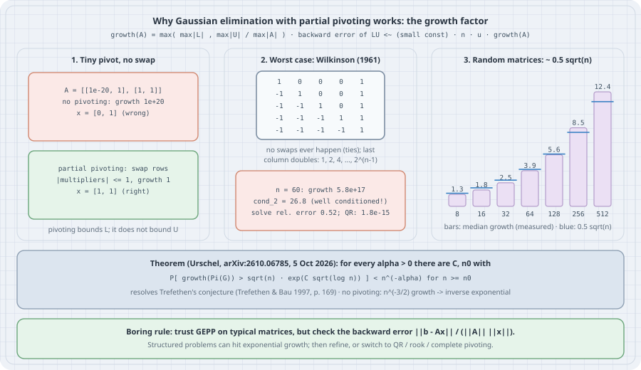

# Why Gaussian Elimination with Partial Pivoting Works

Almost every dense linear solver you have used — `numpy.linalg.solve`, MATLAB's and Julia's backslash on a general matrix, LAPACK's `gesv` underneath all of them — is Gaussian elimination with **partial pivoting** (GEPP). On paper, GEPP is not stable: there are matrices for which its intermediate entries grow by a factor of $2^{n-1}$, which at $n=60$ wipes out every digit of a double-precision answer. In practice, people have run it on billions of matrices for sixty years and almost never seen that happen.

This chapter explains the gap. The quantity that controls it is the **growth factor**. You will compute it by hand on a $2\times 2$ example, watch Wilkinson's worst-case matrix destroy a solve whose condition number is only 27, and measure growth on thousands of random matrices: it comes out near $0.5\sqrt n$, not $2^{n-1}$. Then you will see what John Urschel proved in October 2026, settling a conjecture Trefethen had stated in 1997: for Gaussian random matrices, growth under partial pivoting is rarely much larger than $\sqrt n$. The trap is reading that theorem as "GEPP is always safe".

All listings run on **CPython 3.13.5** with NumPy 2.5.4 and SciPy 1.18.1 in a venv (`uv venv && uv pip install numpy scipy`). The random experiments use fixed seeds and take under a minute.

## 1. Mental model: errors are bounded by how big the numbers get

{fig-alt="The growth factor of Gaussian elimination. Definition: growth(A) = max(max|L|, max|U| / max|A|); the backward error of the computed LU is bounded by a small multiple of n times unit roundoff times the growth factor. Panel 1: without pivoting a tiny pivot 1e-20 gives growth 1e20 and the wrong answer; partial pivoting swaps rows and gives growth 1. Panel 2: the worst case for partial pivoting is Wilkinson's matrix, 1 on the diagonal, -1 below, last column ones; every step doubles the last column so growth is 2^(n-1); at n = 60 the solve has relative error about 0.5 although the matrix has condition number about 27. Panel 3: Gaussian random matrices: median growth under partial pivoting measured here is about 0.5 sqrt(n), from 1.3 at n = 8 to 12.4 at n = 512; without pivoting growth scales like n^(3/2) with an inverse-exponential limit law. Bottom: Urschel, October 2026, proved P[growth(PG) > sqrt(n) exp(C sqrt(log n))] < n^(-alpha), resolving Trefethen's 1997 conjecture."}

Elimination factors $PA = LU$, where $P$ is a permutation, $L$ is unit lower triangular and $U$ is upper triangular. In floating point, each update $a_{ij}\leftarrow a_{ij} - \ell_{ik}u_{kj}$ makes a rounding error proportional to the size of the numbers involved. Higham's analysis (*Accuracy and Stability of Numerical Algorithms*, ch. 9) turns that into a backward-error statement: the computed solution exactly solves $(A+\Delta A)\hat x=b$ with

$$
\frac{\|\Delta A\|}{\|A\|}\;\lesssim\; c(n)\,u\,\cdot \mathrm{growth}(A),
$$

where $u = 2^{-53}$ is the unit roundoff and $c(n)$ is a modest polynomial in $n$. Urschel's paper uses the definition

$$
\mathrm{growth}(A)=\max\!\left(\|L\|_{\max},\ \frac{\|U\|_{\max}}{\|A\|_{\max}}\right),
$$

with $\|\cdot\|_{\max}$ the largest entry in absolute value. Everything else in the bound is small, so **the growth factor is the stability of Gaussian elimination**. Partial pivoting picks the largest $|a_{ik}|$ in the current column as the pivot. That makes every multiplier satisfy $|\ell_{ik}|\le 1$, so $\|L\|_{\max}=1$. It does nothing to bound $U$ directly. A simple induction shows each step can at most double the largest entry, which gives $\mathrm{growth}\le 2^{n-1}$.

## 2. The tiny pivot: why pivot at all

```python
# ge.py: Gaussian elimination with and without partial pivoting, and its growth factor
import numpy as np


def lu(A, pivot=True):
    """Return perm, L, U with A[perm] = L @ U. Ties in the pivot search go to the first row."""
    U = np.array(A, dtype=float)
    n = U.shape[0]
    L = np.eye(n)
    perm = np.arange(n)
    for k in range(n - 1):
        if pivot:
            p = k + int(np.argmax(np.abs(U[k:, k])))     # largest |entry| in column k
            if p != k:
                U[[k, p], k:] = U[[p, k], k:]
                L[[k, p], :k] = L[[p, k], :k]
                perm[[k, p]] = perm[[p, k]]
        L[k + 1:, k] = U[k + 1:, k] / U[k, k]
        U[k + 1:, k:] -= np.outer(L[k + 1:, k], U[k, k:])
        U[k + 1:, k] = 0.0
    return perm, L, U


def growth(A, pivot=True):
    """Urschel's definition: max(||L||_max, ||U||_max / ||A||_max)."""
    _, L, U = lu(A, pivot)
    return max(np.abs(L).max(), np.abs(U).max() / np.abs(A).max())


def solve(A, b, pivot=True):
    perm, L, U = lu(A, pivot)
    return backward(U, forward(L, b[perm]))


def forward(L, b):
    y = np.zeros_like(b)
    for i in range(len(b)):
        y[i] = b[i] - L[i, :i] @ y[:i]
    return y


def backward(U, y):
    x = np.zeros_like(y)
    for i in reversed(range(len(y))):
        x[i] = (y[i] - U[i, i + 1:] @ x[i + 1:]) / U[i, i]
    return x


if __name__ == "__main__":
    eps = 1e-20
    A = np.array([[eps, 1.0], [1.0, 1.0]])
    b = np.array([1.0, 2.0])                       # exact solution is very close to (1, 1)
    for pivot in (False, True):
        x = solve(A, b, pivot)
        print(f"pivot={pivot!s:5}  growth={growth(A, pivot):.3e}  x={x}")
```

```bash
python ge.py
```

Output:

```text
pivot=False  growth=1.000e+20  x=[0. 1.]
pivot=True   growth=1.000e+00  x=[1. 1.]
```

Without pivoting, the multiplier is $1/10^{-20}=10^{20}$, $U_{22}=1-10^{20}$ rounds to $-10^{20}$, and the information in the "1" is gone. The growth factor reports exactly that: $10^{20}$. Swapping the rows first gives a multiplier of $10^{-20}$, growth 1, and the right answer. This is the textbook reason for pivoting. The rest of the chapter asks whether pivoting is *enough*.

## 3. Wilkinson's matrix: the worst case is real

Wilkinson (1961) gave a matrix that reaches the $2^{n-1}$ bound: 1 on the diagonal, −1 everywhere below it, and a last column of ones. Every subdiagonal entry in the pivot column has magnitude 1, equal to the pivot, so partial pivoting (ties go to the first row, as in LAPACK) never swaps. Each step adds the pivot row to every row below it, which doubles the last column: $1, 2, 4, \dots, 2^{n-1}$.

```python
# wilkinson.py: the matrix that makes partial pivoting double every entry, every step
import numpy as np
import scipy.linalg as sla

from ge import growth


def wilkinson(n):
    W = np.eye(n) - np.tril(np.ones((n, n)), -1)   # 1 on the diagonal, -1 below it
    W[:, -1] = 1.0                                 # last column all ones
    return W


print(wilkinson(5))
print()
rng = np.random.default_rng(0)
print(f"{'n':>3} {'growth':>10} {'2^(n-1)':>10} {'cond_2':>8} {'rel. error':>11} {'backward err':>13}")
for n in (10, 30, 50, 55, 60, 64):
    W = wilkinson(n)
    x = rng.standard_normal(n)
    b = W @ x
    xh = np.linalg.solve(W, b)                     # LAPACK gesv: LU with partial pivoting
    err = np.linalg.norm(xh - x) / np.linalg.norm(x)
    berr = np.linalg.norm(b - W @ xh) / (np.linalg.norm(W, 2) * np.linalg.norm(xh))
    print(f"{n:3d} {growth(W):10.3e} {2.0 ** (n - 1):10.3e} {np.linalg.cond(W):8.1f} {err:11.2e} {berr:13.2e}")

n = 60
W = wilkinson(n)
x = rng.standard_normal(n)
b = W @ x
Q, R = np.linalg.qr(W)                             # Householder QR: no growth problem
xq = sla.solve_triangular(R, Q.T @ b)
print(f"\nn=60 via QR: rel. error {np.linalg.norm(xq - x) / np.linalg.norm(x):.2e}")
```

```bash
python wilkinson.py
```

Output:

```text
[[ 1.  0.  0.  0.  1.]
 [-1.  1.  0.  0.  1.]
 [-1. -1.  1.  0.  1.]
 [-1. -1. -1.  1.  1.]
 [-1. -1. -1. -1.  1.]]

  n     growth    2^(n-1)   cond_2  rel. error  backward err
 10  5.120e+02  5.120e+02      4.4    1.11e-14      2.78e-15
 30  5.369e+08  5.369e+08     13.3    4.04e-09      4.83e-10
 50  5.629e+14  5.629e+14     22.3    1.89e-03      1.08e-04
 55  1.801e+16  1.801e+16     24.6    2.56e-02      1.40e-03
 60  5.765e+17  5.765e+17     26.8    5.23e-01      3.10e-02
 64  9.223e+18  9.223e+18     28.6    2.77e-01      3.46e-02

n=60 via QR: rel. error 1.84e-15
```

Read the columns together:

- **The growth is exactly $2^{n-1}$** at every size. The bound is attained.
- **The matrix is well conditioned.** $\kappa_2$ is below 30 even at $n=64$. Nothing about the *problem* is hard. The algorithm is what fails.
- **The error tracks $u\cdot\mathrm{growth}$.** At $n=50$ the growth is $5.6\times10^{14}$, and $u\cdot\mathrm{growth}\approx 0.06$. The observed relative error is $1.9\times10^{-3}$. By $n=60$, about half the solution is wrong, from `numpy.linalg.solve` with no warning.
- **The backward error notices.** $\|b-A\hat x\|/(\|A\|\,\|\hat x\|)$ rises from $10^{-15}$ to $3\times10^{-2}$. A residual check catches this failure, even though nothing else would.
- **A different algorithm does not have the problem.** Householder QR is backward stable with no growth factor and solves the $n=60$ system to $1.8\times 10^{-15}$, at about twice the flops of LU.

## 4. Random matrices: about $0.5\sqrt n$, not $2^{n-1}$

Trefethen and Schreiber (1990) ran GEPP on large numbers of random matrices and found growth near $n^{1/2}$ for Gaussian entries. In the 1997 textbook with Bau (Lecture 22), Trefethen wrote that observation down as a conjecture. To repeat the experiment at scale, the next listing eliminates whole batches of matrices at once. Each step's pivot search, row swap and rank-one update is a NumPy operation over the batch axis. It is checked against `ge.py` below.

```python
# batch_growth.py: growth factors of many Gaussian matrices at once (vectorised elimination)
import numpy as np


def batch_growth(A, pivot=True):
    """A: (B, n, n). Returns max(||L||_max, ||U||_max / ||A||_max) for each matrix."""
    U = A.copy()
    B, n, _ = U.shape
    rows = np.arange(B)
    Lmax = np.ones(B)
    for k in range(n - 1):
        if pivot:
            p = k + np.argmax(np.abs(U[:, k:, k]), axis=1)
            tmp = U[rows, k, k:].copy()
            U[rows, k, k:] = U[rows, p, k:]
            U[rows, p, k:] = tmp
        l = U[:, k + 1:, k] / U[:, k, k][:, None]
        Lmax = np.maximum(Lmax, np.abs(l).max(axis=1))
        U[:, k + 1:, k:] -= l[:, :, None] * U[:, k, None, k:]
        U[:, k + 1:, k] = 0.0
    Umax = np.abs(np.triu(U)).max(axis=(1, 2))
    return np.maximum(Lmax, Umax / np.abs(A).max(axis=(1, 2)))
```

```python
# random_growth.py: partial pivoting on Gaussian matrices grows like sqrt(n), not 2^(n-1)
import math
import time

import numpy as np

from batch_growth import batch_growth

rng = np.random.default_rng(2026)
t0 = time.perf_counter()
print("partial pivoting, G with iid N(0,1) entries")
print(f"{'n':>4} {'samples':>7} {'median':>8} {'median/sqrt(n)':>15} {'max seen':>9} {'max/sqrt(n)':>12} {'log g / log n':>14}")
for n, B in ((8, 4000), (16, 4000), (32, 2000), (64, 1000), (128, 300), (256, 80), (512, 20)):
    g = batch_growth(rng.standard_normal((B, n, n)), pivot=True)
    med = float(np.median(g))
    print(f"{n:4d} {B:7d} {med:8.2f} {med / math.sqrt(n):15.3f} {g.max():9.2f} {g.max() / math.sqrt(n):12.3f}"
          f" {math.log(med) / math.log(n):14.3f}")

print("\nno pivoting, n = 64: Urschel's Theorem 1.3 says n^(-3/2) growth -> X, P[X <= x] = exp(-c/x), c = 2/(3 sqrt(pi))")
n, B = 64, 20000
x = np.sort(batch_growth(rng.standard_normal((B, n, n)), pivot=False) / n ** 1.5)
c = 2 / (3 * math.sqrt(math.pi))
emp = np.arange(1, B + 1) / B
print(f"  samples {B}, KS distance to the limit law: {np.abs(emp - np.exp(-c / x)).max():.4f}")
for q in (0.5, 0.9, 0.99):
    print(f"  quantile {q:4}: empirical {np.quantile(x, q):8.3f}   limit law {c / -math.log(q):8.3f}")
print(f"  largest no-pivot growth seen: {x[-1] * n ** 1.5:.3e}")
print(f"elapsed {time.perf_counter() - t0:.0f} s")
```

```bash
python random_growth.py
```

Output:

```text
partial pivoting, G with iid N(0,1) entries
   n samples   median  median/sqrt(n)  max seen  max/sqrt(n)  log g / log n
   8    4000     1.30           0.458      4.01        1.419          0.125
  16    4000     1.77           0.442      5.34        1.334          0.206
  32    2000     2.55           0.451      6.74        1.192          0.270
  64    1000     3.85           0.481     10.95        1.369          0.324
 128     300     5.58           0.493     10.44        0.923          0.354
 256      80     8.49           0.531     13.76        0.860          0.386
 512      20    12.38           0.547     16.07        0.710          0.403

no pivoting, n = 64: Urschel's Theorem 1.3 says n^(-3/2) growth -> X, P[X <= x] = exp(-c/x), c = 2/(3 sqrt(pi))
  samples 20000, KS distance to the limit law: 0.0103
  quantile  0.5: empirical    0.536   limit law    0.543
  quantile  0.9: empirical    3.495   limit law    3.570
  quantile 0.99: empirical   35.599   limit law   37.424
  largest no-pivot growth seen: 1.795e+06
elapsed 27 s
```

Two regimes, measured:

- **With partial pivoting**, the median growth is $0.44$–$0.55\sqrt n$ over a 64-fold range of sizes, and the largest value in thousands of samples is about $1.4\sqrt n$. At $n=512$ that is 16, against a worst case of $2^{511}$. The last column, $\log g/\log n$, creeps up toward $1/2$ but slowly, because $\log(0.5\sqrt n)/\log n = 1/2 - \log 2/\log n$, which is still $0.39$ at $n=512$. Urschel's Corollary 1.5 says this ratio tends to $1/2$ in probability.
- **Without pivoting**, growth is about $n^{3/2}$ times a heavy-tailed random variable. Urschel's Theorem 1.3 identifies the limit law as an inverse exponential, $\Pr[X\le x]=e^{-c/x}$ with $c = 2/(3\sqrt\pi)$ (his Figure 1 uses $n=64$). Our 20,000 samples at $n=64$ sit within KS distance $0.01$ of it, and the 99% quantile is about 36, which is $36\cdot 64^{3/2}\approx 18{,}000$. The largest sample was $1.8\times10^{6}$. Random matrices do not need pivoting for their *typical* case. They need it for the tail.

A check that the vectorised code agrees with the one-matrix-at-a-time `ge.py`, which you should always run before trusting a batched rewrite:

```python
# check_batch.py: the batched elimination must agree exactly with ge.py
import numpy as np

from batch_growth import batch_growth
from ge import growth

A = np.random.default_rng(1).standard_normal((50, 20, 20))
for pivot in (True, False):
    batched = batch_growth(A, pivot)
    single = np.array([growth(a, pivot) for a in A])
    print(f"pivot={pivot!s:5}  max |batched - single| = {np.abs(batched - single).max():.1e}")
```

```bash
python check_batch.py
```

Output:

```text
pivot=True   max |batched - single| = 0.0e+00
pivot=False  max |batched - single| = 0.0e+00
```

## 5. The 2026 theorem

Urschel's main result (*On the Growth Factor of Random Matrices*, arXiv:2610.06785, 5 October 2026, Theorem 1.4): for every $\alpha>0$ there are constants $C_\alpha, n_\alpha$ such that, for an $n\times n$ Gaussian matrix $G$ and the partial-pivoting map $\Pi$,

$$
\Pr\!\left[\mathrm{growth}(\Pi(G)) > \sqrt n\, e^{C_\alpha\sqrt{\log n}}\right] < n^{-\alpha}\qquad (n\ge n_\alpha).
$$

Since $e^{C\sqrt{\log n}}$ grows more slowly than any power $n^{c}$, this implies Trefethen's Conjecture 1.1: $\Pr[\mathrm{growth}>n^{1/2+\alpha}]<n^{-M}$ for every $\alpha, M>0$ once $n$ is large. Trefethen had offered \$1000 for a resolution. The exponent $1/2$ is sharp, because $\|U\|_{\max}$ is at least about $|\det G|^{1/n}$, which is of order $\sqrt n$. Some context from the paper's introduction:

- Before this, the best rigorous bound was Huang and Tikhomirov's $n^{c}$ with high probability, for a large unspecified $c$.
- Trefethen released his own long-unpublished argument for the *last* pivot $|U_{nn}|$ in parallel.
- The same technique improves the **smoothed analysis** of GEPP (Theorem 1.6). Any matrix plus a polynomially small Gaussian perturbation has growth $n^{O(\log\log n)}$, down from Sankar's $n^{O(\log n)}$. This is the result that speaks to *non-random* inputs. Adversarial matrices like Wilkinson's are fragile: almost any perturbation destroys their growth.
- The proof works in exact arithmetic, as almost all growth-factor results do. The paper notes that for Gaussian matrices, floating point raises the growth by at most a small constant factor with high probability.

At the time of writing, the paper is a single-author preprint that has not been refereed. The numbers in section 4 agree with it, but numerical agreement is not a proof.

## 6. The trap: "it is proved, so GEPP is always stable"

The theorem is about *Gaussian random* matrices, and through Theorem 1.6 about matrices with random noise added. It says nothing about the structured matrices that real problems produce. There are documented natural failures. Wright (1993) showed exponential growth in GEPP for matrices from multiple-shooting methods for two-point boundary value problems. Foster (1994) did the same for a discretised Volterra integral equation. In both cases a modelling problem produced Wilkinson-like structure, and GEPP returned garbage with a small condition number, exactly as in section 3. Two mistakes are common:

1. **Checking the condition number instead of the backward error.** $\kappa(A)$ measures how hard the *problem* is. Growth measures how badly the *algorithm* did. Section 3 has $\kappa<30$ and relative error $0.5$.
2. **Trusting `solve` because it did not raise an error.** LAPACK reports only exact zero pivots (`info > 0`). Growth of $10^{17}$ is not an error condition.

The boring rules:

1. **Compute the normwise backward error** $\eta=\|b-A\hat x\|/(\|A\|\,\|\hat x\|+\|b\|)$ for any solve whose answer matters. It costs one matrix–vector product. If $\eta\gg n u$, do not use the answer.
2. **Fix it with something cheap first.** One or two steps of iterative refinement ($r=b-A\hat x$, solve $Ad=r$ with the same LU, $\hat x\leftarrow\hat x+d$) recover a backward-stable solution in most moderate-growth cases. If they do not, switch to QR, or to rook or complete pivoting.
3. **For structured problem families** (shooting, Volterra, anything with a long one-directional coupling), estimate the growth once from $\|U\|_{\max}/\|A\|_{\max}$, which is free from the factorization, and pick the solver from that.
4. **Treat the 2026 theorem as an explanation of typical behaviour**, not as a guarantee for your matrix.

## 7. Try this

1. Run `wilkinson.py` with one step of iterative refinement after `np.linalg.solve`. At which $n$ does refinement stop helping, and why does it stop?
2. Add a perturbation $W+10^{-8}G$ to Wilkinson's matrix and measure the growth for $n=60$. Relate the result to Theorem 1.6.
3. Implement **rook pivoting** (alternately search the pivot's row and column until the entry is maximal in both) in `ge.py`, and compare its growth on Wilkinson's matrix and on random matrices.
4. Repeat section 4 with $\pm1$ entries instead of Gaussian ones. Does the median growth still look like $c\sqrt n$? What happens to the no-pivoting tail? (Ties in the pivot search now occur with positive probability.)
5. Use `batch_growth` to estimate $\Pr[\mathrm{growth}>3\sqrt n]$ for $n=32$ with 20,000 samples. How does that compare with the theorem's $n^{-\alpha}$ shape?

## Checkpoint

- Define the growth factor and explain why it, rather than $\kappa(A)$, controls the backward error of LU.
- Explain why partial pivoting gives $\|L\|_{\max}\le 1$ but only $\mathrm{growth}\le 2^{n-1}$.
- Build Wilkinson's matrix and explain why partial pivoting never swaps on it.
- State Trefethen's conjecture and the form of Urschel's 2026 theorem.
- Give a cheap test that detects a growth-induced failure after the fact.

## Summary

Gaussian elimination is exactly as stable as the numbers it creates are small. Partial pivoting bounds the multipliers but not the growth, and Wilkinson's matrix shows the $2^{n-1}$ worst case is real: a condition number under 30 and half the answer wrong at $n=60$. On random matrices, the growth measured here is about $0.5\sqrt n$, and Urschel's October 2026 preprint proves that it is rarely much larger than $\sqrt n$, resolving Trefethen's conjecture. Use that as the reason GEPP works in practice, and keep checking the backward error, because your matrix is not drawn from a Gaussian distribution.

## Sources

- J. Urschel, "On the Growth Factor of Random Matrices", [arXiv:2610.06785](https://arxiv.org/abs/2610.06785), 5 October 2026 (definition of growth; Conjecture 1.1; Theorems 1.3, 1.4, 1.6; Corollary 1.5; Figure 1).
- L. N. Trefethen, R. S. Schreiber, "Average-case stability of Gaussian elimination", *SIAM J. Matrix Anal. Appl.* 11(3):335–360, 1990, [doi:10.1137/0611023](https://doi.org/10.1137/0611023).
- L. N. Trefethen, D. Bau III, *Numerical Linear Algebra*, SIAM, 1997, Lectures 20–22 (Lecture 22: stability of Gaussian elimination, p. 169).
- J. H. Wilkinson, "Error analysis of direct methods of matrix inversion", *J. ACM* 8(3):281–330, 1961.
- N. J. Higham, *Accuracy and Stability of Numerical Algorithms*, 2nd ed., SIAM, 2002, ch. 9 (LU backward error and the growth factor).
- S. J. Wright, "A collection of problems for which Gaussian elimination with partial pivoting is unstable", *SIAM J. Sci. Comput.* 14(1):231–238, 1993. L. V. Foster, "Gaussian elimination with partial pivoting can fail in practice", *SIAM J. Matrix Anal. Appl.* 15(4):1354–1362, 1994.
- NumPy 2.5 documentation, [`numpy.linalg.solve`](https://numpy.org/doc/stable/reference/generated/numpy.linalg.solve.html) (computed with LAPACK `_gesv`).
