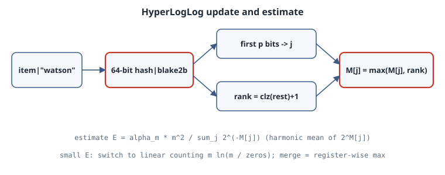

# HyperLogLog: Counting Distinct Items in a Few Kilobytes

## Thesis

Counting distinct items exactly needs memory proportional to the number of distinct items, because you have to remember what you have already seen. **HyperLogLog** (Flajolet, Fusy, Gandouet and Meunier, 2007) gives up exactness for a fixed, tiny memory budget. With $m = 2^p$ small registers, its relative standard error is about $1.04/\sqrt{m}$. Redis's implementation, for example, uses up to 12 KB and documents a standard error of 0.81%. Sketches also **merge**: the sketch of a union is the register-wise maximum of the two sketches. That is why HLL appears in databases, analytics pipelines and network monitors. This chapter builds HLL from scratch and checks that error law empirically.

## Mental model

{fig-alt="An item is hashed to 64 bits. The first p bits choose one of m = 2^p registers; the rank is one plus the number of leading zeros in the remaining bits. The register keeps the maximum rank it has seen. The estimate is alpha times m squared divided by the sum of 2 to the minus register values."}

**The coin-flip intuition.** Hash each item to a uniform bit string. A run of $k$ leading zeros occurs with probability $2^{-k}$, so if the longest run among $n$ distinct items is $R$, then $2^R$ is a (very noisy) estimate of $n$. Duplicates hash identically, so they never change anything. That is what makes the count *distinct*.

**Stochastic averaging.** A single maximum has huge variance. Use the first $p$ bits of the hash to choose one of $m = 2^p$ registers, and keep a separate maximum $M[j]$ in each. Each register sees about $n/m$ items.

**Harmonic mean.** Combine the registers as

$$
E = \alpha_m \, m^2 \Big/ \sum_{j=1}^{m} 2^{-M[j]}, \qquad \alpha_m \approx \frac{0.7213}{1 + 1.079/m} \quad (m \ge 128).
$$

The harmonic mean damps the effect of a few registers that happened to see a very long run. The constant $\alpha_m$ corrects the remaining multiplicative bias.

**Small range.** When $n$ is small compared with $m$, many registers are still zero and $E$ is biased. Then HLL switches to *linear counting*, $m \ln(m/V)$, where $V$ is the number of empty registers. The original paper uses this rule when $E \le 2.5m$. With 64-bit hashes, the paper's large-range correction for 32-bit hash collisions isn't needed. Heule, Nunkesser and Hall's HyperLogLog++ makes the same choice.

**Memory.** A 64-bit hash leaves at most $64 - p + 1$ possible rank values, so 6 bits per register suffice. That gives $p=14$: $16384 \times 6$ bits $= 12{,}288$ bytes.

## Worked example

The sketch is vectorized with NumPy. The register index is the top $p$ bits of the hash. The rank comes from an exact integer count-leading-zeros on the remaining bits. A sentinel bit caps the rank at $64-p+1$. Updates use `np.maximum.at` so that repeated indices are handled correctly. Part 1 uses random 64-bit integers as ideal hashes, 20 trials per cell. Part 2 hashes the words of *The Adventures of Sherlock Holmes* (Project Gutenberg #1661) with BLAKE2b. Part 3 checks merging.

```python
# hll.py -- HyperLogLog from scratch: registers, estimator, error, merging
import hashlib, math, re
import numpy as np

def alpha(m):
    return {16: 0.673, 32: 0.697, 64: 0.709}.get(m, 0.7213 / (1 + 1.079 / m))

class HLL:
    def __init__(self, p):
        self.p, self.m = p, 1 << p
        self.reg = np.zeros(self.m, np.uint8)

    def add_hashes(self, h):                     # h: uint64 array of uniform hashes
        idx = (h >> np.uint64(64 - self.p)).astype(np.int64)            # first p bits pick a register
        rest = (h << np.uint64(self.p)) | np.uint64(1 << (self.p - 1))  # sentinel bounds the rank
        # rank = 1 + number of leading zeros in the remaining 64-p bits
        lz = np.zeros(len(h), np.int64); r = rest.copy()
        for shift in (32, 16, 8, 4, 2, 1):                              # exact integer clz
            top = r >> np.uint64(64 - shift)
            z = top == 0
            lz += np.where(z, shift, 0); r = np.where(z, r << np.uint64(shift), r)
        rank = (lz + 1).astype(np.uint8)
        np.maximum.at(self.reg, idx, rank)

    def estimate(self):
        m = self.m
        raw = alpha(m) * m * m / np.sum(2.0 ** -self.reg.astype(np.float64))
        zeros = int(np.count_nonzero(self.reg == 0))
        if raw <= 2.5 * m and zeros:                                    # small range: linear counting
            return m * math.log(m / zeros)
        return raw

    def merge(self, other):
        out = HLL(self.p); out.reg = np.maximum(self.reg, other.reg); return out

def word_hashes(words):
    return np.array([int.from_bytes(hashlib.blake2b(w.encode(), digest_size=8).digest(), "big")
                     for w in words], dtype=np.uint64)

# 1) Error vs the 1.04/sqrt(m) prediction, with random 64-bit hashes
rng = np.random.default_rng(2026)
print("p      m  bytes(6-bit regs)  n         mean rel.err  rms rel.err  1.04/sqrt(m)")
for p in (8, 12, 14):
    for n in (1_000, 100_000, 1_000_000):
        errs = []
        for _ in range(20):
            s = HLL(p); s.add_hashes(rng.integers(0, 2**64, size=n, dtype=np.uint64))
            errs.append(s.estimate() / n - 1)
        errs = np.array(errs)
        print(f"{p:2d} {1<<p:6d} {(1<<p)*6//8:10d}       {n:9d}  {errs.mean():+10.4f}   "
              f"{np.sqrt((errs**2).mean()):10.4f}   {1.04/math.sqrt(1<<p):10.4f}")

# 2) Real data: distinct words in The Adventures of Sherlock Holmes
words = re.findall(r"[a-z']+", open("holmes.txt", encoding="utf-8").read().lower())
hw = word_hashes(words)
s = HLL(12); s.add_hashes(hw)
print(f"\nwords {len(words)}, exact distinct {len(set(words))}, HLL p=12 estimate {s.estimate():.0f}")

# 3) Merging: the sketch of a union is the register-wise max
half = len(words) // 2
a, b = HLL(12), HLL(12)
a.add_hashes(hw[:half]); b.add_hashes(hw[half:])
exact_union = len(set(words[:half]) | set(words[half:]))
print(f"first half {len(set(words[:half]))} ~ {a.estimate():.0f}, second half "
      f"{len(set(words[half:]))} ~ {b.estimate():.0f}, union {exact_union} ~ {a.merge(b).estimate():.0f}, "
      f"registers identical to one-pass sketch: {np.array_equal(a.merge(b).reg, s.reg)}")
```

Output (CPython 3.15.0, NumPy 2.5.4, about 4 s):

```text
p      m  bytes(6-bit regs)  n         mean rel.err  rms rel.err  1.04/sqrt(m)
 8    256        192            1000     +0.0036       0.0504       0.0650
 8    256        192          100000     -0.0004       0.0676       0.0650
 8    256        192         1000000     -0.0101       0.0702       0.0650
12   4096       3072            1000     -0.0009       0.0119       0.0163
12   4096       3072          100000     +0.0032       0.0154       0.0163
12   4096       3072         1000000     -0.0049       0.0154       0.0163
14  16384      12288            1000     -0.0004       0.0055       0.0081
14  16384      12288          100000     +0.0003       0.0063       0.0081
14  16384      12288         1000000     -0.0002       0.0076       0.0081

words 108922, exact distinct 8069, HLL p=12 estimate 8056
first half 5744 ~ 5833, second half 5473 ~ 5510, union 8069 ~ 8056, registers identical to one-pass sketch: True
```

### Reading the output

- **The error law holds.** For large $n$ the RMS relative error tracks $1.04/\sqrt{m}$: 0.070 vs 0.065 at $p=8$, 0.0154 vs 0.0163 at $p=12$, 0.0076 vs 0.0081 at $p=14$. With 20 trials, the RMS estimates are themselves only accurate to roughly ±15%, so these values agree with the law.
- **Memory doesn't grow with $n$.** Going from a thousand to a million distinct items changes nothing about the sketch's size.
- **Small $n$ is *better* than the law.** At $n = 1000$ the linear-counting branch takes over, and the error falls below $1.04/\sqrt{m}$ (0.0055 at $p=14$). That is the reason the small-range correction exists.
- **No visible bias.** Mean relative errors stay within about ±1%, and are mostly much smaller, so the $\alpha_m$ correction is doing its job.
- **Real data behaves like ideal hashes.** The book has 108,922 words and 8,069 distinct ones. A 3 KB sketch estimates 8,056, an error of −0.16%.
- **Merging is exact at the sketch level.** The sketch of the two halves merged by register-wise max is *identical* to the one-pass sketch, so it gives the same estimate (8,056). A distributed system can count each shard separately and combine the sketches without moving any data.

## Pitfalls

- **Bad hashes break everything.** The analysis assumes uniform, independent hash bits. Python's built-in `hash()` is randomized per process for strings, and it is the identity for small integers. Use a real hash function such as BLAKE2b, xxHash or MurmurHash3.
- **Intersections are not free.** Unions merge exactly, but $|A \cap B| = |A| + |B| - |A \cup B|$ subtracts two large noisy estimates from each other. The relative error of a small intersection can be enormous.
- **Precision is fixed at creation.** You can merge only sketches with the same $p$ (or fold a larger $p$ down to a smaller one), so choose $p$ up front.
- **Error is relative, not absolute.** 1% of a billion is ten million. Make sure the downstream decision can tolerate that.

## Exercises

1. Show that the probability of at least $k$ leading zeros in a uniform 64-bit string is $2^{-k}$, and use it to argue why $2^{\max}$ grows like $n$.
2. Remove the linear-counting branch and re-run Part 1. How large is the error at $n=1000$, $p=14$?
3. Implement *folding*: convert a $p=14$ sketch to $p=12$ by taking the max over each group of 4 registers. (Watch out: the top two bits of the rest become index bits, so the ranks need adjusting.) Compare the result with a sketch built directly at $p=12$.
4. Estimate $|A \cap B|$ for two word sets that share only 100 words, using inclusion–exclusion on sketches with $p=12$. How large is the relative error?

## Sources

- P. Flajolet, É. Fusy, O. Gandouet, F. Meunier, "HyperLogLog: the analysis of a near-optimal cardinality estimation algorithm," *AofA 2007*, DMTCS Proceedings. <https://algo.inria.fr/flajolet/Publications/FlFuGaMe07.pdf>
- S. Heule, M. Nunkesser, A. Hall, "HyperLogLog in Practice: Algorithmic Engineering of a State of The Art Cardinality Estimation Algorithm," *EDBT 2013*. <https://research.google/pubs/hyperloglog-in-practice-algorithmic-engineering-of-a-state-of-the-art-cardinality-estimation-algorithm/>
- K.-Y. Whang, B. T. Vander-Zanden, H. M. Taylor, "A linear-time probabilistic counting algorithm for database applications," *ACM TODS* 15(2), 1990 (linear counting).
- Redis documentation, [HyperLogLog](https://redis.io/docs/latest/develop/data-types/probabilistic/hyperloglogs/): 12 KB, 0.81% standard error.
- Python [`hashlib.blake2b`](https://docs.python.org/3/library/hashlib.html#blake2) and NumPy [`ufunc.at`](https://numpy.org/doc/stable/reference/generated/numpy.ufunc.at.html).
