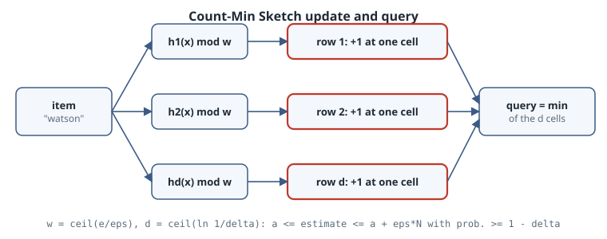

# Count-Min Sketch: Frequencies with a Provable Error Bound

## Thesis

A [Bloom filter](../10-information-theory/05-bloom-filters.qmd) answers "have I seen $x$?" in fixed memory. The **Count-Min Sketch** (Cormode and Muthukrishnan, 2005) answers "*how many times* have I seen $x$?" It stores $d \times w$ counters, never underestimates, and comes with a clean guarantee. With $w = \lceil e/\varepsilon \rceil$ and $d = \lceil \ln(1/\delta) \rceil$, every estimate satisfies $a_x \le \hat a_x \le a_x + \varepsilon N$ with probability at least $1-\delta$, where $N$ is the total stream length. Memory depends on $\varepsilon$ and $\delta$, not on how many distinct items the stream contains. This chapter proves the bound, then checks it on a real word stream.

## Mental model

{fig-alt="An item is hashed by d independent hash functions, one per row of a d by w table of counters. An update adds one to the chosen cell in every row. A query reads the same d cells and returns the minimum, which never underestimates and overestimates by at most epsilon N with probability at least 1 minus delta when w is e over epsilon and d is ln of 1 over delta."}

**Update.** For item $x$, add 1 to cell $T[i, h_i(x)]$ in each row $i = 1..d$.

**Query.** Return $\hat a_x = \min_i T[i, h_i(x)]$.

**Why it never underestimates.** Every occurrence of $x$ incremented every one of its $d$ cells, so each cell is at least $a_x$.

**Why it rarely overestimates by much.** In row $i$, the excess $X_i = T[i,h_i(x)] - a_x$ is the total count of the *other* items that collide with $x$. With pairwise-independent hashing, each other item lands in $x$'s cell with probability $1/w$, so $\mathbb{E}[X_i] \le N/w = \varepsilon N / e$. By Markov's inequality, $\Pr[X_i > \varepsilon N] \le 1/e$. The rows are independent, and the minimum exceeds $\varepsilon N$ only if *every* row does:

$$
\Pr[\hat a_x > a_x + \varepsilon N] \le e^{-d} \le \delta.
$$

**Two useful variants.**

- *Conservative update* (Estan and Varghese, 2002) raises only the cells that are at the current minimum. That never makes an estimate worse and usually makes it much better, but it gives up linearity (see Pitfalls).
- *Linearity.* With plain updates, the sketch is a linear map of the frequency vector. Sketches of two streams can be **added** cell by cell, and the sum is the sketch of the combined stream.

## Worked example

The stream is every word of *The Adventures of Sherlock Holmes* (Project Gutenberg #1661). The $d$ row hashes are taken from one BLAKE2b digest. The script sweeps $\varepsilon$ with $\delta = 0.01$ (so $d = 5$), compares standard and conservative updates against exact counts, recovers the top-10 words, and checks that sketches merge by addition.

```python
"""Count-Min Sketch on real text: error vs the eps*N guarantee, conservative update, heavy hitters."""
import hashlib, math, re
from collections import Counter
import numpy as np

words = re.findall(r"[a-z']+", open("holmes.txt", encoding="utf-8").read().lower())
N, exact = len(words), Counter(words)
print(f"stream N = {N} words, {len(exact)} distinct (an exact Counter needs {len(exact)} keys)\n")

def rows_for(word, d, w):
    """d independent hash positions from one 8*d-byte BLAKE2b digest."""
    h = hashlib.blake2b(word.encode(), digest_size=8 * d).digest()
    return [int.from_bytes(h[8 * i:8 * i + 8], "little") % w for i in range(d)]

class CountMin:
    def __init__(self, eps, delta, conservative=False):
        self.w, self.d = math.ceil(math.e / eps), math.ceil(math.log(1 / delta))
        self.T = np.zeros((self.d, self.w), dtype=np.int64)
        self.conservative = conservative
    def add(self, x):
        idx = rows_for(x, self.d, self.w)
        cells = self.T[range(self.d), idx]
        if self.conservative:              # raise only the cells that are at the current minimum
            self.T[range(self.d), idx] = np.maximum(cells, cells.min() + 1)
        else:
            self.T[range(self.d), idx] = cells + 1
    def query(self, x):
        return int(self.T[range(self.d), rows_for(x, self.d, self.w)].min())

delta = 0.01
print(f"{'eps':>6} {'w x d':>9} {'cells':>7} {'eps*N':>7} {'update':>12} "
      f"{'mean err':>9} {'max err':>8} {'P[err>eps*N]':>13} {'exact hits':>10}")
sketches = {}
for eps in [0.01, 0.001, 0.0002]:
    for cons in (False, True):
        cm = CountMin(eps, delta, cons)
        for x in words:
            cm.add(x)
        sketches[eps, cons] = cm
        err = np.array([cm.query(x) - c for x, c in exact.items()])
        assert err.min() >= 0                     # never underestimates
        print(f"{eps:6g} {cm.w:5d}x{cm.d:<3d} {cm.w*cm.d:7d} {eps*N:7.0f} "
              f"{'conservative' if cons else 'standard':>12} {err.mean():9.2f} {err.max():8d} "
              f"{(err > eps*N).mean():13.4f} {(err == 0).mean():10.3f}")

# Heavy hitters: top 10 by sketch estimate (standard update, eps=0.001) vs exact top 10.
cm = sketches[0.001, False]
est_top = sorted(exact, key=cm.query, reverse=True)[:10]
print("\nrank  exact top-10 (count)      sketch top-10 (estimate)")
for r, ((w_, c), w2) in enumerate(zip(exact.most_common(10), est_top), 1):
    print(f"{r:4d}  {w_:>8s} {c:6d}            {w2:>8s} {cm.query(w2):6d}")

# Linearity: sketch(A) + sketch(B) == sketch(A + B), cell for cell.
half = N // 2
a, b, ab = (CountMin(0.001, delta) for _ in range(3))
for x in words[:half]: a.add(x)
for x in words[half:]: b.add(x)
for x in words: ab.add(x)
print("\nmerge by addition identical to one-pass sketch:", np.array_equal(a.T + b.T, ab.T))
```

Output (CPython 3.15.0, NumPy 2.5.4, about 5 s):

```text
stream N = 108922 words, 8069 distinct (an exact Counter needs 8069 keys)

   eps     w x d   cells   eps*N       update  mean err  max err  P[err>eps*N] exact hits
  0.01   272x5      1360    1089     standard    109.43      721        0.0000      0.000
  0.01   272x5      1360    1089 conservative     60.17      527        0.0000      0.011
 0.001  2719x5     13595     109     standard      2.45       32        0.0000      0.235
 0.001  2719x5     13595     109 conservative      0.96       21        0.0000      0.507
0.0002 13592x5     67960      22     standard      0.02        3        0.0000      0.981
0.0002 13592x5     67960      22 conservative      0.00        2        0.0000      0.996

rank  exact top-10 (count)      sketch top-10 (estimate)
   1       the   5822                 the   5826
   2       and   3086                 and   3086
   3         i   3038                   i   3041
   4        to   2826                  to   2826
   5        of   2781                  of   2784
   6         a   2701                   a   2702
   7        in   1826                  in   1827
   8      that   1767                that   1768
   9        it   1749                  it   1753
  10       you   1577                 you   1581

merge by addition identical to one-pass sketch: True
```

### Reading the output

- **The guarantee holds with plenty of margin.** In every configuration, no word's error exceeded $\varepsilon N$, although the bound allows up to $\delta = 1\%$ of queries to. The worst error at $\varepsilon = 0.001$ is 32, against a bound of 109. Markov's inequality is loose, and natural-language word counts are Zipf-skewed: most of the mass sits in a few heavy items, and most cells don't collide with them.
- **Memory follows $\varepsilon$, not the vocabulary.** With 13,595 counters ($\varepsilon=0.001$), the mean error is 2.45 words. Shrinking $\varepsilon$ fivefold (67,960 counters) makes 98% of estimates exact. Every counter here is an `int64` for clarity; real deployments use 32-bit or smaller counters.
- **Conservative update roughly halves the error.** At $\varepsilon=0.001$ the mean error falls from 2.45 to 0.96, and the exact-hit rate rises from 23.5% to 50.7%, with the same memory.
- **Heavy hitters are almost free.** The sketch's top-10 matches the exact top-10 in order. Each estimate is off by at most 4, because a count of 5,822 dwarfs the collision noise. In general, the relative error is $\varepsilon N / a_x$, so it is smallest exactly for the items you care about most.
- **Merging is exact.** The sum of the two half-stream sketches is identical, cell for cell, to the one-pass sketch. That makes sharded and windowed counting easy.

## Pitfalls

- **Light items get swamped.** The error is additive ($\varepsilon N$), so a word seen once can be estimated at hundreds when $\varepsilon = 0.01$ (max error 721 above). Use CMS to find and measure *frequent* items, not to tell 1 from 3.
- **The sketch stores counts, not keys.** We ranked a known vocabulary. On a true stream you also need a candidate heap: keep the current top-$k$ by estimate as items arrive.
- **Conservative update isn't linear.** It doesn't support deletions (negative updates), and summing two conservative sketches isn't the sketch of the combined stream. Choose between accuracy and mergeability.
- **The proof assumes independent hashes.** It needs a pairwise-independent family, chosen independently for each row. Slicing one cryptographic digest works well in practice. Reusing one hash with different moduli, or using Python's `hash()`, does not.
- **Negative updates.** With deletions in a turnstile stream, the minimum is no longer an upper bound in general. Cormode and Muthukrishnan use the *median* estimator for that case.

## Exercises

1. Prove that conservative update never produces an estimate below $a_x$ and never above the standard-update estimate.
2. Fix the memory at 13,600 counters and compare $(w, d) = (13600, 1)$, $(2720, 5)$ and $(1360, 10)$. Which minimizes the mean error on this stream, and which minimizes the max error?
3. Implement streaming heavy hitters: keep a heap of the top 20 by estimate while consuming the stream, and measure recall against the exact top 20.
4. Use the Count-Min estimates to approximate the *inner product* $\sum_x a_x b_x$ of two books' word-frequency vectors (row-wise dot products, then the min). Compare with the exact value.

## Sources

- G. Cormode, S. Muthukrishnan, "An improved data stream summary: the count-min sketch and its applications," *Journal of Algorithms* 55(1):58–75, 2005. <https://doi.org/10.1016/j.jalgor.2003.12.001>
- C. Estan, G. Varghese, "New directions in traffic measurement and accounting," *ACM SIGCOMM 2002* (conservative update).
- M. Charikar, K. Chen, M. Farach-Colton, "Finding frequent items in data streams," *ICALP 2002* (Count Sketch, the signed variant).
- Redis documentation, [Count-min sketch](https://redis.io/docs/latest/develop/data-types/probabilistic/count-min-sketch/) (`CMS.INITBYPROB` takes $\varepsilon$ and $\delta$ directly).
- Python [`hashlib.blake2b`](https://docs.python.org/3/library/hashlib.html#blake2).
