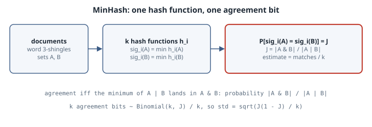

# MinHash: Estimating Jaccard Similarity from Tiny Signatures

## Thesis

To find near-duplicate documents, you compare sets: the sets of word *shingles* (runs of $n$ consecutive words) in each document. The natural measure is the **Jaccard similarity**

$$J(A,B) = \frac{|A \cap B|}{|A \cup B|}.$$

Computing it exactly needs both full sets, for every pair. **MinHash** (Broder, 1997) shrinks each set to $k$ numbers so that the fraction of positions where two signatures agree is an **unbiased** estimate of $J$, with standard deviation $\sqrt{J(1-J)/k}$. The error depends only on $k$ and $J$, not on how big the sets are. This chapter proves the one-line lemma behind it, runs it, and checks the error bound against simulation.

## Mental model

{fig-alt="Pipeline. Text is split into word 3-shingles, giving sets A and B. Each of k random hash functions is applied to every element, and only the minimum per set is kept, giving two signatures of length k. Position i agrees exactly when the overall minimum of A union B lies in A intersect B, which happens with probability J equal to the size of the intersection over the size of the union. The fraction of agreeing positions estimates J with standard deviation square root of J times one minus J over k."}

**The lemma.** Let $h$ be a random hash function that behaves like a random ordering of the universe, with no ties. Consider the element $x^\star$ of $A \cup B$ with the smallest hash. Every element of the union is equally likely to be $x^\star$. Now:

- if $x^\star \in A \cap B$, it is the minimum of both $A$ and $B$, so $\min h(A) = \min h(B)$;
- if $x^\star$ is in only one of the sets, that set's minimum is $h(x^\star)$ and the other set's minimum is strictly larger, so they differ.

Therefore

$$\Pr[\min h(A) = \min h(B)] = \frac{|A\cap B|}{|A\cup B|} = J.$$

**The estimator.** Use $k$ independent hash functions. Each position gives an agreement bit with mean $J$, so $\hat J = (\text{matches})/k \sim \text{Binomial}(k, J)/k$. This has $\mathbb E[\hat J] = J$ and $\operatorname{sd}(\hat J) = \sqrt{J(1-J)/k}$. Halving the error costs $4\times$ the signature length.

## Worked example

`minhash.py` uses the family $h(x) = (a x + b) \bmod p$ with the Mersenne prime $p = 2^{61}-1$. Each token is first mapped to an integer with BLAKE2b. It ran on CPython 3.15.0 with NumPy 2.5.4:

```python
"""MinHash: estimate Jaccard similarity from k-number signatures, and check the error bound."""
import hashlib
import numpy as np

P = (1 << 61) - 1                      # Mersenne prime for the hash family h(x) = (a*x + b) mod P
rng = np.random.default_rng(7)


def base_hash(token: str) -> int:
    return int.from_bytes(hashlib.blake2b(token.encode(), digest_size=8).digest(), "little") % P


def signature(tokens: set[str], a: np.ndarray, b: np.ndarray) -> np.ndarray:
    x = np.array([base_hash(t) for t in tokens], dtype=object)
    # k independent hash functions; keep the minimum of each over the set
    return np.array([min((ai * xi + bi) % P for xi in x) for ai, bi in zip(a, b)], dtype=object)


def shingles(text: str, n: int = 3) -> set[str]:
    w = text.split()
    return {" ".join(w[i:i + n]) for i in range(len(w) - n + 1)}


def make_pair(n_shared: int, n_only: int) -> tuple[set[str], set[str]]:
    shared = {f"s{i}" for i in range(n_shared)}
    return shared | {f"a{i}" for i in range(n_only)}, shared | {f"b{i}" for i in range(n_only)}


# 1) Two near-duplicate sentences.
s1 = shingles("the quick brown fox jumps over the lazy dog near the river bank today")
s2 = shingles("the quick brown fox jumps over the lazy cat near the river bank today")
exact = len(s1 & s2) / len(s1 | s2)
a = rng.integers(1, P, 256, dtype=np.int64).astype(object)
b = rng.integers(0, P, 256, dtype=np.int64).astype(object)
est = np.mean(signature(s1, a, b) == signature(s2, a, b))
print(f"shingles: |A|={len(s1)} |B|={len(s2)} |A&B|={len(s1 & s2)}  exact J={exact:.4f}  MinHash(k=256)={est:.4f}")
reps = []
for _ in range(40):                    # one draw is noisy: repeat with fresh hash functions
    a = rng.integers(1, P, 256, dtype=np.int64).astype(object)
    b = rng.integers(0, P, 256, dtype=np.int64).astype(object)
    reps.append(np.mean(signature(s1, a, b) == signature(s2, a, b)))
print(f"40 fresh draws of k=256: mean={np.mean(reps):.4f} std={np.std(reps, ddof=1):.4f}"
      f" (theory std {np.sqrt(exact * (1 - exact) / 256):.4f})")

# 2) Error vs k: estimate is unbiased with std sqrt(J(1-J)/k).
A, B = make_pair(n_shared=300, n_only=100)       # J = 300 / 500 = 0.6
J = len(A & B) / len(A | B)
print(f"\nsynthetic pair: J = {J}")
print(f"{'k':>5} {'mean est':>9} {'emp std':>8} {'theory':>8}")
for k in (16, 64, 256):
    ests = []
    for trial in range(40):
        a = rng.integers(1, P, k, dtype=np.int64).astype(object)
        b = rng.integers(0, P, k, dtype=np.int64).astype(object)
        ests.append(np.mean(signature(A, a, b) == signature(B, a, b)))
    ests = np.array(ests, dtype=float)
    print(f"{k:>5} {ests.mean():>9.4f} {ests.std(ddof=1):>8.4f} {np.sqrt(J * (1 - J) / k):>8.4f}")
```

Output:

```text
shingles: |A|=12 |B|=12 |A&B|=9  exact J=0.6000  MinHash(k=256)=0.6719
40 fresh draws of k=256: mean=0.5957 std=0.0312 (theory std 0.0306)

synthetic pair: J = 0.6
    k  mean est  emp std   theory
   16    0.6016   0.1164   0.1225
   64    0.5957   0.0595   0.0612
  256    0.6026   0.0312   0.0306
```

### Reading the output

- **The sentence pair.** Changing one word ("dog" to "cat") changes the 3 shingles that contain it. That leaves 9 shared out of $12+12-9 = 15$, so $J = 0.6$ exactly.
- **One draw can miss.** The first $k=256$ signature gave $0.6719$. That is about $2.3$ standard deviations ($0.0306$) above the truth. It's an unlucky draw, not a bias: 40 fresh draws average $0.5957$, with an empirical std of $0.0312$, matching the theoretical $0.0306$. Don't judge an estimator from a single run.
- **The error table.** On a 500-element synthetic pair with $J=0.6$, the mean stays near $0.6$ for every $k$ (no bias). The empirical std tracks $\sqrt{0.24/k}$: $0.116$ vs $0.122$, $0.060$ vs $0.061$, $0.031$ vs $0.031$. Each $4\times$ increase in $k$ halves the error.
- **Set size doesn't matter.** The 12-element and 500-element pairs have the same error at $k=256$, as the formula predicts.

## Pitfalls

1. **The hash family is only approximately min-wise.** The lemma needs every element to be equally likely to be the minimum. A linear family $(ax+b) \bmod p$ is not exactly min-wise independent. Broder, Charikar, Frieze and Mitzenmacher (1998) study how far families can fall short. With a large prime and random $a, b$ the bias is far below the sampling noise here, but don't assume it is exactly zero. Ties matter too: with 32-bit hashes on huge sets, collisions start to count, while a 61-bit range keeps them negligible.
2. **Shingle choice decides what "similar" means.** Word 3-shingles make one changed word cost 3 shingles. Character shingles or larger $n$ give a different $J$ for the same pair of texts. MinHash estimates *the* $J$ of whatever sets you give it.
3. **The error is absolute, not relative.** $\sqrt{J(1-J)/k}$ is largest at $J = 0.5$ and does not shrink with $J$. At $J = 0.01$ and $k = 256$ the std is $0.0062$, more than half the value. Low similarities can't be estimated precisely; MinHash is for spotting *high* similarity.
4. **Slow pure-Python loops.** The listing computes $k \times |A|$ object-dtype products for clarity. Real pipelines vectorise with `uint64` arithmetic, or use one hash with $k$ bottom values ("bottom-$k$" sketches).
5. **Comparing all pairs is still quadratic.** Signatures make each comparison cheap, but $N^2/2$ comparisons remain. The standard fix is LSH banding (Exercise 3): split each signature into $b$ bands of $r$ rows and compare only documents that share a band.

## Exercises

1. Show that $\hat J$ is unbiased and derive its variance from the Binomial model. Then compute the $k$ needed for a std of $0.01$ at $J = 0.5$.
2. Rerun the error table with $J = 0.1$ (for example 50 shared, 225 unique on each side). Compare the relative error at $k=256$ with the $J=0.6$ case.
3. **LSH banding.** With $b$ bands of $r$ rows ($k = br$), two documents with similarity $s$ share at least one band with probability $1-(1-s^r)^b$. For $k=256$, plot this curve for $(b,r) = (64,4), (32,8), (16,16)$ and find where each crosses $1/2$ (roughly $(1/b)^{1/r}$).
4. Replace the $k$ hash functions with one hash and the $k$ smallest values of $A \cup B$ (a bottom-$k$ sketch). Estimate $J$ as the fraction of those $k$ elements that lie in $A \cap B$ (computable from the two sets' own bottom-$k$ lists), and compare its error with the table above.

## Sources

- A. Z. Broder, "On the resemblance and containment of documents", *Compression and Complexity of Sequences* (1997).
- A. Z. Broder, M. Charikar, A. M. Frieze, M. Mitzenmacher, "Min-wise independent permutations", *STOC* (1998); *JCSS* 60 (2000).
- J. Leskovec, A. Rajaraman, J. D. Ullman, *Mining of Massive Datasets*, ch. 3 "Finding Similar Items": <http://www.mmds.org/>
- Python `hashlib.blake2b`: <https://docs.python.org/3/library/hashlib.html#blake2>
