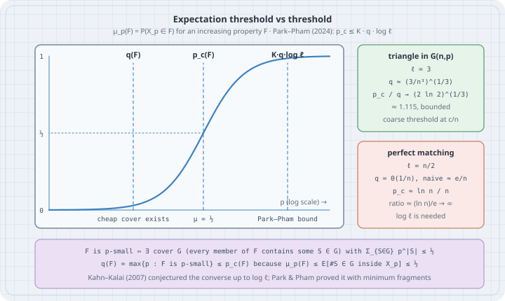

**Thesis:** for almost every "does a random object contain a structure?" question, the honest first guess, *the probability at which you expect to see one copy*, is already within a logarithmic factor of the truth. Kahn and Kalai conjectured this in 2007 while writing that it would "probably be more sensible to conjecture that it is not true." Jinyoung Park and Huy Tuan Pham proved it in 2022 with a short counting argument. This chapter builds the vocabulary (increasing properties, thresholds, covers, the expectation threshold), measures two classical thresholds in random graphs, shows exactly where the logarithm comes from, and then checks the counting step at the heart of the proof by brute force.

Picture the question first. Flip a coin with bias $p$ for every edge of the complete graph on $n$ vertices. For which $p$ does the result contain a triangle? A perfect matching? A Hamilton cycle? A copy of a fixed spanning tree? Each of these properties switches from "almost never" to "almost always" over a narrow range of $p$, and locating that range used to need a separate, often very hard, paper per property.

All listings are complete Python files. They were run with **Python 3.13.5** and **NumPy 2.5.4** on Linux; outputs are pasted unedited. Monte Carlo runs use a fixed seed, so you will get the same numbers.

## 1. Increasing properties and the threshold

Let $X$ be a finite set (the edges of $K_n$, the $k$-subsets of $[n]$, the cells of a grid). For $p\in[0,1]$ let $X_p$ be the random subset that keeps each element independently with probability $p$, so

$$
\mu_p(A)=P(X_p=A)=p^{|A|}(1-p)^{|X\setminus A|}.
$$

A family $\mathcal F\subseteq 2^X$ is an **increasing property** if adding elements never destroys it: $A\in\mathcal F$ and $B\supseteq A$ imply $B\in\mathcal F$. "Contains a triangle", "is connected", "has a perfect matching" are increasing; "is a forest" is not.

For a nontrivial increasing $\mathcal F$ (neither empty nor everything), $\mu_p(\mathcal F)=P(X_p\in\mathcal F)$ is a polynomial in $p$ that increases strictly and continuously from 0 to 1. The **threshold** $p_c(\mathcal F)$ is the unique $p$ with

$$
\mu_{p_c}(\mathcal F)=\tfrac12 .
$$

Bollobás and Thomason (1987) showed that this is always a threshold in the original Erdős–Rényi sense: $\mu_p(\mathcal F)\to 0$ when $p\ll p_c$ and $\to 1$ when $p\gg p_c$. How *wide* the transition window is relative to $p_c$ is a separate question (sharp versus coarse thresholds, Friedgut 1999). This chapter is about *where* $p_c$ is.

Every increasing property is generated by its **minimal elements** $\mathcal H$: $A\in\mathcal F$ exactly when $A$ contains some $S\in\mathcal H$. For "contains a triangle" the minimal elements are the $\binom n3$ triangles; for "has a perfect matching" (even $n$) they are the $(n-1)!!$ perfect matchings. Write

$$
\ell(\mathcal F)=\max\bigl(2,\ \max_{S\in\mathcal H}|S|\bigr).
$$

That is 3 for triangles and $n/2$ for perfect matchings. It will be the only structural parameter in the main theorem.

### Worked example 1 — two thresholds in $G(n,p)$, by simulation

```python
# er_thresholds.py - two Erdős–Rényi thresholds in G(n, p), by Monte Carlo
#   triangles appear at p = c/n           (coarse threshold, Poisson limit)
#   isolated vertices vanish at p = (ln n + c)/n   (sharp threshold, Gumbel limit)
import math
import numpy as np

rng = np.random.default_rng(20261017)
n, trials = 400, 300

def sample_adjacency(n, p):
    upper = np.triu(rng.random((n, n)) < p, k=1)
    return (upper | upper.T).astype(np.float64)

def has_triangle(A):
    return ((A @ A) * A).sum() > 0          # sum of (A^2 ∘ A) = 6 * #triangles

def no_isolated_vertex(A):
    return A.sum(axis=1).min() >= 1

print(f"n = {n}, {trials} graphs per row\n")
print("triangles, p = c/n:   c    simulated   1 - exp(-c^3/6)")
for c in (0.5, 1.0, 1.5, 2.0, 3.0):
    hits = sum(has_triangle(sample_adjacency(n, c / n)) for _ in range(trials))
    print(f"                    {c:3.1f}     {hits / trials:6.3f}        {1 - math.exp(-c**3 / 6):6.3f}")

print("\nno isolated vertex, p = (ln n + c)/n:   c    simulated   exp(-e^-c)")
for c in (-2.0, -1.0, 0.0, 1.0, 2.0):
    p = (math.log(n) + c) / n
    hits = sum(no_isolated_vertex(sample_adjacency(n, p)) for _ in range(trials))
    print(f"                                      {c:4.1f}     {hits / trials:6.3f}      {math.exp(-math.exp(-c)):6.3f}")
```

```bash
python3 er_thresholds.py
```

```text
n = 400, 300 graphs per row

triangles, p = c/n:   c    simulated   1 - exp(-c^3/6)
                    0.5      0.017         0.021
                    1.0      0.117         0.154
                    1.5      0.420         0.430
                    2.0      0.737         0.736
                    3.0      0.990         0.989

no isolated vertex, p = (ln n + c)/n:   c    simulated   exp(-e^-c)
                                      -2.0      0.000       0.001
                                      -1.0      0.073       0.066
                                       0.0      0.343       0.368
                                       1.0      0.740       0.692
                                       2.0      0.863       0.873
```

Both columns on the right are classical limits (Erdős–Rényi 1959–60):

- **Triangles.** The number of triangles has mean $\binom n3 p^3\to c^3/6$ at $p=c/n$ and is asymptotically Poisson, so $P(\text{triangle})\to 1-e^{-c^3/6}$. The transition is **coarse**: $p$ has to change by a constant *factor* to go from 2 % to 99 %.
- **No isolated vertex.** The number of isolated vertices has mean $n(1-p)^{n-1}\to e^{-c}$ at $p=(\ln n+c)/n$, again asymptotically Poisson, so $P(\text{none})\to e^{-e^{-c}}$. The window is $\Theta(1/n)$ around $\ln n/n$, a vanishing *fraction* of $p$: a **sharp** threshold.

The simulation agrees with the limits to within two standard errors (one standard error is $0.02$–$0.03$ for 300 trials). The two largest gaps, triangles at $c=1$ and isolated vertices at $c=1$, are both about $1.8$ standard errors, and part of them is finite-$n$ bias: at $n=400$ the triangle mean is $\binom{400}{3}/400^3=0.9925$ times $c^3/6$, and neither count is exactly Poisson yet. "No isolated vertex" matters here because of a theorem of Erdős and Rényi (1966): for even $n$, $G(n,p)$ has a perfect matching with the same limiting probability $e^{-e^{-c}}$ at $p=(\ln n+c)/n$. Isolated vertices are the bottleneck.

## 2. Mental model: covers, cost, and the expectation threshold

{fig-alt="A plot of mu_p(F) against p on a log scale, an S-shaped curve from 0 to 1. Three dashed vertical lines: q(F), the expectation threshold, where a cheap cover exists; p_c(F), where the curve crosses one half; and K times q times log l, the Park–Pham upper bound. Two side cards: for triangles in G(n,p), l equals 3, q is about (3 over n cubed) to the one third, and p_c over q tends to (2 ln 2) to the one third, about 1.115, bounded; for perfect matchings, l equals n over 2, q is Theta(1/n) with naive estimate e over n, p_c is about ln n over n, and the ratio (ln n)/e tends to infinity, so log l is needed. A footer defines p-small (there is a cover G, every member of F contains some S in G, with sum of p to the |S| at most one half), q(F) as the largest p for which F is p-small, and notes q(F) at most p_c(F) because mu_p(F) is at most the expected number of S in G inside X_p."}

The cheapest way to show that $X_p$ is *unlikely* to have a property is the first-moment method: count the expected number of witnesses and use $P(\text{at least one})\le E[\text{count}]$. The definition that makes this precise (Talagrand's formulation):

- A family $\mathcal G\subseteq 2^X$ is a **cover** of $\mathcal F$ if every $A\in\mathcal F$ contains some $S\in\mathcal G$.
- The **cost** of the cover at $p$ is $\sum_{S\in\mathcal G}p^{|S|}=E\bigl[\#\{S\in\mathcal G : S\subseteq X_p\}\bigr]$.
- $\mathcal F$ is **$p$-small** if it has a cover of cost at most $\tfrac12$.
- The **expectation threshold** is $q(\mathcal F)=\max\{p:\mathcal F \text{ is } p\text{-small}\}$.

The lower bound is three lines. If $\mathcal G$ covers $\mathcal F$ with cost $\le\tfrac12$ at $p$, then by the union bound

$$
\mu_p(\mathcal F)\le \mu_p\bigl(\exists S\in\mathcal G: S\subseteq X_p\bigr)\le\sum_{S\in\mathcal G}p^{|S|}\le\tfrac12,
$$

so $p\le p_c$. Taking the largest such $p$:

$$
q(\mathcal F)\le p_c(\mathcal F).
$$

Two things make covers more interesting than "expected number of copies":

1. **The minimal elements are one cover, not the best one.** Using $\mathcal G=\mathcal H$ gives the naive estimate "expected number of copies $=\tfrac12$". Any cleverer cover can only push $q$ higher.
2. **Covers can be small sets.** A cover of "has a perfect matching" is $\{\{e\}: e\ni v\}$ for a fixed vertex $v$: every perfect matching uses an edge at $v$. Its cost is $(n-1)p$. That only certifies $p$-smallness up to $p\approx\tfrac1{2n}$, worse than the naive cover here, but it shows the idea: a cover is any family of *obstructions you would have to see*.

## 3. Where the logarithm comes from

For triangles the naive cover is essentially optimal and $p_c$ sits a constant factor above it. For perfect matchings, the naive cover says the expected number of perfect matchings is already $\tfrac12$ at $p\approx e/n$ (because $((n-1)!!)^{2/n}\approx n/e$), yet the graph has isolated vertices, and therefore no perfect matching, until $p\approx\ln n/n$. In fact $q=\Theta(1/n)$ for perfect matchings (this is the standard example showing the logarithm in the theorem below cannot be dropped), so the ratio $p_c/q$ really grows like $\log n$. The obstruction is a coupon-collector effect: each of $n$ vertices independently needs one edge, and collecting all $n$ coupons costs a $\log n$ factor that no first-moment count over whole matchings can see.

### Worked example 2 — naive expectation threshold vs threshold, exactly

```python
# expectation_vs_threshold.py - the naive "expected count = 1/2" estimate vs the true threshold
#   triangle in G(n,p):        minimal elements have size 3        -> ratio stays bounded
#   perfect matching in G(n,p): minimal elements have size n/2     -> ratio grows like log n
import math

def p_expect_triangle(n):
    # cover G = all triangles: E[#triangles] = C(n,3) p^3 = 1/2
    return (0.5 / math.comb(n, 3)) ** (1 / 3)

def p_c_triangle(n):
    # #triangles is asymptotically Poisson(C(n,3) p^3): P(no triangle) = 1/2 at mean ln 2
    return (math.log(2) / math.comb(n, 3)) ** (1 / 3)

def p_expect_matching(n):
    # cover G = all perfect matchings: (n-1)!! p^(n/2) = 1/2
    log_double_fact = math.lgamma(n + 1) - (n // 2) * math.log(2) - math.lgamma(n // 2 + 1)
    return math.exp((math.log(0.5) - log_double_fact) / (n // 2))

def p_c_no_isolated(n):
    # P(no isolated vertex) ~ exp(-n (1-p)^(n-1)) = 1/2; a perfect matching needs this,
    # so it is a lower bound on p_c(perfect matching), and asymptotically equal to it
    return 1 - (math.log(2) / n) ** (1 / (n - 1))

print("     n |  triangle: p_c/q_naive |  matching: p_c/q_naive   ln(l), l=n/2   ratio/ln(l)")
for n in (100, 400, 1600, 6400, 25600, 102400):
    rt = p_c_triangle(n) / p_expect_triangle(n)
    rm = p_c_no_isolated(n) / p_expect_matching(n)
    ln_l = math.log(n / 2)
    print(f"{n:6d} |        {rt:6.3f}          |        {rm:6.3f}          {ln_l:6.3f}        {rm / ln_l:6.3f}")
print(f"\n(2 ln 2)^(1/3) = {(2 * math.log(2)) ** (1 / 3):.3f};  n * q_naive(matching) at n=102400: "
      f"{102400 * p_expect_matching(102400):.4f}  (e = {math.e:.4f})")
```

```bash
python3 expectation_vs_threshold.py
```

```text
     n |  triangle: p_c/q_naive |  matching: p_c/q_naive   ln(l), l=n/2   ratio/ln(l)
   100 |         1.115          |         1.840           3.912         0.470
   400 |         1.115          |         2.338           5.298         0.441
  1600 |         1.115          |         2.848           6.685         0.426
  6400 |         1.115          |         3.358           8.071         0.416
 25600 |         1.115          |         3.869           9.457         0.409
102400 |         1.115          |         4.379          10.843         0.404

(2 ln 2)^(1/3) = 1.115;  n * q_naive(matching) at n=102400: 2.7182  (e = 2.7183)
```

Read the two ratio columns:

- **Triangles ($\ell=3$).** $p_c/q_{\text{naive}}$ is $(2\ln 2)^{1/3}\approx 1.115$ for every $n$: the threshold is where the Poisson mean is $\ln 2$, the naive estimate is where the mean is $\tfrac12$.
- **Perfect matchings ($\ell=n/2$).** The ratio grows without bound, and dividing by $\ln\ell$ gives a column that settles slowly towards $1/e\approx 0.368$ (since $p_c\approx\ln n/n$ and $q_{\text{naive}}\approx e/n$). The last line confirms $n\,q_{\text{naive}}\to e$.

Here $q_{\text{naive}}$ uses the cover by minimal elements, so it is a **lower** bound on $q$. The matching column uses $p_c(\text{no isolated vertex})$, which is a **lower** bound on $p_c(\text{perfect matching})$ for every $n$ (a perfect matching has no isolated vertex) and is asymptotically equal to it. So the growth of the ratio is real, not an artefact of the estimates.

## 4. The theorem

**Theorem (Kahn–Kalai conjecture; Park–Pham 2022, J. Amer. Math. Soc. 2024).** There is a universal constant $K$ such that for every finite set $X$ and every nontrivial increasing property $\mathcal F\subseteq 2^X$,

$$
q(\mathcal F)\ \le\ p_c(\mathcal F)\ \le\ K\,q(\mathcal F)\,\log\ell(\mathcal F).
$$

The lower bound is the three-line union bound above. The upper bound says the union bound is never fooled by more than a logarithm of the size of the witnesses, *for every property at once*. Section 3 shows the $\log\ell$ cannot be removed.

Why this was a big deal:

- **It replaces case-by-case papers.** Thresholds that took long dedicated work become corollaries: perfect matchings in random $r$-uniform hypergraphs (Johansson–Kahn–Vu, 2008, "Shamir's problem"), a fixed bounded-degree spanning tree in $G(n,p)$ at $\Theta(\log n/n)$ (Montgomery, 2019, who proved a stronger universal version), powers of Hamilton cycles, and more. In each case you compute $q$ (usually a first-moment count) and multiply by $\log\ell$.
- **It went through a fractional version first.** Talagrand proposed replacing covers by fractional covers (weights $\lambda_S\ge0$ with $\sum_{S\subseteq F}\lambda_S\ge1$ for all $F\in\mathcal F$), giving $q\le q_f\le p_c$. Frankston, Kahn, Narayanan and Park (Annals of Math., 2021) proved $p_c\le K q_f\log\ell$ by adapting the Alweiss–Lovett–Wu–Zhang sunflower argument, which relies on "spread" measures and LP duality. Park and Pham's proof of the integral version avoids spread entirely.
- **The constant is not explicit.** $K$ is "large enough"; nobody uses this theorem to compute $p_c$ to two digits.

## 5. Proof idea: minimum fragments

Work with the minimal elements $\mathcal H$ (an $\ell$-bounded hypergraph on $X$, $|X|=n$) and assume $\mathcal H$ is **not** $p$-small: every cover costs more than $\tfrac12$. The goal (their Theorem 1.4) is to show that a uniformly random set $W$ of about $(Lp\log\ell)\,n$ elements contains some $S\in\mathcal H$ with probability $1-o(1)$. From that, $p_c\le K q\log\ell$ follows by a concentration step.

Pick $W$ of size $w=Lpn$. For $S\in\mathcal H$, a **minimum $(S,W)$-fragment** is a smallest set of the form

$$
T(S,W)=S'\setminus W,\qquad S'\in\mathcal H,\ S'\subseteq W\cup S .
$$

It is what is still missing from *some* witness once $W$ has been placed, choosing the witness that is cheapest to finish. Note $T\subseteq S$, and $T=\varnothing$ means $W$ already contains a witness.

One round splits $\mathcal H$:

- If the fragment is still **large** ($|T|\ge 0.9\ell$), $W$ did not help $S$ much. Put $T$ into a cover $\mathcal U(W)$.
- If it is **small**, keep $T$ as an edge of a new hypergraph $\mathcal H'$, which is $0.9\ell$-bounded. Covering $\mathcal H'$ later also covers these $S$.

**Key lemma.** Over a uniform $w$-set $W$, the expected cost of the large-fragment cover is tiny:

$$
E\Bigl[\sum_{U\in\mathcal U(W)}p^{|U|}\Bigr] < L^{-0.8\ell}.
$$

**The counting.** Fix $m\ge0.9\ell$ and count pairs $(W,T)$ with $|T|=m$:

1. Let $Z=W\cup T$, a set of size $w+m$. There are $\binom n{w+m}\le\binom nw(Lp)^{-m}$ choices.
2. $Z$ contains a witness, so fix one, $\hat S\subseteq Z$, as a function of $Z$ alone. **Minimality forces $T\subseteq\hat S$**: $\hat S\subseteq W\cup T\subseteq W\cup S$, so $\hat S\setminus W$ is itself a candidate fragment for $(S,W)$, and $\hat S\setminus W\subseteq T$. If $T\not\subseteq\hat S$ that inclusion is strict, so $\hat S\setminus W$ is smaller than $T$, contradicting minimality.
3. So $T$ is a subset of the fixed $\hat S$: at most $2^\ell$ choices. $(Z,T)$ determines $W=Z\setminus T$.

Each pair contributes $p^m$, so the total over all $W$ is at most $\binom nw (Lp)^{-m}2^\ell p^m=\binom nw L^{-m}2^\ell$. Dividing by $\binom nw$ and summing over $m\ge 0.9\ell$ gives the lemma for large $L$.

**Iteration.** Repeat on $\mathcal H'$ with a fresh random $W_2$, then $W_3$, …. The edge sizes shrink by $0.9$ each round, so after about $\log_{1/0.9}\ell$ rounds one of two things has happened. Either the covers $\mathcal U_1\cup\dots\cup\mathcal U_\gamma$ together cover $\mathcal H$, or the fragments have shrunk to $\varnothing$ and $W_1\cup\dots\cup W_\gamma$ contains a witness. Because $\mathcal H$ is not $p$-small, the first case forces the total cost above $\tfrac12$; by Markov's inequality that has probability at most $2\,E[\text{cost}]$, which the key lemma makes small. So the second case is the likely one. The union of the $W_i$ has $O(Lpn\log\ell)$ elements (the paper enlarges the last few rounds by a $\sqrt{\log\ell}$ factor to make the failure probability tend to 0). **That is where $\log\ell$ comes from: the number of rounds.**

### Worked example 3 — checking the counting step by brute force

On a small instance we can enumerate every $W$, compute every minimum fragment, and test step 2 and the multiplicity bound in step 3 directly. Take $X$ = the 15 edges of $K_6$ and $\mathcal H$ = its 15 perfect matchings ($\ell=3$).

```python
# fragments.py - exhaustive check of the counting step in Park–Pham's key lemma
# X = the 15 edges of K_6, H = its 15 perfect matchings (each a 3-edge set, l = 3).
# For every w-subset W of X and every S in H, compute a minimum (S, W)-fragment
#   T(S, W) = smallest S' \ W over S' in H with S' ⊆ W ∪ S.
# The proof encodes the pair (W, T) by Z = W ∪ T plus T as a subset of one fixed
# edge Ŝ ⊆ Z, so #pairs with |T| = m is at most C(n, w + m) * 2^l. Check it.
import itertools, math

V = range(6)
X = list(itertools.combinations(V, 2))                     # 15 edges
idx = {e: i for i, e in enumerate(X)}

def perfect_matchings(vs):
    if not vs:
        yield frozenset()
        return
    a, rest = vs[0], vs[1:]
    for b in rest:
        for m in perfect_matchings([v for v in rest if v != b]):
            yield m | {idx[(a, b)]}

H = list(perfect_matchings(list(V)))
n, l = len(X), max(len(S) for S in H)
print(f"|X| = {n} edges, |H| = {len(H)} perfect matchings, l = {l}")

def min_fragment(S, W):
    return min((Sp - W for Sp in H if Sp <= W | S), key=len)   # ties: first found

for w in (2, 4, 6):
    pairs, violations = {}, 0
    for W in map(frozenset, itertools.combinations(range(n), w)):
        for S in H:
            T = min_fragment(S, W)
            Z = W | T
            S_hat = next(Sp for Sp in H if Sp <= Z)            # a fixed choice given Z
            violations += not T <= S_hat                       # (16): T ⊆ Ŝ must hold
            pairs.setdefault(len(T), set()).add((W, T))
    print(f"\nw = {w}:  T ⊆ Ŝ violations = {violations}")
    print("  m   pairs (W,T)   distinct Z   max T per Z (<= 2^l)   bound C(n,w+m)*2^l")
    for m in sorted(pairs):
        per_Z = {}
        for W, T in pairs[m]:
            per_Z.setdefault(W | T, set()).add(T)               # (W, T) is fixed by (Z, T)
        worst = max(len(ts) for ts in per_Z.values())
        print(f"  {m}   {len(pairs[m]):11d}   {len(per_Z):10d}   {worst:20d}   {math.comb(n, w + m) * 2**l:18d}")
```

```bash
python3 fragments.py
```

```text
|X| = 15 edges, |H| = 15 perfect matchings, l = 3

w = 2:  T ⊆ Ŝ violations = 0
  m   pairs (W,T)   distinct Z   max T per Z (<= 2^l)   bound C(n,w+m)*2^l
  1            45           15                      3                 3640
  2           540          180                      3                10920
  3           900          900                      1                24024

w = 4:  T ⊆ Ŝ violations = 0
  m   pairs (W,T)   distinct Z   max T per Z (<= 2^l)   bound C(n,w+m)*2^l
  0           180          180                      1                10920
  1          2745          945                      3                24024
  2          6840         2280                      3                40040
  3          2880         2880                      1                51480

w = 6:  T ⊆ Ŝ violations = 0
  m   pairs (W,T)   distinct Z   max T per Z (<= 2^l)   bound C(n,w+m)*2^l
  0          2790         2790                      1                40040
  1         10275         4515                      3                51480
  2          4860         1620                      3                51480
  3           360          360                      1                40040
```

What it shows:

- **$T\subseteq\hat S$ never fails** (0 violations over every $W$ and every $S$, for three sizes of $W$). That is the one non-obvious step of the proof.
- **"max T per Z" is at most 3**, inside the $2^\ell=8$ the proof allows: for a fixed $Z$, $T$ is an $m$-subset of the 3-edge set $\hat S$, so there are at most $\binom3m\le3$ choices. The number of pairs is therefore at most (distinct $Z$) × 3, and far below $\binom n{w+m}2^\ell$.
- Pairs with $m=0$ appear once $w\ge4$: some $W$ already contain a perfect matching.

On a 15-element ground set the lemma's conclusion is vacuous (it needs $L$ large and $\ell\to\infty$). The listing checks the *mechanism*, not the constants.

## 6. The trap

**Trap: "the expectation threshold is where the expected number of copies is $\tfrac12$."** That is only the cover by minimal elements, a lower bound on $q$. The definition takes the best cover. For many properties they coincide up to constants, which is why the naive estimate works so often. But the true $p_c$ is governed by the cheapest *obstruction*, and for perfect matchings that obstruction (an isolated vertex) is local and invisible to a count of whole matchings.

**Trap: "the theorem locates thresholds."** It locates them up to a factor $K\log\ell$, with $K$ unspecified. For triangles that is a constant; for spanning structures it is a $\log n$ window. Finding the exact constant (Erdős–Rényi's $\ln n/n$ for perfect matchings) still needs property-specific work.

**Trap: "threshold" means two different things.** $p_c$ is the exact point where the probability is $\tfrac12$. The Erdős–Rényi notion "threshold function" is only defined up to constant factors, and says nothing about how sharp the transition is. Coarse (triangles) and sharp (isolated vertices) thresholds both satisfy the theorem.

**Trap: applying it to non-monotone properties.** "Has exactly one triangle" or "is a forest" are not increasing; $\mu_p$ need not even be monotone in $p$.

## 7. The boring rule

To guess where a random structure appears, compute the expected number of minimal witnesses, then ask what the cheapest local obstruction is (an isolated vertex, an uncovered element). The threshold lies between the first-moment estimate and $\log\ell$ times it. If the two estimates disagree by more than that, one of them is wrong.

## 8. Pitfalls

1. Confusing $q$ (best cover) with the naive count (cover by minimal elements).
2. Forgetting that $\ell$ is the size of the *largest minimal* witness, not $|X|$.
3. Treating $p_c$ as the place where the expected count equals 1. For a Poisson count it is where the mean is $\ln 2$.
4. Reading a Monte Carlo transition at small $n$ as the asymptotic one; finite-$n$ corrections are visible already at $n=400$.
5. Assuming a sharp threshold because the theorem holds; sharpness is a separate theory (Friedgut, Bourgain).

## 9. Checkpoint

- Define an increasing property, $\mu_p$, $p_c$, a cover, $p$-small, and $q(\mathcal F)$.
- Prove $q\le p_c$ with the union bound.
- Compute $q_{\text{naive}}$ for triangles and perfect matchings in $G(n,p)$.
- Explain why perfect matchings need the $\log\ell$ factor.
- State the minimum-fragment definition and the inclusion $T\subseteq\hat S$.

## Exercises (try this)

1. Change `er_thresholds.py` to test connectivity instead of "no isolated vertex" (BFS from vertex 0). The limiting probability is the same $e^{-e^{-c}}$. Why?
2. Compute $q_{\text{naive}}$ and $p_c$ (Poisson heuristic) for "contains a $K_4$" in $G(n,p)$. Check that the ratio is bounded.
3. For "contains a Hamilton cycle", the minimal elements number $(n-1)!/2$. Show $q_{\text{naive}}\approx e/n$ and compare with the known threshold $(\ln n+\ln\ln n)/n$.
4. In `fragments.py`, replace perfect matchings by the 20 triangles of $K_6$ ($\ell=3$) and by the 60 Hamilton cycles of $K_6$ ($\ell=6$). Does $T\subseteq\hat S$ still always hold? (It must: the argument used nothing about matchings.)
5. Prove $q\le q_f\le p_c$ for the fractional expectation threshold, using linearity of expectation in place of the union bound.
6. Show the cover $\{\{e\}:e\ni v\}$ certifies that "has a perfect matching" is $p$-small for $p\le\frac1{2(n-1)}$, and explain why a union of such stars over many vertices does **not** give a better cover.

## Summary

An increasing property on a $p$-random set has a threshold $p_c$. The union bound over any cover gives a lower bound, and the best such bound is the expectation threshold $q$. Park and Pham proved that $p_c$ is never more than $K\log\ell$ times $q$, where $\ell$ is the size of the largest minimal witness. The logarithm is necessary: perfect matchings in $G(n,p)$ have $q=\Theta(1/n)$ and $p_c\sim\ln n/n$, because isolated vertices are a coupon-collector obstruction. The proof is a randomised peeling: add random elements in $\approx\log\ell$ rounds, track minimum fragments of what is still missing, and count pairs $(W,T)$ through $Z=W\cup T$ and $T\subseteq\hat S$ to show that a cheap cover would otherwise appear, which the hypothesis forbids.

## Sources (for further reading)

- J. Park, H. T. Pham, "A proof of the Kahn–Kalai conjecture", *J. Amer. Math. Soc.* 37 (2024), 235–243, <https://doi.org/10.1090/jams/1028>; arXiv:2203.17207, <https://arxiv.org/abs/2203.17207> (definitions, Theorem 1.1, Theorem 1.4, Lemma 2.1, and the iteration in §2.2 follow this paper).
- J. Kahn, G. Kalai, "Thresholds and expectation thresholds", *Combin. Probab. Comput.* 16 (2007), 495–502.
- K. Frankston, J. Kahn, B. Narayanan, J. Park, "Thresholds versus fractional expectation-thresholds", *Ann. of Math.* 194 (2021), 475–495.
- R. Alweiss, S. Lovett, K. Wu, J. Zhang, "Improved bounds for the sunflower lemma", *Ann. of Math.* 194 (2021), 795–815.
- M. Talagrand, "Are many small sets explicitly small?", *STOC 2010*, 13–35.
- B. Bollobás, A. Thomason, "Threshold functions", *Combinatorica* 7 (1987), 35–38.
- P. Erdős, A. Rényi, "On random graphs I" (1959); "On the evolution of random graphs" (1960); "On the existence of a factor of degree one of a connected random graph" (1966).
- E. Friedgut, "Sharp thresholds of graph properties, and the k-SAT problem", *J. Amer. Math. Soc.* 12 (1999), 1017–1054.
- A. Johansson, J. Kahn, V. Vu, "Factors in random graphs", *Random Structures Algorithms* 33 (2008), 1–28; R. Montgomery, "Spanning trees in random graphs", *Adv. Math.* 356 (2019).
- B. Bollobás, *Random Graphs*, 2nd ed., Cambridge University Press, 2001; S. Janson, T. Łuczak, A. Ruciński, *Random Graphs*, Wiley, 2000.
